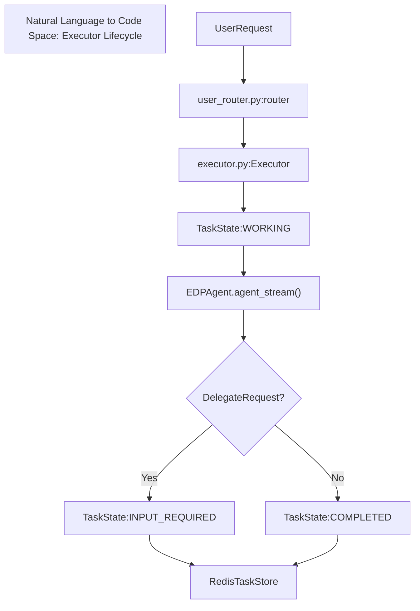
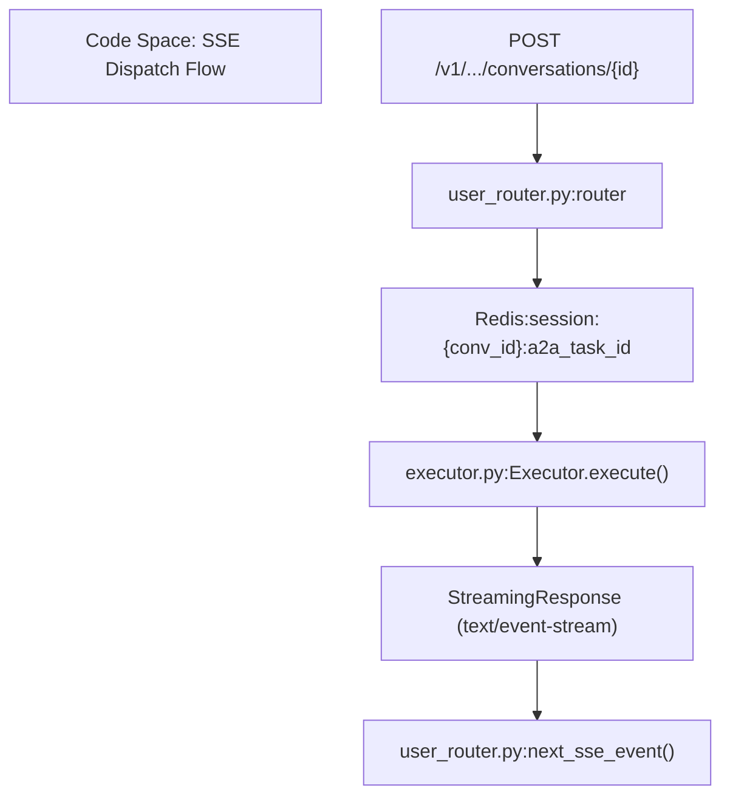

<!-- source: DeepWiki mcp.deepwiki.com · repo openJiuwen-ai/agent-runtime · page 5.3 A2A Orchestration Service · fetched 2026-11-02 -->

# A2A Orchestration Service

Relevant source files

The following files were used as context for generating this wiki page:

- [.gitignore](.gitignore)
- [applications/a2a_service/.env.example](applications/a2a_service/.env.example)
- [applications/a2a_service/agents/__init__.py](applications/a2a_service/agents/__init__.py)
- [applications/a2a_service/app.py](applications/a2a_service/app.py)
- [applications/a2a_service/common/constants.py](applications/a2a_service/common/constants.py)
- [applications/a2a_service/common/crypto.py](applications/a2a_service/common/crypto.py)
- [applications/a2a_service/common/events.py](applications/a2a_service/common/events.py)
- [applications/a2a_service/common/logger.py](applications/a2a_service/common/logger.py)
- [applications/a2a_service/common/redis_client.py](applications/a2a_service/common/redis_client.py)
- [applications/a2a_service/common/redis_task_store.py](applications/a2a_service/common/redis_task_store.py)
- [applications/a2a_service/common/response_wrapper.py](applications/a2a_service/common/response_wrapper.py)
- [applications/a2a_service/config.py](applications/a2a_service/config.py)
- [applications/a2a_service/orchestrator/agent_adapter.py](applications/a2a_service/orchestrator/agent_adapter.py)
- [applications/a2a_service/orchestrator/executor.py](applications/a2a_service/orchestrator/executor.py)
- [applications/a2a_service/orchestrator/sse_helpers.py](applications/a2a_service/orchestrator/sse_helpers.py)
- [applications/a2a_service/orchestrator/user_router.py](applications/a2a_service/orchestrator/user_router.py)
- [applications/a2a_service/tests/integration/test_capture_replay.py](applications/a2a_service/tests/integration/test_capture_replay.py)
- [applications/a2a_service/tools/simulate_router/index.html](applications/a2a_service/tools/simulate_router/index.html)
- [applications/versatile_adapter/app.py](applications/versatile_adapter/app.py)
- [applications/versatile_adapter/tests/__init__.py](applications/versatile_adapter/tests/__init__.py)
- [applications/versatile_adapter/tests/test_executor.py](applications/versatile_adapter/tests/test_executor.py)

The A2A Orchestration Service (`applications/a2a_service`) serves as the core orchestration and execution engine within the openJiuwen Agent Runtime. It exposes north-facing custom Versatile API endpoints as well as standard A2A JSON-RPC endpoints, coordinating dynamic planning agents (`EDPAgent`), managing session state via Redis, and routing cross-agent task delegations through the Versatile Adapter.

---

## 1. Executor & State Lifecycle

The `Executor` class implements the `AgentExecutor` interface defined by the A2A SDK [applications/a2a_service/orchestrator/executor.py:29-221](). It drives the multi-round reasoning loop of the `EDPAgent` [applications/a2a_service/orchestrator/executor.py:61](), handles delegation requests (`DelegateRequest`), and coordinates task states via `RedisTaskStore` [applications/a2a_service/orchestrator/executor.py:13-16]().

### State Machine Transitions
Tasks transition through standard states managed in Redis:
- `WORKING`: Initial state when a user query is received and processed [applications/a2a_service/orchestrator/executor.py:13-16]().
- `INPUT_REQUIRED`: Triggered when an execution round yields a `DelegateRequest` without a terminating node in the downstream Versatile Adapter [applications/a2a_service/orchestrator/executor.py:13-16]().
- `COMPLETED` / `FAILED`: Final states indicating successful generation of a final answer or unrecoverable error [applications/a2a_service/orchestrator/executor.py:49-53]().

Sources: `applications/a2a_service/orchestrator/executor.py:13-61`, `applications/a2a_service/orchestrator/user_router.py:23-27`

---

## 2. User Router & SSE Dispatch

The user router (`applications/a2a_service/orchestrator/user_router.py`) exposes HTTP endpoints conforming to the Versatile platform specification [applications/a2a_service/orchestrator/user_router.py:5-8](). 

### Endpoint & Streaming
- **Route**: `POST /v1/{project_id}/agents/{agent_id}/conversations/{conversation_id}` [applications/a2a_service/orchestrator/user_router.py:8]()
- **Streaming Mode (`stream=true`)**: Dispatches Server-Sent Events (SSE) using `StreamingResponse`, streaming JSON-encoded A2A event frames followed by `[DONE]` [applications/a2a_service/orchestrator/user_router.py:20-21]().
- **Task Binding**: Lookups or initializes conversation task identifiers in Redis using the session key format `session:{conv_id}:a2a_task_id` [applications/a2a_service/orchestrator/user_router.py:23-24]().

Sources: `applications/a2a_service/orchestrator/user_router.py:8-27`, `applications/a2a_service/orchestrator/user_router.py:50-74`

---

## 3. Rate Limiting & Atomic Lua Scripting

To protect downstream LLM providers and agent resources from traffic spikes, the orchestration service implements a sliding window rate limiter backed by Redis atomic Lua execution [applications/a2a_service/orchestrator/user_router.py:87-152]().

### Mechanism
- Evaluates both **session-level** and **global-level** rate limits atomically [applications/a2a_service/orchestrator/user_router.py:87-152]().
- Cleans up expired sliding window records using `ZREMRANGEBYSCORE` [applications/a2a_service/orchestrator/user_router.py:115]().
- Returns structured error responses with code `100001` and message `系统超负载，请在稍后重试` when thresholds are breached [applications/a2a_service/orchestrator/user_router.py:79-80]().

Sources: `applications/a2a_service/orchestrator/user_router.py:87-152`, `applications/a2a_service/config.py:41-48`

---

## 4. Redis Task Store & Bootstrap Coordination

State persistence across requests is handled by `RedisTaskStore`, allowing multi-worker and multi-instance deployments to safely share conversation states and task timelines [applications/a2a_service/app.py:10-13]().

### Bootstrap Coordination
When running in clustered environments, concurrent worker startup can cause race conditions. The service uses Redis distributed locks and status coordination keys [applications/a2a_service/app.py:180-194]():
- Lock Key: `a2a:bootstrap:lock:{lock_name}` [applications/a2a_service/app.py:180-181]()
- Status Key: `a2a:bootstrap:status:{lock_name}` [applications/a2a_service/app.py:184-185]()
- Configuration parameters such as `BOOTSTRAP_LOCK_TTL_SEC` and `BOOTSTRAP_WAIT_TIMEOUT_SEC` control lock acquisition and retry polling intervals [applications/a2a_service/.env.example:18-24]().

Sources: `applications/a2a_service/app.py:35-41`, `applications/a2a_service/app.py:180-194`, `applications/a2a_service/.env.example:10-24`

---

## 5. Tests & Capture-Replay Alignment

The test suite validates integration behavior and exact payload alignment against recorded production fixtures [applications/a2a_service/tests/integration/test_capture_replay.py:4-19]().

### Test Architecture
- **Capture Replay Testing**: Reads key-frame traces from `buy_wealth_round1_key_frames.jsonl` to ensure that generated event structures, orderings, and error conditions match real production captures while ignoring volatile timestamps like `createdTime` [applications/a2a_service/tests/integration/test_capture_replay.py:7-19]().
- **Event Mapping**: Validates conversion routines between internal `AgentEvent` objects and A2A protobuf definitions [applications/a2a_service/orchestrator/agent_adapter.py:5-18]().

Sources: `applications/a2a_service/tests/integration/test_capture_replay.py:1-93`, `applications/a2a_service/orchestrator/agent_adapter.py:5-18`

---

