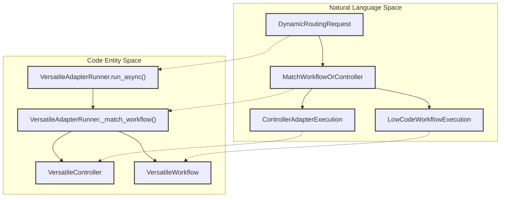
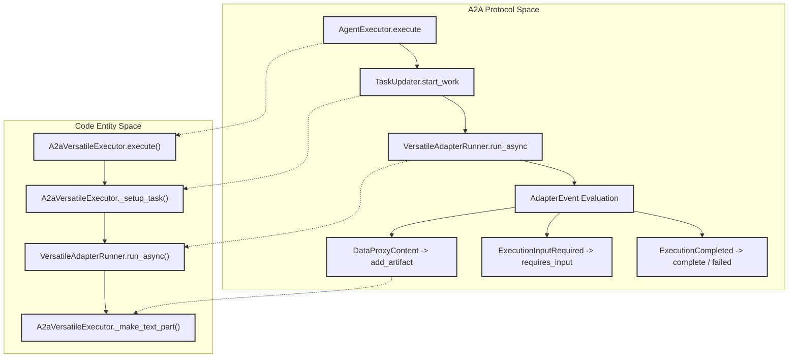

<!-- source: DeepWiki mcp.deepwiki.com · repo openJiuwen-ai/agent-runtime · page 5.4 Versatile Adapter · fetched 2026-11-02 -->

# Versatile Adapter

<details>
<summary>Relevant source files</summary>

The following files were used as context for generating this wiki page:

- [applications/versatile_adapter/.env.example](applications/versatile_adapter/.env.example)
- [applications/versatile_adapter/a2a_facade/executor.py](applications/versatile_adapter/a2a_facade/executor.py)
- [applications/versatile_adapter/adapters/versatile_controller.py](applications/versatile_adapter/adapters/versatile_controller.py)
- [applications/versatile_adapter/adapters/versatile_proxy.py](applications/versatile_adapter/adapters/versatile_proxy.py)
- [applications/versatile_adapter/adapters/versatile_workflow.py](applications/versatile_adapter/adapters/versatile_workflow.py)
- [applications/versatile_adapter/config.py](applications/versatile_adapter/config.py)
- [applications/versatile_adapter/dispatcher/runner.py](applications/versatile_adapter/dispatcher/runner.py)
- [applications/versatile_adapter/event/events.py](applications/versatile_adapter/event/events.py)
- [applications/versatile_adapter/persistence/redis_task_store.py](applications/versatile_adapter/persistence/redis_task_store.py)
- [applications/versatile_adapter/pyproject.toml](applications/versatile_adapter/pyproject.toml)
- [applications/versatile_adapter/tests/conftest.py](applications/versatile_adapter/tests/conftest.py)
- [applications/versatile_adapter/tests/test_events_and_card.py](applications/versatile_adapter/tests/test_events_and_card.py)
- [applications/versatile_adapter/tests/test_runner_routing.py](applications/versatile_adapter/tests/test_runner_routing.py)
- [applications/versatile_adapter/tests/test_runner_stream.py](applications/versatile_adapter/tests/test_runner_stream.py)
- [applications/versatile_adapter/versatile_proxy.yaml.example](applications/versatile_adapter/versatile_proxy.yaml.example)

</details>


The Versatile Adapter (`applications/versatile_adapter/`) provides a config-driven routing subsystem, HTTP/Server-Sent Events (SSE) proxy streaming engine, protocol adapters for controllers and low-code workflows, a standardized event model, and an Agent-to-Agent (A2A) execution facade.

Sources: `[applications/versatile_adapter/dispatcher/runner.py:1-176]()`

---

## 1. Config-Driven Adapter Routing (`VersatileAdapterRunner`)

The routing layer resolves configuration from explicit paths, environment variables (`VERSATILE_PROXY_CONFIG_PATH`), deployment defaults (`/etc/edpagent/config/versatile_proxy.yaml`), or local fallbacks (`versatile_proxy.yaml`) [applications/versatile_adapter/dispatcher/runner.py:27-43](). 

`VersatileAdapterRunner` parses YAML files containing `workflow_defaults` and an `adapters` list [applications/versatile_adapter/dispatcher/runner.py:96-107](). Depending on the runtime target parameters (`workflow_id` or `intent`), it dynamically instantiates either `VersatileWorkflow` or `VersatileController` [applications/versatile_adapter/dispatcher/runner.py:131-161]().


*Figure 1: Conceptual mapping from natural language routing concepts to `VersatileAdapterRunner` and adapter classes.*

Sources: `[applications/versatile_adapter/dispatcher/runner.py:27-176](), [applications/versatile_adapter/versatile_proxy.yaml.example:1-82]()`

---

## 2. SSE Proxy Core (`VersatileProxy`)

`VersatileProxy` implements the foundational HTTP/SSE streaming client using `httpx` [applications/versatile_adapter/adapters/versatile_proxy.py:37-47](). It establishes an asynchronous POST request with keep-alive limits and handles line-by-line SSE parsing [applications/versatile_adapter/adapters/versatile_proxy.py:101-148]().

Key mechanisms within `VersatileProxy`:
- **URL & Header Construction**: Formats URL templates using conversation and workflow IDs (`_build_url`), and filters incoming headers against a whitelist (`_build_headers`) [applications/versatile_adapter/adapters/versatile_proxy.py:63-75]().
- **Stream Context (`VersatileStreamCtx`)**: Maintains mutable state across chunk processing, tracking completion flags, failures, execution results, and error messages [applications/versatile_adapter/adapters/versatile_proxy.py:25-35]().
- **Request Inspection**: Automatically generates and logs equivalent `curl` commands for debugging (`_log_request`) [applications/versatile_adapter/adapters/versatile_proxy.py:149-162]().

```mermaid
sequenceDiagram
    participant Client as "Client"
    participant Proxy as "VersatileProxy.dispatch_stream"
    participant HTTP as "httpx.AsyncClient"
    participant Target as "UpstreamService"

    Client->>Proxy: "run_async(target, headers, params, body)"
    Proxy->>HTTP: "build_request('POST', url)"
    HTTP->>Target: "Stream POST request"
    Target-->>HTTP: "SSE Response Stream"
    loop Aiter Lines
        HTTP-->>Proxy: "response.aiter_lines()"
        Proxy->>Proxy: "_process_line(line, ctx)"
        Proxy-->>Client: "yield AdapterEvent"
    end
    Proxy->>Proxy: "_on_stream_end(ctx)"
    Proxy-->>Client: "yield final AdapterEvent"

    classDef default stroke:#333,stroke-width:2px;
```
*Figure 2: SSE streaming execution flow inside `VersatileProxy`.*

Sources: `[applications/versatile_adapter/adapters/versatile_proxy.py:25-162]()`

---

## 3. Protocol Adapters (`VersatileController` & `VersatileWorkflow`)

Two concrete adapter implementations inherit from `VersatileProxy` to handle specific upstream payload formats and lifecycle events:

- **`VersatileController`**: Customizes parsing for primary agent controllers. It detects `"End"` node types and `"exception"` events in chunks, and extracts result text when a designated `workflow_result_node` (e.g., `GXZQAResponseNode`) is encountered [applications/versatile_adapter/adapters/versatile_controller.py:34-90]().
- **`VersatileWorkflow`**: Designed for low-code workflows. It handles URL parameter formatting for workflow IDs, skips control frames (`finish`, `runCompleted`, `dialogId`), and yields accumulated events upon stream completion [applications/versatile_adapter/adapters/versatile_workflow.py:28-90]().

Sources: `[applications/versatile_adapter/adapters/versatile_controller.py:34-90](), [applications/versatile_adapter/adapters/versatile_workflow.py:28-90]()`

---

## 4. Standardized Event Model (`AdapterEvent`)

To decouple upstream streaming variations from downstream consumers, the adapter outputs a standardized discriminated union model called `AdapterEvent` [applications/versatile_adapter/event/events.py:5-12](). 

| Event Content Class | Description | Fields |
| :--- | :--- | :--- |
| `DataProxyContent` | Raw frame data passed through unmodified. | `raw_data: str` (frozen) [applications/versatile_adapter/event/events.py:20-22]() |
| `ExecutionInputRequiredContent` | Non-terminal signal indicating user input is needed to proceed. | None (frozen) [applications/versatile_adapter/event/events.py:25-27]() |
| `ExecutionCompletedContent` | Terminal signal carrying workflow results or error details. | `is_failed: bool`, `result: str`, `error_message: str` (frozen) [applications/versatile_adapter/event/events.py:30-35]() |

`AdapterEvent` guarantees that only one content field is populated at any given time [applications/versatile_adapter/event/events.py:37-50]().

Sources: `[applications/versatile_adapter/event/events.py:1-50]()`

---

## 5. A2A Facade & Execution (`A2aVersatileExecutor`)

`A2aVersatileExecutor` integrates the adapter runner with the A2A server protocol framework (`a2a.server.agent_execution.AgentExecutor`) [applications/versatile_adapter/a2a_facade/executor.py:20-43]().


*Figure 3: Mapping A2A execution lifecycle methods to `A2aVersatileExecutor` implementation.*

Sources: `[applications/versatile_adapter/a2a_facade/executor.py:43-165]()`

---

## 6. Task Store & Configuration

Session state and persistence are managed via `RedisTaskStore` (`applications/versatile_adapter/persistence/redis_task_store.py`), utilizing Redis connection settings defined in configuration files and environment templates [applications/versatile_adapter/.env.example:43-49]() (`REDIS_HOST`, `REDIS_PORT`, `REDIS_DB`, `REDIS_SESSION_TTL`).

Sources: `[applications/versatile_adapter/.env.example:43-49]()`

---

## 7. Testing & Validation Suite

The adapter subsystem includes comprehensive pytest test suites:
- **`test_runner_routing.py`**: Validates YAML configuration loading, fallback behaviors, workflow defaults inheritance, and adapter matching priorities [applications/versatile_adapter/tests/test_runner_routing.py:5-185]().
- **`test_runner_stream.py`**: Performs end-to-end stream testing with mocked `httpx` clients, verifying controller flows, workflow result node extraction, and exception propagation [applications/versatile_adapter/tests/test_runner_stream.py:6-196]().
- **`test_events_and_card.py`**: Validates `AdapterEvent` discriminated union semantics and A2A `AgentCard` metadata [applications/versatile_adapter/tests/test_events_and_card.py:2-90]().

Sources: `[applications/versatile_adapter/tests/test_runner_routing.py:1-185](), [applications/versatile_adapter/tests/test_runner_stream.py:1-196](), [applications/versatile_adapter/tests/test_events_and_card.py:1-90]()`

---

