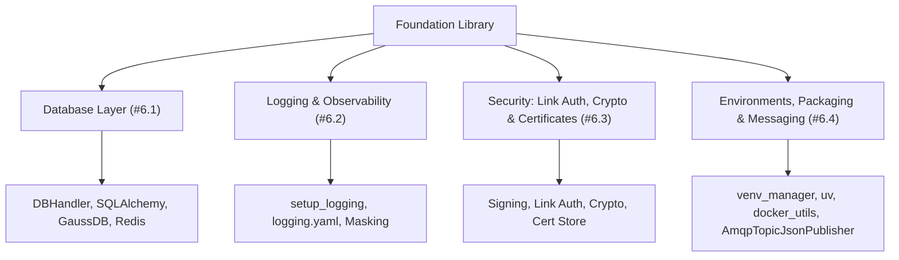
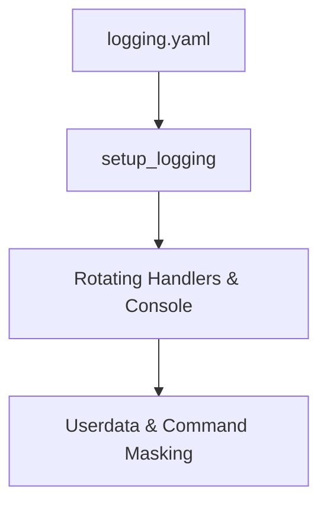
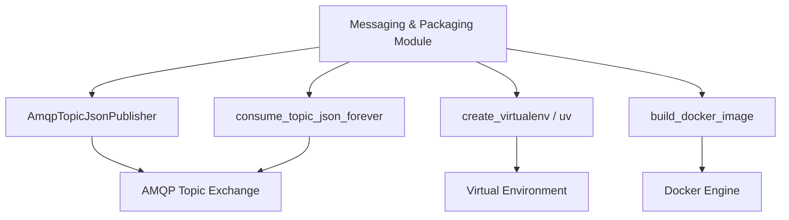

<!-- source: DeepWiki mcp.deepwiki.com · repo openJiuwen-ai/agent-runtime · page 6 Foundation Library · fetched 2026-11-02 -->

# Foundation Library

Relevant source files

The following files were used as context for generating this wiki page:

- [foundation/openjiuwen_runtime/foundation/__init__.py](foundation/openjiuwen_runtime/foundation/__init__.py)
- [foundation/openjiuwen_runtime/foundation/messaging/__init__.py](foundation/openjiuwen_runtime/foundation/messaging/__init__.py)
- [foundation/openjiuwen_runtime/foundation/messaging/amqp_json.py](foundation/openjiuwen_runtime/foundation/messaging/amqp_json.py)
- [foundation/pyproject.toml](foundation/pyproject.toml)

The Foundation Library (`openjiuwen_runtime.foundation`) serves as the shared infrastructure utility layer for the openJiuwen Agent Runtime monorepo. It houses fundamental capabilities required across control and data planes, including database abstractions, logging configuration, cryptographic security primitives, virtual environment provisioning, Docker manipulation utilities, and asynchronous AMQP messaging components [foundation/pyproject.toml:1-64] [foundation/openjiuwen_runtime/foundation/__init__.py:1-39]. 

For comprehensive technical details, consult the child pages linked below.

Sources: [foundation/pyproject.toml:1-63](), [foundation/openjiuwen_runtime/foundation/__init__.py:1-39]()

---

## 6.1 Database Layer

The Database Layer provides a unified persistence abstraction (`DBHandler`) supporting multiple relational engines via SQLAlchemy (PostgreSQL, MySQL, SQLite, and GaussDB) alongside key-value/caching storage via Redis. It normalizes connection pooling, asynchronous session management, and database dialects across all runtime services.

For deep technical details, implementation specifics, and dialect configurations, see [Database Layer](#6.1).

Sources: [foundation/pyproject.toml:16-25]()

---

## 6.2 Logging & Observability

The Logging and Observability subsystem standardizes diagnostics across the runtime. It centers around a unified setup routine (`setup_logging`) governed by a structured YAML configuration (`logging.yaml`). It incorporates rotating file handlers, console streams, and security-aware masking filters to scrub sensitive userdata and command payloads from log streams.

For deep technical details, log formatters, and configuration schemas, see [Logging & Observability](#6.2).

Sources: [foundation/pyproject.toml:59]()

---

## 6.3 Security: Link Auth, Crypto & Certificates

The Security module implements foundation primitives for secure inter-service communication, payload signing, and cryptographic utilities. It supports cryptographic validation, link authentication token generation and verification (`link_auth`), and management certificate/pin stores required for zero-trust environments.

For deep technical details, signature verification workflows, and certificate storage specifications, see [Security: Link Auth, Crypto & Certificates](#6.3).

Sources: [foundation/pyproject.toml:20]()

---

## 6.4 Environments, Packaging & Messaging Utilities

This module groups operational tooling for python packaging, runtime environment provisioning, container interaction, and asynchronous messaging. It includes virtual environment managers backed by `uv`, Docker image compilation and file utilities, port allocation scanners, and robust AMQP JSON message exchange classes [foundation/pyproject.toml:10-36] [foundation/openjiuwen_runtime/foundation/__init__.py:4-21].

The messaging subsystem specifically provides `AmqpTopicJsonPublisher` for durable topic exchange publication and `consume_topic_json_forever` for background asynchronous processing [foundation/openjiuwen_runtime/foundation/messaging/amqp_json.py:29-136].

For deep technical details, execution scripts, and API usage, see [Environments, Packaging & Messaging Utilities](#6.4).

Sources: [foundation/pyproject.toml:10-36](), [foundation/openjiuwen_runtime/foundation/__init__.py:4-21](), [foundation/openjiuwen_runtime/foundation/messaging/amqp_json.py:29-135]()

---

