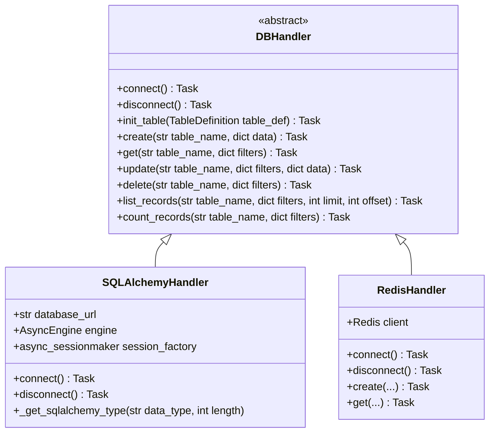
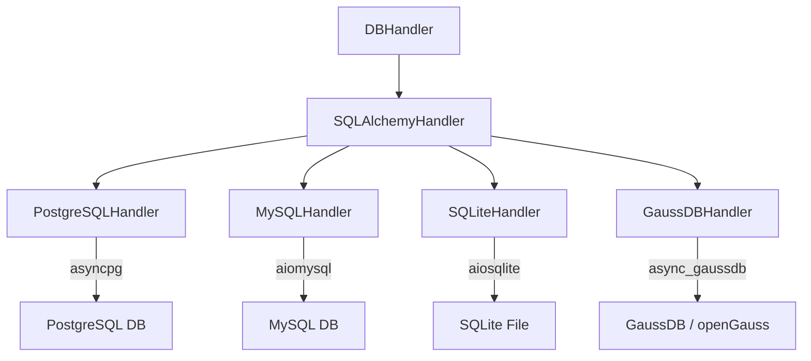
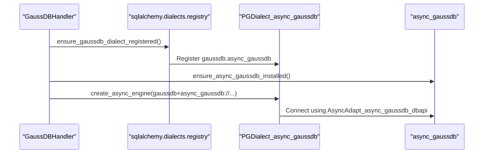
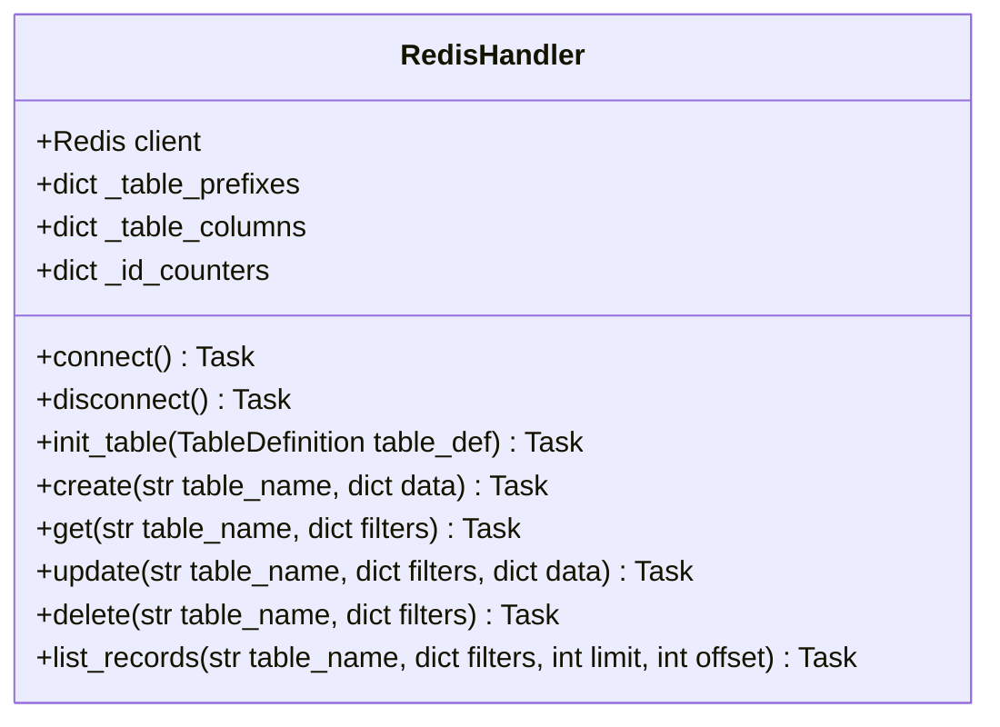

<!-- source: DeepWiki mcp.deepwiki.com · repo openJiuwen-ai/agent-runtime · page 6.1 Database Layer · fetched 2026-11-02 -->

# Database Layer

Relevant source files

The following files were used as context for generating this wiki page:

- [cli/openjiuwen_runtime/cli/__init__.py](cli/openjiuwen_runtime/cli/__init__.py)
- [cli/rebuild.bat](cli/rebuild.bat)
- [cli/rebuild.sh](cli/rebuild.sh)
- [foundation/openjiuwen_runtime/foundation/db/__init__.py](foundation/openjiuwen_runtime/foundation/db/__init__.py)
- [foundation/openjiuwen_runtime/foundation/db/dialects/gaussdb_asyncgaussdb.py](foundation/openjiuwen_runtime/foundation/db/dialects/gaussdb_asyncgaussdb.py)
- [foundation/openjiuwen_runtime/foundation/db/gaussdb_handler.py](foundation/openjiuwen_runtime/foundation/db/gaussdb_handler.py)
- [foundation/openjiuwen_runtime/foundation/db/handler.py](foundation/openjiuwen_runtime/foundation/db/handler.py)
- [foundation/openjiuwen_runtime/foundation/db/mysql_handler.py](foundation/openjiuwen_runtime/foundation/db/mysql_handler.py)
- [foundation/openjiuwen_runtime/foundation/db/postgresql_handler.py](foundation/openjiuwen_runtime/foundation/db/postgresql_handler.py)
- [foundation/openjiuwen_runtime/foundation/db/redis_handler.py](foundation/openjiuwen_runtime/foundation/db/redis_handler.py)
- [foundation/openjiuwen_runtime/foundation/db/sqlalchemy_handler.py](foundation/openjiuwen_runtime/foundation/db/sqlalchemy_handler.py)
- [foundation/openjiuwen_runtime/foundation/db/sqlite_handler.py](foundation/openjiuwen_runtime/foundation/db/sqlite_handler.py)
- [foundation/openjiuwen_runtime/foundation/docker_utils.py](foundation/openjiuwen_runtime/foundation/docker_utils.py)
- [foundation/tests/system_tests/test_gaussdb_real_db_system.py](foundation/tests/system_tests/test_gaussdb_real_db_system.py)
- [foundation/tests/unit_tests/test_sqlite_handler.py](foundation/tests/unit_tests/test_sqlite_handler.py)
- [management/openjiuwen_runtime/management/session/k8s_service_handler.py](management/openjiuwen_runtime/management/session/k8s_service_handler.py)
- [management/openjiuwen_runtime/management/session/router.py](management/openjiuwen_runtime/management/session/router.py)
- [management/openjiuwen_runtime/management/session/ws_client_channel.py](management/openjiuwen_runtime/management/session/ws_client_channel.py)

## Purpose and Scope
The Database Layer provides a unified asynchronous persistence abstraction (`DBHandler`) and concrete implementations for relational databases (PostgreSQL, MySQL, SQLite, GaussDB via custom dialects) and NoSQL/in-memory stores (Redis). This layer abstracts storage operations for the agent runtime management plane and associated services, decoupling business logic from underlying database drivers and connection pooling semantics.

---

## 1. The `DBHandler` Abstraction

The `DBHandler` abstract base class defines the standard CRUD, connection lifecycle, and schema initialization contract implemented by all storage handlers [foundation/openjiuwen_runtime/foundation/db/handler.py:10-128]().

### Interface Contract
*   `connect()` / `disconnect()`: Manages the asynchronous connection pool lifecycle [foundation/openjiuwen_runtime/foundation/db/handler.py:14-21]().
*   `init_table(table_def)`: Declarative table initialization (creates tables if missing, updates columns if needed) [foundation/openjiuwen_runtime/foundation/db/handler.py:24-31]().
*   `create(table_name, data)`: Inserts a record and returns the persisted object or dictionary [foundation/openjiuwen_runtime/foundation/db/handler.py:34-45]().
*   `get(table_name, filters)`: Retrieves a single matching record [foundation/openjiuwen_runtime/foundation/db/handler.py:48-59]().
*   `update(table_name, filters, data)`: Modifies existing records matching filters [foundation/openjiuwen_runtime/foundation/db/handler.py:62-74]().
*   `delete(table_name, filters)`: Removes records matching filters, returning a boolean success status [foundation/openjiuwen_runtime/foundation/db/handler.py:77-88]().
*   `list_records(table_name, filters, limit, offset)`: Queries paginated lists with filtering options [foundation/openjiuwen_runtime/foundation/db/handler.py:91-110]().
*   `count_records(table_name, filters)`: Returns the count of matching records (`SELECT COUNT(*)`) [foundation/openjiuwen_runtime/foundation/db/handler.py:113-128]().

*Sources: `foundation/openjiuwen_runtime/foundation/db/handler.py:10-128()`, `foundation/openjiuwen_runtime/foundation/db/sqlalchemy_handler.py:32-61()`, `foundation/openjiuwen_runtime/foundation/db/redis_handler.py:14-45()`*

---

## 2. SQLAlchemy Foundation & Relational Handlers

`SQLAlchemyHandler` provides the base implementation for relational databases using SQLAlchemy's asynchronous extension (`asyncio`, `AsyncSession`, `async_sessionmaker`) [foundation/openjiuwen_runtime/foundation/db/sqlalchemy_handler.py:32-61](). It manages connection pre-pinging and connection recycling [foundation/openjiuwen_runtime/foundation/db/sqlalchemy_handler.py:51-60]().

### Relational Handler Subclasses
*   **PostgreSQLHandler**: Connects via `postgresql+asyncpg://`, supporting custom search paths and automatic creation of databases and schemas when missing [foundation/openjiuwen_runtime/foundation/db/postgresql_handler.py:22-55](). It handles timezone-aware timestamps (`TIMESTAMP WITH TIME ZONE`) [foundation/openjiuwen_runtime/foundation/db/postgresql_handler.py:130-132]().
*   **MySQLHandler**: Connects via `mysql+aiomysql://`, reading connection attributes from environment settings and executing `CREATE DATABASE IF NOT EXISTS` during initialization [foundation/openjiuwen_runtime/foundation/db/mysql_handler.py:18-43]() [foundation/openjiuwen_runtime/foundation/db/mysql_handler.py:44-65]().
*   **SQLiteHandler**: Connects via `sqlite+aiosqlite:///`, ensuring parent directories exist before connection establishment [foundation/openjiuwen_runtime/foundation/db/sqlite_handler.py:12-29]().

*Sources: `foundation/openjiuwen_runtime/foundation/db/sqlalchemy_handler.py:32-61()`, `foundation/openjiuwen_runtime/foundation/db/postgresql_handler.py:22-55()`, `foundation/openjiuwen_runtime/foundation/db/mysql_handler.py:18-65()`, `foundation/openjiuwen_runtime/foundation/db/sqlite_handler.py:12-30()`*

---

## 3. GaussDB & Custom Dialect Integration

`GaussDBHandler` integrates GaussDB and openGauss databases by registering a custom SQLAlchemy dialect (`gaussdb+async_gaussdb`, `opengauss+async_gaussdb`, `postgresql+async_gaussdb`) [foundation/openjiuwen_runtime/foundation/db/gaussdb_handler.py:8-24]() [foundation/openjiuwen_runtime/foundation/db/dialects/gaussdb_asyncgaussdb.py:80-83]().

### Dialect Implementation Details
*   **Driver & Version Mapping**: `PGDialect_async_gaussdb` inherits from SQLAlchemy's PostgreSQL `asyncpg` dialect, disabling statement caching and remapping server version numbers for compatibility [foundation/openjiuwen_runtime/foundation/db/dialects/gaussdb_asyncgaussdb.py:55-75]().
*   **DBAPI Adaptation**: `AsyncAdapt_async_gaussdb_dbapi` translates `async_gaussdb` exceptions into SQLAlchemy standard database errors [foundation/openjiuwen_runtime/foundation/db/dialects/gaussdb_asyncgaussdb.py:40-53]().

*Sources: `foundation/openjiuwen_runtime/foundation/db/gaussdb_handler.py:8-24()`, `foundation/openjiuwen_runtime/foundation/db/dialects/gaussdb_asyncgaussdb.py:36-83()`*

---

## 4. Redis NoSQL Handler

`RedisHandler` implements `DBHandler` using `redis.asyncio` for key-value and hash-based storage structures [foundation/openjiuwen_runtime/foundation/db/redis_handler.py:14-45]().

### Implementation Mechanisms
*   **Table Mapping**: Tables are mapped to Redis hash keys using configured prefixes (`table_name:primary_key`) [foundation/openjiuwen_runtime/foundation/db/redis_handler.py:46-54]().
*   **Record Lists and Counters**: Insertion uses auto-incrementing ID counters (`incr`) and list tracking (`rpush`) to support `list_records` pagination [foundation/openjiuwen_runtime/foundation/db/redis_handler.py:55-101]() [foundation/openjiuwen_runtime/foundation/db/redis_handler.py:160-188]().
*   **Serialization**: Datetime objects and nested dictionaries are serialized to ISO formats and JSON strings during storage and deserialized on retrieval [foundation/openjiuwen_runtime/foundation/db/redis_handler.py:58-76]().

*Sources: `foundation/openjiuwen_runtime/foundation/db/redis_handler.py:14-45()`, `foundation/openjiuwen_runtime/foundation/db/redis_handler.py:46-188()`*

---

