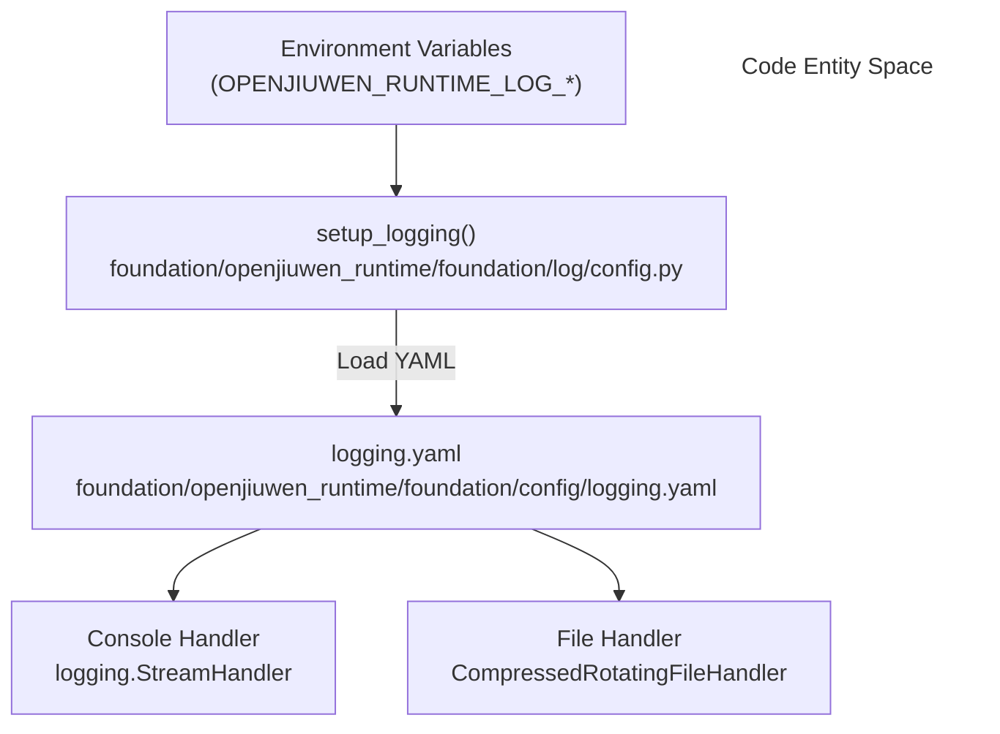
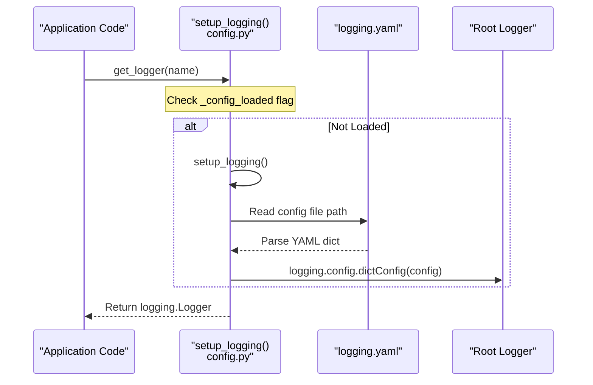
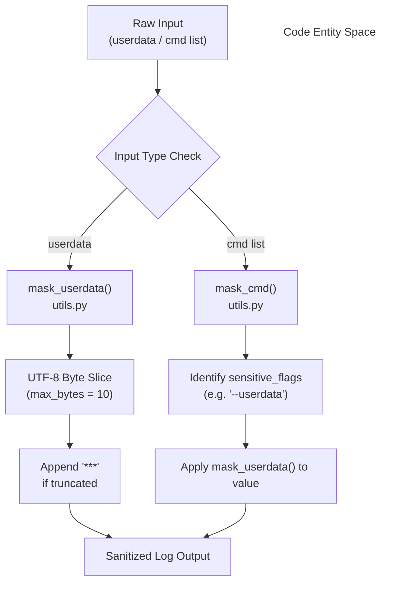

<!-- source: DeepWiki mcp.deepwiki.com · repo openJiuwen-ai/agent-runtime · page 6.2 Logging & Observability · fetched 2026-11-02 -->

# Logging & Observability

Relevant source files

The following files were used as context for generating this wiki page:

- [foundation/openjiuwen_runtime/foundation/config/logging.yaml](foundation/openjiuwen_runtime/foundation/config/logging.yaml)
- [foundation/openjiuwen_runtime/foundation/log/__init__.py](foundation/openjiuwen_runtime/foundation/log/__init__.py)
- [foundation/openjiuwen_runtime/foundation/log/config.py](foundation/openjiuwen_runtime/foundation/log/config.py)
- [foundation/openjiuwen_runtime/foundation/log/utils.py](foundation/openjiuwen_runtime/foundation/log/utils.py)
- [foundation/tests/unit_tests/test_log.py](foundation/tests/unit_tests/test_log.py)
- [server/openjiuwen_runtime/server/utils.py](server/openjiuwen_runtime/server/utils.py)

This page covers the logging and observability subsystem of the `openJiuwen-ai/agent-runtime` foundation library. The subsystem handles centralized initialization (`setup_logging`), YAML configuration (`logging.yaml`), custom rotation and compression handlers, and safety utilities for masking sensitive user data and command-line arguments.

---

## Purpose and Scope

The logging and observability framework provides structured, configurable logging across all components of the agent runtime (foundation, management server, service framework, and worker processes). Its core responsibilities include:
- Initializing standard Python logging via dictionary configurations and fallback mechanisms [foundation/openjiuwen_runtime/foundation/log/config.py:104-148]().
- Managing file-based rotation and compression through specialized handlers [foundation/openjiuwen_runtime/foundation/log/config.py:87-102]().
- Providing dynamic configuration overrides via environment variables [foundation/openjiuwen_runtime/foundation/log/config.py:14-16]().
- Enforcing security by sanitizing sensitive payloads (such as user session inputs and sensitive command-line flags) before writing them to disk or console streams [foundation/openjiuwen_runtime/foundation/log/utils.py:9-66]().

Sources:
- `foundation/openjiuwen_runtime/foundation/log/config.py:104-148`
- `foundation/openjiuwen_runtime/foundation/log/utils.py:9-66`

---

## Core Architecture & Configuration (`logging.yaml`)

The default logging structure is defined in `logging.yaml` and loaded during runtime bootstrap [foundation/openjiuwen_runtime/foundation/config/logging.yaml:1-28](). It establishes standard formatting, console output via `StreamHandler`, and file output using a custom rotating file handler class [foundation/openjiuwen_runtime/foundation/config/logging.yaml:10-24]().

### Configuration Parameters
- **Formatters**: Uses a standard formatter structure including timestamp, log level, logger name, source filename, line number, function name, and message [foundation/openjiuwen_runtime/foundation/config/logging.yaml:4-7]().
- **Handlers**:
  - `console`: Streams `INFO` level logs and above to `sys.stdout` [foundation/openjiuwen_runtime/foundation/config/logging.yaml:10-14]().
  - `file`: Manages log rotation with a maximum size of 10MB (`maxBytes: 10485760`) and retains up to 20 backup files (`backupCount: 20`) using UTF-8 encoding [foundation/openjiuwen_runtime/foundation/config/logging.yaml:16-24]().
- **Root Logger**: Configured at `INFO` level with both `console` and `file` handlers attached [foundation/openjiuwen_runtime/foundation/config/logging.yaml:26-28]().

*Sources: `foundation/openjiuwen_runtime/foundation/config/logging.yaml:1-29`, `foundation/openjiuwen_runtime/foundation/log/config.py:104-148`*

---

## Initialization & Environment Controls (`config.py`)

The configuration module [foundation/openjiuwen_runtime/foundation/log/config.py]() manages path resolution, environment variable hooks, and handler resets.

### Environment Variables
- `OPENJIUWEN_RUNTIME_LOG_CONFIG`: Overrides the default `logging.yaml` path [foundation/openjiuwen_runtime/foundation/log/config.py:14]().
- `OPENJIUWEN_RUNTIME_LOG_FILE`: Overrides the specific log file target path [foundation/openjiuwen_runtime/foundation/log/config.py:15]().
- `OPENJIUWEN_RUNTIME_LOG_DIR`: Specifies a directory base for relative log file paths [foundation/openjiuwen_runtime/foundation/log/config.py:16]().

### Key Functions
- `get_config_path()`: Resolves the active configuration file path, prioritizing `OPENJIUWEN_RUNTIME_LOG_CONFIG` if set [foundation/openjiuwen_runtime/foundation/log/config.py:27-33]().
- `setup_logging(config_path, *, log_file)`: Resets existing root loggers, loads the YAML configuration via `logging.config.dictConfig`, and applies file path overrides [foundation/openjiuwen_runtime/foundation/log/config.py:104-148](). If the configuration file is missing, it falls back to basic console logging with an optional file handler [foundation/openjiuwen_runtime/foundation/log/config.py:136-144]().
- `get_logger(name)`: Retrieves a named logger, automatically invoking `setup_logging()` if no configuration has been loaded yet [foundation/openjiuwen_runtime/foundation/log/config.py:150-155]().

*Sources: `foundation/openjiuwen_runtime/foundation/log/config.py:104-155`*

---

## Rotating Handlers & Log Rotation

File logging utilizes `CompressedRotatingFileHandler` (defined in `foundation/openjiuwen_runtime/foundation/log/handler.py`), which integrates with standard byte-based rotation.

- **Size-based Triggers**: When active log files reach `maxBytes` (default `10485760` bytes / 10 MB) [foundation/openjiuwen_runtime/foundation/log/config.py:23](), rotation is triggered.
- **Backup Retention**: Up to `backupCount` (default `20`) historical logs are preserved on disk [foundation/openjiuwen_runtime/foundation/log/config.py:24]().
- **Fallback Attachment**: If the configuration file cannot be found, `_attach_fallback_file_handler()` manually instantiates the rotating handler to guarantee persistence [foundation/openjiuwen_runtime/foundation/log/config.py:87-102]().

Sources:
- `foundation/openjiuwen_runtime/foundation/log/config.py:23-24,87-102`

---

## Security & Data Masking Utilities (`utils.py`)

To prevent sensitive information (such as personal data, credentials, or keys) from leaking into logs, the framework provides masking utilities in [foundation/openjiuwen_runtime/foundation/log/utils.py]() and re-exported via [server/openjiuwen_runtime/server/utils.py]().

### Masking Functions

| Function | Signature | Purpose |
| :--- | :--- | :--- |
| `mask_userdata` | `(userdata: str \| None, max_bytes: int = 10) -> str` | Encodes input to UTF-8, preserves up to `max_bytes` (default 10), and appends `***` to truncated payloads [foundation/openjiuwen_runtime/foundation/log/utils.py:9-40](). |
| `mask_cmd` | `(cmd: list[str], sensitive_flags: list[str] \| None = None) -> str` | Iterates over command-line argument lists, automatically targeting flags like `--userdata` and masking their immediate values [foundation/openjiuwen_runtime/foundation/log/utils.py:43-66](). |

*Sources: `foundation/openjiuwen_runtime/foundation/log/utils.py:9-66`*

---

