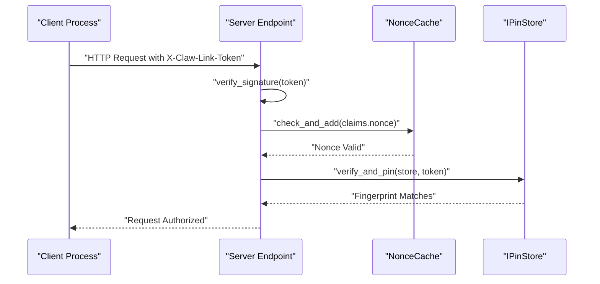

<!-- source: DeepWiki mcp.deepwiki.com · repo openJiuwen-ai/agent-runtime · page 6.3 Security: Link Auth, Crypto & Certificates · fetched 2026-11-02 -->

# Security: Link Auth, Crypto & Certificates

<details>
<summary>Relevant source files</summary>

The following files were used as context for generating this wiki page:

- [docs/zh/SUMMARY.md](docs/zh/SUMMARY.md)
- [foundation/openjiuwen_runtime/foundation/security/__init__.py](foundation/openjiuwen_runtime/foundation/security/__init__.py)
- [foundation/openjiuwen_runtime/foundation/security/_primitives.py](foundation/openjiuwen_runtime/foundation/security/_primitives.py)
- [foundation/openjiuwen_runtime/foundation/security/crypto.py](foundation/openjiuwen_runtime/foundation/security/crypto.py)
- [foundation/openjiuwen_runtime/foundation/security/interfaces.py](foundation/openjiuwen_runtime/foundation/security/interfaces.py)
- [foundation/openjiuwen_runtime/foundation/security/link_auth.py](foundation/openjiuwen_runtime/foundation/security/link_auth.py)
- [foundation/openjiuwen_runtime/foundation/security/models.py](foundation/openjiuwen_runtime/foundation/security/models.py)
- [foundation/openjiuwen_runtime/foundation/security/signing.py](foundation/openjiuwen_runtime/foundation/security/signing.py)
- [foundation/tests/unit_tests/test_link_auth.py](foundation/tests/unit_tests/test_link_auth.py)
- [management/openjiuwen_runtime/management/security/__init__.py](management/openjiuwen_runtime/management/security/__init__.py)
- [management/openjiuwen_runtime/management/security/certificate.py](management/openjiuwen_runtime/management/security/certificate.py)
- [management/openjiuwen_runtime/management/security/certificate_pin_store.py](management/openjiuwen_runtime/management/security/certificate_pin_store.py)
- [management/tests/unit_tests/management_security/test_certificate_manager.py](management/tests/unit_tests/management_security/test_certificate_manager.py)
- [management/tests/unit_tests/management_security/test_crypto.py](management/tests/unit_tests/management_security/test_crypto.py)
- [management/tests/unit_tests/management_security/test_link_auth_bind.py](management/tests/unit_tests/management_security/test_link_auth_bind.py)
- [management/tests/unit_tests/management_security/test_signing.py](management/tests/unit_tests/management_security/test_signing.py)

</details>


## Purpose and Scope
This page documents the security infrastructure of the openJiuwen Agent Runtime, spanning low-level cryptographic primitives, asynchronous link authentication (`link_auth`), hybrid envelope encryption (`EnvelopeCryptoProvider`), and database-backed certificate and key management (`CertificateManager` and `CertificatePinStore`). The foundation layer (`openjiuwen_runtime.foundation.security`) provides zero-control-plane-dependency cryptographic operations, while the management layer (`openjiuwen_runtime.management.security`) adds database persistence and trust binding.

---

## 1. Cryptographic Primitives & Provider Architecture

The low-level foundation security primitives reside in `foundation/openjiuwen_runtime/foundation/security/_primitives.py` and are wrapped by interfaces in `foundation/openjiuwen_runtime/foundation/security/interfaces.py`. Symmetrical encryption relies on `AES-256-GCM`, asymmetric signing on `Ed25519`, and hybrid envelope encryption on `X25519` combined with `HKDF-SHA256` key derivation.

### Primitives Implementation
- **Ed25519 Signatures**: Handled via `ed25519_generate()`, `ed25519_sign()`, and `ed25519_verify()` [foundation/openjiuwen_runtime/foundation/security/_primitives.py:50-70]().
- **X25519 Key Exchange & Envelope Encryption**: Handled via `x25519_generate()`, `wrap_key()`, and `unwrap_key()` [foundation/openjiuwen_runtime/foundation/security/_primitives.py:72-104]().
- **AES-256-GCM AEAD**: Handled via `aead_encrypt()` and `aead_decrypt()` [foundation/openjiuwen_runtime/foundation/security/_primitives.py:105-114]().
- **Signer/Verifier Abstractions**: `ISigner` and `IVerifier` interfaces are implemented by `Ed25519Signer` and `Ed25519Verifier` in `foundation/openjiuwen_runtime/foundation/security/signing.py:15-42`().
- **Envelope Encryption**: `EnvelopeCryptoProvider` implements `ICryptoProvider` providing data key generation, AEAD operations, and hybrid sealing/opening [foundation/openjiuwen_runtime/foundation/security/crypto.py]().

```mermaid
graph TD
    subcode["Code Entity Architecture"]
        A["ICryptoProvider"] --> B["EnvelopeCryptoProvider"]
        C["ISigner"] --> D["Ed25519Signer"]
        E["IVerifier"] --> F["Ed25519Verifier"]
        G["_primitives.py"] --> H["ed25519_sign"]
        G --> I["wrap_key"]
        G --> J["aead_encrypt"]
    end
```
Sources: `foundation/openjiuwen_runtime/foundation/security/_primitives.py:1-115`, `foundation/openjiuwen_runtime/foundation/security/signing.py:1-52`, `foundation/openjiuwen_runtime/foundation/security/interfaces.py:1-75`

---

## 2. Link Authentication & Control Handshake

Control channels (e.g., Claw Manager to Gateway, Gateway to AgentServer) authenticate using asymmetric tokens (`CLT`) passed via the HTTP header `X-Claw-Link-Token` (`LINK_TOKEN_HEADER`) [foundation/openjiuwen_runtime/foundation/security/link_auth.py:46]().

### Authentication Modes & Token Flow
The environment variable `CLAW_LINK_AUTH_MODE` determines runtime behavior:
- `off`: Disables link authentication [foundation/openjiuwen_runtime/foundation/security/link_auth.py:58-71]().
- `observe`: Validates signatures and logs failures without rejecting requests [foundation/openjiuwen_runtime/foundation/security/link_auth.py:58-71]().
- `enforce`: Rejects unverified or invalid requests immediately [foundation/openjiuwen_runtime/foundation/security/link_auth.py:58-71]().

Token verification is orchestrated by `verify_signature()`, `NonceCache`, and `verify_and_pin()` [foundation/openjiuwen_runtime/foundation/security/link_auth.py:149-219]().


Sources: `foundation/openjiuwen_runtime/foundation/security/link_auth.py:133-219`, `foundation/openjiuwen_runtime/foundation/tests/unit_tests/test_link_auth.py:1-169`

---

## 3. Certificate & Key Management Store

The management layer implements database-backed certificate and key storage via `CertificateManager` implementing `ICertificateManager` [management/openjiuwen_runtime/management/security/certificate.py:70-189](). It relies on table definitions `SECURITY_LOCAL_KEY_TABLE_DEF` and `SECURITY_PEER_KEY_TABLE_DEF` [foundation/openjiuwen_runtime/foundation/security/models.py:77-111]().

### Key Management Operations
- **Local Key Pairs**: Stored in `security_local_key`. Private keys are protected and never exported [management/openjiuwen_runtime/management/security/certificate.py:83-117]().
- **Peer Keys**: Stored in `security_peer_key` using a composite record ID (`peer_id::purpose`) [management/openjiuwen_runtime/management/security/certificate.py:121-189]().

```mermaid
graph TD
    subcode["Certificate Management Flow"]
        CM["CertificateManager"] --> DB["DBHandler"]
        DB --> LTable["security_local_key"]
        DB --> PTable["security_peer_key"]
        CM --> LK["get_or_create_keypair"]
        CM --> SP["save_peer_key"]
    end
```
Sources: `management/openjiuwen_runtime/management/security/certificate.py:70-189`, `foundation/openjiuwen_runtime/foundation/security/models.py:74-111`

---

## 4. Trust Binding & Pin Store

Trust binding ensures that once a peer's public key fingerprint is recorded, subsequent handshakes must match the pinned fingerprint. This is managed via `CertificatePinStore` and `verify_and_bind` [management/openjiuwen_runtime/management/security/certificate_pin_store.py]().

Sources: `management/openjiuwen_runtime/management/security/certificate_pin_store.py`, `management/openjiuwen_runtime/management/security/__init__.py:60-66`

---

