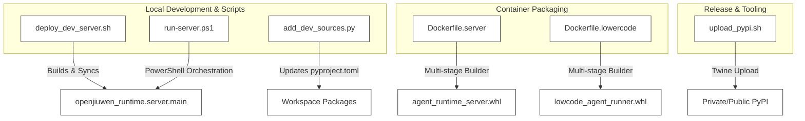
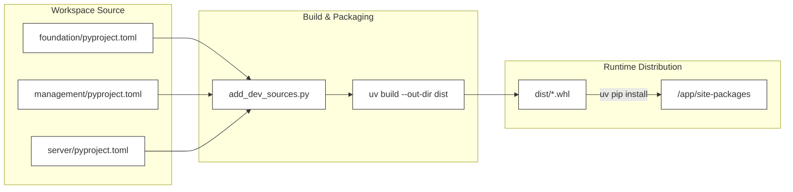

<!-- source: DeepWiki mcp.deepwiki.com · repo openJiuwen-ai/agent-runtime · page 7 Build, Deployment & Tooling · fetched 2026-11-02 -->

# Build, Deployment & Tooling

Relevant source files

The following files were used as context for generating this wiki page:

- [docker/Dockerfile.lowercode](docker/Dockerfile.lowercode)
- [docker/Dockerfile.server](docker/Dockerfile.server)
- [scripts/add_dev_sources.py](scripts/add_dev_sources.py)
- [scripts/deploy_dev_server.sh](scripts/deploy_dev_server.sh)
- [scripts/run-server.ps1](scripts/run-server.ps1)
- [scripts/upload_pypi.sh](scripts/upload_pypi.sh)

## Purpose and Scope
This parent page provides a high-level overview of the build pipelines, container image configurations, development deployment scripts, release automation, and command-line tooling utilized across the `openjiuwen-ai/agent-runtime` monorepo. 

The runtime relies on modern Python packaging tools (such as `uv` and `tomlkit`) to manage workspace dependencies, build wheel distributions, orchestrate multi-stage container builds, and automate package distribution. 

For detailed technical implementations, refer to the child pages:
- [Docker Images & Release Scripts](#7.1)
- [CLI](#7.2)

---

## Architecture & Workflow Overview

The build, deployment, and tooling ecosystem bridges local development workspaces, containerized service images, and external package registries. Developers and CI pipelines rely on automation scripts like `scripts/deploy_dev_server.sh` [scripts/deploy_dev_server.sh:1-120]() and `scripts/upload_pypi.sh` [scripts/upload_pypi.sh:1-82]() to configure project metadata, inject local source paths via `scripts/add_dev_sources.py` [scripts/add_dev_sources.py:1-79](), and build Python wheels.

Sources: `scripts/deploy_dev_server.sh:1-121`, `scripts/run-server.ps1:1-157`, `scripts/add_dev_sources.py:1-79`, `docker/Dockerfile.server:1-69`, `docker/Dockerfile.lowercode:1-64`, `scripts/upload_pypi.sh:1-83`

---

## 7.1. Docker Images & Release Scripts

The repository maintains specialized multi-stage Dockerfiles and shell/PowerShell scripts to package individual components (such as the management server and lowercode agent runner) into isolated runtime environments. 

- **Multi-Stage Containerization**: Files like `docker/Dockerfile.server` [docker/Dockerfile.server:1-69]() and `docker/Dockerfile.lowercode` [docker/Dockerfile.lowercode:1-63]() utilize a builder stage to resolve dependencies with `uv` and compile `.whl` artifacts, followed by a lightweight runtime stage that installs wheels using `uv pip install` to prevent directory-deletion issues associated with traditional pip target installations.
- **Development & Release Automation**: Local testing and staging deployments are driven by `scripts/deploy_dev_server.sh` [scripts/deploy_dev_server.sh:1-120]() and `scripts/run-server.ps1` [scripts/run-server.ps1:1-157]`, which handle environment file loading (`.env`), submodule updates, dependency graph adjustments, and server execution. Package publishing is automated via `scripts/upload_pypi.sh` [scripts/upload_pypi.sh:1-83]`.

For detailed descriptions of container stages, environment injection, and release steps, see [Docker Images & Release Scripts](#7.1).

Sources: `docker/Dockerfile.server:1-69`, `docker/Dockerfile.lowercode:1-64`, `scripts/deploy_dev_server.sh:1-121`, `scripts/run-server.ps1:1-157`, `scripts/upload_pypi.sh:1-83`

---

## 7.2. CLI

Command-line tooling provides operators and developers with standardized interfaces for managing runtime instances, scaffolding project templates, and executing build or rebuild scripts. The CLI layer acts as the user-facing entry point for operational commands, abstracting complex multi-package orchestration into concise command sets.

For detailed command references, template structures, and build invocation patterns, see [CLI](#7.2).

---

## Build Pipeline Execution Flow

The following diagram illustrates the lifecycle of workspace packages as they transition from raw source code through dependency synchronization, wheel compilation, and target site-packages deployment.

Sources: `scripts/add_dev_sources.py:1-79`, `docker/Dockerfile.server:1-69`, `docker/Dockerfile.lowercode:1-64`

---

