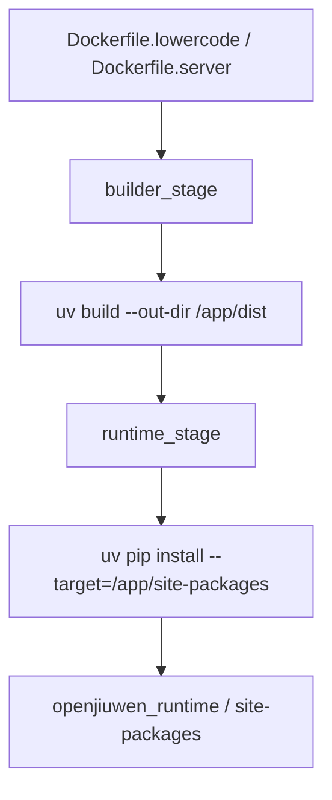
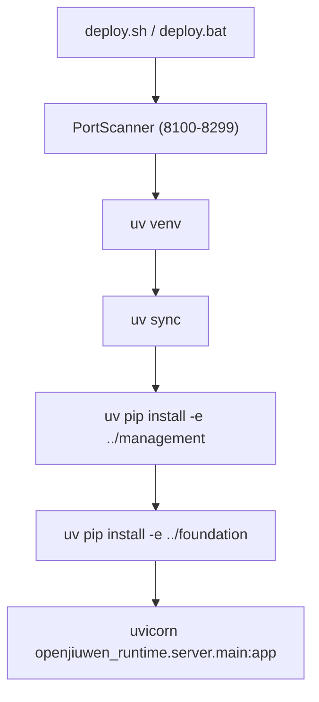

<!-- source: DeepWiki mcp.deepwiki.com · repo openJiuwen-ai/agent-runtime · page 7.1 Docker Images & Release Scripts · fetched 2026-11-02 -->

# Docker Images & Release Scripts

<details>
<summary>Relevant source files</summary>

The following files were used as context for generating this wiki page:

- [docker/Dockerfile.lowercode](docker/Dockerfile.lowercode)
- [docker/Dockerfile.server](docker/Dockerfile.server)
- [scripts/add_dev_sources.py](scripts/add_dev_sources.py)
- [scripts/deploy_dev_server.sh](scripts/deploy_dev_server.sh)
- [scripts/run-server.ps1](scripts/run-server.ps1)
- [scripts/upload_pypi.sh](scripts/upload_pypi.sh)
- [server/deploy.bat](server/deploy.bat)
- [server/deploy.sh](server/deploy.sh)

</details>


### Purpose and Scope
This page details the containerization architecture, release pipelines, local development deployment scripts, and development source injection tooling for the `openJiuwen-ai/agent-runtime` codebase. It covers multi-stage Dockerfiles designed for safe wheel sharing, automated execution scripts for Windows and POSIX environments, PyPI publishing scripts, and programmatic `pyproject.toml` source modification utilities.

---

## 1. Multi-Stage Containerization (`Dockerfile.lowercode` & `Dockerfile.server`)

The runtime provides isolated container builds via specialized multi-stage Dockerfiles: `docker/Dockerfile.lowercode` [docker/Dockerfile.lowercode:1-63]() and `docker/Dockerfile.server` [docker/Dockerfile.server:1-69](). 

### Build & Runtime Architecture
Both Dockerfiles partition operations into two primary stages:
1. **Builder Stage (`builder`)**: Installs build dependencies using `uv`, strips internal workspace package references to force clean compilations, builds Python wheel packages (`.whl`), and exports artifacts into `/app/dist`.
2. **Runtime Stage (`runtime`)**: Installs system requirements (e.g., `docker.io` in server images), copies built wheels, and deploys them to a shared target directory (`/app/site-packages`).

**Crucial Implementation Detail**: When multiple packages share the same root namespace (`openjiuwen_runtime`), legacy `pip --target` installations present a fatal bug where preexisting directories are completely wiped out before installation [docker/Dockerfile.lowercode:48-49](). The runtime utilizes `uv pip install` with `--target=/app/site-packages`, which safely adds or overwrites files without purging the shared directory [docker/Dockerfile.lowercode:51-54]().


*Sources: `docker/Dockerfile.lowercode`, `docker/Dockerfile.server`*

---

## 2. Development Deployment & Execution Scripts

Local deployment and orchestration are supported across platforms via bash and PowerShell scripts (`scripts/deploy_dev_server.sh`, `scripts/run-server.ps1`, `server/deploy.sh`, and `server/deploy.bat`).

### Port Discovery & Environment Provisioning
The server deployment scripts automatically scan ports ranging from `8100` to `8299` using network utilities (`ss` or `lsof` on POSIX [server/deploy.sh:28-44](); PowerShell `Get-NetTCPConnection` on Windows [server/deploy.bat:28]()). Once an available port is secured, the script initializes a virtual environment via `uv venv`, syncs dependencies, and installs local editable SDKs (`../management` and `../foundation`) [server/deploy.sh:52-83]().


*Sources: `server/deploy.sh`, `server/deploy.bat`, `scripts/deploy_dev_server.sh`, `scripts/run-server.ps1`*

---

## 3. Release & PyPI Upload Automation (`upload_pypi.sh`)

The release script `scripts/upload_pypi.sh` automates the version bumping, dependency locking, packaging, and publishing workflow across all monorepo packages (`foundation`, `management`, `service`, `server`, and applications) [scripts/upload_pypi.sh:15-22]().

### Workflow Steps
1. **Tool Configuration**: Configures `pip` and installs pinned versions of `uv`, `setuptools`, `wheel`, and `twine` [scripts/upload_pypi.sh:1-10]().
2. **Version Synchronization**: Parses target directories, modifies `pyproject.toml` versions dynamically via `sed`, and adjusts internal inter-package dependencies to reference the exact release `VERSION` [scripts/upload_pypi.sh:35-56]().
3. **Build & Upload**: Executes `uv sync` against private repositories with unsafe best-match index strategies, generates distributions using `uv build`, and uploads artifacts via `twine` to private HuaweiCloud repositories and optionally official PyPI [scripts/upload_pypi.sh:58-81]().

*Sources: `scripts/upload_pypi.sh`*

---

## 4. Development Source Injection (`add_dev_sources.py`)

To enable seamless cross-package local editing without manual `pyproject.toml` path management, `scripts/add_dev_sources.py` programmatically injects editable source overrides into package configurations [scripts/add_dev_sources.py:1-79]().

### Implementation Details
The script reads `pyproject.toml` files using the `tomlkit` library to preserve formatting and comments [scripts/add_dev_sources.py:50-51](). It defines a mapping of internal dependencies (`PACKAGE_CONFIGS`), appending standard `[tool.uv.sources]` tables specifying relative path overrides and editable flags [scripts/add_dev_sources.py:19-62]():

```python
# Example injected TOML structure via scripts/add_dev_sources.py
[tool.uv.sources]
openjiuwen-runtime-foundation = { path = "../foundation", editable = true }
openjiuwen-runtime-management = { path = "../management", editable = true }
```

*Sources: `scripts/add_dev_sources.py`*

---

