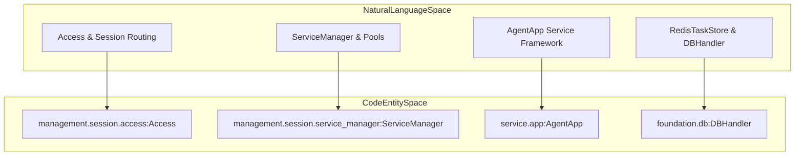

<!-- source: DeepWiki mcp.deepwiki.com · repo openJiuwen-ai/agent-runtime · page 8 Glossary · fetched 2026-11-02 -->

# Glossary

Relevant source files

The following files were used as context for generating this wiki page:

- [README.md](README.md)
- [README_zh.md](README_zh.md)
- [applications/lowcode_agent/pyproject.toml](applications/lowcode_agent/pyproject.toml)
- [cli/pyproject.toml](cli/pyproject.toml)
- [management/openjiuwen_runtime/management/session/DESIGN.md](management/openjiuwen_runtime/management/session/DESIGN.md)
- [management/openjiuwen_runtime/management/session/__init__.py](management/openjiuwen_runtime/management/session/__init__.py)
- [management/openjiuwen_runtime/management/session/models.py](management/openjiuwen_runtime/management/session/models.py)
- [management/pyproject.toml](management/pyproject.toml)
- [server/pyproject.toml](server/pyproject.toml)
- [service/openjiuwen_runtime/service/__init__.py](service/openjiuwen_runtime/service/__init__.py)
- [service/pyproject.toml](service/pyproject.toml)

## Purpose and Scope

This wiki page defines core architectural concepts, classes, modules, protocols, and tooling terms used across the `openJiuwen/agent-runtime` repository. Each entry provides a technical definition, its primary role within the system, and exact code pointers (`[file:start-end]()`) to facilitate navigation and code auditing.

---

## Session Management & Orchestration Terms

This group covers terms related to the control plane, session routing, lifecycle management, and multi-tenancy.

* **`Access`**: The entry point interface/class in the session management subsystem that ingests raw requests (`IRequest`), applies routing strategies to produce `ISessionRequest` wrappers, enqueues them into the dual-queue scheduler, and consumes the response stream asynchronously.
  * Defined in: `management/openjiuwen_runtime/management/session/access.py` [management/openjiuwen_runtime/management/session/__init__.py:4-4]()

* **`ServiceManager`**: The core orchestrator managing dual queues (`PriorityDualAsyncQueues`), instance pools (`in_use` and `idle`), autoscaling loops, session TTL tracking, and background timers for service reclaiming.
  * Defined in: `management/openjiuwen_runtime/management/session/service_manager.py` [management/openjiuwen_runtime/management/session/__init__.py:23-23]()

* **`affinity routing`**: A routing mechanism that maps a specific `session_id` to a consistent `service_id` (running agent instance) so that conversation state and local context remain stable across multiple queries within a TTL window.
  * Described in: `management/openjiuwen_runtime/management/session/DESIGN.md:16-16` [management/openjiuwen_runtime/management/session/router.py:1-15]()

* **`idle pool`**: A collection (`_idle`) of pre-warmed or recently used `ServiceHandler` instances ready to immediately handle incoming session requests without incurring cold-start deployment overhead.
  * Defined in: `management/openjiuwen_runtime/management/session/models.py:52-54` [management/openjiuwen_runtime/management/session/service_manager.py:20-60]()

* **`service TTL`**: A timeout policy governing how long an `in_use` service instance waits after all sessions release their concurrency locks before transitioning back to the idle pool, or how long an idle instance survives before being reclaimed.
  * Defined in: `management/openjiuwen_runtime/management/session/models.py:60-65` [management/openjiuwen_runtime/management/session/service_manager.py:80-120]()

* **`PodDeployInfo`**: A data container holding deployment metadata (such as pod IP, target port, and resource identifiers) returned by Kubernetes or other deploy controllers once an instance becomes ready.
  * Defined in: `management/openjiuwen_runtime/management/session/k8s_service_handler.py:1-40` [management/openjiuwen_runtime/management/session/__init__.py:21-21]()

* **`deployment strategy`**: An abstraction layer determining how agent instances are provisioned and isolated, supporting modes such as local subprocesses (`subprocess`), Docker containers (`docker`), and Kubernetes pods (`k8s`).
  * Described in: `README.md:20-27` [README_zh.md:20-27]()

* **`tenant context`**: Metadata (such as `user_id`, `space_id`, and organization tokens) injected into requests or middleware pipelines to enforce multi-tenant resource isolation across management and data planes.
  * Described in: `README.md:28-31` [README_zh.md:28-31]()

Sources:
- `management/openjiuwen_runtime/management/session/__init__.py:4-55`
- `management/openjiuwen_runtime/management/session/models.py:41-66`
- `README.md:20-31`

---

## Service Framework & Execution Terms

This group covers terms related to the data plane, agent application abstractions, and workflow execution formats.

* **`AgentApp`**: A concrete service application class extending `BaseApp` that wraps FastAPI and exposes standard agent endpoints (`/query`, `/health`, `/reset_conversation`) for conversation execution.
  * Defined in: `service/openjiuwen_runtime/service/app.py` [service/openjiuwen_runtime/service/__init__.py:4-9]()

* **`IR` (Intermediate Representation)**: The structured graph or workflow definition format consumed by low-code and execution runners to instantiate dynamic agent behaviors and node connections.
  * Described in: `applications/lowcode_agent/pyproject.toml:6-10` [README.md:45-45]()

* **`ir.json`**: The serialized JSON file containing an exported `IR` configuration generated by openJiuwen Studio, used by the low-code runner to load and execute agent workflows.
  * Described in: `applications/lowcode_agent/pyproject.toml:6-10` [README_zh.md:45-45]()

* **`DFX middleware`**: Diagnostic, Fault-Tolerance, and X-functional (DFX) middleware layers embedded in execution services to provide robust logging, error recovery, and interface tracing.
  * Described in: `README.md:40-46` [service/openjiuwen_runtime/service/__init__.py:4-9]()

Sources:
- `service/openjiuwen_runtime/service/__init__.py:1-11`
- `applications/lowcode_agent/pyproject.toml:1-20`
- `README.md:40-46`

---

## Applications & Messaging Terms

This group covers terms related to shipped applications, routing adapters, event models, and task persistence.

* **`VersatileAdapter`**: A component providing config-driven adapter routing, Server-Sent Events (SSE) proxying, and A2A facades.
  * Described in: `README.md:45-45` [README_zh.md:45-45]()

* **`AdapterEvent`**: The internal event model utilized by adapters and streaming pipelines to encapsulate protocol messages and dispatch status updates.
  * Described in: `README.md:45-45` [README_zh.md:45-45]()

* **`A2A` (Agent-to-Agent)**: An orchestration service architecture enabling agent-to-agent communication, task store persistence, rate limiting, and SSE dispatch.
  * Described in: `README.md:45-45` [README_zh.md:45-45]()

* **`RedisTaskStore`**: A Redis-backed persistence layer used by the A2A orchestration service to track asynchronous task states, queues, and execution statuses.
  * Described in: `README.md:44-45` [management/pyproject.toml:24-24]()

Sources:
- `management/pyproject.toml:10-35`
- `README.md:44-46`

---

## Foundation, Tooling & Packaging Terms

This group covers foundational security primitives, package managers, packaging formats, and database integrations.

* **`link-auth`**: A foundation security primitive implementing cryptographic signing and verification for secure inter-service link communication and token validation.
  * Described in: `README.md:44-44` [README_zh.md:44-44]()

* **`uv`**: An extremely fast Python package installer and resolver used across all workspace packages (`pyproject.toml` files) for dependency management and virtual environment provisioning.
  * Defined in: `management/pyproject.toml:37-38` [applications/lowcode_agent/pyproject.toml:24-25]()

* **`whl` (Wheel)**: The standard built-distribution format for Python workspace packages (`openjiuwen-runtime-foundation`, `openjiuwen-runtime-management`, etc.) generated during build and deployment phases.
  * Defined in: `management/pyproject.toml:2-3` [service/pyproject.toml:1-3]()

* **`GaussDB`**: An enterprise relational database supported by the foundation database abstraction layer (`DBHandler`), configured via `RUNTIME_DB_TYPE=gaussdb`.
  * Described in: `README.md:95-103` [README_zh.md:95-103]()

Sources:
- `management/pyproject.toml:1-55`
- `service/pyproject.toml:1-10`
- `README.md:70-104`

---

## Code Entity Mapping Diagram

The following diagram bridges natural language concepts and architectural terms to their concrete code entities and modules within the codebase.

Sources:
- `management/openjiuwen_runtime/management/session/__init__.py:4-23`
- `service/openjiuwen_runtime/service/__init__.py:4-9`