# Page: Overview

# Overview

<details>
<summary>Relevant source files</summary>

The following files were used as context for generating this wiki page:

- [README.md](README.md)
- [README_zh.md](README_zh.md)
- [applications/lowcode_agent/pyproject.toml](applications/lowcode_agent/pyproject.toml)
- [cli/pyproject.toml](cli/pyproject.toml)
- [docs/zh/SUMMARY.md](docs/zh/SUMMARY.md)
- [management/openjiuwen_runtime/management/security/__init__.py](management/openjiuwen_runtime/management/security/__init__.py)
- [management/openjiuwen_runtime/management/security/certificate.py](management/openjiuwen_runtime/management/security/certificate.py)
- [management/pyproject.toml](management/pyproject.toml)
- [management/tests/unit_tests/management_security/test_certificate_manager.py](management/tests/unit_tests/management_security/test_certificate_manager.py)
- [management/tests/unit_tests/management_security/test_crypto.py](management/tests/unit_tests/management_security/test_crypto.py)
- [management/tests/unit_tests/management_security/test_signing.py](management/tests/unit_tests/management_security/test_signing.py)
- [server/pyproject.toml](server/pyproject.toml)
- [service/openjiuwen_runtime/service/__init__.py](service/openjiuwen_runtime/service/__init__.py)
- [service/pyproject.toml](service/pyproject.toml)

</details>


openJiuwen Agent Runtime is an enterprise-grade runtime and deployment system designed to transition AI agents reliably from development environments to production. The runtime provides uniform service exposure, multi-tenant resource isolation, multi-mode deployment strategies (subprocess, Docker, Kubernetes), and comprehensive lifecycle management.

For detailed setup instructions, run scripts, configuration options, and documentation sets, see [Getting Started & Configuration](#1.1). For workspace packaging details, dependency graphs, and wheel builds, see [Repository Structure & Packaging](#1.2).

Sources: [`README.md:1-46`](), [`README_zh.md:1-46`]().

---

## System Architecture & Monorepo Layout

The runtime is organized as a Python monorepo split into modular packages that interact across control and data planes. The foundation layer provides shared primitives, while the management layer orchestrates deployment strategies.

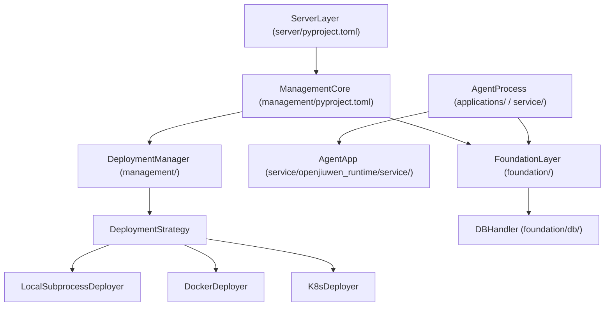
*Figure 1: High-level architectural layout bridging natural language concepts to code components.*

Sources: [`README.md:55-68`](), [`management/pyproject.toml:1-35`](), [`service/pyproject.toml:1-19`](), [`server/pyproject.toml:1-18`]().

---

## Core Capabilities & Deployment Flow

The runtime handles deployment orchestration through a structured lifecycle where client requests trigger strategy execution and spin up isolated agent apps.

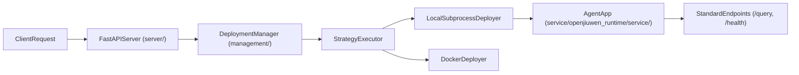
*Figure 2: Deployment and request execution workflow mapping components to codebase entities.*

1. **Deployment Request**: Clients invoke management endpoints exposed by the server layer (`server/`).
2. **Strategy Selection**: The deployment manager determines the appropriate strategy (`subprocess`, `docker`, or `k8s`) based on metadata.
3. **Instance Provisioning**: The underlying deployer allocates ports, initializes virtual environments via `uv`, or provisions container/pod specs.
4. **Service Exposure**: The agent application starts, exposing standard conversation and health endpoints (`/query`, `/health`, `/reset_conversation`).

Sources: [`README.md:47-54`](), [`README.md:127-142`]().

---

## Child Pages

- **[Getting Started & Configuration](#1.1)** — Setup procedures, run scripts (`run-server.sh` / `run-server.ps1`), `.env` settings, database selection (SQLite, MySQL, GaussDB, openGauss), and documentation sets (`docs/en`, `docs/zh`).
- **[Repository Structure & Packaging](#1.2)** — Python workspace packaging, `pyproject.toml` dependency graphs, wheel building, PyPI upload configurations, and development source injection.

Sources: [`README.md:70-178`](), [`management/pyproject.toml:1-62`](), [`service/pyproject.toml:1-41`](), [`applications/lowcode_agent/pyproject.toml:1-43`]().

---

# Page: Getting Started & Configuration

# Getting Started & Configuration

<details>
<summary>Relevant source files</summary>

The following files were used as context for generating this wiki page:

- [docs/en/0. Project Overview.md](docs/en/0. Project Overview.md)
- [docs/en/1. Quick Start.md](docs/en/1. Quick Start.md)
- [docs/en/2. Configuration.md](docs/en/2. Configuration.md)
- [docs/en/3. Agent Deployment.md](docs/en/3. Agent Deployment.md)
- [docs/en/4. Agent Integration.md](docs/en/4. Agent Integration.md)
- [foundation/openjiuwen_runtime/foundation/config.py](foundation/openjiuwen_runtime/foundation/config.py)
- [server/.env.example](server/.env.example)

</details>


## Purpose & Scope
This document covers the setup, installation scripts, environment configuration (`server/.env`), database backend selection (`RUNTIME_DB_TYPE`), and documentation sets (`docs/en`, `docs/zh`) for the openJiuwen Agent Runtime platform. It details how runtime configuration parameters are parsed, validated, and initialized programmatically via the Pydantic-based `Settings` class.

Sources: `docs/en/1. Quick Start.md:1-20`, `foundation/openjiuwen_runtime/foundation/config.py:4-15`

---

## Prerequisites & One-Step Installation

The runtime requires an isolated environment managed by `uv` and Python >= 3.11.4. The reference installation flow initializes a virtual environment, installs the server package, and launches the runtime service.

### System Requirements
- Python >= `3.11.4`
- `uv` >= `0.25.x`
- `git`
- `bash` (Linux/macOS) or **Git Bash** (Windows)

### Installation & Launch Sequence
1. Create and activate a virtual environment using `uv venv`:
   ```shell
   uv venv
   source .venv/bin/activate       # Linux/macOS
   source .venv/Scripts/activate   # Windows (Git Bash)
   ```
2. Install the `agent-runtime-server` distribution:
   ```shell
   uv pip install agent-runtime-server
   ```
3. Load environment variables from `server/.env` and start the server module:
   ```shell
   set -a; source server/.env; set +a
   python -m openjiuwen_runtime.server.main
   ```

Sources: `docs/en/1. Quick Start.md:5-56`

---

## Configuration & Environment Settings (`server/.env`)

Runtime behavior is controlled via environment variables loaded from `server/.env`. The configuration parser maps these variables into the `Settings` class (`foundation/openjiuwen_runtime/foundation/config.py:16`), performing strict model validation and dynamic path resolution.

### Core Configuration Parameters

| Environment Variable | Default Value | Description |
| :--- | :--- | :--- |
| `RUNTIME_DB_TYPE` | `sqlite` | Database engine selection (`mysql`, `sqlite`, `gaussdb`, `opengauss`). |
| `RUNTIME_DB_HOST` | `None` | Database server hostname or IP address. |
| `RUNTIME_DB_PORT` | `None` | Database connection port (`3306` for MySQL, `5432` for GaussDB/openGauss). |
| `RUNTIME_DB_USER` | `None` | Database authentication username. |
| `RUNTIME_DB_PASSWORD` | `None` | Database authentication password. |
| `RUNTIME_DB_NAME` | `None` | Target database instance name. |
| `IP` | `None` | Host IP address shared by runtime-server and low-code agents. |
| `LOWCODE_IMAGE` | `None` | Container image reference for containerized low-code agents (`docker` / `k8s`). |
| `DEPLOY_DIR` | `/tmp/deploys` | Directory for deployment artifacts and temporary files. |
| `DIST_DIR` | `/tmp/dist` | Directory holding `.whl` packages required by low-code agents. |
| `HOST` | `0.0.0.0` | Bind address for `agent-runtime-server`. |
| `PORT` | `8186` | TCP listening port for `agent-runtime-server`. |
| `UV_EXTRA_ARGS` | `""` | Global extra flags appended to `uv` command invocations. |
| `DEPLOY_TYPE` | `subprocess` | Execution strategy (`subprocess`, `docker`, `k8s`). |
| `MODE` | `product` | Dependency loading mode (`dev` or `product`) when `DEPLOY_TYPE=subprocess`. |

Sources: `server/.env.example:1-76`, `foundation/openjiuwen_runtime/foundation/config.py:16-47`

### Diagram: Settings Parsing & Validation Flow

The following diagram maps natural language configuration properties defined in `server/.env` to code entities inside `foundation/openjiuwen_runtime/foundation/config.py`.

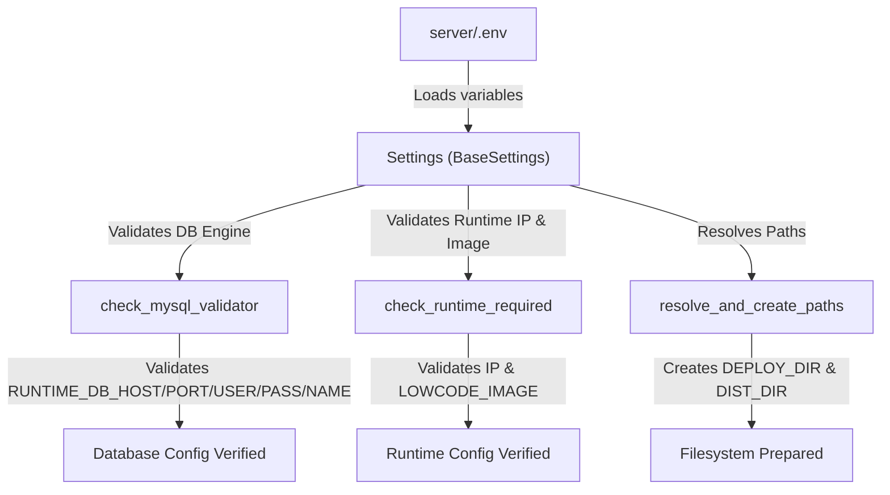
Sources: `server/.env.example:1-76`, `foundation/openjiuwen_runtime/foundation/config.py:16-140`

---

## Database Selection & Optional Drivers

Runtime supports four database backends via `RUNTIME_DB_TYPE` (`foundation/openjiuwen_runtime/foundation/config.py:20`):

1. **SQLite**: Default embedded storage requiring no external server.
2. **MySQL**: Relational storage requiring valid connection parameters (`RUNTIME_DB_HOST`, `RUNTIME_DB_PORT`, `RUNTIME_DB_USER`, `RUNTIME_DB_PASSWORD`, `RUNTIME_DB_NAME`).
3. **GaussDB / openGauss**: Enterprise relational databases requiring `async-gaussdb>=0.30.4`.

### Driver Installation Note
- Default installations include dependencies for `sqlite` and `mysql`.
- When `RUNTIME_DB_TYPE=gaussdb` or `RUNTIME_DB_TYPE=opengauss`, the `async-gaussdb` driver must be installed:
  ```shell
  uv pip install -e "./foundation[gaussdb]"
  ```

Sources: `server/.env.example:1-30`, `docs/en/1. Quick Start.md:21-26`, `foundation/openjiuwen_runtime/foundation/config.py:20`

---

## Documentation Set Layout

The runtime documentation repository is organized into distinct language sets under `docs/en/` and `docs/zh/`, structured to guide developers through installation, configuration, and agent deployment:

- **Quick Start (`docs/en/1. Quick Start.md`)**: Prerequisites, virtual environment setup, package installation, and Studio publishing steps.
- **Configuration (`docs/en/2. Configuration.md`)**: Comprehensive documentation for `.env` parameters, database setup, and process options.
- **Agent Deployment (`docs/en/3. Agent Deployment.md`)**: Details on `subprocess`, `docker`, and `Kubernetes` deployment models.
- **Agent Integration (`docs/en/4. Agent Integration.md`)**: HTTP API specifications, SSE query handling (`/query`), health checks (`/health`), and conversation management.

Sources: `docs/en/0. Project Overview.md:67-73`, `docs/en/1. Quick Start.md:1-12`, `docs/en/2. Configuration.md:1-5`

### Diagram: Startup and Runtime Initialization Flow

The following diagram bridges user operations (Natural Language Space) to execution modules (Code Entity Space) during service bootstrap.

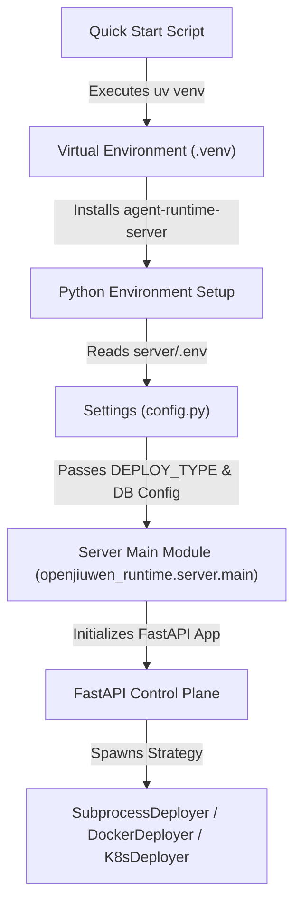
Sources: `docs/en/1. Quick Start.md:42-56`, `foundation/openjiuwen_runtime/foundation/config.py:16-167`, `server/.env.example:56-64`

---

# Page: Repository Structure & Packaging

# Repository Structure & Packaging

<details>
<summary>Relevant source files</summary>

The following files were used as context for generating this wiki page:

- [applications/lowcode_agent/pyproject.toml](applications/lowcode_agent/pyproject.toml)
- [cli/pyproject.toml](cli/pyproject.toml)
- [docker/Dockerfile.lowercode](docker/Dockerfile.lowercode)
- [docker/Dockerfile.server](docker/Dockerfile.server)
- [foundation/openjiuwen_runtime/foundation/__init__.py](foundation/openjiuwen_runtime/foundation/__init__.py)
- [foundation/openjiuwen_runtime/foundation/messaging/__init__.py](foundation/openjiuwen_runtime/foundation/messaging/__init__.py)
- [foundation/openjiuwen_runtime/foundation/messaging/amqp_json.py](foundation/openjiuwen_runtime/foundation/messaging/amqp_json.py)
- [foundation/pyproject.toml](foundation/pyproject.toml)
- [management/pyproject.toml](management/pyproject.toml)
- [scripts/add_dev_sources.py](scripts/add_dev_sources.py)
- [scripts/deploy_dev_server.sh](scripts/deploy_dev_server.sh)
- [scripts/run-server.ps1](scripts/run-server.ps1)
- [scripts/upload_pypi.sh](scripts/upload_pypi.sh)
- [server/pyproject.toml](server/pyproject.toml)
- [service/openjiuwen_runtime/service/__init__.py](service/openjiuwen_runtime/service/__init__.py)
- [service/pyproject.toml](service/pyproject.toml)

</details>


## Purpose & Scope
This page details the monorepo workspace architecture, inter-package dependency graphs, wheel compilation pipelines, PyPI publication workflows, and local development source injection mechanisms used across the `agent-runtime` codebase. 

---

## 1. Monorepo Workspace Packages & Layout
The repository is structured as a Python workspace containing multiple independent sub-packages sharing the `openjiuwen_runtime` namespace. Each package defines its own build configuration and dependencies via `pyproject.toml`.

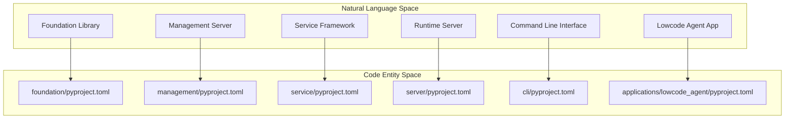
*Figure 1: Mapping natural language package identities to physical `pyproject.toml` configurations.*

- **Foundation Library**: Shared utilities, database handlers, security, and messaging primitives (`foundation/pyproject.toml` [foundation/pyproject.toml:1-63]()).
- **Management Server (Control Plane)**: FastAPI management service, deployment orchestration, and database models (`management/pyproject.toml` [management/pyproject.toml:1-61]()).
- **Service Framework (Data Plane)**: Base application abstractions (`BaseApp`, `AgentApp`) for agent processes (`service/pyproject.toml` [service/pyproject.toml:1-41]()).
- **Runtime Server**: Orchestrator entrypoint (`server/pyproject.toml` [server/pyproject.toml:1-33]()).
- **CLI**: Management command-line interface (`cli/pyproject.toml` [cli/pyproject.toml:1-36]()).
- **Lowcode Agent Runner**: IR-driven agent runner application (`applications/lowcode_agent/pyproject.toml` [applications/lowcode_agent/pyproject.toml:1-42]()).

**Sources:**
- `foundation/pyproject.toml` [foundation/pyproject.toml:1-63]()
- `management/pyproject.toml` [management/pyproject.toml:1-61]()
- `service/pyproject.toml` [service/pyproject.toml:1-41]()
- `server/pyproject.toml` [server/pyproject.toml:1-33]()
- `cli/pyproject.toml` [cli/pyproject.toml:1-36]()
- `applications/lowcode_agent/pyproject.toml` [applications/lowcode_agent/pyproject.toml:1-42]()

---

## 2. Dependency Graph (`pyproject.toml`)
The packages depend on each other hierarchically. `openjiuwen-runtime-foundation` forms the base layer, consumed by both management and service layers, which are subsequently bundled by the server and CLI tiers.

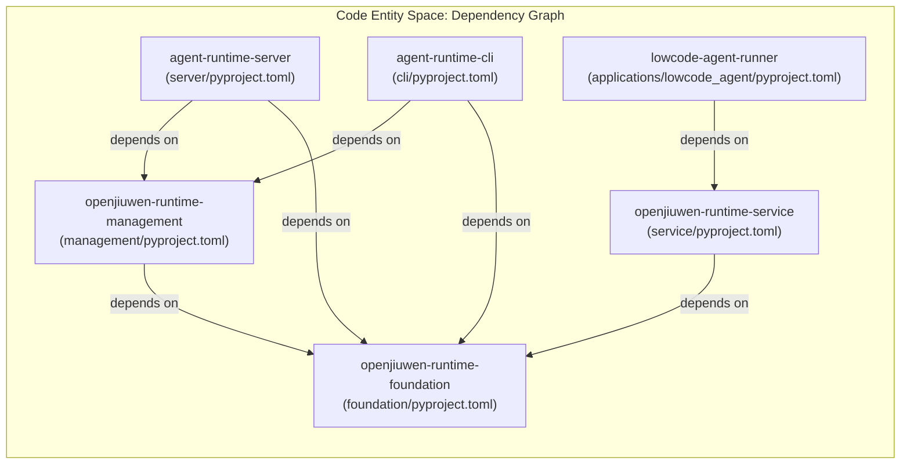
*Figure 2: Inter-package dependency hierarchy across workspace packages.*

Key dependency mappings defined in configuration files:
- `agent-runtime-server` declares dependencies on `openjiuwen-runtime-foundation==0.1.0` and `openjiuwen-runtime-management==0.1.0` (`server/pyproject.toml` [server/pyproject.toml:10-17]()).
- `openjiuwen-runtime-management` declares a dependency on `openjiuwen-runtime-foundation==0.1.0` (`management/pyproject.toml` [management/pyproject.toml:10-35]()).
- `openjiuwen-runtime-service` requires `openjiuwen-runtime-foundation==0.1.0` (`service/pyproject.toml` [service/pyproject.toml:10-18]()).

**Sources:**
- `server/pyproject.toml` [server/pyproject.toml:10-17]()
- `management/pyproject.toml` [management/pyproject.toml:10-35]()
- `service/pyproject.toml` [service/pyproject.toml:10-18]()

---

## 3. Wheel Builds & Packaging Utilities
Packaging and wheel compilation leverage `setuptools` build backends with `uv build` for rapid workspace iteration. The foundation library also provides programmatic packaging utilities (`foundation/openjiuwen_runtime/foundation/__init__.py` [foundation/openjiuwen_runtime/foundation/__init__.py:4-11]()).

| Utility / Function | Code Path | Description |
| :--- | :--- | :--- |
| `package_python_to_whl` | `foundation/openjiuwen_runtime/foundation/packaging.py` | Programmatically packages Python code into `.whl` files. |
| `create_virtualenv` | `foundation/openjiuwen_runtime/foundation/packaging.py` | Provisions isolated virtual environments via `uv`/`venv`. |
| `install_package` / `uninstall_package` | `foundation/openjiuwen_runtime/foundation/packaging.py` | Installs or removes packages inside target virtual environments. |

**Sources:**
- `foundation/openjiuwen_runtime/foundation/__init__.py` [foundation/openjiuwen_runtime/foundation/__init__.py:4-11]()
- `foundation/pyproject.toml` [foundation/pyproject.toml:1-3]()

---

## 4. Dev Source Injection & Local Deployment
For local development and testing, intra-repo dependencies can cause installation conflicts if locked to exact PyPI versions. Deployment scripts (`scripts/deploy_dev_server.sh` [scripts/deploy_dev_server.sh:1-120]() and `scripts/run-server.ps1` [scripts/run-server.ps1:1-157]()) dynamically sanitize `pyproject.toml` files by stripping internal dependency constraints, building local wheels into a shared `dist` directory, and installing packages in editable mode (`uv pip install -e`).

```mermaid
sequenceDiagram
    participant Script as deploy_dev_server.sh
    participant Config as pyproject.toml
    participant UV as uv build / uv sync
    participant Server as server runtime

    Script->>Config: Strip internal dependencies (e.g. openjiuwen-runtime-foundation)
    Script->>UV: uv sync and uv build --out-dir dist
    UV--create-->DistFolder["dist/*.whl"]
    Script->>Server: uv pip install -e ../management & -e ../foundation
    Server->>Server: python -m openjiuwen_runtime.server.main
```
*Figure 3: Dev source injection and local wheel compilation workflow.*

- **Dependency Stripping**: `scripts/deploy_dev_server.sh` uses `sed` to remove lines referencing internal packages like `openjiuwen-runtime-service` or `openjiuwen-runtime-foundation` before compilation (`scripts/deploy_dev_server.sh` [scripts/deploy_dev_server.sh:53-55]()).
- **Editable Installation**: After syncing dependencies, local development mode installs management and foundation via editable links (`scripts/deploy_dev_server.sh` [scripts/deploy_dev_server.sh:117-118]()).

**Sources:**
- `scripts/deploy_dev_server.sh` [scripts/deploy_dev_server.sh:1-120]()
- `scripts/run-server.ps1` [scripts/run-server.ps1:1-157]()

---

## 5. Containerized Builds & Namespace Package Installation
Dockerfiles (`docker/Dockerfile.server` [docker/Dockerfile.server:1-69]() and `docker/Dockerfile.lowercode` [docker/Dockerfile.lowercode:1-63]()) use multi-stage builds to compile wheels and install them into a shared runtime container.

- **Namespace Protection**: Because multiple workspace packages share the root `openjiuwen_runtime` namespace, standard `pip install --target` has a known bug where installing subsequent packages deletes the existing namespace directory. The build pipelines enforce `uv pip install --target=/app/site-packages`, which safely adds or overwrites files without purging the parent namespace directory (`docker/Dockerfile.server` [docker/Dockerfile.server:53-59](), `docker/Dockerfile.lowercode` [docker/Dockerfile.lowercode:48-54]()).

**Sources:**
- `docker/Dockerfile.server` [docker/Dockerfile.server:1-69]()
- `docker/Dockerfile.lowercode` [docker/Dockerfile.lowercode:1-63]()

---

## 6. PyPI Publication & Release Automation
Automated releases and PyPI publication are handled by `scripts/upload_pypi.sh` [scripts/upload_pypi.sh:1-82]().

- **Version Propagation**: The script iterates over target package directories (`foundation`, `management`, `service`, `server`, `applications/lowcode_agent`, etc.), updates `pyproject.toml` version fields dynamically via `sed`, and adjusts internal dependency version specifiers (`scripts/upload_pypi.sh` [scripts/upload_pypi.sh:31-56]()).
- **Build & Upload**: Packages are compiled via `uv build` and published using `twine upload` to private Huaweicloud repositories or official PyPI indexes (`scripts/upload_pypi.sh` [scripts/upload_pypi.sh:58-81]()).

**Sources:**
- `scripts/upload_pypi.sh` [scripts/upload_pypi.sh:1-82]()

---

# Page: Management Server (Control Plane)

# Management Server (Control Plane)

<details>
<summary>Relevant source files</summary>

The following files were used as context for generating this wiki page:

- [README.md](README.md)
- [README_zh.md](README_zh.md)
- [foundation/openjiuwen_runtime/foundation/venv_manager.py](foundation/openjiuwen_runtime/foundation/venv_manager.py)
- [management/openjiuwen_runtime/management/deployments/subprocess/deployer.py](management/openjiuwen_runtime/management/deployments/subprocess/deployer.py)
- [server/openjiuwen_runtime/server/main.py](server/openjiuwen_runtime/server/main.py)

</details>


The Management Server acts as the control plane for the openJiuwen Agent Runtime. It provides a FastAPI-based REST API service (`[server/openjiuwen_runtime/server/main.py:71-76]()`) that handles agent deployment requests, tenant context parsing, and database-backed instance tracking. It delegates execution tasks to the underlying deployment orchestration layers.

As a parent page, this section provides a high-level architectural overview of the control plane components. For in-depth technical details, refer to the child pages:
- [REST API & Middleware](#2.1)
- [DeploymentManager & Strategies](#2.2)

---

### Control Plane Architecture

The control plane coordinates client requests, intercepts them via tenant middleware, normalizes configurations, and routes them through the deployment manager to target execution environments.

### Diagram: Control Plane Request Flow to Deployment Execution

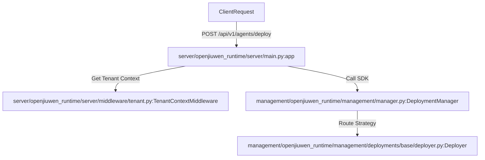

Sources: `[server/openjiuwen_runtime/server/main.py:71-216]()`, `[server/openjiuwen_runtime/server/middleware/tenant.py]()`

---

## 2.1 REST API & Middleware

The REST API layer (`[server/openjiuwen_runtime/server/main.py:84-216]()`) exposes endpoints for health checking (`[server/openjiuwen_runtime/server/main.py:84-88]()`), agent deployment (`[server/openjiuwen_runtime/server/main.py:169-216]()`), and listing deployments. It includes request query parsers (`[server/openjiuwen_runtime/server/main.py:158-164]()`) and tenant context extraction middleware to enforce resource boundaries across multiple users and spaces.

For implementation details on endpoints, request parsers, tenant context propagation, and CLI/WHL integration, see [REST API & Middleware](#2.1).

Sources: `[server/openjiuwen_runtime/server/main.py:84-216]()`

---

## 2.2 DeploymentManager & Strategies

The deployment orchestration layer (`[management/openjiuwen_runtime/management/manager.py]()`) manages the lifecycle of agent runtimes. It abstracts deployment models (`[management/openjiuwen_runtime/management/models/deployment_params.py]()`), tracks state in database handlers (`[server/openjiuwen_runtime/server/main.py:44-55]()`), and selects the appropriate strategy (such as subprocess, Docker, or Kubernetes) to instantiate agent services.

### Diagram: Deployment Execution Architecture

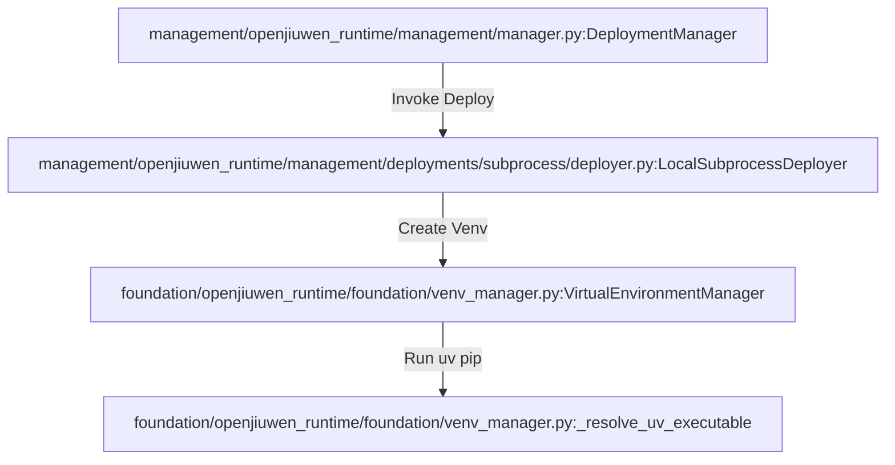

Sources: `[management/openjiuwen_runtime/management/deployments/subprocess/deployer.py:39-148]`, `[foundation/openjiuwen_runtime/foundation/venv_manager.py:21-180]()`

For detailed discussions on strategy abstraction, virtual environment provisioning via `uv`, port allocation, and container/K8s deployment lifecycles, see [DeploymentManager & Strategies](#2.2).

Sources: `[management/openjiuwen_runtime/management/deployments/subprocess/deployer.py:39-188]()`, `[foundation/openjiuwen_runtime/foundation/venv_manager.py:21-128]()`

---

# Page: REST API & Middleware

# REST API & Middleware

<details>
<summary>Relevant source files</summary>

The following files were used as context for generating this wiki page:

- [cli/openjiuwen_runtime/cli/main.py](cli/openjiuwen_runtime/cli/main.py)
- [cli/openjiuwen_runtime/cli/templates.py](cli/openjiuwen_runtime/cli/templates.py)
- [foundation/openjiuwen_runtime/foundation/venv_manager.py](foundation/openjiuwen_runtime/foundation/venv_manager.py)
- [management/openjiuwen_runtime/management/deployments/subprocess/deployer.py](management/openjiuwen_runtime/management/deployments/subprocess/deployer.py)
- [scripts/build-cli.sh](scripts/build-cli.sh)
- [server/openjiuwen_runtime/server/converter/agent_converter.py](server/openjiuwen_runtime/server/converter/agent_converter.py)
- [server/openjiuwen_runtime/server/main.py](server/openjiuwen_runtime/server/main.py)
- [server/openjiuwen_runtime/server/middleware/tenant.py](server/openjiuwen_runtime/server/middleware/tenant.py)
- [server/openjiuwen_runtime/server/oss/client.py](server/openjiuwen_runtime/server/oss/client.py)

</details>


## Purpose & Scope
This page details the management server REST API, FastAPI middleware, request parsing pipelines, mock object storage integration, virtual environment provisioning, and the command-line interface (CLI) for the openJiuwen Agent Runtime. It covers how control-plane requests are ingested, authenticated via tenant context headers, translated into deployment parameters, and dispatched to execution strategies like local subprocesses using isolated virtual environments.

---

## 1. FastAPI Server & Lifecycle Management

The control plane management server is constructed as a FastAPI application in `server/openjiuwen_runtime/server/main.py`. It establishes database handlers (`SQLiteHandler`, `MySQLHandler`, or `GaussDBHandler`) based on the runtime configuration and wraps application startup and shutdown within an asynchronous lifespan context manager that initializes and tears down the `DeploymentManager` [server/openjiuwen_runtime/server/main.py:20-68].

```mermaid
title "Server Lifespan and Database Initialization Flow"
graph TD
    subgraph "Natural Language Space"
        A["Load Configuration"] --> B["Select Database Handler"]
        B --> C["Initialize Deployment Manager"]
        C --> D["FastAPI Lifespan Startup"]
        D --> E["FastAPI Lifespan Shutdown"]
    end
    subgraph "Code Entity Space"
        F["settings.RUNTIME_DB_TYPE\n[server/openjiuwen_runtime/server/main.py:43-55]()"] --> G["db_handler\n[server/openjiuwen_runtime/server/main.py:45-51]()"]
        G --> H["manager = DeploymentManager(db_handler)\n[server/openjiuwen_runtime/server/main.py:57]()"]
        H --> I["lifespan(fastapi_app: FastAPI)\n[server/openjiuwen_runtime/server/main.py:60-68]()"]
        I --> J["await manager.initialize()\n[server/openjiuwen_runtime/server/main.py:64]()"]
        I --> K["await manager.shutdown()\n[server/openjiuwen_runtime/server/main.py:67]()"]
    end
    A -.-> F
    C -.-> H
    D -.-> I
    E -.-> K
```

Sources: `server/openjiuwen_runtime/server/main.py` [server/openjiuwen_runtime/server/main.py:20-80]()

---

## 2. REST Endpoints & Request Parsing

The server exposes core control-plane endpoints, including a basic health check and an agent deployment endpoint that consumes file uploads and query parameters [server/openjiuwen_runtime/server/main.py:84-216].

### Health Check Endpoint
* **Route**: `GET /health` [server/openjiuwen_runtime/server/main.py:84-87]()
* **Behavior**: Returns a static JSON payload confirming the service status [server/openjiuwen_runtime/server/main.py:85-87]().

### Agent Deployment Endpoint
* **Route**: `POST /api/v1/agents/deploy` [server/openjiuwen_runtime/server/main.py:169-174]()
* **Request Handling**: Ingests an uploaded JSON configuration file (`UploadFile`), extracts tenant headers via `get_tenant_context(request)`, parses deployment options using `AgentDeployQuery` and `_parse_agent_deploy_query`, and prepares subprocess execution environments if necessary [server/openjiuwen_runtime/server/main.py:172-216].

| Parameter / Query Field | Type | Description | Code Reference |
| :--- | :--- | :--- | :--- |
| `name` | `str` | Deployment name / package identifier | `[server/openjiuwen_runtime/server/main.py:152]()` |
| `mode` | `str` | Deployer type (default: `"subprocess"`) | `[server/openjiuwen_runtime/server/main.py:153]()` |
| `port` | `int \| None` | Target service port (auto-allocated if blank) | `[server/openjiuwen_runtime/server/main.py:154]()` |
| `userdata` | `str \| None` | User custom payload/data | `[server/openjiuwen_runtime/server/main.py:155]()` |

Sources: `server/openjiuwen_runtime/server/main.py` [server/openjiuwen_runtime/server/main.py:90-216]()

---

## 3. Tenant Context Middleware

Isolation across user workspaces is enforced by `TenantContextMiddleware` defined in `server/openjiuwen_runtime/server/middleware/tenant.py` [server/openjiuwen_runtime/server/middleware/tenant.py:22-61].

```mermaid
title "Tenant Context Resolution Pipeline"
graph TD
    subgraph "Natural Language Space"
        A["Incoming HTTP Request"] --> B["Extract Headers"]
        B --> C["Validate Tenant Requirements"]
        C --> D["Inject into Request State"]
        D --> E["Pass to Next Middleware / Route"]
    end
    subgraph "Code Entity Space"
        F["BaseHTTPMiddleware.dispatch\n[server/openjiuwen_runtime/server/middleware/tenant.py:37]()"] --> G["request.headers.get('X-User-ID')\n[server/openjiuwen_runtime/server/middleware/tenant.py:41-42]()"]
        G --> H["require_tenant check\n[server/openjiuwen_runtime/server/middleware/tenant.py:45-51]()"]
        H --> I["request.state.user_id / space_id\n[server/openjiuwen_runtime/server/middleware/tenant.py:54-55]()"]
        I --> J["call_next(request)\n[server/openjiuwen_runtime/server/middleware/tenant.py:59]()"]
    end
    A -.-> F
    B -.-> G
    C -.-> H
    D -.-> I
    E -.-> J
```

Sources: `server/openjiuwen_runtime/server/middleware/tenant.py` [server/openjiuwen_runtime/server/middleware/tenant.py:22-74]()

---

## 4. OSS Client

A mock object storage client `MockOSSClient` is provided in `server/openjiuwen_runtime/server/oss/client.py` to simulate artifact persistence [server/openjiuwen_runtime/server/oss/client.py:15-59].

* **`upload_file(local_file_path, object_key)`**: Simulates file upload, logging the operation and returning a deterministic `mock://` URL [server/openjiuwen_runtime/server/oss/client.py:31-45].
* **`delete_file(object_key)`**: Simulates object deletion, returning `True` upon completion [server/openjiuwen_runtime/server/oss/client.py:47-58].

Sources: `server/openjiuwen_runtime/server/oss/client.py` [server/openjiuwen_runtime/server/oss/client.py:1-58]()

---

## 5. Virtual Environment & Subprocess Deployment

Local subprocess deployments and dependency isolation rely on `VirtualEnvironmentManager` and `LocalSubprocessDeployer` [management/openjiuwen_runtime/management/deployments/subprocess/deployer.py:39-156, foundation/openjiuwen_runtime/foundation/venv_manager.py:29-124].

```mermaid
title "Agent Deployment & Venv Provisioning Flow"
graph TD
    subgraph "Natural Language Space"
        A["Deploy Request Received"] --> B["Create Isolated Venv"]
        B --> C["Resolve uv Executable"]
        C --> D["Install Wheel Packages"]
        D --> E["Spawn Python Process"]
    end
    subgraph "Code Entity Space"
        F["LocalSubprocessDeployer.deploy\n[management/openjiuwen_runtime/management/deployments/subprocess/deployer.py:114]()"] --> G["VirtualEnvironmentManager.create_venv\n[foundation/openjiuwen_runtime/foundation/venv_manager.py:49]()"]
        G --> H["_resolve_uv_executable\n[foundation/openjiuwen_runtime/foundation/venv_manager.py:21]()"]
        H --> I["VirtualEnvironmentManager.pip_install\n[foundation/openjiuwen_runtime/foundation/venv_manager.py:159]()"]
        I --> J["asyncio.create_subprocess_exec\n[management/openjiuwen_runtime/management/deployments/subprocess/deployer.py:171-188]()"]
    end
    A -.-> F
    B -.-> G
    C -.-> H
    D -.-> I
    E -.-> J
```

Sources: 
* `management/openjiuwen_runtime/management/deployments/subprocess/deployer.py` [management/openjiuwen_runtime/management/deployments/subprocess/deployer.py:39-188]()
* `foundation/openjiuwen_runtime/foundation/venv_manager.py` [foundation/openjiuwen_runtime/foundation/venv_manager.py:29-124]()

---

## 6. Management CLI

The management CLI (`cli/openjiuwen_runtime/cli/main.py`) provides commands for building project wheels via `uv build` and executing agent lifecycle commands (`deploy`, `list`, `get`, `delete`) [cli/openjiuwen_runtime/cli/main.py:59-223].

* **`_build_project(project_dir)`**: Validates `pyproject.toml`, invokes `uv build` inside the project folder, and returns the path to the compiled wheel [cli/openjiuwen_runtime/cli/main.py:59-92].
* **`deploy`**: Resolves module paths, builds distribution packages, and invokes `DeploymentManager.deploy_agent` [cli/openjiuwen_runtime/cli/main.py:131-159].

Sources: `cli/openjiuwen_runtime/cli/main.py` [cli/openjiuwen_runtime/cli/main.py:40-223]()

---

# Page: DeploymentManager & Strategies

# DeploymentManager & Strategies

<details>
<summary>Relevant source files</summary>

The following files were used as context for generating this wiki page:

- [applications/lowcode_agent/openjiuwen_runtime/examples/lowcode_agent/lowcode_agent_runner.py](applications/lowcode_agent/openjiuwen_runtime/examples/lowcode_agent/lowcode_agent_runner.py)
- [applications/lowcode_agent/openjiuwen_runtime/examples/lowcode_agent/workflow_registration.py](applications/lowcode_agent/openjiuwen_runtime/examples/lowcode_agent/workflow_registration.py)
- [management/openjiuwen_runtime/management/__init__.py](management/openjiuwen_runtime/management/__init__.py)
- [management/openjiuwen_runtime/management/deployments/__init__.py](management/openjiuwen_runtime/management/deployments/__init__.py)
- [management/openjiuwen_runtime/management/deployments/base/strategy.py](management/openjiuwen_runtime/management/deployments/base/strategy.py)
- [management/openjiuwen_runtime/management/deployments/k8s/deployer.py](management/openjiuwen_runtime/management/deployments/k8s/deployer.py)
- [management/openjiuwen_runtime/management/deployments/k8s/models.py](management/openjiuwen_runtime/management/deployments/k8s/models.py)
- [management/openjiuwen_runtime/management/deployments/k8s/strategy.py](management/openjiuwen_runtime/management/deployments/k8s/strategy.py)
- [management/openjiuwen_runtime/management/manager.py](management/openjiuwen_runtime/management/manager.py)
- [management/openjiuwen_runtime/management/models/__init__.py](management/openjiuwen_runtime/management/models/__init__.py)
- [management/openjiuwen_runtime/management/models/deployment_params.py](management/openjiuwen_runtime/management/models/deployment_params.py)
- [management/openjiuwen_runtime/management/models/enums.py](management/openjiuwen_runtime/management/models/enums.py)
- [management/tests/system_tests/__init__.py](management/tests/system_tests/__init__.py)
- [management/tests/system_tests/test_manager.py](management/tests/system_tests/test_manager.py)
- [service/openjiuwen_runtime/service/app/agent_app.py](service/openjiuwen_runtime/service/app/agent_app.py)
- [service/tests/unit_tests/test_middleware.py](service/tests/unit_tests/test_middleware.py)

</details>


This page covers the core orchestration architecture of the control plane's deployment management subsystem (`DeploymentManager`), the associated deployment models and enums, and the strategy abstraction layer. 

As a parent page, this section provides a high-level architectural overview. For concrete deployment runtime implementations, refer to the child pages:
- [Subprocess Deployment](#2.2.1) — LocalSubprocessDeployer, venv provisioning with uv, port allocation, process lifecycle.
- [Docker Deployment](#2.2.2) — DockerDeployer create/cp/start sequence, env & proxy propagation, container status and cleanup.
- [Kubernetes Deployment](#2.2.3) — K8s deployer/strategy, pod specs, image and namespace configuration.

---

## 1. DeploymentManager Architecture & Lifecycle

The `DeploymentManager` class serves as the central control plane coordinator for managing agent and plugin instances across different runtime environments. It handles database state synchronization, strategy resolution, lifecycle execution (`deploy`, `stop`, `get_status`), and health checks [management/openjiuwen_runtime/management/manager.py:80-148]().

```mermaid
title "Architecture: Natural Language Space to Code Entity Space for Deployment Management"
graph TD
    subgraph Natural_Language_Space ["Natural Language Space"]
        DM["Deployment Manager Control Plane"]
        Strat["Deployment Strategy Abstraction"]
        SubStrategy["Subprocess Strategy"]
        DockerStrategy["Docker Strategy"]
        K8sStrategy["Kubernetes Strategy"]
        DB["Deployment Database Handler"]
    end

    subgraph Code_Entity_Space ["Code Entity Space"]
        CodeDM["DeploymentManager\n(management/openjiuwen_runtime/management/manager.py:80-148)"]
        CodeBaseStrat["BaseDeploymentStrategy\n(management/openjiuwen_runtime/management/deployments/base/strategy.py:67-111)"]
        CodeSubStrat["SubprocessStrategy\n(management/openjiuwen_runtime/management/deployments/__init__.py)"]
        CodeDockerStrat["DockerStrategy\n(management/openjiuwen_runtime/management/deployments/__init__.py)"]
        CodeK8sStrat["K8sStrategy\n(management/openjiuwen_runtime/management/deployments/k8s/strategy.py:49-181)"]
        CodeDB["DBHandler\n(foundation/db/handler.py)"]
    end

    DM --> CodeDM
    Strat --> CodeBaseStrat
    SubStrategy --> CodeSubStrat
    DockerStrategy --> CodeDockerStrat
    K8sStrategy --> CodeK8sStrat
    DB --> CodeDB
```
*Sources: `management/openjiuwen_runtime/management/manager.py`, `management/openjiuwen_runtime/management/deployments/base/strategy.py`, `management/openjiuwen_runtime/management/deployments/k8s/strategy.py`*

Upon initialization, `DeploymentManager` connects to the underlying database (`DBHandler`), initializes the global deployment table (`DEPLOYMENT_TABLE_DEF`), and iterates through registered strategies to initialize their respective storage tables [management/openjiuwen_runtime/management/manager.py:134-142]().

```mermaid
title "Deployment Execution Flow"
sequenceDiagram
    participant API as "REST API / User"
    participant DM as "DeploymentManager"
    participant Strat as "BaseDeploymentStrategy"
    participant Dep as "Deployer"

    API->>DM: deploy_agent(params)
    DM->>DM: _deploy(execution_params)
    DM->>Strat: deploy(deployment_id, db_handler)
    Strat->>Strat: Get record & update status to PENDING
    Strat->>Dep: deploy(ctx)
    Dep-->>Strat: DeployResult (success/url)
    Strat->>DM: Update deployment status (RUNNING/FAILED)
    DM-->>API: DeploymentInfo
```
*Sources: `management/openjiuwen_runtime/management/manager.py`, `management/openjiuwen_runtime/management/deployments/base/strategy.py`*

Sources: `management/openjiuwen_runtime/management/manager.py`, `management/openjiuwen_runtime/management/deployments/base/strategy.py`

---

## 2. Deployment Models & Enums

The deployment subsystem defines strict type classifications and parameters to decouple API requests from underlying deployment modes.

- **`DeployMode`**: Specifies the target infrastructure tier (`SUBPROCESS`, `DOCKER`, `K8S`) [management/openjiuwen_runtime/management/models/enums.py]().
- **`DeploymentType`**: Distinguishes between payload types (`AGENT`, `PLUGIN`, `IMAGE`) [management/openjiuwen_runtime/management/models/enums.py]().
- **`DeploymentStatus`**: Represents state transitions (`PENDING`, `RUNNING`, `STOPPED`, `FAILED`) [management/openjiuwen_runtime/management/models/enums.py]().
- **`DeployAgentParams` / `DeployPluginParams`**: Encapsulates incoming target naming, versioning, mode, and metadata extras [management/openjiuwen_runtime/management/models/deployment_params.py]().

Sources: `management/openjiuwen_runtime/management/models/enums.py`, `management/openjiuwen_runtime/management/models/deployment_params.py`

---

## 3. Strategy Abstraction & Selection

To support pluggable backend infrastructure without altering management control logic, the codebase implements a strategy pattern rooted in `DeploymentStrategy` and extended by `BaseDeploymentStrategy` [management/openjiuwen_runtime/management/deployments/base/strategy.py:22-67]().

```mermaid
title "Strategy Class Hierarchy"
classDiagram
    class DeploymentStrategy {
        <<interface>>
        +get_table_definition() TableDefinition
        +create_record() Any
        +get_record() Optional
        +delete_record() bool
        +deploy() DeployResult
        +stop() DeployResult
        +get_status() DeploymentStatus
    }

    class BaseDeploymentStrategy {
        <<abstract>>
        #_deployer Deployer
        #_table_def TableDefinition
        +deploy() DeployResult
        +stop() DeployResult
        +get_status() DeploymentStatus
    }

    class SubprocessStrategy {
        +_create_default_deployer()
        +_build_deploy_context()
    }

    class DockerStrategy {
        +_create_default_deployer()
        +_build_deploy_context()
    }

    class K8sStrategy {
        +_create_default_deployer()
        +_build_deploy_context()
    }

    DeploymentStrategy <|-- BaseDeploymentStrategy
    BaseDeploymentStrategy <|-- SubprocessStrategy
    BaseDeploymentStrategy <|-- DockerStrategy
    BaseDeploymentStrategy <|-- K8sStrategy
```
*Sources: `management/openjiuwen_runtime/management/deployments/base/strategy.py`, `management/openjiuwen_runtime/management/deployments/k8s/strategy.py`*

`DeploymentManager` maps each `DeployMode` to its corresponding strategy during startup (`_create_default_strategies`). If optional dependencies (such as Kubernetes client libraries) are missing, the corresponding strategy is safely disabled with a warning [management/openjiuwen_runtime/management/manager.py:92-107]().

Sources: `management/openjiuwen_runtime/management/manager.py`, `management/openjiuwen_runtime/management/deployments/base/strategy.py`, `management/openjiuwen_runtime/management/deployments/k8s/strategy.py`

---

## 4. Child Deployment Strategies

For deep technical details on specific deployment runtimes, consult the respective child pages:

- **[Subprocess Deployment](#2.2.1)**: Covers `LocalSubprocessDeployer`, virtual environment provisioning via `uv`, port binding, and process supervision.
- **[Docker Deployment](#2.2.2)**: Covers `DockerDeployer`, container creation, file copying (`cp`), start sequences, environment variable propagation, and cleanup.
- **[Kubernetes Deployment](#2.2.3)**: Covers `K8sDeployer` and `K8sStrategy`, pod specifications, dynamic image configuration, and namespace management.

Sources: `management/openjiuwen_runtime/management/deployments/base/strategy.py`, `management/openjiuwen_runtime/management/deployments/k8s/strategy.py`

---

# Page: Subprocess Deployment

# Subprocess Deployment

<details>
<summary>Relevant source files</summary>

The following files were used as context for generating this wiki page:

- [applications/lowcode_agent/openjiuwen_runtime/examples/lowcode_agent/__main__.py](applications/lowcode_agent/openjiuwen_runtime/examples/lowcode_agent/__main__.py)
- [foundation/openjiuwen_runtime/foundation/venv_manager.py](foundation/openjiuwen_runtime/foundation/venv_manager.py)
- [management/openjiuwen_runtime/management/deployments/base/models.py](management/openjiuwen_runtime/management/deployments/base/models.py)
- [management/openjiuwen_runtime/management/deployments/subprocess/deployer.py](management/openjiuwen_runtime/management/deployments/subprocess/deployer.py)
- [management/openjiuwen_runtime/management/deployments/subprocess/models.py](management/openjiuwen_runtime/management/deployments/subprocess/models.py)
- [management/openjiuwen_runtime/management/deployments/subprocess/strategy.py](management/openjiuwen_runtime/management/deployments/subprocess/strategy.py)
- [server/openjiuwen_runtime/server/main.py](server/openjiuwen_runtime/server/main.py)

</details>


## Purpose and Scope
This section covers the local subprocess deployment mechanism within the agent runtime management plane. Subprocess deployment isolates agent instances by provisioning dedicated virtual environments using `uv`, allocating unique network ports, configuring Python dependencies (including local wheel builds or PyPI packages), and managing the execution lifecycle (startup, status checking, and termination via PID).

Sources: `management/openjiuwen_runtime/management/deployments/subprocess/deployer.py:4-11`()

---

## Subprocess Architecture & Control Flow

The following diagram maps the natural language deployment concepts to the actual code entities involved in orchestrating a subprocess deployment from the FastAPI control plane down to the spawned agent runtime.

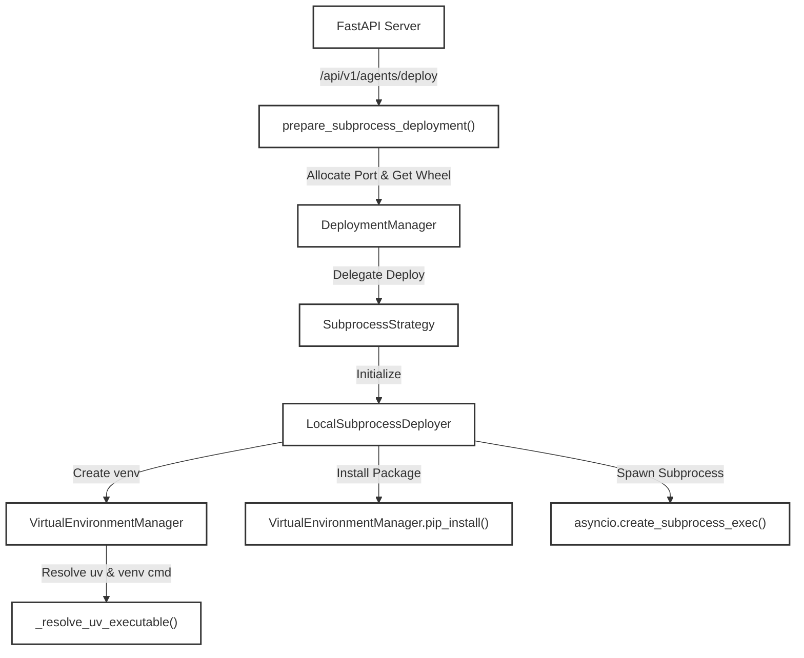
Sources: `server/openjiuwen_runtime/server/main.py:169-216`(), `management/openjiuwen_runtime/management/deployments/subprocess/deployer.py:114-188`(), `management/openjiuwen_runtime/management/deployments/subprocess/strategy.py:72-90`()

---

## Port Allocation and Preprocessing

Before a subprocess is launched, the server inspects available network ports and resolves the required package wheel paths based on the operational mode (`dev` vs `product`).

### Key Functions
- `prepare_subprocess_deployment(deploy_type, port)`: Validates or automatically assigns an available port using `allocate_port()` and `is_port_available()`. In development mode (`settings.MODE == "dev"`), it locates the precompiled `lowcode_agent_runner` wheel file under `settings.dist_path`.
- `get_deploy_type(mode)`: Enforces global deployment mode constraints defined in `settings.DEPLOY_TYPE`.

```python
# Port allocation check tracking set
_allocated_ports: set[int] = set()
```

Sources: `server/openjiuwen_runtime/server/main.py:22-40`(), `server/openjiuwen_runtime/server/main.py:90-146`()

---

## Virtual Environment Provisioning with `uv`

The `VirtualEnvironmentManager` class handles the creation and package installation of isolated virtual environments for each unique `deployment_id` using `uv`.

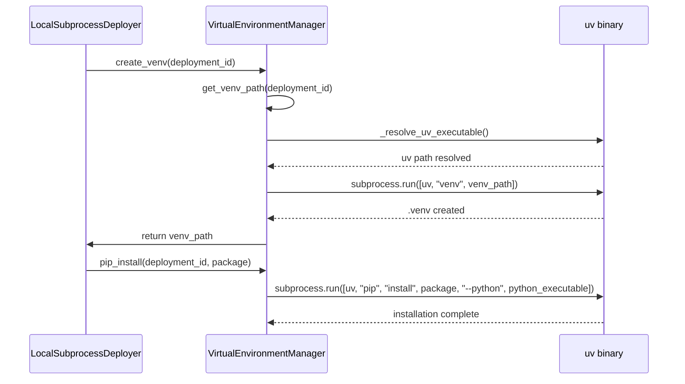
Sources: `foundation/openjiuwen_runtime/foundation/venv_manager.py:21-47`(), `foundation/openjiuwen_runtime/foundation/venv_manager.py:49-124`(), `foundation/openjiuwen_runtime/foundation/venv_manager.py:159-207`()

### Key Implementation Details
- `_resolve_uv_executable()`: Locates the `uv` binary via `shutil.which("uv")`, raising a `RuntimeError` if missing.
- `VirtualEnvironmentManager.create_venv()`: Executes `uv venv` to bootstrap the environment and runs `ensurepip` as a fallback if `pip` is absent.
- `VirtualEnvironmentManager.pip_install()`: Installs packages into the isolated environment with built-in retry logic (up to 3 attempts), extended HTTP timeouts (`UV_HTTP_TIMEOUT=600`), and restricted concurrency (`UV_CONCURRENT_DOWNLOADS=1`) to handle unstable or private PyPI servers.

Sources: `foundation/openjiuwen_runtime/foundation/venv_manager.py:21-26`(), `foundation/openjiuwen_runtime/foundation/venv_manager.py:49-128`(), `foundation/openjiuwen_runtime/foundation/venv_manager.py:159-207`()

---

## Process Lifecycle and Execution

`LocalSubprocessDeployer` inherits from the base `Deployer` abstract class and manages process execution, monitoring, and termination.

### Execution Flow in `LocalSubprocessDeployer.deploy()`
1. **Environment Setup**: Invokes `VirtualEnvironmentManager.create_venv()` using `deployment_id`.
2. **Package Installation**: Installs base runtime wheels (`openjiuwen_*.whl`) and agent-specific wheels if in `dev` mode, or fetches `lowcode-agent-runner` from PyPI in `product` mode.
3. **Command Construction**: Assembles the execution list using the virtual environment's python executable:
   ```bash
   python -m openjiuwen_runtime.examples.lowcode_agent --host 0.0.0.0 --port <port> --irpath <ir_path>
   ```
4. **Process Spawning**: Starts the process using `asyncio.create_subprocess_exec()` with an environment variable mapping containing `VIRTUAL_ENV`. On Windows, it applies `subprocess.CREATE_NEW_PROCESS_GROUP` to isolate signal handling.

### Process Management Operations
- `_check_process_by_pid(pid)`: Checks if a process is running using `kill -0` on POSIX systems or `tasklist.exe` on Windows (`win32`).
- `_kill_by_pid(pid)`: Terminates a process using `/bin/kill -9` on POSIX or `taskkill.exe /F /PID` on Windows.

Sources: `management/openjiuwen_runtime/management/deployments/subprocess/deployer.py:39-188`()

---

## Strategy and Persistence Models

`SubprocessStrategy` bridges the orchestration logic with persistence layers, mapping deployment records to database tables.

### Data Models & Table Definition
- `SubprocessParams`: Dataclass holding subprocess-specific attributes such as `whl_path`, `ir_path`, `package_name`, `venv_path`, and `userdata`.
- `ProcessInfo`: Pydantic model representing process deployment metadata retrieved from the database.
- `PROCESS_TABLE_DEF`: Defines the relational schema (`process`) containing columns for `deployment_id`, `version`, `host`, `port`, `url`, `pid`, `whl_path`, `ir_path`, `package_name`, `venv_path`, and JSON-encoded `data`.

```python
PROCESS_TABLE_DEF = TableDefinition(
    table_name="process",
    columns=[
        ColumnDefinition("id", "integer", primary_key=True, autoincrement=True),
        ColumnDefinition("deployment_id", "string", length=64, unique=True, nullable=False),
        ColumnDefinition("version", "string", length=32, nullable=False),
        ColumnDefinition("host", "string", length=255, nullable=False),
        ColumnDefinition("port", "integer", nullable=True),
        ColumnDefinition("url", "string", length=512, nullable=True),
        ColumnDefinition("pid", "integer", nullable=True),
        ColumnDefinition("whl_path", "string", length=512, nullable=True),
        ColumnDefinition("ir_path", "string", length=512, nullable=True),
        ColumnDefinition("package_name", "string", length=255, nullable=True),
        ColumnDefinition("venv_path", "string", length=512, nullable=True),
        ColumnDefinition("created_at", "datetime", nullable=False),
        ColumnDefinition("updated_at", "datetime", nullable=False),
        ColumnDefinition("data", "json", nullable=True),
    ],
    indexes=[
        IndexDefinition(["deployment_id"], unique=True),
    ],
)
```

Sources: `management/openjiuwen_runtime/management/deployments/subprocess/models.py:16-82`(), `management/openjiuwen_runtime/management/deployments/subprocess/strategy.py:15-110`()

---

# Page: Docker Deployment

# Docker Deployment

<details>
<summary>Relevant source files</summary>

The following files were used as context for generating this wiki page:

- [.gitmodules](.gitmodules)
- [management/openjiuwen_runtime/management/deployments/docker/deployer.py](management/openjiuwen_runtime/management/deployments/docker/deployer.py)
- [management/openjiuwen_runtime/management/deployments/docker/models.py](management/openjiuwen_runtime/management/deployments/docker/models.py)
- [management/openjiuwen_runtime/management/deployments/docker/strategy.py](management/openjiuwen_runtime/management/deployments/docker/strategy.py)
- [management/openjiuwen_runtime/management/deployments/docker/utils.py](management/openjiuwen_runtime/management/deployments/docker/utils.py)

</details>


## Purpose and Scope
This page details the implementation of Docker-based deployments within the openJiuwen Agent Runtime control plane. It covers the `DockerDeployer` container lifecycle management, the specialized `docker create` -> `docker cp` -> `docker start` sequence designed to bypass volume mounting limitations in containerized control planes, automatic port allocation, environment/proxy propagation, and database persistence via `DockerStrategy` and `DOCKER_TABLE_DEF`.

---

## 1. Core Data Models and Strategy

The Docker deployment subsystem relies on distinct data structures and a concrete strategy implementation to bridge management requests with containerized runtime execution.

- **`DockerParams`**: Defines container-specific options including `image`, `container_name`, `env_vars`, `volumes`, `whl_path`, `ir_path`, `package_name`, and `port` [management/openjiuwen_runtime/management/deployments/docker/models.py:16-25]().
- **`DockerInfo`**: Pydantic model representing persisted deployment records [management/openjiuwen_runtime/management/deployments/docker/models.py:28-48]().
- **`DOCKER_TABLE_DEF`**: SQLAlchemy/DB table definition containing columns for deployment IDs, container IDs, host/port bindings, and JSON metadata [management/openjiuwen_runtime/management/deployments/docker/models.py:66-90]().
- **`DockerStrategy`**: Implements `BaseDeploymentStrategy` to manage record creation, context rebuilding, and stop/status parameter extraction [management/openjiuwen_runtime/management/deployments/docker/strategy.py:20-113]().

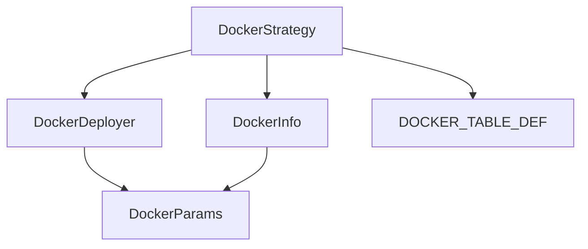
*Sources: [management/openjiuwen_runtime/management/deployments/docker/strategy.py:20-113](), [management/openjiuwen_runtime/management/deployments/docker/models.py:16-90]()*

---

## 2. DockerDeployer Implementation & Lifecycle Sequence

The `DockerDeployer` class handles direct communication with the Docker daemon via asynchronous subprocess execution [management/openjiuwen_runtime/management/deployments/docker/deployer.py:32-68]().

### Lowcode Container Deployment Sequence (`deploy_lowcode_container`)

When deploying lowcode agent containers, `DockerDeployer` adopts a strict three-step sequence: `docker create` -> `docker cp` -> `docker start` [management/openjiuwen_runtime/management/deployments/docker/deployer.py:70-132](). 

This sequence avoids issues with `docker run -v` mounting. When the management server itself runs inside a container and mounts `/var/run/docker.sock`, any relative or absolute file paths passed to `-v` evaluate against the host filesystem rather than the management container's internal filesystem, resulting in empty directory mounts. By creating an empty container first, files like `ir.json` can be reliably streamed inside using `docker cp` [management/openjiuwen_runtime/management/deployments/docker/deployer.py:80-86]().

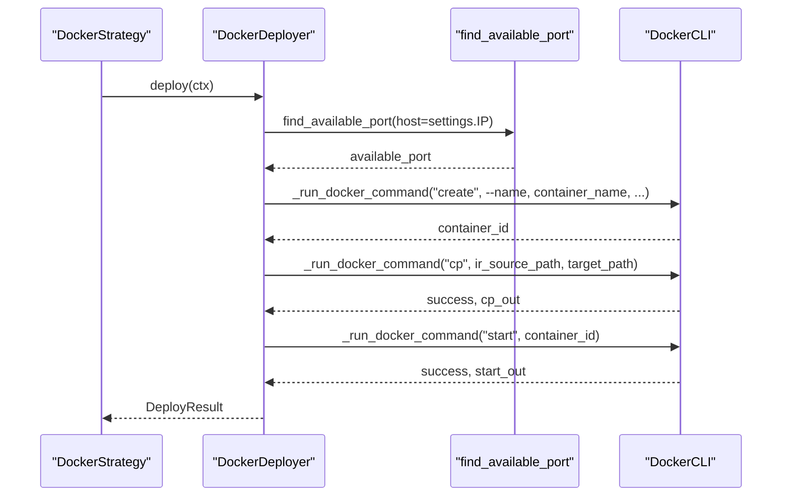
*Sources: [management/openjiuwen_runtime/management/deployments/docker/deployer.py:70-132](), [management/openjiuwen_runtime/management/deployments/docker/utils.py:27-62]()*

### Port Allocation

Before launching a container, `DockerDeployer` scans for an available host port using `find_available_port` from the utility module, which checks TCP connectivity across a specified port range using concurrent worker threads [management/openjiuwen_runtime/management/deployments/docker/utils.py:27-62]().

*Sources: [management/openjiuwen_runtime/management/deployments/docker/deployer.py:189-194](), [management/openjiuwen_runtime/management/deployments/docker/utils.py:1-62]()*

---

## 3. Environment & Proxy Propagation

During the `deploy()` execution, `DockerDeployer` automatically propagates parent container network proxy configurations and link authentication parameters into the target container environment [management/openjiuwen_runtime/management/deployments/docker/deployer.py:133-181]().

1. **Proxy Propagation**: Standard proxy environment variables (`HTTP_PROXY`, `HTTPS_PROXY`, `NO_PROXY`, and their lowercase variants) are read from the host environment, filtered for non-empty values, and merged with custom environment variables (with custom variables taking precedence) [management/openjiuwen_runtime/management/deployments/docker/deployer.py:162-173]().
2. **Link Authentication (`link-auth`)**: Link-auth variables (`CLAW_LINK_AUTH_MODE`, `CLAW_LINK_TOKEN_TTL`) are explicitly extracted from the control plane's environment and injected via `setdefault` to ensure AgentServer containers inherit required verification tokens for gateway reverse-validation [management/openjiuwen_runtime/management/deployments/docker/deployer.py:174-180]().
3. **Runtime Userdata**: `DockerStrategy._build_deploy_context` extracts runtime userdata from record metadata and injects it as `RUNTIME_USERDATA` into `DockerParams` [management/openjiuwen_runtime/management/deployments/docker/strategy.py:68-95]().

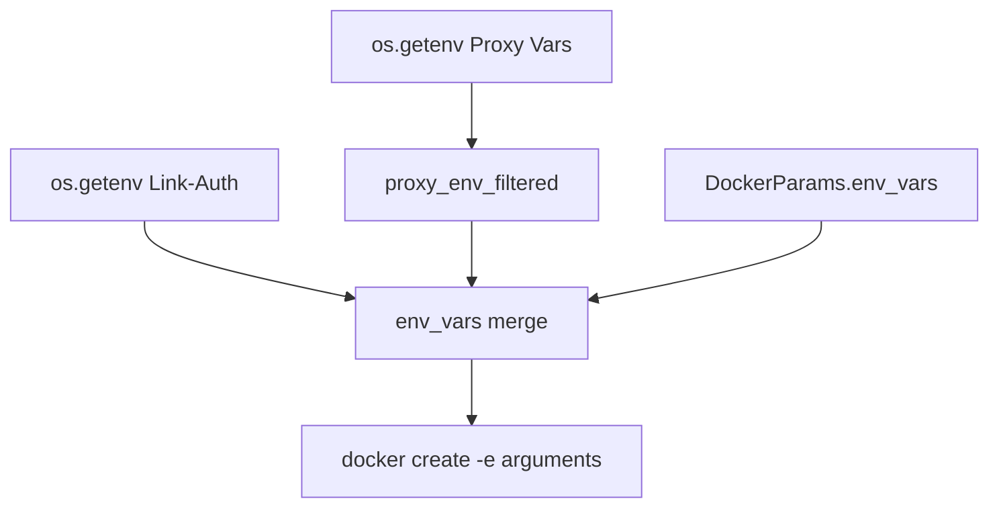
*Sources: [management/openjiuwen_runtime/management/deployments/docker/deployer.py:162-181](), [management/openjiuwen_runtime/management/deployments/docker/strategy.py:68-95]()*

---

# Page: Kubernetes Deployment

# Kubernetes Deployment

<details>
<summary>Relevant source files</summary>

The following files were used as context for generating this wiki page:

- [foundation/openjiuwen_runtime/foundation/db/postgresql_handler.py](foundation/openjiuwen_runtime/foundation/db/postgresql_handler.py)
- [foundation/openjiuwen_runtime/foundation/db/sqlalchemy_handler.py](foundation/openjiuwen_runtime/foundation/db/sqlalchemy_handler.py)
- [foundation/openjiuwen_runtime/foundation/docker_utils.py](foundation/openjiuwen_runtime/foundation/docker_utils.py)
- [foundation/tests/unit_tests/test_sqlite_handler.py](foundation/tests/unit_tests/test_sqlite_handler.py)
- [management/openjiuwen_runtime/management/__init__.py](management/openjiuwen_runtime/management/__init__.py)
- [management/openjiuwen_runtime/management/deployments/__init__.py](management/openjiuwen_runtime/management/deployments/__init__.py)
- [management/openjiuwen_runtime/management/deployments/k8s/deployer.py](management/openjiuwen_runtime/management/deployments/k8s/deployer.py)
- [management/openjiuwen_runtime/management/deployments/k8s/models.py](management/openjiuwen_runtime/management/deployments/k8s/models.py)
- [management/openjiuwen_runtime/management/models/__init__.py](management/openjiuwen_runtime/management/models/__init__.py)
- [management/openjiuwen_runtime/management/models/deployment_params.py](management/openjiuwen_runtime/management/models/deployment_params.py)
- [management/openjiuwen_runtime/management/models/enums.py](management/openjiuwen_runtime/management/models/enums.py)
- [management/openjiuwen_runtime/management/session/k8s_service_handler.py](management/openjiuwen_runtime/management/session/k8s_service_handler.py)
- [management/openjiuwen_runtime/management/session/router.py](management/openjiuwen_runtime/management/session/router.py)
- [management/openjiuwen_runtime/management/session/ws_client_channel.py](management/openjiuwen_runtime/management/session/ws_client_channel.py)

</details>


## Purpose and Scope
This section details the Kubernetes deployment infrastructure within the `openjiuwen-ai/agent-runtime` management control plane and session subsystem. The architecture leverages both synchronous (`kubernetes` client) and asynchronous (`kubernetes_asyncio` client) Python SDKs to provision, orchestrate, and monitor containerized agent runtimes, pods, and services within a Kubernetes cluster. 

Sources: `management/openjiuwen_runtime/management/deployments/k8s/deployer.py:1-41]`, `management/openjiuwen_runtime/management/session/k8s_service_handler.py:1-155]()`

---

## Core Architecture and Data Models
The Kubernetes deployment strategy is configured via specialized parameter structures and runtime settings that translate high-level agent definitions into Kubernetes manifests (`Deployments`, `Pods`, and `Services`).

* **`K8sParams`**: Defines deployment options including namespace, deployment name, container image, resource limits, config maps, and secrets `[management/openjiuwen_runtime/management/deployments/k8s/models.py:33-45]()`.
* **`RuntimeSettings`**: Normalized internal runtime parameters extracted from `DeployContext` for execution `[management/openjiuwen_runtime/management/deployments/k8s/deployer.py:25-38]()`.
* **`ContainerSpec`**: Specifies container attributes such as ports, pull policies, environment variables, security context (`privileged`, `capabilities_add`, `seccomp_unconfined`), `hostPath` mounts, and resource requests/limits `[management/openjiuwen_runtime/management/session/k8s_service_handler.py:92-128]()`.
* **`PodDeployInfo`**: Represents successfully deployed pod metadata matching `kubectl get pods -o wide` output (`pod_name`, `namespace`, `pod_ip`, `containers`, `port`) `[management/openjiuwen_runtime/management/session/k8s_service_handler.py:28-39]()`.

```mermaid
graph TD
    A["DeployContext"] -->|Extracts| B["K8sParams"]
    B -->|Normalizes| C["RuntimeSettings"]
    C -->|Constructs Manifest| D["AppsV1Api.create_namespaced_deployment"]
    E["ContainerSpec"] -->|Maps Security & Mounts| F["K8sServiceHandler"]
    F -->|Creates Pod| G["PodDeployInfo"]

    style A fill:#ffffff,stroke:#000000,stroke-width:1px
    style B fill:#ffffff,stroke:#000000,stroke-width:1px
    style C fill:#ffffff,stroke:#000000,stroke-width:1px
    style D fill:#ffffff,stroke:#000000,stroke-width:1px
    style E fill:#ffffff,stroke:#000000,stroke-width:1px
    style F fill:#ffffff,stroke:#000000,stroke-width:1px
    style G fill:#ffffff,stroke:#000000,stroke-width:1px
```
*Sources: `management/openjiuwen_runtime/management/deployments/k8s/models.py:33-45]`, `management/openjiuwen_runtime/management/deployments/k8s/deployer.py:25-38]`, `management/openjiuwen_runtime/management/session/k8s_service_handler.py:28-128]()`*

---

## `K8sDeployer` Implementation & Client Configuration
The `K8sDeployer` class extends the base `Deployer` abstraction and interfaces with the Kubernetes Python API `[management/openjiuwen_runtime/management/deployments/k8s/deployer.py:40-41]()`. 

### Client Initialization & Config Loading
Client authentication resolves credentials hierarchically via `_ensure_client_config()`:
1. Explicitly provided `kubeconfig` file paths `[management/openjiuwen_runtime/management/deployments/k8s/deployer.py:171-174]()`.
2. In-cluster service account configuration (`k8s_config.load_incluster_config()`) `[management/openjiuwen_runtime/management/deployments/k8s/deployer.py:175-176]()`.
3. Default user kubeconfig location fallback `[management/openjiuwen_runtime/management/deployments/k8s/deployer.py:177-178]()`.

API calls are wrapped using `asyncio.to_thread` via `_call_api()` to prevent blocking the event loop during network operations `[management/openjiuwen_runtime/management/deployments/k8s/deployer.py:164-165]()`.

```mermaid
graph TD
    H["K8sDeployer"] -->|_ensure_client_config| I{"Kubeconfig Provided?"}
    I -->|Yes| J["k8s_config.load_kube_config"]
    I -->|No| K{"In-Cluster?}
    K -->|Yes| L["k8s_config.load_incluster_config"]
    K -->|No| M["k8s_config.load_kube_config default"]
    J --> N["_get_apis CoreV1Api & AppsV1Api"]
    L --> N
    M --> N

    style H fill:#ffffff,stroke:#000000,stroke-width:1px
    style I fill:#ffffff,stroke:#000000,stroke-width:1px
    style J fill:#ffffff,stroke:#000000,stroke-width:1px
    style K fill:#ffffff,stroke:#000000,stroke-width:1px
    style L fill:#ffffff,stroke:#000000,stroke-width:1px
    style M fill:#ffffff,stroke:#000000,stroke-width:1px
    style N fill:#ffffff,stroke:#000000,stroke-width:1px
```
*Sources: `management/openjiuwen_runtime/management/deployments/k8s/deployer.py:167-185]()`*

---

## Pod Specs, Security Contexts, and Mount Management
The `K8sServiceHandler` manages asynchronous pod creation using `kubernetes_asyncio` `[management/openjiuwen_runtime/management/session/k8s_service_handler.py:3-155]()`. It translates Docker-like configurations into native Kubernetes pod specifications:

* **Privileged & Capabilities**: `ContainerSpec` supports `privileged`, `capabilities_add`, `capabilities_drop`, `seccomp_unconfined`, and `apparmor_unconfined` annotations `[management/openjiuwen_runtime/management/session/k8s_service_handler.py:100-112]()`.
* **HostPath Mounts**: `HostPathMount` definitions map host directories into containers, equivalent to `docker run -v HOST:CONTAINER[:ro]` `[management/openjiuwen_runtime/management/session/k8s_service_handler.py:70-83]()`.
* **Database Persistence Schema**: The `K8S_TABLE_DEF` schema tracks deployment states, image references, node selectors, and service ports within the underlying relational database `[management/openjiuwen_runtime/management/deployments/k8s/models.py:96-128]()`.

Sources: `management/openjiuwen_runtime/management/session/k8s_service_handler.py:70-128]`, `management/openjiuwen_runtime/management/deployments/k8s/models.py:96-128]()`

---

## WebSocket Integration and Pod Readiness
Once a pod or container is successfully provisioned, `WSServiceMessageChannel.on_pod_ready` resolves the target IP and port to establish a bi-directional streaming WebSocket connection `[management/openjiuwen_runtime/management/session/ws_client_channel.py:149-181]()`.

```mermaid
graph TD
    O["K8sServiceHandler.deploy"] -->|Returns PodInfo| P["WSServiceMessageChannel.on_pod_ready"]
    P -->|Extracts pod_ip & container port| Q["_build_ws_url"]
    Q -->|Establishes Connection| R["websockets.connect"]
    R -->|Binds Handler & Parser| S["_recv_loop & Multiplexed Stream"]

    style O fill:#ffffff,stroke:#000000,stroke-width:1px
    style P fill:#ffffff,stroke:#000000,stroke-width:1px
    style Q fill:#ffffff,stroke:#000000,stroke-width:1px
    style R fill:#ffffff,stroke:#000000,stroke-width:1px
    style S fill:#ffffff,stroke:#000000,stroke-width:1px
```
*Sources: `management/openjiuwen_runtime/management/session/ws_client_channel.py:149-181]()`*

---

# Page: Session Management Subsystem

# Session Management Subsystem

<details>
<summary>Relevant source files</summary>

The following files were used as context for generating this wiki page:

- [management/openjiuwen_runtime/management/session/DESIGN.md](management/openjiuwen_runtime/management/session/DESIGN.md)
- [management/openjiuwen_runtime/management/session/__init__.py](management/openjiuwen_runtime/management/session/__init__.py)
- [management/openjiuwen_runtime/management/session/access.py](management/openjiuwen_runtime/management/session/access.py)
- [management/openjiuwen_runtime/management/session/interfaces.py](management/openjiuwen_runtime/management/session/interfaces.py)
- [management/openjiuwen_runtime/management/session/models.py](management/openjiuwen_runtime/management/session/models.py)
- [management/openjiuwen_runtime/management/session/service_manager.py](management/openjiuwen_runtime/management/session/service_manager.py)

</details>


The Session Management Subsystem (`openjiuwen_runtime.management.session`) provides orchestration and routing between client request entrypoints and scalable backend agent workloads (such as Kubernetes pods, Docker containers, or local processes) [management/openjiuwen_runtime/management/session/DESIGN.md:7-16](). It guarantees session affinity, handles dual-queue request prioritization, manages instance pooling and autoscaling, and coordinates multi-路 multiplexed messaging channels.

As a parent page, this document provides a high-level overview of the session orchestration architecture. For granular implementation details, refer to the respective child pages linked below.

```mermaid
graph TD
    subgraph "Natural Language Space"
        AccessPoint["Access Control"]
        ServiceOrchestrator["Service Orchestration"]
        DualQueues["Dual Queue Priority"]
        Strategy["Session Strategy"]
    end
    subgraph "Code Entity Space"
        Access["Access [management/openjiuwen_runtime/management/session/access.py:70]()"]
        ServiceManager["ServiceManager [management/openjiuwen_runtime/management/session/service_manager.py:48]()"]
        PriorityDualAsyncQueues["PriorityDualAsyncQueues"]
        ISessionStrategy["ISessionStrategy [management/openjiuwen_runtime/management/session/interfaces.py:169]()"]
    end
    AccessPoint --> Access
    ServiceOrchestrator --> ServiceManager
    DualQueues --> PriorityDualAsyncQueues
    Strategy --> ISessionStrategy
```
*Sources: [management/openjiuwen_runtime/management/session/access.py:70](), [management/openjiuwen_runtime/management/session/service_manager.py:48](), [management/openjiuwen_runtime/management/session/interfaces.py:169](), [management/openjiuwen_runtime/management/session/DESIGN.md:7-16]()*

---

## 3.1. Access, ServiceManager & Interfaces

The request ingestion and scheduling core is anchored by `Access` and `ServiceManager`. `Access` acts as the primary ingress controller that intercepts inbound requests, applies session routing strategies via `ISessionStrategy`, and wraps requests into `SessionRequestWrapper` instances before handing them to the queue layer [management/openjiuwen_runtime/management/session/access.py:70](), [management/openjiuwen_runtime/management/session/DESIGN.md:62](). 

`ServiceManager` consumes these wrapped requests through `PriorityDualAsyncQueues`, ensuring system-level internal events take priority over standard user traffic [management/openjiuwen_runtime/management/session/service_manager.py:48](), [management/openjiuwen_runtime/management/session/DESIGN.md:11](). It orchestrates service instance pools (`_in_use` and `_idle`), executes bootstrap pre-warming (`_bootstrap_min_idle`), manages background autoscaling (`_autoscale_loop`), and enforces service time-to-live (`service_ttl`) policies [management/openjiuwen_runtime/management/session/service_manager.py:48-175](), [management/openjiuwen_runtime/management/session/models.py:41-70]().

For details, see [Access, ServiceManager & Interfaces](#3.1).

*Sources: [management/openjiuwen_runtime/management/session/access.py:70-120](), [management/openjiuwen_runtime/management/session/service_manager.py:48-175](), [management/openjiuwen_runtime/management/session/models.py:41-70](), [management/openjiuwen_runtime/management/session/DESIGN.md:62]() *

---

## 3.2. Service Handlers & Channels

Backend agent instances are encapsulated by `ServiceHandler`, which coordinates instance-level concurrency, session routing tables (`ServiceRouter`), and lifecycle operations (`deploy` and `delete`) [management/openjiuwen_runtime/management/session/service_handler.py:1-50](), [management/openjiuwen_runtime/management/session/DESIGN.md:63](). Communication between the runtime and backend agent instances is facilitated by `WSServiceMessageChannel`, establishing persistent WebSocket connections that multiplex multiple concurrent streams using individual `request_id` attributes [management/openjiuwen_runtime/management/session/ws_client_channel.py:1-50](), [management/openjiuwen_runtime/management/session/DESIGN.md:66](). Concurrency is managed across two distinct tiers: service-wide limits and session-specific constraints via `SessionHandler` [management/openjiuwen_runtime/management/session/DESIGN.md:13]().

```mermaid
graph TD
    subgraph "Natural Language Space"
        ServiceInstance["Service Instance"]
        MessageChannel["WebSocket Channel"]
        SessionScope["Session Scope Handler"]
        DeployController["Deployment Controller"]
    end
    subgraph "Code Entity Space"
        ServiceHandler["ServiceHandler"]
        WSServiceMessageChannel["WSServiceMessageChannel [management/openjiuwen_runtime/management/session/ws_client_channel.py:26]()"]
        SessionHandler["SessionHandler"]
        K8sServiceHandler["K8sServiceHandler [management/openjiuwen_runtime/management/session/k8s_service_handler.py:27]()"]
    end
    ServiceInstance --> ServiceHandler
    MessageChannel --> WSServiceMessageChannel
    SessionScope --> SessionHandler
    DeployController --> K8sServiceHandler
```
*Sources: [management/openjiuwen_runtime/management/session/ws_client_channel.py:26](), [management/openjiuwen_runtime/management/session/k8s_service_handler.py:27](), [management/openjiuwen_runtime/management/session/DESIGN.md:60-68]*

For details, see [Service Handlers & Channels](#3.2).

*Sources: [management/openjiuwen_runtime/management/session/service_handler.py:1-50](), [management/openjiuwen_runtime/management/session/ws_client_channel.py:1-50](), [management/openjiuwen_runtime/management/session/k8s_service_handler.py:1-50](), [management/openjiuwen_runtime/management/session/DESIGN.md:60-68]() *

---

## 3.3. Session Testing & System Tests

To guarantee stability under high load, the session management subsystem includes comprehensive unit and integration test suites. These tests validate session concurrency limits, timer expirations, multi-session Kubernetes scaling scenarios, failure recovery flows, and SDK usage patterns across asynchronous event loops.

For details, see [Session Testing & System Tests](#3.3).

*Sources: [management/openjiuwen_runtime/management/session/DESIGN.md:1-150]() *

---

# Page: Access, ServiceManager & Interfaces

# Access, ServiceManager & Interfaces

<details>
<summary>Relevant source files</summary>

The following files were used as context for generating this wiki page:

- [management/openjiuwen_runtime/management/session/access.py](management/openjiuwen_runtime/management/session/access.py)
- [management/openjiuwen_runtime/management/session/dual_queue.py](management/openjiuwen_runtime/management/session/dual_queue.py)
- [management/openjiuwen_runtime/management/session/exception.py](management/openjiuwen_runtime/management/session/exception.py)
- [management/openjiuwen_runtime/management/session/interfaces.py](management/openjiuwen_runtime/management/session/interfaces.py)
- [management/openjiuwen_runtime/management/session/internal_events.py](management/openjiuwen_runtime/management/session/internal_events.py)
- [management/openjiuwen_runtime/management/session/service_manager.py](management/openjiuwen_runtime/management/session/service_manager.py)

</details>


## Purpose and Scope
This section covers the session management subsystem core components: `Access`, `ServiceManager`, and their abstract interfaces. It details request ingestion via `PriorityDualAsyncQueues`, session routing and affinity with `ServiceRouter`, dynamic autoscaling policies, TTL management, internal events (`ServiceReclaimEvent`), and error handling primitives.

Sources: `management/openjiuwen_runtime/management/session/access.py:4-5`(), `management/openjiuwen_runtime/management/session/service_manager.py:4-5`()

---

## Core Interfaces and Protocols
The session subsystem relies on a set of abstract base classes and protocols defined in `interfaces.py` to decouple request ingress, routing, execution, and response parsing:

- `IAccess`: Defines the entry interface for handling incoming requests, initialization, configuration hot-updates, and shutdown `[management/openjiuwen_runtime/management/session/interfaces.py:180-223]()`.
- `IServiceManager`: Manages service instance provisioning, lifecycle, and task dispatch `[management/openjiuwen_runtime/management/session/interfaces.py:246-270]()`.
- `IServiceHandler`: Represents a running backend service instance wrapper (e.g., Kubernetes pod, Docker container, or local process) `[management/openjiuwen_runtime/management/session/interfaces.py:250-300]()`.
- `ISessionStrategy`: Abstracts session configuration generation, mapping raw incoming requests (`IRequest`) to session requests (`ISessionRequest`) `[management/openjiuwen_runtime/management/session/interfaces.py:169-178]()`.
- `IServiceMessageChannel`: A protocol used to communicate with downstream services over long-lived connections (such as WebSockets) with multiplexed request IDs `[management/openjiuwen_runtime/management/session/interfaces.py:225-243]()`.

Sources: `management/openjiuwen_runtime/management/session/interfaces.py:169-270`()

---

## Request Ingestion & Dual Queues
Incoming messages are ingested through `Access` which wraps raw requests, generates required identifiers via `_AutoIdRequest`, and routes them into a priority dual asynchronous queue (`PriorityDualAsyncQueues`) `[management/openjiuwen_runtime/management/session/access.py:29-68](), [management/openjiuwen_runtime/management/session/dual_queue.py:18-27]()`.

```mermaid
graph TD
    UserReq["Incoming IRequest"] --> AccessLayer["Access.send_message()"]
    AccessLayer --> AutoId["_AutoIdRequest (UUID binding)"]
    AutoId --> DualQ["PriorityDualAsyncQueues"]
    DualQ --> SysQ["System Queue (_sys) [Priority.HIGH]"]
    DualQ --> UserQ["User Queue (_user) [Priority.LOW]"]
    SysQ --> MessageLoop["ServiceManager._message_loop()"]
    UserQ --> MessageLoop
```
*Sources: `management/openjiuwen_runtime/management/session/access.py:29-68`(), `management/openjiuwen_runtime/management/session/dual_queue.py:18-64`()*

`PriorityDualAsyncQueues` manages two separate `asyncio.Queue` instances: a system queue (`_sys`) for internal control plane events and a user queue (`_user`) for client requests `[management/openjiuwen_runtime/management/session/dual_queue.py:21-24]`. The retrieval method (`get`) drains the system queue entirely before considering the user queue, ensuring operational control messages take precedence `[management/openjiuwen_runtime/management/session/dual_queue.py:65-107]()`.

Sources: `management/openjiuwen_runtime/management/session/dual_queue.py:18-107`()

---

## Affinity Routing & Service Management
`ServiceManager` orchestrates the lifecycle of backend service instances and binds sessions to specific workers using `ServiceRouter` `[management/openjiuwen_runtime/management/session/service_manager.py:48-94]()`. 

Instances are partitioned into two core dictionaries grouped by `template_id`:
- `self._in_use`: Active instances currently handling requests `[management/openjiuwen_runtime/management/session/service_manager.py:87-89]()`.
- `self._idle`: Unassigned instances waiting for inbound session requests or pending reclamation `[management/openjiuwen_runtime/management/session/service_manager.py:90]()`.

```mermaid
graph TD
    Consumer["ServiceManager._message_loop()"] --> Router["ServiceRouter.route()"]
    Router --> CheckAffinity{"Session Affinity Match?"}
    CheckAffinity -- Yes --> InUse["Select Active IServiceHandler from _in_use"]
    CheckAffinity -- No --> IdlePool["Acquire Free IServiceHandler from _idle"]
    IdlePool --> MovePool["Transition Instance: _idle -> _in_use"]
    InUse --> SendReq["IServiceMessageChannel.send()"]
    MovePool --> SendReq
```
*Sources: `management/openjiuwen_runtime/management/session/service_manager.py:87-94`(), `management/openjiuwen_runtime/management/session/router.py:1-40`()*

Sources: `management/openjiuwen_runtime/management/session/service_manager.py:87-94`(), `management/openjiuwen_runtime/management/session/router.py:1-40`()

---

## Autoscaling, TTLs & Internal Events
`ServiceManager` runs a background autoscaling coroutine (`_autoscale_loop`) that maintains minimum idle instances (`min_idle_services`) and reclaims idle instances exceeding the time-to-live (`service_idle_ttl`) `[management/openjiuwen_runtime/management/session/service_manager.py:56-59](), [management/openjiuwen_runtime/management/session/service_manager.py:160]()`.

When an idle instance expires, a `ServiceReclaimEvent` is pushed into the system queue (`_sys`) to trigger cleanup `[management/openjiuwen_runtime/management/session/internal_events.py:11-15]()`.

```mermaid
stateDiagram-v2
    [*] --> Provisioned: Factory.new_service()
    Provisioned --> IdlePool: Registered to _idle
    IdlePool --> InUsePool: Session assigned (_in_use)
    InUsePool --> IdlePool: TTL expired / requests complete
    IdlePool --> Reclaiming: ServiceReclaimEvent (Exceeded service_idle_ttl)
    Reclaiming --> Terminated: Instance delete / Pod cleanup
    Terminated --> [*]
```
*Sources: `management/openjiuwen_runtime/management/session/service_manager.py:87-105`(), `management/openjiuwen_runtime/management/session/internal_events.py:11-16`()*

Sources: `management/openjiuwen_runtime/management/session/service_manager.py:87-105`(), `management/openjiuwen_runtime/management/session/internal_events.py:11-16`()

---

## Exceptions and Error Handling
Runtime errors and protocol rejections are mapped through `exception_message` utilizing a dictionary mapping error codes to localized `ResponseMessage` objects `[management/openjiuwen_runtime/management/session/exception.py:3-19]()`.

Common error codes include:
- `-1`: General internal errors `[management/openjiuwen_runtime/management/session/exception.py:4-5]()`.
- `100001`: Service concurrency limit exceeded (`Service concurrency limit reached, request failed`) `[management/openjiuwen_runtime/management/session/exception.py:6-7]()`.
- `100002`: Service startup failure `[management/openjiuwen_runtime/management/session/exception.py:8-9]()`.

Sources: `management/openjiuwen_runtime/management/session/exception.py:3-20`()

---

# Page: Service Handlers & Channels

# Service Handlers & Channels

<details>
<summary>Relevant source files</summary>

The following files were used as context for generating this wiki page:

- [foundation/openjiuwen_runtime/foundation/db/postgresql_handler.py](foundation/openjiuwen_runtime/foundation/db/postgresql_handler.py)
- [foundation/openjiuwen_runtime/foundation/db/sqlalchemy_handler.py](foundation/openjiuwen_runtime/foundation/db/sqlalchemy_handler.py)
- [foundation/openjiuwen_runtime/foundation/docker_utils.py](foundation/openjiuwen_runtime/foundation/docker_utils.py)
- [foundation/tests/unit_tests/test_sqlite_handler.py](foundation/tests/unit_tests/test_sqlite_handler.py)
- [management/openjiuwen_runtime/management/session/docker_service_handler.py](management/openjiuwen_runtime/management/session/docker_service_handler.py)
- [management/openjiuwen_runtime/management/session/k8s_service_handler.py](management/openjiuwen_runtime/management/session/k8s_service_handler.py)
- [management/openjiuwen_runtime/management/session/process_service_handler.py](management/openjiuwen_runtime/management/session/process_service_handler.py)
- [management/openjiuwen_runtime/management/session/router.py](management/openjiuwen_runtime/management/session/router.py)
- [management/openjiuwen_runtime/management/session/runtime.py](management/openjiuwen_runtime/management/session/runtime.py)
- [management/openjiuwen_runtime/management/session/service_handler.py](management/openjiuwen_runtime/management/session/service_handler.py)
- [management/openjiuwen_runtime/management/session/session_request.py](management/openjiuwen_runtime/management/session/session_request.py)
- [management/openjiuwen_runtime/management/session/strategies/_base.py](management/openjiuwen_runtime/management/session/strategies/_base.py)
- [management/openjiuwen_runtime/management/session/ws_client_channel.py](management/openjiuwen_runtime/management/session/ws_client_channel.py)
- [management/tests/system_tests/management_session/test_session_sdk.py](management/tests/system_tests/management_session/test_session_sdk.py)
- [management/tests/unit_tests/management_session/test_access_session_st.py](management/tests/unit_tests/management_session/test_access_session_st.py)
- [management/tests/unit_tests/management_session/test_service_handler_unit.py](management/tests/unit_tests/management_session/test_service_handler_unit.py)
- [management/tests/unit_tests/management_session/test_session_concurrency_interleave.py](management/tests/unit_tests/management_session/test_session_concurrency_interleave.py)

</details>


This section details the runtime infrastructure for service handlers, transport channels, routing tables, and session request packaging within the `openJiuwen` agent runtime. It bridges management-plane orchestration with data-plane agent instances running across Kubernetes, Docker, or local processes, utilizing multiplexed WebSocket channels and session-affinity routers.

---

## 1. Service Handler Architecture & Deployers

The `ServiceHandler` class manages the lifecycle of a single agent service instance, coordinating concurrency quotas, active sessions, and underlying deployment controllers (`IDeployController`) [management/openjiuwen_runtime/management/session/service_handler.py:30-75]().

### Deployment Backends
- **Kubernetes (`K8sServiceHandler`)**: Manages asynchronous Pod lifecycles using `kubernetes_asyncio`, supporting custom container specifications, host path mounts, environment variables, and readiness probes [management/openjiuwen_runtime/management/session/k8s_service_handler.py:154-187]().
- **Process (`ProcessServiceHandler`)**: Spawns local agent server subprocesses via `subprocess.Popen`, injecting bootstrap environment variables and utilizing TCP port connection checks for readiness validation [management/openjiuwen_runtime/management/session/process_service_handler.py:71-192]().
- **Docker (`DockerServiceHandler`)**: Manages container lifecycles, volume mounts, and port bindings via container runtimes.

```mermaid
graph TD
    subgraph "Control Plane"
        SM["ServiceManager"] -->|deploy/delete| SH["ServiceHandler"]
    end
    subgraph "Deploy Controllers"
        SH -->|uses| K8S["K8sServiceHandler"]
        SH -->|uses| PROC["ProcessServiceHandler"]
        SH -->|uses| DOCK["DockerServiceHandler"]
    end
    subgraph "Target Environment"
        K8S -->|creates| POD["Kubernetes Pod"]
        PROC -->|spawns| SUB["Subprocess AgentServer"]
        DOCK -->|runs| CONT["Docker Container"]
    end
    
    classDef default fill:none,stroke:#000,stroke-width:1px;
```
*Figure 1: Service Handler and Deployer Architecture.*

**Sources:**
- `management/openjiuwen_runtime/management/session/service_handler.py:30-75`
- `management/openjiuwen_runtime/management/session/k8s_service_handler.py:154-187`
- `management/openjiuwen_runtime/management/session/process_service_handler.py:71-192`

---

## 2. WebSocket Message Channel (`WSServiceMessageChannel`)

The `WSServiceMessageChannel` establishes a full-duplex WebSocket connection with an agent service instance [management/openjiuwen_runtime/management/session/ws_client_channel.py:73-135](). Multiple `request_id` streams are multiplexed over a single persistent connection.

### Key Mechanisms
- **Payload Serialization**: Converts requests to JSON using `serialize_request_payload`, supporting dataclasses, `model_dump()` methods, and explicit wire dictionaries [management/openjiuwen_runtime/management/session/ws_client_channel.py:33-56]().
- **Connection Handshake**: Invoked via `on_pod_ready()`, resolving container endpoints, constructing WebSocket URLs (`ws://` or `wss://`), and establishing the connection with optional ping/pong intervals and TLS settings [management/openjiuwen_runtime/management/session/ws_client_channel.py:149-181]().

```mermaid
graph TD
    subgraph "Data Flow Code Space"
        SH2["ServiceHandler.handle_message"] -->|invokes| CH["WSServiceMessageChannel.send"]
        CH -->|serializes via| SRP["serialize_request_payload"]
        SRP -->|sends JSON over| WSS["websockets.connect"]
        WSS -->|receives frames| RCV["_recv_loop"]
        RCV -->|dispatches to| RSP["IResponseParser"]
        RSP -->|puts result into| RQ["response_queue"]
    end

    classDef default fill:none,stroke:#000,stroke-width:1px;
```
*Figure 2: WebSocket Message Channel Data Flow.*

**Sources:**
- `management/openjiuwen_runtime/management/session/ws_client_channel.py:33-181`

---

## 3. Routing Subsystem: Session & Service Routers

The routing layer maintains bidirectional mappings between requests, sessions, and service instances using thread-safe asynchronous locks [management/openjiuwen_runtime/management/session/router.py:10-86]().

### Router Classes
- **`SessionRouter`**: Maps individual request IDs to session IDs (`request_id` $\rightarrow$ `session_id`) [management/openjiuwen_runtime/management/session/router.py:10-44]().
- **`ServiceRouter`**: Maps session IDs to active service instance IDs (`session_id` $\rightarrow$ `service_id`), enabling affinity routing and bulk cleanup during service scale-down [management/openjiuwen_runtime/management/session/router.py:46-86]().

```mermaid
graph TD
    subgraph "Routing Code Entities"
        SR["SessionRouter"] -->|manages| REQ_MAP["_request_session: Dict[str, str]"]
        SER["ServiceRouter"] -->|manages| SES_MAP["_session_service: Dict[str, str]"]
        
        REQ_MAP -->|get_request_session| RID["request_id"]
        SES_MAP -->|get_session_service| SID["session_id"]
    end

    classDef default fill:none,stroke:#000,stroke-width:1px;
```
*Figure 3: Router Class Mapping Relationships.*

**Sources:**
- `management/openjiuwen_runtime/management/session/router.py:10-87`

---

## 4. Session Requests & Strategies

Session requests encapsulate payload details, concurrency boundaries, and Time-To-Live (TTL) parameters [management/openjiuwen_runtime/management/session/session_request.py:12-58]().

### `SessionRequest` Attributes
- `session_id`: Unique identifier for the conversation session.
- `session_concurrency`: Maximum concurrent executions permitted within the session [management/openjiuwen_runtime/management/session/session_request.py:18]().
- `session_ttl`: Expiration timeout for idle sessions [management/openjiuwen_runtime/management/session/session_request.py:19]().
- `raw_msg`: Underlying request object (`IRequest`) [management/openjiuwen_runtime/management/session/session_request.py:28]().

Routing strategies (such as `PerChatBotStrategy`) utilize these request properties to determine affinity keys and allocate service instances across the worker pool.

**Sources:**
- `management/openjiuwen_runtime/management/session/session_request.py:12-59`

---

# Page: Session Testing & System Tests

# Session Testing & System Tests

<details>
<summary>Relevant source files</summary>

The following files were used as context for generating this wiki page:

- [management/openjiuwen_runtime/management/session/service_handler.py](management/openjiuwen_runtime/management/session/service_handler.py)
- [management/tests/system_tests/management_session/main_k8s_access.py](management/tests/system_tests/management_session/main_k8s_access.py)
- [management/tests/system_tests/management_session/main_k8s_multi_session.py](management/tests/system_tests/management_session/main_k8s_multi_session.py)
- [management/tests/system_tests/management_session/test_session_sdk.py](management/tests/system_tests/management_session/test_session_sdk.py)
- [management/tests/unit_tests/management_session/test_access_session_st.py](management/tests/unit_tests/management_session/test_access_session_st.py)
- [management/tests/unit_tests/management_session/test_service_handler_unit.py](management/tests/unit_tests/management_session/test_service_handler_unit.py)
- [management/tests/unit_tests/management_session/test_session_concurrency_interleave.py](management/tests/unit_tests/management_session/test_session_concurrency_interleave.py)

</details>


## Purpose and Scope
This page documents the testing infrastructure, unit tests, and system tests for the session management subsystem of the `agent-runtime` codebase. The scope covers concurrency isolation across multiple sessions, mock-based end-to-end integration tests via `Access` [management/tests/unit_tests/management_session/test_access_session_st.py:14-30](), and real Kubernetes multi-session orchestrations using WebSocket channels and custom envelope parsers [management/tests/system_tests/management_session/main_k8s_multi_session.py:4-35]().

---

## 1. Test Architecture & Overview
The test suites for the session subsystem are split between isolated unit tests and system-level simulations. Unit tests validate individual components like `ServiceHandler` [management/openjiuwen_runtime/management/session/service_handler.py:30-125]() and `SessionRouter`, while system tests spin up an `Access` gateway connected to a `ServiceManager` backed by mock or real deployment controllers (`RecordingK8s`, `DockerDeployer`, or `K8sDeployController`) and message channels (`MockMessageChannel`, `WSServiceMessageChannel`).

```mermaid
graph TD
    subgraph "Test Entrypoints"
        T1["test_session_sdk.py"]
        T2["test_access_session_st.py"]
        T3["test_session_concurrency_interleave.py"]
        T4["main_k8s_multi_session.py"]
    end
    
    subgraph "Subsystem Components"
        ACC["Access"]
        SM["ServiceManager"]
        SH["ServiceHandler"]
        SSH["SessionHandler"]
    end
    
    T1 --> ACC
    T2 --> ACC
    ACC --> SM
    SM --> SH
    SH --> SSH
    T3 --> SH
    T4 --> ACC
    
    classDef default fill:#fff,stroke:#333,stroke-width:1px;
```
*Sources: [management/tests/system_tests/management_session/test_session_sdk.py:14-182](), [management/tests/unit_tests/management_session/test_access_session_st.py:14-201](), [management/tests/unit_tests/management_session/test_session_concurrency_interleave.py:89-129](), [management/tests/system_tests/management_session/main_k8s_multi_session.py:47-72]()*

---

## 2. Concurrency & Interleaving Scenarios
Session-level concurrency isolation ensures that a high volume of requests from a single busy session does not starve other sessions mapped to the same service instance (`ServiceHandler`) [management/openjiuwen_runtime/management/session/service_handler.py:30-125]().

### Interleaving Mechanics
The test `test_session_cap_interleaves_other_sessions` validates that when session `s1` exceeds its concurrency cap (e.g., 11 requests submitted with a concurrency limit of 10), the 11th request blocks at the session layer. Meanwhile, session `s2` can still successfully dispatch its requests up to the remaining service concurrency limit [management/tests/unit_tests/management_session/test_session_concurrency_interleave.py:89-129]().

```mermaid
sequenceDiagram
    participant Test as "test_session_cap_interleaves_other_sessions"
    participant SH as "ServiceHandler"
    participant S1 as "SessionHandler(s1)"
    participant S2 as "SessionHandler(s2)"
    participant CH as "HoldChannel"

    Test->>SH: "handle_message(s1-r0..r10)" (Cap=10)
    Test->>SH: "handle_message(s2-r0..r8)" (Cap=10)
    
    Note over SH,S1: "s1 reaches concurrency limit (10)"
    SH->>S1: "Accept 10 requests, block 11th"
    SH->>S2: "Accept all 9 requests (Service Concurrency 20)"
    
    S1->>CH: "Dispatch 10 requests"
    S2->>CH: "Dispatch 9 requests"
    
    Note over CH: "Total in_send = 19 (Max 19)"
    CH-->>Test: "Verify concurrency limits & isolation"
```
*Sources: [management/tests/unit_tests/management_session/test_session_concurrency_interleave.py:37-129](), [management/openjiuwen_runtime/management/session/service_handler.py:151-182]()*

---

## 3. Kubernetes Multi-Session Scenarios
Real-world K8s scenarios involve multiple sessions sharing a single pod lifecycle, governed by `service_ttl`, `session_ttl`, and priority dual queues [management/tests/system_tests/management_session/main_k8s_multi_session.py:4-35]().

### Serial Sending and Pod Reclamation
In `main_k8s_multi_session.py`, multiple sessions (`A`, `B`, `C`) with varying session TTLs share a single pod (`max-services=1`, `min-idle=0`). The script executes requests over a WebSocket channel (`WSServiceMessageChannel`) using a raw wire request model (`WireIRequest`) and parses responses via `E2aEnvelopResponseParser` [management/tests/system_tests/management_session/main_k8s_multi_session.py:47-123]().

```mermaid
graph LR
    subgraph "Kubernetes Multi-Session Test"
        REQ["WireIRequest"] --> ACC["Access"]
        ACC --> SM["ServiceManager"]
        SM --> K8SH["K8sServiceHandler"]
        K8SH --> WSC["WSServiceMessageChannel"]
        WSC --> POD["K8s Pod Instance"]
        POD --> PARSER["E2aEnvelopResponseParser"]
        PARSER --> ACC
    end
```
*Sources: [management/tests/system_tests/management_session/main_k8s_multi_session.py:47-123](), [management/tests/system_tests/management_session/main_k8s_access.py:138-164]()*

---

## 4. SDK Usage & End-to-End Simulation
The SDK test suite (`test_session_sdk.py` and `test_access_session_st.py`) mocks underlying transport and cluster controllers to verify session routing affinity, failure recovery, and quota reservation [management/tests/system_tests/management_session/test_session_sdk.py:4-182](), [management/tests/unit_tests/management_session/test_access_session_st.py:4-201]().

### Key Test Utilities
* **`MockMessageChannel`**: Simulates asynchronous message transmission, tracking `send_calls` and immediately pushing responses into the `response_queue` [management/tests/system_tests/management_session/test_session_sdk.py:61-89]().
* **`RecordingK8s`**: Implements `IDeployController` to record deployment and teardown counts (`deploy_count`, `delete_count`) [management/tests/system_tests/management_session/test_session_sdk.py:91-113]().
* **`DictStreamParser`**: Parses incoming stream dictionaries and determines completion status based on `error_code` or `done` flags [management/tests/system_tests/management_session/test_session_sdk.py:46-59]().

```mermaid
sequenceDiagram
    participant CLI as "Test Execution"
    participant ACC as "Access"
    participant SM as "ServiceManager"
    participant SH as "ServiceHandler"
    participant CH as "MockMessageChannel"

    CLI->>ACC: "send_message(ireq(t1))"
    ACC->>SM: "Enqueue session request"
    SM->>SH: "try_reserve_session_quota() & handle_message()"
    SH->>CH: "send(service_id, wrapper, ...)"
    CH-->>SH: "Put response & trigger on_request_complete()"
    SH-->>ACC: "Stream response chunks"
    ACC-->>CLI: "Yield final response"
```
*Sources: [management/tests/system_tests/management_session/test_session_sdk.py:61-182](), [management/tests/unit_tests/management_session/test_access_session_st.py:175-201]()`

---

# Page: Service Framework (Data Plane)

# Service Framework (Data Plane)

<details>
<summary>Relevant source files</summary>

The following files were used as context for generating this wiki page:

- [applications/lowcode_agent/pyproject.toml](applications/lowcode_agent/pyproject.toml)
- [cli/pyproject.toml](cli/pyproject.toml)
- [management/pyproject.toml](management/pyproject.toml)
- [server/pyproject.toml](server/pyproject.toml)
- [service/openjiuwen_runtime/service/__init__.py](service/openjiuwen_runtime/service/__init__.py)
- [service/openjiuwen_runtime/service/app/__init__.py](service/openjiuwen_runtime/service/app/__init__.py)
- [service/pyproject.toml](service/pyproject.toml)

</details>


The Service Framework (Data Plane) provides the core application and runtime abstractions used by individual agent processes in the openJiuwen Agent Runtime. Located within the `openjiuwen-runtime-service` workspace [service/pyproject.toml:6-18](), this layer handles HTTP and WebSocket route management, request lifecycle handling via FastAPI, standardized request models (such as `QueryRequest` and `ResetConversationRequest`), and composable middleware execution. 

The data plane framework is designed to run either as a standalone agent service or managed dynamically through orchestration strategies deployed by the Control Plane.

```mermaid
graph TD
    User["Client Request"] --> Gateway["FastAPI Server"]
    subgraph DataPlane["Data Plane Service Framework"]
        Gateway --> BaseApp["BaseApp (openjiuwen_runtime.service.BaseApp)"]
        BaseApp --> AgentApp["AgentApp (openjiuwen_runtime.service.AgentApp)"]
        BaseApp --> PluginApp["PluginApp (openjiuwen_runtime.service.PluginApp)"]
        BaseApp --> AppGroup["AppGroup (openjiuwen_runtime.service.AppGroup)"]
        BaseApp --> Middleware["Middleware / LoggingMiddleware"]
    end
    AgentApp --> CoreEngine["Agent Execution Core"]

    classDef default fill:none,stroke:#333,stroke-width:2px;
```
*Figure 1: Service Framework architectural abstraction bridging application types and routing components.*

Sources: [service/pyproject.toml:6-18](), [service/openjiuwen_runtime/service/__init__.py:4-9]()

---

## 4.1 BaseApp, AgentApp, PluginApp & AppGroup

The core application hierarchy establishes standard conventions for building and running agent services. At the root of this model is `BaseApp`, which sets up essential REST routes such as `/query`, `/health`, and `/reset_conversation`, along with port utility integrations. Specialized subclasses like `AgentApp` and `PluginApp` extend these primitives to encapsulate domain-specific agent logic or plugin capabilities, while `AppGroup` allows multiple applications to be aggregated under a unified runtime harness.

For a detailed technical description of the class inheritance model, REST endpoints, request structures (`QueryRequest`, `ResetConversationRequest`), and port utilities, see [BaseApp, AgentApp, PluginApp & AppGroup](#4.1).

Sources: [service/openjiuwen_runtime/service/__init__.py:4-9](), [service/openjiuwen_runtime/service/app/__init__.py:10-14]()

---

## 4.2 Middleware & Examples

To support cross-cutting concerns such as logging, request tracing, and context propagation, the service framework provides a modular middleware pipeline. Components like `Middleware`, `MiddlewareContext`, and `LoggingMiddleware` hook into the request-response lifecycle to intercept execution, inject state, and record structured telemetry without altering core agent logic.

```mermaid
sequenceDiagram
    participant Client as "Client"
    participant App as "BaseApp"
    participant MW as "LoggingMiddleware"
    participant Ctx as "MiddlewareContext"
    participant Handler as "Endpoint Handler"

    Client->>App: "HTTP /query Request"
    App->>MW: "dispatch(request, call_next)"
    MW->>Ctx: "Initialize Context"
    MW->>Handler: "Forward Request"
    Handler-->>MW: "Response / Stream"
    MW-->>App: "Return Response with Logging"
    App-->>Client: "HTTP Response"

    classDef default fill:none,stroke:#333,stroke-width:2px;
```
*Figure 2: Middleware execution lifecycle linking `LoggingMiddleware` and `MiddlewareContext` to request dispatching.*

For complete technical specifications on writing custom middleware, integrating `MiddlewareContext`, and examining service example applications and unit tests, see [Middleware & Examples](#4.2).

Sources: [service/openjiuwen_runtime/service/__init__.py:4-9](), [service/openjiuwen_runtime/service/app/__init__.py:14-16]()

---

# Page: BaseApp, AgentApp, PluginApp & AppGroup

# BaseApp, AgentApp, PluginApp & AppGroup

<details>
<summary>Relevant source files</summary>

The following files were used as context for generating this wiki page:

- [foundation/openjiuwen_runtime/foundation/port_utils.py](foundation/openjiuwen_runtime/foundation/port_utils.py)
- [service/openjiuwen_runtime/service/app/app_group.py](service/openjiuwen_runtime/service/app/app_group.py)
- [service/openjiuwen_runtime/service/app/base_app.py](service/openjiuwen_runtime/service/app/base_app.py)
- [service/openjiuwen_runtime/service/app/plugin_app.py](service/openjiuwen_runtime/service/app/plugin_app.py)
- [service/openjiuwen_runtime/service/app/restful.py](service/openjiuwen_runtime/service/app/restful.py)
- [service/openjiuwen_runtime/service/models/request.py](service/openjiuwen_runtime/service/models/request.py)

</details>


This page details the application class hierarchy within the openJiuwen Agent Runtime data plane (`service/openjiuwen_runtime/service/app/`). It covers the foundational `BaseApp` class, specialized application types like `PluginApp` (and its integration with `AgentApp`), the multi-application container `AppGroup`, standardized request models, and port allocation utilities.

---

## 1. BaseApp: Foundation and Lifecycle Management

`BaseApp` serves as the abstract parent class for all runtime service applications, including `AgentApp` and `PluginApp`. It wraps a FastAPI instance, manages application lifecycle hooks (`@init` and `@shutdown`), configures standard endpoints (such as `/health`), handles command-line argument parsing, and manages the underlying Uvicorn server execution.

### Key Components
* **FastAPI Initialization**: Instantiates `FastAPI` using `app_name`, `app_description`, and `version` [service/openjiuwen_runtime/service/app/base_app.py:84-99]().
* **Lifecycle Decorators**: Provides `.init()` and `.shutdown()` decorators to register asynchronous startup and teardown hooks [service/openjiuwen_runtime/service/app/base_app.py:122-146]().
* **Base Routes**: Automatically registers a `/health` endpoint and startup/shutdown event handlers that trigger the registered hooks [service/openjiuwen_runtime/service/app/base_app.py:148-171]().
* **CLI Argument Parsing & Runtime Setup**: Uses `_parse_cli_args()` to extract `--host`, `--port`, `--userdata`, and `--irpath` arguments, setting appropriate environment variables (`RUNTIME_USERDATA`, `RUNTIME_IR_PATH`) via `_setup_runtime_env()` [service/openjiuwen_runtime/service/app/base_app.py:26-70]() and [service/openjiuwen_runtime/service/app/base_app.py:172-204]().

### Diagram: BaseApp Execution and Lifecycle Flow

```mermaid
graph TD
    CLI["_parse_cli_args()"] -->|Extracts args| Env["_setup_runtime_env()"]
    Env -->|Sets RUNTIME_USERDATA/IR_PATH| Run["BaseApp.run()"]
    Run -->|Starts Uvicorn| FA["FastAPI.app"]
    FA -->|Event: startup| Init["run_init_hook()"]
    FA -->|GET /health| Health["health()"]
    FA -->|Event: shutdown| Shutdown["run_shutdown_hook()"]
```
*Sources: `service/openjiuwen_runtime/service/app/base_app.py:26-204`*

---

## 2. PluginApp & Restful Tools

`PluginApp` inherits from `BaseApp` and specializes in hosting collections of related tools as RESTful microservices. It features an integrated `RestfulToolDecorator` (`@restful.tool()`) that inspects Python function signatures, dynamically builds Pydantic request validation models, and exposes individual tool endpoints under `/tools/{name}`.

### Implementation Details
* **Tool Registry**: Maintains `self._tools` to store tool metadata, underlying functions, and parameter definitions [service/openjiuwen_runtime/service/app/plugin_app.py:61-67]() & [service/openjiuwen_runtime/service/app/plugin_app.py:76-97]().
* **Signature Inspection & Dynamic Routing**: `RestfulToolDecorator` extracts parameter annotations and defaults using Python's `inspect` module [service/openjiuwen_runtime/service/app/restful.py:57-66](). `PluginApp` then dynamically constructs a Pydantic validation model using `create_model` and registers a POST route at `/tools/{name}` [service/openjiuwen_runtime/service/app/plugin_app.py:113-161]().
* **Discovery Endpoint**: Exposes a `/tools` listing route to inspect all available tools, their descriptions, and parameters [service/openjiuwen_runtime/service/app/plugin_app.py:184-201]().

### Diagram: Tool Registration to REST Route Mapping

```mermaid
graph TD
    Dec["@restful.tool()"] -->|Inspects signature| Insp["inspect.signature()"]
    Insp -->|Extracts types & defaults| Reg["PluginApp.register_tool()"]
    Reg -->|Builds Pydantic model| Dyn["create_model()"]
    Dyn -->|Mounts POST route| Route["/tools/{name}"]
    Route -->|Executes function| Func["User Function"]
```
*Sources: `service/openjiuwen_runtime/service/app/plugin_app.py:76-161]`, `service/openjiuwen_runtime/service/app/restful.py:44-80`*

---

## 3. AppGroup Multi-Application Container

`AppGroup` allows multiple `BaseApp` instances (such as `AgentApp` or `PluginApp`) to be mounted onto a single FastAPI service using URL path prefixes [service/openjiuwen_runtime/service/app/app_group.py:27-107]().

### Core Responsibilities
* **Prefix Mounting**: Normalizes path prefixes (ensuring leading slashes and stripped trailing slashes) and mounts sub-applications via `self.app.mount(prefix, app.app)` [service/openjiuwen_runtime/service/app/app_group.py:76-107]().
* **Aggregated Lifecycle Events**: During startup, iterates through mounted apps in registration order to run `init` hooks. During shutdown, executes `shutdown` hooks in reverse order [service/openjiuwen_runtime/service/app/app_group.py:109-146]().
* **Aggregated Health Check**: Combines health status reports from all mounted sub-applications into a unified payload at `/health`, reporting whether the group is healthy or degraded [service/openjiuwen_runtime/service/app/app_group.py:150-187]().

### Diagram: AppGroup Multiplexing Architecture

```mermaid
graph TD
    Client["HTTP Client Request"] -->|"/customer/query"| AG["AppGroup FastAPI Service"]
    AG -->|Mount Prefix "/customer"| CustApp["AgentApp: customer_app"]
    AG -->|Mount Prefix "/assistant"| AsstApp["AgentApp: assistant_app"]
    AG -->|Mount Prefix "/tools"| PluginApp["PluginApp: WeatherTools"]
    AG -->|GET /health| AggHealth["Aggregated /health Endpoint"]
```
*Sources: `service/openjiuwen_runtime/service/app/app_group.py:53-187`*

---

## 4. Request Models & Port Utilities

### REST Request Models
Data plane endpoints process standardized Pydantic models defined for agent interactions:
* `QueryRequest`: Manages incoming message arrays, conversation tracking (`conversation_id`), user/space identifiers, and streaming flags [service/openjiuwen_runtime/service/models/request.py:12-43]().
* `ResetConversationRequest`: Specifies targets for conversation context resets with optional authorization tokens [service/openjiuwen_runtime/service/models/request.py:46-62]().

### Port Utilities
Network port probing and dynamic allocation are handled by `port_utils.py` to avoid port conflicts when launching subprocess or containerized apps:
* `is_port_available(port, host)`: Attempts to bind a TCP socket with `SO_REUSEADDR` to verify availability [foundation/openjiuwen_runtime/foundation/port_utils.py:7-15]().
* `allocate_port(start_port, max_port, host, exclude_ports)`: Scans a port range, skipping excluded ports, and returns the first available port or raises a `RuntimeError` [foundation/openjiuwen_runtime/foundation/port_utils.py:18-36]().

### Diagram: Port Allocation Logic

```mermaid
graph TD
    Start["allocate_port(start_port, max_port)"] --> Loop["Iterate range"]
    Loop --> Check{"Port in exclude_ports?"}
    Check -->|Yes| Loop
    Check -->|No| Probe["is_port_available()"]
    Probe -->|Socket bind success| Return["Return available port"]
    Probe -->|OSError / Bind failed| Loop
```
*Sources: `foundation/openjiuwen_runtime/foundation/port_utils.py:7-36`, `service/openjiuwen_runtime/service/models/request.py:12-62`*

---

# Page: Middleware & Examples

# Middleware & Examples

<details>
<summary>Relevant source files</summary>

The following files were used as context for generating this wiki page:

- [service/examples/calculator_plugin_app.py](service/examples/calculator_plugin_app.py)
- [service/examples/multi_agent_group.py](service/examples/multi_agent_group.py)
- [service/examples/simple_agent_app.py](service/examples/simple_agent_app.py)
- [service/openjiuwen_runtime/service/app/middleware.py](service/openjiuwen_runtime/service/app/middleware.py)
- [service/tests/unit_tests/__init__.py](service/tests/unit_tests/__init__.py)

</details>


## Purpose and Scope

This page covers section 4.2 of the data plane service framework: runtime middleware (`Middleware`, `MiddlewareContext`, and `LoggingMiddleware`) and service example applications (`SimpleAgentApp`, `CalculatorPluginApp`, and `Multi-Agent Group`). These components define the interceptor lifecycle for agent queries and provide reference implementations for building production-grade agent services and plugin tools using the `openjiuwen-agent-runtime` SDK.

---

## 1. Middleware Architecture & Context

The runtime service framework provides a pipeline-based middleware mechanism to intercept and manipulate requests, manage state across interceptors, and handle operational monitoring through the `Middleware` base class, `MiddlewareContext` state store, and pre-built `LoggingMiddleware` implementation [service/openjiuwen_runtime/service/app/middleware.py:4-141]().

### MiddlewareContext

`MiddlewareContext` acts as a request-scoped key-value store passed through every middleware hook [service/openjiuwen_runtime/service/app/middleware.py:16-48]().

```python
class MiddlewareContext:
    def __init__(self):
        self.data: Dict[str, Any] = {}

    def set(self, key: str, value: Any) -> None:
        self.data[key] = value

    def get(self, key: str, default: Any = None) -> Any:
        return self.data.get(key, default)
```

### Middleware Base Class and Hooks

The `Middleware` class defines four asynchronous lifecycle hooks that subclasses override [service/openjiuwen_runtime/service/app/middleware.py:50-134]():
- `before_query`: Executed prior to query processing. Can inspect or modify the `messages` list [service/openjiuwen_runtime/service/app/middleware.py:61-78]().
- `after_query`: Executed successfully after query execution [service/openjiuwen_runtime/service/app/middleware.py:80-94]().
- `on_error`: Executed when an exception occurs during query processing [service/openjiuwen_runtime/service/app/middleware.py:96-112]().
- `before_response`: Executed before sending the final response back to the client [service/openjiuwen_runtime/service/app/middleware.py:114-133]().

### LoggingMiddleware Implementation

`LoggingMiddleware` extends `Middleware` to log request tracking details across all query phases using a configurable Python logger [service/openjiuwen_runtime/service/app/middleware.py:136-240](). It records conversation identifiers, message counts, error exceptions, and response types.

```mermaid
graph TD
    subgraph "NaturalLanguageSpace: Request Pipeline"
        A["Incoming Agent Query"] --> B["MiddlewareContext Initialization"]
    end

    subgraph "CodeEntitySpace: Middleware Execution"
        B --> C["LoggingMiddleware.before_query"]
        C --> D["Agent Query Execution"]
        D -- "Success" --> E["LoggingMiddleware.after_query"]
        D -- "Exception" --> F["LoggingMiddleware.on_error"]
        E --> G["LoggingMiddleware.before_response"]
        F --> G
        G --> H["Client Response"]
    end

    classDef default fill:none,stroke:#333,stroke-width:2px;
```
*Diagram 1: Middleware Lifecycle and Request Interception Flow bridging runtime hooks to `LoggingMiddleware`.*

Sources: [service/openjiuwen_runtime/service/app/middleware.py:1-240]()

---

## 2. Service Example Applications & Tests

The SDK provides multiple reference examples demonstrating `AgentApp`, `PluginApp`, and `AppGroup` configurations.

### Simple Agent App

`SimpleAgentApp` (`simple_agent_app.py`) defines a minimal echo agent using `AgentApp` [service/examples/simple_agent_app.py:15-102](). It registers lifecycle handlers via decorators:
- `@app.init`: Initializes the mock agent state [service/examples/simple_agent_app.py:69-74]().
- `@app.query`: Streams back response chunks based on user inputs [service/examples/simple_agent_app.py:76-83]().
- `@app.shutdown`: Cleans up agent resources upon server termination [service/examples/simple_agent_app.py:86-91]().

### Calculator Plugin App

`CalculatorPluginApp` (`calculator_plugin_app.py`) demonstrates tool registration using `PluginApp` [service/examples/calculator_plugin_app.py:16-143](). It exposes mathematical operations (`add`, `multiply`, `subtract`, `divide`) as restful tools via `@app.restful.tool` [service/examples/calculator_plugin_app.py:28-120]().

### Multi-Agent Group

`Multi-Agent Group` (`multi_agent_group.py`) mounts multiple distinct `AgentApp` instances (`customer_app` and `assistant_app`) under a single `AppGroup` container (`group`) with prefix routing [service/examples/multi_agent_group.py:21-115]().

```mermaid
graph TD
    subgraph "NaturalLanguageSpace: Multi-Agent Deployment Architecture"
        Client["External Client Request"] --> GroupRouter["AppGroup Container"]
    end

    subgraph "CodeEntitySpace: App Mount & Routing"
        GroupRouter -->|"Mount /customer"| CustomerApp["AgentApp: customer_app"]
        GroupRouter -->|"Mount /assistant"| AssistantApp["AgentApp: assistant_app"]
        CustomerApp -->|"@customer_app.init"| InitCust["init_customer()"]
        CustomerApp -->|"@customer_app.query"| QueryCust["query_customer()"]
        AssistantApp -->|"@assistant_app.init"| InitAsst["init_assistant()"]
        AssistantApp -->|"@assistant_app.query"| QueryAsst["query_assistant()"]
        InitCust --> Mock1["MockAgent(客服)"]
        InitAsst --> Mock2["MockAgent(助手)"]
    end

    classDef default fill:none,stroke:#333,stroke-width:2px;
```
*Diagram 2: Multi-Agent App routing hierarchy illustrating `AppGroup`, `AgentApp`, and underlying mock agent bindings.*

Sources: [service/examples/calculator_plugin_app.py:1-143](), [service/examples/multi_agent_group.py:1-115](), [service/examples/simple_agent_app.py:1-102]()

---

# Page: Applications

# Applications

<details>
<summary>Relevant source files</summary>

The following files were used as context for generating this wiki page:

- [applications/llm_agent/pyproject.toml](applications/llm_agent/pyproject.toml)
- [applications/lowcode_agent/openjiuwen_runtime/examples/lowcode_agent/__init__.py](applications/lowcode_agent/openjiuwen_runtime/examples/lowcode_agent/__init__.py)
- [applications/workflow_agent/openjiuwen_runtime/examples/workflow_agent/__init__.py](applications/workflow_agent/openjiuwen_runtime/examples/workflow_agent/__init__.py)
- [applications/workflow_agent/pyproject.toml](applications/workflow_agent/pyproject.toml)

</details>


## Purpose and Scope

The `applications/` directory in the `openJiuwen-ai/agent-runtime` monorepo houses production-ready agent applications, runtime runners, orchestration services, and adapter layers. These components sit on top of the Service Framework data plane to deliver specific agent execution capabilities, low-code workflow processing, Agent-to-Agent (A2A) orchestration, and versatile protocol integration. 

This page provides a high-level overview of the shipped applications and adapters. For comprehensive technical details, implementation specifics, and API endpoints, refer to the respective child pages:
- [Lowcode Agent Runner](#5.1)
- [IR Execution Service](#5.2)
- [A2A Orchestration Service](#5.3)
- [Versatile Adapter](#5.4)

---

## Architecture Overview: Natural Language Space to Code Entity Space

The following diagram bridges high-level application concepts and protocol adapters to their concrete code entities within the repository.

```mermaid
graph TD
    subgraph "Natural Language Space"
        A["Lowcode Agent Runner"] --> B["IR Execution Service"]
        C["A2A Orchestration Service"] --> D["Versatile Adapter"]
    end

    subgraph "Code Entity Space"
        E["applications/lowcode_agent/openjiuwen_runtime/examples/lowcode_agent/__init__.py"] --> F["applications/workflow_agent/openjiuwen_runtime/examples/workflow_agent/__init__.py"]
        G["applications/llm_agent/pyproject.toml"]
    end

    A -.-> E
    B -.-> F
    D -.-> G
```
Sources: `applications/lowcode_agent/openjiuwen_runtime/examples/lowcode_agent/__init__.py:1-3`, `applications/workflow_agent/openjiuwen_runtime/examples/workflow_agent/__init__.py:1-3`, `applications/llm_agent/pyproject.toml:1-12`

---

## 5.1 Lowcode Agent Runner

The Lowcode Agent Runner provides an Intermediate Representation (IR)-driven execution environment for agents defined via visual workflows or structured configurations. It handles workflow registration, streaming response timeouts, conversion to AGUI formats, and serves as the primary runtime entrypoint for customized low-code agents.

For full technical details, see [Lowcode Agent Runner](#5.1).

Sources: `applications/lowcode_agent/openjiuwen_runtime/examples/lowcode_agent/__init__.py:1-3`

---

## 5.2 IR Execution Service

The IR Execution Service exposes `IrExecutionServiceApp` endpoints to process and execute compiled agent instruction sets. It incorporates DFX (Design for Excellence) middleware, lifecycle runtime support including bootstrap procedures, result caching, state persistence, and granular interface logging.

For full technical details, see [IR Execution Service](#5.2).

Sources: `applications/workflow_agent/openjiuwen_runtime/examples/workflow_agent/__init__.py:1-3`

---

## 5.3 A2A Orchestration Service

The Agent-to-Agent (A2A) Orchestration Service enables multi-agent cooperation and delegation. It features an execution engine, `user_router` Server-Sent Events (SSE) dispatching, a Redis-backed task store, bootstrap coordination mechanisms, and rate limiting to ensure robust distributed agent workflows.

For full technical details, see [A2A Orchestration Service](#5.3).

Sources: `applications/llm_agent/pyproject.toml:1-12`

---

## 5.4 Versatile Adapter

The Versatile Adapter acts as an extensible integration bridge. It provides config-driven adapter routing, an SSE proxy, an A2A facade interface, a decoupled event model, and a persistent Redis task store for handling external request schemas and protocol conversions.

For full technical details, see [Versatile Adapter](#5.4).

Sources: `applications/workflow_agent/pyproject.toml:1-12`

---

## Application Interaction Architecture

```mermaid
graph TD
    Client["Client Request"] --> WA["Versatile Adapter"]
    WA --> A2A["A2A Orchestration Service"]
    A2A --> IRES["IR Execution Service"]
    IRES --> LCAR["Lowcode Agent Runner"]
```
Sources: `applications/llm_agent/pyproject.toml:1-12`, `applications/workflow_agent/pyproject.toml:1-12`

---

# Page: Lowcode Agent Runner

# Lowcode Agent Runner

<details>
<summary>Relevant source files</summary>

The following files were used as context for generating this wiki page:

- [applications/lowcode_agent/openjiuwen_runtime/examples/lowcode_agent/__main__.py](applications/lowcode_agent/openjiuwen_runtime/examples/lowcode_agent/__main__.py)
- [applications/lowcode_agent/openjiuwen_runtime/examples/lowcode_agent/agui_converter.py](applications/lowcode_agent/openjiuwen_runtime/examples/lowcode_agent/agui_converter.py)
- [applications/lowcode_agent/openjiuwen_runtime/examples/lowcode_agent/lowcode_agent_runner.py](applications/lowcode_agent/openjiuwen_runtime/examples/lowcode_agent/lowcode_agent_runner.py)
- [applications/lowcode_agent/openjiuwen_runtime/examples/lowcode_agent/runtime_agent_adapters.py](applications/lowcode_agent/openjiuwen_runtime/examples/lowcode_agent/runtime_agent_adapters.py)
- [applications/lowcode_agent/openjiuwen_runtime/examples/lowcode_agent/workflow_registration.py](applications/lowcode_agent/openjiuwen_runtime/examples/lowcode_agent/workflow_registration.py)
- [management/openjiuwen_runtime/management/deployments/base/models.py](management/openjiuwen_runtime/management/deployments/base/models.py)
- [management/openjiuwen_runtime/management/deployments/subprocess/models.py](management/openjiuwen_runtime/management/deployments/subprocess/models.py)
- [management/openjiuwen_runtime/management/deployments/subprocess/strategy.py](management/openjiuwen_runtime/management/deployments/subprocess/strategy.py)
- [management/openjiuwen_runtime/management/manager.py](management/openjiuwen_runtime/management/manager.py)
- [service/openjiuwen_runtime/service/app/agent_app.py](service/openjiuwen_runtime/service/app/agent_app.py)
- [service/tests/unit_tests/test_middleware.py](service/tests/unit_tests/test_middleware.py)

</details>


## Purpose and Scope

The Lowcode Agent Runner (`openjiuwen_runtime.examples.lowcode_agent`) serves as the production execution engine for exported low-code agents and workflows created via Agent Studio. It loads agent configurations (IR JSON), compiles them into runtime-executable instances using `AgentCompiler` and `RuntimePluginManager`, and exposes standard HTTP service endpoints (`/query`, `/health`, `/reset_conversation`) via the `AgentApp` base framework. 

This page details the initialization sequence, environment injection, IR compilation and workflow registration logic, timeout configurations, and the Server-Sent Events (SSE) translation layer that converts low-level runtime streaming chunks into AG-UI protocol events.

---

## 1. Entrypoint & Environment Initialization

The runner can be invoked either as a Python module or through its console script entrypoint defined in `__main__.py`:
```python
python -m openjiuwen_runtime.examples.lowcode_agent --file config.json --port 8091
lowcode-agent-runner --file config.json --port 8091
``` [applications/lowcode_agent/openjiuwen_runtime/examples/lowcode_agent/lowcode_agent_runner.py:15-17]()

### Command-Line & Module Execution (`__main__.py`)
The command-line interface delegates execution directly to the runner application instance:
- `main()`: Imports `app` from `.lowcode_agent_runner` and executes `app.run()` [applications/lowcode_agent/openjiuwen_runtime/examples/lowcode_agent/__main__.py:15-18]().

### Environment Injection & Parameter Parsing (`lowcode_agent_runner.py`)
Before importing any framework or business packages, `lowcode_agent_runner.py` performs strict environment and database configuration injections:
- **Database Type Validation**: Reads and normalizes `RUNTIME_DB_TYPE` against valid types (`mysql`, `sqlite`, `gaussdb`, `opengauss`), falling back to `sqlite` [applications/lowcode_agent/openjiuwen_runtime/examples/lowcode_agent/lowcode_agent_runner.py:44-48]().
- **Studio DB Compatibility**: Adjusts `LOWCODE_STUDIO_DB_TYPE` when running under `gaussdb` or `opengauss` to prevent compatibility bottlenecks in internal Studio components [applications/lowcode_agent/openjiuwen_runtime/examples/lowcode_agent/lowcode_agent_runner.py:50-55]().
- **Userdata Parser (`_parse_userdata_env_vars`)**: Parses `RUNTIME_USERDATA` JSON strings to extract custom `env_vars`, injecting them into `os.environ` while preserving system-level overrides and protecting `RUNTIME_DB_TYPE` [applications/lowcode_agent/openjiuwen_runtime/examples/lowcode_agent/lowcode_agent_runner.py:57-83]().
- **Timeouts & Sandbox Defaults**: Sets default fallback values for `WORKFLOW_EXECUTE_TIMEOUT` (300s), `WORKFLOW_STREAM_FRAME_TIMEOUT`, `WORKFLOW_STREAM_FIRST_FRAME_TIMEOUT`, and `CODE_SANDBOX_URL` [applications/lowcode_agent/openjiuwen_runtime/examples/lowcode_agent/lowcode_agent_runner.py:87-97]().

```mermaid
graph TD
    sub5_1_entry["CLI Entrypoint (__main__.py:main)"] --> sub5_1_runner["Lowcode Runner (lowcode_agent_runner.py)"]
    sub5_1_runner --> sub5_1_db["DB Validation & RUNTIME_DB_TYPE"]
    sub5_1_runner --> sub5_1_env["Userdata Parser (_parse_userdata_env_vars)"]
    sub5_1_env --> sub5_1_os["OS Environment Injection"]
    sub5_1_runner --> sub5_1_sandbox["Code Sandbox URL Setup (remote_code_runner)"]
```
*Figure 5.1.1: Runner Entrypoint and Environment Bootstrapping Architecture.*

Sources: 
- `applications/lowcode_agent/openjiuwen_runtime/examples/lowcode_agent/__main__.py:15-22`
- `applications/lowcode_agent/openjiuwen_runtime/examples/lowcode_agent/lowcode_agent_runner.py:35-124`

---

## 2. IR-Driven Compilation & Workflow Registration

The Lowcode Agent Runner transforms static declarative IR configurations into executable stateful agents via Studio compilation abstractions and custom runtime adapters.

### Plugin Management (`RuntimePluginManager`)
`RuntimePluginManager` inherits from `PluginManager` and indexes plugins, tools, and dependencies declared in the IR file [applications/lowcode_agent/openjiuwen_runtime/examples/lowcode_agent/runtime_agent_adapters.py:143-168](). It constructs:
- **Code Tools (`_build_code_tool`)**: Encapsulates Python or custom code snippets using `PluginCodeConfig` [applications/lowcode_agent/openjiuwen_runtime/examples/lowcode_agent/runtime_agent_adapters.py:71-81]().
- **Service Tools (`_build_service_tool`)**: Maps RESTful endpoints using `RestfulApiSchema` with HTTP method mapping and header propagation [applications/lowcode_agent/openjiuwen_runtime/examples/lowcode_agent/runtime_agent_adapters.py:84-115]().
- **MCP Tools (`_build_mcp_tool`)**: Configures Model Context Protocol tools across transport options (`stdio`, `sse`, `streamable_http`, etc.) [applications/lowcode_agent/openjiuwen_runtime/examples/lowcode_agent/runtime_agent_adapters.py:118-140]().

### Workflow Metadata Normalization (`workflow_registration.py`)
When workflows are compiled from the IR, `normalize_workflow_providers_for_agent()` prepares workflow cards for agent registration [applications/lowcode_agent/openjiuwen_runtime/examples/lowcode_agent/workflow_registration.py:72-93]():
- **`_normalize_workflow_id()`**: Strips redundant version suffixes from workflow IDs to ensure version identifiers are appended exactly once [applications/lowcode_agent/openjiuwen_runtime/examples/lowcode_agent/workflow_registration.py:10-20]().
- **`_attach_workflow_metadata()`**: Binds `.id`, `.version`, `.name`, `.description`, and `.input_params` directly onto the workflow callable provider [applications/lowcode_agent/openjiuwen_runtime/examples/lowcode_agent/workflow_registration.py:23-38]().
- **`_sanitize_input_params()`**: Cleans up JSON input schemas to prevent legacy controllers from misrouting optional compatibility `query` fields when required parameters (e.g., `city`) are present [applications/lowcode_agent/openjiuwen_runtime/examples/lowcode_agent/workflow_registration.py:41-70]().

```mermaid
graph TD
    sub5_1_ir["IR JSON Configuration"] --> sub5_1_compiler["AgentCompiler & ConfigAdapter"]
    sub5_1_compiler --> sub5_1_pm["RuntimePluginManager"]
    sub5_1_pm --> sub5_1_tools["Tool Indexing (Code, Service, MCP)"]
    sub5_1_compiler --> sub5_1_wf["Workflow Compilations"]
    sub5_1_wf --> sub5_1_norm["normalize_workflow_providers_for_agent"]
    sub5_1_norm --> sub5_1_meta["_attach_workflow_metadata & _sanitize_input_params"]
    sub5_1_meta --> sub5_1_agent["Compiled Agent Instance (AgentApp)"]
```
*Figure 5.1.2: IR Compilation and Workflow Registration Data Flow.*

Sources:
- `applications/lowcode_agent/openjiuwen_runtime/examples/lowcode_agent/workflow_registration.py:10-94`
- `applications/lowcode_agent/openjiuwen_runtime/examples/lowcode_agent/runtime_agent_adapters.py:59-168`

---

## 3. Streaming Timeouts & Execution Control

Execution timeouts guard long-running agent loops, workflow steps, and network streaming connections.

### Timeout Environment Variables
The runner configures timeout enforcement globally via environment variables initialized at startup:
- `WORKFLOW_EXECUTE_TIMEOUT`: Maximum execution time in seconds for a workflow run (default `300`) [applications/lowcode_agent/openjiuwen_runtime/examples/lowcode_agent/lowcode_agent_runner.py:87]().
- `WORKFLOW_STREAM_FRAME_TIMEOUT`: Timeout for receiving intermediate streaming frames [applications/lowcode_agent/openjiuwen_runtime/examples/lowcode_agent/lowcode_agent_runner.py:89]().
- `WORKFLOW_STREAM_FIRST_FRAME_TIMEOUT`: Timeout for receiving the initial response frame [applications/lowcode_agent/openjiuwen_runtime/examples/lowcode_agent/lowcode_agent_runner.py:90]().

### Integration with `AgentApp` Query Endpoint
The compiled agent is hosted inside an `AgentApp` instance [service/openjiuwen_runtime/service/app/agent_app.py:30-57](). The `/query` HTTP endpoint handles client disconnection and cancellation signals:
- **Disconnection Monitoring**: Periodically checks `await request.is_disconnected()` during chunk iteration [service/openjiuwen_runtime/service/app/agent_app.py:193-196]().
- **Cancellation Signaling**: Triggers an `asyncio.Event` (`cancel_event`) to abort downstream execution streams when a client disconnects [service/openjiuwen_runtime/service/app/agent_app.py:188-195]().

Sources:
- `applications/lowcode_agent/openjiuwen_runtime/examples/lowcode_agent/lowcode_agent_runner.py:87-94`
- `service/openjiuwen_runtime/service/app/agent_app.py:153-219`

---

## 4. AG-UI Conversion Subsystem

To support frontend clients expecting AG-UI protocol events, `agui_converter.py` translates low-level runtime trace schemas and output schemas into structured Server-Sent Events (SSE).

### Core Components
- **`AgUiStreamState`**: Manages session state per conversation/run, tracking `thread_id`, `run_id`, `text_message_id`, and accumulation buffers (`text_acc`) [applications/lowcode_agent/openjiuwen_runtime/examples/lowcode_agent/agui_converter.py:45-55]().
- **`agui_trace_context()`**: Generates lightweight execution context mapping initial messages to `RUN_STARTED` events [applications/lowcode_agent/openjiuwen_runtime/examples/lowcode_agent/agui_converter.py:80-85]().
- **`convert_chunk_to_agui_events()`**: Inspects incoming `OutputSchema` chunks, mapping `llm_output`, `workflow_final`, `llm_reasoning`, `answer`, and interaction events into corresponding AG-UI event types [applications/lowcode_agent/openjiuwen_runtime/examples/lowcode_agent/agui_converter.py:102-194]().

### Mapped AG-UI Event Lifecycle
1. `RUN_STARTED`: Emitted upon first chunk processing with thread and run identifiers [applications/lowcode_agent/openjiuwen_runtime/examples/lowcode_agent/agui_converter.py:117-130]().
2. `TEXT_MESSAGE_START`: Signals the initiation of an assistant text message block [applications/lowcode_agent/openjiuwen_runtime/examples/lowcode_agent/agui_converter.py:133-138]().
3. `TEXT_MESSAGE_CONTENT`: Streams incremental text content deltas [applications/lowcode_agent/openjiuwen_runtime/examples/lowcode_agent/agui_converter.py:140-148]().
4. `TEXT_MESSAGE_END`: Finalizes the accumulated text response [applications/lowcode_agent/openjiuwen_runtime/examples/lowcode_agent/agui_converter.py:159-164]().
5. `RUN_FINISHED`: Concludes the execution run [applications/lowcode_agent/openjiuwen_runtime/examples/lowcode_agent/agui_converter.py:165-167]().

```mermaid
graph TD
    sub5_1_chunk["Runtime Chunk (OutputSchema / TraceSchema)"] --> sub5_1_conv["convert_chunk_to_agui_events"]
    sub5_1_conv --> sub5_1_state["AgUiStreamState Tracking"]
    sub5_1_state --> sub5_1_ev1["RUN_STARTED"]
    sub5_1_state --> sub5_1_ev2["TEXT_MESSAGE_START"]
    sub5_1_state --> sub5_1_ev3["TEXT_MESSAGE_CONTENT (Delta)"]
    sub5_1_state --> sub5_1_ev4["TEXT_MESSAGE_END"]
    sub5_1_state --> sub5_1_ev5["RUN_FINISHED"]
    sub5_1_ev1 & sub5_1_ev2 & sub5_1_ev3 & sub5_1_ev4 & sub5_1_ev5 --> sub5_1_sse["SSE Stream (data: json)"]
```
*Figure 5.1.3: AG-UI Event Conversion Pipeline.*

Sources:
- `applications/lowcode_agent/openjiuwen_runtime/examples/lowcode_agent/agui_converter.py:45-194`

---

# Page: IR Execution Service

# IR Execution Service

<details>
<summary>Relevant source files</summary>

The following files were used as context for generating this wiki page:

- [applications/ir_execution_service/.env.example](applications/ir_execution_service/.env.example)
- [applications/ir_execution_service/ir_execution_service/dsl_workflow_dependency_loader.py](applications/ir_execution_service/ir_execution_service/dsl_workflow_dependency_loader.py)
- [applications/ir_execution_service/ir_execution_service/invoke_api.py](applications/ir_execution_service/ir_execution_service/invoke_api.py)
- [applications/ir_execution_service/ir_execution_service/ir_execution_service_app.py](applications/ir_execution_service/ir_execution_service/ir_execution_service_app.py)
- [applications/ir_execution_service/ir_execution_service/react_agent_builder.py](applications/ir_execution_service/ir_execution_service/react_agent_builder.py)
- [applications/ir_execution_service/ir_execution_service/runtime_support/alarm_logger.py](applications/ir_execution_service/ir_execution_service/runtime_support/alarm_logger.py)
- [applications/ir_execution_service/ir_execution_service/runtime_support/context_persistence.py](applications/ir_execution_service/ir_execution_service/runtime_support/context_persistence.py)
- [applications/ir_execution_service/ir_execution_service/runtime_support/core_log_bridge.py](applications/ir_execution_service/ir_execution_service/runtime_support/core_log_bridge.py)
- [applications/ir_execution_service/ir_execution_service/runtime_support/execution_request.py](applications/ir_execution_service/ir_execution_service/runtime_support/execution_request.py)
- [applications/ir_execution_service/ir_execution_service/runtime_support/interface_logger.py](applications/ir_execution_service/ir_execution_service/runtime_support/interface_logger.py)
- [applications/ir_execution_service/ir_execution_service/runtime_support/ir_cache_fetch.py](applications/ir_execution_service/ir_execution_service/runtime_support/ir_cache_fetch.py)
- [applications/ir_execution_service/ir_execution_service/runtime_support/memory_engine_start.py](applications/ir_execution_service/ir_execution_service/runtime_support/memory_engine_start.py)
- [applications/ir_execution_service/ir_execution_service/runtime_support/runtime_bootstrap.py](applications/ir_execution_service/ir_execution_service/runtime_support/runtime_bootstrap.py)
- [applications/ir_execution_service/ir_execution_service/runtime_support/runtime_env.py](applications/ir_execution_service/ir_execution_service/runtime_support/runtime_env.py)
- [applications/ir_execution_service/ir_execution_service/runtime_support/runtime_env_prepare.py](applications/ir_execution_service/ir_execution_service/runtime_support/runtime_env_prepare.py)
- [applications/ir_execution_service/ir_execution_service/stream_api.py](applications/ir_execution_service/ir_execution_service/stream_api.py)
- [applications/ir_execution_service/ir_execution_service/test/llm_test.json](applications/ir_execution_service/ir_execution_service/test/llm_test.json)
- [applications/ir_execution_service/ir_execution_service/test/test_llm2.json](applications/ir_execution_service/ir_execution_service/test/test_llm2.json)
- [applications/ir_execution_service/pyproject.toml](applications/ir_execution_service/pyproject.toml)

</details>


## Purpose and Scope

The IR Execution Service (`ir-execution-service`) is a dedicated HTTP service responsible for compiling workflow Intermediate Representation (IR) definitions, executing graph nodes, managing session execution contexts, and handling interactive states for low-code agent workflows [applications/ir_execution_service/pyproject.toml:5-10](). Built on top of FastAPI and the `openjiuwen-runtime-service` framework, it provides high-throughput execution endpoints, two-tier IR caching, Redis-backed session persistence, and comprehensive DFX (Design for X) logging and alarming.

Sources:
- `applications/ir_execution_service/pyproject.toml:1-23`
- `applications/ir_execution_service/ir_execution_service/ir_execution_service_app.py:1-129`

---

## 1. Application Architecture & Endpoints (`IrExecutionServiceApp`)

The service core is implemented by `IrExecutionServiceApp`, which inherits from `BaseApp` rather than `AgentApp` to mount custom POST routing for workflow execution [applications/ir_execution_service/ir_execution_service/ir_execution_service_app.py:120-128]().

### Request and Response Contracts

Incoming requests are parsed and validated via the `IrQueryBody` Pydantic model, which requires:
- `user_id`: Unique identifier for the user.
- `conversation_id`: Session identifier for conversation continuity.
- `ir_path`: OBS bucket object key pointing to the target IR JSON file (cached in-memory and via Redis to avoid repetitive downloads) [applications/ir_execution_service/ir_execution_service/ir_execution_service_app.py:109-118]().
- `inputs`: JSON string containing execution inputs.
- `timeout_ms`: Execution timeout in milliseconds (default `120,000`).

The application exposes two primary public endpoints:
1. `POST /execute_invoke`: Synchronous execution endpoint that runs the compiled workflow or agent graph to completion and returns a unified JSON response.
2. `POST /execute_stream`: Streaming execution endpoint utilizing Server-Sent Events (SSE) via `sse_starlette` (`EventSourceResponse`) to stream node outputs, tool call states, and trace chunks [applications/ir_execution_service/ir_execution_service/ir_execution_service_app.py:17-18]().

### Natural Language to Code Entity Mapping: Execution Ingestion

```mermaid
graph TD
    Client["Client Request"] -->|HTTP POST| App["IrExecutionServiceApp (ir_execution_service_app.py)"]
    App -->|Validates Schema| Body["IrQueryBody (ir_execution_service_app.py)"]
    Body -->|Routes Path| Invoke["execute_invoke (invoke_api.py)"]
    Body -->|Routes Stream| Stream["execute_stream (stream_api.py)"]
    Stream -->|SSE Events| SSE["EventSourceResponse (ir_execution_service_app.py)"]
```
*Figure 1: Mapping high-level client requests to `IrExecutionServiceApp` routing and execution modules.*

Sources:
- `applications/ir_execution_service/ir_execution_service/ir_execution_service_app.py:109-181`
- `applications/ir_execution_service/ir_execution_service/stream_api.py:1-35`

---

## 2. DFX Middleware & Interface Logging

To support production diagnostics, tracing, and operational monitoring, `IrExecutionServiceApp` installs a custom HTTP middleware (`_DfxMiddleware`) and a structured interface logging subsystem [applications/ir_execution_service/ir_execution_service/ir_execution_service_app.py:130-181]().

### `_DfxMiddleware` Execution Flow

`_DfxMiddleware` intercepts requests destined for `/execute_invoke` and `/execute_stream`:
1. Generates a unique `request_id` via `uuid.uuid4().hex` [applications/ir_execution_service/ir_execution_service/ir_execution_service_app.py:137-139]().
2. Extracts the client source IP and binds context variables using `set_request_context()` and `set_session_id()` [applications/ir_execution_service/ir_execution_service/ir_execution_service_app.py:140-142]().
3. Measures execution duration via `time.perf_counter()` [applications/ir_execution_service/ir_execution_service/ir_execution_service_app.py:145]().
4. Intercepts response streams or body buffers to log detailed interface metrics (`InterfaceLogRecord`) through `InterfaceLogger` [applications/ir_execution_service/ir_execution_service/runtime_support/interface_logger.py:126-190]().

### Natural Language to Code Entity Mapping: Observability Subsystem

```mermaid
graph TD
    Req["Incoming HTTP Request"] --> MW["_DfxMiddleware (ir_execution_service_app.py)"]
    MW -->|Binds ID| Ctx["set_request_context (interface_logger.py)"]
    MW -->|Binds Session| Sess["set_session_id (ir_execution_service_app.py)"]
    MW -->|Records Metrics| ILogger["InterfaceLogger (interface_logger.py)"]
    MW -->|Bridges Logs| Bridge["CoreLogBridge (core_log_bridge.py)"]
    Bridge -->|Emits Alarms| Alarm["AlarmLogger (alarm_logger.py)"]
```
*Figure 2: Mapping DFX interceptors and loggers to underlying runtime logging components.*

Sources:
- `applications/ir_execution_service/ir_execution_service/ir_execution_service_app.py:130-181`
- `applications/ir_execution_service/ir_execution_service/runtime_support/interface_logger.py:126-190`
- `applications/ir_execution_service/ir_execution_service/runtime_support/alarm_logger.py:107-137`
- `applications/ir_execution_service/ir_execution_service/runtime_support/core_log_bridge.py:86-165`

---

## 3. Runtime Support Subsystem

The runtime support directory (`runtime_support/`) contains critical infrastructure utilities required before and during workflow execution.

### Bootstrap and Environment Validation

Before starting the FastAPI application, `prepare_runtime_environment()` and `validate_runtime_environment()` validate that all mandatory environment variables (such as `LOWCODE_IR_EXECUTION_SERVICE_VERSION`, `CODE_SANDBOX_URL`, LLM API credentials, and Redis/OBS configurations) are properly injected [applications/ir_execution_service/ir_execution_service/runtime_support/runtime_env_prepare.py:116-161](). If required variables are missing, a `RuntimeError` is raised with a descriptive error list [applications/ir_execution_service/ir_execution_service/runtime_support/runtime_env_prepare.py:147-152]().

### Two-Tier IR Caching (`ir_cache_fetch.py`)

To optimize the retrieval of IR definitions from OBS, a two-tier caching mechanism is implemented:
- **Process-Level LRU Cache (`_IrJsonLru`)**: Thread-safe in-memory cache bounded by `LOWCODE_IR_MEMORY_LRU_MAX` with sliding TTL support (`LOWCODE_IR_MEMORY_TTL_SECONDS`) [applications/ir_execution_service/ir_execution_service/runtime_support/ir_cache_fetch.py:91-105, 151-187]().
- **Redis Secondary Cache**: Distributed cache layer utilizing `LOWCODE_DEFAULT_REDIS_URL` with distributed locking (`_UNLOCK_IF_TOKEN_MATCHES_LUA`) to prevent cache stampedes during concurrent fetches of the same OBS object key [applications/ir_execution_service/ir_execution_service/runtime_support/ir_cache_fetch.py:54-60, 107-148]().
- **OBS Fallback**: If both caches miss, the IR is fetched directly from the OBS object store and populated into the cache tiers.

### Context Persistence (`context_persistence.py`)

`RedisContextPersistence` manages the persistence and restoration of `SessionModelContext` states in Redis [applications/ir_execution_service/ir_execution_service/runtime_support/context_persistence.py:137-155](). 
- It serializes and persists **only user input messages** (`role=user`) to keep storage footprints minimal and prevent stale state overwrites [applications/ir_execution_service/ir_execution_service/runtime_support/context_persistence.py:7-14, 103-120]().
- It employs a Redis distributed lock mechanism (`_UNLOCK_IF_TOKEN_MATCHES_LUA`) keyed by `conversation_id` to guarantee thread-safety and prevent concurrent corruption across worker processes [applications/ir_execution_service/ir_execution_service/runtime_support/context_persistence.py:76-87]().

Sources:
- `applications/ir_execution_service/ir_execution_service/runtime_support/runtime_env_prepare.py:116-161`
- `applications/ir_execution_service/ir_execution_service/runtime_support/ir_cache_fetch.py:54-187`
- `applications/ir_execution_service/ir_execution_service/runtime_support/context_persistence.py:7-155`

---

# Page: A2A Orchestration Service

# A2A Orchestration Service

<details>
<summary>Relevant source files</summary>

The following files were used as context for generating this wiki page:

- [.gitignore](.gitignore)
- [applications/a2a_service/.env.example](applications/a2a_service/.env.example)
- [applications/a2a_service/agents/__init__.py](applications/a2a_service/agents/__init__.py)
- [applications/a2a_service/app.py](applications/a2a_service/app.py)
- [applications/a2a_service/common/constants.py](applications/a2a_service/common/constants.py)
- [applications/a2a_service/common/crypto.py](applications/a2a_service/common/crypto.py)
- [applications/a2a_service/common/events.py](applications/a2a_service/common/events.py)
- [applications/a2a_service/common/logger.py](applications/a2a_service/common/logger.py)
- [applications/a2a_service/common/redis_client.py](applications/a2a_service/common/redis_client.py)
- [applications/a2a_service/common/redis_task_store.py](applications/a2a_service/common/redis_task_store.py)
- [applications/a2a_service/common/response_wrapper.py](applications/a2a_service/common/response_wrapper.py)
- [applications/a2a_service/config.py](applications/a2a_service/config.py)
- [applications/a2a_service/orchestrator/agent_adapter.py](applications/a2a_service/orchestrator/agent_adapter.py)
- [applications/a2a_service/orchestrator/executor.py](applications/a2a_service/orchestrator/executor.py)
- [applications/a2a_service/orchestrator/sse_helpers.py](applications/a2a_service/orchestrator/sse_helpers.py)
- [applications/a2a_service/orchestrator/user_router.py](applications/a2a_service/orchestrator/user_router.py)
- [applications/a2a_service/tests/integration/test_capture_replay.py](applications/a2a_service/tests/integration/test_capture_replay.py)
- [applications/a2a_service/tools/simulate_router/index.html](applications/a2a_service/tools/simulate_router/index.html)
- [applications/versatile_adapter/app.py](applications/versatile_adapter/app.py)
- [applications/versatile_adapter/tests/__init__.py](applications/versatile_adapter/tests/__init__.py)
- [applications/versatile_adapter/tests/test_executor.py](applications/versatile_adapter/tests/test_executor.py)

</details>


The A2A Orchestration Service (`applications/a2a_service`) serves as the core orchestration and execution engine within the openJiuwen Agent Runtime. It exposes north-facing custom Versatile API endpoints as well as standard A2A JSON-RPC endpoints, coordinating dynamic planning agents (`EDPAgent`), managing session state via Redis, and routing cross-agent task delegations through the Versatile Adapter.

---

## 1. Executor & State Lifecycle

The `Executor` class implements the `AgentExecutor` interface defined by the A2A SDK [applications/a2a_service/orchestrator/executor.py:29-221](). It drives the multi-round reasoning loop of the `EDPAgent` [applications/a2a_service/orchestrator/executor.py:61](), handles delegation requests (`DelegateRequest`), and coordinates task states via `RedisTaskStore` [applications/a2a_service/orchestrator/executor.py:13-16]().

### State Machine Transitions
Tasks transition through standard states managed in Redis:
- `WORKING`: Initial state when a user query is received and processed [applications/a2a_service/orchestrator/executor.py:13-16]().
- `INPUT_REQUIRED`: Triggered when an execution round yields a `DelegateRequest` without a terminating node in the downstream Versatile Adapter [applications/a2a_service/orchestrator/executor.py:13-16]().
- `COMPLETED` / `FAILED`: Final states indicating successful generation of a final answer or unrecoverable error [applications/a2a_service/orchestrator/executor.py:49-53]().

```mermaid
graph TD
    sub531["Natural Language to Code Space: Executor Lifecycle"]
    Start["UserRequest"] --> Router["user_router.py:router"]
    Router --> ExInit["executor.py:Executor"]
    ExInit --> Working["TaskState:WORKING"]
    Working --> AgentStream["EDPAgent.agent_stream()"]
    AgentStream --> CheckDelegate{"DelegateRequest?"}
    CheckDelegate -- "Yes" --> InputReq["TaskState:INPUT_REQUIRED"]
    CheckDelegate -- "No" --> Completed["TaskState:COMPLETED"]
    InputReq --> Store["RedisTaskStore"]
    Completed --> Store
```
Sources: `applications/a2a_service/orchestrator/executor.py:13-61`, `applications/a2a_service/orchestrator/user_router.py:23-27`

---

## 2. User Router & SSE Dispatch

The user router (`applications/a2a_service/orchestrator/user_router.py`) exposes HTTP endpoints conforming to the Versatile platform specification [applications/a2a_service/orchestrator/user_router.py:5-8](). 

### Endpoint & Streaming
- **Route**: `POST /v1/{project_id}/agents/{agent_id}/conversations/{conversation_id}` [applications/a2a_service/orchestrator/user_router.py:8]()
- **Streaming Mode (`stream=true`)**: Dispatches Server-Sent Events (SSE) using `StreamingResponse`, streaming JSON-encoded A2A event frames followed by `[DONE]` [applications/a2a_service/orchestrator/user_router.py:20-21]().
- **Task Binding**: Lookups or initializes conversation task identifiers in Redis using the session key format `session:{conv_id}:a2a_task_id` [applications/a2a_service/orchestrator/user_router.py:23-24]().

```mermaid
graph TD
    sub532["Code Space: SSE Dispatch Flow"]
    HTTPReq["POST /v1/.../conversations/{id}"] --> UserRouter["user_router.py:router"]
    UserRouter --> CheckRedis["Redis:session:{conv_id}:a2a_task_id"]
    CheckRedis --> ExExec["executor.py:Executor.execute()"]
    ExExec --> StreamResp["StreamingResponse (text/event-stream)"]
    StreamResp --> SSERes["user_router.py:next_sse_event()"]
```
Sources: `applications/a2a_service/orchestrator/user_router.py:8-27`, `applications/a2a_service/orchestrator/user_router.py:50-74`

---

## 3. Rate Limiting & Atomic Lua Scripting

To protect downstream LLM providers and agent resources from traffic spikes, the orchestration service implements a sliding window rate limiter backed by Redis atomic Lua execution [applications/a2a_service/orchestrator/user_router.py:87-152]().

### Mechanism
- Evaluates both **session-level** and **global-level** rate limits atomically [applications/a2a_service/orchestrator/user_router.py:87-152]().
- Cleans up expired sliding window records using `ZREMRANGEBYSCORE` [applications/a2a_service/orchestrator/user_router.py:115]().
- Returns structured error responses with code `100001` and message `系统超负载，请在稍后重试` when thresholds are breached [applications/a2a_service/orchestrator/user_router.py:79-80]().

Sources: `applications/a2a_service/orchestrator/user_router.py:87-152`, `applications/a2a_service/config.py:41-48`

---

## 4. Redis Task Store & Bootstrap Coordination

State persistence across requests is handled by `RedisTaskStore`, allowing multi-worker and multi-instance deployments to safely share conversation states and task timelines [applications/a2a_service/app.py:10-13]().

### Bootstrap Coordination
When running in clustered environments, concurrent worker startup can cause race conditions. The service uses Redis distributed locks and status coordination keys [applications/a2a_service/app.py:180-194]():
- Lock Key: `a2a:bootstrap:lock:{lock_name}` [applications/a2a_service/app.py:180-181]()
- Status Key: `a2a:bootstrap:status:{lock_name}` [applications/a2a_service/app.py:184-185]()
- Configuration parameters such as `BOOTSTRAP_LOCK_TTL_SEC` and `BOOTSTRAP_WAIT_TIMEOUT_SEC` control lock acquisition and retry polling intervals [applications/a2a_service/.env.example:18-24]().

Sources: `applications/a2a_service/app.py:35-41`, `applications/a2a_service/app.py:180-194`, `applications/a2a_service/.env.example:10-24`

---

## 5. Tests & Capture-Replay Alignment

The test suite validates integration behavior and exact payload alignment against recorded production fixtures [applications/a2a_service/tests/integration/test_capture_replay.py:4-19]().

### Test Architecture
- **Capture Replay Testing**: Reads key-frame traces from `buy_wealth_round1_key_frames.jsonl` to ensure that generated event structures, orderings, and error conditions match real production captures while ignoring volatile timestamps like `createdTime` [applications/a2a_service/tests/integration/test_capture_replay.py:7-19]().
- **Event Mapping**: Validates conversion routines between internal `AgentEvent` objects and A2A protobuf definitions [applications/a2a_service/orchestrator/agent_adapter.py:5-18]().

Sources: `applications/a2a_service/tests/integration/test_capture_replay.py:1-93`, `applications/a2a_service/orchestrator/agent_adapter.py:5-18`

---

# Page: Versatile Adapter

# Versatile Adapter

<details>
<summary>Relevant source files</summary>

The following files were used as context for generating this wiki page:

- [applications/versatile_adapter/.env.example](applications/versatile_adapter/.env.example)
- [applications/versatile_adapter/a2a_facade/executor.py](applications/versatile_adapter/a2a_facade/executor.py)
- [applications/versatile_adapter/adapters/versatile_controller.py](applications/versatile_adapter/adapters/versatile_controller.py)
- [applications/versatile_adapter/adapters/versatile_proxy.py](applications/versatile_adapter/adapters/versatile_proxy.py)
- [applications/versatile_adapter/adapters/versatile_workflow.py](applications/versatile_adapter/adapters/versatile_workflow.py)
- [applications/versatile_adapter/config.py](applications/versatile_adapter/config.py)
- [applications/versatile_adapter/dispatcher/runner.py](applications/versatile_adapter/dispatcher/runner.py)
- [applications/versatile_adapter/event/events.py](applications/versatile_adapter/event/events.py)
- [applications/versatile_adapter/persistence/redis_task_store.py](applications/versatile_adapter/persistence/redis_task_store.py)
- [applications/versatile_adapter/pyproject.toml](applications/versatile_adapter/pyproject.toml)
- [applications/versatile_adapter/tests/conftest.py](applications/versatile_adapter/tests/conftest.py)
- [applications/versatile_adapter/tests/test_events_and_card.py](applications/versatile_adapter/tests/test_events_and_card.py)
- [applications/versatile_adapter/tests/test_runner_routing.py](applications/versatile_adapter/tests/test_runner_routing.py)
- [applications/versatile_adapter/tests/test_runner_stream.py](applications/versatile_adapter/tests/test_runner_stream.py)
- [applications/versatile_adapter/versatile_proxy.yaml.example](applications/versatile_adapter/versatile_proxy.yaml.example)

</details>


The Versatile Adapter (`applications/versatile_adapter/`) provides a config-driven routing subsystem, HTTP/Server-Sent Events (SSE) proxy streaming engine, protocol adapters for controllers and low-code workflows, a standardized event model, and an Agent-to-Agent (A2A) execution facade.

Sources: `[applications/versatile_adapter/dispatcher/runner.py:1-176]()`

---

## 1. Config-Driven Adapter Routing (`VersatileAdapterRunner`)

The routing layer resolves configuration from explicit paths, environment variables (`VERSATILE_PROXY_CONFIG_PATH`), deployment defaults (`/etc/edpagent/config/versatile_proxy.yaml`), or local fallbacks (`versatile_proxy.yaml`) [applications/versatile_adapter/dispatcher/runner.py:27-43](). 

`VersatileAdapterRunner` parses YAML files containing `workflow_defaults` and an `adapters` list [applications/versatile_adapter/dispatcher/runner.py:96-107](). Depending on the runtime target parameters (`workflow_id` or `intent`), it dynamically instantiates either `VersatileWorkflow` or `VersatileController` [applications/versatile_adapter/dispatcher/runner.py:131-161]().

```mermaid
graph TD
    subgraph NaturalLanguageSpace ["Natural Language Space"]
      A["DynamicRoutingRequest"] --> B["MatchWorkflowOrController"]
      B --> C["ControllerAdapterExecution"]
      B --> D["LowCodeWorkflowExecution"]
    end
    subgraph CodeEntitySpace ["Code Entity Space"]
      E["VersatileAdapterRunner.run_async()"] --> F["VersatileAdapterRunner._match_workflow()"]
      F --> G["VersatileController"]
      F --> H["VersatileWorkflow"]
    end
    A -.-> E
    B -.-> F
    C -.-> G
    D -.-> H

    classDef default stroke:#333,stroke-width:2px;
```
*Figure 1: Conceptual mapping from natural language routing concepts to `VersatileAdapterRunner` and adapter classes.*

Sources: `[applications/versatile_adapter/dispatcher/runner.py:27-176](), [applications/versatile_adapter/versatile_proxy.yaml.example:1-82]()`

---

## 2. SSE Proxy Core (`VersatileProxy`)

`VersatileProxy` implements the foundational HTTP/SSE streaming client using `httpx` [applications/versatile_adapter/adapters/versatile_proxy.py:37-47](). It establishes an asynchronous POST request with keep-alive limits and handles line-by-line SSE parsing [applications/versatile_adapter/adapters/versatile_proxy.py:101-148]().

Key mechanisms within `VersatileProxy`:
- **URL & Header Construction**: Formats URL templates using conversation and workflow IDs (`_build_url`), and filters incoming headers against a whitelist (`_build_headers`) [applications/versatile_adapter/adapters/versatile_proxy.py:63-75]().
- **Stream Context (`VersatileStreamCtx`)**: Maintains mutable state across chunk processing, tracking completion flags, failures, execution results, and error messages [applications/versatile_adapter/adapters/versatile_proxy.py:25-35]().
- **Request Inspection**: Automatically generates and logs equivalent `curl` commands for debugging (`_log_request`) [applications/versatile_adapter/adapters/versatile_proxy.py:149-162]().

```mermaid
sequenceDiagram
    participant Client as "Client"
    participant Proxy as "VersatileProxy.dispatch_stream"
    participant HTTP as "httpx.AsyncClient"
    participant Target as "UpstreamService"

    Client->>Proxy: "run_async(target, headers, params, body)"
    Proxy->>HTTP: "build_request('POST', url)"
    HTTP->>Target: "Stream POST request"
    Target-->>HTTP: "SSE Response Stream"
    loop Aiter Lines
        HTTP-->>Proxy: "response.aiter_lines()"
        Proxy->>Proxy: "_process_line(line, ctx)"
        Proxy-->>Client: "yield AdapterEvent"
    end
    Proxy->>Proxy: "_on_stream_end(ctx)"
    Proxy-->>Client: "yield final AdapterEvent"

    classDef default stroke:#333,stroke-width:2px;
```
*Figure 2: SSE streaming execution flow inside `VersatileProxy`.*

Sources: `[applications/versatile_adapter/adapters/versatile_proxy.py:25-162]()`

---

## 3. Protocol Adapters (`VersatileController` & `VersatileWorkflow`)

Two concrete adapter implementations inherit from `VersatileProxy` to handle specific upstream payload formats and lifecycle events:

- **`VersatileController`**: Customizes parsing for primary agent controllers. It detects `"End"` node types and `"exception"` events in chunks, and extracts result text when a designated `workflow_result_node` (e.g., `GXZQAResponseNode`) is encountered [applications/versatile_adapter/adapters/versatile_controller.py:34-90]().
- **`VersatileWorkflow`**: Designed for low-code workflows. It handles URL parameter formatting for workflow IDs, skips control frames (`finish`, `runCompleted`, `dialogId`), and yields accumulated events upon stream completion [applications/versatile_adapter/adapters/versatile_workflow.py:28-90]().

Sources: `[applications/versatile_adapter/adapters/versatile_controller.py:34-90](), [applications/versatile_adapter/adapters/versatile_workflow.py:28-90]()`

---

## 4. Standardized Event Model (`AdapterEvent`)

To decouple upstream streaming variations from downstream consumers, the adapter outputs a standardized discriminated union model called `AdapterEvent` [applications/versatile_adapter/event/events.py:5-12](). 

| Event Content Class | Description | Fields |
| :--- | :--- | :--- |
| `DataProxyContent` | Raw frame data passed through unmodified. | `raw_data: str` (frozen) [applications/versatile_adapter/event/events.py:20-22]() |
| `ExecutionInputRequiredContent` | Non-terminal signal indicating user input is needed to proceed. | None (frozen) [applications/versatile_adapter/event/events.py:25-27]() |
| `ExecutionCompletedContent` | Terminal signal carrying workflow results or error details. | `is_failed: bool`, `result: str`, `error_message: str` (frozen) [applications/versatile_adapter/event/events.py:30-35]() |

`AdapterEvent` guarantees that only one content field is populated at any given time [applications/versatile_adapter/event/events.py:37-50]().

Sources: `[applications/versatile_adapter/event/events.py:1-50]()`

---

## 5. A2A Facade & Execution (`A2aVersatileExecutor`)

`A2aVersatileExecutor` integrates the adapter runner with the A2A server protocol framework (`a2a.server.agent_execution.AgentExecutor`) [applications/versatile_adapter/a2a_facade/executor.py:20-43]().

```mermaid
graph TD
    subgraph A2ASpace ["A2A Protocol Space"]
      A["AgentExecutor.execute"] --> B["TaskUpdater.start_work"]
      B --> C["VersatileAdapterRunner.run_async"]
      C --> D["AdapterEvent Evaluation"]
      D --> E["DataProxyContent -> add_artifact"]
      D --> F["ExecutionInputRequired -> requires_input"]
      D --> G["ExecutionCompleted -> complete / failed"]
    end
    subgraph CodeEntitySpace ["Code Entity Space"]
      H["A2aVersatileExecutor.execute()"] --> I["A2aVersatileExecutor._setup_task()"]
      I --> J["VersatileAdapterRunner.run_async()"]
      J --> K["A2aVersatileExecutor._make_text_part()"]
    end
    A -.-> H
    B -.-> I
    C -.-> J
    E -.-> K

    classDef default stroke:#333,stroke-width:2px;
```
*Figure 3: Mapping A2A execution lifecycle methods to `A2aVersatileExecutor` implementation.*

Sources: `[applications/versatile_adapter/a2a_facade/executor.py:43-165]()`

---

## 6. Task Store & Configuration

Session state and persistence are managed via `RedisTaskStore` (`applications/versatile_adapter/persistence/redis_task_store.py`), utilizing Redis connection settings defined in configuration files and environment templates [applications/versatile_adapter/.env.example:43-49]() (`REDIS_HOST`, `REDIS_PORT`, `REDIS_DB`, `REDIS_SESSION_TTL`).

Sources: `[applications/versatile_adapter/.env.example:43-49]()`

---

## 7. Testing & Validation Suite

The adapter subsystem includes comprehensive pytest test suites:
- **`test_runner_routing.py`**: Validates YAML configuration loading, fallback behaviors, workflow defaults inheritance, and adapter matching priorities [applications/versatile_adapter/tests/test_runner_routing.py:5-185]().
- **`test_runner_stream.py`**: Performs end-to-end stream testing with mocked `httpx` clients, verifying controller flows, workflow result node extraction, and exception propagation [applications/versatile_adapter/tests/test_runner_stream.py:6-196]().
- **`test_events_and_card.py`**: Validates `AdapterEvent` discriminated union semantics and A2A `AgentCard` metadata [applications/versatile_adapter/tests/test_events_and_card.py:2-90]().

Sources: `[applications/versatile_adapter/tests/test_runner_routing.py:1-185](), [applications/versatile_adapter/tests/test_runner_stream.py:1-196](), [applications/versatile_adapter/tests/test_events_and_card.py:1-90]()`

---

# Page: Foundation Library

# Foundation Library

<details>
<summary>Relevant source files</summary>

The following files were used as context for generating this wiki page:

- [foundation/openjiuwen_runtime/foundation/__init__.py](foundation/openjiuwen_runtime/foundation/__init__.py)
- [foundation/openjiuwen_runtime/foundation/messaging/__init__.py](foundation/openjiuwen_runtime/foundation/messaging/__init__.py)
- [foundation/openjiuwen_runtime/foundation/messaging/amqp_json.py](foundation/openjiuwen_runtime/foundation/messaging/amqp_json.py)
- [foundation/pyproject.toml](foundation/pyproject.toml)

</details>


The Foundation Library (`openjiuwen_runtime.foundation`) serves as the shared infrastructure utility layer for the openJiuwen Agent Runtime monorepo. It houses fundamental capabilities required across control and data planes, including database abstractions, logging configuration, cryptographic security primitives, virtual environment provisioning, Docker manipulation utilities, and asynchronous AMQP messaging components [foundation/pyproject.toml:1-64] [foundation/openjiuwen_runtime/foundation/__init__.py:1-39]. 

For comprehensive technical details, consult the child pages linked below.

```mermaid
graph TD
    sub5["Foundation Library"] --> sub61["Database Layer (#6.1)"]
    sub5 --> sub62["Logging & Observability (#6.2)"]
    sub5 --> sub63["Security: Link Auth, Crypto & Certificates (#6.3)"]
    sub5 --> sub64["Environments, Packaging & Messaging (#6.4)"]

    sub61 --> DB["DBHandler, SQLAlchemy, GaussDB, Redis"]
    sub62 --> Log["setup_logging, logging.yaml, Masking"]
    sub63 --> Sec["Signing, Link Auth, Crypto, Cert Store"]
    sub64 --> Util["venv_manager, uv, docker_utils, AmqpTopicJsonPublisher"]
```
Sources: [foundation/pyproject.toml:1-63](), [foundation/openjiuwen_runtime/foundation/__init__.py:1-39]()

---

## 6.1 Database Layer

The Database Layer provides a unified persistence abstraction (`DBHandler`) supporting multiple relational engines via SQLAlchemy (PostgreSQL, MySQL, SQLite, and GaussDB) alongside key-value/caching storage via Redis. It normalizes connection pooling, asynchronous session management, and database dialects across all runtime services.

For deep technical details, implementation specifics, and dialect configurations, see [Database Layer](#6.1).

Sources: [foundation/pyproject.toml:16-25]()

---

## 6.2 Logging & Observability

The Logging and Observability subsystem standardizes diagnostics across the runtime. It centers around a unified setup routine (`setup_logging`) governed by a structured YAML configuration (`logging.yaml`). It incorporates rotating file handlers, console streams, and security-aware masking filters to scrub sensitive userdata and command payloads from log streams.

For deep technical details, log formatters, and configuration schemas, see [Logging & Observability](#6.2).

```mermaid
graph TD
    Config["logging.yaml"] --> Setup["setup_logging"]
    Setup --> Handlers["Rotating Handlers & Console"]
    Handlers --> Masking["Userdata & Command Masking"]
```
Sources: [foundation/pyproject.toml:59]()

---

## 6.3 Security: Link Auth, Crypto & Certificates

The Security module implements foundation primitives for secure inter-service communication, payload signing, and cryptographic utilities. It supports cryptographic validation, link authentication token generation and verification (`link_auth`), and management certificate/pin stores required for zero-trust environments.

For deep technical details, signature verification workflows, and certificate storage specifications, see [Security: Link Auth, Crypto & Certificates](#6.3).

Sources: [foundation/pyproject.toml:20]()

---

## 6.4 Environments, Packaging & Messaging Utilities

This module groups operational tooling for python packaging, runtime environment provisioning, container interaction, and asynchronous messaging. It includes virtual environment managers backed by `uv`, Docker image compilation and file utilities, port allocation scanners, and robust AMQP JSON message exchange classes [foundation/pyproject.toml:10-36] [foundation/openjiuwen_runtime/foundation/__init__.py:4-21].

The messaging subsystem specifically provides `AmqpTopicJsonPublisher` for durable topic exchange publication and `consume_topic_json_forever` for background asynchronous processing [foundation/openjiuwen_runtime/foundation/messaging/amqp_json.py:29-136].

For deep technical details, execution scripts, and API usage, see [Environments, Packaging & Messaging Utilities](#6.4).

```mermaid
graph TD
    Module["Messaging & Packaging Module"] --> Pub["AmqpTopicJsonPublisher"]
    Module --> Sub["consume_topic_json_forever"]
    Module --> Venv["create_virtualenv / uv"]
    Module --> Docker["build_docker_image"]

    Pub --> Rabbit["AMQP Topic Exchange"]
    Sub --> Rabbit
    Venv --> PythonEnv["Virtual Environment"]
    Docker --> Container["Docker Engine"]
```
Sources: [foundation/pyproject.toml:10-36](), [foundation/openjiuwen_runtime/foundation/__init__.py:4-21](), [foundation/openjiuwen_runtime/foundation/messaging/amqp_json.py:29-135]()

---

# Page: Database Layer

# Database Layer

<details>
<summary>Relevant source files</summary>

The following files were used as context for generating this wiki page:

- [cli/openjiuwen_runtime/cli/__init__.py](cli/openjiuwen_runtime/cli/__init__.py)
- [cli/rebuild.bat](cli/rebuild.bat)
- [cli/rebuild.sh](cli/rebuild.sh)
- [foundation/openjiuwen_runtime/foundation/db/__init__.py](foundation/openjiuwen_runtime/foundation/db/__init__.py)
- [foundation/openjiuwen_runtime/foundation/db/dialects/gaussdb_asyncgaussdb.py](foundation/openjiuwen_runtime/foundation/db/dialects/gaussdb_asyncgaussdb.py)
- [foundation/openjiuwen_runtime/foundation/db/gaussdb_handler.py](foundation/openjiuwen_runtime/foundation/db/gaussdb_handler.py)
- [foundation/openjiuwen_runtime/foundation/db/handler.py](foundation/openjiuwen_runtime/foundation/db/handler.py)
- [foundation/openjiuwen_runtime/foundation/db/mysql_handler.py](foundation/openjiuwen_runtime/foundation/db/mysql_handler.py)
- [foundation/openjiuwen_runtime/foundation/db/postgresql_handler.py](foundation/openjiuwen_runtime/foundation/db/postgresql_handler.py)
- [foundation/openjiuwen_runtime/foundation/db/redis_handler.py](foundation/openjiuwen_runtime/foundation/db/redis_handler.py)
- [foundation/openjiuwen_runtime/foundation/db/sqlalchemy_handler.py](foundation/openjiuwen_runtime/foundation/db/sqlalchemy_handler.py)
- [foundation/openjiuwen_runtime/foundation/db/sqlite_handler.py](foundation/openjiuwen_runtime/foundation/db/sqlite_handler.py)
- [foundation/openjiuwen_runtime/foundation/docker_utils.py](foundation/openjiuwen_runtime/foundation/docker_utils.py)
- [foundation/tests/system_tests/test_gaussdb_real_db_system.py](foundation/tests/system_tests/test_gaussdb_real_db_system.py)
- [foundation/tests/unit_tests/test_sqlite_handler.py](foundation/tests/unit_tests/test_sqlite_handler.py)
- [management/openjiuwen_runtime/management/session/k8s_service_handler.py](management/openjiuwen_runtime/management/session/k8s_service_handler.py)
- [management/openjiuwen_runtime/management/session/router.py](management/openjiuwen_runtime/management/session/router.py)
- [management/openjiuwen_runtime/management/session/ws_client_channel.py](management/openjiuwen_runtime/management/session/ws_client_channel.py)

</details>


## Purpose and Scope
The Database Layer provides a unified asynchronous persistence abstraction (`DBHandler`) and concrete implementations for relational databases (PostgreSQL, MySQL, SQLite, GaussDB via custom dialects) and NoSQL/in-memory stores (Redis). This layer abstracts storage operations for the agent runtime management plane and associated services, decoupling business logic from underlying database drivers and connection pooling semantics.

---

## 1. The `DBHandler` Abstraction

The `DBHandler` abstract base class defines the standard CRUD, connection lifecycle, and schema initialization contract implemented by all storage handlers [foundation/openjiuwen_runtime/foundation/db/handler.py:10-128]().

### Interface Contract
*   `connect()` / `disconnect()`: Manages the asynchronous connection pool lifecycle [foundation/openjiuwen_runtime/foundation/db/handler.py:14-21]().
*   `init_table(table_def)`: Declarative table initialization (creates tables if missing, updates columns if needed) [foundation/openjiuwen_runtime/foundation/db/handler.py:24-31]().
*   `create(table_name, data)`: Inserts a record and returns the persisted object or dictionary [foundation/openjiuwen_runtime/foundation/db/handler.py:34-45]().
*   `get(table_name, filters)`: Retrieves a single matching record [foundation/openjiuwen_runtime/foundation/db/handler.py:48-59]().
*   `update(table_name, filters, data)`: Modifies existing records matching filters [foundation/openjiuwen_runtime/foundation/db/handler.py:62-74]().
*   `delete(table_name, filters)`: Removes records matching filters, returning a boolean success status [foundation/openjiuwen_runtime/foundation/db/handler.py:77-88]().
*   `list_records(table_name, filters, limit, offset)`: Queries paginated lists with filtering options [foundation/openjiuwen_runtime/foundation/db/handler.py:91-110]().
*   `count_records(table_name, filters)`: Returns the count of matching records (`SELECT COUNT(*)`) [foundation/openjiuwen_runtime/foundation/db/handler.py:113-128]().

```mermaid
classDiagram
    direction TB
    class DBHandler {
        <<abstract>>
        +connect() Task
        +disconnect() Task
        +init_table(TableDefinition table_def) Task
        +create(str table_name, dict data) Task
        +get(str table_name, dict filters) Task
        +update(str table_name, dict filters, dict data) Task
        +delete(str table_name, dict filters) Task
        +list_records(str table_name, dict filters, int limit, int offset) Task
        +count_records(str table_name, dict filters) Task
    }
    class SQLAlchemyHandler {
        +str database_url
        +AsyncEngine engine
        +async_sessionmaker session_factory
        +connect() Task
        +disconnect() Task
        +_get_sqlalchemy_type(str data_type, int length)
    }
    class RedisHandler {
        +Redis client
        +connect() Task
        +disconnect() Task
        +create(...) Task
        +get(...) Task
    }
    DBHandler <|-- SQLAlchemyHandler
    DBHandler <|-- RedisHandler
```
*Sources: `foundation/openjiuwen_runtime/foundation/db/handler.py:10-128()`, `foundation/openjiuwen_runtime/foundation/db/sqlalchemy_handler.py:32-61()`, `foundation/openjiuwen_runtime/foundation/db/redis_handler.py:14-45()`*

---

## 2. SQLAlchemy Foundation & Relational Handlers

`SQLAlchemyHandler` provides the base implementation for relational databases using SQLAlchemy's asynchronous extension (`asyncio`, `AsyncSession`, `async_sessionmaker`) [foundation/openjiuwen_runtime/foundation/db/sqlalchemy_handler.py:32-61](). It manages connection pre-pinging and connection recycling [foundation/openjiuwen_runtime/foundation/db/sqlalchemy_handler.py:51-60]().

### Relational Handler Subclasses
*   **PostgreSQLHandler**: Connects via `postgresql+asyncpg://`, supporting custom search paths and automatic creation of databases and schemas when missing [foundation/openjiuwen_runtime/foundation/db/postgresql_handler.py:22-55](). It handles timezone-aware timestamps (`TIMESTAMP WITH TIME ZONE`) [foundation/openjiuwen_runtime/foundation/db/postgresql_handler.py:130-132]().
*   **MySQLHandler**: Connects via `mysql+aiomysql://`, reading connection attributes from environment settings and executing `CREATE DATABASE IF NOT EXISTS` during initialization [foundation/openjiuwen_runtime/foundation/db/mysql_handler.py:18-43]() [foundation/openjiuwen_runtime/foundation/db/mysql_handler.py:44-65]().
*   **SQLiteHandler**: Connects via `sqlite+aiosqlite:///`, ensuring parent directories exist before connection establishment [foundation/openjiuwen_runtime/foundation/db/sqlite_handler.py:12-29]().

```mermaid
graph TD
    A["DBHandler"] --> B["SQLAlchemyHandler"]
    B --> C["PostgreSQLHandler"]
    B --> D["MySQLHandler"]
    B --> E["SQLiteHandler"]
    B --> F["GaussDBHandler"]
    
    C -->|"asyncpg"| C1["PostgreSQL DB"]
    D -->|"aiomysql"| D1["MySQL DB"]
    E -->|"aiosqlite"| E1["SQLite File"]
    F -->|"async_gaussdb"| F1["GaussDB / openGauss"]
```
*Sources: `foundation/openjiuwen_runtime/foundation/db/sqlalchemy_handler.py:32-61()`, `foundation/openjiuwen_runtime/foundation/db/postgresql_handler.py:22-55()`, `foundation/openjiuwen_runtime/foundation/db/mysql_handler.py:18-65()`, `foundation/openjiuwen_runtime/foundation/db/sqlite_handler.py:12-30()`*

---

## 3. GaussDB & Custom Dialect Integration

`GaussDBHandler` integrates GaussDB and openGauss databases by registering a custom SQLAlchemy dialect (`gaussdb+async_gaussdb`, `opengauss+async_gaussdb`, `postgresql+async_gaussdb`) [foundation/openjiuwen_runtime/foundation/db/gaussdb_handler.py:8-24]() [foundation/openjiuwen_runtime/foundation/db/dialects/gaussdb_asyncgaussdb.py:80-83]().

### Dialect Implementation Details
*   **Driver & Version Mapping**: `PGDialect_async_gaussdb` inherits from SQLAlchemy's PostgreSQL `asyncpg` dialect, disabling statement caching and remapping server version numbers for compatibility [foundation/openjiuwen_runtime/foundation/db/dialects/gaussdb_asyncgaussdb.py:55-75]().
*   **DBAPI Adaptation**: `AsyncAdapt_async_gaussdb_dbapi` translates `async_gaussdb` exceptions into SQLAlchemy standard database errors [foundation/openjiuwen_runtime/foundation/db/dialects/gaussdb_asyncgaussdb.py:40-53]().

```mermaid
sequenceDiagram
    participant App as "GaussDBHandler"
    participant Reg as "sqlalchemy.dialects.registry"
    participant Dialect as "PGDialect_async_gaussdb"
    participant DB as "async_gaussdb"
    
    App->>Reg: ensure_gaussdb_dialect_registered()
    Reg->>Dialect: Register gaussdb.async_gaussdb
    App->>DB: ensure_async_gaussdb_installed()
    App->>Dialect: create_async_engine(gaussdb+async_gaussdb://...)
    Dialect->>DB: Connect using AsyncAdapt_async_gaussdb_dbapi
```
*Sources: `foundation/openjiuwen_runtime/foundation/db/gaussdb_handler.py:8-24()`, `foundation/openjiuwen_runtime/foundation/db/dialects/gaussdb_asyncgaussdb.py:36-83()`*

---

## 4. Redis NoSQL Handler

`RedisHandler` implements `DBHandler` using `redis.asyncio` for key-value and hash-based storage structures [foundation/openjiuwen_runtime/foundation/db/redis_handler.py:14-45]().

### Implementation Mechanisms
*   **Table Mapping**: Tables are mapped to Redis hash keys using configured prefixes (`table_name:primary_key`) [foundation/openjiuwen_runtime/foundation/db/redis_handler.py:46-54]().
*   **Record Lists and Counters**: Insertion uses auto-incrementing ID counters (`incr`) and list tracking (`rpush`) to support `list_records` pagination [foundation/openjiuwen_runtime/foundation/db/redis_handler.py:55-101]() [foundation/openjiuwen_runtime/foundation/db/redis_handler.py:160-188]().
*   **Serialization**: Datetime objects and nested dictionaries are serialized to ISO formats and JSON strings during storage and deserialized on retrieval [foundation/openjiuwen_runtime/foundation/db/redis_handler.py:58-76]().

```mermaid
classDiagram
    direction LR
    class RedisHandler {
        +Redis client
        +dict _table_prefixes
        +dict _table_columns
        +dict _id_counters
        +connect() Task
        +disconnect() Task
        +init_table(TableDefinition table_def) Task
        +create(str table_name, dict data) Task
        +get(str table_name, dict filters) Task
        +update(str table_name, dict filters, dict data) Task
        +delete(str table_name, dict filters) Task
        +list_records(str table_name, dict filters, int limit, int offset) Task
    }
```
*Sources: `foundation/openjiuwen_runtime/foundation/db/redis_handler.py:14-45()`, `foundation/openjiuwen_runtime/foundation/db/redis_handler.py:46-188()`*

---

# Page: Logging & Observability

# Logging & Observability

<details>
<summary>Relevant source files</summary>

The following files were used as context for generating this wiki page:

- [foundation/openjiuwen_runtime/foundation/config/logging.yaml](foundation/openjiuwen_runtime/foundation/config/logging.yaml)
- [foundation/openjiuwen_runtime/foundation/log/__init__.py](foundation/openjiuwen_runtime/foundation/log/__init__.py)
- [foundation/openjiuwen_runtime/foundation/log/config.py](foundation/openjiuwen_runtime/foundation/log/config.py)
- [foundation/openjiuwen_runtime/foundation/log/utils.py](foundation/openjiuwen_runtime/foundation/log/utils.py)
- [foundation/tests/unit_tests/test_log.py](foundation/tests/unit_tests/test_log.py)
- [server/openjiuwen_runtime/server/utils.py](server/openjiuwen_runtime/server/utils.py)

</details>


This page covers the logging and observability subsystem of the `openJiuwen-ai/agent-runtime` foundation library. The subsystem handles centralized initialization (`setup_logging`), YAML configuration (`logging.yaml`), custom rotation and compression handlers, and safety utilities for masking sensitive user data and command-line arguments.

---

## Purpose and Scope

The logging and observability framework provides structured, configurable logging across all components of the agent runtime (foundation, management server, service framework, and worker processes). Its core responsibilities include:
- Initializing standard Python logging via dictionary configurations and fallback mechanisms [foundation/openjiuwen_runtime/foundation/log/config.py:104-148]().
- Managing file-based rotation and compression through specialized handlers [foundation/openjiuwen_runtime/foundation/log/config.py:87-102]().
- Providing dynamic configuration overrides via environment variables [foundation/openjiuwen_runtime/foundation/log/config.py:14-16]().
- Enforcing security by sanitizing sensitive payloads (such as user session inputs and sensitive command-line flags) before writing them to disk or console streams [foundation/openjiuwen_runtime/foundation/log/utils.py:9-66]().

Sources:
- `foundation/openjiuwen_runtime/foundation/log/config.py:104-148`
- `foundation/openjiuwen_runtime/foundation/log/utils.py:9-66`

---

## Core Architecture & Configuration (`logging.yaml`)

The default logging structure is defined in `logging.yaml` and loaded during runtime bootstrap [foundation/openjiuwen_runtime/foundation/config/logging.yaml:1-28](). It establishes standard formatting, console output via `StreamHandler`, and file output using a custom rotating file handler class [foundation/openjiuwen_runtime/foundation/config/logging.yaml:10-24]().

### Configuration Parameters
- **Formatters**: Uses a standard formatter structure including timestamp, log level, logger name, source filename, line number, function name, and message [foundation/openjiuwen_runtime/foundation/config/logging.yaml:4-7]().
- **Handlers**:
  - `console`: Streams `INFO` level logs and above to `sys.stdout` [foundation/openjiuwen_runtime/foundation/config/logging.yaml:10-14]().
  - `file`: Manages log rotation with a maximum size of 10MB (`maxBytes: 10485760`) and retains up to 20 backup files (`backupCount: 20`) using UTF-8 encoding [foundation/openjiuwen_runtime/foundation/config/logging.yaml:16-24]().
- **Root Logger**: Configured at `INFO` level with both `console` and `file` handlers attached [foundation/openjiuwen_runtime/foundation/config/logging.yaml:26-28]().

```mermaid
graph TD
    A["Environment Variables<br/>(OPENJIUWEN_RUNTIME_LOG_*)"] --> B["setup_logging()<br/>foundation/openjiuwen_runtime/foundation/log/config.py"]
    B -->|Load YAML| C["logging.yaml<br/>foundation/openjiuwen_runtime/foundation/config/logging.yaml"]
    C --> D["Console Handler<br/>logging.StreamHandler"]
    C --> E["File Handler<br/>CompressedRotatingFileHandler"]
    
    sub5["Code Entity Space"]
    style sub5 fill:none,stroke:none
```
*Sources: `foundation/openjiuwen_runtime/foundation/config/logging.yaml:1-29`, `foundation/openjiuwen_runtime/foundation/log/config.py:104-148`*

---

## Initialization & Environment Controls (`config.py`)

The configuration module [foundation/openjiuwen_runtime/foundation/log/config.py]() manages path resolution, environment variable hooks, and handler resets.

### Environment Variables
- `OPENJIUWEN_RUNTIME_LOG_CONFIG`: Overrides the default `logging.yaml` path [foundation/openjiuwen_runtime/foundation/log/config.py:14]().
- `OPENJIUWEN_RUNTIME_LOG_FILE`: Overrides the specific log file target path [foundation/openjiuwen_runtime/foundation/log/config.py:15]().
- `OPENJIUWEN_RUNTIME_LOG_DIR`: Specifies a directory base for relative log file paths [foundation/openjiuwen_runtime/foundation/log/config.py:16]().

### Key Functions
- `get_config_path()`: Resolves the active configuration file path, prioritizing `OPENJIUWEN_RUNTIME_LOG_CONFIG` if set [foundation/openjiuwen_runtime/foundation/log/config.py:27-33]().
- `setup_logging(config_path, *, log_file)`: Resets existing root loggers, loads the YAML configuration via `logging.config.dictConfig`, and applies file path overrides [foundation/openjiuwen_runtime/foundation/log/config.py:104-148](). If the configuration file is missing, it falls back to basic console logging with an optional file handler [foundation/openjiuwen_runtime/foundation/log/config.py:136-144]().
- `get_logger(name)`: Retrieves a named logger, automatically invoking `setup_logging()` if no configuration has been loaded yet [foundation/openjiuwen_runtime/foundation/log/config.py:150-155]().

```mermaid
sequenceDiagram
    participant App as "Application Code"
    participant LogCfg as "setup_logging()<br/>config.py"
    participant Yaml as "logging.yaml"
    participant Root as "Root Logger"

    App->>LogCfg: get_logger(name)
    Note over LogCfg: Check _config_loaded flag
    alt Not Loaded
        LogCfg->>LogCfg: setup_logging()
        LogCfg->>Yaml: Read config file path
        Yaml-->>LogCfg: Parse YAML dict
        LogCfg->>Root: logging.config.dictConfig(config)
    end
    LogCfg-->>App: Return logging.Logger
```
*Sources: `foundation/openjiuwen_runtime/foundation/log/config.py:104-155`*

---

## Rotating Handlers & Log Rotation

File logging utilizes `CompressedRotatingFileHandler` (defined in `foundation/openjiuwen_runtime/foundation/log/handler.py`), which integrates with standard byte-based rotation.

- **Size-based Triggers**: When active log files reach `maxBytes` (default `10485760` bytes / 10 MB) [foundation/openjiuwen_runtime/foundation/log/config.py:23](), rotation is triggered.
- **Backup Retention**: Up to `backupCount` (default `20`) historical logs are preserved on disk [foundation/openjiuwen_runtime/foundation/log/config.py:24]().
- **Fallback Attachment**: If the configuration file cannot be found, `_attach_fallback_file_handler()` manually instantiates the rotating handler to guarantee persistence [foundation/openjiuwen_runtime/foundation/log/config.py:87-102]().

Sources:
- `foundation/openjiuwen_runtime/foundation/log/config.py:23-24,87-102`

---

## Security & Data Masking Utilities (`utils.py`)

To prevent sensitive information (such as personal data, credentials, or keys) from leaking into logs, the framework provides masking utilities in [foundation/openjiuwen_runtime/foundation/log/utils.py]() and re-exported via [server/openjiuwen_runtime/server/utils.py]().

### Masking Functions

| Function | Signature | Purpose |
| :--- | :--- | :--- |
| `mask_userdata` | `(userdata: str \| None, max_bytes: int = 10) -> str` | Encodes input to UTF-8, preserves up to `max_bytes` (default 10), and appends `***` to truncated payloads [foundation/openjiuwen_runtime/foundation/log/utils.py:9-40](). |
| `mask_cmd` | `(cmd: list[str], sensitive_flags: list[str] \| None = None) -> str` | Iterates over command-line argument lists, automatically targeting flags like `--userdata` and masking their immediate values [foundation/openjiuwen_runtime/foundation/log/utils.py:43-66](). |

```mermaid
graph TD
    A["Raw Input<br/>(userdata / cmd list)"] --> B{"Input Type Check"}
    B -->|userdata| C["mask_userdata()<br/>utils.py"]
    B -->|cmd list| D["mask_cmd()<br/>utils.py"]
    
    C --> E["UTF-8 Byte Slice<br/>(max_bytes = 10)"]
    E --> F["Append '***'<br/>if truncated"]
    
    D --> G["Identify sensitive_flags<br/>(e.g. '--userdata')"]
    G --> H["Apply mask_userdata() to value"]
    
    F --> I["Sanitized Log Output"]
    H --> I
    
    sub6["Code Entity Space"]
    style sub6 fill:none,stroke:none
```
*Sources: `foundation/openjiuwen_runtime/foundation/log/utils.py:9-66`*

---

# Page: Security: Link Auth, Crypto & Certificates

# Security: Link Auth, Crypto & Certificates

<details>
<summary>Relevant source files</summary>

The following files were used as context for generating this wiki page:

- [docs/zh/SUMMARY.md](docs/zh/SUMMARY.md)
- [foundation/openjiuwen_runtime/foundation/security/__init__.py](foundation/openjiuwen_runtime/foundation/security/__init__.py)
- [foundation/openjiuwen_runtime/foundation/security/_primitives.py](foundation/openjiuwen_runtime/foundation/security/_primitives.py)
- [foundation/openjiuwen_runtime/foundation/security/crypto.py](foundation/openjiuwen_runtime/foundation/security/crypto.py)
- [foundation/openjiuwen_runtime/foundation/security/interfaces.py](foundation/openjiuwen_runtime/foundation/security/interfaces.py)
- [foundation/openjiuwen_runtime/foundation/security/link_auth.py](foundation/openjiuwen_runtime/foundation/security/link_auth.py)
- [foundation/openjiuwen_runtime/foundation/security/models.py](foundation/openjiuwen_runtime/foundation/security/models.py)
- [foundation/openjiuwen_runtime/foundation/security/signing.py](foundation/openjiuwen_runtime/foundation/security/signing.py)
- [foundation/tests/unit_tests/test_link_auth.py](foundation/tests/unit_tests/test_link_auth.py)
- [management/openjiuwen_runtime/management/security/__init__.py](management/openjiuwen_runtime/management/security/__init__.py)
- [management/openjiuwen_runtime/management/security/certificate.py](management/openjiuwen_runtime/management/security/certificate.py)
- [management/openjiuwen_runtime/management/security/certificate_pin_store.py](management/openjiuwen_runtime/management/security/certificate_pin_store.py)
- [management/tests/unit_tests/management_security/test_certificate_manager.py](management/tests/unit_tests/management_security/test_certificate_manager.py)
- [management/tests/unit_tests/management_security/test_crypto.py](management/tests/unit_tests/management_security/test_crypto.py)
- [management/tests/unit_tests/management_security/test_link_auth_bind.py](management/tests/unit_tests/management_security/test_link_auth_bind.py)
- [management/tests/unit_tests/management_security/test_signing.py](management/tests/unit_tests/management_security/test_signing.py)

</details>


## Purpose and Scope
This page documents the security infrastructure of the openJiuwen Agent Runtime, spanning low-level cryptographic primitives, asynchronous link authentication (`link_auth`), hybrid envelope encryption (`EnvelopeCryptoProvider`), and database-backed certificate and key management (`CertificateManager` and `CertificatePinStore`). The foundation layer (`openjiuwen_runtime.foundation.security`) provides zero-control-plane-dependency cryptographic operations, while the management layer (`openjiuwen_runtime.management.security`) adds database persistence and trust binding.

---

## 1. Cryptographic Primitives & Provider Architecture

The low-level foundation security primitives reside in `foundation/openjiuwen_runtime/foundation/security/_primitives.py` and are wrapped by interfaces in `foundation/openjiuwen_runtime/foundation/security/interfaces.py`. Symmetrical encryption relies on `AES-256-GCM`, asymmetric signing on `Ed25519`, and hybrid envelope encryption on `X25519` combined with `HKDF-SHA256` key derivation.

### Primitives Implementation
- **Ed25519 Signatures**: Handled via `ed25519_generate()`, `ed25519_sign()`, and `ed25519_verify()` [foundation/openjiuwen_runtime/foundation/security/_primitives.py:50-70]().
- **X25519 Key Exchange & Envelope Encryption**: Handled via `x25519_generate()`, `wrap_key()`, and `unwrap_key()` [foundation/openjiuwen_runtime/foundation/security/_primitives.py:72-104]().
- **AES-256-GCM AEAD**: Handled via `aead_encrypt()` and `aead_decrypt()` [foundation/openjiuwen_runtime/foundation/security/_primitives.py:105-114]().
- **Signer/Verifier Abstractions**: `ISigner` and `IVerifier` interfaces are implemented by `Ed25519Signer` and `Ed25519Verifier` in `foundation/openjiuwen_runtime/foundation/security/signing.py:15-42`().
- **Envelope Encryption**: `EnvelopeCryptoProvider` implements `ICryptoProvider` providing data key generation, AEAD operations, and hybrid sealing/opening [foundation/openjiuwen_runtime/foundation/security/crypto.py]().

```mermaid
graph TD
    subcode["Code Entity Architecture"]
        A["ICryptoProvider"] --> B["EnvelopeCryptoProvider"]
        C["ISigner"] --> D["Ed25519Signer"]
        E["IVerifier"] --> F["Ed25519Verifier"]
        G["_primitives.py"] --> H["ed25519_sign"]
        G --> I["wrap_key"]
        G --> J["aead_encrypt"]
    end
```
Sources: `foundation/openjiuwen_runtime/foundation/security/_primitives.py:1-115`, `foundation/openjiuwen_runtime/foundation/security/signing.py:1-52`, `foundation/openjiuwen_runtime/foundation/security/interfaces.py:1-75`

---

## 2. Link Authentication & Control Handshake

Control channels (e.g., Claw Manager to Gateway, Gateway to AgentServer) authenticate using asymmetric tokens (`CLT`) passed via the HTTP header `X-Claw-Link-Token` (`LINK_TOKEN_HEADER`) [foundation/openjiuwen_runtime/foundation/security/link_auth.py:46]().

### Authentication Modes & Token Flow
The environment variable `CLAW_LINK_AUTH_MODE` determines runtime behavior:
- `off`: Disables link authentication [foundation/openjiuwen_runtime/foundation/security/link_auth.py:58-71]().
- `observe`: Validates signatures and logs failures without rejecting requests [foundation/openjiuwen_runtime/foundation/security/link_auth.py:58-71]().
- `enforce`: Rejects unverified or invalid requests immediately [foundation/openjiuwen_runtime/foundation/security/link_auth.py:58-71]().

Token verification is orchestrated by `verify_signature()`, `NonceCache`, and `verify_and_pin()` [foundation/openjiuwen_runtime/foundation/security/link_auth.py:149-219]().

```mermaid
sequenceDiagram
    participant Client as "Client Process"
    participant Server as "Server Endpoint"
    participant Cache as "NonceCache"
    participant Store as "IPinStore"

    Client->>Server: "HTTP Request with X-Claw-Link-Token"
    Server->>Server: "verify_signature(token)"
    Server->>Cache: "check_and_add(claims.nonce)"
    Cache-->>Server: "Nonce Valid"
    Server->>Store: "verify_and_pin(store, token)"
    Store-->>Server: "Fingerprint Matches"
    Server-->>Client: "Request Authorized"
```
Sources: `foundation/openjiuwen_runtime/foundation/security/link_auth.py:133-219`, `foundation/openjiuwen_runtime/foundation/tests/unit_tests/test_link_auth.py:1-169`

---

## 3. Certificate & Key Management Store

The management layer implements database-backed certificate and key storage via `CertificateManager` implementing `ICertificateManager` [management/openjiuwen_runtime/management/security/certificate.py:70-189](). It relies on table definitions `SECURITY_LOCAL_KEY_TABLE_DEF` and `SECURITY_PEER_KEY_TABLE_DEF` [foundation/openjiuwen_runtime/foundation/security/models.py:77-111]().

### Key Management Operations
- **Local Key Pairs**: Stored in `security_local_key`. Private keys are protected and never exported [management/openjiuwen_runtime/management/security/certificate.py:83-117]().
- **Peer Keys**: Stored in `security_peer_key` using a composite record ID (`peer_id::purpose`) [management/openjiuwen_runtime/management/security/certificate.py:121-189]().

```mermaid
graph TD
    subcode["Certificate Management Flow"]
        CM["CertificateManager"] --> DB["DBHandler"]
        DB --> LTable["security_local_key"]
        DB --> PTable["security_peer_key"]
        CM --> LK["get_or_create_keypair"]
        CM --> SP["save_peer_key"]
    end
```
Sources: `management/openjiuwen_runtime/management/security/certificate.py:70-189`, `foundation/openjiuwen_runtime/foundation/security/models.py:74-111`

---

## 4. Trust Binding & Pin Store

Trust binding ensures that once a peer's public key fingerprint is recorded, subsequent handshakes must match the pinned fingerprint. This is managed via `CertificatePinStore` and `verify_and_bind` [management/openjiuwen_runtime/management/security/certificate_pin_store.py]().

Sources: `management/openjiuwen_runtime/management/security/certificate_pin_store.py`, `management/openjiuwen_runtime/management/security/__init__.py:60-66`

---

# Page: Environments, Packaging & Messaging Utilities

# Environments, Packaging & Messaging Utilities

<details>
<summary>Relevant source files</summary>

The following files were used as context for generating this wiki page:

- [foundation/openjiuwen_runtime/foundation/__init__.py](foundation/openjiuwen_runtime/foundation/__init__.py)
- [foundation/openjiuwen_runtime/foundation/config.py](foundation/openjiuwen_runtime/foundation/config.py)
- [foundation/openjiuwen_runtime/foundation/messaging/__init__.py](foundation/openjiuwen_runtime/foundation/messaging/__init__.py)
- [foundation/openjiuwen_runtime/foundation/messaging/amqp_json.py](foundation/openjiuwen_runtime/foundation/messaging/amqp_json.py)
- [foundation/openjiuwen_runtime/foundation/venv_manager.py](foundation/openjiuwen_runtime/foundation/venv_manager.py)
- [foundation/pyproject.toml](foundation/pyproject.toml)
- [management/openjiuwen_runtime/management/deployments/subprocess/deployer.py](management/openjiuwen_runtime/management/deployments/subprocess/deployer.py)
- [management/openjiuwen_runtime/management/dispatcher.py](management/openjiuwen_runtime/management/dispatcher.py)
- [server/openjiuwen_runtime/server/main.py](server/openjiuwen_runtime/server/main.py)

</details>


## Purpose and Scope
Section 6.4 details the core infrastructure utilities powering the OpenJiuwen Agent Runtime foundation. This includes isolated Python virtual environment provisioning via `uv`, robust configuration management with Pydantic-based validation, port allocation helpers, and asynchronous AMQP topic-exchange JSON messaging (`aio-pika`). These utilities ensure reliable deployment isolation, type-safe configuration parsing, and scalable inter-service event communication.

---

## 1. Virtual Environment Management & `uv` Integration

The virtual environment subsystem manages isolated execution sandboxes for deployed agents and plugins. It relies on the high-performance package manager `uv` to provision environments and install dependencies with resilient retry loops.

### Key Components

*   `_resolve_uv_executable`: Resolves the absolute path of the `uv` executable from the system `PATH` [foundation/openjiuwen_runtime/foundation/venv_manager.py:21-27]().
*   `VirtualEnvironmentManager`: Encapsulates operations for virtual environment creation, path resolution, Python executable discovery, and resilient package installation [foundation/openjiuwen_runtime/foundation/venv_manager.py:29-128]().
*   `pip_install`: Installs packages into the isolated environment using `uv pip install`, incorporating network timeout extensions (`UV_HTTP_TIMEOUT=600`) and automatic retry logic for unstable registries [foundation/openjiuwen_runtime/foundation/venv_manager.py:159-207]().

```mermaid
title "Virtual Environment Provisioning and Installation Flow"
graph TD
    A["API Request / DeploymentManager"] --> B["VirtualEnvironmentManager.create_venv"]
    B --> C["_resolve_uv_executable"]
    C --> D["uv venv .venv"]
    D --> E["Get Python Executable get_python_executable"]
    E --> F["VirtualEnvironmentManager.pip_install"]
    F --> G["uv pip install --python python_exe"]
    G --> H{Network Error?}
    H -- Yes --> I["Retry up to 3 times with delay"]
    I --> G
    H -- No --> J["Environment Ready"]
```
Sources: [foundation/openjiuwen_runtime/foundation/venv_manager.py:21-207]()

---

## 2. Configuration Management via Pydantic

Runtime settings are centralized in a Pydantic `BaseSettings` model that automatically reads environment variables from `server/.env` and validates infrastructure dependencies [foundation/openjiuwen_runtime/foundation/config.py:16-165]().

### Validation Rules and Validators

*   `check_mysql_required`: Validates that required database connection attributes (`RUNTIME_DB_HOST`, `RUNTIME_DB_PORT`, `RUNTIME_DB_USER`, `RUNTIME_DB_PASSWORD`, `RUNTIME_DB_NAME`) are supplied when `RUNTIME_DB_TYPE` is set to `mysql`, `gaussdb`, or `opengauss` [foundation/openjiuwen_runtime/foundation/config.py:61-86]().
*   `check_runtime_required`: Ensures that mandatory deployment endpoints like `IP` and `LOWCODE_IMAGE` (for Docker/K8s modes) are configured [foundation/openjiuwen_runtime/foundation/config.py:87-105]().
*   `resolve_and_create_paths`: Resolves relative paths for `DEPLOY_DIR` and `DIST_DIR` against `PROJECT_ROOT`, automatically creating target directories on disk [foundation/openjiuwen_runtime/foundation/config.py:109-141]().

```mermaid
title "Configuration Loading and Validation Architecture"
graph TD
    A["server/.env File"] --> B["Settings BaseSettings"]
    B --> C["check_mysql_required Validator"]
    B --> D["check_runtime_required Validator"]
    B --> E["resolve_and_create_paths Validator"]
    E --> F["Project Root Absolute Paths Created"]
    C --> G["Valid DB Configuration"]
    D --> H["Valid Runtime Configuration"]
```
Sources: [foundation/openjiuwen_runtime/foundation/config.py:16-165]()

---

## 3. Port Allocation & Subprocess Deployment Preparation

The management server includes helper utilities to allocate available TCP ports and prepare local subprocess environments for agent runners [server/openjiuwen_runtime/server/main.py:90-128]().

### Subprocess Deployment Preparation
*   `prepare_subprocess_deployment`: Checks port availability, allocates unused ports when omitted, and resolves pre-compiled wheel package paths (`lowcode_agent_runner-0.1.0-py3-none-any.whl`) when operating in development mode [server/openjiuwen_runtime/server/main.py:90-128]().
*   `allocate_port` & `is_port_available`: Low-level port scanning utility functions utilized by foundation and management APIs [server/openjiuwen_runtime/server/main.py:22]().

Sources: [server/openjiuwen_runtime/server/main.py:22-128]()

---

## 4. AMQP JSON Messaging Utilities

Asynchronous messaging is implemented using `aio-pika` over RabbitMQ Topic Exchanges, supporting durable message publishing and robust background consumption [foundation/openjiuwen_runtime/foundation/messaging/amqp_json.py:29-135]().

### Core Classes and Functions

*   `AmqpTopicJsonPublisher`: Manages a durable connection and channel to publish JSON-encoded payloads to designated topic exchanges with persistent delivery modes (`PERSISTENT`) [foundation/openjiuwen_runtime/foundation/messaging/amqp_json.py:29-85]().
*   `consume_topic_json_forever`: Runs an infinite background consumer loop that binds durable queues to topic patterns, decodes incoming JSON messages, invokes a callback handler `handler(body, routing_key)`, and automatically handles bad encoding or malformed JSON payloads [foundation/openjiuwen_runtime/foundation/messaging/amqp_json.py:87-135]().

```mermaid
title "AMQP JSON Publisher and Consumer Architecture"
graph TD
    A["Application Event"] --> B["AmqpTopicJsonPublisher.publish"]
    B --> C["aio-pika robust connection"]
    C --> D["Topic Exchange durable=True"]
    D --> E["RabbitMQ Message Broker"]
    E --> F["consume_topic_json_forever"]
    F --> G["Queue Binding & QoS prefetch"]
    G --> H["JSON Decode & handler body, routing_key"]
```
Sources: [foundation/openjiuwen_runtime/foundation/messaging/amqp_json.py:29-135]()

---

# Page: Build, Deployment & Tooling

# Build, Deployment & Tooling

<details>
<summary>Relevant source files</summary>

The following files were used as context for generating this wiki page:

- [docker/Dockerfile.lowercode](docker/Dockerfile.lowercode)
- [docker/Dockerfile.server](docker/Dockerfile.server)
- [scripts/add_dev_sources.py](scripts/add_dev_sources.py)
- [scripts/deploy_dev_server.sh](scripts/deploy_dev_server.sh)
- [scripts/run-server.ps1](scripts/run-server.ps1)
- [scripts/upload_pypi.sh](scripts/upload_pypi.sh)

</details>


## Purpose and Scope
This parent page provides a high-level overview of the build pipelines, container image configurations, development deployment scripts, release automation, and command-line tooling utilized across the `openjiuwen-ai/agent-runtime` monorepo. 

The runtime relies on modern Python packaging tools (such as `uv` and `tomlkit`) to manage workspace dependencies, build wheel distributions, orchestrate multi-stage container builds, and automate package distribution. 

For detailed technical implementations, refer to the child pages:
- [Docker Images & Release Scripts](#7.1)
- [CLI](#7.2)

---

## Architecture & Workflow Overview

The build, deployment, and tooling ecosystem bridges local development workspaces, containerized service images, and external package registries. Developers and CI pipelines rely on automation scripts like `scripts/deploy_dev_server.sh` [scripts/deploy_dev_server.sh:1-120]() and `scripts/upload_pypi.sh` [scripts/upload_pypi.sh:1-82]() to configure project metadata, inject local source paths via `scripts/add_dev_sources.py` [scripts/add_dev_sources.py:1-79](), and build Python wheels.

```mermaid
graph TD
    subgraph "Local Development & Scripts"
        DevScript["deploy_dev_server.sh"]
        PsScript["run-server.ps1"]
        SourceAdder["add_dev_sources.py"]
    end

    subgraph "Container Packaging"
        ServerDocker["Dockerfile.server"]
        LowcodeDocker["Dockerfile.lowercode"]
    end

    subgraph "Release & Tooling"
        UploadScript["upload_pypi.sh"]
    end

    SourceAdder -->|Updates pyproject.toml| WorkspacePackages["Workspace Packages"]
    DevScript -->|Builds & Syncs| ServerMain["openjiuwen_runtime.server.main"]
    PsScript -->|PowerShell Orchestration| ServerMain
    ServerDocker -->|Multi-stage Builder| ServerWhl["agent_runtime_server.whl"]
    LowcodeDocker -->|Multi-stage Builder| LowcodeWhl["lowcode_agent_runner.whl"]
    UploadScript -->|Twine Upload| PyPIRepo["Private/Public PyPI"]

    classDef default fill:#fff,stroke:#333,stroke-width:1px;
    class DevScript,PsScript,SourceAdder,ServerDocker,LowcodeDocker,UploadScript default;
```

Sources: `scripts/deploy_dev_server.sh:1-121`, `scripts/run-server.ps1:1-157`, `scripts/add_dev_sources.py:1-79`, `docker/Dockerfile.server:1-69`, `docker/Dockerfile.lowercode:1-64`, `scripts/upload_pypi.sh:1-83`

---

## 7.1. Docker Images & Release Scripts

The repository maintains specialized multi-stage Dockerfiles and shell/PowerShell scripts to package individual components (such as the management server and lowercode agent runner) into isolated runtime environments. 

- **Multi-Stage Containerization**: Files like `docker/Dockerfile.server` [docker/Dockerfile.server:1-69]() and `docker/Dockerfile.lowercode` [docker/Dockerfile.lowercode:1-63]() utilize a builder stage to resolve dependencies with `uv` and compile `.whl` artifacts, followed by a lightweight runtime stage that installs wheels using `uv pip install` to prevent directory-deletion issues associated with traditional pip target installations.
- **Development & Release Automation**: Local testing and staging deployments are driven by `scripts/deploy_dev_server.sh` [scripts/deploy_dev_server.sh:1-120]() and `scripts/run-server.ps1` [scripts/run-server.ps1:1-157]`, which handle environment file loading (`.env`), submodule updates, dependency graph adjustments, and server execution. Package publishing is automated via `scripts/upload_pypi.sh` [scripts/upload_pypi.sh:1-83]`.

For detailed descriptions of container stages, environment injection, and release steps, see [Docker Images & Release Scripts](#7.1).

Sources: `docker/Dockerfile.server:1-69`, `docker/Dockerfile.lowercode:1-64`, `scripts/deploy_dev_server.sh:1-121`, `scripts/run-server.ps1:1-157`, `scripts/upload_pypi.sh:1-83`

---

## 7.2. CLI

Command-line tooling provides operators and developers with standardized interfaces for managing runtime instances, scaffolding project templates, and executing build or rebuild scripts. The CLI layer acts as the user-facing entry point for operational commands, abstracting complex multi-package orchestration into concise command sets.

For detailed command references, template structures, and build invocation patterns, see [CLI](#7.2).

---

## Build Pipeline Execution Flow

The following diagram illustrates the lifecycle of workspace packages as they transition from raw source code through dependency synchronization, wheel compilation, and target site-packages deployment.

```mermaid
graph LR
    subgraph "Workspace Source"
        Foundation["foundation/pyproject.toml"]
        Management["management/pyproject.toml"]
        Server["server/pyproject.toml"]
    end

    subgraph "Build & Packaging"
        AddSources["add_dev_sources.py"]
        UvBuild["uv build --out-dir dist"]
    end

    subgraph "Runtime Distribution"
        WhlArtifacts["dist/*.whl"]
        SitePackages["/app/site-packages"]
    end

    Foundation --> AddSources
    Management --> AddSources
    Server --> AddSources
    AddSources --> UvBuild
    UvBuild --> WhlArtifacts
    WhlArtifacts -->|uv pip install| SitePackages

    classDef default fill:#fff,stroke:#333,stroke-width:1px;
    class Foundation,Management,Server,AddSources,UvBuild,WhlArtifacts,SitePackages default;
```

Sources: `scripts/add_dev_sources.py:1-79`, `docker/Dockerfile.server:1-69`, `docker/Dockerfile.lowercode:1-64`

---

# Page: Docker Images & Release Scripts

# Docker Images & Release Scripts

<details>
<summary>Relevant source files</summary>

The following files were used as context for generating this wiki page:

- [docker/Dockerfile.lowercode](docker/Dockerfile.lowercode)
- [docker/Dockerfile.server](docker/Dockerfile.server)
- [scripts/add_dev_sources.py](scripts/add_dev_sources.py)
- [scripts/deploy_dev_server.sh](scripts/deploy_dev_server.sh)
- [scripts/run-server.ps1](scripts/run-server.ps1)
- [scripts/upload_pypi.sh](scripts/upload_pypi.sh)
- [server/deploy.bat](server/deploy.bat)
- [server/deploy.sh](server/deploy.sh)

</details>


### Purpose and Scope
This page details the containerization architecture, release pipelines, local development deployment scripts, and development source injection tooling for the `openJiuwen-ai/agent-runtime` codebase. It covers multi-stage Dockerfiles designed for safe wheel sharing, automated execution scripts for Windows and POSIX environments, PyPI publishing scripts, and programmatic `pyproject.toml` source modification utilities.

---

## 1. Multi-Stage Containerization (`Dockerfile.lowercode` & `Dockerfile.server`)

The runtime provides isolated container builds via specialized multi-stage Dockerfiles: `docker/Dockerfile.lowercode` [docker/Dockerfile.lowercode:1-63]() and `docker/Dockerfile.server` [docker/Dockerfile.server:1-69](). 

### Build & Runtime Architecture
Both Dockerfiles partition operations into two primary stages:
1. **Builder Stage (`builder`)**: Installs build dependencies using `uv`, strips internal workspace package references to force clean compilations, builds Python wheel packages (`.whl`), and exports artifacts into `/app/dist`.
2. **Runtime Stage (`runtime`)**: Installs system requirements (e.g., `docker.io` in server images), copies built wheels, and deploys them to a shared target directory (`/app/site-packages`).

**Crucial Implementation Detail**: When multiple packages share the same root namespace (`openjiuwen_runtime`), legacy `pip --target` installations present a fatal bug where preexisting directories are completely wiped out before installation [docker/Dockerfile.lowercode:48-49](). The runtime utilizes `uv pip install` with `--target=/app/site-packages`, which safely adds or overwrites files without purging the shared directory [docker/Dockerfile.lowercode:51-54]().

```mermaid
graph TD
    A["Dockerfile.lowercode / Dockerfile.server"] --> B["builder_stage"]
    B --> C["uv build --out-dir /app/dist"]
    C --> D["runtime_stage"]
    D --> E["uv pip install --target=/app/site-packages"]
    E --> F["openjiuwen_runtime / site-packages"]
```
*Sources: `docker/Dockerfile.lowercode`, `docker/Dockerfile.server`*

---

## 2. Development Deployment & Execution Scripts

Local deployment and orchestration are supported across platforms via bash and PowerShell scripts (`scripts/deploy_dev_server.sh`, `scripts/run-server.ps1`, `server/deploy.sh`, and `server/deploy.bat`).

### Port Discovery & Environment Provisioning
The server deployment scripts automatically scan ports ranging from `8100` to `8299` using network utilities (`ss` or `lsof` on POSIX [server/deploy.sh:28-44](); PowerShell `Get-NetTCPConnection` on Windows [server/deploy.bat:28]()). Once an available port is secured, the script initializes a virtual environment via `uv venv`, syncs dependencies, and installs local editable SDKs (`../management` and `../foundation`) [server/deploy.sh:52-83]().

```mermaid
graph TD
    A["deploy.sh / deploy.bat"] --> B["PortScanner (8100-8299)"]
    B --> C["uv venv"]
    C --> D["uv sync"]
    D --> E["uv pip install -e ../management"]
    E --> F["uv pip install -e ../foundation"]
    F --> G["uvicorn openjiuwen_runtime.server.main:app"]
```
*Sources: `server/deploy.sh`, `server/deploy.bat`, `scripts/deploy_dev_server.sh`, `scripts/run-server.ps1`*

---

## 3. Release & PyPI Upload Automation (`upload_pypi.sh`)

The release script `scripts/upload_pypi.sh` automates the version bumping, dependency locking, packaging, and publishing workflow across all monorepo packages (`foundation`, `management`, `service`, `server`, and applications) [scripts/upload_pypi.sh:15-22]().

### Workflow Steps
1. **Tool Configuration**: Configures `pip` and installs pinned versions of `uv`, `setuptools`, `wheel`, and `twine` [scripts/upload_pypi.sh:1-10]().
2. **Version Synchronization**: Parses target directories, modifies `pyproject.toml` versions dynamically via `sed`, and adjusts internal inter-package dependencies to reference the exact release `VERSION` [scripts/upload_pypi.sh:35-56]().
3. **Build & Upload**: Executes `uv sync` against private repositories with unsafe best-match index strategies, generates distributions using `uv build`, and uploads artifacts via `twine` to private HuaweiCloud repositories and optionally official PyPI [scripts/upload_pypi.sh:58-81]().

*Sources: `scripts/upload_pypi.sh`*

---

## 4. Development Source Injection (`add_dev_sources.py`)

To enable seamless cross-package local editing without manual `pyproject.toml` path management, `scripts/add_dev_sources.py` programmatically injects editable source overrides into package configurations [scripts/add_dev_sources.py:1-79]().

### Implementation Details
The script reads `pyproject.toml` files using the `tomlkit` library to preserve formatting and comments [scripts/add_dev_sources.py:50-51](). It defines a mapping of internal dependencies (`PACKAGE_CONFIGS`), appending standard `[tool.uv.sources]` tables specifying relative path overrides and editable flags [scripts/add_dev_sources.py:19-62]():

```python
# Example injected TOML structure via scripts/add_dev_sources.py
[tool.uv.sources]
openjiuwen-runtime-foundation = { path = "../foundation", editable = true }
openjiuwen-runtime-management = { path = "../management", editable = true }
```

*Sources: `scripts/add_dev_sources.py`*

---

# Page: CLI

# CLI

<details>
<summary>Relevant source files</summary>

The following files were used as context for generating this wiki page:

- [cli/openjiuwen_runtime/cli/__init__.py](cli/openjiuwen_runtime/cli/__init__.py)
- [cli/openjiuwen_runtime/cli/main.py](cli/openjiuwen_runtime/cli/main.py)
- [cli/openjiuwen_runtime/cli/templates.py](cli/openjiuwen_runtime/cli/templates.py)
- [cli/rebuild.bat](cli/rebuild.bat)
- [cli/rebuild.sh](cli/rebuild.sh)
- [foundation/openjiuwen_runtime/foundation/db/handler.py](foundation/openjiuwen_runtime/foundation/db/handler.py)
- [foundation/openjiuwen_runtime/foundation/db/redis_handler.py](foundation/openjiuwen_runtime/foundation/db/redis_handler.py)
- [scripts/build-cli.sh](scripts/build-cli.sh)
- [server/openjiuwen_runtime/server/converter/agent_converter.py](server/openjiuwen_runtime/server/converter/agent_converter.py)

</details>


## Overview & Scope

The `agent-runtime-cli` (invoked via the `openjiuwen` binary or `openjiuwen_runtime.cli.main`) serves as the administrative control plane interface for the openJiuwen Agent Runtime. It provides command-line utilities for scaffolding agent projects from built-in templates, building project distributions into Wheel (`.whl`) packages using `uv`, orchestrating agent deployments through the `DeploymentManager`, and managing local standalone binaries via PyInstaller build scripts.

---

## CLI Core Architecture & Commands

The CLI implementation is built using the `click` framework [cli/openjiuwen_runtime/cli/main.py:16](). Upon initialization, it loads global configurations from `~/.openjiuwen/.env` [cli/openjiuwen_runtime/cli/main.py:21-24](), provisions an SQLite deployment database via `SQLiteHandler` [cli/openjiuwen_runtime/cli/main.py:102](), and instantiates the `DeploymentManager` control plane handler [cli/openjiuwen_runtime/cli/main.py:103]().

```mermaid
graph TD
  User[""User Terminal""] -->|Invokes| ClickCli[""cli() [cli/openjiuwen_runtime/cli/main.py:95]""]
  ClickCli -->|Loads Env & DB| SQLiteH[""SQLiteHandler [cli/openjiuwen_runtime/cli/main.py:102]""]
  ClickCli -->|Initializes| DepMgr[""DeploymentManager [cli/openjiuwen_runtime/cli/main.py:103]""]
  DepMgr -->|Manages| Subcommands[""Agent Commands [cli/openjiuwen_runtime/cli/main.py:121]""]
  Subcommands -->|Builds Whl| BuildProj["""_build_project() [cli/openjiuwen_runtime/cli/main.py:59]""]
  Subcommands -->|Deploys Agent| DeployAPI[""deploy_agent()"" ]
```
*Figure 1: CLI Execution Flow bridging user commands to runtime management.*

**Sources:** `cli/openjiuwen_runtime/cli/main.py:16-117`

---

## Project Build & Module Resolution

When deploying an agent project directory, the CLI validates the presence of a `pyproject.toml`, invokes `uv build` to generate a distribution wheel, and resolves the target Python module namespace.

```mermaid
graph TD
  ProjectDir[""Project Directory [cli/openjiuwen_runtime/cli/main.py:40]""] -->|Scans pkg_root| ModuleResolve["""_resolve_module_path() [cli/openjiuwen_runtime/cli/main.py:40]""]
  ModuleResolve -->|Validates __main__.py| ModPath[""openjiuwen_runtime.xxx"" ]
  ProjectDir -->|Invokes uv build| BuildProject["""_build_project() [cli/openjiuwen_runtime/cli/main.py:59]""]
  BuildProject -->|Outputs Whl| DistFolder["""dist/*.whl [cli/openjiuwen_runtime/cli/main.py:86]""]
  DistFolder -->|Passes Path| DeployAgent[""deploy_agent() Params [cli/openjiuwen_runtime/cli/main.py:149]""]
```
*Figure 2: Project Build and Module Resolution Architecture.*

The helper function `_resolve_module_path(project_dir: Path)` scans `openjiuwen_runtime/` subdirectories to locate the entrypoint containing `__main__.py` [cli/openjiuwen_runtime/cli/main.py:40-56](). The `_build_project(project_dir: Path)` function executes `uv build` with a 300-second timeout safeguard and retrieves the newest `.whl` artifact from the distribution directory [cli/openjiuwen_runtime/cli/main.py:59-92]().

**Sources:** `cli/openjiuwen_runtime/cli/main.py:40-92`

---

## Agent Management Commands

The agent command group (`@cli.group()`) provides comprehensive lifecycle management routines for agent deployments [cli/openjiuwen_runtime/cli/main.py:121-124]():

| Command | Arguments / Options | Description | Code Reference |
| :--- | :--- | :--- | :--- |
| `agent deploy` | `project_dir` (path, required), `--port` (int) | Builds project wheel and registers/deploys the agent via `DeploymentManager`. | [cli/openjiuwen_runtime/cli/main.py:127-160]() |
| `agent list` | `--status` (choice: pending, running, stopped, failed) | Queries and formats active agent deployments. | [cli/openjiuwen_runtime/cli/main.py:162-197]() |
| `agent get` | `deployment_id` (string, required) | Dumps detailed JSON metadata for a specific deployment ID. | [cli/openjiuwen_runtime/cli/main.py:199-215]() |
| `agent delete` | `deployment_id` (string, required) | Terminates and removes a deployment, cleaning up isolated virtual environments. | [cli/openjiuwen_runtime/cli/main.py:217-223]() |

**Sources:** `cli/openjiuwen_runtime/cli/main.py:121-223`

---

## Templating Engine

The templates submodule `cli/openjiuwen_runtime/cli/templates.py` provides scaffolding functions for generating new agent workspace structures [cli/openjiuwen_runtime/cli/templates.py:4-10](). It supports three distinct architecture templates:
1. **`empty`**: A minimal echo agent with no LLM or tool dependencies [cli/openjiuwen_runtime/cli/templates.py:7-8]() [cli/openjiuwen_runtime/cli/templates.py:84-137]().
2. **`react`**: A ReAct agent integrated with model request clients and restful tool cards [cli/openjiuwen_runtime/cli/templates.py:8]() [cli/openjiuwen_runtime/cli/templates.py:142-244]().
3. **`workflow`**: A workflow-driven agent configuration [cli/openjiuwen_runtime/cli/templates.py:9]() [cli/openjiuwen_runtime/cli/templates.py:77-78]().

The configuration files are synthesized dynamically via `get_pyproject()`, `get_init()`, `get_main()`, and `get_runner()` [cli/openjiuwen_runtime/cli/templates.py:13-80]().

**Sources:** `cli/openjiuwen_runtime/cli/templates.py:1-80`

---

## Build Scripts & Standalone Packaging

Standalone binary compilation and workspace installation are managed via shell scripts located in the repository root and `cli` directory.

### Build Script (`scripts/build-cli.sh`)
The build script performs a multi-stage compilation procedure:
1. Builds base runtime wheels (`foundation`, `management`, `service`) into `dist/` using `uv build` [scripts/build-cli.sh:33-46]().
2. Initializes an isolated build virtual environment in the `cli` directory and installs required package dependencies in editable mode [scripts/build-cli.sh:49-62]().
3. Invokes PyInstaller to bundle `openjiuwen_runtime/cli/main.py` into a single standalone binary (`openjiuwen` / `openjiuwen.exe`) with explicit `--hidden-import` declarations covering all runtime submodules and database handlers [scripts/build-cli.sh:63-122]().

### Rebuild and Cache Purge Scripts (`cli/rebuild.sh` / `cli/rebuild.bat`)
To resolve stale bytecode cache and editable installation desynchronization issues across development environments, the rebuild scripts execute a complete purge of `__pycache__` directories, remove legacy site-package links for `openjiuwen_runtime`, uninstall outdated SDK wheels, and reinstall packages in editable mode (`uv pip install -e`) across CLI, SDK, and server virtual environments [cli/rebuild.sh:16-64]() [cli/rebuild.bat:14-73]().

**Sources:** `scripts/build-cli.sh:1-142`, `cli/rebuild.sh:1-98`, `cli/rebuild.bat:1-100`

---

# Page: Glossary

# Glossary

<details>
<summary>Relevant source files</summary>

The following files were used as context for generating this wiki page:

- [README.md](README.md)
- [README_zh.md](README_zh.md)
- [applications/lowcode_agent/pyproject.toml](applications/lowcode_agent/pyproject.toml)
- [cli/pyproject.toml](cli/pyproject.toml)
- [management/openjiuwen_runtime/management/session/DESIGN.md](management/openjiuwen_runtime/management/session/DESIGN.md)
- [management/openjiuwen_runtime/management/session/__init__.py](management/openjiuwen_runtime/management/session/__init__.py)
- [management/openjiuwen_runtime/management/session/models.py](management/openjiuwen_runtime/management/session/models.py)
- [management/pyproject.toml](management/pyproject.toml)
- [server/pyproject.toml](server/pyproject.toml)
- [service/openjiuwen_runtime/service/__init__.py](service/openjiuwen_runtime/service/__init__.py)
- [service/pyproject.toml](service/pyproject.toml)

</details>


## Purpose and Scope

This wiki page defines core architectural concepts, classes, modules, protocols, and tooling terms used across the `openJiuwen/agent-runtime` repository. Each entry provides a technical definition, its primary role within the system, and exact code pointers (`[file:start-end]()`) to facilitate navigation and code auditing.

---

## Session Management & Orchestration Terms

This group covers terms related to the control plane, session routing, lifecycle management, and multi-tenancy.

* **`Access`**: The entry point interface/class in the session management subsystem that ingests raw requests (`IRequest`), applies routing strategies to produce `ISessionRequest` wrappers, enqueues them into the dual-queue scheduler, and consumes the response stream asynchronously.
  * Defined in: `management/openjiuwen_runtime/management/session/access.py` [management/openjiuwen_runtime/management/session/__init__.py:4-4]()

* **`ServiceManager`**: The core orchestrator managing dual queues (`PriorityDualAsyncQueues`), instance pools (`in_use` and `idle`), autoscaling loops, session TTL tracking, and background timers for service reclaiming.
  * Defined in: `management/openjiuwen_runtime/management/session/service_manager.py` [management/openjiuwen_runtime/management/session/__init__.py:23-23]()

* **`affinity routing`**: A routing mechanism that maps a specific `session_id` to a consistent `service_id` (running agent instance) so that conversation state and local context remain stable across multiple queries within a TTL window.
  * Described in: `management/openjiuwen_runtime/management/session/DESIGN.md:16-16` [management/openjiuwen_runtime/management/session/router.py:1-15]()

* **`idle pool`**: A collection (`_idle`) of pre-warmed or recently used `ServiceHandler` instances ready to immediately handle incoming session requests without incurring cold-start deployment overhead.
  * Defined in: `management/openjiuwen_runtime/management/session/models.py:52-54` [management/openjiuwen_runtime/management/session/service_manager.py:20-60]()

* **`service TTL`**: A timeout policy governing how long an `in_use` service instance waits after all sessions release their concurrency locks before transitioning back to the idle pool, or how long an idle instance survives before being reclaimed.
  * Defined in: `management/openjiuwen_runtime/management/session/models.py:60-65` [management/openjiuwen_runtime/management/session/service_manager.py:80-120]()

* **`PodDeployInfo`**: A data container holding deployment metadata (such as pod IP, target port, and resource identifiers) returned by Kubernetes or other deploy controllers once an instance becomes ready.
  * Defined in: `management/openjiuwen_runtime/management/session/k8s_service_handler.py:1-40` [management/openjiuwen_runtime/management/session/__init__.py:21-21]()

* **`deployment strategy`**: An abstraction layer determining how agent instances are provisioned and isolated, supporting modes such as local subprocesses (`subprocess`), Docker containers (`docker`), and Kubernetes pods (`k8s`).
  * Described in: `README.md:20-27` [README_zh.md:20-27]()

* **`tenant context`**: Metadata (such as `user_id`, `space_id`, and organization tokens) injected into requests or middleware pipelines to enforce multi-tenant resource isolation across management and data planes.
  * Described in: `README.md:28-31` [README_zh.md:28-31]()

Sources:
- `management/openjiuwen_runtime/management/session/__init__.py:4-55`
- `management/openjiuwen_runtime/management/session/models.py:41-66`
- `README.md:20-31`

---

## Service Framework & Execution Terms

This group covers terms related to the data plane, agent application abstractions, and workflow execution formats.

* **`AgentApp`**: A concrete service application class extending `BaseApp` that wraps FastAPI and exposes standard agent endpoints (`/query`, `/health`, `/reset_conversation`) for conversation execution.
  * Defined in: `service/openjiuwen_runtime/service/app.py` [service/openjiuwen_runtime/service/__init__.py:4-9]()

* **`IR` (Intermediate Representation)**: The structured graph or workflow definition format consumed by low-code and execution runners to instantiate dynamic agent behaviors and node connections.
  * Described in: `applications/lowcode_agent/pyproject.toml:6-10` [README.md:45-45]()

* **`ir.json`**: The serialized JSON file containing an exported `IR` configuration generated by openJiuwen Studio, used by the low-code runner to load and execute agent workflows.
  * Described in: `applications/lowcode_agent/pyproject.toml:6-10` [README_zh.md:45-45]()

* **`DFX middleware`**: Diagnostic, Fault-Tolerance, and X-functional (DFX) middleware layers embedded in execution services to provide robust logging, error recovery, and interface tracing.
  * Described in: `README.md:40-46` [service/openjiuwen_runtime/service/__init__.py:4-9]()

Sources:
- `service/openjiuwen_runtime/service/__init__.py:1-11`
- `applications/lowcode_agent/pyproject.toml:1-20`
- `README.md:40-46`

---

## Applications & Messaging Terms

This group covers terms related to shipped applications, routing adapters, event models, and task persistence.

* **`VersatileAdapter`**: A component providing config-driven adapter routing, Server-Sent Events (SSE) proxying, and A2A facades.
  * Described in: `README.md:45-45` [README_zh.md:45-45]()

* **`AdapterEvent`**: The internal event model utilized by adapters and streaming pipelines to encapsulate protocol messages and dispatch status updates.
  * Described in: `README.md:45-45` [README_zh.md:45-45]()

* **`A2A` (Agent-to-Agent)**: An orchestration service architecture enabling agent-to-agent communication, task store persistence, rate limiting, and SSE dispatch.
  * Described in: `README.md:45-45` [README_zh.md:45-45]()

* **`RedisTaskStore`**: A Redis-backed persistence layer used by the A2A orchestration service to track asynchronous task states, queues, and execution statuses.
  * Described in: `README.md:44-45` [management/pyproject.toml:24-24]()

Sources:
- `management/pyproject.toml:10-35`
- `README.md:44-46`

---

## Foundation, Tooling & Packaging Terms

This group covers foundational security primitives, package managers, packaging formats, and database integrations.

* **`link-auth`**: A foundation security primitive implementing cryptographic signing and verification for secure inter-service link communication and token validation.
  * Described in: `README.md:44-44` [README_zh.md:44-44]()

* **`uv`**: An extremely fast Python package installer and resolver used across all workspace packages (`pyproject.toml` files) for dependency management and virtual environment provisioning.
  * Defined in: `management/pyproject.toml:37-38` [applications/lowcode_agent/pyproject.toml:24-25]()

* **`whl` (Wheel)**: The standard built-distribution format for Python workspace packages (`openjiuwen-runtime-foundation`, `openjiuwen-runtime-management`, etc.) generated during build and deployment phases.
  * Defined in: `management/pyproject.toml:2-3` [service/pyproject.toml:1-3]()

* **`GaussDB`**: An enterprise relational database supported by the foundation database abstraction layer (`DBHandler`), configured via `RUNTIME_DB_TYPE=gaussdb`.
  * Described in: `README.md:95-103` [README_zh.md:95-103]()

Sources:
- `management/pyproject.toml:1-55`
- `service/pyproject.toml:1-10`
- `README.md:70-104`

---

## Code Entity Mapping Diagram

The following diagram bridges natural language concepts and architectural terms to their concrete code entities and modules within the codebase.

```mermaid
graph TD
    subgraph "NaturalLanguageSpace"
        NL_Access["Access & Session Routing"]
        NL_Manager["ServiceManager & Pools"]
        NL_App["AgentApp Service Framework"]
        NL_Store["RedisTaskStore & DBHandler"]
    end

    subgraph "CodeEntitySpace"
        CE_Access["management.session.access:Access"]
        CE_Manager["management.session.service_manager:ServiceManager"]
        CE_App["service.app:AgentApp"]
        CE_Store["foundation.db:DBHandler"]
    end

    NL_Access --> CE_Access
    NL_Manager --> CE_Manager
    NL_App --> CE_App
    NL_Store --> CE_Store
```

Sources:
- `management/openjiuwen_runtime/management/session/__init__.py:4-23`
- `service/openjiuwen_runtime/service/__init__.py:4-9`