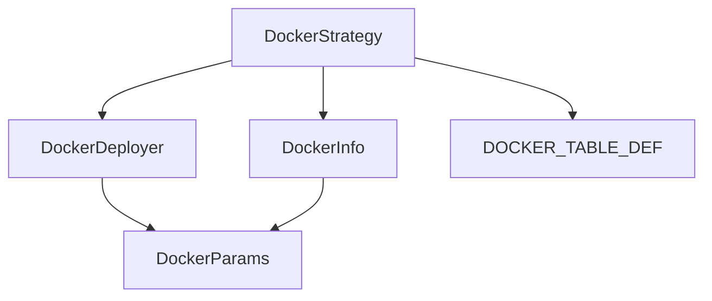
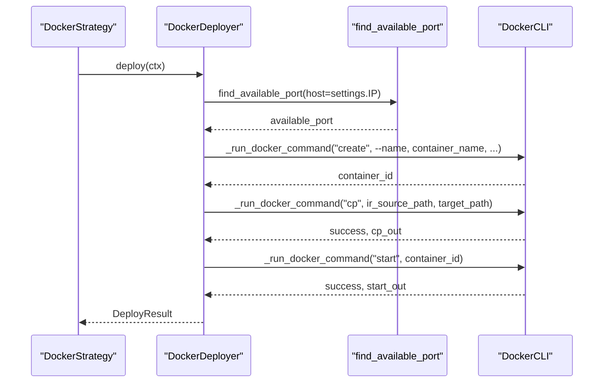
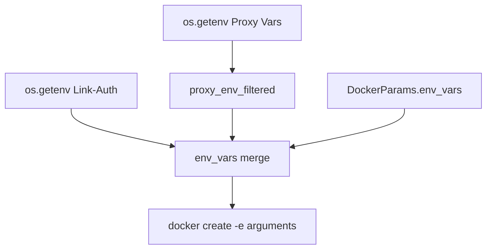

<!-- source: DeepWiki mcp.deepwiki.com · repo openJiuwen-ai/agent-runtime · extra page Docker Deployment · fetched 2026-11-02 -->

# Docker Deployment

Relevant source files

The following files were used as context for generating this wiki page:

- [.gitmodules](.gitmodules)
- [management/openjiuwen_runtime/management/deployments/docker/deployer.py](management/openjiuwen_runtime/management/deployments/docker/deployer.py)
- [management/openjiuwen_runtime/management/deployments/docker/models.py](management/openjiuwen_runtime/management/deployments/docker/models.py)
- [management/openjiuwen_runtime/management/deployments/docker/strategy.py](management/openjiuwen_runtime/management/deployments/docker/strategy.py)
- [management/openjiuwen_runtime/management/deployments/docker/utils.py](management/openjiuwen_runtime/management/deployments/docker/utils.py)

## Purpose and Scope
This page details the implementation of Docker-based deployments within the openJiuwen Agent Runtime control plane. It covers the `DockerDeployer` container lifecycle management, the specialized `docker create` -> `docker cp` -> `docker start` sequence designed to bypass volume mounting limitations in containerized control planes, automatic port allocation, environment/proxy propagation, and database persistence via `DockerStrategy` and `DOCKER_TABLE_DEF`.

---

## 1. Core Data Models and Strategy

The Docker deployment subsystem relies on distinct data structures and a concrete strategy implementation to bridge management requests with containerized runtime execution.

- **`DockerParams`**: Defines container-specific options including `image`, `container_name`, `env_vars`, `volumes`, `whl_path`, `ir_path`, `package_name`, and `port` [management/openjiuwen_runtime/management/deployments/docker/models.py:16-25]().
- **`DockerInfo`**: Pydantic model representing persisted deployment records [management/openjiuwen_runtime/management/deployments/docker/models.py:28-48]().
- **`DOCKER_TABLE_DEF`**: SQLAlchemy/DB table definition containing columns for deployment IDs, container IDs, host/port bindings, and JSON metadata [management/openjiuwen_runtime/management/deployments/docker/models.py:66-90]().
- **`DockerStrategy`**: Implements `BaseDeploymentStrategy` to manage record creation, context rebuilding, and stop/status parameter extraction [management/openjiuwen_runtime/management/deployments/docker/strategy.py:20-113]().

*Sources: [management/openjiuwen_runtime/management/deployments/docker/strategy.py:20-113](), [management/openjiuwen_runtime/management/deployments/docker/models.py:16-90]()*

---

## 2. DockerDeployer Implementation & Lifecycle Sequence

The `DockerDeployer` class handles direct communication with the Docker daemon via asynchronous subprocess execution [management/openjiuwen_runtime/management/deployments/docker/deployer.py:32-68]().

### Lowcode Container Deployment Sequence (`deploy_lowcode_container`)

When deploying lowcode agent containers, `DockerDeployer` adopts a strict three-step sequence: `docker create` -> `docker cp` -> `docker start` [management/openjiuwen_runtime/management/deployments/docker/deployer.py:70-132](). 

This sequence avoids issues with `docker run -v` mounting. When the management server itself runs inside a container and mounts `/var/run/docker.sock`, any relative or absolute file paths passed to `-v` evaluate against the host filesystem rather than the management container's internal filesystem, resulting in empty directory mounts. By creating an empty container first, files like `ir.json` can be reliably streamed inside using `docker cp` [management/openjiuwen_runtime/management/deployments/docker/deployer.py:80-86]().

*Sources: [management/openjiuwen_runtime/management/deployments/docker/deployer.py:70-132](), [management/openjiuwen_runtime/management/deployments/docker/utils.py:27-62]()*

### Port Allocation

Before launching a container, `DockerDeployer` scans for an available host port using `find_available_port` from the utility module, which checks TCP connectivity across a specified port range using concurrent worker threads [management/openjiuwen_runtime/management/deployments/docker/utils.py:27-62]().

*Sources: [management/openjiuwen_runtime/management/deployments/docker/deployer.py:189-194](), [management/openjiuwen_runtime/management/deployments/docker/utils.py:1-62]()*

---

## 3. Environment & Proxy Propagation

During the `deploy()` execution, `DockerDeployer` automatically propagates parent container network proxy configurations and link authentication parameters into the target container environment [management/openjiuwen_runtime/management/deployments/docker/deployer.py:133-181]().

1. **Proxy Propagation**: Standard proxy environment variables (`HTTP_PROXY`, `HTTPS_PROXY`, `NO_PROXY`, and their lowercase variants) are read from the host environment, filtered for non-empty values, and merged with custom environment variables (with custom variables taking precedence) [management/openjiuwen_runtime/management/deployments/docker/deployer.py:162-173]().
2. **Link Authentication (`link-auth`)**: Link-auth variables (`CLAW_LINK_AUTH_MODE`, `CLAW_LINK_TOKEN_TTL`) are explicitly extracted from the control plane's environment and injected via `setdefault` to ensure AgentServer containers inherit required verification tokens for gateway reverse-validation [management/openjiuwen_runtime/management/deployments/docker/deployer.py:174-180]().
3. **Runtime Userdata**: `DockerStrategy._build_deploy_context` extracts runtime userdata from record metadata and injects it as `RUNTIME_USERDATA` into `DockerParams` [management/openjiuwen_runtime/management/deployments/docker/strategy.py:68-95]().

*Sources: [management/openjiuwen_runtime/management/deployments/docker/deployer.py:162-181](), [management/openjiuwen_runtime/management/deployments/docker/strategy.py:68-95]()*

---

