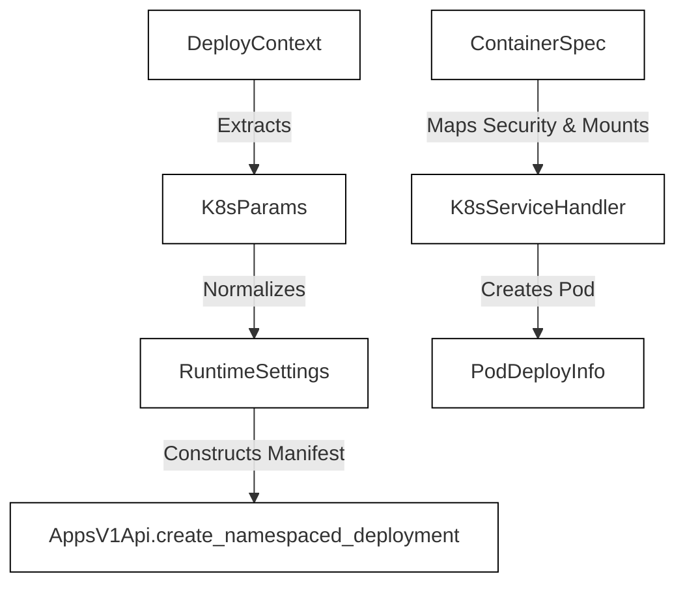
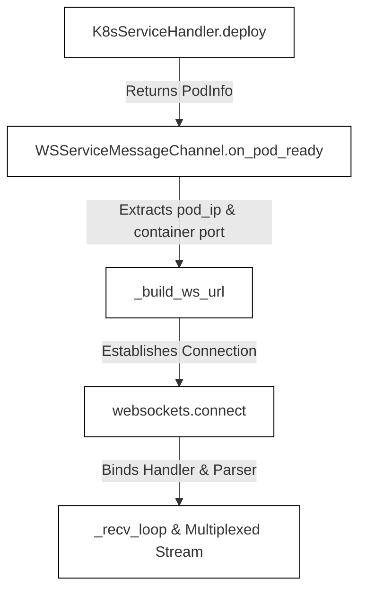

<!-- source: DeepWiki mcp.deepwiki.com · repo openJiuwen-ai/agent-runtime · extra page Kubernetes Deployment · fetched 2026-11-02 -->

# Kubernetes Deployment

<details>
<summary>Relevant source files</summary>

The following files were used as context for generating this wiki page:

- [foundation/openjiuwen_runtime/foundation/db/postgresql_handler.py](foundation/openjiuwen_runtime/foundation/db/postgresql_handler.py)
- [foundation/openjiuwen_runtime/foundation/db/sqlalchemy_handler.py](foundation/openjiuwen_runtime/foundation/db/sqlalchemy_handler.py)
- [foundation/openjiuwen_runtime/foundation/docker_utils.py](foundation/openjiuwen_runtime/foundation/docker_utils.py)
- [foundation/tests/unit_tests/test_sqlite_handler.py](foundation/tests/unit_tests/test_sqlite_handler.py)
- [management/openjiuwen_runtime/management/__init__.py](management/openjiuwen_runtime/management/__init__.py)
- [management/openjiuwen_runtime/management/deployments/__init__.py](management/openjiuwen_runtime/management/deployments/__init__.py)
- [management/openjiuwen_runtime/management/deployments/k8s/deployer.py](management/openjiuwen_runtime/management/deployments/k8s/deployer.py)
- [management/openjiuwen_runtime/management/deployments/k8s/models.py](management/openjiuwen_runtime/management/deployments/k8s/models.py)
- [management/openjiuwen_runtime/management/models/__init__.py](management/openjiuwen_runtime/management/models/__init__.py)
- [management/openjiuwen_runtime/management/models/deployment_params.py](management/openjiuwen_runtime/management/models/deployment_params.py)
- [management/openjiuwen_runtime/management/models/enums.py](management/openjiuwen_runtime/management/models/enums.py)
- [management/openjiuwen_runtime/management/session/k8s_service_handler.py](management/openjiuwen_runtime/management/session/k8s_service_handler.py)
- [management/openjiuwen_runtime/management/session/router.py](management/openjiuwen_runtime/management/session/router.py)
- [management/openjiuwen_runtime/management/session/ws_client_channel.py](management/openjiuwen_runtime/management/session/ws_client_channel.py)

</details>


## Purpose and Scope
This section details the Kubernetes deployment infrastructure within the `openjiuwen-ai/agent-runtime` management control plane and session subsystem. The architecture leverages both synchronous (`kubernetes` client) and asynchronous (`kubernetes_asyncio` client) Python SDKs to provision, orchestrate, and monitor containerized agent runtimes, pods, and services within a Kubernetes cluster. 

Sources: `management/openjiuwen_runtime/management/deployments/k8s/deployer.py:1-41]`, `management/openjiuwen_runtime/management/session/k8s_service_handler.py:1-155]()`

---

## Core Architecture and Data Models
The Kubernetes deployment strategy is configured via specialized parameter structures and runtime settings that translate high-level agent definitions into Kubernetes manifests (`Deployments`, `Pods`, and `Services`).

* **`K8sParams`**: Defines deployment options including namespace, deployment name, container image, resource limits, config maps, and secrets `[management/openjiuwen_runtime/management/deployments/k8s/models.py:33-45]()`.
* **`RuntimeSettings`**: Normalized internal runtime parameters extracted from `DeployContext` for execution `[management/openjiuwen_runtime/management/deployments/k8s/deployer.py:25-38]()`.
* **`ContainerSpec`**: Specifies container attributes such as ports, pull policies, environment variables, security context (`privileged`, `capabilities_add`, `seccomp_unconfined`), `hostPath` mounts, and resource requests/limits `[management/openjiuwen_runtime/management/session/k8s_service_handler.py:92-128]()`.
* **`PodDeployInfo`**: Represents successfully deployed pod metadata matching `kubectl get pods -o wide` output (`pod_name`, `namespace`, `pod_ip`, `containers`, `port`) `[management/openjiuwen_runtime/management/session/k8s_service_handler.py:28-39]()`.


*Sources: `management/openjiuwen_runtime/management/deployments/k8s/models.py:33-45]`, `management/openjiuwen_runtime/management/deployments/k8s/deployer.py:25-38]`, `management/openjiuwen_runtime/management/session/k8s_service_handler.py:28-128]()`*

---

## `K8sDeployer` Implementation & Client Configuration
The `K8sDeployer` class extends the base `Deployer` abstraction and interfaces with the Kubernetes Python API `[management/openjiuwen_runtime/management/deployments/k8s/deployer.py:40-41]()`. 

### Client Initialization & Config Loading
Client authentication resolves credentials hierarchically via `_ensure_client_config()`:
1. Explicitly provided `kubeconfig` file paths `[management/openjiuwen_runtime/management/deployments/k8s/deployer.py:171-174]()`.
2. In-cluster service account configuration (`k8s_config.load_incluster_config()`) `[management/openjiuwen_runtime/management/deployments/k8s/deployer.py:175-176]()`.
3. Default user kubeconfig location fallback `[management/openjiuwen_runtime/management/deployments/k8s/deployer.py:177-178]()`.

API calls are wrapped using `asyncio.to_thread` via `_call_api()` to prevent blocking the event loop during network operations `[management/openjiuwen_runtime/management/deployments/k8s/deployer.py:164-165]()`.

```mermaid
graph TD
    H["K8sDeployer"] -->|_ensure_client_config| I{"Kubeconfig Provided?"}
    I -->|Yes| J["k8s_config.load_kube_config"]
    I -->|No| K{"In-Cluster?}
    K -->|Yes| L["k8s_config.load_incluster_config"]
    K -->|No| M["k8s_config.load_kube_config default"]
    J --> N["_get_apis CoreV1Api & AppsV1Api"]
    L --> N
    M --> N

    style H fill:#ffffff,stroke:#000000,stroke-width:1px
    style I fill:#ffffff,stroke:#000000,stroke-width:1px
    style J fill:#ffffff,stroke:#000000,stroke-width:1px
    style K fill:#ffffff,stroke:#000000,stroke-width:1px
    style L fill:#ffffff,stroke:#000000,stroke-width:1px
    style M fill:#ffffff,stroke:#000000,stroke-width:1px
    style N fill:#ffffff,stroke:#000000,stroke-width:1px
```
*Sources: `management/openjiuwen_runtime/management/deployments/k8s/deployer.py:167-185]()`*

---

## Pod Specs, Security Contexts, and Mount Management
The `K8sServiceHandler` manages asynchronous pod creation using `kubernetes_asyncio` `[management/openjiuwen_runtime/management/session/k8s_service_handler.py:3-155]()`. It translates Docker-like configurations into native Kubernetes pod specifications:

* **Privileged & Capabilities**: `ContainerSpec` supports `privileged`, `capabilities_add`, `capabilities_drop`, `seccomp_unconfined`, and `apparmor_unconfined` annotations `[management/openjiuwen_runtime/management/session/k8s_service_handler.py:100-112]()`.
* **HostPath Mounts**: `HostPathMount` definitions map host directories into containers, equivalent to `docker run -v HOST:CONTAINER[:ro]` `[management/openjiuwen_runtime/management/session/k8s_service_handler.py:70-83]()`.
* **Database Persistence Schema**: The `K8S_TABLE_DEF` schema tracks deployment states, image references, node selectors, and service ports within the underlying relational database `[management/openjiuwen_runtime/management/deployments/k8s/models.py:96-128]()`.

Sources: `management/openjiuwen_runtime/management/session/k8s_service_handler.py:70-128]`, `management/openjiuwen_runtime/management/deployments/k8s/models.py:96-128]()`

---

## WebSocket Integration and Pod Readiness
Once a pod or container is successfully provisioned, `WSServiceMessageChannel.on_pod_ready` resolves the target IP and port to establish a bi-directional streaming WebSocket connection `[management/openjiuwen_runtime/management/session/ws_client_channel.py:149-181]()`.


*Sources: `management/openjiuwen_runtime/management/session/ws_client_channel.py:149-181]()`*

---

