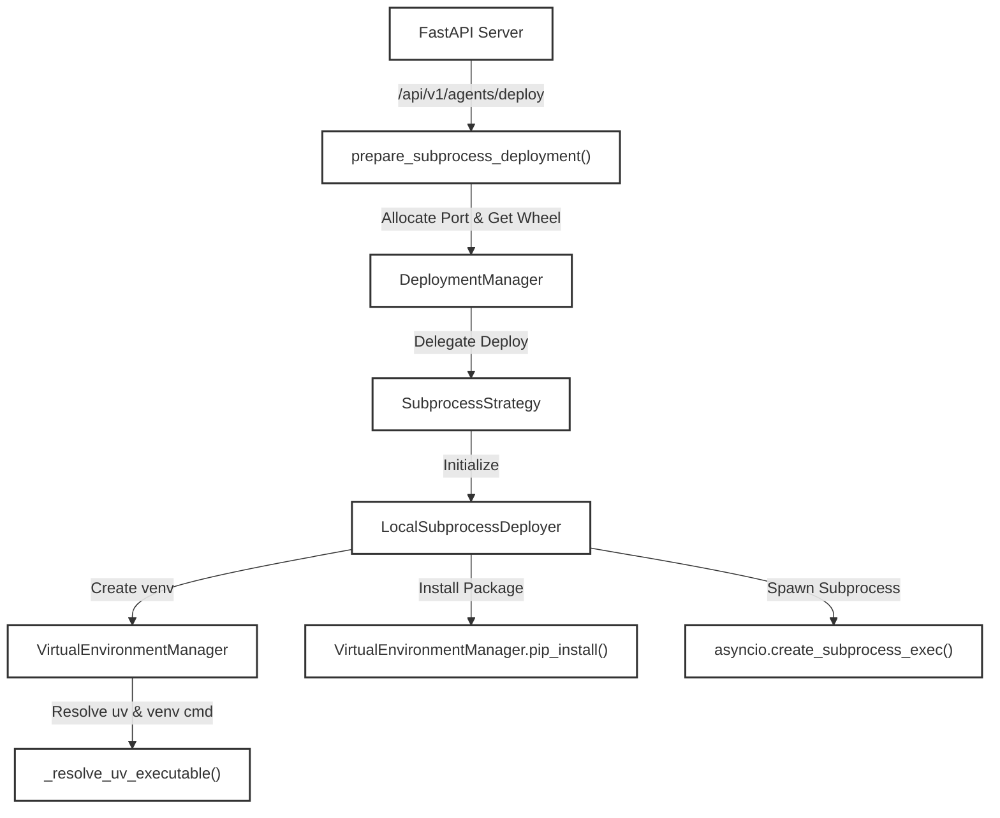
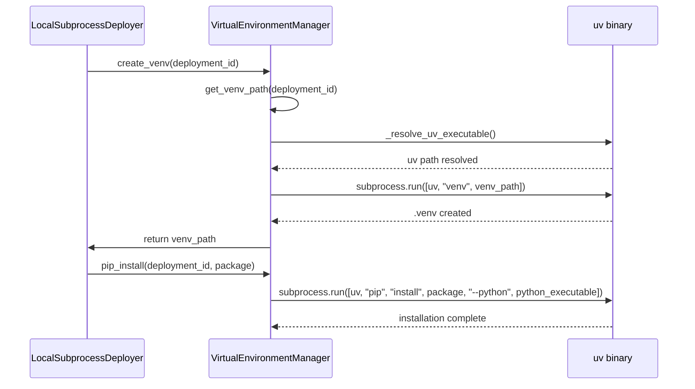

<!-- source: DeepWiki mcp.deepwiki.com · repo openJiuwen-ai/agent-runtime · extra page Subprocess Deployment · fetched 2026-11-02 -->

# Subprocess Deployment

<details>
<summary>Relevant source files</summary>

The following files were used as context for generating this wiki page:

- [applications/lowcode_agent/openjiuwen_runtime/examples/lowcode_agent/__main__.py](applications/lowcode_agent/openjiuwen_runtime/examples/lowcode_agent/__main__.py)
- [foundation/openjiuwen_runtime/foundation/venv_manager.py](foundation/openjiuwen_runtime/foundation/venv_manager.py)
- [management/openjiuwen_runtime/management/deployments/base/models.py](management/openjiuwen_runtime/management/deployments/base/models.py)
- [management/openjiuwen_runtime/management/deployments/subprocess/deployer.py](management/openjiuwen_runtime/management/deployments/subprocess/deployer.py)
- [management/openjiuwen_runtime/management/deployments/subprocess/models.py](management/openjiuwen_runtime/management/deployments/subprocess/models.py)
- [management/openjiuwen_runtime/management/deployments/subprocess/strategy.py](management/openjiuwen_runtime/management/deployments/subprocess/strategy.py)
- [server/openjiuwen_runtime/server/main.py](server/openjiuwen_runtime/server/main.py)

</details>


## Purpose and Scope
This section covers the local subprocess deployment mechanism within the agent runtime management plane. Subprocess deployment isolates agent instances by provisioning dedicated virtual environments using `uv`, allocating unique network ports, configuring Python dependencies (including local wheel builds or PyPI packages), and managing the execution lifecycle (startup, status checking, and termination via PID).

Sources: `management/openjiuwen_runtime/management/deployments/subprocess/deployer.py:4-11`()

---

## Subprocess Architecture & Control Flow

The following diagram maps the natural language deployment concepts to the actual code entities involved in orchestrating a subprocess deployment from the FastAPI control plane down to the spawned agent runtime.


Sources: `server/openjiuwen_runtime/server/main.py:169-216`(), `management/openjiuwen_runtime/management/deployments/subprocess/deployer.py:114-188`(), `management/openjiuwen_runtime/management/deployments/subprocess/strategy.py:72-90`()

---

## Port Allocation and Preprocessing

Before a subprocess is launched, the server inspects available network ports and resolves the required package wheel paths based on the operational mode (`dev` vs `product`).

### Key Functions
- `prepare_subprocess_deployment(deploy_type, port)`: Validates or automatically assigns an available port using `allocate_port()` and `is_port_available()`. In development mode (`settings.MODE == "dev"`), it locates the precompiled `lowcode_agent_runner` wheel file under `settings.dist_path`.
- `get_deploy_type(mode)`: Enforces global deployment mode constraints defined in `settings.DEPLOY_TYPE`.

```python
# Port allocation check tracking set
_allocated_ports: set[int] = set()
```

Sources: `server/openjiuwen_runtime/server/main.py:22-40`(), `server/openjiuwen_runtime/server/main.py:90-146`()

---

## Virtual Environment Provisioning with `uv`

The `VirtualEnvironmentManager` class handles the creation and package installation of isolated virtual environments for each unique `deployment_id` using `uv`.


Sources: `foundation/openjiuwen_runtime/foundation/venv_manager.py:21-47`(), `foundation/openjiuwen_runtime/foundation/venv_manager.py:49-124`(), `foundation/openjiuwen_runtime/foundation/venv_manager.py:159-207`()

### Key Implementation Details
- `_resolve_uv_executable()`: Locates the `uv` binary via `shutil.which("uv")`, raising a `RuntimeError` if missing.
- `VirtualEnvironmentManager.create_venv()`: Executes `uv venv` to bootstrap the environment and runs `ensurepip` as a fallback if `pip` is absent.
- `VirtualEnvironmentManager.pip_install()`: Installs packages into the isolated environment with built-in retry logic (up to 3 attempts), extended HTTP timeouts (`UV_HTTP_TIMEOUT=600`), and restricted concurrency (`UV_CONCURRENT_DOWNLOADS=1`) to handle unstable or private PyPI servers.

Sources: `foundation/openjiuwen_runtime/foundation/venv_manager.py:21-26`(), `foundation/openjiuwen_runtime/foundation/venv_manager.py:49-128`(), `foundation/openjiuwen_runtime/foundation/venv_manager.py:159-207`()

---

## Process Lifecycle and Execution

`LocalSubprocessDeployer` inherits from the base `Deployer` abstract class and manages process execution, monitoring, and termination.

### Execution Flow in `LocalSubprocessDeployer.deploy()`
1. **Environment Setup**: Invokes `VirtualEnvironmentManager.create_venv()` using `deployment_id`.
2. **Package Installation**: Installs base runtime wheels (`openjiuwen_*.whl`) and agent-specific wheels if in `dev` mode, or fetches `lowcode-agent-runner` from PyPI in `product` mode.
3. **Command Construction**: Assembles the execution list using the virtual environment's python executable:
   ```bash
   python -m openjiuwen_runtime.examples.lowcode_agent --host 0.0.0.0 --port <port> --irpath <ir_path>
   ```
4. **Process Spawning**: Starts the process using `asyncio.create_subprocess_exec()` with an environment variable mapping containing `VIRTUAL_ENV`. On Windows, it applies `subprocess.CREATE_NEW_PROCESS_GROUP` to isolate signal handling.

### Process Management Operations
- `_check_process_by_pid(pid)`: Checks if a process is running using `kill -0` on POSIX systems or `tasklist.exe` on Windows (`win32`).
- `_kill_by_pid(pid)`: Terminates a process using `/bin/kill -9` on POSIX or `taskkill.exe /F /PID` on Windows.

Sources: `management/openjiuwen_runtime/management/deployments/subprocess/deployer.py:39-188`()

---

## Strategy and Persistence Models

`SubprocessStrategy` bridges the orchestration logic with persistence layers, mapping deployment records to database tables.

### Data Models & Table Definition
- `SubprocessParams`: Dataclass holding subprocess-specific attributes such as `whl_path`, `ir_path`, `package_name`, `venv_path`, and `userdata`.
- `ProcessInfo`: Pydantic model representing process deployment metadata retrieved from the database.
- `PROCESS_TABLE_DEF`: Defines the relational schema (`process`) containing columns for `deployment_id`, `version`, `host`, `port`, `url`, `pid`, `whl_path`, `ir_path`, `package_name`, `venv_path`, and JSON-encoded `data`.

```python
PROCESS_TABLE_DEF = TableDefinition(
    table_name="process",
    columns=[
        ColumnDefinition("id", "integer", primary_key=True, autoincrement=True),
        ColumnDefinition("deployment_id", "string", length=64, unique=True, nullable=False),
        ColumnDefinition("version", "string", length=32, nullable=False),
        ColumnDefinition("host", "string", length=255, nullable=False),
        ColumnDefinition("port", "integer", nullable=True),
        ColumnDefinition("url", "string", length=512, nullable=True),
        ColumnDefinition("pid", "integer", nullable=True),
        ColumnDefinition("whl_path", "string", length=512, nullable=True),
        ColumnDefinition("ir_path", "string", length=512, nullable=True),
        ColumnDefinition("package_name", "string", length=255, nullable=True),
        ColumnDefinition("venv_path", "string", length=512, nullable=True),
        ColumnDefinition("created_at", "datetime", nullable=False),
        ColumnDefinition("updated_at", "datetime", nullable=False),
        ColumnDefinition("data", "json", nullable=True),
    ],
    indexes=[
        IndexDefinition(["deployment_id"], unique=True),
    ],
)
```

Sources: `management/openjiuwen_runtime/management/deployments/subprocess/models.py:16-82`(), `management/openjiuwen_runtime/management/deployments/subprocess/strategy.py:15-110`()

---

