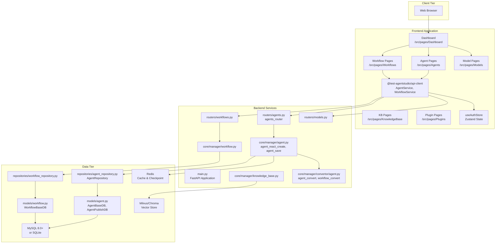
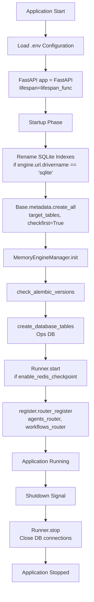
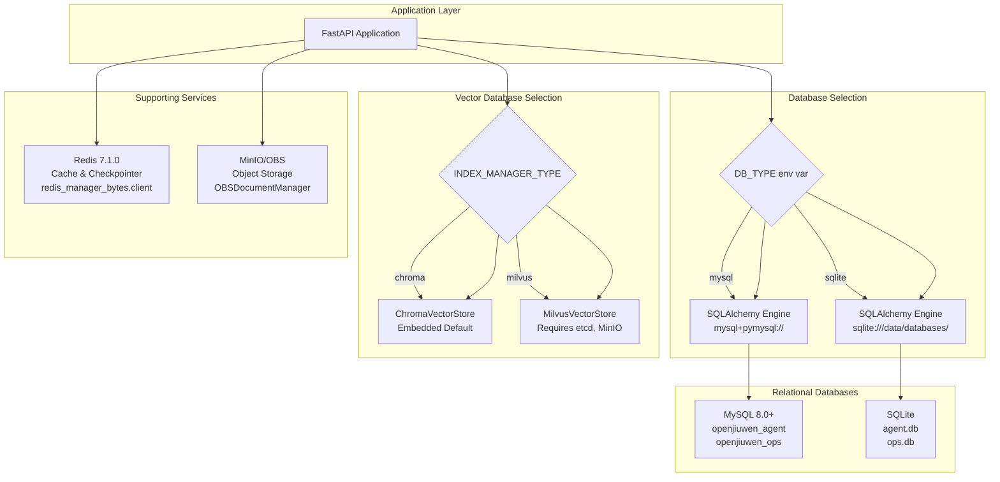
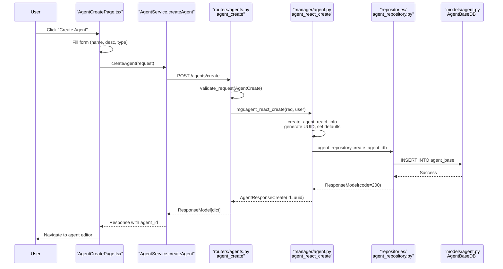
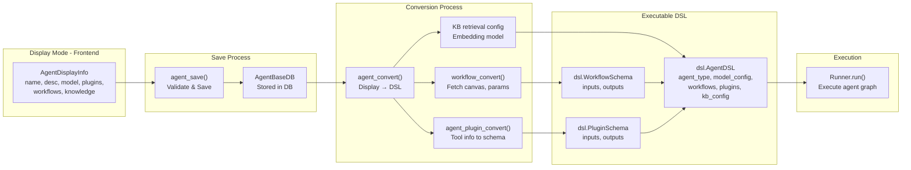
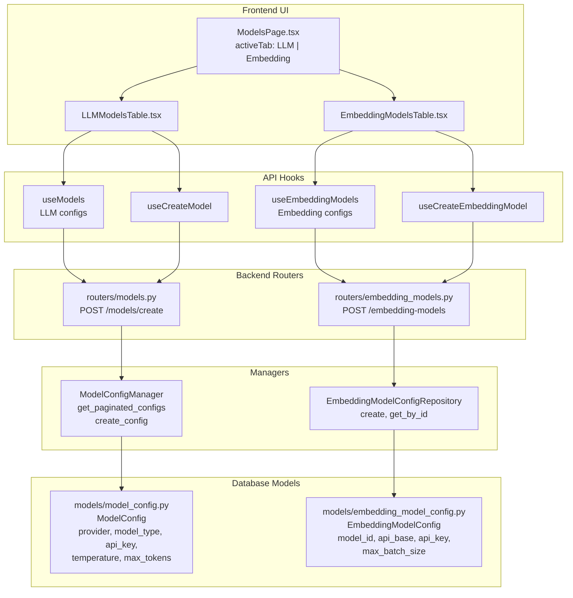
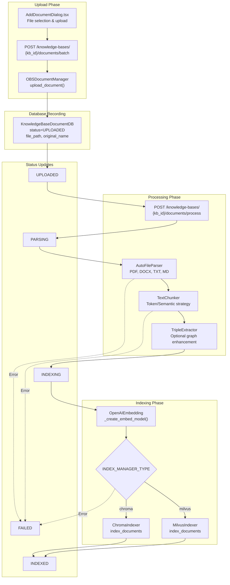
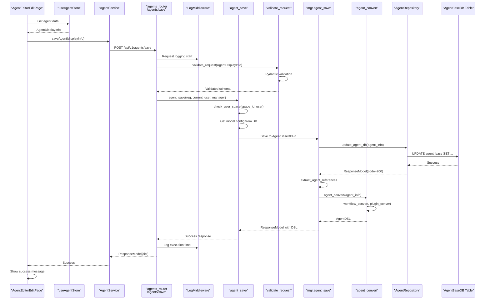

<!-- source: DeepWiki mcp.deepwiki.com · repo openJiuwen-ai/agent-studio · page 1 Overview · fetched 2026-11-02 -->

# Overview

<details>
<summary>Relevant source files</summary>

The following files were used as context for generating this wiki page:

- [.env.example](.env.example)
- [backend/openjiuwen_studio/core/common/logging/__init__.py](backend/openjiuwen_studio/core/common/logging/__init__.py)
- [backend/openjiuwen_studio/core/common/logging/events.py](backend/openjiuwen_studio/core/common/logging/events.py)
- [backend/openjiuwen_studio/core/config.py](backend/openjiuwen_studio/core/config.py)
- [backend/openjiuwen_studio/core/manager/agent.py](backend/openjiuwen_studio/core/manager/agent.py)
- [backend/openjiuwen_studio/core/manager/convertor/agent.py](backend/openjiuwen_studio/core/manager/convertor/agent.py)
- [backend/openjiuwen_studio/core/manager/convertor/components/sub_workflow.py](backend/openjiuwen_studio/core/manager/convertor/components/sub_workflow.py)
- [backend/openjiuwen_studio/core/manager/email_manager/__init__.py](backend/openjiuwen_studio/core/manager/email_manager/__init__.py)
- [backend/openjiuwen_studio/core/manager/email_manager/email_template.py](backend/openjiuwen_studio/core/manager/email_manager/email_template.py)
- [backend/openjiuwen_studio/core/manager/email_manager/email_utils.py](backend/openjiuwen_studio/core/manager/email_manager/email_utils.py)
- [backend/openjiuwen_studio/core/manager/knowledge_base.py](backend/openjiuwen_studio/core/manager/knowledge_base.py)
- [backend/openjiuwen_studio/core/manager/model_manager/managers/embedding_model_test_manager.py](backend/openjiuwen_studio/core/manager/model_manager/managers/embedding_model_test_manager.py)
- [backend/openjiuwen_studio/core/manager/redis_manager/__init__.py](backend/openjiuwen_studio/core/manager/redis_manager/__init__.py)
- [backend/openjiuwen_studio/core/manager/repositories/agent_repository.py](backend/openjiuwen_studio/core/manager/repositories/agent_repository.py)
- [backend/openjiuwen_studio/core/manager/repositories/plugin_repository.py](backend/openjiuwen_studio/core/manager/repositories/plugin_repository.py)
- [backend/openjiuwen_studio/core/manager/repositories/tool_repository.py](backend/openjiuwen_studio/core/manager/repositories/tool_repository.py)
- [backend/openjiuwen_studio/core/manager/utils/utils.py](backend/openjiuwen_studio/core/manager/utils/utils.py)
- [backend/openjiuwen_studio/main.py](backend/openjiuwen_studio/main.py)
- [backend/openjiuwen_studio/routers/agents.py](backend/openjiuwen_studio/routers/agents.py)
- [backend/openjiuwen_studio/routers/embedding_models.py](backend/openjiuwen_studio/routers/embedding_models.py)
- [backend/openjiuwen_studio/schemas/agent.py](backend/openjiuwen_studio/schemas/agent.py)
- [frontend/packages/api-client/src/config.ts](frontend/packages/api-client/src/config.ts)
- [frontend/packages/api-client/src/services/agentService.ts](frontend/packages/api-client/src/services/agentService.ts)
- [frontend/src/locales/en-US.json](frontend/src/locales/en-US.json)
- [frontend/src/locales/zh-CN.json](frontend/src/locales/zh-CN.json)
- [frontend/src/pages/Auth/PrivacyPolicyPage.tsx](frontend/src/pages/Auth/PrivacyPolicyPage.tsx)
- [frontend/src/pages/Auth/UserLoginPage.tsx](frontend/src/pages/Auth/UserLoginPage.tsx)
- [frontend/src/pages/KnowledgeBase/components/AddDocumentDialog.tsx](frontend/src/pages/KnowledgeBase/components/AddDocumentDialog.tsx)
- [frontend/src/pages/KnowledgeBase/components/KnowledgeBaseFormDialog.tsx](frontend/src/pages/KnowledgeBase/components/KnowledgeBaseFormDialog.tsx)
- [frontend/src/pages/Models/ModelsPage.tsx](frontend/src/pages/Models/ModelsPage.tsx)
- [frontend/src/pages/Models/ModelsPageNew.tsx](frontend/src/pages/Models/ModelsPageNew.tsx)
- [frontend/src/pages/Models/components/EmbeddingModelsTable.tsx](frontend/src/pages/Models/components/EmbeddingModelsTable.tsx)
- [frontend/src/pages/Models/components/LLMModelsTable.tsx](frontend/src/pages/Models/components/LLMModelsTable.tsx)

</details>


OpenJiuwen Agent Studio is a comprehensive AI agent development platform that enables users to build, deploy, and manage intelligent agents through visual interfaces and automated workflows. The system provides a complete toolkit for creating both autonomous (ReAct) and orchestrated (Workflow) agents, with integrated support for knowledge bases, model management, prompt optimization, and plugin extensibility.

This page provides a technical overview of the system architecture, major components, and how they interconnect. For detailed guides on specific features, see:
- Agent development and lifecycle: [Agents](#3.1)
- Workflow design and execution: [Workflows](#3.2)
- Database architecture and migrations: [Data Layer](#5.4)
- API endpoint reference: [API Reference](#8)

## System Architecture

The platform follows a modern three-tier architecture with clear separation between presentation (React frontend), business logic (FastAPI backend), and data persistence (multi-database strategy).

### High-Level Component Architecture



**Sources:** 
- [frontend/src/pages/Models/ModelsPage.tsx:1-114]()
- [backend/openjiuwen_studio/main.py:1-262]()
- [backend/openjiuwen_studio/routers/agents.py:1-70]()
- [backend/openjiuwen_studio/core/manager/agent.py:1-160]()

### Application Initialization and Lifecycle

The application follows a structured startup and shutdown process managed by FastAPI's lifespan context:



**Key initialization classes and functions:**

| Component | Code Entity | Location |
|-----------|-------------|----------|
| Application Factory | `FastAPI(lifespan=lifespan_func)` | [backend/openjiuwen_studio/main.py:149-163]() |
| Database Tables | `Base.metadata.create_all()` | [backend/openjiuwen_studio/main.py:110-114]() |
| Table Models | `AgentBaseDB`, `AgentPublishDB`, `WorkflowBaseDB`, etc. | [backend/openjiuwen_studio/main.py:28-43]() |
| Memory Engine | `MemoryEngineManager.init()` | [backend/openjiuwen_studio/main.py:115]() |
| Version Check | `check_alembic_versions()` | [backend/openjiuwen_studio/main.py:121]() |
| Runner Initialization | `Runner.start()` | [backend/openjiuwen_studio/main.py:140]() |

**Sources:**
- [backend/openjiuwen_studio/main.py:54-146]()
- [backend/openjiuwen_studio/core/config.py:1-80]()

## Technology Stack

### Frontend Stack

| Layer | Technologies | Key Files |
|-------|-------------|-----------|
| **Framework** | React 18, TypeScript, Vite | [frontend/src/main.tsx](), [frontend/vite.config.ts]() |
| **UI Components** | Material-UI (MUI), Lucide Icons | [frontend/src/pages/Models/ModelsPage.tsx:1-50]() |
| **State Management** | Zustand (`useAuthStore`, `useAgentStore`) | [frontend/src/stores/useAuthStore.ts]() |
| **API Client** | React Query, Axios | [frontend/packages/api-client/src/services/agentService.ts:1-50]() |
| **Routing** | React Router v6 | [frontend/src/App.tsx]() |
| **i18n** | react-i18next | [frontend/src/locales/zh-CN.json](), [frontend/src/locales/en-US.json]() |
| **Workflow Canvas** | Custom React Flow implementation | [@workflow-canvas package]() |

**Sources:**
- [frontend/src/pages/Models/ModelsPage.tsx:1-45]()
- [frontend/packages/api-client/src/config.ts:1-70]()
- [frontend/src/locales/zh-CN.json:1-100]()

### Backend Stack

| Layer | Technologies | Key Files |
|-------|-------------|-----------|
| **Framework** | FastAPI, Uvicorn | [backend/openjiuwen_studio/main.py:1-50]() |
| **ORM** | SQLAlchemy 2.x | [backend/openjiuwen_studio/models/agent.py]() |
| **Validation** | Pydantic v2 | [backend/openjiuwen_studio/schemas/agent.py:1-50]() |
| **Migration** | Alembic (multi-head: MySQL + SQLite) | [backend/alembic/]() |
| **Authentication** | JWT (PyJWT) | [backend/openjiuwen_studio/core/manager/login_manager/]() |
| **AI Integration** | `openjiuwen` package (LLM, RAG, Agents) | [backend/openjiuwen_studio/core/manager/convertor/agent.py:1-50]() |
| **Task Queue** | Redis (optional) | [backend/openjiuwen_studio/core/manager/redis_manager/]() |

**Sources:**
- [backend/openjiuwen_studio/main.py:1-262]()
- [backend/openjiuwen_studio/schemas/agent.py:1-100]()
- [backend/openjiuwen_studio/core/config.py:1-80]()

### Database Architecture

The system supports multiple database backends for different data types:



**Database configuration mapping:**

| Purpose | Environment Variable | Code Entity | Default Value |
|---------|---------------------|-------------|---------------|
| DB Type | `DB_TYPE` | `settings.db_type` | `sqlite` |
| MySQL Host | `DB_HOST` | `settings.db_host` | `localhost` |
| SQLite Path | `SQLITE_DB_PATH` | `settings.sqlite_db_path` | `data/databases` |
| Vector DB Type | `INDEX_MANAGER_TYPE` | `_CURR_INDEX_TYPE` | `chroma` |
| Milvus Host | `MILVUS_HOST` | `settings.milvus_host` | `jiuwen-milvus-standalone` |
| Redis Host | `REDIS_HOST` | `settings.redis_host` | `localhost` |

**Sources:**
- [.env.example:88-149]()
- [backend/openjiuwen_studio/core/config.py:26-80]()
- [backend/openjiuwen_studio/core/manager/knowledge_base.py:83-152]()

## Core Components and Data Flow

### Agent Development Flow

The following diagram maps the natural language user journey to concrete code entities:



**Key code entities in agent creation:**

| Stage | Frontend Entity | Backend Entity | Data Model |
|-------|----------------|----------------|------------|
| UI Form | `AgentCreatePage` | - | `CreateAgentRequest` |
| API Call | `AgentService.createAgent()` | `POST /agents/create` | `AgentCreate` schema |
| Validation | - | `validate_request()` | Pydantic validation |
| Business Logic | - | `agent_react_create()` | `AgentBaseDBPd` |
| Persistence | - | `AgentRepository.create_agent_db()` | `AgentBaseDB` model |

**Sources:**
- [frontend/packages/api-client/src/services/agentService.ts:44-54]()
- [backend/openjiuwen_studio/routers/agents.py:157-179]()
- [backend/openjiuwen_studio/core/manager/agent.py:329-376]()
- [backend/openjiuwen_studio/core/manager/repositories/agent_repository.py:1-50]()

### Agent Configuration and Execution

Agents are configured in "display mode" and converted to executable DSL format:



**Conversion function mapping:**

| Conversion Task | Function | Input | Output |
|----------------|----------|-------|--------|
| Main conversion | `agent_convert()` | `AgentBaseDBPd` | `dsl.AgentDSL` |
| Workflow list | `workflows_convert()` | `List[dict]` | `List[dsl.WorkflowSchema]` |
| Single workflow | `workflow_convert()` | `AgentWorkflowListNodeBase` | `(inputs, outputs)` |
| Plugin list | `agent_plugins_convert()` | `List[AgentPlugin]` | `List[dsl.PluginSchema]` |
| Single plugin | `agent_plugin_convert()` | `AgentPlugin` | `dsl.PluginSchema` |
| Model config | `model_convert()` | `AgentBaseDBPd.model_id` | `dsl.ModelConfig` |
| Knowledge base | KB retrieval logic | `kb_list` | `dsl.KBRetrievalConfig` |

**Sources:**
- [backend/openjiuwen_studio/core/manager/agent.py:613-695]()
- [backend/openjiuwen_studio/core/manager/convertor/agent.py:1-400]()
- [backend/openjiuwen_studio/schemas/agent.py:1-200]()

### Model Management Architecture

The system supports two types of models with distinct configurations:



**Model type comparison:**

| Aspect | LLM Models | Embedding Models |
|--------|-----------|------------------|
| **Frontend Component** | `LLMModelsTable.tsx` | `EmbeddingModelsTable.tsx` |
| **API Hook** | `useModels()` | `useEmbeddingModels()` |
| **Backend Router** | `routers/models.py` | `routers/embedding_models.py` |
| **Manager** | `ModelConfigManager` | `EmbeddingModelConfigRepository` |
| **DB Model** | `ModelConfig` | `EmbeddingModelConfig` |
| **Key Parameters** | `temperature`, `max_tokens`, `top_p`, `timeout` | `max_batch_size` |
| **Usage** | Agent reasoning, tool calls | Document embedding, RAG retrieval |

**Sources:**
- [frontend/src/pages/Models/ModelsPage.tsx:1-300]()
- [frontend/src/pages/Models/components/LLMModelsTable.tsx:1-100]()
- [frontend/src/pages/Models/components/EmbeddingModelsTable.tsx:1-100]()
- [backend/openjiuwen_studio/routers/embedding_models.py:1-200]()

### Knowledge Base Document Processing Pipeline

Documents flow through a multi-stage processing pipeline:



**Processing function mapping:**

| Stage | Code Entity | Key Parameters | Location |
|-------|-------------|----------------|----------|
| **Upload** | `document_upload_batch()` | `files: List[UploadFile]` | [knowledge_base.py:700-800]() |
| **Save to storage** | `OBSDocumentManager.upload_document()` | `object_name`, `file_path` | [knowledge_base.py:144-151]() |
| **Parse** | `AutoFileParser.parse()` | `file_path` | Via `openjiuwen` package |
| **Chunk** | `TextChunker.chunk()` | `chunk_size`, `overlap` | Via `openjiuwen` package |
| **Extract triples** | `TripleExtractor.extract()` | `llm_client`, `documents` | Via `openjiuwen` package |
| **Embed** | `OpenAIEmbedding.embed()` | `texts`, `batch_size` | [knowledge_base.py:369-451]() |
| **Index** | `ChromaIndexer.index_documents()` | `documents`, `collection_name` | Via `openjiuwen` package |
| **Status update** | `knowledge_base_repository.update_document_status()` | `doc_id`, `status` | [knowledge_base.py:1000-1100]() |

**Sources:**
- [frontend/src/pages/KnowledgeBase/components/AddDocumentDialog.tsx:1-200]()
- [backend/openjiuwen_studio/core/manager/knowledge_base.py:86-451]()
- [backend/openjiuwen_studio/schemas/knowledge_base.py:1-100]()

## Configuration and Environment

The system is configured through environment variables defined in `.env`:

**Critical configuration mapping:**

| Category | Variable | Code Reference | Default | Purpose |
|----------|----------|----------------|---------|---------|
| **Database** | `DB_TYPE` | `settings.db_type` | `sqlite` | `mysql` or `sqlite` |
| | `DB_HOST` | `settings.db_host` | `localhost` | MySQL host |
| | `SQLITE_DB_PATH` | `settings.sqlite_db_path` | `data/databases` | SQLite file location |
| **Vector DB** | `INDEX_MANAGER_TYPE` | `_CURR_INDEX_TYPE` | `chroma` | `milvus` or `chroma` |
| | `MILVUS_HOST` | `settings.milvus_host` | `jiuwen-milvus-standalone` | Milvus server |
| **Authentication** | `SECRET_KEY` | `settings.secret_key` | (required) | JWT signing key |
| | `ACCESS_TOKEN_EXPIRE_MINUTES` | `settings.access_token_expire_minutes` | `2880` | Token lifetime |
| **Services** | `BACKEND_PORT` | `settings.port` | `8000` | Backend port |
| | `FRONTEND_PORT` | - | `3000` | Frontend dev server |
| | `REDIS_HOST` | `settings.redis_host` | `localhost` | Redis cache |
| | `CODE_SANDBOX_URL` | `settings.code_sandbox_url` | - | Plugin execution sandbox |
| **Object Storage** | `OBS_BUCKET` | `OBSDocumentManager.bucket` | - | MinIO/OBS bucket |
| | `OBS_SERVER` | Used in `AioBotoClient` | - | Object storage endpoint |
| **Email** | `SMTP_HOST` | `settings.smtp_host` | - | Email server |
| | `SMTP_PORT` | `settings.smtp_port` | `465` | Email port |

**Frontend environment variables:**

| Variable | Purpose | Default | Code Usage |
|----------|---------|---------|------------|
| `VITE_API_BASE_URL` | Backend API endpoint | `/api/v1` | `API_CONFIG.BASE_URL` |
| `VITE_API_PROXY_TARGET` | Dev proxy target | `http://localhost:8000/` | `vite.config.ts` |
| `VITE_TOKEN_REFRESH_INTERVAL_SECONDS` | Token refresh frequency | `600` | `useAuthStore` |
| `VITE_ENABLE_NEW_AUTH` | Enable registration system | `False` | Auth routing |
| `VITE_PLUGIN_SERVICE_URL` | External plugin server | - | Plugin execution |

**Sources:**
- [.env.example:1-196]()
- [backend/openjiuwen_studio/core/config.py:1-80]()
- [frontend/packages/api-client/src/config.ts:1-70]()

## Request-Response Flow Example

A complete request flow for saving an agent configuration:



**Key validation and error handling points:**

| Stage | Code Location | Error Handling |
|-------|--------------|----------------|
| Schema validation | `validate_request(AgentDisplayInfo)` | `ValidationError` → `handle_validation_error()` → HTTP 400 |
| User permission | `check_user_space()` | Raises exception if unauthorized |
| Model lookup | `manager.get_config_by_id()` | Returns `AGENT_MODEL_NOT_FOUND` if missing |
| Database save | `agent_repository.update_agent_db()` | Returns `ResponseModel` with error code |
| DSL conversion | `agent_convert()` | Catches conversion errors, logs warnings |

**Sources:**
- [backend/openjiuwen_studio/routers/agents.py:200-250]()
- [backend/openjiuwen_studio/core/manager/agent.py:613-800]()
- [backend/openjiuwen_studio/main.py:166-222]()

## Internationalization (i18n)

The platform supports English and Chinese through react-i18next:

**Language resolution strategy (backend):**

```python
def _resolve_language(current_user: Optional[dict]) -> str:
    """Sticky English strategy - prefers 'en' if specified in header or profile"""
    # 1. Check HTTP Header
    language = get_language()  # From Accept-Language or custom header
    if language and language.lower() not in {"cn"}:
        header_lang = _normalize_language(language)
        if header_lang == "en":
            return "en"
    
    # 2. Check user profile
    if current_user:
        locale = (current_user.get("data") or {}).get("locale")
        if locale and _normalize_language(locale) == "en":
            return "en"
    
    # 3. Default to Chinese
    return "zh"
```

**Translation file structure:**

| File | Keys | Usage |
|------|------|-------|
| `frontend/src/locales/zh-CN.json` | ~2500+ keys | Chinese translations |
| `frontend/src/locales/en-US.json` | ~2500+ keys | English translations |

**Key translation domains:**

- `common.*` - Buttons, messages, status
- `agents.*` - Agent-specific UI
- `workflows.*` - Workflow editor
- `models.*` - Model management
- `knowledgeBases.*` - Knowledge base UI
- `auth.*` - Authentication flows

**Sources:**
- [frontend/src/locales/zh-CN.json:1-500]()
- [frontend/src/locales/en-US.json:1-500]()
- [backend/openjiuwen_studio/routers/agents.py:28-68]()

---

This overview provides the foundation for understanding OpenJiuwen Agent Studio's architecture. For detailed information on specific subsystems, refer to the subsequent sections linked at the beginning of this document.

---

