<!-- source: DeepWiki mcp.deepwiki.com · repo openJiuwen-ai/agent-studio · page 1.1 Key Features · fetched 2026-11-02 -->

# Key Features

<details>
<summary>Relevant source files</summary>

The following files were used as context for generating this wiki page:

- [backend/openjiuwen_studio/core/manager/agent.py](backend/openjiuwen_studio/core/manager/agent.py)
- [backend/openjiuwen_studio/core/manager/convertor/agent.py](backend/openjiuwen_studio/core/manager/convertor/agent.py)
- [backend/openjiuwen_studio/core/manager/knowledge_base.py](backend/openjiuwen_studio/core/manager/knowledge_base.py)
- [backend/openjiuwen_studio/core/manager/model_manager/managers/embedding_model_test_manager.py](backend/openjiuwen_studio/core/manager/model_manager/managers/embedding_model_test_manager.py)
- [backend/openjiuwen_studio/core/manager/repositories/agent_repository.py](backend/openjiuwen_studio/core/manager/repositories/agent_repository.py)
- [backend/openjiuwen_studio/core/manager/repositories/plugin_repository.py](backend/openjiuwen_studio/core/manager/repositories/plugin_repository.py)
- [backend/openjiuwen_studio/core/manager/repositories/tool_repository.py](backend/openjiuwen_studio/core/manager/repositories/tool_repository.py)
- [backend/openjiuwen_studio/routers/agents.py](backend/openjiuwen_studio/routers/agents.py)
- [backend/openjiuwen_studio/routers/embedding_models.py](backend/openjiuwen_studio/routers/embedding_models.py)
- [backend/openjiuwen_studio/schemas/agent.py](backend/openjiuwen_studio/schemas/agent.py)
- [frontend/packages/api-client/src/config.ts](frontend/packages/api-client/src/config.ts)
- [frontend/packages/api-client/src/services/agentService.ts](frontend/packages/api-client/src/services/agentService.ts)
- [frontend/src/components/Agent/AgentModelSelector.tsx](frontend/src/components/Agent/AgentModelSelector.tsx)
- [frontend/src/components/Agent/OverridePromptTemplateDialog.tsx](frontend/src/components/Agent/OverridePromptTemplateDialog.tsx)
- [frontend/src/locales/agent/en-US/common.json](frontend/src/locales/agent/en-US/common.json)
- [frontend/src/locales/agent/en-US/editor.json](frontend/src/locales/agent/en-US/editor.json)
- [frontend/src/locales/agent/zh-CN/common.json](frontend/src/locales/agent/zh-CN/common.json)
- [frontend/src/locales/agent/zh-CN/editor.json](frontend/src/locales/agent/zh-CN/editor.json)
- [frontend/src/locales/en-US.json](frontend/src/locales/en-US.json)
- [frontend/src/locales/zh-CN.json](frontend/src/locales/zh-CN.json)
- [frontend/src/pages/Agents/AgentCreatePage.tsx](frontend/src/pages/Agents/AgentCreatePage.tsx)
- [frontend/src/pages/Agents/AgentEditorEditPage.tsx](frontend/src/pages/Agents/AgentEditorEditPage.tsx)
- [frontend/src/pages/Agents/AgentsPage.tsx](frontend/src/pages/Agents/AgentsPage.tsx)
- [frontend/src/pages/Auth/PrivacyPolicyPage.tsx](frontend/src/pages/Auth/PrivacyPolicyPage.tsx)
- [frontend/src/pages/Auth/UserLoginPage.tsx](frontend/src/pages/Auth/UserLoginPage.tsx)
- [frontend/src/pages/KnowledgeBase/components/AddDocumentDialog.tsx](frontend/src/pages/KnowledgeBase/components/AddDocumentDialog.tsx)
- [frontend/src/pages/KnowledgeBase/components/KnowledgeBaseFormDialog.tsx](frontend/src/pages/KnowledgeBase/components/KnowledgeBaseFormDialog.tsx)
- [frontend/src/pages/Models/ModelsPage.tsx](frontend/src/pages/Models/ModelsPage.tsx)
- [frontend/src/pages/Models/ModelsPageNew.tsx](frontend/src/pages/Models/ModelsPageNew.tsx)
- [frontend/src/pages/Models/components/EmbeddingModelsTable.tsx](frontend/src/pages/Models/components/EmbeddingModelsTable.tsx)
- [frontend/src/pages/Models/components/LLMModelsTable.tsx](frontend/src/pages/Models/components/LLMModelsTable.tsx)

</details>


This document provides an overview of the main capabilities provided by OpenJiuwen Agent Studio. It describes the platform's core feature set at a functional level, including agent development modes, workflow orchestration, knowledge management, and extensibility mechanisms.

For detailed architectural implementation, see [Architecture Overview](#1.2). For installation and setup instructions, see [Installation & Setup](#2).

---

## Agent Development

OpenJiuwen Agent Studio supports two distinct agent development paradigms, each suited to different use cases.

### Agent Modes

The platform provides two agent creation modes, differentiated by the `agent_type` field in [backend/openjiuwen_studio/schemas/agent.py:26]():

| Mode | Type Value | Description | Use Case |
|------|------------|-------------|----------|
| **ReAct Mode** | `react` | Autonomous planning with LLM-driven reasoning and tool invocation | Complex tasks requiring dynamic planning and adaptation |
| **Workflow Mode** | `workflow` | Orchestrated execution through pre-defined workflow graphs | Business processes with clear, deterministic steps |

### Agent Creation Flow

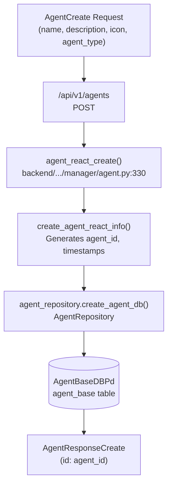

**Sources:** 
- [backend/openjiuwen_studio/routers/agents.py:70-100]()
- [backend/openjiuwen_studio/core/manager/agent.py:301-376]()
- [frontend/src/pages/Agents/AgentCreatePage.tsx:1-50]()

### Agent Configuration Components

Each agent consists of multiple configurable components managed through the `SaveAgentRequest` schema:

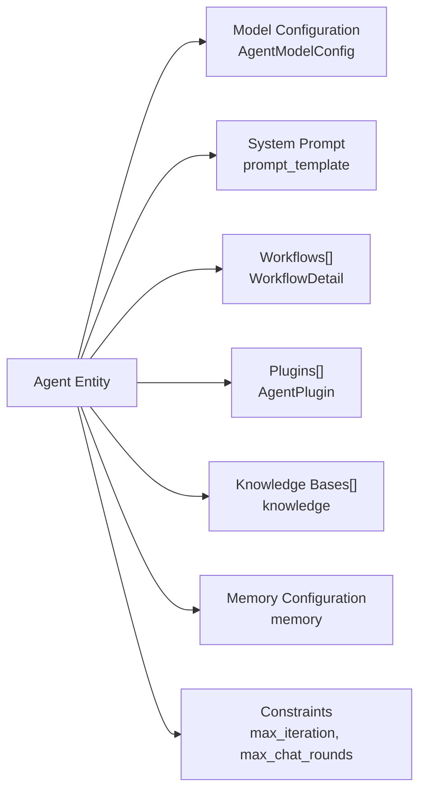

**Sources:**
- [backend/openjiuwen_studio/schemas/agent.py:80-150]()
- [frontend/src/components/Agent/AgentModelSelector.tsx:108-150]()
- [frontend/src/pages/Agents/AgentEditorEditPage.tsx:40-100]()

---

## Workflow Orchestration

The workflow system enables visual design of multi-step processes using a node-based canvas editor.

### Workflow Canvas Architecture

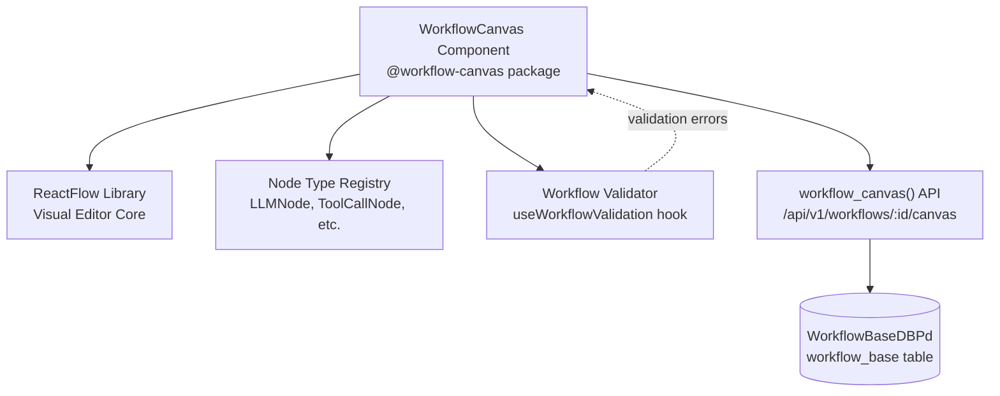

**Workflow Node Types:**

| Node Type | Class/Component | Purpose |
|-----------|-----------------|---------|
| `llm` | `LLMNode` | LLM inference with prompt templates |
| `tool_call` | `ToolCallNode` | Invoke external tools/plugins |
| `code` | `CodeNode` | Execute Python/JavaScript code |
| `condition` | `ConditionNode` | Conditional branching logic |
| `start` | `StartNode` | Workflow entry point |
| `end` | `EndNode` | Workflow termination |

**Sources:**
- [frontend/packages/workflow-canvas/src/components/]()
- [backend/openjiuwen_studio/core/manager/repositories/workflow_repository.py:1-50]()
- [frontend/src/hooks/useWorkflowValidation.ts]()

### Workflow Execution Pipeline

When an agent with `agent_type: workflow` executes, the system converts the workflow graph into executable DSL:

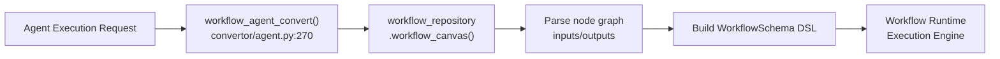

**Sources:**
- [backend/openjiuwen_studio/core/manager/convertor/agent.py:32-66]()
- [backend/openjiuwen_studio/core/manager/convertor/agent.py:270-350]()

---

## Prompt Management

The platform provides sophisticated prompt template management with version control and optimization capabilities.

### Prompt Template System

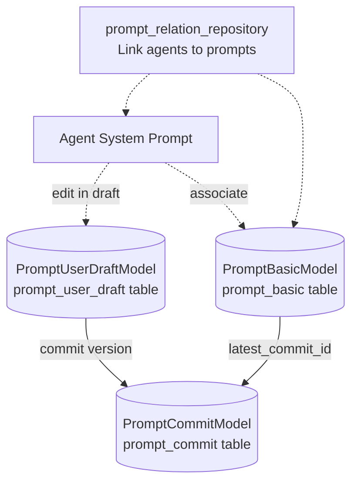

**Key Operations:**

| Operation | Endpoint/Function | Description |
|-----------|-------------------|-------------|
| Create Template | `POST /api/v1/prompts` | Create new prompt template with unique key |
| Draft Edit | `PUT /api/v1/prompts/:key/draft` | Update user's draft version |
| Commit Version | `POST /api/v1/prompts/:key/commit` | Publish version (e.g., 1.0.0) |
| Associate Agent | `prompt_relation_repository` | Link prompt to agent's system prompt |

**Sources:**
- [backend/openjiuwen_studio/ops/modules/prompt/infra/repositories/orm_repo.py:1-100]()
- [backend/openjiuwen_studio/core/manager/repositories/prompt_relation_repository.py:1-50]()
- [frontend/src/components/Agent/SystemPromptTab.tsx:1-100]()

### Prompt Optimization

The system includes an AI-powered prompt optimization feature:


**Sources:**
- [frontend/src/locales/agent/en-US/editor.json:151-160]()
- [backend/openjiuwen_studio/routers/agents.py:1-50]()

---

## Model Management

The platform supports configuration and management of both LLM and Embedding models.

### Model Types and Configuration

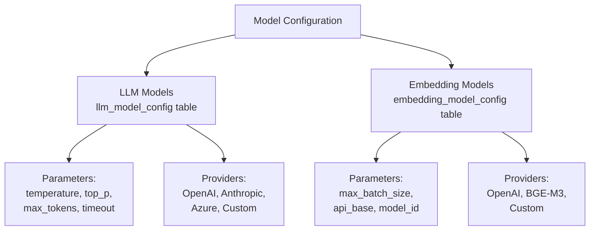

**LLM Model Configuration Fields:**

| Field | Type | Purpose |
|-------|------|---------|
| `name` | string | User-defined model name |
| `provider` | enum | Model provider (OpenAI, Anthropic, etc.) |
| `model_type` | string | Actual model identifier (e.g., gpt-4) |
| `api_key` | encrypted | Encrypted API credentials |
| `base_url` | string | API endpoint URL |
| `temperature` | float | Sampling temperature (0-2) |
| `max_tokens` | int | Maximum generation tokens |
| `timeout` | int | Request timeout in seconds |
| `enable_streaming` | bool | Enable SSE streaming responses |

**Sources:**
- [frontend/src/pages/Models/ModelsPage.tsx:84-113]()
- [backend/openjiuwen_studio/core/manager/model_manager/managers.py:1-100]()
- [frontend/packages/api-client/src/types/models.ts:1-50]()

### Model Security

API keys are encrypted using the `SecurityUtils` class before storage:

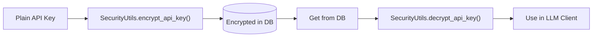

**Sources:**
- [backend/openjiuwen_studio/core/manager/model_manager/utils.py:1-100]()
- [backend/openjiuwen_studio/core/manager/knowledge_base.py:99-106]()

---

## Knowledge Base Management

The knowledge base system provides document ingestion, processing, and retrieval capabilities with optional graph enhancement.

### Document Processing Pipeline

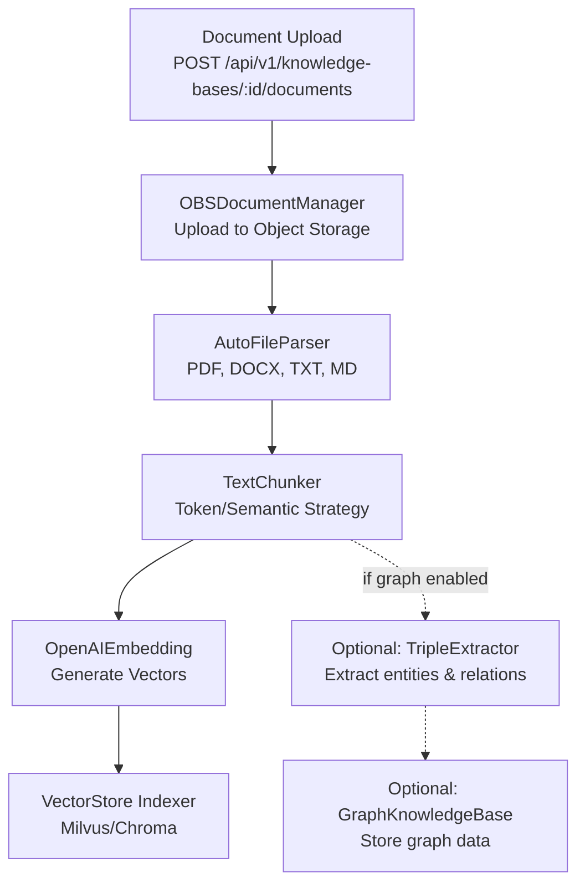

**Processing Configuration:**

| Strategy | Options | Description |
|----------|---------|-------------|
| **Parsing** | `auto_detect` | Automatically detect file format and parse |
| **Chunking** | `token`, `semantic` | Split by token count or semantic boundaries |
| **Indexing** | `text`, `graph`, `hybrid` | Vector-only, graph-only, or combined |

**Sources:**
- [backend/openjiuwen_studio/core/manager/knowledge_base.py:86-186]()
- [backend/openjiuwen_studio/core/manager/knowledge_base.py:456-650]()
- [frontend/src/pages/KnowledgeBase/components/AddDocumentDialog.tsx:1-100]()

### Knowledge Base Retrieval

Agents can access knowledge bases with configurable retrieval strategies:

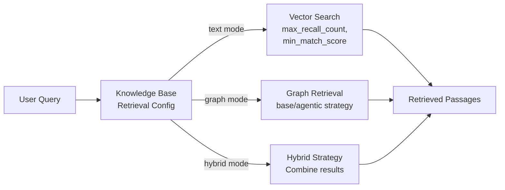

**Retrieval Configuration Fields:**

- `max_recall_count`: Maximum number of passages to return (default: 5)
- `min_match_score`: Minimum similarity threshold (default: 0.5)
- `graph_retrieval_strategy`: `base` (entity/relation graph) or `agentic` (multi-step reasoning)
- `retrieval_source`: `text`, `triple`, or `hybrid`

**Sources:**
- [frontend/src/components/Agent/AgentModelSelector.tsx:165-175]()
- [backend/openjiuwen_studio/core/manager/convertor/agent.py:390-450]()

---

## Plugin & Tool System

The platform supports two types of plugins for extending agent capabilities.

### Plugin Types

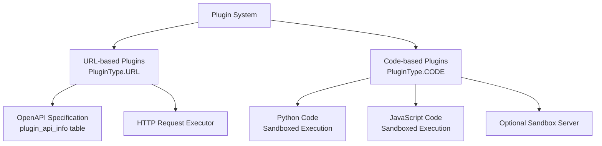

**Plugin Configuration:**

| Plugin Type | Storage | Execution |
|-------------|---------|-----------|
| **URL** | API endpoint, method, parameters in DB | Direct HTTP request to external service |
| **Code** | Python/JS code in `plugin_code_info` table | Execute in optional sandbox environment |

**URL Plugin Structure:**
```
PluginApiInfo:
  - api_name: string
  - url: string
  - method: GET/POST/PUT/DELETE
  - parameters: PluginApiParameter[]
  - description: string
```

**Sources:**
- [backend/openjiuwen_studio/schemas/plugin.py:1-100]()
- [backend/openjiuwen_studio/core/manager/repositories/plugin_repository.py:1-50]()
- [frontend/packages/workflow-canvas/src/components/PluginSelector.tsx:1-100]()

### Tool Invocation in Agents

When an agent uses a plugin, the system converts it to a tool schema:

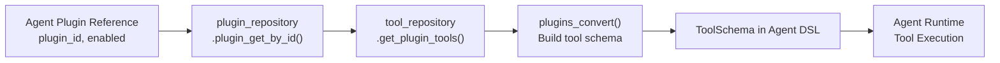

**Sources:**
- [backend/openjiuwen_studio/core/manager/convertor/agent.py:120-170]()
- [backend/openjiuwen_studio/core/manager/repositories/tool_repository.py:1-50]()

---

## Memory Systems

The platform provides two memory mechanisms: variable storage and long-term memory.

### Memory Architecture

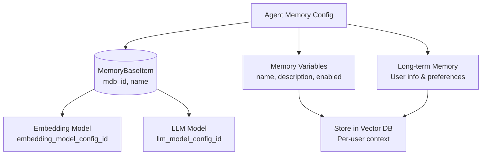

**Memory Variable Configuration:**

| Field | Type | Description |
|-------|------|-------------|
| `id` | string | Unique variable identifier |
| `name` | string | Variable name (user-defined) |
| `description` | string | Variable purpose description |
| `enabled` | boolean | Whether variable is active |

**Long-term Memory:**
- Stores user personal information and preferences across conversations
- Requires binding a memory base with both embedding and LLM models
- Automatically updates based on conversation context

**Sources:**
- [frontend/src/components/Agent/AgentModelSelector.tsx:80-106]()
- [frontend/src/components/Agent/AgentModelSelector.tsx:179-186]()

---

## Version Control & Publishing

The system includes comprehensive version control for agents, prompts, and plugins.

### Agent Version Management

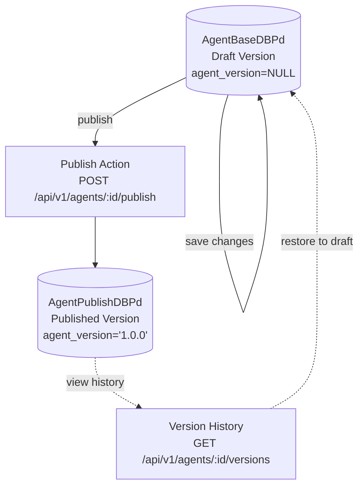

**Version Fields:**
- `agent_version`: Semantic version string (e.g., "1.0.0")
- `create_time`: Version creation timestamp
- `update_time`: Last modification timestamp

**Sources:**
- [backend/openjiuwen_studio/core/manager/agent.py:850-950]()
- [frontend/src/components/Agent/AgentPublishDialog.tsx:1-100]()
- [frontend/src/components/Agent/AgentVersionListPanel.tsx:1-100]()

---

## Multi-Database Support

The platform supports flexible database backend selection via environment configuration.

### Database Selection

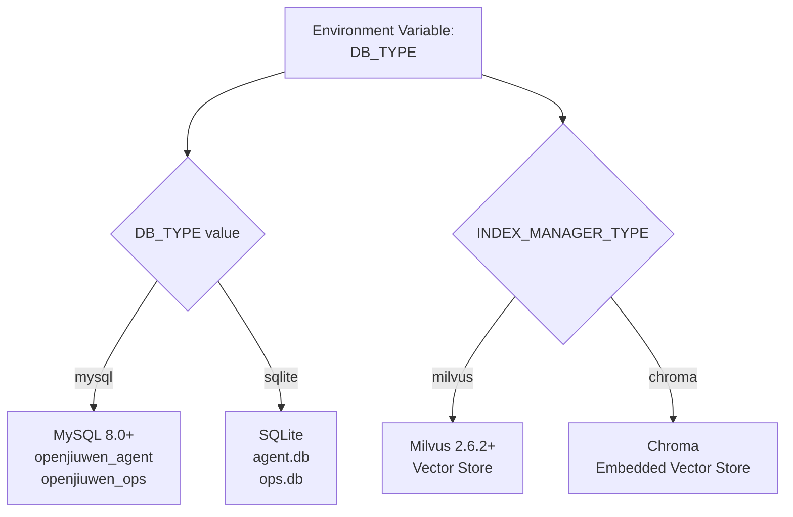

**Database Configuration:**

| Database | Environment Variable | Default | Use Case |
|----------|---------------------|---------|----------|
| **Relational** | `DB_TYPE` | `sqlite` | `mysql` for production, `sqlite` for development |
| **Vector Store** | `INDEX_MANAGER_TYPE` | `chroma` | `milvus` for scale, `chroma` for simplicity |

**Schema Management:**
- Alembic migrations for both MySQL and SQLite variants
- Separate migration scripts: `alembic_mysql_agent`, `alembic_sqlite_agent`, etc.

**Sources:**
- [backend/openjiuwen_studio/core/manager/agent.py:132]()
- [backend/openjiuwen_studio/core/manager/knowledge_base.py:83]()

---

## Import/Export Functionality

Agents can be exported and imported as portable packages for sharing and backup.

### Export Format

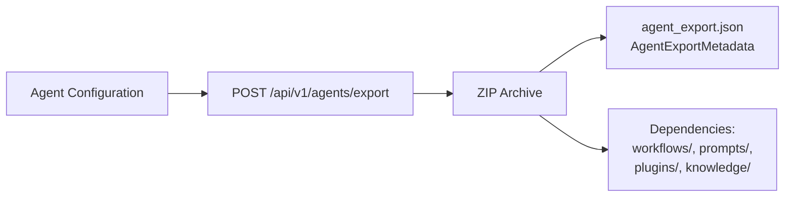

**Export Package Structure:**
```
agent_export_<name>_<timestamp>.zip
├── agent_export.json (metadata)
├── workflows/
│   ├── workflow_1.json
│   └── workflow_2.json
├── prompts/
│   └── prompt_template.json
├── plugins/
│   └── plugin_config.json
└── knowledge/
    └── kb_references.json
```

**Sources:**
- [backend/openjiuwen_studio/core/manager/agent.py:1100-1400]()
- [backend/openjiuwen_studio/schemas/agent.py:200-250]()
- [frontend/src/pages/Agents/AgentsPage.tsx:60-70]()

---

