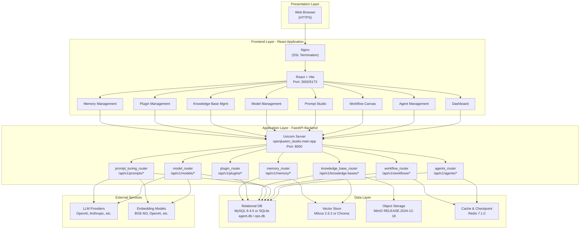
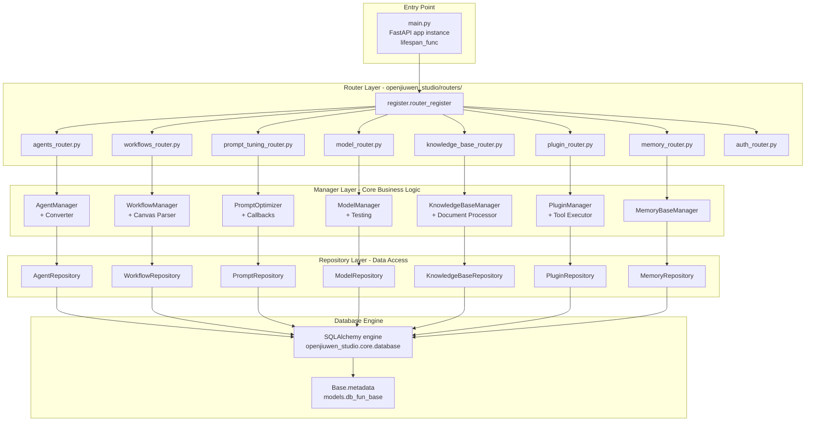
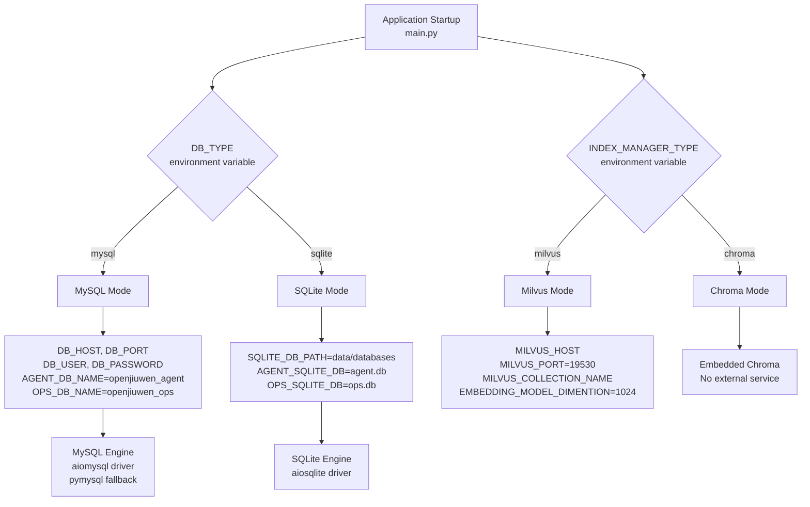
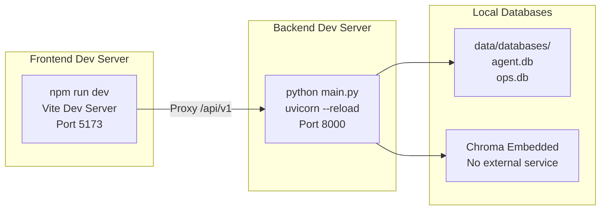
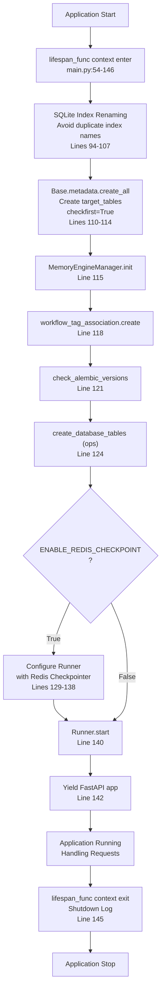
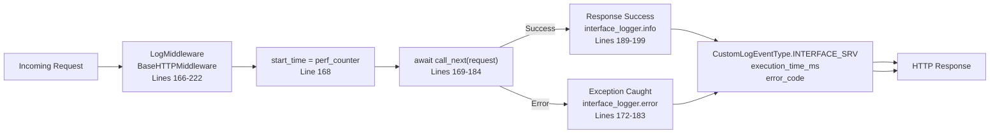
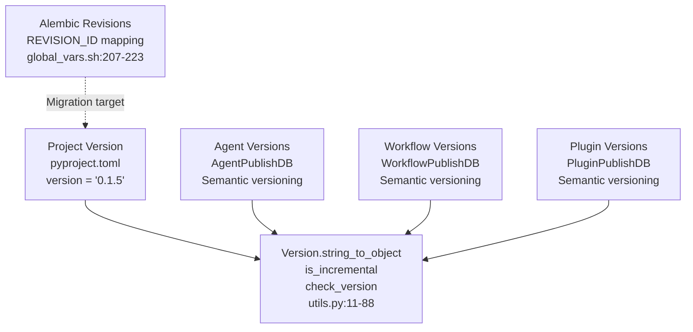

<!-- source: DeepWiki mcp.deepwiki.com · repo openJiuwen-ai/agent-studio · page 1.2 Architecture Overview · fetched 2026-11-02 -->

# Architecture Overview

<details>
<summary>Relevant source files</summary>

The following files were used as context for generating this wiki page:

- [.env.example](.env.example)
- [backend/openjiuwen_studio/core/common/logging/__init__.py](backend/openjiuwen_studio/core/common/logging/__init__.py)
- [backend/openjiuwen_studio/core/common/logging/events.py](backend/openjiuwen_studio/core/common/logging/events.py)
- [backend/openjiuwen_studio/core/config.py](backend/openjiuwen_studio/core/config.py)
- [backend/openjiuwen_studio/core/manager/convertor/components/sub_workflow.py](backend/openjiuwen_studio/core/manager/convertor/components/sub_workflow.py)
- [backend/openjiuwen_studio/core/manager/email_manager/__init__.py](backend/openjiuwen_studio/core/manager/email_manager/__init__.py)
- [backend/openjiuwen_studio/core/manager/email_manager/email_template.py](backend/openjiuwen_studio/core/manager/email_manager/email_template.py)
- [backend/openjiuwen_studio/core/manager/email_manager/email_utils.py](backend/openjiuwen_studio/core/manager/email_manager/email_utils.py)
- [backend/openjiuwen_studio/core/manager/redis_manager/__init__.py](backend/openjiuwen_studio/core/manager/redis_manager/__init__.py)
- [backend/openjiuwen_studio/core/manager/utils/utils.py](backend/openjiuwen_studio/core/manager/utils/utils.py)
- [backend/openjiuwen_studio/main.py](backend/openjiuwen_studio/main.py)
- [backend/pyproject.toml](backend/pyproject.toml)
- [docs/en/2.Installation Guide/Install via Docker/Linux_Installation.md](docs/en/2.Installation Guide/Install via Docker/Linux_Installation.md)
- [docs/en/2.Installation Guide/Install via Docker/MacOS_Installation.md](docs/en/2.Installation Guide/Install via Docker/MacOS_Installation.md)
- [docs/en/2.Installation Guide/Install via Docker/Windows_Installation.md](docs/en/2.Installation Guide/Install via Docker/Windows_Installation.md)
- [scripts/.env.deploy.default](scripts/.env.deploy.default)
- [scripts/args_handler.sh](scripts/args_handler.sh)
- [scripts/common.sh](scripts/common.sh)
- [scripts/conf/docker-deepsearch.template.yml](scripts/conf/docker-deepsearch.template.yml)
- [scripts/conf/docker-jiuwen.template.yml](scripts/conf/docker-jiuwen.template.yml)
- [scripts/conf/docker-plugin.template.yml](scripts/conf/docker-plugin.template.yml)
- [scripts/envfile_handler.sh](scripts/envfile_handler.sh)
- [scripts/gen_ssl.sh](scripts/gen_ssl.sh)
- [scripts/global_vars.sh](scripts/global_vars.sh)
- [scripts/prompt_handler.sh](scripts/prompt_handler.sh)
- [scripts/service.sh](scripts/service.sh)
- [scripts/template_handler.sh](scripts/template_handler.sh)
- [scripts/vars_handler.sh](scripts/vars_handler.sh)

</details>


This document provides a high-level technical overview of the OpenJiuwen Agent Studio system architecture. It describes the major subsystems, their interactions, technology stack, deployment options, and configuration management. For detailed information about specific subsystems, see:
- Frontend architecture details: [Frontend Architecture](#5.2)
- Backend architecture details: [Backend Architecture](#5.3)
- Database and storage systems: [Data Layer](#5.4)
- Production deployment configurations: [Docker Deployment](#7.1)

## Purpose and Scope

OpenJiuwen Agent Studio is a full-stack AI agent development platform with a clear separation between presentation (React), business logic (FastAPI), and data persistence (multi-database). The system supports two deployment modes: containerized Docker deployment for production, and local development setup for rapid iteration. This document focuses on the architectural patterns, component relationships, and technology choices that enable flexible, scalable agent development.

---

## System Layers

The architecture follows a classic three-tier pattern with additional external service integrations:

**Three-Tier Architecture**



Sources: [backend/openjiuwen_studio/main.py:1-278](), [scripts/conf/docker-jiuwen.template.yml:1-72](), [.env.example:1-196]()

---

## Technology Stack

The platform is built on modern, production-ready technologies with configurable alternatives:

| Layer | Technology | Version | Configuration |
|-------|-----------|---------|---------------|
| **Frontend** | React + Vite | - | `NODE_ENV`, `VITE_API_BASE_URL` |
| **Backend** | FastAPI + Uvicorn | 0.115.11 / 0.35+ | `BACKEND_PORT=8000` |
| **Relational DB** | MySQL or SQLite | 8.4.5 / built-in | `DB_TYPE=mysql\|sqlite` |
| **Vector Store** | Milvus or Chroma | 2.6.2 / embedded | `INDEX_MANAGER_TYPE=milvus\|chroma` |
| **Object Storage** | MinIO | RELEASE.2024-12-18 | `MINIO_HOST`, `MINIO_PORT=9000` |
| **Cache** | Redis | 7.1.0 | `ENABLE_REDIS_CHECKPOINT=False` |
| **Web Server** | Nginx | - | SSL termination, proxy |
| **Container** | Docker + Compose | 20.10+ / v2.19.1+ | `docker-compose.yml` |
| **Python** | CPython | 3.11.4+ | `requires-python = ">=3.11.4"` |

Sources: [backend/pyproject.toml:1-70](), [.env.example:90-143](), [scripts/.env.deploy.default:1-76]()

---

## Core Backend Services

The FastAPI backend is organized into modular services with clear separation of concerns:

**Backend Service Architecture**



Sources: [backend/openjiuwen_studio/main.py:24-244](), [backend/openjiuwen_studio/core/database.py]()

---

## Database Models and Tables

The system uses SQLAlchemy ORM with explicit table creation during startup:

**Database Tables (Initialized in lifespan_func)**

| Model Class | Table Purpose | Database |
|-------------|---------------|----------|
| `AgentBaseDB` | Agent drafts and metadata | `agent.db` / `openjiuwen_agent` |
| `AgentPublishDB` | Published agent versions | `agent.db` / `openjiuwen_agent` |
| `WorkflowBaseDB` | Workflow drafts | `agent.db` / `openjiuwen_agent` |
| `WorkflowPublishDB` | Published workflow versions | `agent.db` / `openjiuwen_agent` |
| `PluginBaseDB` | Plugin drafts | `agent.db` / `openjiuwen_agent` |
| `PluginPublishDB` | Published plugin versions | `agent.db` / `openjiuwen_agent` |
| `ToolBaseDB` | Tool configurations | `agent.db` / `openjiuwen_agent` |
| `KnowledgeBaseDB` | Knowledge base metadata | `agent.db` / `openjiuwen_agent` |
| `KnowledgeBaseDocumentDB` | Document tracking | `agent.db` / `openjiuwen_agent` |
| `MemoryBaseDB` | Memory base configurations | `agent.db` / `openjiuwen_agent` |
| `ModelConfig` | LLM configurations | `agent.db` / `openjiuwen_agent` |
| `EmbeddingModelConfig` | Embedding model configs | `agent.db` / `openjiuwen_agent` |
| `SystemLLMModelDB` | System-level LLM registry | `agent.db` / `openjiuwen_agent` |
| `SystemEmbeddingModelDB` | System-level embedding registry | `agent.db` / `openjiuwen_agent` |
| `WorkflowExecutionDB` | Workflow run history | `agent.db` / `openjiuwen_agent` |
| `WorkflowExecutionDetailsDB` | Workflow step details | `agent.db` / `openjiuwen_agent` |
| `AgentExecutionDB` | Agent run history | `agent.db` / `openjiuwen_agent` |
| `AgentExecutionDetailsDB` | Agent execution details | `agent.db` / `openjiuwen_agent` |
| `TraceDetailDB` | Trace details | `agent.db` / `openjiuwen_agent` |
| `TraceSummaryDB` | Trace summaries | `agent.db` / `openjiuwen_agent` |
| `UserDB` | User accounts | `ops.db` / `openjiuwen_ops` |
| `SpaceDB` | Workspace/tenant data | `ops.db` / `openjiuwen_ops` |
| `SpaceUserDB` | User-space associations | `ops.db` / `openjiuwen_ops` |
| `PromptRelationDB` | Prompt templates (ops) | `ops.db` / `openjiuwen_ops` |
| `TagDB` | Tags for categorization | `agent.db` / `openjiuwen_agent` |
| `ReferenceDB` | Reference data | `agent.db` / `openjiuwen_agent` |

Sources: [backend/openjiuwen_studio/main.py:59-118]()

The system uses Alembic for schema migrations with separate migration paths for MySQL and SQLite:

```
backend/alembic_mysql_agent/    # MySQL agent DB migrations
backend/alembic_mysql_ops/      # MySQL ops DB migrations
backend/alembic_sqlite_agent/   # SQLite agent DB migrations
backend/alembic_sqlite_ops/     # SQLite ops DB migrations
```

Sources: [backend/openjiuwen_studio/main.py:120-121](), [scripts/global_vars.sh:207-223]()

---

## Multi-Database Configuration

One of the key architectural features is the ability to switch between database backends via environment variables:

**Database Selection Logic**



Sources: [.env.example:92-143](), [backend/openjiuwen_studio/core/config.py:26-46]()

---

## Deployment Architectures

The system supports two primary deployment modes:

### Docker Deployment (Production)

**Docker Service Orchestration**

```mermaid
graph TB
    subgraph "Orchestration Scripts"
        ServiceScript["service.sh<br/>Main entry point"]
        GlobalVars["global_vars.sh<br/>NAMES, PORTS, MODULES"]
        EnvHandler["envfile_handler.sh<br/>generate_env_file"]
        TemplateHandler["template_handler.sh<br/>generate_config_files"]
        ContainerHandler["container_handler.sh<br/>Docker Compose commands"]
    end
    
    subgraph "Environment Files"
        EnvExample[".env.example<br/>Template"]
        EnvCustom[".env.custom<br/>User overrides"]
        EnvDeploy[".env.deploy.default<br/>Docker defaults"]
        EnvRuntime[".env.runtime.default<br/>Runtime vars"]
        EnvFinal[".env<br/>Generated final"]
    end
    
    subgraph "Docker Compose Templates"
        JiuwenTemplate["docker-jiuwen.template.yml<br/>Backend + Frontend"]
        MySQLTemplate["docker-mysql.template.yml<br/>MySQL 8.4.5"]
        MilvusTemplate["docker-milvus.template.yml<br/>Milvus + etcd + MinIO"]
        PluginTemplate["docker-plugin.template.yml<br/>Plugin Server"]
        SandboxTemplate["docker-sandbox.template.yml<br/>Code Execution"]
        DeepsearchTemplate["docker-deepsearch.template.yml<br/>DeepSearch Agent"]
    end
    
    subgraph "Generated Compose Files"
        JiuwenCompose["docker-jiuwen.yml"]
        MySQLCompose["docker-mysql.yml"]
        MilvusCompose["docker-milvus.yml"]
        PluginCompose["docker-plugin.yml"]
        SandboxCompose["docker-sandbox.yml"]
        DeepsearchCompose["docker-deepsearch.yml"]
    end
    
    subgraph "Docker Containers"
        Backend["jiuwen-backend-xxxxx<br/>studio-backend:latest"]
        Frontend["jiuwen-frontend-xxxxx<br/>studio-frontend:latest"]
        MySQL["jiuwen-mysql-xxxxx<br/>mysql:8.4.5"]
        Milvus["jiuwen-milvus-standalone-xxxxx<br/>milvusdb/milvus:v2.6.2"]
        MinIO["jiuwen-minio-xxxxx<br/>minio/minio:RELEASE.2024-12-18"]
        Redis["Redis 7.1.0<br/>(optional)"]
    end
    
    ServiceScript --> GlobalVars & EnvHandler & TemplateHandler & ContainerHandler
    
    EnvExample & EnvCustom & EnvDeploy & EnvRuntime --> EnvHandler
    EnvHandler --> EnvFinal
    
    EnvFinal --> TemplateHandler
    JiuwenTemplate & MySQLTemplate & MilvusTemplate & PluginTemplate & SandboxTemplate & DeepsearchTemplate --> TemplateHandler
    
    TemplateHandler --> JiuwenCompose & MySQLCompose & MilvusCompose & PluginCompose & SandboxCompose & DeepsearchCompose
    
    JiuwenCompose --> ContainerHandler --> Backend & Frontend
    MySQLCompose --> ContainerHandler --> MySQL
    MilvusCompose --> ContainerHandler --> Milvus & MinIO
```



**Service Naming Convention:**
All Docker containers follow the pattern `jiuwen-{service}-{random-suffix}` where the random suffix is a 5-character alphanumeric string generated during deployment to allow multiple instances. This is defined in [scripts/global_vars.sh:28-61]().

**Module-Based Deployment:**
The deployment script supports selective module deployment:
- `MYSQL`: MySQL database service
- `MILVUS`: Milvus vector store + etcd + MinIO
- `PLUGIN`: Plugin execution server
- `SANDBOX`: Code sandbox (Python + JS + Gateway)
- `JIUWEN`: Core backend + frontend
- `DEEPSEARCH`: DeepSearch agent service

Sources: [scripts/service.sh:1-40](), [scripts/global_vars.sh:1-224](), [scripts/envfile_handler.sh:1-195](), [scripts/template_handler.sh:1-125]()

### Local Development Setup

For local development, the system runs without Docker:



Sources: [backend/openjiuwen_studio/main.py:247-277](), [.env.example:10-28]()

---

## Configuration Management

Configuration is managed through a hierarchical environment variable system:

**Configuration Precedence (Highest to Lowest)**

1. **Runtime Environment Variables**: Exported in shell before execution
2. **`.env.custom`**: User customizations (not version controlled)
3. **`.env.runtime.default`**: Runtime variable defaults
4. **`.env.deploy.default`**: Docker deployment defaults
5. **`.env.example`**: Template with all available options

**Key Configuration Files:**

| File | Purpose | When Used |
|------|---------|-----------|
| `.env.example` | Template, documentation | Reference for all options |
| `.env.custom` | User overrides | Docker and local |
| `.env.deploy.default` | Docker container configs | Docker only |
| `.env.runtime.default` | Runtime variable defaults | Both modes |
| `.env` (generated) | Final merged config | Docker deployment |

**Critical Environment Variables:**

| Variable | Values | Impact |
|----------|--------|--------|
| `DB_TYPE` | `mysql` \| `sqlite` | Database backend selection |
| `INDEX_MANAGER_TYPE` | `milvus` \| `chroma` | Vector store selection |
| `BACKEND_PORT` | Integer (default: `8000`) | Backend service port |
| `FRONTEND_PORT` | Integer (default: `3000`) | Frontend service port |
| `DEBUG` | `true` \| `false` | Debug mode toggle |
| `ENABLE_REDIS_CHECKPOINT` | `true` \| `false` | Redis checkpointing |
| `WORKER_NUM` | Integer (default: `1`) | Uvicorn worker count |

Sources: [.env.example:1-196](), [scripts/envfile_handler.sh:5-28](), [scripts/vars_handler.sh:49-63]()

---

## Application Lifecycle

The FastAPI application uses a lifecycle context manager for initialization and cleanup:

**Startup and Shutdown Sequence**



Sources: [backend/openjiuwen_studio/main.py:54-146]()

---

## Logging and Middleware

The application uses structured logging with custom event types:

**Request Logging Middleware**



Sources: [backend/openjiuwen_studio/main.py:166-222](), [backend/openjiuwen_studio/core/common/logging/events.py:1-50]()

---

## Security Features

The system implements multiple security layers:

| Feature | Implementation | Configuration |
|---------|----------------|---------------|
| **JWT Authentication** | PyJWT library | `SECRET_KEY`, `ALGORITHM=HS256` |
| **Token Expiration** | Configurable lifetimes | `ACCESS_TOKEN_EXPIRE_MINUTES=2880` |
| **SSL/TLS** | Nginx with auto-generated certs | `generate_ssl_certs` function |
| **CORS** | FastAPI CORSMiddleware | `ALLOWED_ORIGINS` |
| **API Key Encryption** | AES-256 encryption | `SERVER_AES_MASTER_KEY` |
| **SSRF Protection** | Optional SSRF guard | `SSRF_PROTECT_ENABLED=False` |
| **Email Verification** | SMTP with templates | `SMTP_HOST`, `SMTP_PORT=465` |

**Encryption Key Management:**
- Development: `SERVER_AES_MASTER_KEY` in `.env`
- Production: `SERVER_AES_MASTER_KEY_ENV` (base64 encoded)
- Optional: Huawei Cloud KMS integration (`HUAWEICLOUD_KMS_ENABLED`)

Sources: [.env.example:51-62](), [.env.example:72-89](), [scripts/gen_ssl.sh:1-62](), [backend/openjiuwen_studio/core/manager/email_manager/email_utils.py:1-67]()

---

## Version Management

The system tracks versions at multiple levels:

**Version Tracking**



The `Version` class provides structured version parsing with prefix support (e.g., `v1.2.3`), validation, and incremental version checking.

Sources: [backend/pyproject.toml:5-7](), [backend/openjiuwen_studio/core/manager/utils/utils.py:11-88](), [scripts/global_vars.sh:207-223]()

---

## External Service Integration

The platform integrates with external AI services through abstraction layers:

| Service Type | Purpose | Configuration Example |
|--------------|---------|----------------------|
| **LLM Providers** | Text generation, reasoning | `openai_api_key`, custom endpoints |
| **Embedding Models** | Vector embeddings | `EMBEDDING_MODEL_DIMENTION=1024` |
| **MinIO/OBS** | Object storage | `OBS_ACCESS_KEY_ID`, `OBS_BUCKET` |
| **SMTP** | Email delivery | `SMTP_HOST`, `SMTP_USER`, `SMTP_PASSWORD` |

**SSL Verification:**
- `LLM_SSL_VERIFY=False`: LLM provider SSL verification
- `RESTFUL_SSL_VERIFY=False`: RESTful plugin SSL verification
- `RESTFUL_SSL_CERT=False`: Client certificate usage

Sources: [.env.example:76-78](), [.env.example:131-133](), [.env.example:192-196]()

---

## Summary

OpenJiuwen Agent Studio's architecture provides:

1. **Flexible Deployment**: Docker for production, local setup for development
2. **Multi-Database Support**: MySQL/SQLite for relational, Milvus/Chroma for vectors
3. **Modular Services**: Clear separation between routers, managers, and repositories
4. **Configuration-Driven**: Environment variables control all major behaviors
5. **Version Management**: Comprehensive versioning across all entity types
6. **Security-First**: JWT, SSL, encryption, and optional SSRF protection
7. **Extensibility**: Plugin system, custom workflows, external LLM integration

The system's design emphasizes operational flexibility while maintaining clear architectural boundaries, enabling teams to deploy at any scale from single-developer laptops to multi-container production clusters.

---

