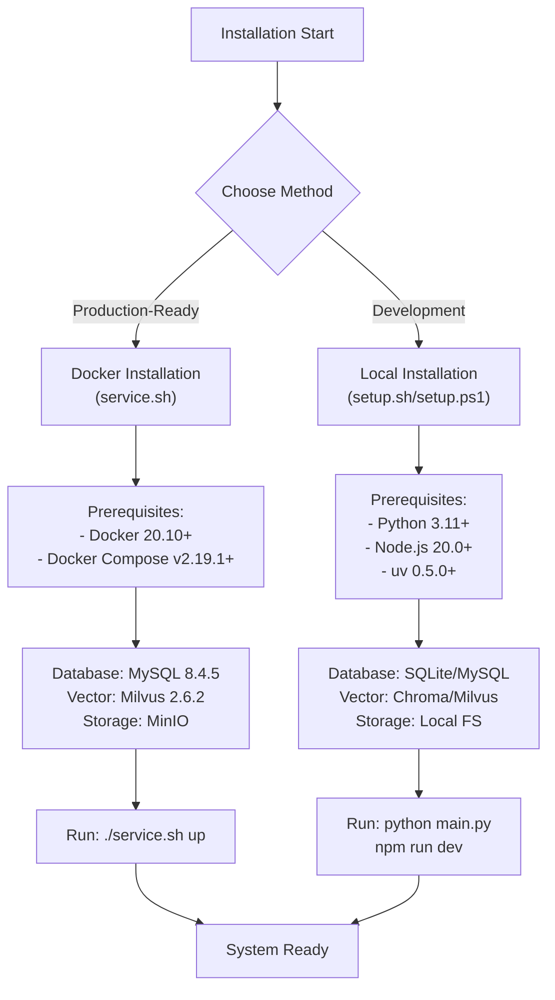
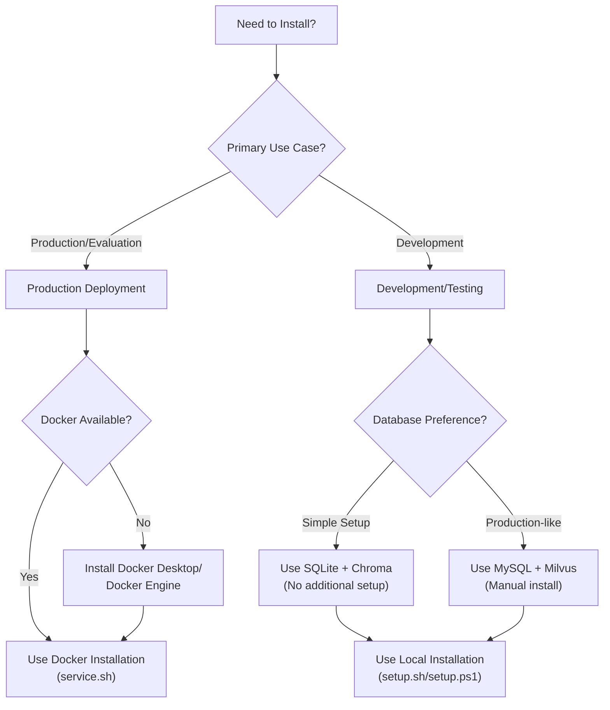
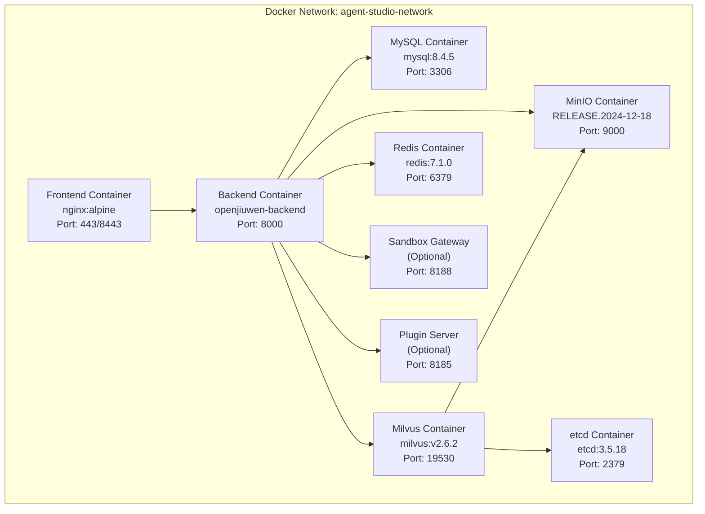
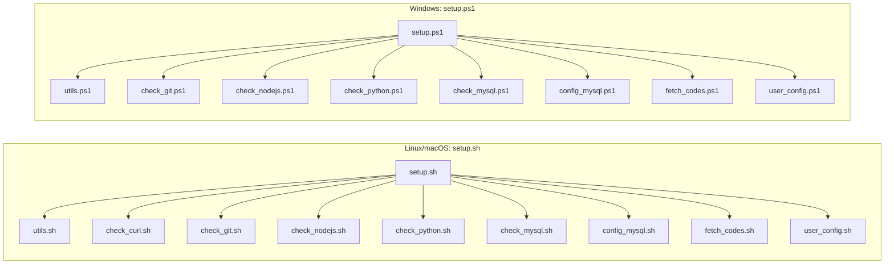
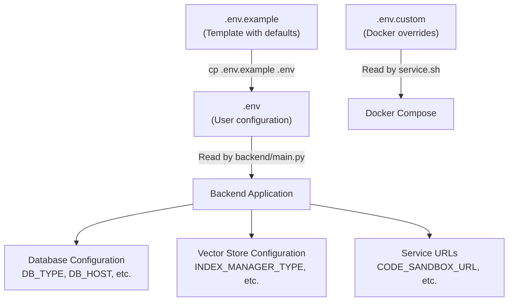
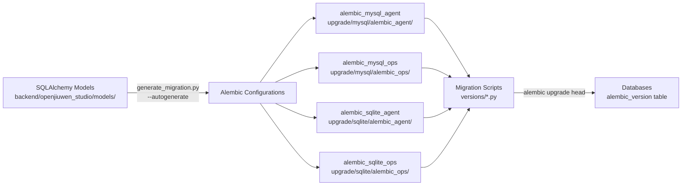
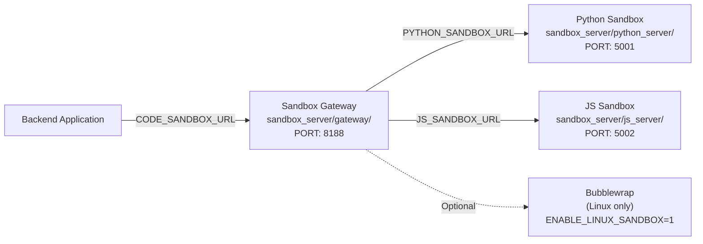

<!-- source: DeepWiki mcp.deepwiki.com · repo openJiuwen-ai/agent-studio · page 2 Installation & Setup · fetched 2026-11-02 -->

# Installation & Setup

<details>
<summary>Relevant source files</summary>

The following files were used as context for generating this wiki page:

- [backend/DATABASE_MIGRATION_DEVELOPMENT_GUIDE_EN.md](backend/DATABASE_MIGRATION_DEVELOPMENT_GUIDE_EN.md)
- [backend/GENERATE_MIGRATION_USAGE_EN.md](backend/GENERATE_MIGRATION_USAGE_EN.md)
- [backend/pyproject.toml](backend/pyproject.toml)
- [docs/en/2.Installation Guide/Install via Docker/Linux_Installation.md](docs/en/2.Installation Guide/Install via Docker/Linux_Installation.md)
- [docs/en/2.Installation Guide/Install via Docker/MacOS_Installation.md](docs/en/2.Installation Guide/Install via Docker/MacOS_Installation.md)
- [docs/en/2.Installation Guide/Install via Docker/Windows_Installation.md](docs/en/2.Installation Guide/Install via Docker/Windows_Installation.md)
- [docs/en/2.Installation Guide/Local Installation/Linux_Installation.md](docs/en/2.Installation Guide/Local Installation/Linux_Installation.md)
- [docs/en/2.Installation Guide/Local Installation/MacOS_Installation.md](docs/en/2.Installation Guide/Local Installation/MacOS_Installation.md)
- [docs/en/2.Installation Guide/Local Installation/Windows_Installation.md](docs/en/2.Installation Guide/Local Installation/Windows_Installation.md)

</details>


This document provides comprehensive guidance for installing and configuring OpenJiuwen Agent Studio. It covers both production-ready Docker deployment and local development setup, along with configuration options for databases, vector stores, and optional services.

For deployment to production environments with scaling considerations, see [Deployment & Operations](#7). For setting up a development environment with hot reload and debugging, see [Development Environment Setup](#6.1).

## Installation Methods Overview

OpenJiuwen Agent Studio supports two primary installation approaches, each suited to different use cases:



**Sources:** [docs/en/2.Installation Guide/Install via Docker/Linux_Installation.md:1-127](), [docs/en/2.Installation Guide/Local Installation/Linux_Installation.md:1-32]()

| Installation Method | Best For | Complexity | Database Options | Vector Store Options |
|---------------------|----------|------------|------------------|---------------------|
| **Docker** | Production, quick evaluation | Low | MySQL (bundled) | Milvus (bundled) |
| **Local** | Development, customization | Medium | SQLite, MySQL | Chroma, Milvus |

## System Requirements

### Hardware Requirements

| Component | Minimum | Recommended |
|-----------|---------|-------------|
| CPU Cores | 2 | 4+ |
| RAM | 4 GB | 8+ GB |
| Disk Space | 10 GB | 20+ GB |

**Note:** Milvus requires AVX instruction set support. Check with `lscpu | grep Flags` on Linux or equivalent commands on other platforms.

**Sources:** [docs/en/2.Installation Guide/Local Installation/Linux_Installation.md:6-12](), [docs/en/2.Installation Guide/Install via Docker/Linux_Installation.md:3-19]()

### Software Requirements by Platform

#### Linux (Ubuntu 22.04+ recommended)

| Software | Minimum Version | Docker Method | Local Method |
|----------|----------------|---------------|--------------|
| Docker | 20.10 | Required | Not required |
| Docker Compose | v2.19.1 | Required | Not required |
| Git | 2.40 | Optional | Required |
| Node.js | 20.0 | Not needed | Required |
| npm | 10.0 | Not needed | Required |
| Python | 3.11.4 | Not needed | Required |
| uv | 0.5.0 | Not needed | Required |
| MySQL | 8.0 | Bundled | Optional |

#### Windows (Windows 10+)

| Software | Minimum Version | Notes |
|----------|----------------|-------|
| PowerShell | 5.1 | Check with `$PSVersionTable.PSVersion` |
| WSL 2 | N/A | Required for Docker Desktop |

#### macOS (macOS 14.0 Sonoma+)

| Software | Minimum Version | Notes |
|----------|----------------|-------|
| Homebrew | Latest | For package management |
| Xcode Command Line Tools | Latest | For Git and compilation |

**Sources:** [docs/en/2.Installation Guide/Local Installation/Linux_Installation.md:6-26](), [docs/en/2.Installation Guide/Local Installation/Windows_Installation.md:6-25](), [docs/en/2.Installation Guide/Local Installation/MacOS_Installation.md:6-24]()

## Installation Decision Tree



**Sources:** [docs/en/2.Installation Guide/Local Installation/Linux_Installation.md:28-115](), [docs/en/2.Installation Guide/Install via Docker/Linux_Installation.md:36-52]()

## Docker Installation

Docker installation provides a fully-configured environment with all dependencies bundled, suitable for production deployment and quick evaluation.

### Architecture Components

The Docker deployment includes the following containers:



**Sources:** [docs/en/2.Installation Guide/Install via Docker/Linux_Installation.md:113-121]()

### Installation Steps

#### 1. Download Deployment Package

Download the appropriate architecture package:

**x86_64 Architecture:**
```bash
wget https://openjiuwen-ci.obs.cn-north-4.myhuaweicloud.com/agentstudio/deployTool_0.1.3_amd64.zip
```

**ARM64 Architecture:**
```bash
wget https://openjiuwen-ci.obs.cn-north-4.myhuaweicloud.com/agentstudio/deployTool_0.1.3_arm64.zip
```

**Sources:** [docs/en/2.Installation Guide/Install via Docker/Linux_Installation.md:38-50]()

#### 2. Extract and Prepare

```bash
# Extract package
unzip deployTool_0.1.3_amd64.zip  # or arm64
cd deployTool_0.1.3_amd64

# Verify Docker is running
sudo systemctl start docker
sudo systemctl status docker
```

**Sources:** [docs/en/2.Installation Guide/Install via Docker/Linux_Installation.md:52-78]()

#### 3. Start Services

The `service.sh` script orchestrates all container lifecycle operations:

```bash
# Start all services
./service.sh up

# Check status
./service.sh status

# Stop all services
./service.sh down

# Restart all services
./service.sh restart
```

**File Structure:**
- `service.sh` - Main orchestration script
- `conf/docker-jiuwen.template.yml` - Docker Compose template
- `.env.deploy.default` - Default environment variables
- `.env.custom` - User customizations (optional)

**Sources:** [docs/en/2.Installation Guide/Install via Docker/Linux_Installation.md:80-94](), [scripts/README.md:1-100]()

#### 4. Access the System

After successful startup, the system outputs access URLs:

```
Local access: https://localhost:8443
Network access: https://<your-ip>:8443
```

**Default Credentials:**
- Username: `admin`
- Password: Check deployment documentation

**Sources:** [docs/en/2.Installation Guide/Install via Docker/Linux_Installation.md:96-101]()

### Platform-Specific Notes

#### Windows Docker Installation

Windows requires WSL 2 for optimal Docker performance:

```powershell
# Enable WSL 2
wsl --install

# After reboot, install Docker Desktop
# Download from: https://www.docker.com/products/docker-desktop/
```

**Docker Desktop Configuration:**
1. Use WSL 2 backend (not Hyper-V)
2. Configure file sharing for installation directory
3. Allocate sufficient resources (4GB+ RAM recommended)

**Sources:** [docs/en/2.Installation Guide/Install via Docker/Windows_Installation.md:18-46]()

#### macOS Docker Installation

macOS uses Docker Desktop natively:

```bash
# Install via Homebrew
brew install --cask docker

# Or download directly from Docker website
# https://www.docker.com/products/docker-desktop/
```

**Sources:** [docs/en/2.Installation Guide/Install via Docker/MacOS_Installation.md:23-36]()

## Local Development Installation

Local installation provides full control over components and configuration, ideal for development workflows with hot reload capabilities.

### Installation Script Architecture



**Sources:** [docs/en/2.Installation Guide/Local Installation/Linux_Installation.md:30-46](), [docs/en/2.Installation Guide/Local Installation/Windows_Installation.md:30-44]()

### Quick Start with Installation Script

#### Linux/macOS

```bash
# Download and extract setup scripts
# Grant execution permissions
chmod +x *.sh

# Run with default settings (MySQL)
./setup.sh

# Or specify SQLite
./setup.sh --db_type=sqlite

# Common operations
./setup.sh --status    # Check service status
./setup.sh --stop      # Stop services
./setup.sh --restart   # Restart services
```

**Sources:** [docs/en/2.Installation Guide/Local Installation/Linux_Installation.md:75-114]()

#### Windows

```powershell
# Set execution policy
Set-ExecutionPolicy Unrestricted -Scope CurrentUser

# Run with default settings (MySQL)
.\setup.ps1

# Or specify SQLite
.\setup.ps1 -DbType sqlite

# Common operations
.\setup.ps1 -Status    # Check service status
.\setup.ps1 -Stop      # Stop services
.\setup.ps1 -Restart   # Restart services
```

**Sources:** [docs/en/2.Installation Guide/Local Installation/Windows_Installation.md:69-108]()

### Manual Installation Process

For developers who need full control or custom configurations:

#### 1. Install Dependencies

**Python and uv:**
```bash
# Linux
sudo apt install python3.11 python3-pip
pip3 install uv

# macOS
brew install python@3.11
brew install uv

# Windows
# Download from https://www.python.org/downloads/
pip install uv
```

**Node.js and npm:**
```bash
# Linux
sudo apt install nodejs npm

# macOS
brew install node

# Windows
# Download from https://nodejs.org/
```

**Sources:** [docs/en/2.Installation Guide/Local Installation/Linux_Installation.md:122-165](), [backend/pyproject.toml:9-10]()

#### 2. Clone Repository

```bash
# Configure Git credentials
git config --global credential.helper store
git config --global user.name "your_username"
git config --global user.email "your_email"

# Clone repository
git clone https://github.com/openJiuwen-ai/agent-studio.git
cd agent-studio
```

**Sources:** [docs/en/2.Installation Guide/Local Installation/Linux_Installation.md:220-243]()

#### 3. Configure Environment

```bash
# Copy environment template
cp .env.example .env

# Edit configuration (see Configuration Guide section below)
# vim .env
```

**Sources:** [docs/en/2.Installation Guide/Local Installation/Linux_Installation.md:260-299]()

#### 4. Backend Setup

```bash
cd backend

# Create virtual environment and install dependencies
uv venv
uv sync

# Initialize database version
alembic -n alembic_sqlite_agent stamp head
alembic -n alembic_sqlite_ops stamp head

# Create log directories
mkdir -p logs/run

# Activate virtual environment and start
source .venv/bin/activate  # Linux/macOS
# .\.venv\Scripts\Activate.ps1  # Windows PowerShell

python main.py
```

The backend dependencies are managed in `pyproject.toml`:

**Key Dependencies:**
- `fastapi==0.115.11` - Web framework
- `uvicorn[standard]>=0.35` - ASGI server
- `sqlalchemy==2.0.41` - ORM
- `alembic==1.13.1` - Database migrations
- `openjiuwen[chromadb,obs]==0.1.7` - Core library

**Sources:** [docs/en/2.Installation Guide/Local Installation/Linux_Installation.md:318-348](), [backend/pyproject.toml:1-35]()

#### 5. Frontend Setup

```bash
cd frontend

# Install dependencies
npm install

# Start development server
npm run dev
```

The frontend will start on port `5173` by default and output:
```
Local: http://localhost:5173
Network: http://<your-ip>:5173
```

**Sources:** [docs/en/2.Installation Guide/Local Installation/Linux_Installation.md:354-380]()

## Configuration Guide

### Environment Variable Structure

The configuration is managed through `.env` files with the following hierarchy:



**Sources:** [docs/en/2.Installation Guide/Local Installation/Linux_Installation.md:260-316]()

### Core Configuration Variables

| Variable Name | Purpose | Values | Default |
|---------------|---------|--------|---------|
| `DB_TYPE` | Database backend selection | `sqlite`, `mysql` | `sqlite` |
| `DB_HOST` | Database host address | hostname/IP | `localhost` |
| `DB_PORT` | Database port | port number | `3306` |
| `DB_USER` | Database username | string | - |
| `DB_PASSWORD` | Database password | string | - |
| `INDEX_MANAGER_TYPE` | Vector store selection | `chroma`, `milvus` | `chroma` |
| `MEMORY_DATA_PATH` | Memory data storage path | directory path | `memory-data` |
| `MILVUS_HOST` | Milvus service host | hostname/IP | `127.0.0.1` |
| `MILVUS_PORT` | Milvus service port | port number | `19530` |
| `MILVUS_COLLECTION_NAME` | Milvus collection name | string | `memory_vector` |
| `CODE_SANDBOX_URL` | Sandbox service endpoint | URL | `http://localhost:8188/run` |
| `VITE_PLUGIN_SERVICE_URL` | Plugin server endpoint | URL | `http://localhost:8185` |
| `VITE_PLUGIN_CONFIG_PATH` | Plugin config path | file path | `/config.json` |

**Sources:** [docs/en/2.Installation Guide/Local Installation/Linux_Installation.md:303-316](), [docs/en/2.Installation Guide/Local Installation/MacOS_Installation.md:268-281]()

### Database Configuration

#### SQLite vs MySQL Decision Matrix

| Criterion | SQLite | MySQL |
|-----------|--------|-------|
| Setup Complexity | None (embedded) | Requires server installation |
| Concurrent Writes | Limited | Full support |
| User Management | No | Yes |
| Production Ready | Development/Testing | Production |
| Performance | Good for small datasets | Better for large datasets |

**Configuration for SQLite:**
```env
DB_TYPE=sqlite
# No additional DB_HOST, DB_PORT, DB_USER, DB_PASSWORD needed
```

**Configuration for MySQL:**
```env
DB_TYPE=mysql
DB_HOST=localhost
DB_PORT=3306
DB_USER=your_user_name
DB_PASSWORD=your_password
```

**Creating MySQL Databases:**
```sql
-- Connect to MySQL
mysql -u root -p

-- Create databases
CREATE DATABASE openjiuwen_agent;
CREATE DATABASE openjiuwen_ops;

-- Create user
CREATE USER 'your_user_name'@'localhost' IDENTIFIED BY 'your_password';

-- Grant privileges
GRANT ALL PRIVILEGES ON openjiuwen_agent.* TO 'your_user_name'@'localhost';
GRANT ALL PRIVILEGES ON openjiuwen_ops.* TO 'your_user_name'@'localhost';
FLUSH PRIVILEGES;
```

**Sources:** [docs/en/2.Installation Guide/Local Installation/Linux_Installation.md:166-207]()

### Vector Store Configuration

#### Chroma vs Milvus Decision Matrix

| Criterion | Chroma | Milvus |
|-----------|--------|--------|
| Setup Complexity | None (embedded) | Docker/standalone installation |
| CPU Requirements | Standard | AVX instruction set required |
| Scalability | Limited | High |
| Production Ready | Development/Testing | Production |
| Graph Extraction | Not supported | Supported |

**Configuration for Chroma:**
```env
INDEX_MANAGER_TYPE=chroma
# No additional configuration needed
```

**Configuration for Milvus:**
```env
INDEX_MANAGER_TYPE=milvus
MILVUS_HOST=127.0.0.1
MILVUS_PORT=19530
MILVUS_COLLECTION_NAME=memory_vector
```

**Starting Milvus (Docker method):**
```bash
# Download startup script
curl -fsSL https://raw.githubusercontent.com/milvus-io/milvus/master/scripts/standalone_embed.sh -o standalone_embed.sh

# Pull image (x86_64)
docker pull swr.cn-north-4.myhuaweicloud.com/openjiuwen/milvusdb/milvus-amd64:v2.6.2

# Edit script to use mirror image
# Replace milvusdb/milvus:v2.6.7 with mirror URL

# Start Milvus
bash standalone_embed.sh start

# Stop Milvus
bash standalone_embed.sh stop
```

**Sources:** [docs/en/2.Installation Guide/Local Installation/Linux_Installation.md:209-216](), [docs/en/2.Installation Guide/Local Installation/Linux_Installation.md:384-434]()

### Database Migration Management

The system uses Alembic for database schema versioning:



**Initial Database Stamping:**

When setting up an existing database for the first time:

```bash
# SQLite Agent Database
alembic -n alembic_sqlite_agent stamp head
alembic -n alembic_sqlite_ops stamp head

# MySQL Agent Database
alembic -n alembic_mysql_agent stamp head
alembic -n alembic_mysql_ops stamp head
```

**Version Baselines:**

| Database | Component | v0.1.2 | v0.1.3 | v0.1.4 |
|----------|-----------|--------|--------|--------|
| MySQL | Agent | `54351e123cf0` | `06a1f79bce8b` | `072ac1293a02` |
| MySQL | Ops | `80f110f929fc` | `13377a900fe2` | `13377a900fe2` |
| SQLite | Agent | `f458c7fb17a5` | `031b34b4dd30` | `8f4846812221` |
| SQLite | Ops | `b4f4c6589bc5` | `f6e49cd8c97d` | `f6e49cd8c97d` |

**Sources:** [backend/DATABASE_MIGRATION_DEVELOPMENT_GUIDE_EN.md:1-157](), [backend/DATABASE_MIGRATION_DEVELOPMENT_GUIDE_EN.md:398-427]()

### Optional Services Configuration

#### Code Sandbox (for Code Execution Nodes)

The sandbox architecture provides isolated code execution:



**Configuration Steps:**

1. **Python Sandbox:** Create `sandbox_server/python_server/.env`
```env
HOST=0.0.0.0
PORT=5001
```

2. **JS Sandbox:** Create `sandbox_server/js_server/.env` (or use default port 5002)

3. **Gateway:** Create `sandbox_server/gateway/.env`
```env
HOST=0.0.0.0
PORT=8188
PYTHON_SANDBOX_URL=http://localhost:5001/run
JS_SANDBOX_URL=http://localhost:5002/run
ENABLE_LINUX_SANDBOX=0  # Set to 1 for Bubblewrap on Linux
```

4. **Backend:** Add to `.env`
```env
CODE_SANDBOX_URL=http://localhost:8188/run
```

**Sources:** [docs/en/2.Installation Guide/Local Installation/Linux_Installation.md:456-533]()

#### Plugin Server

For URL-based and code-based plugins:

**Configuration:**
1. Configure plugin services in `plugin_server/openjiuwen_plugin_server/`
2. Add to `.env`:
```env
VITE_PLUGIN_SERVICE_URL=http://localhost:8185
VITE_PLUGIN_CONFIG_PATH=/config.json
```

**Sources:** [docs/en/2.Installation Guide/Local Installation/Linux_Installation.md:535-541]()

### Security Configuration

#### AES Master Key Generation

For encrypting sensitive data at rest:

```bash
cd scripts
bash build_AES_master_key.sh

# Export key
export SERVER_AES_MASTER_KEY_ENV=your_generated_key
```

**Important:** The AES key must remain unchanged. Changing it will make previously encrypted data undecipherable.

**Sources:** [docs/en/2.Installation Guide/Local Installation/Linux_Installation.md:245-258]()

#### Password Special Characters

If database passwords contain special characters, URL-encode them:

| Character | URL Encoding | Character | URL Encoding |
|-----------|--------------|-----------|--------------|
| Space | `%20` | `"` | `%22` |
| `#` | `%23` | `%` | `%25` |
| `&` | `%26` | `(` | `%28` |
| `)` | `%29` | `+` | `%2B` |
| `/` | `%2F` | `:` | `%3A` |
| `<` | `%3C` | `=` | `%3D` |
| `>` | `%3E` | `?` | `%3F` |
| `@` | `%40` | `\` | `%5C` |
| `\|` | `%7C` | | |

**Sources:** [docs/en/2.Installation Guide/Local Installation/Linux_Installation.md:543-549]()

## Verification and Troubleshooting

### Startup Verification Checklist

**Backend Verification:**
```bash
# Check backend is running
curl http://localhost:8000/health

# Check database versions match
alembic -n alembic_sqlite_agent current
alembic -n alembic_sqlite_ops current

# Check logs
tail -f backend/logs/run/agent-studio.log
```

**Frontend Verification:**
```bash
# Access frontend
curl http://localhost:5173

# Check for build errors in terminal output
```

**Docker Verification:**
```bash
# Check all containers are running
docker ps

# Check container logs
docker logs agent-studio-backend
docker logs agent-studio-frontend
docker logs agent-studio-mysql

# Verify network connectivity
docker network inspect agent-studio-network
```

**Sources:** [backend/DATABASE_MIGRATION_DEVELOPMENT_GUIDE_EN.md:298-343]()

### Common Issues and Solutions

#### Milvus Container Exits

**Symptom:** Milvus container stops unexpectedly

**Cause:** Missing AVX instruction set support

**Solution:**
```bash
# Check CPU flags
lscpu | grep Flags

# If AVX is missing, use Chroma instead
# Edit .env:
INDEX_MANAGER_TYPE=chroma
```

**Sources:** [docs/en/2.Installation Guide/Install via Docker/Linux_Installation.md:104-105]()

#### Database Connection Failures

**Symptom:** Milvus connection errors

**Error Message:**
```
Milvus connection failed: <MilvusException: (code=2, message=Fail connecting to server on milvus-standalone:19530)>
```

**Solution:** Update `MILVUS_HOST` in `.env` to match actual service IP

**Sources:** [docs/en/2.Installation Guide/Local Installation/Linux_Installation.md:430-434]()

#### Module Import Errors (macOS)

**Symptom:** `No module named 'greenlet'` error on Apple Silicon

**Solution:**
```bash
deactivate  # Exit virtual environment
uv add greenlet  # Add missing dependency
source .venv/bin/activate  # Re-enter environment
```

**Sources:** [docs/en/2.Installation Guide/Local Installation/MacOS_Installation.md:478-489]()

#### Docker Zombie Containers (Windows)

**Symptom:** Container enters D state, cannot be killed

**Cause:** LinuxKit backend limitations

**Solution:** Use WSL 2 backend instead of Hyper-V/LinuxKit

**Sources:** [docs/en/2.Installation Guide/Install via Docker/Windows_Installation.md:123-132]()

### HTTP vs HTTPS in Local Installation

Local installations default to HTTP for simplicity. Docker installations include HTTPS with self-signed certificates.

To enable HTTPS in local installations, manually configure TLS certificates according to deployment requirements.

**Sources:** [docs/en/2.Installation Guide/Local Installation/Linux_Installation.md:551-557]()

### Port Configuration

**Default Ports:**
- Frontend (Docker): `8443` (HTTPS), `8080` (HTTP)
- Frontend (Local): `5173`
- Backend: `8000`
- MySQL: `3306`
- Milvus: `19530`
- Redis: `6379`
- MinIO: `9000`
- Sandbox Gateway: `8188`
- Plugin Server: `8185`

To modify ports, refer to the deployment tool documentation in `scripts/README.md`.

**Sources:** [docs/en/2.Installation Guide/Install via Docker/Linux_Installation.md:80-94]()

---

