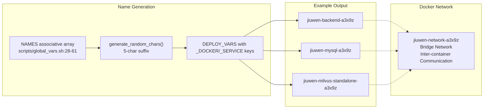
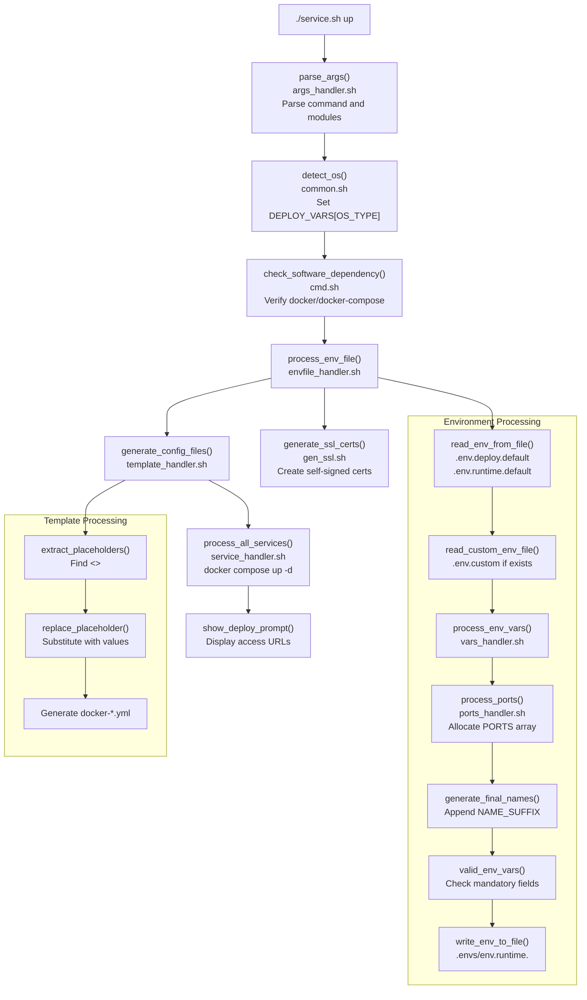
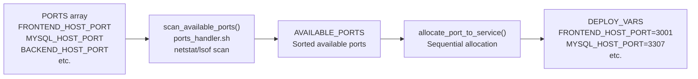

<!-- source: DeepWiki mcp.deepwiki.com · repo openJiuwen-ai/agent-studio · page 2.1 Docker Installation · fetched 2026-11-02 -->

# Docker Installation

<details>
<summary>Relevant source files</summary>

The following files were used as context for generating this wiki page:

- [backend/pyproject.toml](backend/pyproject.toml)
- [docs/en/2.Installation Guide/Install via Docker/Linux_Installation.md](docs/en/2.Installation Guide/Install via Docker/Linux_Installation.md)
- [docs/en/2.Installation Guide/Install via Docker/MacOS_Installation.md](docs/en/2.Installation Guide/Install via Docker/MacOS_Installation.md)
- [docs/en/2.Installation Guide/Install via Docker/Windows_Installation.md](docs/en/2.Installation Guide/Install via Docker/Windows_Installation.md)
- [scripts/.env.deploy.default](scripts/.env.deploy.default)
- [scripts/args_handler.sh](scripts/args_handler.sh)
- [scripts/common.sh](scripts/common.sh)
- [scripts/conf/docker-deepsearch.template.yml](scripts/conf/docker-deepsearch.template.yml)
- [scripts/conf/docker-jiuwen.template.yml](scripts/conf/docker-jiuwen.template.yml)
- [scripts/conf/docker-plugin.template.yml](scripts/conf/docker-plugin.template.yml)
- [scripts/envfile_handler.sh](scripts/envfile_handler.sh)
- [scripts/gen_ssl.sh](scripts/gen_ssl.sh)
- [scripts/global_vars.sh](scripts/global_vars.sh)
- [scripts/prompt_handler.sh](scripts/prompt_handler.sh)
- [scripts/service.sh](scripts/service.sh)
- [scripts/template_handler.sh](scripts/template_handler.sh)
- [scripts/vars_handler.sh](scripts/vars_handler.sh)

</details>


This document provides step-by-step instructions for deploying OpenJiuwen Agent Studio using Docker across Linux, Windows, and macOS platforms. The deployment uses a modular Bash-based orchestration script (`service.sh`) that automates container provisioning, configuration generation, and service management.

For local development without Docker, see [Local Development Setup](#2.2). For detailed configuration options, see [Configuration Guide](#2.3).

---

## Prerequisites

### Hardware Requirements

| Resource | Minimum | Recommended |
|----------|---------|-------------|
| CPU | 2 cores | 4+ cores |
| RAM | 4 GB | 8+ GB |
| Disk Space | 10 GB | 20+ GB |

**Note**: Milvus 2.6.2 requires CPUs with AVX instruction set support. Verify with `lscpu | grep Flags` (Linux) or system profiler (macOS).

Sources: [docs/en/2.Installation Guide/Install via Docker/Linux_Installation.md:6-9](), [docs/en/2.Installation Guide/Install via Docker/Windows_Installation.md:7-9]()

### Software Requirements by Platform

#### Linux
- **Operating System**: Ubuntu 20.04+ (Ubuntu 22.04 recommended) or EulerOS 2.0+
- **Docker**: 20.10+
- **Docker Compose**: v2.19.1+
- **Bash**: 5.0+ (verified in [scripts/service.sh:3-8]())

#### Windows
- **Operating System**: Windows 10 (Build 19041+) or Windows 11
- **Docker Desktop**: Latest version with embedded Docker Engine 20.10+ and Docker Compose v2.19.1+
- **WSL 2**: Enabled and configured as Docker Desktop backend
- **Git for Windows**: 2.51.0+

#### macOS
- **Operating System**: macOS 14.0 (Sonoma)+
- **Docker Desktop**: Latest version with embedded Docker Engine 20.10+ and Docker Compose v2.19.1+
- **Homebrew**: For installing dependencies
- **Bash**: 5.0+ (default macOS bash is 3.x, upgrade required)
- **Git**: Installed via Homebrew

Sources: [docs/en/2.Installation Guide/Install via Docker/Linux_Installation.md:11-34](), [docs/en/2.Installation Guide/Install via Docker/Windows_Installation.md:11-49](), [docs/en/2.Installation Guide/Install via Docker/MacOS_Installation.md:5-36]()

---

## Deployment Architecture

### Module-Based Service Orchestration

The Docker deployment uses a modular architecture where services are grouped into logical modules that can be deployed independently or together. The orchestration is controlled by `service.sh` and associated handler scripts.

```mermaid
graph TB
    subgraph "Entry Point"
        ServiceSh["service.sh<br/>(Main Orchestration)"]
    end
    
    subgraph "Handler Scripts"
        ArgsHandler["args_handler.sh<br/>Command Parsing"]
        EnvHandler["envfile_handler.sh<br/>Config Generation"]
        TemplateHandler["template_handler.sh<br/>Docker Compose Generation"]
        ContainerHandler["container_handler.sh<br/>Docker Operations"]
        PortsHandler["ports_handler.sh<br/>Port Allocation"]
        VarsHandler["vars_handler.sh<br/>Variable Processing"]
    end
    
    subgraph "Configuration Files"
        EnvDeploy[".env.deploy.default<br/>DEPLOY_VARS"]
        EnvRuntime[".env.runtime.default<br/>RUNTIME_VARS"]
        EnvCustom[".env.custom<br/>User Overrides"]
        GeneratedEnv[".envs/env.runtime.<suffix><br/>Generated Runtime Config"]
    end
    
    subgraph "Docker Compose Templates"
        JiuwenTpl["docker-jiuwen.template.yml"]
        MysqlTpl["docker-mysql.template.yml"]
        MilvusTpl["docker-milvus.template.yml"]
        PluginTpl["docker-plugin.template.yml"]
        SandboxTpl["docker-sandbox.template.yml"]
        DeepsearchTpl["docker-deepsearch.template.yml"]
    end
    
    subgraph "Generated Compose Files"
        JiuwenYml["docker-jiuwen.yml"]
        MysqlYml["docker-mysql.yml"]
        MilvusYml["docker-milvus.yml"]
        PluginYml["docker-plugin.yml"]
        SandboxYml["docker-sandbox.yml"]
        DeepsearchYml["docker-deepsearch.yml"]
    end
    
    ServiceSh --> ArgsHandler
    ArgsHandler --> EnvHandler
    EnvHandler --> EnvDeploy
    EnvHandler --> EnvRuntime
    EnvHandler --> EnvCustom
    EnvHandler --> VarsHandler
    VarsHandler --> PortsHandler
    EnvHandler --> GeneratedEnv
    EnvHandler --> TemplateHandler
    
    TemplateHandler --> JiuwenTpl
    TemplateHandler --> MysqlTpl
    TemplateHandler --> MilvusTpl
    TemplateHandler --> PluginTpl
    TemplateHandler --> SandboxTpl
    TemplateHandler --> DeepsearchTpl
    
    TemplateHandler --> JiuwenYml
    TemplateHandler --> MysqlYml
    TemplateHandler --> MilvusYml
    TemplateHandler --> PluginYml
    TemplateHandler --> SandboxYml
    TemplateHandler --> DeepsearchYml
    
    JiuwenYml --> ContainerHandler
    MysqlYml --> ContainerHandler
    MilvusYml --> ContainerHandler
    PluginYml --> ContainerHandler
    SandboxYml --> ContainerHandler
    DeepsearchYml --> ContainerHandler
```



Sources: [scripts/service.sh:12-39](), [scripts/global_vars.sh:158-194]()

### Deployable Modules

The deployment system defines seven modules as specified in `ALL_MODULES` array:

| Module | Components | Purpose |
|--------|------------|---------|
| `JIUWEN` | `BACKEND`, `FRONTEND` | Core Agent Studio backend (FastAPI) and frontend (Nginx + React) |
| `MYSQL` | `MYSQL` | MySQL 8.4.5 relational database |
| `MILVUS` | `ETCD`, `MINIO`, `MILVUS` | Vector database stack with dependencies |
| `PLUGIN` | `PLUGIN_SERVER` | Plugin execution service |
| `SANDBOX` | `PYTHON_SERVER`, `JS_SERVER`, `SANDBOX_GATEWAY` | Code execution sandboxes |
| `DEEPSEARCH` | `DEEPSEARCH` | DeepSearch agent service |
| `UPGRADE` | `UPGRADE_TOOL` | Database migration utility |

Sources: [scripts/global_vars.sh:159-170]()

### Container Naming and Network

All containers are assigned unique names with a random 5-character suffix to allow multiple deployments on the same host:



Sources: [scripts/vars_handler.sh:5-15](), [scripts/common.sh:30-63](), [scripts/global_vars.sh:28-61]()

---

## Installation Procedures

### Linux Installation (Ubuntu 22.04)

#### 1. Install Docker and Docker Compose

```bash
# Install Docker using official script
curl -fsSL https://get.docker.com -o get-docker.sh
sudo sh get-docker.sh

# Verify installation
docker version
docker compose version
```

Ensure versions meet minimum requirements: Docker 20.10+, Docker Compose v2.19.1+.

#### 2. Download Deployment Package

Download the appropriate architecture package:

```bash
# For x86_64
wget https://openjiuwen-ci.obs.cn-north-4.myhuaweicloud.com/agentstudio/deployTool_0.1.3_amd64.zip

# For ARM64
wget https://openjiuwen-ci.obs.cn-north-4.myhuaweicloud.com/agentstudio/deployTool_0.1.3_arm64.zip
```

#### 3. Extract and Prepare

```bash
# Install unzip if needed
sudo apt update && sudo apt install unzip -y

# Extract (example for amd64)
unzip deployTool_0.1.3_amd64.zip
cd deployTool_0.1.3_amd64
```

#### 4. Start Services

```bash
# Ensure Docker daemon is running
sudo systemctl start docker
sudo systemctl status docker

# Start all services
./service.sh up
```

The script will:
- Generate `.env` configuration files in `.envs/` directory
- Allocate available ports starting from `START_PORT=3000` ([scripts/global_vars.sh:22]())
- Generate SSL certificates in `conf/.ssl-dirs/`
- Create Docker Compose files from templates in `conf/`
- Start containers via `docker compose up -d`

#### 5. Access the Platform

Upon successful startup, the script outputs:

```
=== openJiuwen Agent Platform: ===
    Local access: https://localhost:3001
    Network access: https://<detected-ip>:3001
```

Sources: [docs/en/2.Installation Guide/Install via Docker/Linux_Installation.md:36-101](), [scripts/prompt_handler.sh:5-12]()

### Windows Installation

#### 1. Enable WSL 2

Open PowerShell as Administrator and run:

```powershell
wsl --install
```

Restart your computer after installation completes.

**Why WSL 2?** The LinuxKit kernel used by Docker Desktop on Windows has known issues with process management, particularly processes entering uninterruptible sleep (D state). WSL 2 provides a full Linux kernel with proper resource recycling. See [docs/en/2.Installation Guide/Install via Docker/Windows_Installation.md:123-132]() for details on the LinuxKit zombie container issue.

#### 2. Install Docker Desktop

- Download from the [Docker website](https://www.docker.com/products/docker-desktop/) (AMD64 version for x86 machines)
- During installation, select:
  - ✓ Use WSL 2 instead of Hyper-V
  - ✓ Add shortcut to desktop
- Restart computer after installation
- Launch Docker Desktop and wait for initialization (5-10 minutes on first launch)

Verify versions: Docker Engine 20.10+, Docker Compose v2.19.1+

#### 3. Download Deployment Package

Download the appropriate architecture:
- [x86_64 package](https://openjiuwen-ci.obs.cn-north-4.myhuaweicloud.com/agentstudio/deployTool_0.1.3_amd64.zip)
- [ARM64 package](https://openjiuwen-ci.obs.cn-north-4.myhuaweicloud.com/agentstudio/deployTool_0.1.3_arm64.zip)

#### 4. Configure Docker Desktop File Sharing

- Open Docker Desktop → Settings (⚙️ icon)
- Navigate to Resources → File sharing
- Add the installation directory (e.g., `D:\openJiuwen`)
- Click "Apply & restart"

This allows Docker containers to mount volumes from the installation directory.

#### 5. Start Services

Extract the deployment package to your installation directory. Right-click in the directory and select "Git Bash Here", then:

```bash
# Verify Docker Desktop is running
docker info >nul 2>&1 && (echo Docker Desktop is running) || (echo Docker Desktop is not running)

# Start all services
./service.sh up
```

**Note**: The script requires Bash 5.0+. Git for Windows includes a compatible Bash version.

Sources: [docs/en/2.Installation Guide/Install via Docker/Windows_Installation.md:1-96]()

### macOS Installation

#### 1. Install Prerequisites

```bash
# Install Homebrew if not present
/bin/bash -c "$(curl -fsSL https://raw.githubusercontent.com/Homebrew/install/HEAD/install.sh)"

# Install Git
brew install git

# Upgrade Bash to 5.0+ (macOS default is 3.x)
brew install bash
```

#### 2. Install Docker Desktop

- Download from [Docker Desktop website](https://www.docker.com/products/docker-desktop/)
- Double-click the `.dmg` installer
- Drag Docker to Applications folder
- Launch Docker and authorize installation when prompted
- Wait for initialization (downloads base images)

Verify embedded versions: Docker Engine 20.10+, Docker Compose v2.19.1+

#### 3. Download and Extract Deployment Package

Download the appropriate architecture:
- [x86_64 package](https://openjiuwen-ci.obs.cn-north-4.myhuaweicloud.com/agentstudio/deployTool_0.1.3_amd64.zip)
- [ARM64 package](https://openjiuwen-ci.obs.cn-north-4.myhuaweicloud.com/agentstudio/deployTool_0.1.3_arm64.zip)

Create an installation directory, place the package there, and extract it.

#### 4. Start Services

Open Terminal and navigate to the installation directory:

```bash
# Start all services
./service.sh up
```

Sources: [docs/en/2.Installation Guide/Install via Docker/MacOS_Installation.md:1-77]()

---

## Deployment Script Architecture

### Script Execution Flow



Sources: [scripts/service.sh:28-36](), [scripts/envfile_handler.sh:169-195](), [scripts/template_handler.sh:96-124]()

### Configuration Variables

The deployment system uses two primary associative arrays defined in [scripts/global_vars.sh:106-134]():

**`DEPLOY_VARS`**: Deployment-time variables (written to `.env`)
- Container/service/volume names with unique suffix
- Port allocations (host-side ports)
- Module enable flags (`HAS_MYSQL`, `HAS_MILVUS`, etc.)
- Service start flags (`IS_UP_BACKEND`, `IS_UP_FRONTEND`, etc.)
- Infrastructure settings (`DB_ROOT_PASSWORD`, `ENABLE_LINUX_SANDBOX`)

**`RUNTIME_VARS`**: Runtime configuration (written to `.envs/env.runtime.<suffix>`)
- Database connection parameters (`DB_TYPE`, `DB_HOST`, `DB_PORT`)
- Vector store configuration (`INDEX_MANAGER_TYPE`, `MILVUS_HOST`)
- API endpoints (`VITE_API_PROXY_TARGET`, `CODE_SANDBOX_URL`)
- Application settings (loaded by containers at startup)

### Port Allocation Strategy

Ports are dynamically allocated from the range 3000-65535 to avoid conflicts:



The script scans for occupied ports using platform-specific commands (netstat/lsof) and allocates the first N available ports sequentially.

Sources: [scripts/global_vars.sh:64-78](), [scripts/ports_handler.sh]()

### Docker Compose Template Substitution

Templates use `<<VARIABLE>>` placeholders that are replaced with actual values:

**Example**: [scripts/conf/docker-jiuwen.template.yml:1-72]()

```yaml
services:
  <<BACKEND_SERVICE>>:
    image: <<BACKEND_IMAGE>>
    container_name: <<BACKEND_DOCKER>>
    ports:
      - "<<BACKEND_HOST_PORT>>:<<BACKEND_PORT>>"
    env_file:
      - ../.envs/env.runtime.<<NAME_SUFFIX>>
    volumes:
      - <<SQLITE_VOLUME>>:/app/data
```

The template handler extracts placeholders using regex `<<[^>]+>>`, looks up values in `ALL_VARS` (merged `DEPLOY_VARS` + `RUNTIME_VARS`), and performs sed/awk-based substitution.

Sources: [scripts/template_handler.sh:4-61]()

---

## Post-Installation

### Accessing the System

After successful deployment, the system outputs two URLs:

- **Local access**: `https://localhost:<FRONTEND_HOST_PORT>`
- **Network access**: `https://<detected-ip>:<FRONTEND_HOST_PORT>`

The IP address is auto-detected using platform-specific methods defined in [scripts/common.sh:66-115]():
- **Linux**: `ip route` to find default gateway interface, then extract IPv4
- **macOS**: `ifconfig` to find first non-loopback interface
- **Windows**: PowerShell `Get-NetIPAddress` with WLAN/Ethernet filtering

### SSL Certificate Handling

The deployment automatically generates self-signed SSL certificates:

1. Checks for `mkcert` tool; if unavailable, uses `openssl`
2. Generates unencrypted private key and certificate
3. Encrypts private key with AES-256 using random 32-character password
4. Stores password in `SSL_PASSWORD` environment variable (ephemeral)
5. Removes unencrypted key

Certificates are stored in `conf/.ssl-dirs/ssl-<NAME_SUFFIX>/` and mounted into the frontend container.

**Security Note**: The SSL password is only available during the `docker compose up` session. If containers are stopped and restarted, new certificates with a new password are generated. This ensures the password never persists in configuration files.

Sources: [scripts/gen_ssl.sh:5-62]()

### Verifying Installation

Check container health status:

```bash
docker ps --filter "name=jiuwen-"
```

All containers should show `Up` status with healthy healthchecks:
- `jiuwen-backend-*`: Checks `http://localhost:8000/api/health`
- `jiuwen-frontend-*`: Checks `https://localhost:<port>/`
- `jiuwen-mysql-*`: MySQL readiness probe
- `jiuwen-milvus-standalone-*`: Milvus service probe

View logs for a specific service:

```bash
docker logs jiuwen-backend-<suffix>
```

Logs are also persisted to `log-dirs/logs-<suffix>/` directory:
- `server/`: Backend application logs
- `deepsearch/`: DeepSearch agent logs

Sources: [scripts/conf/docker-jiuwen.template.yml:29-34](), [scripts/conf/docker-jiuwen.template.yml:57-62]()

### Managing Services

| Command | Description |
|---------|-------------|
| `./service.sh up` | Start services (auto-detects existing vs new deployment) |
| `./service.sh up -f .envs/env.deploy.<suffix>` | Start specific deployment instance |
| `./service.sh up -n` | Force new deployment (ignore existing `.env`) |
| `./service.sh stop` | Pause services (containers remain) |
| `./service.sh down` | Stop and remove containers, networks (volumes persist) |

**Selective Module Deployment**:

```bash
# Deploy only MySQL and Milvus
./service.sh mysql milvus up

# Deploy only core platform (backend + frontend)
./service.sh jiuwen up
```

Sources: [scripts/args_handler.sh:115-172]()

---

## Troubleshooting

### Milvus Container Exits Immediately

**Symptom**: `jiuwen-milvus-standalone-*` container starts then exits after a few seconds.

**Cause**: Milvus 2.6.2 requires CPU with AVX instruction set. Check availability:

```bash
# Linux
lscpu | grep -i avx

# macOS
sysctl -a | grep machdep.cpu.features
```

If AVX is not present, the vector database cannot run. Consider using Chroma instead by setting `INDEX_MANAGER_TYPE=chroma` in `.env.custom` before deployment.

Sources: [docs/en/2.Installation Guide/Install via Docker/Linux_Installation.md:104-105]()

### Plugin/Sandbox Startup Failures

**Symptom**: "up Plugin + Sandbox Server failed" error during deployment.

**Cause**: Network issues downloading Docker images.

**Solution**: Re-run `./service.sh up`. The script is idempotent and will resume from where it failed.

Sources: [docs/en/2.Installation Guide/Install via Docker/Linux_Installation.md:88]()

### Port Allocation Conflicts

**Symptom**: Deployment fails with "port already in use" error.

**Cause**: Allocated port is already occupied by another service.

**Solution**: 
1. The port scanner should detect this automatically. If it fails, modify `.env.custom`:
   ```
   FRONTEND_HOST_PORT=3002
   ```
2. Delete `.env` file to force re-allocation
3. Re-run deployment

Alternatively, customize the port range in [scripts/global_vars.sh:22-23]() by editing `START_PORT` and `END_PORT`.

Sources: [scripts/ports_handler.sh]()

### OpenEuler seccomp Restrictions

**Symptom**: Containers fail to start on openEuler with "operation not permitted" errors.

**Cause**: Kernel seccomp security policy blocks thread creation in containers.

**Solution**: Adjust seccomp policy following the [official openEuler guide](https://docs.openeuler.openatom.cn/zh/docs/24.03_LTS/docs/Container/%E5%AE%89%E5%85%A8%E7%89%B9%E6%80%A7.html). Modify the Docker Compose templates in `conf/docker-*.template.yml` to add appropriate seccomp profiles.

Sources: [docs/en/2.Installation Guide/Install via Docker/Linux_Installation.md:108-111]()

### Windows Docker Desktop D-State Process Issue

**Symptom**: Container restart fails with "tried to kill container, but did not receive an exit event".

**Cause**: LinuxKit kernel (legacy Docker Desktop backend) has poor process management. Processes entering D state (uninterruptible sleep) become zombies.

**Solution**: 
1. **Immediate**: Restart Docker Desktop to reset the virtual machine
2. **Permanent**: Ensure WSL 2 is enabled as the Docker Desktop backend (see Windows Installation section). WSL 2 has kernel-level D-state recovery mechanisms.

Sources: [docs/en/2.Installation Guide/Install via Docker/Windows_Installation.md:123-132]()

### Database Connection Failures

**Symptom**: Backend container logs show database connection errors.

**Cause**: MySQL container not fully initialized before backend starts.

**Solution**: The backend container has a healthcheck dependency on MySQL readiness. Wait 60 seconds (healthcheck `start_period`) for MySQL initialization to complete. View MySQL logs:

```bash
docker logs jiuwen-mysql-<suffix>
```

Look for "ready for connections" message.

Sources: [scripts/conf/docker-jiuwen.template.yml:29-34]()

### SSL Certificate Warnings

**Symptom**: Browser shows "Your connection is not private" warning when accessing the platform.

**Cause**: Self-signed SSL certificates are not trusted by browsers.

**Solution**: This is expected behavior. Either:
1. Click "Advanced" → "Proceed to localhost (unsafe)" in the browser
2. Install `mkcert` before deployment to generate locally-trusted certificates:
   ```bash
   # Linux
   sudo apt install mkcert
   
   # macOS
   brew install mkcert
   mkcert -install
   
   # Windows (via Chocolatey)
   choco install mkcert
   mkcert -install
   ```

Then redeploy. The script will detect `mkcert` and generate trusted certificates automatically.

Sources: [scripts/gen_ssl.sh:28-49]()

---

## Docker Images

The deployment includes the following third-party Docker images:

| Image | Version | License | Source Repository |
|-------|---------|---------|------------------|
| mysql | 8.4.5 | GPL 2.0 | [Source](https://github.com/mysql/mysql-server/tree/mysql-8.4.5) |
| minio | RELEASE.2024-12-18T13-15-44Z | GNU AGPL 3.0 | [Source](https://github.com/minio/minio/tree/RELEASE.2024-12-18T13-15-44Z) |
| milvus | 2.6.2 | Apache 2.0 | - |
| etcd | 3.5.18 | Apache 2.0 | - |

OpenJiuwen-specific images (backend, frontend, plugin-server, etc.) are defined in [scripts/.env.deploy.default:5-76]() and built from the repository codebase.

Sources: [docs/en/2.Installation Guide/Install via Docker/Linux_Installation.md:113-120](), [scripts/.env.deploy.default:5-76]()

---

