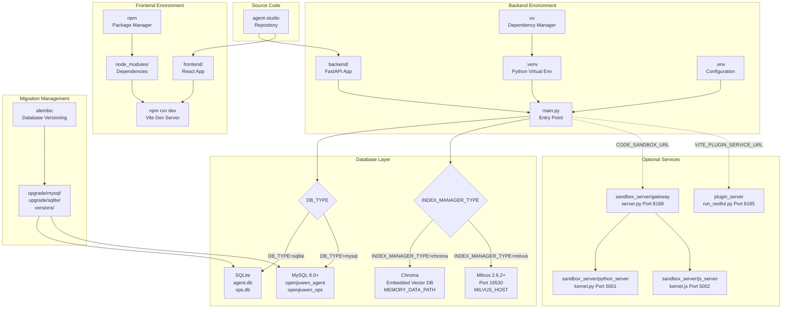
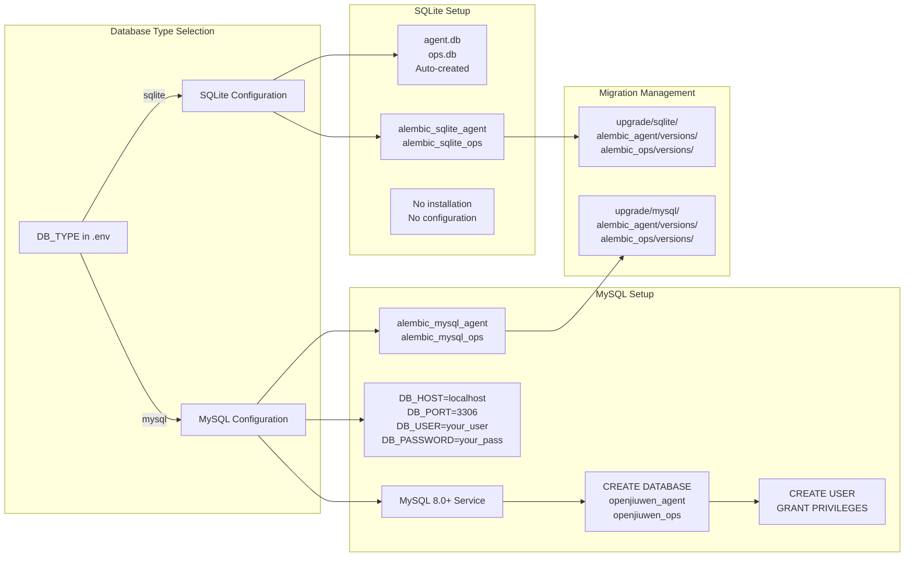
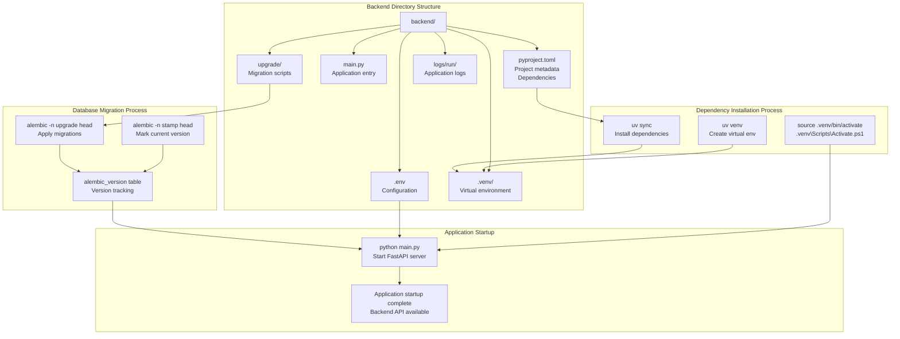
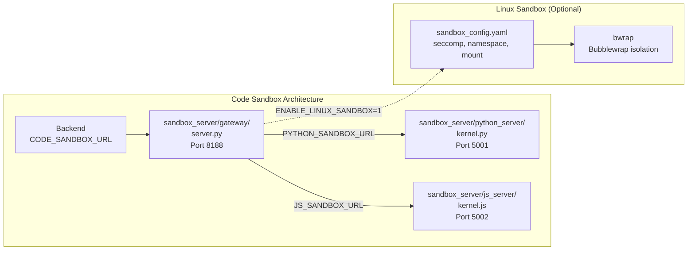
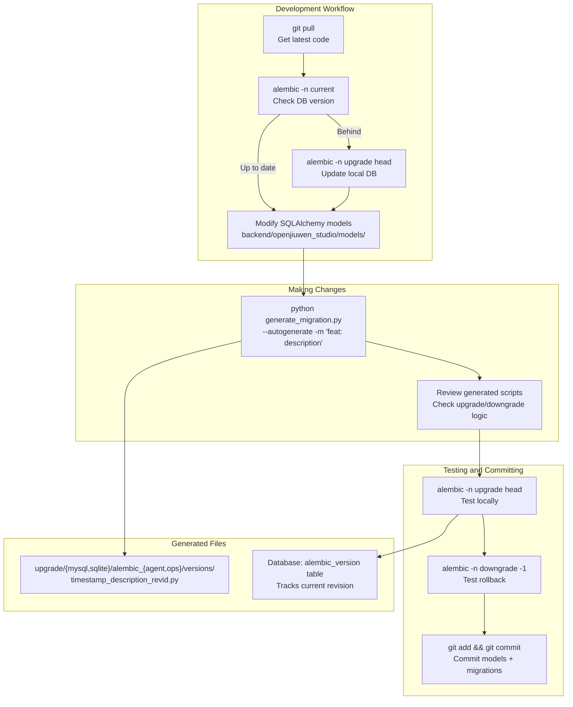

<!-- source: DeepWiki mcp.deepwiki.com · repo openJiuwen-ai/agent-studio · page 2.2 Local Development Setup · fetched 2026-11-02 -->

# Local Development Setup

<details>
<summary>Relevant source files</summary>

The following files were used as context for generating this wiki page:

- [backend/DATABASE_MIGRATION_DEVELOPMENT_GUIDE_EN.md](backend/DATABASE_MIGRATION_DEVELOPMENT_GUIDE_EN.md)
- [backend/GENERATE_MIGRATION_USAGE_EN.md](backend/GENERATE_MIGRATION_USAGE_EN.md)
- [docs/en/2.Installation Guide/Local Installation/Linux_Installation.md](docs/en/2.Installation Guide/Local Installation/Linux_Installation.md)
- [docs/en/2.Installation Guide/Local Installation/MacOS_Installation.md](docs/en/2.Installation Guide/Local Installation/MacOS_Installation.md)
- [docs/en/2.Installation Guide/Local Installation/Windows_Installation.md](docs/en/2.Installation Guide/Local Installation/Windows_Installation.md)

</details>


This page provides instructions for setting up a local development environment for OpenJiuwen Agent Studio using manual installation. This setup is intended for developers who need flexible configuration and hot-reload capabilities during development. For production deployments or quick evaluation, see [Docker Installation](#2.1). For detailed configuration of environment variables and services, see [Configuration Guide](#2.3).

**Sources:** [docs/en/2.Installation Guide/Local Installation/Linux_Installation.md:1-10](), [docs/en/2.Installation Guide/Local Installation/MacOS_Installation.md:1-5](), [docs/en/2.Installation Guide/Local Installation/Windows_Installation.md:1-5]()

## Prerequisites

Local development requires the following minimum hardware and software specifications:

### Hardware Requirements

| Component | Minimum | Recommended |
|-----------|---------|-------------|
| CPU | 2 cores | 4+ cores |
| RAM | 4GB | 8GB+ |
| Disk Space | 10GB | 20GB+ |

### Software Dependencies

| Dependency | Version | Purpose |
|------------|---------|---------|
| **Git** | 2.40+ | Source code management |
| **Node.js** | 20.0+ | Frontend development server |
| **npm** | 10.0+ (9.0+ for macOS) | Frontend package management |
| **Python** | 3.11+ | Backend runtime |
| **uv** | 0.5.0+ | Python dependency management |
| **MySQL** | 8.0+ | Optional relational database |
| **Milvus** | 2.6.2+ | Optional vector database |

### Operating System Support

- **Linux**: Ubuntu 20.04+ (Ubuntu 22.04 Jammy recommended)
- **macOS**: macOS 14.0 Sonoma or later
- **Windows**: Windows 10 or later (with PowerShell 5.1+)

**Sources:** [docs/en/2.Installation Guide/Local Installation/Linux_Installation.md:6-26](), [docs/en/2.Installation Guide/Local Installation/MacOS_Installation.md:6-23](), [docs/en/2.Installation Guide/Local Installation/Windows_Installation.md:6-25]()

## Installation Methods Overview

OpenJiuwen Agent Studio provides two installation approaches for local development:

| Method | Description | Best For |
|--------|-------------|----------|
| **One-Click Script** | Automated installation using shell scripts (`setup.sh` for Linux/macOS, `setup.ps1` for Windows). Handles dependency checks, code fetching, and service startup. | Quick setup, first-time installation, standardized environments |
| **Manual Installation** | Step-by-step installation of all dependencies and services. Requires manual configuration of each component. | Custom configurations, development workflows, troubleshooting |

The one-click script provides:
- Automatic dependency detection and installation (`check_git.sh`, `check_nodejs.sh`, `check_python.sh`, `check_mysql.sh`)
- Repository cloning via `fetch_codes.sh`
- AES key generation
- `.env` configuration setup
- Backend virtual environment creation and dependency installation
- Automatic service startup

**Sources:** [docs/en/2.Installation Guide/Local Installation/Linux_Installation.md:27-115](), [docs/en/2.Installation Guide/Local Installation/MacOS_Installation.md:25-86](), [docs/en/2.Installation Guide/Local Installation/Windows_Installation.md:26-109]()

## Development Environment Architecture



**Diagram: Local Development Environment Component Structure**

This diagram maps the development setup to actual code entities and configuration files used in the repository.

**Sources:** [docs/en/2.Installation Guide/Local Installation/Linux_Installation.md:218-381](), [backend/DATABASE_MIGRATION_DEVELOPMENT_GUIDE_EN.md:1-17]()

## Platform-Specific Setup

### Linux Setup

#### Dependency Installation (Ubuntu 22.04)

1. **Install Git**:
   ```bash
   sudo apt update
   sudo apt install git
   ```

2. **Install Node.js and npm**:
   ```bash
   sudo apt install -y nodejs
   node -v && npm -v  # Verify installation
   ```
   If versions are below Node.js 20.0 or npm 10.0, install from the official Node.js repository.

3. **Install Python 3.11 and uv**:
   ```bash
   sudo add-apt-repository ppa:deadsnakes/ppa
   sudo apt update
   sudo apt install python3.11 python3-pip
   pip3 install uv
   ```
   Note: Deadsnakes PPA does not support Ubuntu 20.04 Focal. Use Miniconda for older versions.

4. **Install MySQL (Optional)**:
   ```bash
   sudo apt install mysql-server
   sudo apt install libmysqlclient-dev pkg-config build-essential python3-dev
   ```

**Sources:** [docs/en/2.Installation Guide/Local Installation/Linux_Installation.md:122-186]()

### macOS Setup

#### Dependency Installation

1. **Install Homebrew (if not installed)**:
   ```bash
   /bin/bash -c "$(curl -fsSL https://raw.githubusercontent.com/Homebrew/install/HEAD/install.sh)"
   ```

2. **Install Git**:
   ```bash
   brew install git
   git --version  # Verify installation
   ```

3. **Install Node.js and npm**:
   Download the macOS installer from the Node.js official website (version 20.0+) or use Homebrew:
   ```bash
   brew install node
   node -v && npm -v  # Verify installation
   ```

4. **Install Python 3.11 and uv**:
   ```bash
   brew install python@3.11
   brew install uv
   python3 --version  # Verify installation
   uv --version  # Verify installation
   ```

5. **Install MySQL (Optional)**:
   ```bash
   brew install pkg-config  # Required for MySQL discovery
   brew install mysql
   brew services start mysql
   ```

**Sources:** [docs/en/2.Installation Guide/Local Installation/MacOS_Installation.md:88-167]()

### Windows Setup

#### Dependency Installation

1. **Install Git**:
   Download the [Git installer](https://mirrors.huaweicloud.com/git-for-windows/v2.51.0.windows.1/Git-2.51.0-64-bit.exe) and follow the installation wizard.
   ```powershell
   git --version  # Verify installation
   ```

2. **Install Node.js and npm**:
   Download the [Node.js installer](https://nodejs.org/dist/v22.21.1/node-v22.21.1-x64.msi) and install.
   ```powershell
   node -v
   npm -v  # Verify installation
   ```

3. **Install Python 3.11 and uv**:
   Download the [Python 3.11.4 installer](https://www.python.org/ftp/python/3.11.4/python-3.11.4-amd64.exe) and check "Add Python to PATH" during installation.
   ```powershell
   python --version  # Verify installation
   pip install uv
   uv --version  # Verify installation
   ```

4. **Install MySQL (Optional)**:
   Download the [MySQL 8.4 installer](https://dev.mysql.com/get/Downloads/MySQL-8.4/mysql-8.4.7-winx64.msi). Use Typical installation mode.
   
   Add MySQL bin directory to PATH:
   ```powershell
   rundll32.exe sysdm.cpl,EditEnvironmentVariables
   ```
   Add `C:\Program Files\MySQL\MySQL Server 8.4\bin` to the Path variable.

**Sources:** [docs/en/2.Installation Guide/Local Installation/Windows_Installation.md:110-187]()

## Source Code Acquisition

### Repository Access

The OpenJiuwen Agent Studio codebase is hosted on GitCode. You need access to the [openJiuwen organization](https://gitcode.com/org/openJiuwen).

1. **Configure Git globally**:
   ```bash
   git config --global user.name your_username
   git config --global user.email your_useremail
   git config --global credential.helper store  # Cache credentials
   ```

2. **Clone the repository**:
   ```bash
   git clone https://gitcode.com/openJiuwen/agent-studio.git
   cd agent-studio
   ```

You will be prompted for your GitCode username and personal access token during clone.

**Sources:** [docs/en/2.Installation Guide/Local Installation/Linux_Installation.md:220-243](), [docs/en/2.Installation Guide/Local Installation/MacOS_Installation.md:179-203](), [docs/en/2.Installation Guide/Local Installation/Windows_Installation.md:197-222]()

## Database Configuration

### Relational Database Setup

OpenJiuwen supports both SQLite and MySQL. The choice is controlled by the `DB_TYPE` environment variable in `.env`.



**Diagram: Relational Database Configuration Paths**

#### SQLite (Default, No Configuration Required)

SQLite is the default database type. It requires no installation or configuration:

- Database files are auto-created: `agent.db` and `ops.db`
- No user management or connection setup needed
- Suitable for development and testing
- Limitations: No concurrent write support, no user permissions

#### MySQL Configuration

If using MySQL, create the required databases and user:

```sql
-- Create databases
CREATE DATABASE openjiuwen_agent;
CREATE DATABASE openjiuwen_ops;

-- Create user (replace placeholders)
CREATE USER 'your_user_name'@'localhost' IDENTIFIED BY 'your_password';

-- Grant privileges
GRANT ALL PRIVILEGES ON openjiuwen_agent.* TO 'your_user_name'@'localhost';
GRANT ALL PRIVILEGES ON openjiuwen_ops.* TO 'your_user_name'@'localhost';
FLUSH PRIVILEGES;
```

Update `.env` configuration:
```env
DB_TYPE=mysql
DB_HOST=localhost
DB_PORT=3306
DB_USER=your_user_name
DB_PASSWORD=your_password
```

If the password contains special characters, URL-encode them (e.g., `@` → `%40`, `#` → `%23`).

**Sources:** [docs/en/2.Installation Guide/Local Installation/Linux_Installation.md:166-207](), [docs/en/2.Installation Guide/Local Installation/MacOS_Installation.md:126-167](), [docs/en/2.Installation Guide/Local Installation/Windows_Installation.md:138-187]()

### Vector Database Setup

Vector databases are required for memory and knowledge base features. The choice is controlled by `INDEX_MANAGER_TYPE` in `.env`.

| Feature | Chroma (Default) | Milvus |
|---------|------------------|--------|
| **Installation** | None required (embedded) | Docker required |
| **Configuration** | Minimal | Moderate (host, port, collection) |
| **Use Case** | Development, testing | Production, complex scenarios |
| **Performance** | Suitable for small-medium datasets | Optimized for large-scale |
| **Dependencies** | Embedding model only | Docker, etcd, MinIO (via standalone script) |

#### Chroma Setup (Default)

Chroma is embedded and requires no installation:

```env
INDEX_MANAGER_TYPE=chroma
MEMORY_DATA_PATH=memory-data  # Storage path for vector data
```

You only need to configure an embedding model provider (see [Model Management](#4.3)).

#### Milvus Setup

Milvus requires Docker. For detailed installation, see the platform-specific guides:

**Linux (Docker)**:
1. Install Docker and Docker Compose
2. Download the `standalone_embed.sh` script:
   ```bash
   curl -sfL https://raw.githubusercontent.com/milvus-io/milvus/master/scripts/standalone_embed.sh -o standalone_embed.sh
   ```
3. Pull the Milvus image:
   ```bash
   # x86 architecture
   docker pull swr.cn-north-4.myhuaweicloud.com/openjiuwen/milvusdb/milvus-amd64:v2.6.2
   ```
4. Edit `standalone_embed.sh` to use the pulled image name
5. Start Milvus:
   ```bash
   bash standalone_embed.sh start
   ```

**macOS/Windows (Docker Desktop)**:
Similar steps using Docker Desktop. For Windows, use `standalone.bat` instead.

Update `.env` configuration:
```env
INDEX_MANAGER_TYPE=milvus
MILVUS_HOST=127.0.0.1
MILVUS_PORT=19530
MILVUS_COLLECTION_NAME=memory_vector
```

**Sources:** [docs/en/2.Installation Guide/Local Installation/Linux_Installation.md:209-216](), [docs/en/2.Installation Guide/Local Installation/Linux_Installation.md:383-434](), [docs/en/2.Installation Guide/Local Installation/MacOS_Installation.md:353-414](), [docs/en/2.Installation Guide/Local Installation/Windows_Installation.md:379-471]()

## Backend Setup

### Environment Preparation

1. **Generate AES Key (Optional)**:
   
   If you need to encrypt sensitive fields in the database, generate an AES master key:
   ```bash
   cd scripts
   bash build_AES_master_key.sh
   ```
   
   Export the generated key:
   ```bash
   export SERVER_AES_MASTER_KEY_ENV=your_aes_key
   ```
   
   **Important**: The AES key must remain unchanged after initial setup. Changing it will make previously encrypted data undecipherable.

2. **Copy Environment Configuration**:
   ```bash
   cp .env.example .env
   ```

3. **Edit `.env` file**:
   
   Configure the following variables according to your setup:
   
   ```env
   # Database configuration
   DB_TYPE=sqlite  # or mysql
   DB_HOST=localhost
   DB_PORT=3306
   DB_USER=your_user_name
   DB_PASSWORD=your_password
   
   # Vector database
   INDEX_MANAGER_TYPE=chroma  # or milvus
   MEMORY_DATA_PATH=memory-data
   
   # Milvus (only if INDEX_MANAGER_TYPE=milvus)
   MILVUS_HOST=127.0.0.1
   MILVUS_PORT=19530
   MILVUS_COLLECTION_NAME=memory_vector
   
   # Optional: Code sandbox
   CODE_SANDBOX_URL=http://localhost:8188/run
   
   # Optional: Plugin server
   VITE_PLUGIN_SERVICE_URL=http://localhost:8185
   VITE_PLUGIN_CONFIG_PATH=/config.json
   ```

**Sources:** [docs/en/2.Installation Guide/Local Installation/Linux_Installation.md:245-317](), [docs/en/2.Installation Guide/Local Installation/MacOS_Installation.md:205-282](), [docs/en/2.Installation Guide/Local Installation/Windows_Installation.md:224-313]()

### Python Environment and Dependencies



**Diagram: Backend Setup and Startup Process**

1. **Navigate to backend directory**:
   ```bash
   cd backend
   ```

2. **Create virtual environment and install dependencies**:
   ```bash
   uv venv
   uv sync
   ```
   
   This reads [backend/pyproject.toml]() and installs all dependencies into `.venv/`.
   
   **Note**: If `uv sync` hangs for more than 20 minutes, try changing the `[[tool.uv.index]]` URL in `pyproject.toml` to an alternate Python package index, or use `uv sync --native-tls` to force system TLS library usage.

3. **Initialize database version stamps**:
   
   Mark the current database as the latest version without executing migrations:
   
   ```bash
   # For MySQL
   alembic -n alembic_mysql_agent stamp head
   alembic -n alembic_mysql_ops stamp head
   
   # For SQLite
   alembic -n alembic_sqlite_agent stamp head
   alembic -n alembic_sqlite_ops stamp head
   ```
   
   This creates the `alembic_version` table in each database and records the current version. See [Database Migrations](#database-migrations) for details.

4. **Create log directories**:
   ```bash
   # Linux/macOS
   mkdir -p logs/run
   
   # Windows
   mkdir logs
   mkdir logs\run
   ```

5. **Activate virtual environment and start backend**:
   
   **Linux/macOS**:
   ```bash
   source .venv/bin/activate
   python main.py
   ```
   
   **Windows PowerShell**:
   ```powershell
   .\.venv\Scripts\Activate.ps1
   python main.py
   ```
   
   **Windows Command Prompt**:
   ```cmd
   .venv\Scripts\activate
   python main.py
   ```

On successful startup, you will see:
```
Application startup complete
```

**macOS Note**: On Apple Silicon chips, if you encounter `No module named 'greenlet'`, run:
```bash
deactivate
uv add greenlet
source .venv/bin/activate
```

**Sources:** [docs/en/2.Installation Guide/Local Installation/Linux_Installation.md:318-351](), [docs/en/2.Installation Guide/Local Installation/MacOS_Installation.md:283-320](), [docs/en/2.Installation Guide/Local Installation/Windows_Installation.md:314-353](), [backend/DATABASE_MIGRATION_DEVELOPMENT_GUIDE_EN.md:326-337]()

## Frontend Setup

The frontend is a React application built with Vite. It communicates with the backend via the API client defined in `frontend/packages/api-client/`.

1. **Navigate to frontend directory**:
   ```bash
   cd frontend
   ```

2. **Install dependencies**:
   ```bash
   npm install
   ```
   
   This installs all packages defined in [frontend/package.json](). 
   
   **Note**: You may see vulnerability warnings from npm. These are known issues and do not affect functionality.

3. **Start development server**:
   ```bash
   npm run dev
   ```
   
   On successful startup, you will see:
   ```
   Local:   http://localhost:5173/
   Network: http://<your-ip>:5173/
   ```

4. **Access the application**:
   
   - **Local access**: Open `http://localhost:5173/` in your browser
   - **Network access**: Use the network URL to access from other devices on the same network

The Vite development server provides hot module replacement (HMR), automatically reloading the browser when you make changes to frontend code.

**Sources:** [docs/en/2.Installation Guide/Local Installation/Linux_Installation.md:354-381](), [docs/en/2.Installation Guide/Local Installation/MacOS_Installation.md:323-349](), [docs/en/2.Installation Guide/Local Installation/Windows_Installation.md:355-376]()

## Optional Services

### Code Sandbox

The code sandbox is required for executing code nodes in workflows and code-based plugins. It consists of three components:



**Diagram: Code Sandbox Service Architecture**

#### Setup Steps

1. **Configure Python Sandbox**:
   
   Create `sandbox_server/python_server/.env`:
   ```env
   HOST=0.0.0.0
   PORT=5001
   ```
   
   Start the Python sandbox:
   ```bash
   python sandbox_server/python_server/openjiuwen_sandbox_pyserver/kernel.py
   ```

2. **Start JS Sandbox**:
   
   The JS sandbox port is defined in [sandbox_server/js_server/kernel.js:471-475]():
   ```javascript
   const PORT = process.env.PORT || 5002;
   server.listen(PORT, "0.0.0.0", () => {
     console.log(`✅ JS sandbox listening on http://0.0.0.0:${PORT}`);
   });
   ```
   
   Start the JS sandbox:
   ```bash
   node sandbox_server/js_server/kernel.js
   ```

3. **Configure and Start Gateway**:
   
   Create `sandbox_server/gateway/.env`:
   ```env
   ENABLE_LINUX_SANDBOX=0  # Set to 1 for bwrap isolation (Linux only)
   HOST=0.0.0.0
   PORT=8188
   PYTHON_SANDBOX_URL=http://localhost:5001/run
   JS_SANDBOX_URL=http://localhost:5002/run
   ```
   
   **Linux Only - Bubblewrap Sandbox**:
   If `ENABLE_LINUX_SANDBOX=1`, configure [sandbox_server/gateway/openjiuwen_sandbox_gateway/conf/sandbox_config.yaml]() with seccomp rules, namespaces, and mount points. Ensure Python and Node interpreters are mounted and included in PATH.
   
   Start the gateway:
   ```bash
   python sandbox_server/gateway/openjiuwen_sandbox_gateway/server.py
   ```

4. **Configure Backend**:
   
   Update `.env` to enable sandbox:
   ```env
   CODE_SANDBOX_URL=http://localhost:8188/run
   ```

**Sources:** [docs/en/2.Installation Guide/Local Installation/Linux_Installation.md:455-531](), [docs/en/2.Installation Guide/Local Installation/MacOS_Installation.md:435-468](), [docs/en/2.Installation Guide/Local Installation/Windows_Installation.md:492-526]()

### Plugin Server

The plugin server hosts external plugin services for the platform. It is required if you use plugins that are not URL-based.

1. **Configure Plugin Services**:
   
   Implement plugin services according to [plugin_server/openjiuwen_plugin_server/]() structure.

2. **Start Plugin Server**:
   ```bash
   python plugin_server/openjiuwen_plugin_server/run_restful.py
   ```
   
   Default port: `8185`

3. **Configure Backend**:
   
   Update `.env`:
   ```env
   VITE_PLUGIN_SERVICE_URL=http://localhost:8185
   VITE_PLUGIN_CONFIG_PATH=/config.json
   ```

**Sources:** [docs/en/2.Installation Guide/Local Installation/Linux_Installation.md:533-540](), [docs/en/2.Installation Guide/Local Installation/MacOS_Installation.md:470-476](), [docs/en/2.Installation Guide/Local Installation/Windows_Installation.md:527-533]()

## Database Migrations

During development, database schema changes are managed using Alembic. OpenJiuwen uses four independent Alembic configurations:

| Configuration Name | Database Type | Purpose | Migration Path |
|--------------------|---------------|---------|----------------|
| `alembic_sqlite_agent` | SQLite | Agent database (agents, workflows, knowledge bases) | `backend/upgrade/sqlite/alembic_agent/versions/` |
| `alembic_sqlite_ops` | SQLite | Ops database (prompt templates, management data) | `backend/upgrade/sqlite/alembic_ops/versions/` |
| `alembic_mysql_agent` | MySQL | Agent database | `backend/upgrade/mysql/alembic_agent/versions/` |
| `alembic_mysql_ops` | MySQL | Ops database | `backend/upgrade/mysql/alembic_ops/versions/` |

### Migration Workflow



**Diagram: Database Migration Development Workflow**

### Standard Development Process

1. **Synchronize with latest code**:
   ```bash
   git pull
   cd backend
   ```

2. **Check database version**:
   ```bash
   # For SQLite Agent database
   alembic -n alembic_sqlite_agent current
   alembic -n alembic_sqlite_agent heads
   
   # For MySQL Agent database
   alembic -n alembic_mysql_agent current
   alembic -n alembic_mysql_agent heads
   ```

3. **Upgrade if needed**:
   ```bash
   # If current is behind heads
   alembic -n alembic_sqlite_agent upgrade head
   alembic -n alembic_sqlite_ops upgrade head
   ```

4. **Modify models**:
   
   Edit model files in [backend/openjiuwen_studio/models/]() or [backend/openjiuwen_studio/ops/modules/prompt/infra/repositories/orm_repo.py]().

5. **Generate migration scripts**:
   
   **Recommended**: Use the unified generation tool:
   ```bash
   python generate_migration.py --autogenerate -m "feat: add user profile table"
   ```
   
   This generates migrations for all four database configurations simultaneously. The description must start with `feat:` or `fix:`.
   
   **Alternative**: Generate manually for specific databases:
   ```bash
   alembic -n alembic_sqlite_agent revision --autogenerate -m "feat: add user profile table"
   alembic -n alembic_mysql_agent revision --autogenerate -m "feat: add user profile table"
   ```

6. **Review generated scripts**:
   
   Check the generated files in `upgrade/{mysql,sqlite}/alembic_{agent,ops}/versions/` to ensure:
   - `upgrade()` function contains correct operations
   - `downgrade()` function can properly rollback changes
   - Idempotent checks are in place for DDL operations (use `table_exists()`, `column_exists()`, `index_exists()` helpers)

7. **Test migration**:
   ```bash
   # Apply migration
   alembic -n alembic_sqlite_agent upgrade head
   
   # Test rollback
   alembic -n alembic_sqlite_agent downgrade -1
   
   # Re-apply
   alembic -n alembic_sqlite_agent upgrade head
   ```

8. **Commit changes**:
   ```bash
   git add backend/openjiuwen_studio/models/
   git add backend/upgrade/
   git commit -m "feat: add user profile table with migrations"
   ```

### Common Migration Commands

| Operation | Command | Description |
|-----------|---------|-------------|
| **Check current version** | `alembic -n <config> current` | Display current database revision |
| **View migration history** | `alembic -n <config> history` | Show all migration versions |
| **Upgrade to latest** | `alembic -n <config> upgrade head` | Apply all pending migrations |
| **Downgrade one step** | `alembic -n <config> downgrade -1` | Rollback the most recent migration |
| **Stamp version** | `alembic -n <config> stamp <revision>` | Mark database with version without executing migrations |
| **Generate migration** | `python generate_migration.py --autogenerate -m "description"` | Auto-generate for all databases |

### Handling Existing Databases

If you have an existing database that hasn't used Alembic migrations:

1. **Determine your database version** (e.g., corresponds to v0.1.3)

2. **Find the revision ID** from [backend/DATABASE_MIGRATION_DEVELOPMENT_GUIDE_EN.md:396-406]():
   
   | Database Type | Component | v0.1.2 | v0.1.3 | v0.1.4 |
   |---------------|-----------|--------|--------|--------|
   | MySQL | Agent | `54351e123cf0` | `06a1f79bce8b` | `072ac1293a02` |
   | MySQL | Ops | `80f110f929fc` | `13377a900fe2` | `13377a900fe2` |
   | SQLite | Agent | `f458c7fb17a5` | `031b34b4dd30` | `8f4846812221` |
   | SQLite | Ops | `b4f4c6589bc5` | `f6e49cd8c97d` | `f6e49cd8c97d` |

3. **Stamp the database**:
   ```bash
   # Example: SQLite database at v0.1.3
   alembic -n alembic_sqlite_agent stamp 031b34b4dd30
   alembic -n alembic_sqlite_ops stamp f6e49cd8c97d
   ```

4. **Verify**:
   ```bash
   alembic -n alembic_sqlite_agent current
   # Should show: 031b34b4dd30
   ```

5. **Upgrade to latest**:
   ```bash
   alembic -n alembic_sqlite_agent upgrade head
   alembic -n alembic_sqlite_ops upgrade head
   ```

**Important**: Do not run `upgrade` before stamping an existing database, as it will attempt to create tables that already exist.

**Sources:** [backend/DATABASE_MIGRATION_DEVELOPMENT_GUIDE_EN.md:289-428](), [backend/GENERATE_MIGRATION_USAGE_EN.md:1-110]()

## System Startup Summary

After completing all setup steps, your development environment should have:

1. **Backend Service**: Running on default port (check `main.py` startup logs)
2. **Frontend Dev Server**: Running on `http://localhost:5173/`
3. **Database**: SQLite files in `backend/` or MySQL service running
4. **Vector Database**: Chroma embedded or Milvus container running
5. **Optional Services**: Code sandbox gateway on port 8188, plugin server on port 8185

### Verification Steps

1. **Check backend logs**: Backend console should show "Application startup complete"
2. **Check frontend**: Open `http://localhost:5173/` in browser
3. **Verify database connections**: Frontend login page should load without errors
4. **Check optional services**: If configured, verify sandbox and plugin server are accepting connections

### Default Access URLs

| Service | URL | Notes |
|---------|-----|-------|
| Frontend | `http://localhost:5173/` | Vite dev server with HMR |
| Backend API | Check backend startup logs | FastAPI with auto-reload |
| Code Sandbox Gateway | `http://localhost:8188/` | If configured |
| Plugin Server | `http://localhost:8185/` | If configured |

**Note**: Local installation defaults to HTTP. For HTTPS, you must manually generate and configure TLS certificates. Docker installation includes built-in HTTPS support.

**Sources:** [docs/en/2.Installation Guide/Local Installation/Linux_Installation.md:376-381](), [docs/en/2.Installation Guide/Local Installation/MacOS_Installation.md:345-349](), [docs/en/2.Installation Guide/Local Installation/Windows_Installation.md:371-376]()

## Troubleshooting

### Backend Issues

| Problem | Solution |
|---------|----------|
| `uv sync` hangs | Change `[[tool.uv.index]]` URL in `pyproject.toml` or use `uv sync --native-tls` |
| `No module named 'greenlet'` (macOS) | Run `deactivate`, `uv add greenlet`, then `source .venv/bin/activate` |
| Database connection failed | Verify `DB_TYPE`, `DB_HOST`, `DB_PORT`, `DB_USER`, `DB_PASSWORD` in `.env` |
| MySQL privilege denied | Re-run `GRANT ALL PRIVILEGES` SQL commands |
| Alembic "no '[alembic]' section" | Add `-n <config>` parameter (e.g., `alembic -n alembic_sqlite_agent`) |

### Frontend Issues

| Problem | Solution |
|---------|----------|
| `npm install` vulnerabilities | Known npm advisories, safe to ignore |
| Frontend won't connect to backend | Verify backend is running and check CORS configuration |
| Port 5173 already in use | Kill the process or change port in Vite config |

### Vector Database Issues

| Problem | Solution |
|---------|----------|
| Milvus connection failed | Verify `MILVUS_HOST` in `.env` matches the IP used to start Milvus |
| Chroma errors | Check `MEMORY_DATA_PATH` is writable and embedding model is configured |

### Migration Issues

| Problem | Solution |
|---------|----------|
| "table already exists" on upgrade | Use `alembic stamp <revision>` to mark existing database version first |
| Multiple heads detected | Run `alembic -n <config> merge heads -m "merge"` |
| Version mismatch warning on startup | Run `alembic -n <config> upgrade head` to sync database |

**Sources:** [docs/en/2.Installation Guide/Local Installation/Linux_Installation.md:382-550](), [docs/en/2.Installation Guide/Local Installation/MacOS_Installation.md:351-506](), [docs/en/2.Installation Guide/Local Installation/Windows_Installation.md:377-551](), [backend/DATABASE_MIGRATION_DEVELOPMENT_GUIDE_EN.md:605-657]()

---

