<!-- source: DeepWiki mcp.deepwiki.com · repo openJiuwen-ai/agent-studio · page 2.3 Configuration Guide · fetched 2026-11-02 -->

# Configuration Guide

<details>
<summary>Relevant source files</summary>

The following files were used as context for generating this wiki page:

- [.env.example](.env.example)
- [backend/openjiuwen_studio/core/common/logging/__init__.py](backend/openjiuwen_studio/core/common/logging/__init__.py)
- [backend/openjiuwen_studio/core/common/logging/events.py](backend/openjiuwen_studio/core/common/logging/events.py)
- [backend/openjiuwen_studio/core/config.py](backend/openjiuwen_studio/core/config.py)
- [backend/openjiuwen_studio/core/manager/convertor/components/sub_workflow.py](backend/openjiuwen_studio/core/manager/convertor/components/sub_workflow.py)
- [backend/openjiuwen_studio/core/manager/email_manager/__init__.py](backend/openjiuwen_studio/core/manager/email_manager/__init__.py)
- [backend/openjiuwen_studio/core/manager/email_manager/email_template.py](backend/openjiuwen_studio/core/manager/email_manager/email_template.py)
- [backend/openjiuwen_studio/core/manager/email_manager/email_utils.py](backend/openjiuwen_studio/core/manager/email_manager/email_utils.py)
- [backend/openjiuwen_studio/core/manager/redis_manager/__init__.py](backend/openjiuwen_studio/core/manager/redis_manager/__init__.py)
- [backend/openjiuwen_studio/core/manager/utils/utils.py](backend/openjiuwen_studio/core/manager/utils/utils.py)
- [backend/openjiuwen_studio/main.py](backend/openjiuwen_studio/main.py)
- [backend/pyproject.toml](backend/pyproject.toml)
- [docs/en/2.Installation Guide/Install via Docker/Linux_Installation.md](docs/en/2.Installation Guide/Install via Docker/Linux_Installation.md)
- [docs/en/2.Installation Guide/Install via Docker/MacOS_Installation.md](docs/en/2.Installation Guide/Install via Docker/MacOS_Installation.md)
- [docs/en/2.Installation Guide/Install via Docker/Windows_Installation.md](docs/en/2.Installation Guide/Install via Docker/Windows_Installation.md)
- [scripts/.env.deploy.default](scripts/.env.deploy.default)
- [scripts/args_handler.sh](scripts/args_handler.sh)
- [scripts/common.sh](scripts/common.sh)
- [scripts/conf/docker-deepsearch.template.yml](scripts/conf/docker-deepsearch.template.yml)
- [scripts/conf/docker-jiuwen.template.yml](scripts/conf/docker-jiuwen.template.yml)
- [scripts/conf/docker-plugin.template.yml](scripts/conf/docker-plugin.template.yml)
- [scripts/envfile_handler.sh](scripts/envfile_handler.sh)
- [scripts/gen_ssl.sh](scripts/gen_ssl.sh)
- [scripts/global_vars.sh](scripts/global_vars.sh)
- [scripts/prompt_handler.sh](scripts/prompt_handler.sh)
- [scripts/service.sh](scripts/service.sh)
- [scripts/template_handler.sh](scripts/template_handler.sh)
- [scripts/vars_handler.sh](scripts/vars_handler.sh)

</details>


This guide explains how to configure OpenJiuwen Agent Studio through environment variables, database selection, and service configuration. For installation instructions, see [Docker Installation](#2.1) or [Local Development Setup](#2.2). For deployment-specific configurations, see [Production Configuration](#7.2).

## Overview

OpenJiuwen uses environment variables to configure all aspects of the system, including frontend settings, backend services, database connections, vector stores, and optional features. The configuration system supports multiple deployment modes and provides flexibility for both development and production environments.

## Configuration File Structure

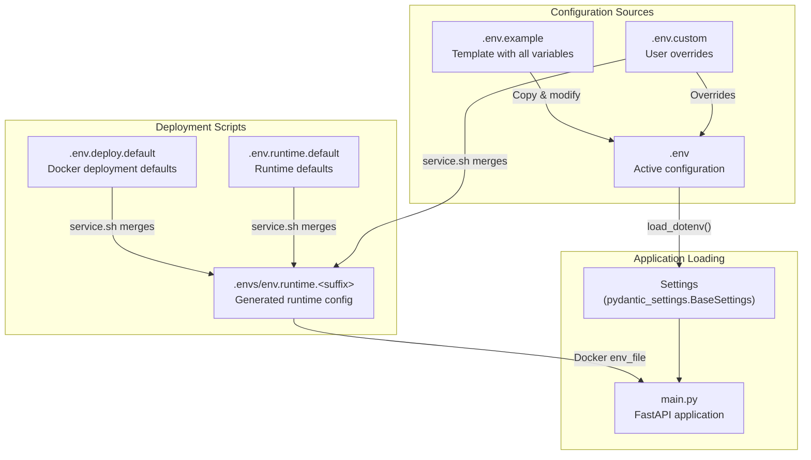

**Configuration Loading Order:**
1. **Local Development**: `.env.example` → `.env` (manually created) → `Settings` class loads via `load_dotenv()`
2. **Docker Deployment**: `.env.deploy.default` + `.env.runtime.default` + `.env.custom` → `service.sh` merges → `.envs/env.runtime.<suffix>` → Container environment

Sources: [.env.example:1-196](), [backend/openjiuwen_studio/core/config.py:1-105](), [backend/openjiuwen_studio/main.py:17-19](), [scripts/envfile_handler.sh:1-195]()

## Configuration Categories

| Category | Environment Variables | Configuration File Section |
|----------|----------------------|---------------------------|
| Frontend | `VITE_*`, `NODE_ENV`, `FRONTEND_PORT` | Lines 6-31 |
| Backend Server | `BACKEND_PORT`, `HOST`, `WORKER_NUM`, `DEBUG` | Lines 39-50 |
| Security | `SECRET_KEY`, `ALGORITHM`, `ACCESS_TOKEN_EXPIRE_MINUTES` | Lines 51-66 |
| Database | `DB_TYPE`, `DB_HOST`, `DB_PORT`, `DB_USER`, `DB_PASSWORD` | Lines 92-106 |
| Vector Store | `INDEX_MANAGER_TYPE`, `MILVUS_HOST`, `MILVUS_PORT` | Lines 135-144 |
| Object Storage | `MINIO_HOST`, `MINIO_PORT`, `MINIO_ACCESS_KEY` | Lines 108-114 |
| Redis | `ENABLE_REDIS_CHECKPOINT`, `REDIS_HOST`, `REDIS_PORT` | Lines 117-121 |
| Email/Auth | `SMTP_HOST`, `SMTP_USER`, `VITE_ENABLE_NEW_AUTH` | Lines 154-164 |
| Optional Services | `CODE_SANDBOX_URL`, `VITE_PLUGIN_SERVICE_URL` | Lines 74, 127 |

Sources: [.env.example:1-196]()

## Frontend Configuration

### Core Frontend Settings

| Variable | Default | Description |
|----------|---------|-------------|
| `NODE_ENV` | `development` | Node.js environment mode |
| `FRONTEND_PORT` | `3000` | Port for frontend service |
| `VITE_API_BASE_URL` | `/api/v1` | Backend API base URL for frontend |
| `VITE_API_PROXY_TARGET` | `http://localhost:8000/` | Proxy target for backend in development |
| `VITE_API_PROXY_TIMEOUT` | `300000` | API request timeout (milliseconds) |
| `VITE_API_PROMPT_LENGTH` | `8000` | Maximum prompt length in workflow components |

**Development vs Production:**

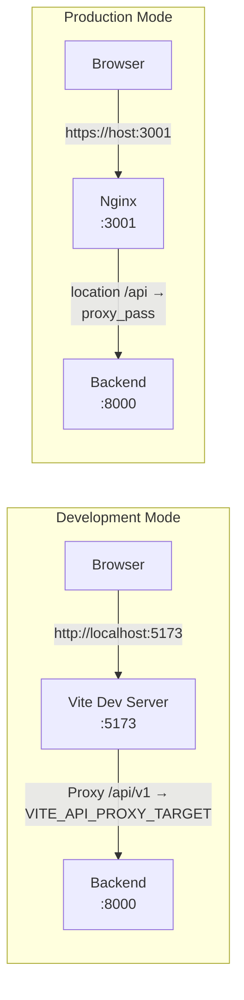

**Vite Proxy Configuration** (development only):
- `VITE_API_PROXY_CHANGE_ORIGIN=true` - Modifies the origin header
- `VITE_API_PROXY_SECURE=false` - Disables SSL verification
- `VITE_API_PROXY_REWRITE=/api` - Rewrites path prefix

Sources: [.env.example:6-31](), [scripts/conf/nginx.template.conf](), [scripts/vars_handler.sh:72-80]()

### Frontend Feature Flags

| Variable | Default | Description |
|----------|---------|-------------|
| `VITE_ENABLE_NEW_AUTH` | `false` | Enable registration/password management (vs simple login) |
| `VITE_PLUGIN_CONFIG_PATH` | `/config.json` | Path to plugin configuration file |
| `VITE_PLUGIN_SERVICE_URL` | `""` | External plugin service URL (empty = use Docker service) |
| `VITE_TOKEN_REFRESH_INTERVAL_SECONDS` | `600` | JWT token refresh interval |

Sources: [.env.example:64-66, 127-129, 164](), [backend/openjiuwen_studio/core/config.py:91]()

## Backend Configuration

### Server Settings

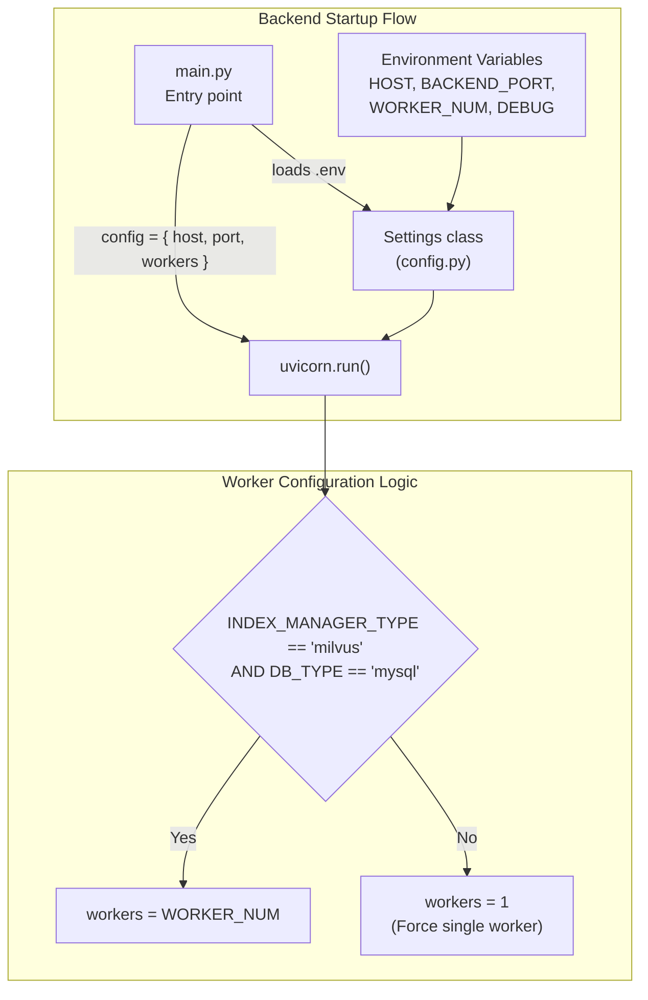

| Variable | Default | Description |
|----------|---------|-------------|
| `BACKEND_PORT` | `8000` | Backend service port |
| `HOST` | `0.0.0.0` | Host binding (0.0.0.0 = all interfaces) |
| `WORKER_NUM` | `1` | Number of Uvicorn workers (multi-worker requires MySQL + Milvus) |
| `DEBUG` | `false` | Debug mode (set to `false` for production) |

**Important Worker Limitation:**
Multi-worker mode (`WORKER_NUM > 1`) is only supported when both:
- `DB_TYPE=mysql` (SQLite does not support concurrent writes)
- `INDEX_MANAGER_TYPE=milvus` (Chroma embedded mode is single-process)

Sources: [.env.example:39-49](), [backend/openjiuwen_studio/main.py:247-258](), [backend/openjiuwen_studio/core/config.py:13-16]()

### Security Configuration

| Variable | Default | Production Requirement |
|----------|---------|----------------------|
| `SECRET_KEY` | `your-secret-key-change-in-production` | **MUST CHANGE** - Generate with: `python -c "import secrets; print(secrets.token_urlsafe(32))"` |
| `ALGORITHM` | `HS256` | Keep default (JWT signing algorithm) |
| `ACCESS_TOKEN_EXPIRE_MINUTES` | `2880` | 48 hours (adjust based on security policy) |
| `REFRESH_TOKEN_EXPIRE_DAYS` | `2` | 2 days (adjust based on security policy) |
| `ALLOWED_ORIGINS` | `["http://localhost:3000",...]` | Add your production domains |

**Service Mode and Encryption:**

| Variable | Values | Description |
|----------|--------|-------------|
| `SERVICE_MODE` | `develop` / `product` | Controls encryption key source |
| `SERVER_AES_MASTER_KEY` | 32-byte AES key | Used in `develop` mode for encrypting API keys |
| `SERVER_AES_MASTER_KEY_ENV` | Base64-encoded AES key | Used in `product` mode (not persisted to disk) |
| `LLM_SSL_VERIFY` | `True` / `False` | Enable SSL verification for LLM API calls |
| `RESTFUL_SSL_VERIFY` | `True` / `False` | Enable SSL verification for RESTful plugin calls |

**Encryption Key Generation:**
```bash
# Generate 32-byte (256-bit) AES key
python -c "import secrets; print(secrets.token_urlsafe(32))"
```

Sources: [.env.example:51-88](), [backend/openjiuwen_studio/core/config.py:52-61](), [backend/openjiuwen_studio/core/manager/model_manager/utils/security_utils.py]()

### CORS Configuration

The `ALLOWED_ORIGINS` variable accepts a JSON array of allowed origins for CORS:

```bash
# Development
ALLOWED_ORIGINS=["http://localhost:3000","http://127.0.0.1:3000"]

# Production - add your domains
ALLOWED_ORIGINS=["https://yourdomain.com","https://www.yourdomain.com"]
```

Sources: [.env.example:67-68](), [backend/openjiuwen_studio/main.py:226-232]()

## Database Configuration

### Database Type Selection

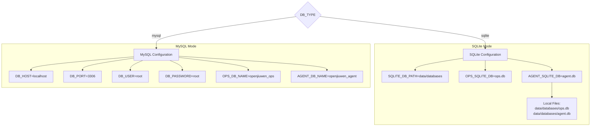

### SQLite Configuration (Default)

| Variable | Default | Description |
|----------|---------|-------------|
| `DB_TYPE` | `sqlite` | Database type selector |
| `SQLITE_DB_PATH` | `data/databases` | Directory for SQLite database files |
| `OPS_SQLITE_DB` | `ops.db` | Operations database filename |
| `AGENT_SQLITE_DB` | `agent.db` | Agent data database filename |

**SQLite Characteristics:**
- ✅ No external dependencies
- ✅ Simple setup for development
- ✅ Embedded vector store (Chroma) compatible
- ❌ Single-worker only (no concurrent writes)
- ❌ Limited scalability

Sources: [.env.example:93-106](), [backend/openjiuwen_studio/core/config.py:26-38]()

### MySQL Configuration

| Variable | Default | Description |
|----------|---------|-------------|
| `DB_TYPE` | `mysql` | Database type selector |
| `DB_HOST` | `localhost` | MySQL server hostname |
| `DB_PORT` | `3306` | MySQL server port |
| `DB_USER` | `root` | MySQL username |
| `DB_PASSWORD` | `root` | MySQL password |
| `OPS_DB_NAME` | `openjiuwen_ops` | Operations database name |
| `AGENT_DB_NAME` | `openjiuwen_agent` | Agent data database name |

**MySQL Characteristics:**
- ✅ Multi-worker support
- ✅ Production-ready scalability
- ✅ ACID transactions
- ✅ Better concurrent performance
- ❌ Requires external MySQL server (8.0+)

**Docker Deployment:** If `DB_HOST` is empty and `DB_TYPE=mysql`, the deployment script automatically starts a MySQL container.

Sources: [.env.example:92-102](), [scripts/vars_handler.sh:95-108](), [backend/openjiuwen_studio/core/config.py:26-35]()

### Database Connection String Construction

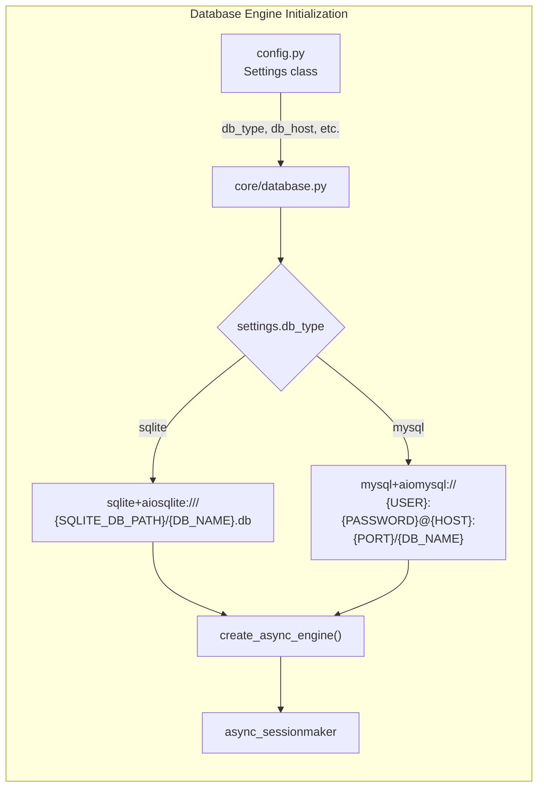

The connection URL is built dynamically based on `DB_TYPE`:

**SQLite URL Pattern:**
```
sqlite+aiosqlite:///{SQLITE_DB_PATH}/{AGENT_SQLITE_DB}
```

**MySQL URL Pattern:**
```
mysql+aiomysql://{DB_USER}:{DB_PASSWORD}@{DB_HOST}:{DB_PORT}/{AGENT_DB_NAME}
```

Sources: [backend/openjiuwen_studio/core/database.py](), [backend/openjiuwen_studio/core/config.py:26-38]()

### Database Schema Management

Database schemas are managed using **Alembic** migrations with separate migration trees for each database type and database:

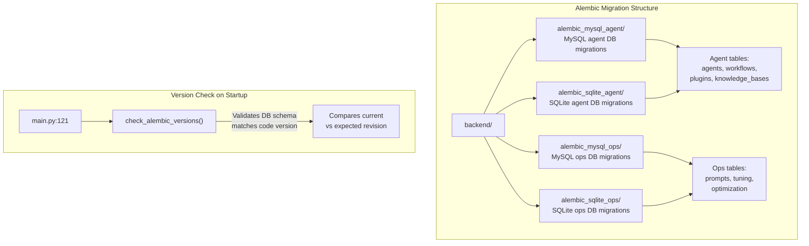

**Alembic Configuration Files:**
- MySQL Agent: `backend/alembic_mysql_agent/alembic.ini`
- MySQL Ops: `backend/alembic_mysql_ops/alembic.ini`
- SQLite Agent: `backend/alembic_sqlite_agent/alembic.ini`
- SQLite Ops: `backend/alembic_sqlite_ops/alembic.ini`

For migration management, see [Database Migrations](#6.2).

Sources: [backend/openjiuwen_studio/main.py:120-121](), [backend/openjiuwen_studio/core/alembic_version_check.py](), [scripts/global_vars.sh:207-223]()

## Vector Store Configuration

### Vector Store Type Selection

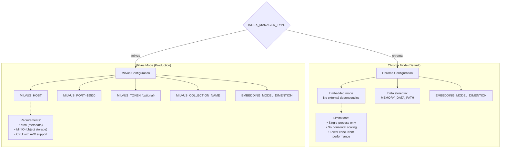

| Variable | Default | Description |
|----------|---------|-------------|
| `INDEX_MANAGER_TYPE` | `chroma` | Vector store type: `chroma` or `milvus` |
| `EMBEDDING_MODEL_DIMENTION` | `1024` | Vector dimension (must match embedding model) |
| `MEMORY_DATA_PATH` | `memory-data` | Path for vector data storage (relative path) |

Sources: [.env.example:135-148](), [backend/openjiuwen_studio/core/config.py]()

### Chroma Configuration (Embedded)

**Chroma** is the default vector store, running in embedded mode:

| Characteristic | Details |
|----------------|---------|
| Deployment | Embedded in backend process |
| Dependencies | None (built-in) |
| Data Location | `{MEMORY_DATA_PATH}/` directory |
| Scalability | Single-process only |
| Best For | Development, small deployments, simple setups |

**No additional configuration required** - Chroma works out of the box.

Sources: [.env.example:136]()

### Milvus Configuration (Distributed)

**Milvus** is a production-grade distributed vector database:

| Variable | Default | Description |
|----------|---------|-------------|
| `MILVUS_HOST` | `jiuwen-milvus-standalone` | Milvus server hostname |
| `MILVUS_PORT` | `19530` | Milvus gRPC port |
| `MILVUS_TOKEN` | `""` | Authentication token (optional) |
| `MILVUS_COLLECTION_NAME` | `memory_vector` | Collection name for vectors |

**Milvus Dependencies:**
- **etcd**: Metadata storage and service discovery
- **MinIO**: Object storage for vector data
- **CPU Requirement**: AVX instruction set (check with `lscpu | grep avx`)

**Docker Deployment:** If `MILVUS_HOST` is empty and `INDEX_MANAGER_TYPE=milvus`, the deployment script automatically starts:
- etcd container
- MinIO container
- Milvus standalone container

Sources: [.env.example:138-143](), [scripts/vars_handler.sh:109-125](), [docs/en/2.Installation Guide/Install via Docker/Linux_Installation.md:105]()

### Embedding Model Dimension

The `EMBEDDING_MODEL_DIMENTION` must match your embedding model's output dimension:

| Common Embedding Models | Dimension |
|------------------------|-----------|
| BGE-M3 | 1024 |
| OpenAI text-embedding-ada-002 | 1536 |
| OpenAI text-embedding-3-small | 1536 |
| OpenAI text-embedding-3-large | 3072 |

**Important:** Changing this value requires recreating all vector collections.

Sources: [.env.example:143]()

## Object Storage Configuration

### MinIO Configuration

MinIO is used for storing uploaded documents, knowledge base files, and other binary data:

| Variable | Default | Description |
|----------|---------|-------------|
| `MINIO_HOST` | `localhost` | MinIO server hostname |
| `MINIO_PORT` | `9000` | MinIO service port |
| `MINIO_ACCESS_KEY` | `minioadmin` | MinIO access key (like AWS_ACCESS_KEY_ID) |
| `MINIO_SECRET_KEY` | `minioadmin` | MinIO secret key (like AWS_SECRET_ACCESS_KEY) |
| `MINIO_SECURE` | `False` | Use HTTPS (set to `True` for production) |
| `MINIO_BUCKET` | `jiuwen-bucket` | Default bucket name |

**Docker Deployment:** If `MINIO_HOST` is empty, the deployment script automatically starts a MinIO container with a management console accessible at port 9001.

Sources: [.env.example:108-114](), [backend/openjiuwen_studio/core/config.py:40-46](), [scripts/vars_handler.sh:109-125]()

### Huawei Cloud OBS Configuration (Alternative)

For Huawei Cloud deployments, you can use OBS instead of MinIO:

| Variable | Description |
|----------|-------------|
| `OBS_ACCESS_KEY_ID` | OBS access key |
| `OBS_SECRET_ACCESS_KEY` | OBS secret key |
| `OBS_SERVER` | OBS endpoint URL |
| `OBS_BUCKET` | OBS bucket name |

**Note:** When OBS variables are configured, they take precedence over MinIO configuration.

Sources: [.env.example:192-196](), [backend/pyproject.toml:19]()

## Redis Configuration

Redis is used for checkpointing workflow execution state and caching:

| Variable | Default | Description |
|----------|---------|-------------|
| `ENABLE_REDIS_CHECKPOINT` | `False` | Enable Redis-based workflow checkpointing |
| `REDIS_HOST` | `localhost` | Redis server hostname |
| `REDIS_PORT` | `6379` | Redis server port |
| `REDIS_DB` | `0` | Redis database number (0-15) |
| `REDIS_PASSWORD` | `""` | Redis password (empty = no auth) |

**Redis URL Construction:**
```python
# Without password
redis://localhost:6379/0

# With password
redis://:password@localhost:6379/0
```

**Checkpointing Feature:**
When `ENABLE_REDIS_CHECKPOINT=True`, workflow execution states are persisted to Redis, enabling:
- Resume from interruption
- Workflow state inspection
- Debugging long-running workflows

Sources: [.env.example:117-121](), [backend/openjiuwen_studio/core/config.py:69-81](), [backend/openjiuwen_studio/main.py:128-138]()

## Email and Authentication Configuration

### SMTP Configuration

Configure email sending for password reset and verification codes:

| Variable | Default | Description |
|----------|---------|-------------|
| `SMTP_HOST` | `""` | SMTP server hostname (e.g., smtp.gmail.com) |
| `SMTP_PORT` | `465` | SMTP port (465 for SSL, 587 for TLS) |
| `SMTP_USER` | `""` | SMTP username / email address |
| `SMTP_PASSWORD` | `""` | SMTP password or app-specific password |
| `SMTP_ALIAS` | `openJiuwen` | Sender display name |

**Email Templates:**
The system includes built-in HTML templates for:
- Registration verification codes (10-minute validity)
- Password reset codes (10-minute validity)

Sources: [.env.example:154-159](), [backend/openjiuwen_studio/core/manager/email_manager/email_utils.py:1-67](), [backend/openjiuwen_studio/core/manager/email_manager/email_template.py:1-86]()

### Authentication Mode

| Variable | Default | Description |
|----------|---------|-------------|
| `VITE_ENABLE_NEW_AUTH` | `False` | Enable full authentication system |

**Authentication Modes:**

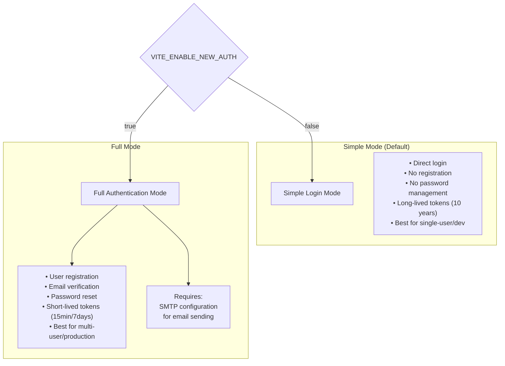

**Token Expiration by Mode:**

| Mode | Access Token | Refresh Token |
|------|-------------|---------------|
| Simple (`false`) | 10 years | 10 years |
| Full (`true`) | 15 minutes | 7 days |

Sources: [.env.example:162-164](), [backend/openjiuwen_studio/core/config.py:55-61, 91]()

## Optional Services Configuration

### Plugin Service

| Variable | Default | Description |
|----------|---------|-------------|
| `VITE_PLUGIN_SERVICE_URL` | `""` | External plugin service URL |
| `VITE_PLUGIN_CONFIG_PATH` | `/config.json` | Plugin configuration file path |

**Deployment Behavior:**
- If `VITE_PLUGIN_SERVICE_URL` is empty → Docker deployment starts plugin-server container
- If URL is provided → Uses external plugin service

Sources: [.env.example:127-129](), [scripts/vars_handler.sh:126-136]()

### Code Sandbox

| Variable | Default | Description |
|----------|---------|-------------|
| `CODE_SANDBOX_URL` | `""` | Sandbox gateway URL |
| `RESTFUL_SSL_VERIFY` | `False` | SSL verification for plugin REST calls |
| `RESTFUL_SSL_CERT` | `False` | Custom SSL certificate path |

**Deployment Behavior:**
- If `CODE_SANDBOX_URL` is empty → Docker deployment starts sandbox-gateway, python-server, and js-server containers
- If URL is provided → Uses external sandbox service

Sources: [.env.example:74, 132-133](), [scripts/vars_handler.sh:137-154]()

### DeepSearch Integration

| Variable | Default | Description |
|----------|---------|-------------|
| `DEEPSEARCH_AGENT_HOST` | `localhost` | DeepSearch agent hostname |
| `DEEPSEARCH_AGENT_PORT` | `6000` | DeepSearch agent port |

**Deployment Behavior:**
- If `DEEPSEARCH_AGENT_HOST` is empty → Docker deployment starts deepsearch container
- If host is provided → Uses external DeepSearch service

Sources: [.env.example:151-152](), [scripts/vars_handler.sh:167-176](), [scripts/template_handler.sh:74-94]()

## Advanced Configuration

### Workflow Configuration

| Variable | Default | Description |
|----------|---------|-------------|
| `WORKFLOW_EXECUTE_TIMEOUT` | `300` | Workflow execution timeout (seconds) |
| `FORCE_DEL_WORKFLOW_STATE` | `True` | Force delete workflow state on completion |

Sources: [.env.example:85-86, 145]()

### Security and Compliance

| Variable | Default | Description |
|----------|---------|-------------|
| `IS_SENSITIVE` | `False` | Enable sensitive data handling mode |
| `SSRF_PROTECT_ENABLED` | `False` | Enable SSRF (Server-Side Request Forgery) protection |
| `SYSTEM_ADMIN_TOKEN` | `""` | System administrator token for privileged operations |

Sources: [.env.example:86-87, 172]()

### Legacy Database Sync

| Variable | Default | Description |
|----------|---------|-------------|
| `AUTO_SYNC_DB` | `False` | Run legacy DB sync on startup (deprecated) |

**Warning:** Keep this `False`. Use Alembic migrations instead. See [Database Migrations](#6.2).

Sources: [.env.example:169]()

### Huawei Cloud KMS Integration

For advanced secret protection using Huawei Cloud Key Management Service:

| Variable | Description |
|----------|-------------|
| `HUAWEICLOUD_KMS_ENABLED` | Enable KMS-based encryption |
| `HUAWEICLOUD_USERNAME` | IAM username |
| `HUAWEICLOUD_DOMAIN_NAME` | Domain name |
| `HUAWEICLOUD_IAM_ENDPOINT` | IAM endpoint URL |
| `HUAWEICLOUD_PROJECT_NAME` | Project name (e.g., ap-southeast-1) |
| `HUAWEICLOUD_PROJECT_ID` | Project ID |
| `HUAWEICLOUD_REGION` | Region code |
| `HUAWEICLOUD_KMS_KEY_ID` | KMS key ID for encryption |
| `HUAWEICLOUD_KMS_ENDPOINT` | KMS endpoint URL |
| `ENCRYPTED_ROOT_KEY` | Encrypted root key |
| `HUAWEICLOUD_KMS_ENCRYPTION_ALGORITHM` | Encryption algorithm (default: RSAES_OAEP_SHA_256) |

Sources: [.env.example:174-190]()

## Configuration Validation

### Validation Rules

The system validates configuration on startup. Key validation rules include:

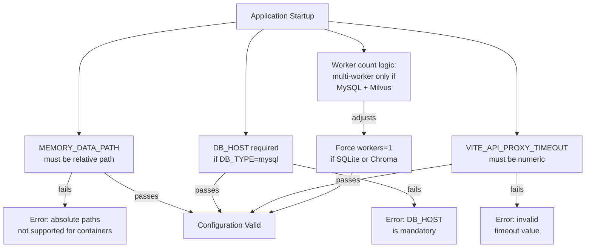

**Validation Functions:**
- Path validation: [scripts/vars_handler.sh:49-63]()
- Timeout validation: [scripts/vars_handler.sh:73-76]()
- Worker validation: [backend/openjiuwen_studio/main.py:255-257]()

Sources: [scripts/vars_handler.sh:49-72](), [backend/openjiuwen_studio/main.py:247-258]()

### Configuration Precedence

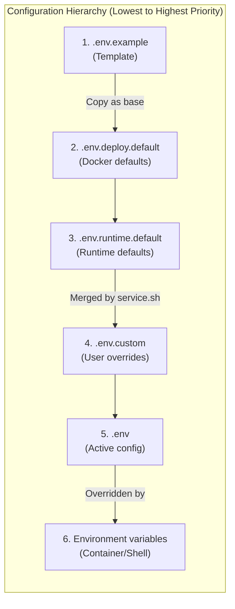

**Override Strategy:**
1. Start with template defaults from `.env.example`
2. Apply deployment defaults from `.env.deploy.default`
3. Apply runtime defaults from `.env.runtime.default`
4. Apply user customizations from `.env.custom`
5. Environment variables (set directly in shell or Docker) override all file-based settings

Sources: [scripts/envfile_handler.sh:46-106](), [backend/openjiuwen_studio/main.py:17-19]()

## Docker Deployment Environment Generation

### Environment File Generation Process

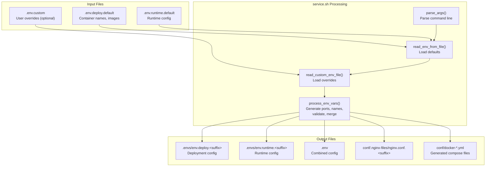

**Key Functions:**
- Argument parsing: [scripts/args_handler.sh:5-71]()
- Environment file reading: [scripts/envfile_handler.sh:110-155]()
- Custom environment merging: [scripts/envfile_handler.sh:46-106]()
- Variable processing: [scripts/vars_handler.sh:66-81]()
- File generation: [scripts/envfile_handler.sh:6-28]()

Sources: [scripts/service.sh:28-36](), [scripts/envfile_handler.sh:1-195](), [scripts/vars_handler.sh:1-179]()

### Instance ID and Naming

Each deployment generates a unique **instance ID** (5-character random suffix) used to:
- Prevent naming conflicts between multiple deployments
- Isolate Docker containers, volumes, and networks
- Track configuration files

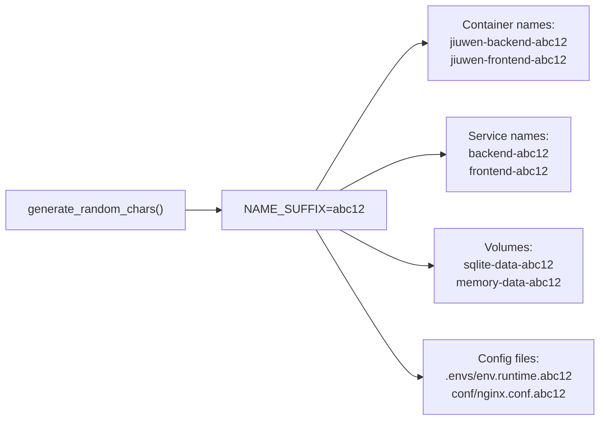

**Name Generation:** [scripts/vars_handler.sh:5-15]()
**Name Application:** [scripts/global_vars.sh:27-61]()

Sources: [scripts/vars_handler.sh:5-15](), [scripts/global_vars.sh:1-224]()

### Port Allocation

The deployment script automatically allocates available ports to avoid conflicts:

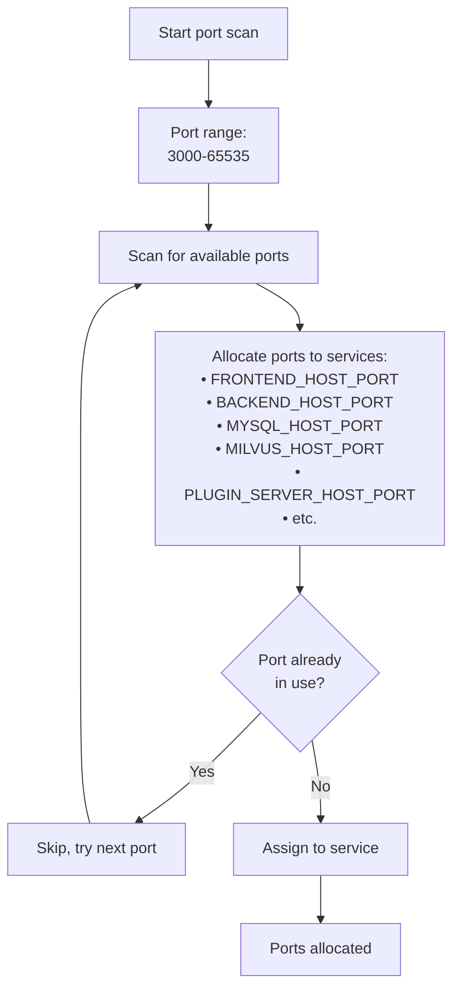

**Port allocation logic:** [scripts/ports_handler.sh]()

Sources: [scripts/global_vars.sh:64-78](), [scripts/ports_handler.sh]()

## Troubleshooting Configuration Issues

### Common Configuration Errors

| Error | Cause | Solution |
|-------|-------|----------|
| "DB_HOST is mandatory" | `DB_TYPE=mysql` but `DB_HOST` empty | Set `DB_HOST` in `.env.custom` or leave empty to auto-start MySQL container |
| "MEMORY_DATA_PATH only supports relative paths" | Absolute path used for `MEMORY_DATA_PATH` | Change to relative path (e.g., `memory-data`) |
| "Invalid timeout value" | `VITE_API_PROXY_TIMEOUT` not numeric | Set to numeric value in milliseconds (e.g., `300000`) |
| Multi-worker not starting | Using SQLite or Chroma | Switch to MySQL + Milvus, or accept single-worker limitation |
| Milvus exits immediately | CPU lacks AVX instruction set | Check with `lscpu \| grep avx`, consider using Chroma instead |

Sources: [scripts/vars_handler.sh:49-72](), [docs/en/2.Installation Guide/Install via Docker/Linux_Installation.md:105]()

### Configuration Verification

**Verify Active Configuration:**
```bash
# View current environment file
cat .env

# For Docker deployments, view generated runtime config
cat .envs/env.runtime.<suffix>

# Check backend configuration loading
docker logs jiuwen-backend-<suffix> | grep "Starting Jiuwen"
```

**Test Database Connection:**
```bash
# MySQL
docker exec jiuwen-backend-<suffix> python -c "
from openjiuwen_studio.core.database import get_db_session
import asyncio
async def test():
    async with get_db_session() as db:
        print('Database connection successful')
asyncio.run(test())
"

# SQLite - check file exists
ls -lh data/databases/agent.db
```

**Test Vector Store Connection:**
```bash
# Milvus
docker exec jiuwen-milvus-standalone healthcheck

# Chroma - check memory data directory
ls -lh memory-data/
```

Sources: [backend/openjiuwen_studio/core/database.py]()

### Configuration Debugging

Enable debug logging to troubleshoot configuration issues:

```bash
# In .env or .env.custom
DEBUG=true
LOG_LEVEL=DEBUG
```

**Log Locations:**
- Docker deployment: `log-dirs/logs-<suffix>/server/`
- Local development: `backend/logs/`

Sources: [.env.example:48](), [backend/openjiuwen_studio/main.py:253]()

## Configuration Best Practices

### Development Environment

```bash
# .env for local development
DB_TYPE=sqlite
INDEX_MANAGER_TYPE=chroma
DEBUG=true
VITE_ENABLE_NEW_AUTH=false
WORKER_NUM=1
```

**Characteristics:**
- ✅ No external dependencies
- ✅ Fast startup
- ✅ Easy to reset (delete SQLite files)
- ❌ No concurrent access testing

### Production Environment

```bash
# .env.custom for Docker production
DB_TYPE=mysql
DB_HOST=  # Empty = auto-start MySQL container
INDEX_MANAGER_TYPE=milvus
MILVUS_HOST=  # Empty = auto-start Milvus
DEBUG=false
SECRET_KEY=<generate-with-secrets.token_urlsafe>
VITE_ENABLE_NEW_AUTH=true
SMTP_HOST=smtp.yourprovider.com
SMTP_USER=noreply@yourdomain.com
SMTP_PASSWORD=<your-smtp-password>
WORKER_NUM=4
```

**Characteristics:**
- ✅ Multi-worker support
- ✅ Horizontal scalability
- ✅ Production-grade vector search
- ✅ Full authentication system
- ⚠️ Requires more resources

### Security Checklist

- [ ] Change `SECRET_KEY` from default value
- [ ] Use strong database passwords
- [ ] Enable SSL for production (`MINIO_SECURE=True`)
- [ ] Configure CORS to specific domains only
- [ ] Use `SERVICE_MODE=product` with `SERVER_AES_MASTER_KEY_ENV`
- [ ] Enable SSL verification (`LLM_SSL_VERIFY=True`, `RESTFUL_SSL_VERIFY=True`)
- [ ] Secure Redis with password if exposed
- [ ] Use short token expiration times (`VITE_ENABLE_NEW_AUTH=true`)

Sources: [.env.example:51-88]()

---

**Related Pages:**
- For installation procedures, see [Docker Installation](#2.1) and [Local Development Setup](#2.2)
- For production deployment, see [Production Configuration](#7.2)
- For database migration management, see [Database Migrations](#6.2)
- For overall architecture, see [System Architecture](#5.1)

---

