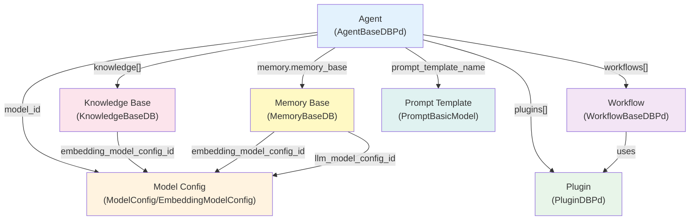
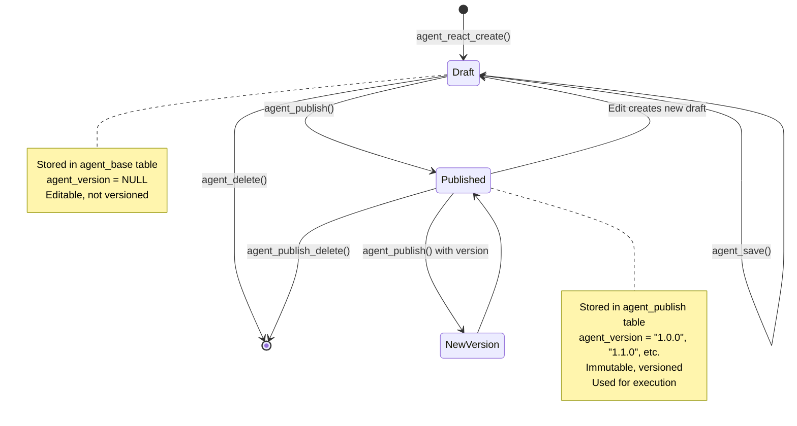
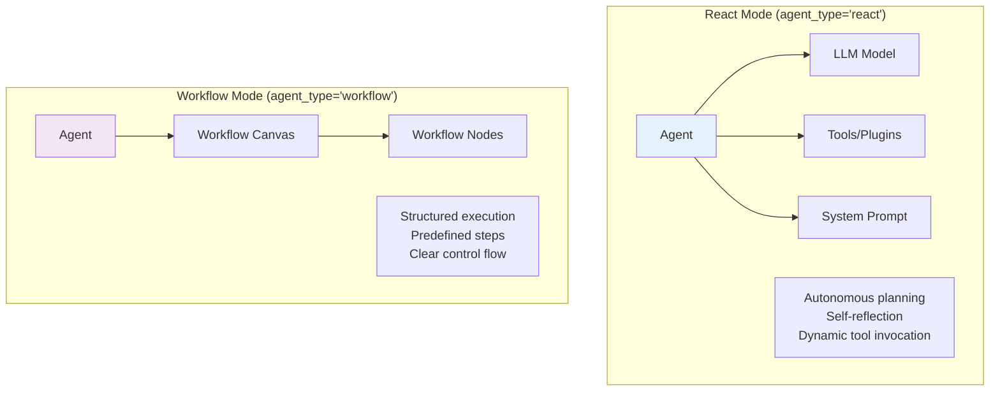
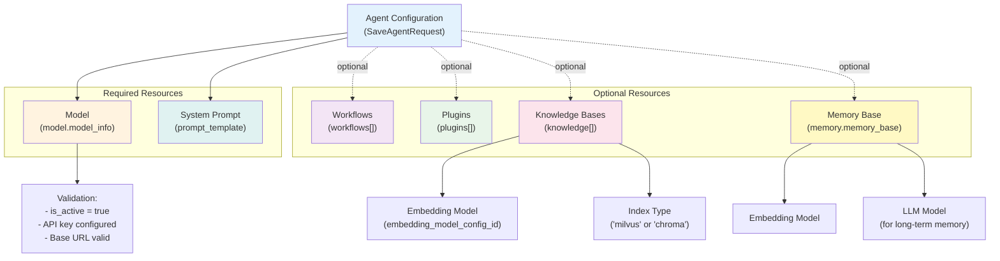
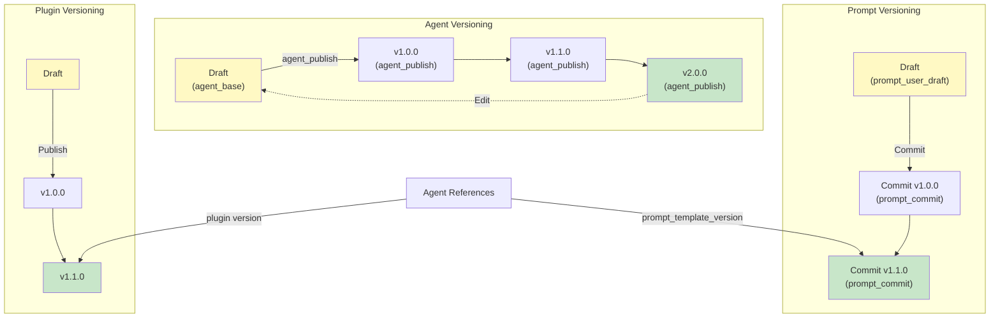
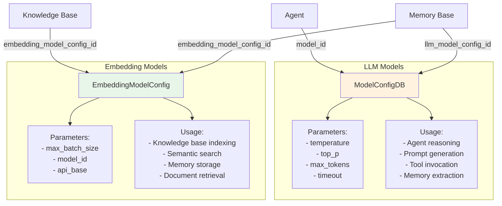
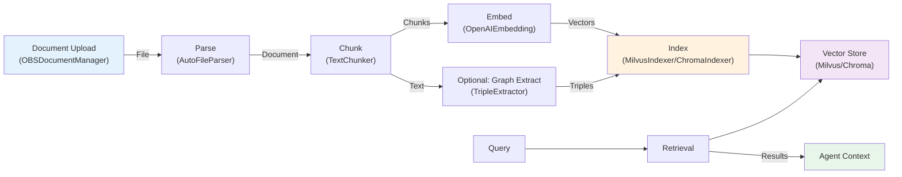
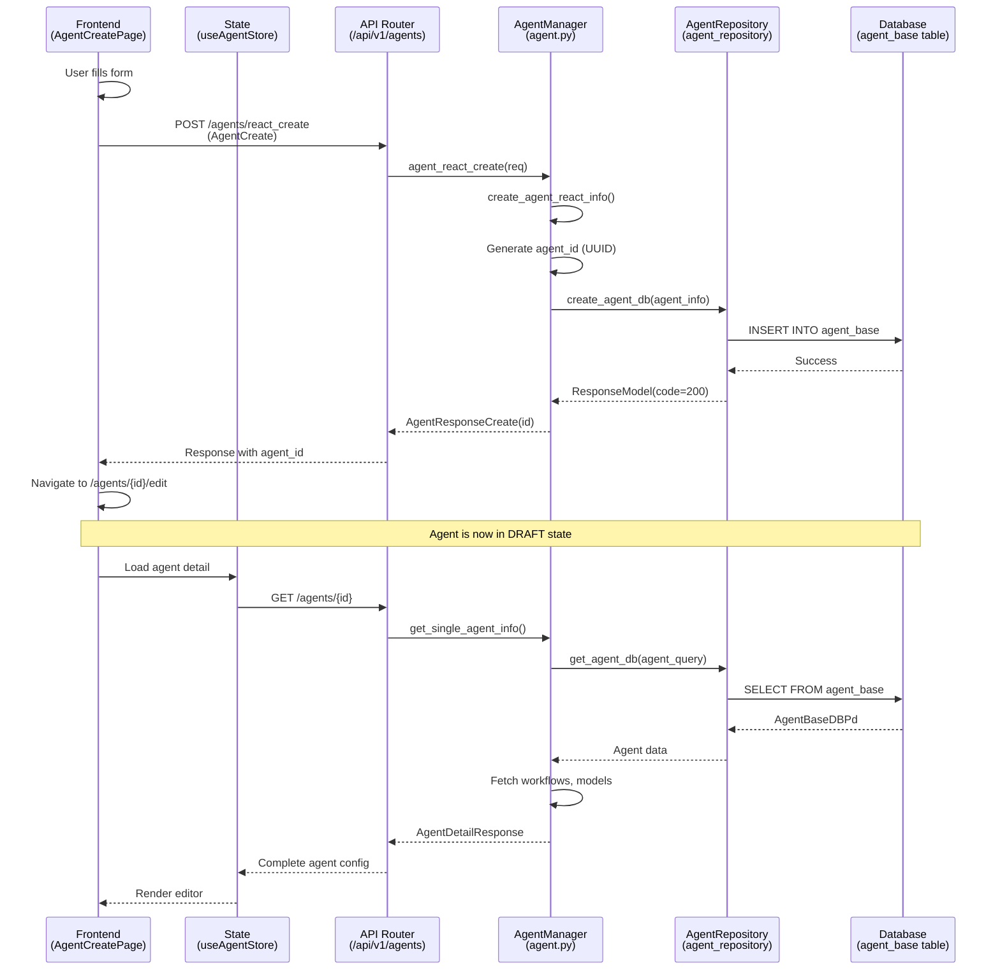
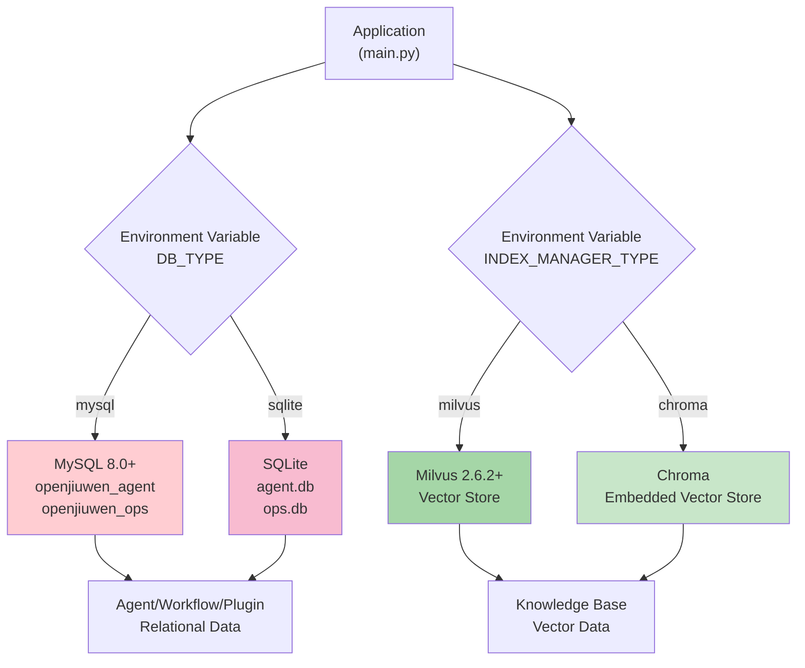

<!-- source: DeepWiki mcp.deepwiki.com · repo openJiuwen-ai/agent-studio · page 3 Core Concepts · fetched 2026-11-02 -->

# Core Concepts

<details>
<summary>Relevant source files</summary>

The following files were used as context for generating this wiki page:

- [backend/openjiuwen_studio/core/manager/agent.py](backend/openjiuwen_studio/core/manager/agent.py)
- [backend/openjiuwen_studio/core/manager/convertor/agent.py](backend/openjiuwen_studio/core/manager/convertor/agent.py)
- [backend/openjiuwen_studio/core/manager/knowledge_base.py](backend/openjiuwen_studio/core/manager/knowledge_base.py)
- [backend/openjiuwen_studio/core/manager/model_manager/managers/embedding_model_test_manager.py](backend/openjiuwen_studio/core/manager/model_manager/managers/embedding_model_test_manager.py)
- [backend/openjiuwen_studio/core/manager/repositories/agent_repository.py](backend/openjiuwen_studio/core/manager/repositories/agent_repository.py)
- [backend/openjiuwen_studio/core/manager/repositories/plugin_repository.py](backend/openjiuwen_studio/core/manager/repositories/plugin_repository.py)
- [backend/openjiuwen_studio/core/manager/repositories/tool_repository.py](backend/openjiuwen_studio/core/manager/repositories/tool_repository.py)
- [backend/openjiuwen_studio/routers/agents.py](backend/openjiuwen_studio/routers/agents.py)
- [backend/openjiuwen_studio/routers/embedding_models.py](backend/openjiuwen_studio/routers/embedding_models.py)
- [backend/openjiuwen_studio/schemas/agent.py](backend/openjiuwen_studio/schemas/agent.py)
- [frontend/packages/api-client/src/config.ts](frontend/packages/api-client/src/config.ts)
- [frontend/packages/api-client/src/services/agentService.ts](frontend/packages/api-client/src/services/agentService.ts)
- [frontend/src/components/Agent/AgentModelSelector.tsx](frontend/src/components/Agent/AgentModelSelector.tsx)
- [frontend/src/components/Agent/OverridePromptTemplateDialog.tsx](frontend/src/components/Agent/OverridePromptTemplateDialog.tsx)
- [frontend/src/locales/agent/en-US/common.json](frontend/src/locales/agent/en-US/common.json)
- [frontend/src/locales/agent/en-US/editor.json](frontend/src/locales/agent/en-US/editor.json)
- [frontend/src/locales/agent/zh-CN/common.json](frontend/src/locales/agent/zh-CN/common.json)
- [frontend/src/locales/agent/zh-CN/editor.json](frontend/src/locales/agent/zh-CN/editor.json)
- [frontend/src/locales/en-US.json](frontend/src/locales/en-US.json)
- [frontend/src/locales/zh-CN.json](frontend/src/locales/zh-CN.json)
- [frontend/src/pages/Agents/AgentCreatePage.tsx](frontend/src/pages/Agents/AgentCreatePage.tsx)
- [frontend/src/pages/Agents/AgentEditorEditPage.tsx](frontend/src/pages/Agents/AgentEditorEditPage.tsx)
- [frontend/src/pages/Agents/AgentsPage.tsx](frontend/src/pages/Agents/AgentsPage.tsx)
- [frontend/src/pages/Auth/PrivacyPolicyPage.tsx](frontend/src/pages/Auth/PrivacyPolicyPage.tsx)
- [frontend/src/pages/Auth/UserLoginPage.tsx](frontend/src/pages/Auth/UserLoginPage.tsx)
- [frontend/src/pages/KnowledgeBase/components/AddDocumentDialog.tsx](frontend/src/pages/KnowledgeBase/components/AddDocumentDialog.tsx)
- [frontend/src/pages/KnowledgeBase/components/KnowledgeBaseFormDialog.tsx](frontend/src/pages/KnowledgeBase/components/KnowledgeBaseFormDialog.tsx)
- [frontend/src/pages/Models/ModelsPage.tsx](frontend/src/pages/Models/ModelsPage.tsx)
- [frontend/src/pages/Models/ModelsPageNew.tsx](frontend/src/pages/Models/ModelsPageNew.tsx)
- [frontend/src/pages/Models/components/EmbeddingModelsTable.tsx](frontend/src/pages/Models/components/EmbeddingModelsTable.tsx)
- [frontend/src/pages/Models/components/LLMModelsTable.tsx](frontend/src/pages/Models/components/LLMModelsTable.tsx)

</details>


This page introduces the fundamental concepts and terminology used throughout the OpenJiuwen Agent Studio platform. Understanding these concepts is essential for working with the system, whether you are creating agents, designing workflows, or integrating external services.

For detailed information about specific concepts, refer to the child pages: [Agents](#3.1), [Workflows](#3.2), [Prompts & Templates](#3.3), [Models](#3.4), [Knowledge Bases](#3.5), [Plugins & Tools](#3.6), and [Memory Systems](#3.7). For system architecture details, see [Architecture](#5).

---

## System Overview

OpenJiuwen Agent Studio is an AI agent development platform built around several interconnected concepts that work together to create intelligent, autonomous systems.

### Core Entity Relationships



**Key Relationships:**
- **Agent** is the central entity that orchestrates all other components
- **Models** provide LLM inference and embedding capabilities
- **Workflows** define structured execution paths
- **Plugins** extend agent capabilities with external tools
- **Knowledge Bases** provide retrieval-augmented generation (RAG)
- **Memory** maintains state and context across interactions
- **Prompts** define agent behavior and personality

Sources: [backend/openjiuwen_studio/models/agent.py:1-100](), [backend/openjiuwen_studio/schemas/agent.py:1-150](), [backend/openjiuwen_studio/core/manager/agent.py:1-100]()

---

## Agent Lifecycle and States

Agents in the system follow a structured lifecycle with distinct states for development and deployment.

### Agent State Diagram



**State Descriptions:**

| State | Database Table | Version Field | Mutability | Purpose |
|-------|---------------|---------------|------------|---------|
| **Draft** | `agent_base` | `NULL` or empty | Mutable | Active development and editing |
| **Published** | `agent_publish` | Semantic version (e.g., "1.0.0") | Immutable | Stable execution and deployment |

**Key Operations:**
- `agent_react_create()` - Creates new agent in draft state
- `agent_save()` - Updates draft agent configuration
- `agent_publish()` - Promotes draft to published version
- `agent_delete()` - Removes agent and all versions
- `agent_publish_delete()` - Removes specific published version

Sources: [backend/openjiuwen_studio/core/manager/agent.py:329-436](), [backend/openjiuwen_studio/models/agent.py:1-50](), [backend/openjiuwen_studio/core/manager/repositories/agent_repository.py:1-100]()

---

## Agent Types and Modes

Agents can operate in two distinct modes, each suited for different use cases.

### Agent Mode Comparison



| Aspect | React Mode | Workflow Mode |
|--------|-----------|---------------|
| **Identifier** | `agent_type: "react"` | `agent_type: "workflow"` |
| **Execution** | LLM-driven autonomous planning | Predefined workflow graph |
| **Control Flow** | Model decides next steps | Fixed node connections |
| **Flexibility** | High - adapts to context | Structured - follows design |
| **Use Cases** | Complex reasoning, open-ended tasks | Predictable processes, business logic |
| **Configuration** | System prompt + tools + constraints | Workflow canvas + node configuration |

**Conversion Process:**

When an agent executes, it undergoes conversion from display format to executable DSL:
- `react_agent_convert()` - Converts React mode agent to DSL
- `workflow_agent_convert()` - Converts Workflow mode agent to DSL

Sources: [backend/openjiuwen_studio/core/manager/convertor/agent.py:1-100](), [frontend/src/locales/agent/en-US/editor.json:4-14](), [backend/openjiuwen_studio/core/common/dsl.py:1-50]()

---

## Resource Dependencies and Configuration

Agents depend on multiple resources that must be properly configured before execution.

### Resource Dependency Graph



**Configuration Structure:**

The `SaveAgentRequest` schema defines agent configuration:

```
SaveAgentRequest
├── model: ModelConfig
│   ├── model_provider: str
│   └── model_info: ModelDetail
│       ├── model_id: str
│       ├── model_name: str
│       ├── temperature: float
│       ├── top_p: float
│       └── timeout: int
├── prompt_template: str
├── workflows: List[WorkflowDetail]
├── plugins: List[AgentPlugin]
├── knowledge: List[KnowledgeBaseConfig]
├── memory: MemoryConfig
│   ├── memory_base: MemoryBaseItem
│   ├── variables: List[MemoryVariable]
│   └── long_term_memory_enabled: bool
└── configs: Dict[str, Any]
```

Sources: [backend/openjiuwen_studio/schemas/agent.py:50-150](), [frontend/src/types/agentTypes.ts:1-100](), [backend/openjiuwen_studio/core/manager/agent.py:614-710]()

---

## Version Management System

The platform implements comprehensive version control for agents, prompts, and plugins.

### Version Control Architecture



**Version Format:**

All versions follow semantic versioning (SemVer): `MAJOR.MINOR.PATCH`
- **MAJOR** - Incompatible API changes
- **MINOR** - Backward-compatible functionality additions
- **PATCH** - Backward-compatible bug fixes

**Version Storage:**

| Entity | Draft Table | Publish Table | Version Field |
|--------|-------------|---------------|---------------|
| Agent | `agent_base` | `agent_publish` | `agent_version` |
| Prompt | `prompt_user_draft` | `prompt_commit` | `version` |
| Plugin | `plugin` (draft flag) | `plugin` (published) | `version` |
| Workflow | `workflow` (version NULL) | `workflow` (version set) | `workflow_version` |

Sources: [backend/openjiuwen_studio/models/agent.py:1-100](), [backend/openjiuwen_studio/ops/modules/prompt/infra/repositories/orm_repo.py:1-100](), [backend/openjiuwen_studio/core/manager/utils/utils.py:1-50]()

---

## Model Configuration and Types

The system supports two types of models, each serving different purposes in the AI pipeline.

### Model Type Architecture



**Model Provider Support:**

The system supports multiple model providers through a unified interface:

| Provider | Identifier | LLM Support | Embedding Support |
|----------|-----------|-------------|-------------------|
| OpenAI | `ModelProvider.OPENAI` | ✓ | ✓ |
| Anthropic | `ModelProvider.ANTHROPIC` | ✓ | ✗ |
| Azure | `ModelProvider.AZURE` | ✓ | ✓ |
| Huawei | `ModelProvider.HUAWEI` | ✓ | ✓ |
| Custom | Provider-specific | ✓ | ✓ |

**Configuration Storage:**

Model configurations include encrypted API keys:
- `api_key` - Encrypted using `SecurityUtils.encrypt_api_key()`
- Decryption occurs at runtime: `SecurityUtils.decrypt_api_key()`
- Base URL and timeout settings per model
- Active/inactive status (`is_active` flag)

Sources: [frontend/src/pages/Models/ModelsPage.tsx:1-100](), [backend/openjiuwen_studio/core/manager/model_manager/managers.py:1-100](), [backend/openjiuwen_studio/models/embedding_model_config.py:1-50]()

---

## Knowledge Base and RAG Pipeline

Knowledge bases provide retrieval-augmented generation through document processing, indexing, and retrieval.

### Knowledge Base Processing Pipeline



**Processing Stages:**

1. **Upload** - Documents stored in MinIO/OBS via `OBSDocumentManager`
2. **Parse** - File format detection and content extraction via `AutoFileParser`
3. **Chunk** - Text segmentation using token or semantic strategies
4. **Embed** - Vector generation using configured embedding model
5. **Index** - Vector storage in Milvus or Chroma
6. **Graph** (Optional) - Entity-relation extraction for graph-enhanced retrieval

**Retrieval Configuration:**

Knowledge bases support multiple retrieval strategies:

```
KBRetrievalConfig
├── graph_retrieval_strategy: "base" | "agentic"
├── enable_graph_retrieval: bool
├── retrieval_source: "hybrid" | "text" | "triple"
├── max_recall_count: int (default: 5)
└── min_match_score: float (default: 0.5)
```

Sources: [backend/openjiuwen_studio/core/manager/knowledge_base.py:86-186](), [frontend/src/pages/KnowledgeBase/components/AddDocumentDialog.tsx:1-100](), [backend/openjiuwen_studio/schemas/knowledge_base.py:1-100]()

---

## Plugin and Tool System

Plugins extend agent capabilities by providing access to external APIs and code execution environments.

### Plugin Type Architecture

```mermaid
graph TB
    Plugin["Plugin<br/>(PluginDBPd)"]
    
    subgraph URLPlugin["URL-Based Plugin"]
        API["API Endpoint"]
        Method["HTTP Method"]
        Params["Parameters"]
        
        API --> Request["HTTP Request"]
        Method --> Request
        Params --> Request
    end
    
    subgraph CodePlugin["Code-Based Plugin"]
        Lang["Language<br/>(Python/JavaScript)"]
        Code["Code Content"]
        Sandbox["Sandbox Environment"]
        
        Lang --> Exec["Execution"]
        Code --> Exec
        Sandbox --> Exec
    end
    
    Plugin -->|plugin_type: "url"| URLPlugin
    Plugin -->|plugin_type: "code"| CodePlugin
    
    Agent["Agent"] -->|plugins[]| Plugin
    Workflow["Workflow"] -->|tool nodes| Plugin
    
    Tool["Tool<br/>(tool table)"]
    Plugin --> Tool
    
    style Plugin fill:#e8f5e9
    style URLPlugin fill:#fff3e0
    style CodePlugin fill:#f3e5f5
```

**Plugin Configuration:**

URL-based plugins define API specifications:

```
PluginApiInfo
├── api_name: str
├── api_url: str
├── http_method: "GET" | "POST" | "PUT" | "DELETE"
├── headers: Dict[str, str]
├── query_params: List[ParamDefinition]
├── body_params: List[ParamDefinition]
└── description: str
```

Code-based plugins include executable code:

```
PluginCodeInfo
├── language: "python" | "javascript"
├── code_content: str
├── entry_function: str
├── parameters: List[ParamDefinition]
└── timeout: int
```

**Tool Repository:**

Plugins create tools stored in the `tool` table, which:
- Map plugin functions to agent-callable tools
- Include parameter schemas for validation
- Support versioning alongside plugins
- Enable reuse across multiple agents

Sources: [backend/openjiuwen_studio/schemas/plugin.py:1-100](), [backend/openjiuwen_studio/core/manager/repositories/plugin_repository.py:1-100](), [backend/openjiuwen_studio/core/manager/repositories/tool_repository.py:1-100]()

---

## Memory System Architecture

The memory system provides both short-term context (variables) and long-term knowledge storage for agents.

### Memory Components

```mermaid
graph TB
    Memory["Memory Configuration<br/>(memory field in SaveAgentRequest)"]
    
    subgraph Variables["Memory Variables"]
        Var1["Variable 1<br/>(id, name, description)"]
        Var2["Variable 2<br/>(id, name, description)"]
        VarN["Variable N"]
        
        State["Runtime State:<br/>- Stored in Redis<br/>- Session-scoped<br/>- Mutable"]
    end
    
    subgraph LongTerm["Long-Term Memory"]
        MemBase["Memory Base<br/>(MemoryBaseDB)"]
        VectorDB["Vector Storage<br/>(Milvus/Chroma)"]
        Extract["Information Extraction<br/>(LLM-based)"]
        
        MemBase --> VectorDB
        MemBase --> Extract
    end
    
    Memory -->|variables[]| Variables
    Memory -->|memory_base| LongTerm
    Memory -->|long_term_memory_enabled| LongTerm
    
    Variables --> State
    
    Agent["Agent Execution"] --> Variables
    Agent --> LongTerm
    
    style Memory fill:#fff9c4
    style Variables fill:#e3f2fd
    style LongTerm fill:#f3e5f5
```

**Memory Variable Structure:**

```
MemoryVariable
├── id: str (UUID)
├── name: str (unique within agent)
├── description: str (optional)
└── enabled: bool (default: true)
```

Variables provide:
- Temporary context storage during agent execution
- Parameter passing between workflow nodes
- User-specific state management
- Session-scoped data retention

**Long-Term Memory:**

When `long_term_memory_enabled: true`:
1. Agent conversations are processed by LLM to extract key information
2. Extracted information is embedded using embedding model
3. Embeddings stored in vector database
4. Future conversations retrieve relevant historical context

**Memory Base Configuration:**

```
MemoryBaseItem
├── mdb_id: str
├── name: str
├── embedding_model_config_id: int
├── llm_model_config_id: int (for extraction)
└── status: str
```

Sources: [frontend/src/components/Agent/AgentModelSelector.tsx:80-106](), [backend/openjiuwen_studio/models/memory_base.py:1-50](), [backend/openjiuwen_studio/schemas/agent.py:100-150]()

---

## Data Flow: Agent Creation to Execution

This section illustrates the complete flow from agent creation through execution, bridging UI interactions to backend processing.

### End-to-End Data Flow



**Key Code Paths:**

1. **Creation**: `AgentCreatePage` → `useCreateAgent` → `POST /agents/react_create` → `agent_react_create()` → `AgentRepository.create_agent_db()`

2. **Editing**: `AgentEditorEditPage` → `useAgentStore` → `PUT /agents/save` → `agent_save()` → `AgentRepository.update_agent_db()`

3. **Publishing**: `AgentPublishDialog` → `POST /agents/publish` → `agent_publish()` → `AgentRepository.create_agent_publish_db()`

4. **Execution**: Client request → `POST /agents/convert` → `agent_convert()` → DSL generation → Workflow execution

Sources: [frontend/src/pages/Agents/AgentCreatePage.tsx:1-100](), [frontend/src/pages/Agents/AgentEditorEditPage.tsx:1-150](), [backend/openjiuwen_studio/routers/agents.py:1-100](), [backend/openjiuwen_studio/core/manager/agent.py:329-620]()

---

## Configuration Validation and Constraints

The system enforces validation rules to ensure agent configurations are valid before execution.

### Validation Rules

| Component | Validation Rule | Enforced By | Error Code |
|-----------|----------------|-------------|------------|
| **Agent Name** | 1-255 characters | `AgentCreate.agent_name` | `AGENT_VALIDATION_ERROR` |
| **Model** | Must be active (`is_active=true`) | `agent_save()` model lookup | `AGENT_MODEL_NOT_FOUND` |
| **Workflow** | Must have valid canvas | Workflow validation service | Workflow-specific |
| **Knowledge Base** | Must have embedding model configured | KB configuration check | KB-specific |
| **Memory Variable** | Name must be unique within agent | Frontend/backend validation | Duplicate warning |
| **Version** | Must follow SemVer (x.y.z) | `check_version()` utility | `AGENT_VERSION_INVALID` |
| **Plugin** | Must have valid API/code definition | Plugin repository validation | Plugin-specific |

**Constraint Configuration:**

Agents have execution constraints defined in `ConstrainConfig`:

```python
ConstrainConfig
├── max_iteration: int = 5      # Maximum reasoning iterations
├── max_chat_rounds: int = 10   # Maximum conversation turns
└── timeout: int = 300           # Execution timeout in seconds
```

These are configurable in the UI via the Orchestration tab.

**Model Selection Validation:**

When a model is selected for an agent:
1. Check `is_active` status from `ModelConfigDB`
2. Verify API key is configured and decryptable
3. Validate base URL format
4. Ensure timeout >= 1 and <= 3600 seconds

If validation fails, the UI displays an alert directing users to the model management page.

Sources: [backend/openjiuwen_studio/schemas/agent.py:20-40](), [frontend/src/components/Agent/AgentModelSelector.tsx:220-350](), [backend/openjiuwen_studio/core/manager/agent.py:614-710](), [backend/openjiuwen_studio/core/common/dsl.py:1-100]()

---

## Multi-Database Architecture

The platform uses different database types for different data storage needs, with configurable backends.

### Database Selection Logic



**Database Usage Pattern:**

| Data Type | Database | Access Pattern | Implementation |
|-----------|----------|----------------|----------------|
| Agent metadata | MySQL/SQLite | CRUD via repositories | `AgentRepository` |
| Workflow definitions | MySQL/SQLite | CRUD via repositories | `WorkflowRepository` |
| Plugin configs | MySQL/SQLite | CRUD via repositories | `PluginRepository` |
| Knowledge vectors | Milvus/Chroma | Similarity search | `MilvusIndexer` / `ChromaIndexer` |
| Memory vectors | Milvus/Chroma | Semantic retrieval | Vector stores |
| Object storage | MinIO/OBS | File operations | `OBSDocumentManager` |
| Cache/sessions | Redis | Key-value operations | Redis client |

**Repository Pattern:**

All relational database access uses the repository pattern:
- `get_db_agent()` - Agent database session generator
- `get_db_ops()` - Ops database session generator  
- `get_db_jw()` - Jiuwen base database context manager

**Vector Store Selection:**

The `_CURR_INDEX_TYPE` variable (from `INDEX_MANAGER_TYPE` env var) determines which vector store to use:
- `"milvus"` - Production deployment, requires etcd and MinIO
- `"chroma"` - Development/testing, embedded mode

Sources: [backend/openjiuwen_studio/core/manager/knowledge_base.py:83-84](), [backend/openjiuwen_studio/core/manager/repositories/jiuwen_base_repository.py:1-50](), [backend/openjiuwen_studio/ops/dependencies.py:1-50]()

---

This document provides a foundation for understanding the core concepts in OpenJiuwen Agent Studio. For detailed implementation specifics, refer to the child pages under [Agents](#3.1), [Workflows](#3.2), [Prompts & Templates](#3.3), [Models](#3.4), [Knowledge Bases](#3.5), [Plugins & Tools](#3.6), and [Memory Systems](#3.7).

---

