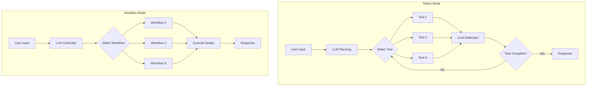
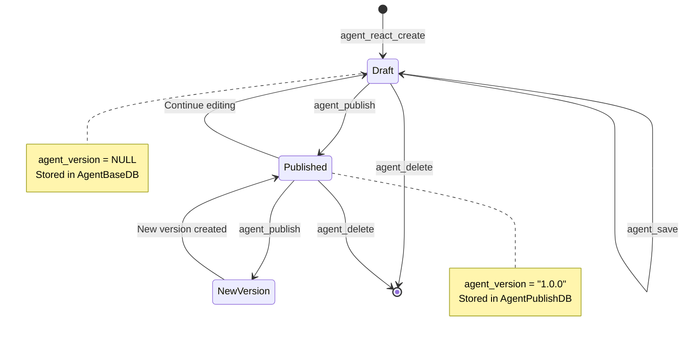
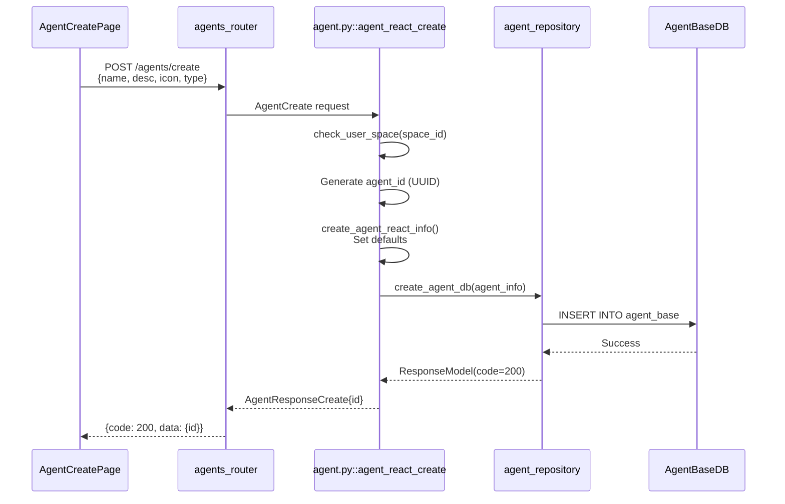
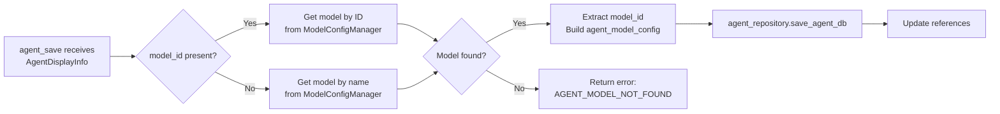
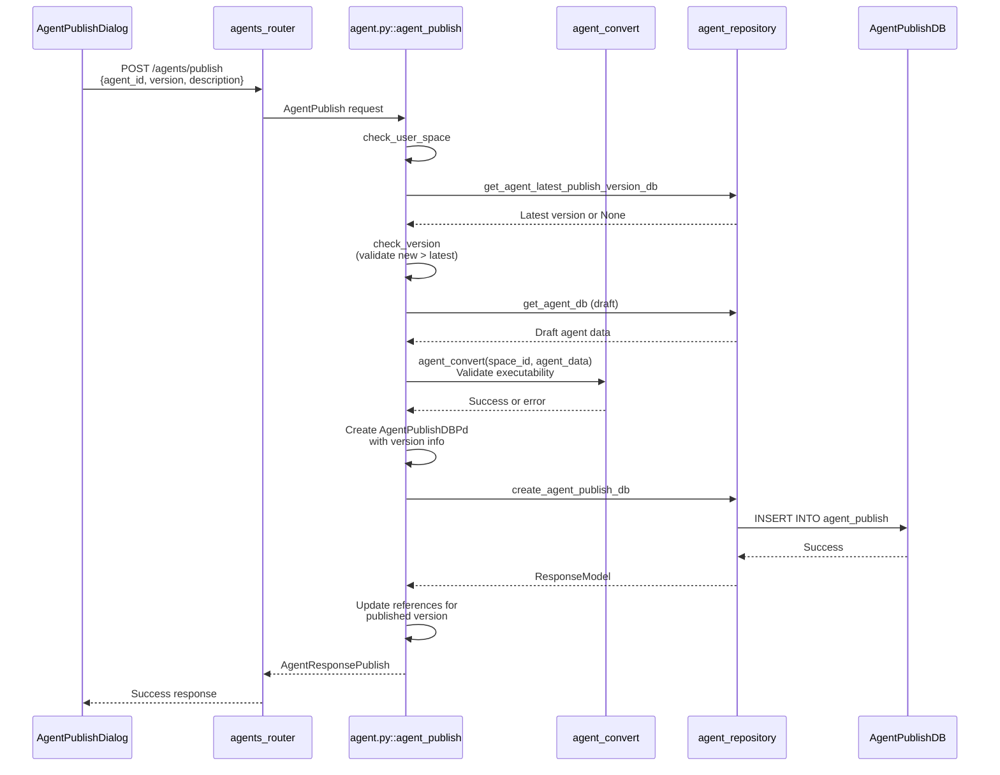
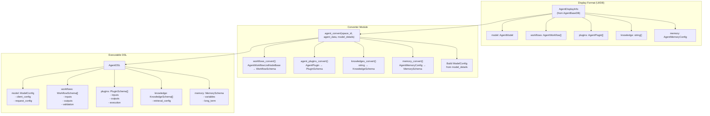

<!-- source: DeepWiki mcp.deepwiki.com · repo openJiuwen-ai/agent-studio · page 3.1 Agents · fetched 2026-11-02 -->

# Agents

<details>
<summary>Relevant source files</summary>

The following files were used as context for generating this wiki page:

- [backend/openjiuwen_studio/core/manager/agent.py](backend/openjiuwen_studio/core/manager/agent.py)
- [backend/openjiuwen_studio/core/manager/convertor/agent.py](backend/openjiuwen_studio/core/manager/convertor/agent.py)
- [backend/openjiuwen_studio/core/manager/knowledge_base.py](backend/openjiuwen_studio/core/manager/knowledge_base.py)
- [backend/openjiuwen_studio/core/manager/repositories/agent_repository.py](backend/openjiuwen_studio/core/manager/repositories/agent_repository.py)
- [backend/openjiuwen_studio/core/manager/repositories/plugin_repository.py](backend/openjiuwen_studio/core/manager/repositories/plugin_repository.py)
- [backend/openjiuwen_studio/core/manager/repositories/tool_repository.py](backend/openjiuwen_studio/core/manager/repositories/tool_repository.py)
- [backend/openjiuwen_studio/routers/agents.py](backend/openjiuwen_studio/routers/agents.py)
- [backend/openjiuwen_studio/schemas/agent.py](backend/openjiuwen_studio/schemas/agent.py)
- [frontend/packages/api-client/src/config.ts](frontend/packages/api-client/src/config.ts)
- [frontend/packages/api-client/src/services/agentService.ts](frontend/packages/api-client/src/services/agentService.ts)
- [frontend/src/components/Agent/AgentModelSelector.tsx](frontend/src/components/Agent/AgentModelSelector.tsx)
- [frontend/src/components/Agent/OverridePromptTemplateDialog.tsx](frontend/src/components/Agent/OverridePromptTemplateDialog.tsx)
- [frontend/src/locales/agent/en-US/common.json](frontend/src/locales/agent/en-US/common.json)
- [frontend/src/locales/agent/en-US/editor.json](frontend/src/locales/agent/en-US/editor.json)
- [frontend/src/locales/agent/zh-CN/common.json](frontend/src/locales/agent/zh-CN/common.json)
- [frontend/src/locales/agent/zh-CN/editor.json](frontend/src/locales/agent/zh-CN/editor.json)
- [frontend/src/pages/Agents/AgentCreatePage.tsx](frontend/src/pages/Agents/AgentCreatePage.tsx)
- [frontend/src/pages/Agents/AgentEditorEditPage.tsx](frontend/src/pages/Agents/AgentEditorEditPage.tsx)
- [frontend/src/pages/Agents/AgentsPage.tsx](frontend/src/pages/Agents/AgentsPage.tsx)

</details>


Agents are the core building blocks of the OpenJiuwen Agent Studio platform. An agent is an AI-powered assistant that combines large language models (LLMs) with various capabilities such as workflows, plugins, knowledge bases, and memory systems to accomplish tasks autonomously or through structured orchestration.

This page covers agent types, lifecycle management, component structure, and operations. For information about workflow orchestration within agents, see [Workflows](#3.2). For prompt template management used in agents, see [Prompts & Templates](#3.3). For execution details, see [Agent Execution Pipeline](#5.5).

---

## Agent Types

OpenJiuwen Agent Studio supports two primary agent modes, each suited to different use cases:

### ReAct Mode (Autonomous Planning)

ReAct mode agents use LLM-based autonomous planning and reflection to accomplish tasks. The agent independently decides which tools to invoke, in what order, and how to process results. This mode is suitable for scenarios requiring complex reasoning, multi-step planning, and adaptive problem-solving.

**Key characteristics:**
- Agent type identifier: `"react"`
- Autonomous decision-making powered by LLM
- Dynamic tool selection and orchestration
- Iterative planning with reflection
- Constraint-based execution (max iterations, chat rounds)

### Workflow Mode (Multi-Workflow)

Workflow mode agents execute predefined workflows in response to user input. The LLM acts as a controller that selects the appropriate workflow based on the user's query, then executes it with structured parameters. This mode is ideal for scenarios with clear, repeatable business processes.

**Key characteristics:**
- Agent type identifier: `"workflow"`
- LLM-based workflow selection
- Structured execution through predefined workflows
- Deterministic process flow
- Support for multiple workflows per agent

**Agent Mode Comparison**



Sources: [backend/openjiuwen_studio/schemas/agent.py:20-27](), [frontend/src/locales/agent/en-US/editor.json:5-13](), [backend/openjiuwen_studio/core/manager/agent.py:301-327]()

---

## Agent Lifecycle

Agents follow a draft-publish lifecycle with semantic versioning support. This enables iterative development while maintaining stable published versions.

### Lifecycle States

**Draft State Diagram**



### Version Management

- **Draft Version**: Represented by `agent_version=NULL` or empty string. Only one draft exists per agent.
- **Published Versions**: Immutable versions with semantic versioning (e.g., `"1.0.0"`, `"1.2.3"`). Multiple published versions can coexist.
- **Version Validation**: Each new published version must be greater than the previous version (checked via `Version.string_to_object` and `check_version`).
- **History Navigation**: Users can view and switch between different published versions in the UI, though only the draft is editable.

**Version Database Storage**

| Version Type | Table | agent_version Value | Mutability |
|-------------|-------|---------------------|------------|
| Draft | `AgentBaseDB` | `NULL` | Editable |
| Published | `AgentPublishDB` | `"1.0.0"`, `"2.1.3"`, etc. | Read-only |

Sources: [backend/openjiuwen_studio/core/manager/agent.py:922-1092](), [backend/openjiuwen_studio/models/agent.py](), [backend/openjiuwen_studio/core/manager/repositories/agent_repository.py:43-95]()

---

## Agent Structure

An agent comprises multiple interconnected components that define its behavior, capabilities, and execution context.

**Agent Component Architecture**

```mermaid
graph TB
    Agent["Agent<br/>(AgentBaseDBPd)"]
    
    Agent --> Model["Model Configuration<br/>(AgentModel)"]
    Agent --> Prompts["Prompt Templates<br/>(AgentPromptTemplate[])"]
    Agent --> Workflows["Workflows<br/>(AgentWorkflow[])"]
    Agent --> Plugins["Plugins<br/>(AgentPlugin[])"]
    Agent --> Knowledge["Knowledge Bases<br/>(knowledge: string[])"]
    Agent --> Memory["Memory Configuration<br/>(AgentMemoryConfig)"]
    Agent --> Constraint["Constraints<br/>(AgentConstraint)"]
    Agent --> Config["Additional Configs<br/>(configs: dict)"]
    
    Model --> ModelInfo["model_info:<br/>- model_name<br/>- model_type<br/>- temperature<br/>- top_p<br/>- timeout"]
    
    Prompts --> PromptRole["role: system/user/assistant"]
    Prompts --> PromptContent["content: template text"]
    
    Workflows --> WorkflowID["workflow_id"]
    Workflows --> WorkflowVersion["workflow_version"]
    
    Plugins --> PluginID["plugin_id"]
    Plugins --> ToolID["tool_id"]
    Plugins --> PluginVersion["plugin_version"]
    
    Memory --> MemVars["variable_config:<br/>Memory variables"]
    Memory --> MemLongterm["longterm_memory_config:<br/>boolean"]
    Memory --> MemBase["memory_base:<br/>MemoryBaseConfig"]
    
    Constraint --> MaxIter["max_iteration: int"]
    Constraint --> MaxRounds["reserved_max_chat_rounds: int"]
    
    Config --> Retrieval["retrieval_config:<br/>- use_agent<br/>- use_sync<br/>- source<br/>- topk<br/>- score_threshold"]
```



### Core Components

#### 1. Model Configuration (`AgentModel`)

Defines the LLM used for agent execution:
- `model_provider`: Provider name (e.g., "openai", "anthropic")
- `model_info`: Detailed model settings including name, type, temperature, top_p, timeout
- `model_id`: Reference to configured model in model management system

The model configuration is validated against available models when saving and publishing.

#### 2. Prompt Templates (`AgentPromptTemplate[]`)

System prompts that define the agent's role, behavior, and capabilities:
- `role`: "system", "user", or "assistant"
- `content`: Template text with optional variable placeholders
- Supports linking to managed prompt templates via `prompt_template_name`

#### 3. Workflows (`AgentWorkflow[]`)

References to workflows that the agent can execute:
- `workflow_id`: Unique workflow identifier
- `workflow_version`: Version to use ("draft" or semantic version)
- `workflow_name` and `description`: Display information

Workflows are validated before publishing to ensure they are executable.

#### 4. Plugins (`AgentPlugin[]`)

Tools and capabilities available to the agent:
- `plugin_id`: Parent plugin identifier
- `tool_id`: Specific tool within the plugin
- `plugin_version`: Version to use

Each plugin provides functions that the agent can invoke.

#### 5. Knowledge Bases (`knowledge: string[]`)

Array of knowledge base IDs that provide retrieval-augmented generation (RAG) capabilities. Knowledge bases must use compatible embedding models.

#### 6. Memory Configuration (`AgentMemoryConfig`)

Manages agent memory across conversations:
- `variable_config`: Custom variables (name, description, enabled state)
- `longterm_memory_config`: Boolean flag for long-term memory
- `memory_base`: Reference to memory base (mdb_id, embedding/LLM model configs)

#### 7. Constraints (`AgentConstraint`)

Execution limits:
- `max_iteration`: Maximum planning iterations (default: 5)
- `reserved_max_chat_rounds`: Maximum conversation history rounds (default: 10)

#### 8. Additional Configurations (`configs`)

Extended settings such as:
- `retrieval_config`: Knowledge base retrieval strategies (graph retrieval, source types, topk, score thresholds)

Sources: [backend/openjiuwen_studio/schemas/agent.py:44-129](), [backend/openjiuwen_studio/models/agent.py](), [frontend/src/components/Agent/AgentModelSelector.tsx:80-189]()

---

## Agent Operations

### Create Agent

**Endpoint**: `POST /api/v1/agents/create`

**Function**: `agent_react_create(req: AgentCreate, current_user: dict)`

Creates a new agent in draft state with default values:



**Default values** applied during creation:
- `agent_id`: Generated via `uuid.uuid4()`
- `edit_mode`: `AgentEditMode.Manual`
- `constraint`: `AgentConstraint()` with default limits
- `opening_remarks`: Default greeting from `AgentDefaults.OPENING_REMARKS`
- `create_time` and `update_time`: Current timestamp via `milliseconds()`

Sources: [backend/openjiuwen_studio/core/manager/agent.py:301-376](), [backend/openjiuwen_studio/routers/agents.py:157-183](), [frontend/src/pages/Agents/AgentCreatePage.tsx:36-263]()

---

### Save Agent (Draft)

**Endpoint**: `POST /api/v1/agents/save`

**Function**: `agent_save(req: AgentDisplayInfo, current_user: dict, manager: ModelConfigManager)`

Updates the draft version of an agent. This operation:
1. Validates that `agent_version` is NULL or empty (only drafts can be saved)
2. Resolves and validates the model configuration
3. Updates the agent record in `AgentBaseDB`
4. Manages reference relationships with other resources

**Model Resolution Flow**:


**Reference Management**:
After saving, the system manages references to:
- Workflows (by workflow_id and version)
- Plugins (by plugin_id, tool_id, and version)
- Knowledge bases (by kb_id)
- Prompt templates (by prompt key/name)

References are stored in the `reference` table and updated via:
1. Delete old draft references: `reference_delete_by_referer_with_version(space_id, "AGENT", agent_id, "draft")`
2. Extract new references: `extract_agent_references(req.model_dump(), space_id, "draft")`
3. Create new references: `reference_create(ref)` for each reference

Sources: [backend/openjiuwen_studio/core/manager/agent.py:614-754](), [backend/openjiuwen_studio/routers/agents.py:219-250](), [frontend/src/pages/Agents/AgentEditorEditPage.tsx:148-176]()

---

### Publish Agent

**Endpoint**: `POST /api/v1/agents/publish`

**Function**: `agent_publish(req: AgentPublish, current_user: dict)`

Publishes a new immutable version of the agent:

**Publish Flow**



**Version Validation Rules**:
- Version must follow semantic versioning format: `x.y.z`
- New version must be strictly greater than the latest published version
- First publish can be any valid semantic version

**Conversion Validation**:
Before publishing, the agent is converted to executable DSL format to ensure:
- All referenced workflows exist and are valid
- All referenced plugins/tools exist and are valid
- Model configuration is complete
- Required resources are available

Sources: [backend/openjiuwen_studio/core/manager/agent.py:922-1092](), [backend/openjiuwen_studio/routers/agents.py:252-282](), [frontend/src/components/Agent/AgentPublishDialog.tsx]()

---

### Delete Agent

**Endpoint**: `POST /api/v1/agents/delete`

**Function**: `agent_delete(req: AgentGet, current_user: dict)`

Deletes all versions (draft and published) of an agent:

1. Validates user permissions via `check_user_space`
2. Deletes all records from both `AgentBaseDB` and `AgentPublishDB` via `delete_agent_db(agent_query)`
3. Cleans up references via `reference_delete_by_referer(space_id, "AGENT", agent_id)`

**Delete Published Version Only**:
- **Endpoint**: `POST /api/v1/agents/delete_publish`
- **Function**: `agent_publish_delete(req: AgentId, current_user: dict)`
- Deletes a specific published version while preserving draft and other versions
- Cleans up version-specific references via `reference_delete_by_referer_with_version`

Sources: [backend/openjiuwen_studio/core/manager/agent.py:379-498](), [backend/openjiuwen_studio/routers/agents.py:185-211]()

---

### Copy Agent

**Endpoint**: `POST /api/v1/agents/copy`

**Function**: `agent_copy(req: AgentCopy, current_user: dict)`

Creates a duplicate of an existing agent with a new `agent_id`:
- Copies all configuration from the source agent
- Appends " (copy)" to the agent name
- Creates a new draft version (published versions are not copied)
- Generates new UUID for the copied agent

Sources: [backend/openjiuwen_studio/core/manager/agent.py:1226-1288](), [frontend/src/pages/Agents/AgentsPage.tsx:244-272]()

---

### Export and Import

**Export Endpoint**: `POST /api/v1/agents/export`

**Function**: `agent_export(req: AgentExportRequest, current_user: dict)`

Exports agent configuration along with dependencies:
- **JSON Format**: Simple export with agent config and metadata
- **ZIP Format**: Includes agent config plus dependent resources (workflows, plugins, knowledge bases, prompts)

**Export Data Structure** (`AgentExportData`):
- `metadata`: Export timestamp, version, format
- `agent`: Complete agent configuration
- `dependencies`: Referenced workflows, plugins, knowledge bases, prompts
- `model_references`: LLM and embedding model information

**Import Endpoint**: `POST /api/v1/agents/import`

**Function**: `agent_import(req: AgentImportRequest, current_user: dict)`

Imports agent from exported file with conflict resolution:
- Checks for name conflicts in the target space
- Supports overwrite or create-as-copy modes
- Validates and imports dependencies
- Resolves model references

Sources: [backend/openjiuwen_studio/core/manager/agent.py:1290-1674](), [backend/openjiuwen_studio/routers/agents.py:284-371](), [frontend/src/pages/Agents/AgentsPage.tsx:275-435]()

---

## Agent Conversion (Display to DSL)

Before execution or publishing, agents must be converted from their display format (`AgentDisplayInfo`) to an executable DSL format. This conversion is handled by the agent converter module.

**Conversion Architecture**



### Conversion Functions

#### `agent_convert(space_id: str, agent_data: AgentBaseDBPd, model_details: Optional[dict])`
Main entry point that orchestrates the conversion based on agent type:
- For `agent_type="react"`: Calls `react_agent_convert`
- For `agent_type="workflow"`: Calls `workflow_agent_convert`

#### `workflows_convert(space_id: str, workflows: List[dict])`
Converts workflow references to `WorkflowSchema[]`:
1. For each workflow, fetches canvas data via `workflow_repository.workflow_canvas`
2. Extracts `input_parameters` and `output_parameters`
3. Converts to JSON Schema format via `convert_to_properties_format`
4. Creates `WorkflowSchema` with id, version, name, description, inputs, outputs

#### `agent_plugins_convert(space_id: str, plugins: List[AgentPlugin])`
Converts plugin references to `PluginSchema[]`:
1. For each plugin, fetches tool info via `tool_repository.tool_get`
2. Extracts input/output parameters
3. Converts to JSON Schema format
4. Creates `PluginSchema` with id, plugin_id, version, name, description, inputs, outputs

#### `knowledges_convert(space_id: str, knowledge_ids: List[str])`
Converts knowledge base IDs to `KnowledgeSchema[]`:
1. For each kb_id, fetches knowledge base info via `knowledge_base_repository.knowledge_base_get`
2. Creates `KnowledgeSchema` with id, name, description

#### `memory_convert(memory_config: AgentMemoryConfig)`
Converts memory configuration to `MemorySchema`:
1. Processes variable configurations
2. Handles long-term memory settings
3. Links to memory base if configured

### Model Configuration Conversion

The model configuration requires special handling to integrate with the LLM foundation:

```python
# Build ModelClientConfig
client_config = ModelClientConfig(
    base_url=model_details["base_url"],
    api_key=model_details["api_key"],
    timeout=model_details["timeout"]
)

# Build ModelRequestConfig
request_config = ModelRequestConfig(
    model=model_details["model_type"],
    temperature=parameters.get("temperature", 0.7),
    top_p=parameters.get("top_p", 0.9),
    max_tokens=parameters.get("max_tokens", 4096)
)

# Combine into ModelConfig
model_config = ModelConfig(
    provider=model_details["provider"],
    client_config=client_config,
    request_config=request_config
)
```

### Validation During Conversion

The converter performs validation to ensure executability:
- **Workflow validation**: Checks that workflows exist and have valid inputs/outputs
- **Plugin validation**: Verifies tools exist and are callable
- **Knowledge validation**: Ensures knowledge bases are accessible
- **Model validation**: Confirms model configuration is complete

Validation errors prevent publishing and are reported back to the user.

Sources: [backend/openjiuwen_studio/core/manager/convertor/agent.py](), [backend/openjiuwen_studio/core/manager/agent.py:1004-1061]()

---

## Data Model

### Database Schema

**AgentBaseDB Table** (Draft versions)

| Column | Type | Description |
|--------|------|-------------|
| `agent_id` | String (UUID) | Primary key |
| `space_id` | String | Workspace identifier |
| `agent_name` | String | Display name (max 255 chars) |
| `description` | String | Description (max 500 chars) |
| `agent_type` | String | "react" or "workflow" |
| `icon` | String | Emoji or icon identifier |
| `edit_mode` | String | "Manual" or other edit modes |
| `model_id` | Integer | Reference to model config |
| `agent_model_config` | JSON | Model parameters override |
| `plugins` | JSON | Array of AgentPlugin |
| `workflows` | JSON | Array of AgentWorkflow |
| `knowledge` | JSON | Array of knowledge base IDs |
| `memory` | JSON | AgentMemoryConfig |
| `prompt_template_name` | String | Linked prompt template |
| `prompt_template` | JSON | Array of AgentPromptTemplate |
| `constraint` | JSON | AgentConstraint |
| `configs` | JSON | Additional configurations |
| `opening_remarks` | String | Greeting message |
| `default_response` | String | Fallback response |
| `create_time` | BigInteger | Timestamp (milliseconds) |
| `update_time` | BigInteger | Timestamp (milliseconds) |

**AgentPublishDB Table** (Published versions)

Same schema as `AgentBaseDB` with additional columns:
- `agent_version`: Semantic version string (e.g., "1.0.0")
- `version_description`: Description of changes in this version

### Key Schema Classes

**AgentDisplayInfo** (Frontend ↔ Backend)
```python
class AgentDisplayInfo(AgentCreate):
    agent_id: str
    agent_version: Optional[str]
    configs: Dict[str, Any]
    edit_mode: str
    plugins: list[AgentPlugin]
    workflows: list[AgentWorkflow]
    model: AgentModel
    prompt_template_name: str
    prompt_template: list[AgentPromptTemplate]
    constraint: AgentConstraint
    prompt_tuning: dict[str, Any]
    knowledge: list[str]
    memory: AgentMemoryConfig
    opening_remarks: str
    default_response: Optional[str]
```

**AgentBaseDBPd** (Database Persistence)
Pydantic model representing database records with serialization/deserialization for JSON columns.

**SaveAgentRequest** (Frontend → Backend)
Request schema for saving agent changes, contains same fields as `AgentDisplayInfo` but with different naming conventions (using aliases).

Sources: [backend/openjiuwen_studio/models/agent.py](), [backend/openjiuwen_studio/schemas/agent.py]()

---

## Frontend Components

### AgentCreatePage

Entry point for creating new agents. Users select:
- Agent mode (ReAct vs Workflow)
- Agent name, description, and icon
- Agent type is derived from mode selection

Location: [frontend/src/pages/Agents/AgentCreatePage.tsx]()

### AgentEditorEditPage

Main editing interface with three-panel layout:
- **Left Panel**: System prompt configuration (`SystemPromptTab`)
- **Middle Panel**: Orchestration configuration (`AgentModelSelector` or `MultiWorkflowSelector`)
- **Right Panel**: Debug and preview (`AgentDebugChat`)

The page handles:
- Loading agent details via `AgentService.getAgentDetail`
- Saving changes via `AgentService.saveAgent`
- Publishing versions via `AgentPublishDialog`
- Version history via `AgentVersionListPanel`
- Settings via `AgentSettingsDialog`

Location: [frontend/src/pages/Agents/AgentEditorEditPage.tsx]()

### AgentModelSelector

Configuration panel for ReAct mode agents, managing:
- Model selection and parameters
- Workflow list (with validation)
- Plugin list
- Knowledge base list (with retrieval settings)
- Memory configuration (variables, long-term memory, memory base)
- Constraints (max iterations, chat rounds)
- Greeting message

Location: [frontend/src/components/Agent/AgentModelSelector.tsx]()

### AgentsPage

List view for browsing and managing agents:
- Grid and table view modes
- Search and sorting
- Agent operations: edit, copy, export, delete
- Import with conflict resolution

Location: [frontend/src/pages/Agents/AgentsPage.tsx]()

Sources: [frontend/src/pages/Agents/AgentCreatePage.tsx](), [frontend/src/pages/Agents/AgentEditorEditPage.tsx](), [frontend/src/components/Agent/AgentModelSelector.tsx](), [frontend/src/pages/Agents/AgentsPage.tsx]()

---

## API Endpoints

All agent endpoints are prefixed with `/api/v1/agents/`.

| Endpoint | Method | Function | Description |
|----------|--------|----------|-------------|
| `/create` | POST | `agent_react_create` | Create new agent |
| `/save` | POST | `agent_save` | Save draft changes |
| `/delete` | POST | `agent_delete` | Delete all versions |
| `/delete_publish` | POST | `agent_publish_delete` | Delete specific version |
| `/update` | POST | `agent_meta_update` | Update metadata only |
| `/detail` | POST | `get_single_agent_info` | Get agent details |
| `/list` | POST | `agent_get_list` | List agents with pagination |
| `/search` | POST | `agent_search` | Search agents |
| `/publish` | POST | `agent_publish` | Publish new version |
| `/version_list` | POST | `agent_get_version_list` | Get version history |
| `/copy` | POST | `agent_copy` | Duplicate agent |
| `/export` | POST | `agent_export` | Export agent with dependencies |
| `/import` | POST | `agent_import` | Import agent from file |
| `/convert` | POST | `agent_convert_api` | Convert to DSL (for validation) |

Sources: [backend/openjiuwen_studio/routers/agents.py](), [frontend/packages/api-client/src/config.ts:120-139]()

---

