<!-- source: DeepWiki mcp.deepwiki.com · repo openJiuwen-ai/agent-studio · page 3.2 Workflows · fetched 2026-11-02 -->

# Workflows

<details>
<summary>Relevant source files</summary>

The following files were used as context for generating this wiki page:

- [backend/openjiuwen_studio/core/manager/agent.py](backend/openjiuwen_studio/core/manager/agent.py)
- [backend/openjiuwen_studio/core/manager/convertor/agent.py](backend/openjiuwen_studio/core/manager/convertor/agent.py)
- [backend/openjiuwen_studio/core/manager/knowledge_base.py](backend/openjiuwen_studio/core/manager/knowledge_base.py)
- [backend/openjiuwen_studio/core/manager/repositories/agent_repository.py](backend/openjiuwen_studio/core/manager/repositories/agent_repository.py)
- [backend/openjiuwen_studio/core/manager/repositories/plugin_repository.py](backend/openjiuwen_studio/core/manager/repositories/plugin_repository.py)
- [backend/openjiuwen_studio/core/manager/repositories/tool_repository.py](backend/openjiuwen_studio/core/manager/repositories/tool_repository.py)
- [backend/openjiuwen_studio/routers/agents.py](backend/openjiuwen_studio/routers/agents.py)
- [backend/openjiuwen_studio/schemas/agent.py](backend/openjiuwen_studio/schemas/agent.py)
- [frontend/packages/api-client/src/config.ts](frontend/packages/api-client/src/config.ts)
- [frontend/packages/api-client/src/services/agentService.ts](frontend/packages/api-client/src/services/agentService.ts)
- [frontend/packages/workflow-canvas/src/components/testrun/shared/use-input-interruption.ts](frontend/packages/workflow-canvas/src/components/testrun/shared/use-input-interruption.ts)
- [frontend/packages/workflow-canvas/src/components/testrun/testrun-panel/test-run-panel.tsx](frontend/packages/workflow-canvas/src/components/testrun/testrun-panel/test-run-panel.tsx)
- [frontend/packages/workflow-canvas/src/editor.tsx](frontend/packages/workflow-canvas/src/editor.tsx)
- [frontend/packages/workflow-canvas/src/nodes/loop/effects.ts](frontend/packages/workflow-canvas/src/nodes/loop/effects.ts)
- [frontend/packages/workflow-canvas/src/nodes/loop/form-meta.tsx](frontend/packages/workflow-canvas/src/nodes/loop/form-meta.tsx)
- [frontend/packages/workflow-canvas/src/nodes/loop/validation.ts](frontend/packages/workflow-canvas/src/nodes/loop/validation.ts)
- [frontend/packages/workflow-canvas/src/utils/validation/validation-helpers.ts](frontend/packages/workflow-canvas/src/utils/validation/validation-helpers.ts)
- [frontend/packages/workflow-canvas/src/utils/workflow-node-utils.ts](frontend/packages/workflow-canvas/src/utils/workflow-node-utils.ts)
- [frontend/src/locales/workflow/en-US/common.json](frontend/src/locales/workflow/en-US/common.json)
- [frontend/src/locales/workflow/en-US/nodes.json](frontend/src/locales/workflow/en-US/nodes.json)
- [frontend/src/locales/workflow/zh-CN/common.json](frontend/src/locales/workflow/zh-CN/common.json)
- [frontend/src/locales/workflow/zh-CN/nodes.json](frontend/src/locales/workflow/zh-CN/nodes.json)

</details>


## Purpose and Scope

Workflows in OpenJiuwen Agent Studio are visual, node-based orchestration tools that define structured execution logic for AI agents and automation tasks. They provide a drag-and-drop canvas where users can connect different types of nodes (LLM calls, code execution, conditional logic, loops, etc.) to create complex, reusable processing pipelines.

This page covers workflow structure, the visual canvas editor, node types, execution model, and version management. For information about how workflows are used within agents, see [Agents](#3.1). For details on the workflow execution runtime and debugging, see [Workflow Canvas Architecture](#5.7).

---

## Workflow Structure

### Core Components

A workflow consists of three main structural elements:

1. **Nodes** - Individual processing units that perform specific tasks
2. **Edges** - Connections between nodes that define execution flow
3. **Parameters** - Typed input/output variables that define the workflow interface

Every workflow must contain at minimum:
- One **Start node** (node type `1`) - the entry point for execution
- One **End node** (node type `2`) - the exit point that returns results

**Sources:** [backend/openjiuwen_studio/core/manager/convertor/agent.py:32-66]()

### Data Model

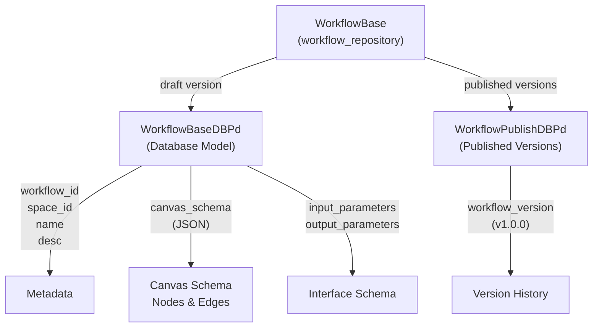

**Diagram: Workflow Data Model**

The workflow data is stored in two tables:
- `workflow_base` table stores draft versions with `workflow_version = NULL`
- `workflow_publish` table stores published versions with semantic version numbers

**Sources:** [backend/openjiuwen_studio/models/workflow.py](), [backend/openjiuwen_studio/core/manager/repositories/workflow_repository.py:1-100]()

### Input and Output Parameters

Workflows define typed input and output parameters that create a contract for execution:

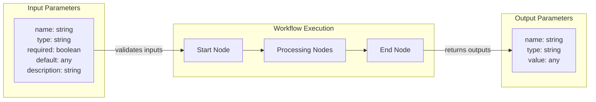

**Diagram: Workflow Parameter Flow**

Input parameters are defined on the Start node and validated before execution. Output parameters are collected from the End node's configuration and returned as the workflow result.

**Sources:** [backend/openjiuwen_studio/core/manager/convertor/agent.py:48-61](), [frontend/packages/workflow-canvas/src/nodes/]()

---

## Node Types

The workflow canvas supports multiple node types, each serving a specific purpose:

| Node Type | Type ID | Purpose | Key Configuration |
|-----------|---------|---------|-------------------|
| Start | 1, 15 | Workflow entry point | Input parameters |
| End | 2, 16 | Workflow exit point | Output parameters, content template |
| LLM | 3 | Large Language Model invocation | Model selection, prompts, output format |
| Selector (Condition) | 4 | Conditional branching | If/Else-If/Else conditions, operators |
| Loop | 5 | Iterative execution | Loop count or array iteration |
| Intent | 6 | Intent recognition | Multiple intent branches |
| Questioner | 7 | User interaction | Max questions, response collection |
| Input | 8 | Runtime input pause | Field definitions |
| Output | 9 | Intermediate output | Display values |
| Code | 10 | Custom code execution | JavaScript or Python code |
| TextEditor | 11 | Text processing | Concatenation or splitting |
| Continue | 12 | Skip loop iteration | (Used within loops) |
| Break | 13 | Exit loop early | (Used within loops) |
| Workflow (Sub) | 14 | Nested workflow | Workflow selection, version |
| Variable | 17, 18 | Variable assignment | Assignment operations |
| Plugin | 19 | Plugin tool execution | Tool selection, parameters |
| Comment | 99 | Documentation | Text annotation |

**Sources:** [frontend/src/locales/workflow/zh-CN/nodes.json:1-189](), [frontend/packages/workflow-canvas/src/nodes/]()

### Special Node Types: Blocks

Loop nodes create **execution blocks** with their own Start and End nodes (types 15 and 16). These block nodes define the boundaries of the loop body:

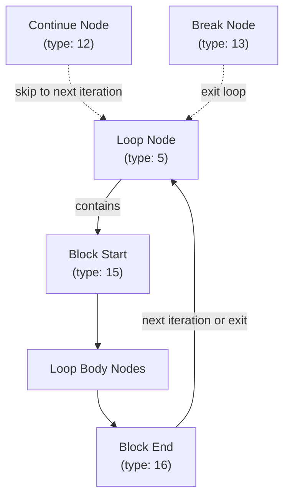

**Diagram: Loop Block Structure**

**Sources:** [frontend/packages/workflow-canvas/src/nodes/loop/](), [frontend/src/locales/workflow/zh-CN/nodes.json:159-166]()

---

## Node Configuration Details

### LLM Node

The LLM node invokes language models with configurable parameters:

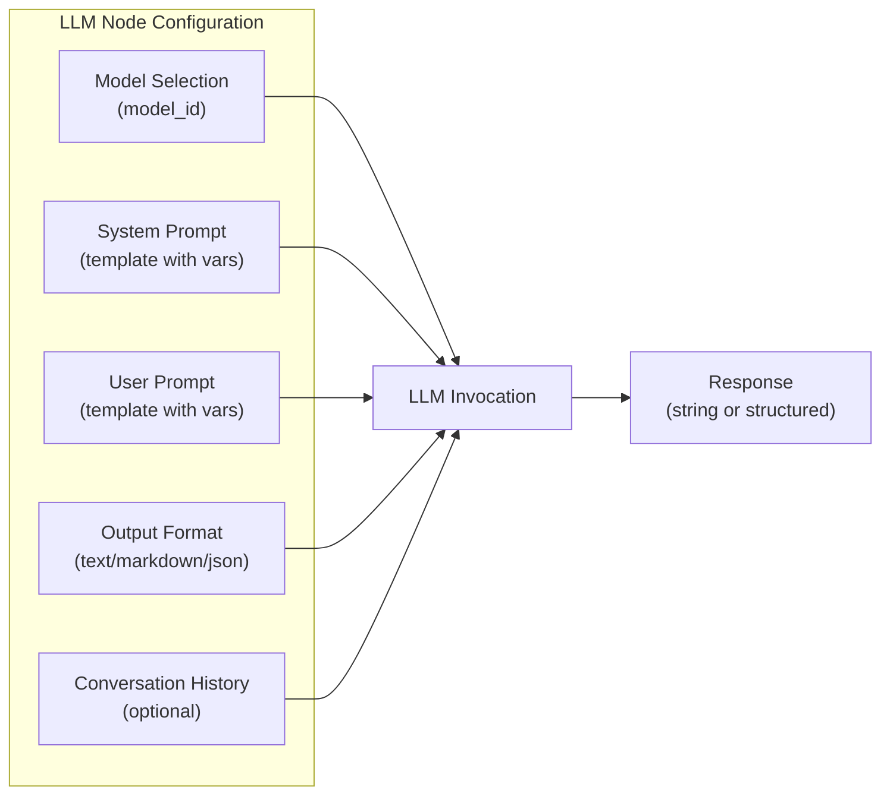

**Diagram: LLM Node Configuration**

The node supports prompt templates with variable interpolation using `{{variableName}}` syntax and can link to versioned prompts from the prompt studio.

**Sources:** [frontend/src/locales/workflow/zh-CN/nodes.json:3-12](), [frontend/packages/workflow-canvas/src/nodes/llm/]()

### Loop Node

Loop nodes support two iteration modes:

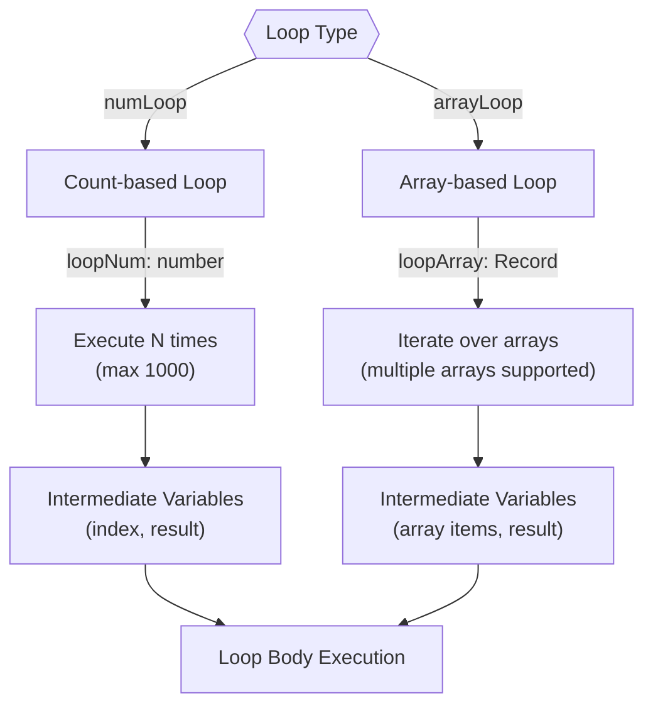

**Diagram: Loop Node Types**

**Count-based loop configuration:**
- `inputs.loopParam.type = "numLoop"`
- `inputs.loopParam.loopNum` - number of iterations (constant or variable reference)

**Array-based loop configuration:**
- `inputs.loopParam.type = "arrayLoop"`
- `inputs.loopParam.loopArray` - object with array variables
- Each array element becomes accessible as intermediate variables inside the loop

**Sources:** [frontend/packages/workflow-canvas/src/nodes/loop/form-meta.tsx:36-61](), [frontend/src/locales/workflow/zh-CN/nodes.json:68-88]()

### Condition Node (Selector)

The Condition node evaluates expressions and routes execution to different branches:

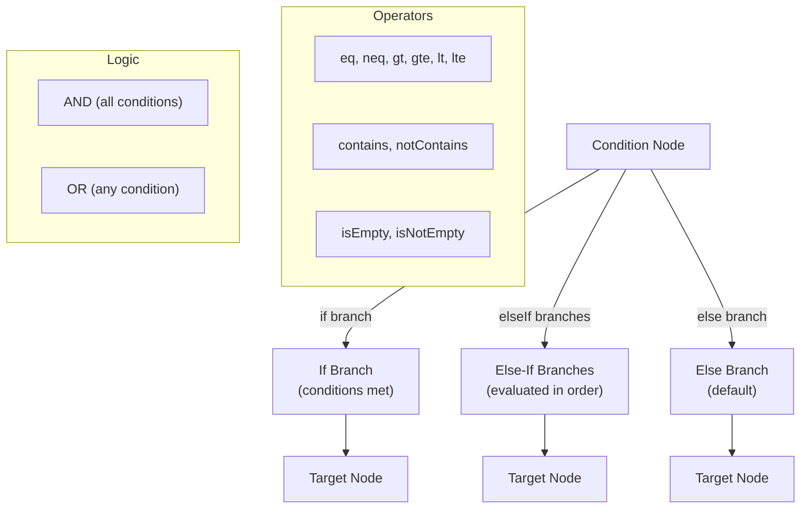

**Diagram: Condition Node Branching**

All branches must be connected to downstream nodes. Conditions support complex logic with multiple comparisons combined using AND/OR operators.

**Sources:** [frontend/src/locales/workflow/zh-CN/nodes.json:22-66](), [frontend/packages/workflow-canvas/src/nodes/condition/]()

### Plugin Node

Plugin nodes execute external tools:

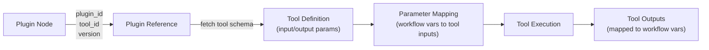

**Diagram: Plugin Node Execution Flow**

The plugin tool's input parameters are dynamically rendered based on the tool's schema definition, allowing variable references or constant values.

**Sources:** [frontend/src/locales/workflow/zh-CN/common.json:2-22](), [backend/openjiuwen_studio/core/manager/convertor/agent.py:119-172]()

---

## Workflow Canvas Editor

### Editor Architecture

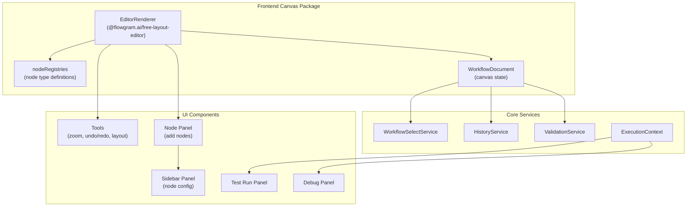

**Diagram: Workflow Canvas Architecture**

The canvas is built on the `@flowgram.ai/free-layout-editor` package, which provides the core graph editing capabilities. Each node type is registered with rendering, validation, and form configuration.

**Sources:** [frontend/packages/workflow-canvas/src/editor.tsx:1-200](), [frontend/packages/workflow-canvas/src/nodes/]()

### Node Registration System

Each node type implements a `FlowNodeRegistry` with the following structure:

```typescript
interface FlowNodeRegistry {
  info: NodeInfo | (() => NodeInfo)
  render?: NodeRenderFunction
  formMeta?: FormMeta
  validation?: ValidationFunction
  effects?: EffectFunction[]
}
```

**Sources:** [frontend/packages/workflow-canvas/src/nodes/]()

### Validation System

Workflows are validated before execution:

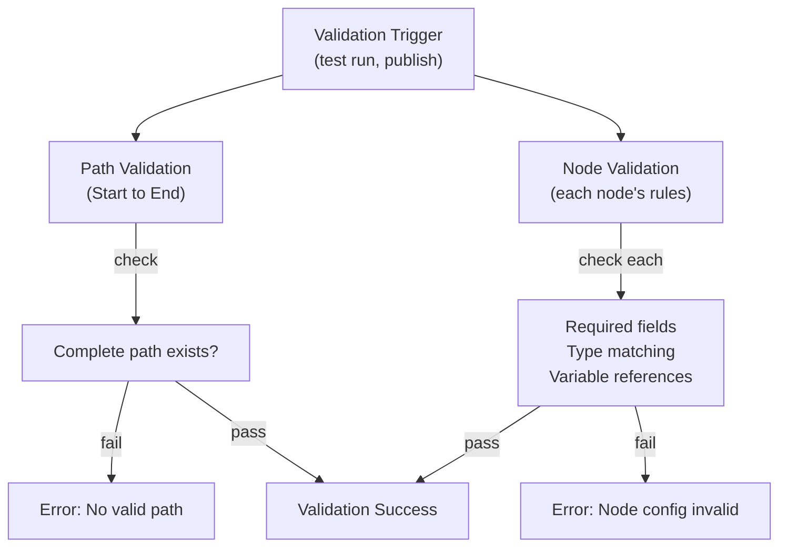

**Diagram: Workflow Validation Process**

Common validation errors include:
- Missing required parameters
- Invalid variable references
- Unconnected branch ports (in Condition, Loop nodes)
- Missing path from Start to End node

**Sources:** [frontend/packages/workflow-canvas/src/nodes/loop/validation.ts:1-200](), [frontend/packages/workflow-canvas/src/utils/validation/]()

---

## Workflow Lifecycle

### Version Management

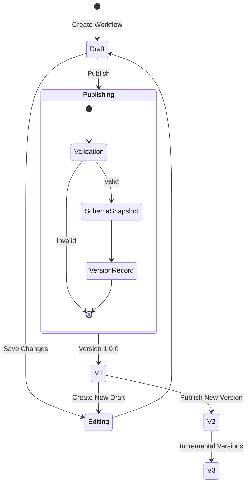

**Diagram: Workflow Lifecycle States**

Workflow versioning follows semantic versioning (v1.0.0). When publishing:
1. The current draft is validated
2. A snapshot of `canvas_schema`, `input_parameters`, and `output_parameters` is saved
3. A new record is created in `workflow_publish` table with the version number
4. The draft remains editable for future changes

**Sources:** [backend/openjiuwen_studio/core/manager/repositories/workflow_repository.py](), [frontend/src/locales/workflow/zh-CN/nodes.json:289-309]()

### API Operations

| Operation | Endpoint | Description |
|-----------|----------|-------------|
| Create | `POST /workflows/create` | Create new workflow (draft) |
| Get Canvas | `POST /workflows/canvas` | Retrieve canvas schema by version |
| Save | `POST /workflows/save` | Update draft workflow |
| Publish | `POST /workflows/publish` | Create versioned snapshot |
| Delete | `POST /workflows/delete` | Delete all versions |
| Delete Version | `POST /workflows/delete_publish` | Delete specific published version |
| List | `POST /workflows/list` | Get workflows with pagination |
| Version List | `POST /workflows/version_list` | Get version history |
| Copy | `POST /workflows/copy` | Duplicate workflow |

**Sources:** [frontend/packages/api-client/src/config.ts:96-114](), [backend/openjiuwen_studio/routers/workflows.py]()

---

## Workflow Execution

### Execution Flow

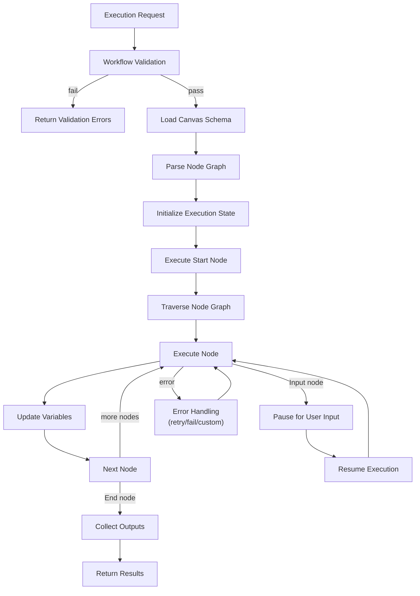

**Diagram: Workflow Execution Process**

Execution is handled by the runtime service which maintains:
- **Variable scope** - values from previous nodes
- **Execution state** - status of each node (pending, running, success, failed)
- **Interruption queue** - paused inputs waiting for user interaction

**Sources:** [frontend/packages/workflow-canvas/src/components/testrun/runtime/testrun-runtime-service.ts](), [backend/openjiuwen_studio/routers/execution.py]()

### Node Execution States

During execution, each node can be in one of these states:

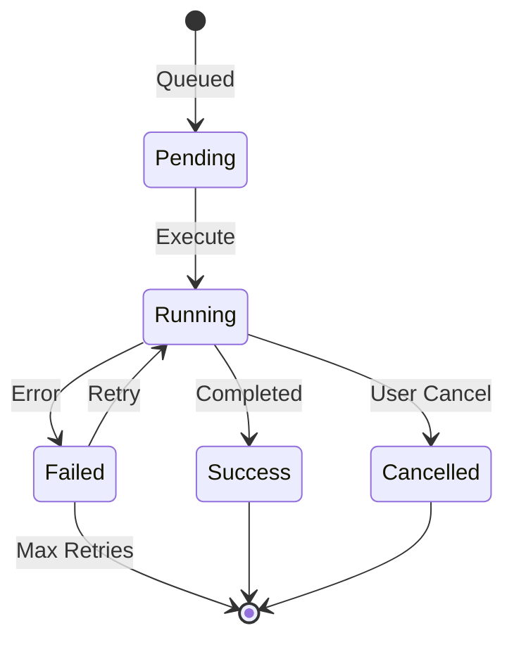

**Diagram: Node Execution States**

Node status is tracked in real-time and displayed in the canvas and debug panel.

**Sources:** [frontend/src/locales/workflow/zh-CN/common.json:228-239](), [frontend/packages/workflow-canvas/src/components/testrun/runtime/types.ts]()

### Stream Execution Events

Workflow execution uses Server-Sent Events (SSE) for real-time updates:

| Event Type | Data | Purpose |
|------------|------|---------|
| `node_started` | nodeId, nodeName | Node execution begins |
| `node_completed` | nodeId, outputs | Node execution succeeds |
| `node_failed` | nodeId, error | Node execution fails |
| `input_required` | nodeId, message, schema | User input needed |
| `stream_chunk` | nodeId, content | LLM streaming content |
| `completed` | inputs, outputs | Workflow finished |
| `error` | message | Workflow error |

**Sources:** [frontend/packages/workflow-canvas/src/components/testrun/runtime/types.ts](), [frontend/packages/workflow-canvas/src/components/testrun/shared/use-stream-messages.ts]()

---

## Sub-Workflows

Workflows can be nested within other workflows or agents using the Workflow node (type 14):

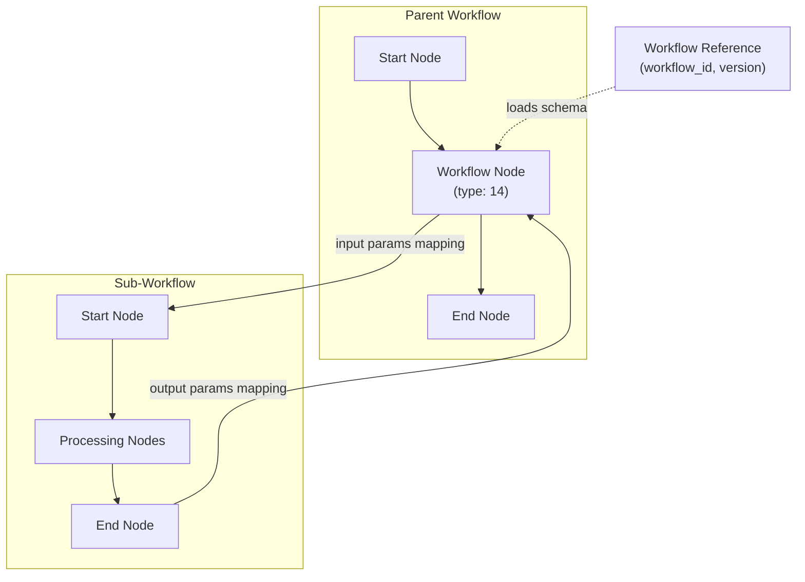

**Diagram: Sub-Workflow Execution**

When a Workflow node executes:
1. The referenced workflow's published version is loaded by `workflow_id` and `version`
2. Input parameters are mapped from parent workflow variables to sub-workflow inputs
3. The sub-workflow executes independently
4. Output parameters are mapped back to parent workflow variables

**Sources:** [backend/openjiuwen_studio/core/manager/convertor/agent.py:32-66](), [frontend/src/locales/workflow/zh-CN/nodes.json:144-148]()

---

## Workflow Conversion for Agent Execution

When an agent references a workflow, the workflow is converted to a DSL format:

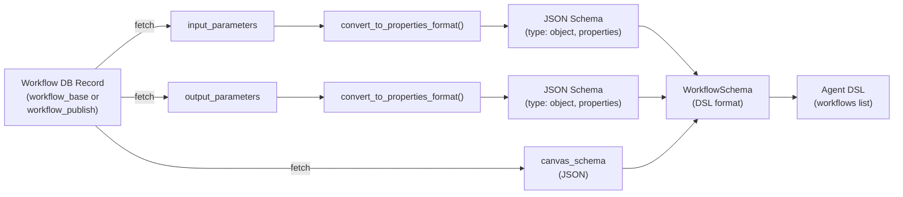

**Diagram: Workflow to DSL Conversion**

The conversion process (`workflow_convert()` function):
1. Fetches the workflow by `workflow_id` and `workflow_version`
2. Extracts `input_parameters` and `output_parameters`
3. Converts parameter arrays to JSON Schema format using `convert_to_properties_format()`
4. Creates a `WorkflowSchema` object with inputs, outputs, and metadata

**Sources:** [backend/openjiuwen_studio/core/manager/convertor/agent.py:32-117]()

---

## Integration with Agents

Agents can use workflows in two ways:

### 1. Workflow-Mode Agents

An agent configured in "Workflow" mode directly executes a single workflow:

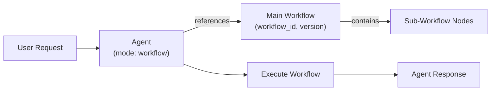

**Diagram: Workflow-Mode Agent**

The agent's entire logic is defined by the workflow. When the agent receives a message, it executes the workflow with the message as input.

### 2. ReAct-Mode Agents with Workflow Skills

ReAct-mode agents can call workflows as "skills" or tools:

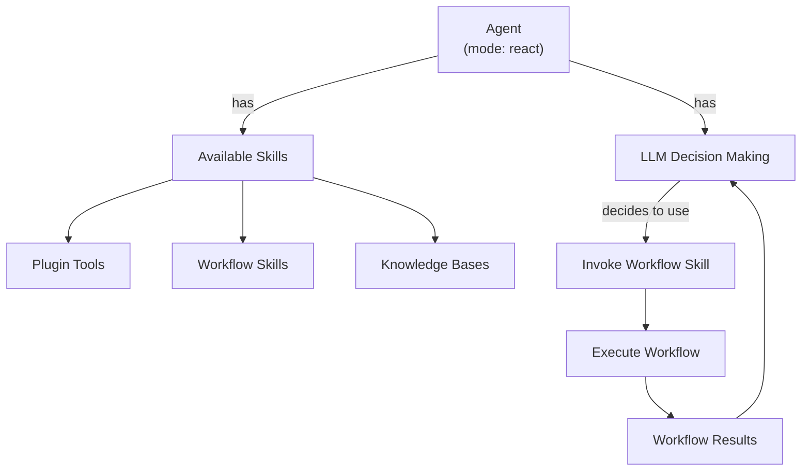

**Diagram: ReAct Agent with Workflow Skills**

The LLM can choose when to invoke workflows based on the conversation context. Workflows appear as function calls with input/output schemas.

**Sources:** [backend/openjiuwen_studio/core/manager/convertor/agent.py:68-117](), [backend/openjiuwen_studio/models/agent.py]()

---

## Test Execution and Debugging

### Test Run Panel

The workflow canvas includes a Test Run panel for immediate execution:

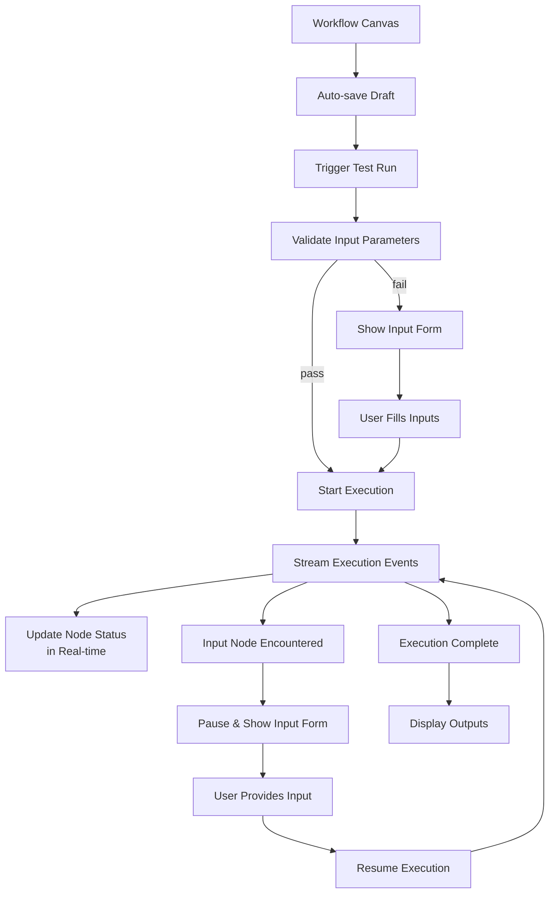

**Diagram: Test Run Flow**

The test run system (`testRunRuntimeService`):
- Maintains node execution status
- Handles input interruptions (Input nodes)
- Collects streaming messages from LLM nodes
- Displays real-time debug information

**Sources:** [frontend/packages/workflow-canvas/src/components/testrun/testrun-panel/test-run-panel.tsx:1-300](), [frontend/packages/workflow-canvas/src/components/testrun/runtime/testrun-runtime-service.ts]()

### Debug Panel

The Debug Panel shows detailed execution logs:

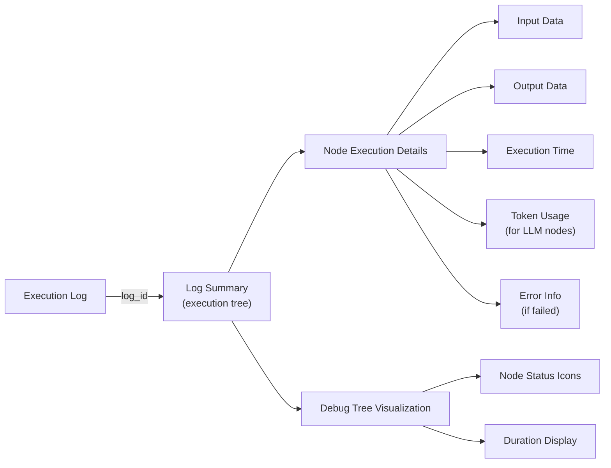

**Diagram: Debug Panel Data Structure**

Users can:
- Select historical execution logs from a list
- View the execution tree with node statuses
- Inspect input/output data for each node
- Analyze token usage and costs for LLM nodes

**Sources:** [frontend/src/locales/workflow/zh-CN/nodes.json:348-379](), [frontend/packages/workflow-canvas/src/components/debug-panel/]()

---

## Version History

Workflows support comprehensive version management:

### Version Operations

| Operation | Description | Implementation |
|-----------|-------------|----------------|
| Save Draft | Update draft without creating version | Updates `workflow_base` record |
| Publish | Create new version | Creates `workflow_publish` record |
| Restore | Copy version back to draft | Loads version canvas into draft |
| Delete Version | Remove published version | Deletes `workflow_publish` record |
| Create Copy | Duplicate version as new workflow | Creates new workflow_id |

**Sources:** [frontend/src/locales/workflow/zh-CN/nodes.json:264-288](), [backend/openjiuwen_studio/core/manager/repositories/workflow_repository.py]()

### Version Snapshot Contents

Each published version captures:
- Complete `canvas_schema` (all nodes, edges, configurations)
- `input_parameters` definition
- `output_parameters` definition
- `version_description` (user-provided changelog)
- `workflow_version` (semantic version string)
- Timestamp (`create_time`, `update_time`)

This ensures workflows can be restored or referenced at any point in their history.

**Sources:** [backend/openjiuwen_studio/models/workflow.py]()

---

## Sources Summary

**Core Backend Files:**
- [backend/openjiuwen_studio/core/manager/convertor/agent.py:32-117]() - Workflow conversion to DSL
- [backend/openjiuwen_studio/core/manager/repositories/workflow_repository.py]() - Workflow data operations
- [backend/openjiuwen_studio/models/workflow.py]() - Workflow database models
- [backend/openjiuwen_studio/routers/workflows.py]() - Workflow API routes

**Core Frontend Files:**
- [frontend/packages/workflow-canvas/src/editor.tsx]() - Main canvas editor
- [frontend/packages/workflow-canvas/src/nodes/]() - Node type implementations
- [frontend/src/locales/workflow/zh-CN/nodes.json]() - Node type translations and documentation
- [frontend/packages/workflow-canvas/src/components/testrun/]() - Test execution system
- [frontend/packages/api-client/src/config.ts:96-114]() - Workflow API endpoints

---

