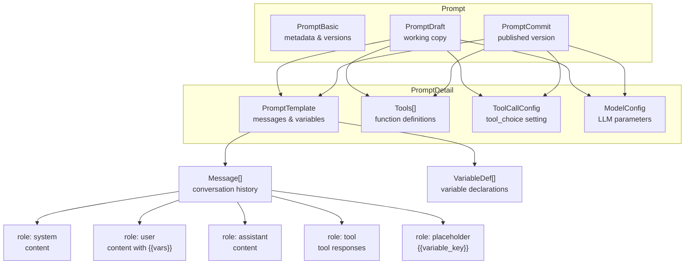
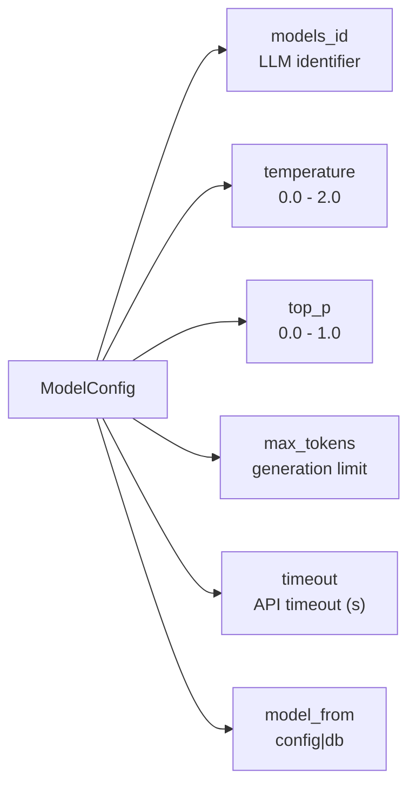
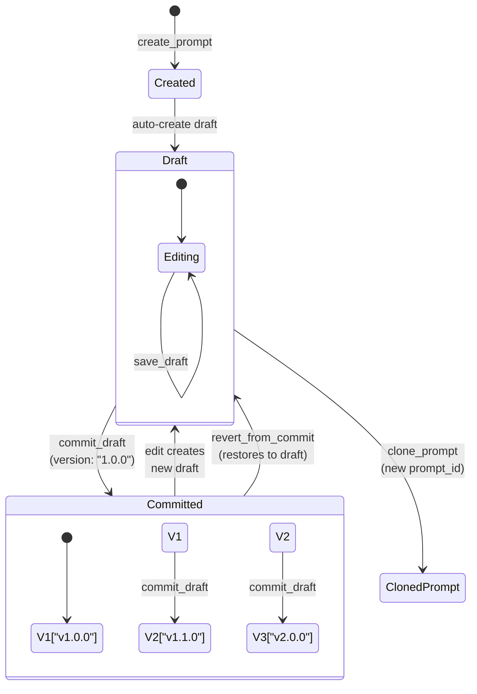
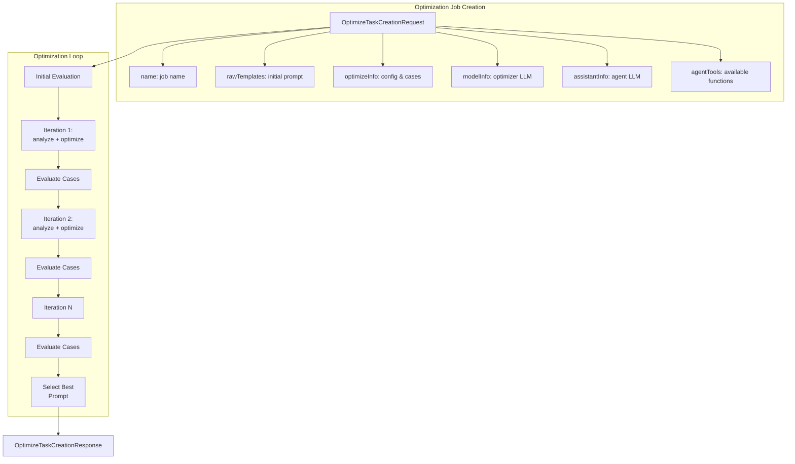
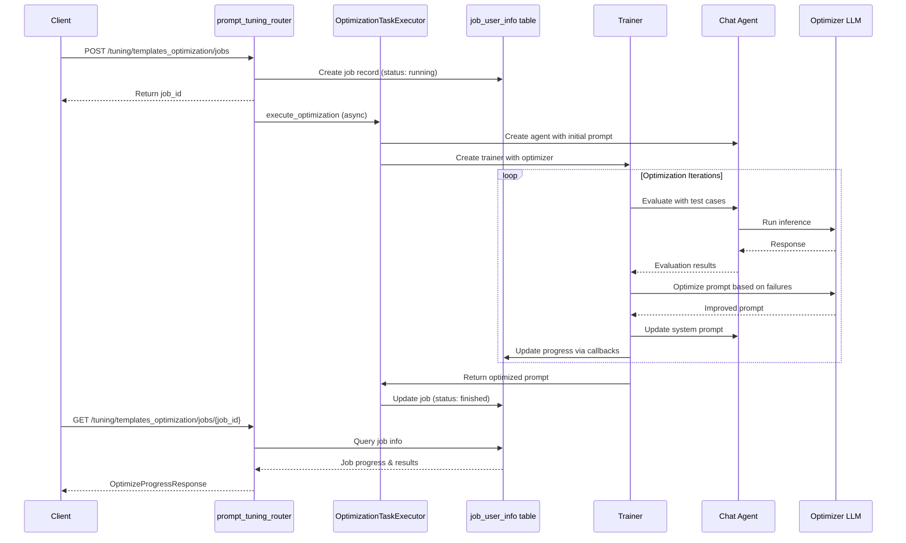
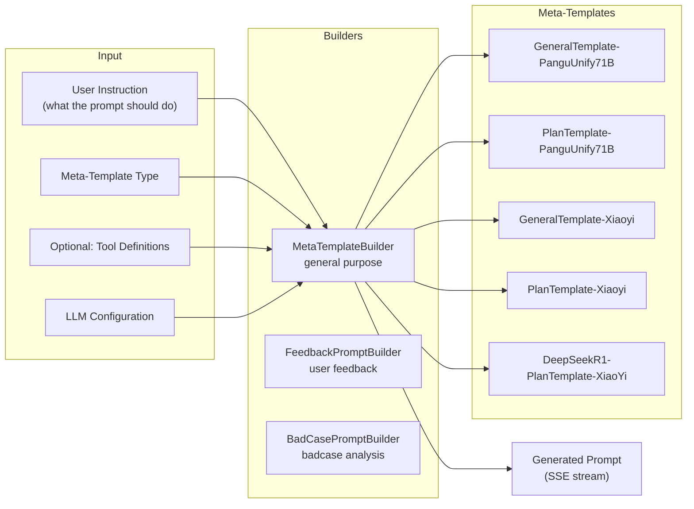
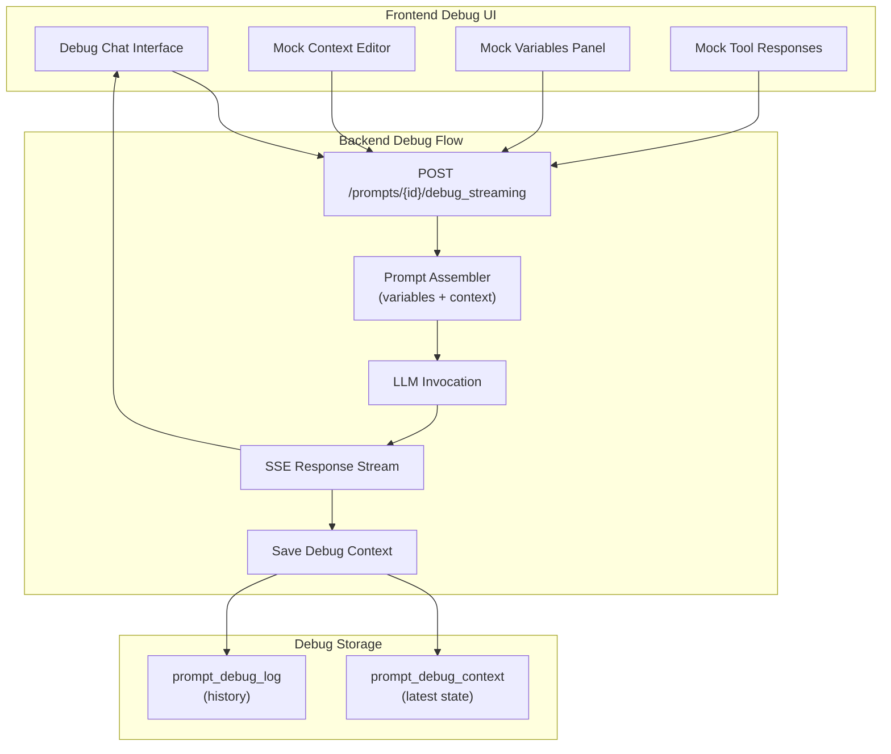
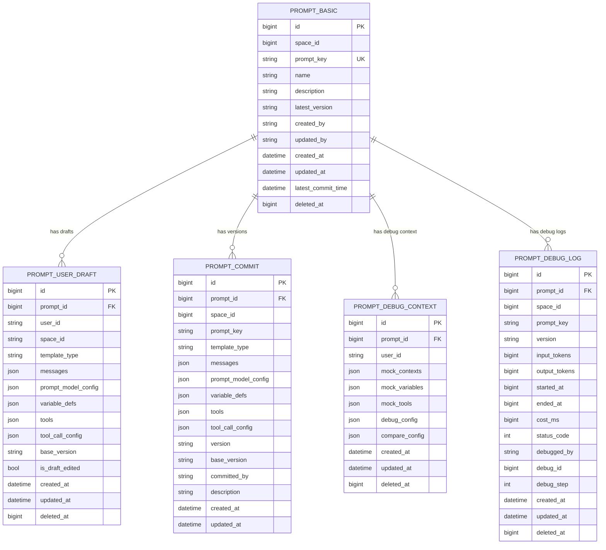
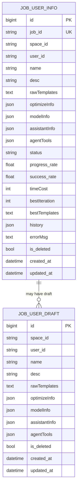
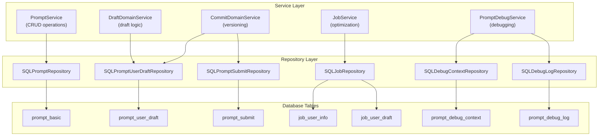

<!-- source: DeepWiki mcp.deepwiki.com · repo openJiuwen-ai/agent-studio · page 3.3 Prompts & Templates · fetched 2026-11-02 -->

# Prompts & Templates

<details>
<summary>Relevant source files</summary>

The following files were used as context for generating this wiki page:

- [backend/openjiuwen_studio/core/manager/model_manager/managers/model_test_manager.py](backend/openjiuwen_studio/core/manager/model_manager/managers/model_test_manager.py)
- [backend/openjiuwen_studio/ops/modules/llm/llm_config_service.py](backend/openjiuwen_studio/ops/modules/llm/llm_config_service.py)
- [backend/openjiuwen_studio/ops/modules/llm/schema.py](backend/openjiuwen_studio/ops/modules/llm/schema.py)
- [backend/openjiuwen_studio/ops/modules/prompt/domain/debug_entity.py](backend/openjiuwen_studio/ops/modules/prompt/domain/debug_entity.py)
- [backend/openjiuwen_studio/ops/modules/prompt/domain/entities.py](backend/openjiuwen_studio/ops/modules/prompt/domain/entities.py)
- [backend/openjiuwen_studio/ops/modules/prompt/domain/services.py](backend/openjiuwen_studio/ops/modules/prompt/domain/services.py)
- [backend/openjiuwen_studio/ops/modules/prompt/infra/repositories/debug_repo.py](backend/openjiuwen_studio/ops/modules/prompt/infra/repositories/debug_repo.py)
- [backend/openjiuwen_studio/routers/prompt_debug_router.py](backend/openjiuwen_studio/routers/prompt_debug_router.py)
- [backend/openjiuwen_studio/routers/prompt_llm_router.py](backend/openjiuwen_studio/routers/prompt_llm_router.py)
- [backend/openjiuwen_studio/routers/prompt_router.py](backend/openjiuwen_studio/routers/prompt_router.py)
- [backend/openjiuwen_studio/routers/prompt_tuning_router.py](backend/openjiuwen_studio/routers/prompt_tuning_router.py)
- [backend/openjiuwen_studio/schemas/model_config.py](backend/openjiuwen_studio/schemas/model_config.py)
- [frontend/src/components/Agent/ModelDetailForm.tsx](frontend/src/components/Agent/ModelDetailForm.tsx)

</details>


This document describes the prompt template system in OpenJiuwen Agent Studio, including template structure, version control, optimization, and debugging capabilities.

**Scope**: This page covers the prompt template data model, draft-commit workflow, prompt optimization/tuning features, template building tools, and debugging infrastructure. For information about how prompts are used within agents, see [Agents](#3.1). For model configuration details, see [Models](#3.4).

## Overview

The prompt template system provides a comprehensive framework for creating, versioning, optimizing, and debugging prompts used by AI agents. Key features include:

- **Structured Templates**: Support for multi-message conversations with variables, tools, and model configurations
- **Version Control**: Git-like draft-commit workflow with version history and rollback capabilities
- **Prompt Optimization**: Automated LLM-based prompt tuning using test cases and iterative refinement
- **Template Building**: AI-assisted prompt generation using meta-templates and feedback
- **Debugging Tools**: Interactive debugging with mock contexts, variables, and SSE streaming

**Sources**: [backend/openjiuwen_studio/ops/modules/prompt/domain/entities.py:1-717](), [backend/openjiuwen_studio/routers/prompt_router.py:1-237]()

---

## Prompt Template Structure

### Core Components

A prompt template consists of several key components organized in a hierarchical structure:



**Sources**: [backend/openjiuwen_studio/ops/modules/prompt/domain/entities.py:195-207](), [backend/openjiuwen_studio/ops/modules/prompt/domain/entities.py:279-287]()

### Message Structure

Messages support multiple content types and roles:

| Field | Type | Description |
|-------|------|-------------|
| `role` | `Role` enum | system, user, assistant, tool, placeholder |
| `content` | `str` | Text content, may contain variable placeholders like `{{variable_name}}` |
| `reasoning_content` | `str` | Optional reasoning/chain-of-thought content |
| `parts` | `List[ContentPart]` | Multi-modal content (text, images) |
| `tool_call_id` | `str` | ID for tool response messages |
| `tool_calls` | `List[ToolCall]` | Tool invocations from assistant |

**Template Types**:
- `normal`: Plain text with `{{variable}}` placeholders
- `jinja2`: Jinja2 templating syntax support

**Sources**: [backend/openjiuwen_studio/ops/modules/prompt/domain/entities.py:185-193](), [backend/openjiuwen_studio/ops/modules/prompt/domain/entities.py:75-78]()

### Model Configuration

Each prompt template includes model-specific parameters:



**Parameter Constraints** (from ModelDetailForm.tsx):
- **temperature**: 0.0 - 2.0, step 0.1 (controls randomness)
- **top_p**: 0.0 - 1.0, step 0.1 (nucleus sampling)
- **timeout**: 1 - 3600 seconds, integer only
- **max_tokens**: 100+ (output length limit)

**Sources**: [backend/openjiuwen_studio/ops/modules/prompt/domain/entities.py:142-154](), [frontend/src/components/Agent/ModelDetailForm.tsx:53-68]()

---

## Variable System

### Variable Types

Variables enable dynamic content injection into prompts:

| Type | Usage | Example |
|------|-------|---------|
| `string` | Simple text substitution | `{{user_query}}` |
| `placeholder` | Multi-message insertion | `{{conversation_history}}` |
| `integer` | Numeric values | `{{max_results}}` |
| `float` | Decimal values | `{{confidence_threshold}}` |
| `boolean` | True/false flags | `{{include_sources}}` |
| `object` | JSON structures | `{{context_data}}` |

### Variable Definition

Variables are declared in `PromptTemplate.variable_defs`:

```python
class VariableDef(BaseModel):
    key: str          # Variable name (without braces)
    desc: str         # Human-readable description
    type: VariableType  # Data type
```

**Placeholder Variables**: When `type="placeholder"`, the variable contains a list of messages that are inserted into the conversation at the placeholder position.

**Sources**: [backend/openjiuwen_studio/ops/modules/prompt/domain/entities.py:179-183](), [backend/openjiuwen_studio/ops/modules/prompt/domain/entities.py:102-109]()

---

## Version Control Workflow

### Draft-Commit Model

The prompt system implements a Git-like version control workflow:



### Database Tables

**Prompt Basic** (`prompt_basic` table):
- `id`: Primary key (prompt_id)
- `space_id`: Workspace identifier
- `prompt_key`: Unique key within workspace
- `name`, `description`: Metadata
- `latest_version`: Current version string
- `latest_commit_time`: Last commit timestamp

**Prompt User Draft** (`prompt_user_draft` table):
- `prompt_id`: References prompt_basic
- `user_id`: Owner of this draft
- `template_type`, `messages`, `variable_defs`, `tools`, etc.: Serialized prompt details
- `base_version`: Version this draft was created from
- `is_draft_edited`: Boolean flag

**Prompt Commit** (`prompt_submit` table):
- `prompt_id`: References prompt_basic
- `version`: Semantic version string
- `base_version`: Parent version
- `committed_by`, `description`: Commit metadata
- All prompt detail fields (same as draft)

**Sources**: [backend/openjiuwen_studio/ops/modules/prompt/domain/entities.py:226-234](), [backend/openjiuwen_studio/ops/modules/prompt/domain/entities.py:410-426](), [backend/openjiuwen_studio/ops/modules/prompt/domain/entities.py:442-459]()

### API Operations

| Operation | Endpoint | Description |
|-----------|----------|-------------|
| Create | `POST /api/v1/prompts/` | Create new prompt with auto-draft |
| Save Draft | `POST /api/v1/prompts/{id}/drafts/save` | Update draft |
| Get Draft | `GET /api/v1/prompts/{id}/drafts` | Retrieve user's draft |
| Commit | `POST /api/v1/prompts/{id}/drafts/commit` | Publish version |
| List Commits | `GET /api/v1/prompts/{id}/commits/list` | Version history |
| Revert | `POST /api/v1/prompts/{id}/drafts/revert_from_commit` | Restore from version |
| Clone | `POST /api/v1/prompts/{id}/clone` | Duplicate prompt |

**Sources**: [backend/openjiuwen_studio/routers/prompt_router.py:31-222]()

---

## Prompt Optimization

### Overview

The prompt optimization system uses LLM-based iterative refinement to improve prompt performance against test cases.



### Optimization Configuration

**OptimizeInfo** structure (from `OptimizeTaskCreationRequest`):

| Field | Type | Description | Default | Range |
|-------|------|-------------|---------|-------|
| `num_iter` | int | Number of optimization iterations | - | - |
| `early_stop_score` | float | Score threshold to stop early | - | 0.0-1.0 |
| `cases` | List[Case] | Test cases (max 300) | [] | - |
| `example_num` | int | Number of examples to use | 0 | 0-10 |
| `llm_parallel` | int | Parallel LLM calls | 1 | 1-10 |
| `user_compare_rules` | str | Evaluation rules | - | - |
| `user_compare_options` | str | Evaluation options | - | - |
| `external_knowledge` | str | Background knowledge | - | - |

**Case Structure**:
```python
class Case(BaseModel):
    inputs: Dict[str, Any]   # Variable values
    label: Dict[str, Any]    # Expected output (content, tool_calls, etc.)
```

**Validation**:
- Maximum 300 cases per job
- Total cases data size ≤ 16MB

**Sources**: [backend/openjiuwen_studio/ops/modules/prompt/domain/entities.py:563-604](), [backend/openjiuwen_studio/ops/modules/prompt/domain/entities.py:558-561](), [backend/openjiuwen_studio/routers/prompt_tuning_router.py:614-624]()

### Optimization Execution Flow



### Model Configuration Conversion

The optimizer requires specific model configuration format:

```python
# Convert from studio format to SDK format
def convert_to_sdk_format(llm_service, model_info):
    model_config = llm_service.get_llm_model_key_info(
        model_info["id"], 
        model_info["model_from"]
    )
    return {
        "base_url": model_config["base_url"],
        "api_key": model_config["api_key"],
        "provider": model_config["provider"],
        "model_name": model_config["model_name"],
        "params": {
            "temperature": model_info.get("temperature") or default,
            "top_p": model_info.get("top_p") or default,
            "timeout": model_info.get("timeout") or default
        }
    }
```

**Two LLMs Used**:
1. **Optimizer LLM** (`modelInfo`): Analyzes failures and generates improved prompts
2. **Assistant LLM** (`assistantInfo`): The agent being optimized

**Sources**: [backend/openjiuwen_studio/routers/prompt_tuning_router.py:107-139](), [backend/openjiuwen_studio/routers/prompt_tuning_router.py:287-291]()

### Optimization Callbacks

Real-time progress updates via `OptimizationCallbacks`:

```python
class OptimizationCallbacks(Callbacks):
    def on_train_begin(self, agent, progress, eval_info):
        # Record baseline performance
        
    def on_train_epoch_end(self, agent, progress, eval_info):
        # Update DB with:
        # - current_epoch, current_epoch_score
        # - best_score, best_iteration
        # - optimized_prompt
        # - evaluate_cases (case-by-case results)
        
    def on_train_end(self, agent, progress, eval_info):
        # Mark job as finished
        # Record final metrics
```

**Database Updates**:
- `progress_rate`: 0.0 to 1.0 (completion percentage)
- `success_rate`: Best score achieved
- `bestIteration`: Iteration number with best score
- `bestTemplates`: Best prompt text
- `history`: JSON array of iteration results
- `timeCost`: Elapsed time in seconds

**Sources**: [backend/openjiuwen_studio/routers/prompt_tuning_router.py:141-276]()

### Job Management

**Job Draft** (for incomplete configurations):
- Save partial optimization configs as drafts
- Resume optimization job creation
- API: `POST /tuning/templates_optimization/job_draft/save`

**Job Monitoring**:
- `GET /tuning/templates_optimization/jobs/{job_id}`: Poll for progress
- Returns `OptimizeProgressResponse` with history and current status

**Job History Pagination**:
- `GET /tuning/templates_optimization/job_history/{job_id}`: Get detailed iteration results
- Query params: `iteration_round`, `page_num`, `page_size`

**Sources**: [backend/openjiuwen_studio/routers/prompt_tuning_router.py:822-906](), [backend/openjiuwen_studio/ops/modules/prompt/domain/services.py:342-425]()

---

## Prompt Building & Generation

### Meta-Template System

The system provides AI-assisted prompt generation using meta-templates:



### Template Types

**Enum Values** (MetaTemplateTypeEnum):
- `GeneralTemplate-PanguUnify71B`: General-purpose template
- `PlanTemplate-PanguUnify71B`: Planning/reasoning template
- `GeneralTemplate-Xiaoyi`: Xiaoyi model variant
- `PlanTemplate-Xiaoyi`: Xiaoyi planning variant
- `DeepSeekR1-PlanTemplate-XiaoYi`: DeepSeek R1 with Xiaoyi

**Sources**: [backend/openjiuwen_studio/ops/modules/prompt/domain/entities.py:676-681]()

### Build API

**Endpoint**: `POST /api/v1/prompts/tuning/build`

**Request Body**:
```json
{
  "instruct": "Create a prompt for customer support chatbot",
  "modelInfo": {
    "id": "1",
    "model_from": "config"
  },
  "templateInfo": {
    "metaTemplateType": "GeneralTemplate-Xiaoyi"
  },
  "tools": [...],  // Optional tool definitions
  "stream": true,
  "workspace_id": "123"
}
```

**Response**: SSE stream of generated prompt content

**Builder Classes**:
- `MetaTemplateBuilder`: Uses LLM to generate prompts from instructions
- `FeedbackPromptBuilder`: Refines prompts based on user feedback
- `BadCasePromptBuilder`: Improves prompts based on failure cases

**Sources**: [backend/openjiuwen_studio/routers/prompt_tuning_router.py:919-1049](), [backend/openjiuwen_studio/ops/modules/prompt/domain/entities.py:684-687]()

---

## Prompt Debugging

### Debug Architecture



### Debug Context Structure

**DebugContext** components:

1. **debug_core**:
   - `mock_contexts`: List of `DebugMessage` (conversation history with metadata)
   - `mock_variables`: List of `VariableVal` (variable values for testing)
   - `mock_tools`: List of `MockTool` (mocked tool responses)

2. **debug_config**:
   - `single_step_debug`: Boolean flag for step-by-step execution

3. **compare_config**:
   - `groups`: Array of prompt variants for A/B testing

**DebugMessage** fields:
- Standard message fields (role, content, etc.)
- `debug_id`: Unique identifier for this debug session
- `input_tokens`, `output_tokens`: Token usage
- `cost_ms`: Execution time
- `msg_time`: Timestamp
- `tool_calls`: Enhanced with `mock_response` and `debug_trace_key`

**Sources**: [backend/openjiuwen_studio/ops/modules/prompt/domain/debug_entity.py:100-149]()

### Debug APIs

| Endpoint | Method | Purpose |
|----------|--------|---------|
| `/prompts/{id}/debug_streaming` | POST | Execute prompt with mocks, return SSE stream |
| `/prompts/{id}/debug_context/save` | POST | Save debug context for reuse |
| `/prompts/{id}/debug_context/get` | GET | Retrieve saved debug context |
| `/prompts/{id}/debug_history/list` | GET | Paginated debug log history |

**Debug Streaming Request**:
```json
{
  "prompt": { "prompt_draft": { "detail": {...} } },
  "messages": [...],           // Initial conversation
  "variable_vals": [...],      // Variable values
  "mock_tools": [...],         // Tool mock responses
  "single_step_debug": false,
  "debug_trace_key": "trace_123",
  "workspace_id": 123
}
```

**Sources**: [backend/openjiuwen_studio/routers/prompt_debug_router.py:32-104](), [backend/openjiuwen_studio/ops/modules/prompt/domain/debug_entity.py:204-221]()

### Debug Log Tracking

**PromptDebugLog** table fields:
- `prompt_id`, `space_id`, `prompt_key`, `version`: Prompt identification
- `input_tokens`, `output_tokens`: Token usage
- `started_at`, `ended_at`, `cost_ms`: Timing metrics
- `status_code`: HTTP status or error code
- `debugged_by`: User identifier
- `debug_id`: Session identifier
- `debug_step`: Step number in multi-step debugging

**Query Filters**:
- `days_limit`: Filter by recency (e.g., last 7 days)
- `page_size`, `page_token`: Pagination

**Sources**: [backend/openjiuwen_studio/ops/modules/prompt/infra/repositories/debug_repo.py:44-71](), [backend/openjiuwen_studio/ops/modules/prompt/infra/repositories/debug_repo.py:303-335]()

---

## Data Model & Storage

### Entity Relationship Diagram



### Optimization Job Storage



**Sources**: [backend/openjiuwen_studio/ops/modules/prompt/infra/repositories/debug_repo.py:18-71](), [backend/openjiuwen_studio/ops/modules/prompt/domain/services.py:53-107]()

---

## Repository & Service Layers

### Repository Pattern



**Key Repository Methods**:

`SQLPromptRepository`:
- `find_by_id(prompt_id)`: Get basic prompt info
- `find_commit_by_id_version(prompt_id, version)`: Get specific commit
- `find_draft_by_id(prompt_id, user_id)`: Get user's draft

`SQLPromptUserDraftRepository`:
- `save_draft(draft_po)`: Upsert draft
- `get_draft(prompt_id, user_id)`: Retrieve draft

`SQLPromptSubmitRepository`:
- `save_commit(commit)`: Create version
- `find_commit_by_version(prompt_id, version)`: Get commit
- `list_commits_by_prompt_id(prompt_id, page_size)`: Version history

`SQLJobRepository`:
- `save(job_data)`: Create optimization job
- `update(job)`: Update job status/progress
- `find_job_by_job_id(job_id, space_id, user_id)`: Get job info

**Sources**: [backend/openjiuwen_studio/ops/modules/prompt/domain/services.py:26-194](), [backend/openjiuwen_studio/ops/modules/prompt/application/service.py:1-300]()

---

## API Quick Reference

### Prompt Management APIs

| Route | Method | Handler | Purpose |
|-------|--------|---------|---------|
| `/api/v1/prompts/` | POST | `create_prompt` | Create new prompt |
| `/api/v1/prompts/list` | POST | `list_prompts` | List prompts with filters |
| `/api/v1/prompts/{id}` | GET | `get_prompt` | Get prompt details |
| `/api/v1/prompts/{id}` | PUT | `update_prompt` | Update metadata |
| `/api/v1/prompts/{id}` | DELETE | `delete_prompt` | Soft delete |
| `/api/v1/prompts/{id}/clone` | POST | `clone_prompt` | Duplicate prompt |
| `/api/v1/prompts/batch-get` | POST | `batch_get_prompts` | Get multiple prompts |

**Sources**: [backend/openjiuwen_studio/routers/prompt_router.py:31-237]()

### Draft & Commit APIs

| Route | Method | Handler | Purpose |
|-------|--------|---------|---------|
| `/api/v1/prompts/{id}/drafts/save` | POST | `save_draft` | Save draft changes |
| `/api/v1/prompts/{id}/drafts` | GET | `get_draft` | Get user's draft |
| `/api/v1/prompts/{id}/drafts/commit` | POST | `commit_draft` | Publish version |
| `/api/v1/prompts/{id}/commits/list` | GET | `list_commits` | Version history |
| `/api/v1/prompts/{id}/drafts/revert_from_commit` | POST | `revert_from_commit` | Restore version |

**Sources**: [backend/openjiuwen_studio/routers/prompt_router.py:121-222]()

### Optimization APIs

| Route | Method | Handler | Purpose |
|-------|--------|---------|---------|
| `/api/v1/prompts/tuning/templates_optimization/jobs` | POST | `prompt_optimize` | Start optimization |
| `/api/v1/prompts/tuning/templates_optimization/jobs/{job_id}` | GET | `prompt_optimize_progress` | Get job status |
| `/api/v1/prompts/tuning/templates_optimization/jobs/get_infos` | POST | `prompt_optimize_progress_list` | Batch get jobs |
| `/api/v1/prompts/tuning/templates_optimization/jobs/{job_id}` | DELETE | `prompt_optimize_delete` | Delete job/draft |
| `/api/v1/prompts/tuning/templates_optimization/job_draft/save` | POST | `save_draft` | Save job draft |
| `/api/v1/prompts/tuning/templates_optimization/job_draft/get` | GET | `get_draft` | Get job draft |
| `/api/v1/prompts/tuning/templates_optimization/job_history/{job_id}` | GET | `get_history` | Iteration details |
| `/api/v1/prompts/tuning/build` | POST | `prompt_generate` | Generate prompt from instruction |

**Sources**: [backend/openjiuwen_studio/routers/prompt_tuning_router.py:677-1049]()

### Debug APIs

| Route | Method | Handler | Purpose |
|-------|--------|---------|---------|
| `/api/v1/prompts/{id}/debug_streaming` | POST | `debug_streaming` | Test prompt (SSE) |
| `/api/v1/prompts/{id}/debug_context/save` | POST | `save_debug_context` | Save context |
| `/api/v1/prompts/{id}/debug_context/get` | GET | `get_debug_context` | Get context |
| `/api/v1/prompts/{id}/debug_history/list` | GET | `list_debug_history` | Debug logs |

**Sources**: [backend/openjiuwen_studio/routers/prompt_debug_router.py:32-104]()

---

