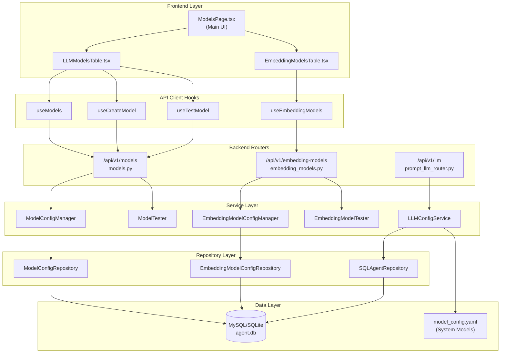
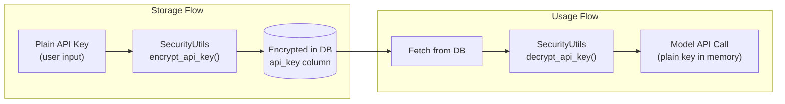
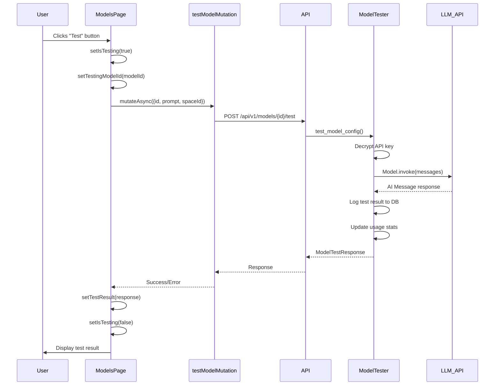
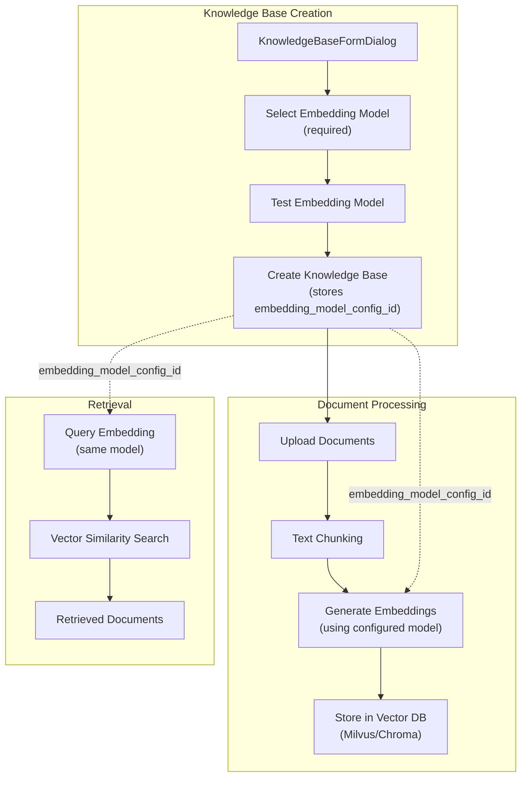
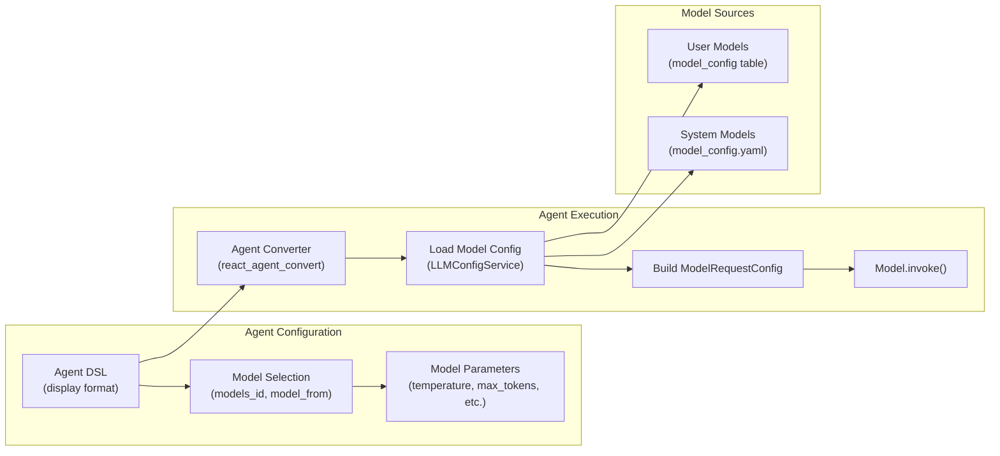
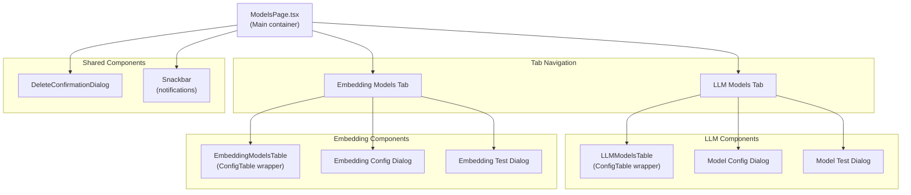

<!-- source: DeepWiki mcp.deepwiki.com · repo openJiuwen-ai/agent-studio · page 3.4 Models · fetched 2026-11-02 -->

# Models

<details>
<summary>Relevant source files</summary>

The following files were used as context for generating this wiki page:

- [backend/openjiuwen_studio/core/manager/model_manager/managers/embedding_model_test_manager.py](backend/openjiuwen_studio/core/manager/model_manager/managers/embedding_model_test_manager.py)
- [backend/openjiuwen_studio/core/manager/model_manager/managers/model_test_manager.py](backend/openjiuwen_studio/core/manager/model_manager/managers/model_test_manager.py)
- [backend/openjiuwen_studio/ops/modules/llm/llm_config_service.py](backend/openjiuwen_studio/ops/modules/llm/llm_config_service.py)
- [backend/openjiuwen_studio/ops/modules/llm/schema.py](backend/openjiuwen_studio/ops/modules/llm/schema.py)
- [backend/openjiuwen_studio/ops/modules/prompt/domain/debug_entity.py](backend/openjiuwen_studio/ops/modules/prompt/domain/debug_entity.py)
- [backend/openjiuwen_studio/ops/modules/prompt/domain/entities.py](backend/openjiuwen_studio/ops/modules/prompt/domain/entities.py)
- [backend/openjiuwen_studio/ops/modules/prompt/domain/services.py](backend/openjiuwen_studio/ops/modules/prompt/domain/services.py)
- [backend/openjiuwen_studio/ops/modules/prompt/infra/repositories/debug_repo.py](backend/openjiuwen_studio/ops/modules/prompt/infra/repositories/debug_repo.py)
- [backend/openjiuwen_studio/routers/embedding_models.py](backend/openjiuwen_studio/routers/embedding_models.py)
- [backend/openjiuwen_studio/routers/prompt_debug_router.py](backend/openjiuwen_studio/routers/prompt_debug_router.py)
- [backend/openjiuwen_studio/routers/prompt_llm_router.py](backend/openjiuwen_studio/routers/prompt_llm_router.py)
- [backend/openjiuwen_studio/routers/prompt_router.py](backend/openjiuwen_studio/routers/prompt_router.py)
- [backend/openjiuwen_studio/routers/prompt_tuning_router.py](backend/openjiuwen_studio/routers/prompt_tuning_router.py)
- [backend/openjiuwen_studio/schemas/model_config.py](backend/openjiuwen_studio/schemas/model_config.py)
- [frontend/src/components/Agent/ModelDetailForm.tsx](frontend/src/components/Agent/ModelDetailForm.tsx)
- [frontend/src/locales/en-US.json](frontend/src/locales/en-US.json)
- [frontend/src/locales/zh-CN.json](frontend/src/locales/zh-CN.json)
- [frontend/src/pages/Auth/PrivacyPolicyPage.tsx](frontend/src/pages/Auth/PrivacyPolicyPage.tsx)
- [frontend/src/pages/Auth/UserLoginPage.tsx](frontend/src/pages/Auth/UserLoginPage.tsx)
- [frontend/src/pages/KnowledgeBase/components/AddDocumentDialog.tsx](frontend/src/pages/KnowledgeBase/components/AddDocumentDialog.tsx)
- [frontend/src/pages/KnowledgeBase/components/KnowledgeBaseFormDialog.tsx](frontend/src/pages/KnowledgeBase/components/KnowledgeBaseFormDialog.tsx)
- [frontend/src/pages/Models/ModelsPage.tsx](frontend/src/pages/Models/ModelsPage.tsx)
- [frontend/src/pages/Models/ModelsPageNew.tsx](frontend/src/pages/Models/ModelsPageNew.tsx)
- [frontend/src/pages/Models/components/EmbeddingModelsTable.tsx](frontend/src/pages/Models/components/EmbeddingModelsTable.tsx)
- [frontend/src/pages/Models/components/LLMModelsTable.tsx](frontend/src/pages/Models/components/LLMModelsTable.tsx)

</details>


This page documents the model management system in OpenJiuwen Agent Studio, covering both LLM (Large Language Model) and Embedding model configuration, testing, and lifecycle management. Models are fundamental resources used throughout the platform for text generation, reasoning, and vector embeddings.

For information about using models within agents, see [Agents](#3.1). For model selection in knowledge bases, see [Knowledge Bases](#3.5). For prompt optimization with models, see [Prompts & Templates](#3.3).

---

## Model Types

OpenJiuwen supports two distinct categories of AI models, each serving different purposes in the platform:

### LLM Models

LLM models are used for text generation, reasoning, and conversational interactions. They power agents, prompt optimization, and knowledge graph extraction.

**Key characteristics:**
- **Purpose**: Text generation, reasoning, function calling
- **Configuration**: Temperature, max tokens, top-p, timeout
- **Features**: Streaming responses, function calling support
- **Usage tracking**: Request count, token consumption, cost estimation

**Supported providers** (defined in [backend/openjiuwen_studio/schemas/model_config.py:8-17]()):
- `openai` - OpenAI GPT models
- `anthropic` - Anthropic Claude models
- `deepseek` - DeepSeek models
- `qwen` - Alibaba Qwen models
- `google` - Google Gemini models
- `baidu` - Baidu ERNIE models
- `zhipu` - Zhipu GLM models
- `siliconflow` - SiliconFlow models
- `custom` - Custom API-compatible models

### Embedding Models

Embedding models convert text into high-dimensional vectors for semantic search and retrieval in knowledge bases.

**Key characteristics:**
- **Purpose**: Text vectorization for RAG (Retrieval-Augmented Generation)
- **Configuration**: Batch size, API endpoint
- **Protocol**: OpenAI-compatible embedding API
- **Integration**: Required for knowledge base document indexing

**Supported protocols** (defined in [backend/openjiuwen_studio/schemas/embedding_model_config.py]()):
- `openai` - OpenAI embedding API format (e.g., text-embedding-ada-002, BGE-M3)

Sources: [backend/openjiuwen_studio/schemas/model_config.py:8-17](), [frontend/src/pages/Models/ModelsPage.tsx:46-49](), [backend/openjiuwen_studio/schemas/embedding_model_config.py]()

---

## System Architecture

### Model Configuration Data Flow



Sources: [frontend/src/pages/Models/ModelsPage.tsx:1-1312](), [backend/openjiuwen_studio/routers/models.py](), [backend/openjiuwen_studio/routers/embedding_models.py:1-390](), [backend/openjiuwen_studio/core/manager/model_manager/managers/model_config_manager.py]()

### Model Testing Pipeline

```mermaid
graph LR
    subgraph "Test Request Flow"
        UI["User clicks Test"]
        TestReq["ModelTestRequest<br/>{prompt, parameters}"]
        Validate["Validate Model<br/>is_active=true<br/>api_key exists"]
    end
    
    subgraph "Model Invocation"
        Decrypt["SecurityUtils<br/>decrypt_api_key()"]
        Config["ModelClientConfig<br/>ModelRequestConfig"]
        ModelSDK["Model.invoke()<br/>(openjiuwen SDK)"]
        Response["AI Message<br/>response + metadata"]
    end
    
    subgraph "Result Processing"
        LogResult["Log test result<br/>to database"]
        UpdateStats["Update usage stats<br/>tokens, cost, latency"]
        ReturnUI["ModelTestResponse<br/>{success, response,<br/>tokens, cost, latency}"]
    end
    
    UI --> TestReq
    TestReq --> Validate
    Validate --> Decrypt
    Decrypt --> Config
    Config --> ModelSDK
    ModelSDK --> Response
    Response --> LogResult
    LogResult --> UpdateStats
    UpdateStats --> ReturnUI
```



Sources: [backend/openjiuwen_studio/core/manager/model_manager/managers/model_test_manager.py:40-219](), [backend/openjiuwen_studio/core/manager/model_manager/managers/embedding_model_test_manager.py:28-144]()

---

## Model Configuration

### LLM Model Configuration Schema

The `ModelConfigBase` class defines the structure for LLM models ([backend/openjiuwen_studio/schemas/model_config.py:27-57]()):

| Field | Type | Default | Description |
|-------|------|---------|-------------|
| `name` | `str` | Required | Model configuration name (1-100 chars) |
| `provider` | `ModelProvider` | Required | AI provider (openai, anthropic, etc.) |
| `model_type` | `str` | Required | Specific model identifier (e.g., gpt-4) |
| `base_url` | `str` | Required | API endpoint URL (must start with http/https) |
| `api_key` | `str` | Required (create) | API authentication key (encrypted in storage) |
| `space_id` | `str` | `"0"` | User workspace identifier |
| `is_active` | `bool` | `true` | Whether model is available for use |
| `description` | `str` | `null` | Optional description (max 500 chars) |
| `tags` | `List[str]` | `[]` | Categorization tags (max 10) |
| `parameters.temperature` | `float` | `0.7` | Randomness control (0.0-2.0) |
| `parameters.max_tokens` | `int` | `4096` | Maximum generation length |
| `parameters.top_p` | `float` | `0.9` | Nucleus sampling threshold (0.0-1.0) |
| `timeout` | `int` | `60` | Request timeout in seconds (1-3600) |
| `retry_count` | `int` | `3` | Retry attempts on failure (0-10) |
| `enable_streaming` | `bool` | `true` | Support streaming responses |
| `enable_function_calling` | `bool` | `false` | Support function/tool calling |

### Embedding Model Configuration Schema

The `EmbeddingModelConfigBase` class defines the structure for embedding models ([backend/openjiuwen_studio/schemas/embedding_model_config.py]()):

| Field | Type | Default | Description |
|-------|------|---------|-------------|
| `model_name` | `str` | Required | Display name for the model (1-100 chars) |
| `protocol` | `EmbeddingProtocol` | `"openai"` | API protocol format |
| `model_id` | `str` | Required | Model identifier for API calls |
| `api_base` | `str` | Required | Embedding API endpoint URL |
| `api_key` | `str` | Required (create) | API authentication key (encrypted) |
| `space_id` | `str` | `"0"` | User workspace identifier |
| `is_active` | `bool` | `true` | Whether model is available for use |
| `max_batch_size` | `int` | `5` | Maximum texts per batch (1-100) |

### API Key Security

API keys are encrypted before storage and decrypted only during actual API calls:



The encryption/decryption logic is implemented in [backend/openjiuwen_studio/core/manager/model_manager/utils/security_utils.py]() using the `cryptography` library with Fernet symmetric encryption.

Sources: [backend/openjiuwen_studio/schemas/model_config.py:27-99](), [backend/openjiuwen_studio/schemas/embedding_model_config.py](), [backend/openjiuwen_studio/core/manager/model_manager/utils/security_utils.py]()

---

## Model Lifecycle Management

### CRUD Operations

#### Create Model

**Frontend:** [frontend/src/pages/Models/ModelsPage.tsx:416-633]()
```
handleSaveLLMModel() / handleSaveEmbeddingModel()
  ↓
createModelMutation.mutateAsync()  [LLM]
createEmbeddingModelMutation.mutateAsync()  [Embedding]
  ↓
POST /api/v1/models  [LLM]
POST /api/v1/embedding-models  [Embedding]
```

**Backend:** [backend/openjiuwen_studio/routers/models.py]()
- **LLM**: `POST /api/v1/models` → `ModelConfigManager.create()`
- **Embedding**: `POST /api/v1/embedding-models` → `EmbeddingModelConfigManager.create()`

**Validation rules:**
- Name: 1-100 characters, unique per workspace
- Model ID: 1-100 characters
- API Key: Required on create, optional on update (if unchanged)
- Base URL: Must be valid HTTP/HTTPS URL
- Tags: Maximum 10 per model
- Parameters: Within specified ranges (temperature 0-2, timeout 1-3600, etc.)

#### Update Model

**Frontend:** [frontend/src/pages/Models/ModelsPage.tsx:418-518]()
```
handleSaveLLMModel() [edit mode]
  ↓
updateModelMutation.mutateAsync({id, model, spaceId})
  ↓
PUT /api/v1/models/{model_id}
```

**Backend:** `PUT /api/v1/models/{model_id}` → `ModelConfigManager.update()`

**Special behavior:**
- API key is optional on update; if omitted or matches masked value, existing key is retained
- Validates that model exists and belongs to user's workspace
- Updates `updated_at` timestamp automatically

#### Delete Model

**Frontend:** [frontend/src/pages/Models/ModelsPage.tsx:815-916]()
```
handleDelete()
  ↓
deleteModelMutation.mutateAsync({id, spaceId})
  ↓
DELETE /api/v1/models/{model_id}
```

**Backend:** `DELETE /api/v1/models/{model_id}` → `ModelConfigManager.delete()`

**Validation:**
- For embedding models: Checks if used by any knowledge bases ([backend/openjiuwen_studio/routers/embedding_models.py:163-179]())
- If in use, deletion is blocked and returns list of dependent knowledge bases
- System models (from YAML config) cannot be deleted

#### Toggle Status

**Frontend:** [frontend/src/pages/Models/ModelsPage.tsx:918-972]()
```
handleToggleStatus()
  ↓
toggleStatusMutation.mutateAsync({id, spaceId})
  ↓
PATCH /api/v1/models/{model_id}/toggle-status
```

**Backend:** `PATCH /api/v1/models/{model_id}/toggle-status` → `ModelConfigManager.toggle_status()`

**Effect:**
- Flips `is_active` boolean
- Inactive models cannot be tested or used in new configurations
- Existing agents/knowledge bases continue to reference inactive models but may fail at runtime

Sources: [frontend/src/pages/Models/ModelsPage.tsx:416-972](), [backend/openjiuwen_studio/routers/models.py](), [backend/openjiuwen_studio/routers/embedding_models.py:163-179]()

---

## Model Testing

### LLM Model Testing

The `ModelTester` class provides comprehensive testing for LLM configurations ([backend/openjiuwen_studio/core/manager/model_manager/managers/model_test_manager.py:23-220]()):

**Test flow:**
1. **Retrieve model configuration** from database
2. **Validate model status** (`is_active` must be true)
3. **Decrypt API key** using `SecurityUtils`
4. **Build configuration objects**:
   - `ModelClientConfig` (provider, API base, timeout, SSL verification)
   - `ModelRequestConfig` (model name, temperature, top_p, max_tokens)
5. **Invoke model** via `Model.invoke()` from openjiuwen SDK
6. **Record results**:
   - Success: Log response, tokens used, cost, latency
   - Failure: Log error message, still update statistics
7. **Update usage statistics** in database
8. **Return test response** to frontend

**Test request structure** ([backend/openjiuwen_studio/schemas/model_config.py:102-106]()):
```python
class ModelTestRequest(BaseModel):
    prompt: str  # Test prompt to send to model
    parameters: Optional[ModelParameters]  # Override default parameters
```

**Test response structure** ([backend/openjiuwen_studio/schemas/model_config.py:109-117]()):
```python
class ModelTestResponse(BaseModel):
    success: bool
    response: Optional[str]  # Model's generated response
    tokens_used: int
    cost: float
    latency: float  # Response time in seconds
    error: Optional[str]  # Error message if test failed
```

### Embedding Model Testing

The `EmbeddingModelTester` class tests embedding model configurations ([backend/openjiuwen_studio/core/manager/model_manager/managers/embedding_model_test_manager.py:20-144]()):

**Test flow:**
1. **Retrieve model configuration** from database
2. **Validate model status** (`is_active` must be true)
3. **Decrypt API key** using `SecurityUtils`
4. **Create EmbeddingConfig**:
   - `model_name`: Model identifier for API
   - `api_key`: Decrypted authentication key
   - `base_url`: API endpoint
5. **Invoke embedding** via `OpenAIEmbedding.embed_texts()`
6. **Return raw API response** (vector dimensions, embeddings)

**Default test prompt:** "This is a test sentence for embedding model validation."

**Test response** returns the raw embedding API response, typically including:
- `embedding_dimensions`: Vector size (e.g., 1536 for OpenAI, 1024 for BGE-M3)
- `embeddings`: List of float vectors
- `model`: Model identifier used
- `usage`: Token count information

### Test Execution in UI

**Frontend test flow** ([frontend/src/pages/Models/ModelsPage.tsx:974-1073]()):



**UI states during testing:**
- Test button shows `Loader2` icon while `isTesting` is true
- Result displayed in dialog with formatted response
- Success shown in green, errors shown in red
- Latency and token usage displayed for successful tests

Sources: [backend/openjiuwen_studio/core/manager/model_manager/managers/model_test_manager.py:23-220](), [backend/openjiuwen_studio/core/manager/model_manager/managers/embedding_model_test_manager.py:20-144](), [frontend/src/pages/Models/ModelsPage.tsx:974-1073]()

---

## Model Usage Statistics

LLM models track detailed usage metrics for monitoring and cost management ([backend/openjiuwen_studio/schemas/model_config.py:59-73]()):

### Usage Metrics Table

| Metric | Type | Description |
|--------|------|-------------|
| `total_requests` | `int` | Cumulative number of API calls |
| `total_tokens` | `int` | Total tokens consumed (input + output) |
| `total_cost` | `float` | Total cost in USD |
| `success_rate` | `float` | Ratio of successful calls (0.0-1.0) |
| `avg_response_time` | `float` | Average latency in seconds |
| `last_used` | `datetime` | Timestamp of most recent use |
| `daily_requests` | `int` | Requests today |
| `daily_tokens` | `int` | Tokens consumed today |
| `daily_cost` | `float` | Cost today in USD |
| `monthly_requests` | `int` | Requests this month |
| `monthly_tokens` | `int` | Tokens consumed this month |
| `monthly_cost` | `float` | Cost this month in USD |

### Statistics Update Flow

Statistics are updated in two scenarios:

1. **Model Testing** ([backend/openjiuwen_studio/core/manager/model_manager/managers/model_test_manager.py:159-165]()):
   - After each test invocation (success or failure)
   - Updates `total_requests`, `total_tokens`, `success_rate`, `avg_response_time`

2. **Production Usage** (via repository update methods):
   - When agents invoke models
   - When prompt optimization runs
   - When knowledge graph extraction occurs

The `ModelConfigRepository.update_usage_stats()` method ([backend/openjiuwen_studio/core/manager/repositories/model_config_repository.py]()) handles the atomic update of all metrics.

Sources: [backend/openjiuwen_studio/schemas/model_config.py:59-73](), [backend/openjiuwen_studio/core/manager/model_manager/managers/model_test_manager.py:159-165]()

---

## Integration with Other Systems

### Knowledge Base Integration

Embedding models are required for knowledge base document indexing and retrieval:



**Key integration points:**

1. **Model Selection** ([frontend/src/pages/KnowledgeBase/components/KnowledgeBaseFormDialog.tsx:114-149]()):
   - Fetches active embedding models via `useEmbeddingModels`
   - Validates model connectivity before KB creation
   - Tests model with sample text

2. **Model Validation** ([frontend/src/pages/KnowledgeBase/components/KnowledgeBaseFormDialog.tsx:186-222]()):
   - Prevents KB creation if model test fails
   - Shows error message with test failure details

3. **Document Processing** ([frontend/src/pages/KnowledgeBase/components/AddDocumentDialog.tsx:52-118]()):
   - Optional LLM model selection for graph enhancement
   - Uses KB's configured embedding model for vectorization

4. **Deletion Protection** ([backend/openjiuwen_studio/routers/embedding_models.py:163-179]()):
   - Checks for dependent knowledge bases before deletion
   - Returns list of KBs using the model
   - Blocks deletion if model is in use

### Agent Integration

LLM models are the core inference engine for agents:



**Model resolution in agents** ([backend/openjiuwen_studio/ops/modules/llm/llm_config_service.py:54-78]()):
- `model_from="config"`: Load from YAML configuration (system models)
- `model_from="database"`: Load from user's model configurations
- Returns complete model info including API credentials and parameters

### Prompt Optimization Integration

The prompt optimization system uses LLM models for iterative prompt improvement ([backend/openjiuwen_studio/routers/prompt_tuning_router.py:287-444]()):

**Model usage in optimization:**
1. **Agent Creation** - Creates test agent with optimized prompt
2. **Evaluation** - Evaluates agent responses against test cases
3. **Feedback Generation** - Generates prompt improvement suggestions

**Model configuration conversion** ([backend/openjiuwen_studio/routers/prompt_tuning_router.py:107-138]()):
```python
ModelConfigConverter.convert_to_sdk_format(llm_service, model_info)
  ↓
Returns: {
  "base_url": str,
  "api_key": str,
  "provider": str,
  "model_name": str,
  "params": {
    "temperature": float,
    "top_p": float,
    "timeout": int
  }
}
```

This standardized format is used to create `ModelClientConfig` and `ModelRequestConfig` objects for the optimization pipeline.

Sources: [frontend/src/pages/KnowledgeBase/components/KnowledgeBaseFormDialog.tsx:114-222](), [backend/openjiuwen_studio/routers/embedding_models.py:163-179](), [backend/openjiuwen_studio/ops/modules/llm/llm_config_service.py:54-126](), [backend/openjiuwen_studio/routers/prompt_tuning_router.py:107-444]()

---

## API Endpoints Reference

### LLM Model Endpoints

| Method | Endpoint | Handler | Description |
|--------|----------|---------|-------------|
| `POST` | `/api/v1/models` | `create_model_config` | Create new LLM model configuration |
| `GET` | `/api/v1/models` | `list_model_configs` | List all LLM models (paginated) |
| `GET` | `/api/v1/models/{model_id}` | `get_model_config` | Get single LLM model details |
| `PUT` | `/api/v1/models/{model_id}` | `update_model_config` | Update LLM model configuration |
| `DELETE` | `/api/v1/models/{model_id}` | `delete_model_config` | Delete LLM model configuration |
| `PATCH` | `/api/v1/models/{model_id}/toggle-status` | `toggle_model_status` | Toggle active/inactive status |
| `POST` | `/api/v1/models/{model_id}/test` | `test_model_config` | Test LLM model connectivity |

### Embedding Model Endpoints

| Method | Endpoint | Handler | Description |
|--------|----------|---------|-------------|
| `POST` | `/api/v1/embedding-models` | `create_embedding_model_config` | Create new embedding model |
| `GET` | `/api/v1/embedding-models` | `list_embedding_model_configs` | List all embedding models |
| `GET` | `/api/v1/embedding-models/{model_id}` | `get_embedding_model_config` | Get single embedding model |
| `PUT` | `/api/v1/embedding-models/{model_id}` | `update_embedding_model_config` | Update embedding model |
| `DELETE` | `/api/v1/embedding-models/{model_id}` | `delete_embedding_model_config` | Delete embedding model |
| `PATCH` | `/api/v1/embedding-models/{model_id}/toggle-status` | `toggle_embedding_model_status` | Toggle active/inactive |
| `POST` | `/api/v1/embedding-models/{model_id}/test` | `test_embedding_model` | Test embedding model |

### Legacy LLM Endpoints (Prompt System)

| Method | Endpoint | Handler | Description |
|--------|----------|---------|-------------|
| `POST` | `/api/v1/llm/model/{model_id}` | `get_model` | Get model info for prompt system |
| `POST` | `/api/v1/llm/models/list` | `list_models` | List models for prompt debug/optimization |

Sources: [backend/openjiuwen_studio/routers/models.py](), [backend/openjiuwen_studio/routers/embedding_models.py:26-390](), [backend/openjiuwen_studio/routers/prompt_llm_router.py:17-70]()

---

## Database Schema

### Model Configuration Tables

**LLM Models Table** (`model_config`):
```sql
CREATE TABLE model_config (
    id INTEGER PRIMARY KEY,
    name VARCHAR(100) NOT NULL,
    provider VARCHAR(50) NOT NULL,
    model_type VARCHAR(100) NOT NULL,
    base_url VARCHAR(500) NOT NULL,
    api_key TEXT,  -- Encrypted
    space_id VARCHAR(50) DEFAULT '0',
    is_active BOOLEAN DEFAULT TRUE,
    description VARCHAR(500),
    tags JSON,  -- Array of strings
    parameters JSON,  -- {temperature, max_tokens, top_p}
    timeout INTEGER DEFAULT 60,
    retry_count INTEGER DEFAULT 3,
    enable_streaming BOOLEAN DEFAULT TRUE,
    enable_function_calling BOOLEAN DEFAULT FALSE,
    created_at TIMESTAMP,
    updated_at TIMESTAMP,
    -- Usage statistics columns
    total_requests INTEGER DEFAULT 0,
    total_tokens INTEGER DEFAULT 0,
    total_cost FLOAT DEFAULT 0.0,
    success_rate FLOAT DEFAULT 0.0,
    avg_response_time FLOAT DEFAULT 0.0,
    last_used TIMESTAMP
)
```

**Embedding Models Table** (`embedding_model_config`):
```sql
CREATE TABLE embedding_model_config (
    id INTEGER PRIMARY KEY,
    model_name VARCHAR(100) NOT NULL,
    protocol VARCHAR(20) DEFAULT 'openai',
    model_id VARCHAR(100) NOT NULL,
    api_base VARCHAR(500) NOT NULL,
    api_key TEXT,  -- Encrypted
    space_id VARCHAR(50) DEFAULT '0',
    is_active BOOLEAN DEFAULT TRUE,
    max_batch_size INTEGER DEFAULT 5,
    created_at TIMESTAMP,
    updated_at TIMESTAMP
)
```

**Indexes:**
- `idx_model_config_space_id` on `model_config(space_id)`
- `idx_embedding_model_config_space_id` on `embedding_model_config(space_id)`

Sources: [backend/openjiuwen_studio/core/database/models.py](), [backend/openjiuwen_studio/schemas/model_config.py:27-99](), [backend/openjiuwen_studio/schemas/embedding_model_config.py]()

---

## Frontend Components

### ModelsPage Component Hierarchy



**Key component responsibilities:**

1. **ModelsPage** ([frontend/src/pages/Models/ModelsPage.tsx:114-1312]()):
   - Manages active tab state (LLM vs Embedding)
   - Handles search, filter, pagination
   - Coordinates CRUD operations via mutations
   - Manages dialog visibility and selected model state

2. **LLMModelsTable** ([frontend/src/pages/Models/components/LLMModelsTable.tsx:1-249]()):
   - Renders table with columns: name, provider, model ID, status, actions
   - Provides action buttons: Test, Edit, Delete
   - Handles status toggle switch
   - Shows loading states during operations

3. **EmbeddingModelsTable** ([frontend/src/pages/Models/components/EmbeddingModelsTable.tsx:1-207]()):
   - Similar to LLMModelsTable but for embedding models
   - Simplified columns (no usage statistics)
   - Same action patterns

4. **ConfigTable** (from `@/components/Common/common-table`):
   - Generic table component with search, sort, pagination
   - Used by both LLM and Embedding tables
   - Supports custom cell renderers for each column

### State Management

**Local state in ModelsPage:**
- `activeTab`: Current tab index (0=LLM, 1=Embedding)
- `currentPage`: Current page number
- `pageSize`: Items per page (10, 25, 50, 100)
- `searchTerm`: Search filter text
- `filterProvider`: Provider filter selection
- `filterStatus`: Status filter (all/active/inactive)
- `selectedModel`: Model being edited
- `showModelDialog`: Dialog visibility for create/edit
- `showTestDialog`: Test dialog visibility
- `isTesting`: Test operation in progress
- `testResult`: Test response text

**React Query state:**
- `modelsResponse`: LLM models data from API
- `embeddingModelsResponse`: Embedding models data from API
- `isLoadingLLM` / `isLoadingEmbedding`: Loading states
- Mutations: create, update, delete, toggle status, test

Sources: [frontend/src/pages/Models/ModelsPage.tsx:114-366](), [frontend/src/pages/Models/components/LLMModelsTable.tsx:1-249](), [frontend/src/pages/Models/components/EmbeddingModelsTable.tsx:1-207]()

---

## Error Handling

### Validation Errors

**Frontend validation** ([frontend/src/pages/Models/ModelsPage.tsx:224-244]()):
- Form-level validation before submission
- Name: Required, max 100 characters
- Model ID: Required, max 100 characters
- API Key: Required on create, optional on update
- Base URL: Required, must be valid HTTP/HTTPS URL
- Tags: Maximum 10 tags allowed
- Parameters: Within valid ranges

**Backend validation** ([backend/openjiuwen_studio/schemas/model_config.py:46-56]()):
- Pydantic model validation on all API requests
- Custom validators for base URL format, tag count
- Database-level unique constraints on name per space

### Error Response Format

**Standardized error responses:**

```python
{
  "detail": [
    {
      "loc": ["body", "name"],
      "msg": "String should have at most 100 characters",
      "type": "string_too_long"
    }
  ]
}
```

**Frontend error parsing** ([frontend/src/pages/Models/ModelsPage.tsx:426-516]()):
- Extracts field-specific errors from validation arrays
- Maps field names to localized labels
- Generates user-friendly error messages
- Displays in Snackbar notification

### Test Failure Handling

**Common test failures and user messages** ([backend/openjiuwen_studio/core/manager/model_manager/managers/model_test_manager.py:184-213]()):

| Error Type | Detection | User Message |
|------------|-----------|--------------|
| Invalid API Key | 401/403 status | "Invalid API key. Please verify your credentials." |
| Rate Limit | 429 status | "Rate limit exceeded. Please try again later." |
| Network Error | Connection timeout | "Network connection failed. Check endpoint URL and network." |
| Invalid Endpoint | DNS error | "Invalid API endpoint. Please verify the base URL." |
| Model Not Found | 404 on model name | "Model not found. Check model ID spelling." |
| Quota Exceeded | Specific error messages | "API quota exceeded. Check your account limits." |

All test failures are logged to the database with full error details for debugging.

Sources: [frontend/src/pages/Models/ModelsPage.tsx:224-516](), [backend/openjiuwen_studio/schemas/model_config.py:46-56](), [backend/openjiuwen_studio/core/manager/model_manager/managers/model_test_manager.py:184-213]()

---

## Configuration Files

### System Model Configuration (YAML)

System-wide models can be pre-configured in `model_config.yaml` ([backend/openjiuwen_studio/ops/modules/llm/llm_config_service.py:31-45]()):

```yaml
models:
  - id: "gpt-4-default"
    protocol_config:
      provider: "openai"
      model: "gpt-4"
      base_url: "https://api.openai.com/v1"
      api_key: "${OPENAI_API_KEY}"  # Environment variable
    openModel:
      param_config:
        param_schemas:
          - name: "temperature"
            type: "float"
            default_val: "0.7"
            min: "0"
            max: "2"
          - name: "max_tokens"
            type: "int"
            default_val: "4000"
          - name: "top_p"
            type: "float"
            default_val: "0.9"
          - name: "timeout"
            type: "int"
            default_val: "60"
```

**Loading system models:**
- `ModelConfigManager.list_models()` reads YAML
- System models have `model_from="config"`
- Combined with user models (`model_from="database"`)
- System models cannot be edited or deleted

### Environment Variables

**Required for model operations:**
- `LLM_SSL_VERIFY`: SSL certificate verification (default: `"true"`)
- Model provider API keys (referenced in YAML or stored encrypted in DB)

Sources: [backend/openjiuwen_studio/ops/modules/llm/llm_config_service.py:31-78](), [backend/openjiuwen_studio/ops/config.py]()

---

