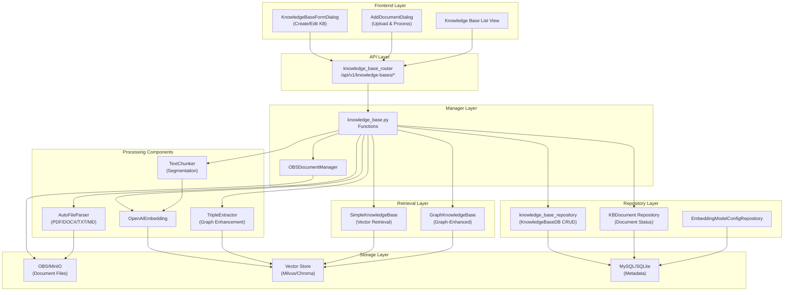
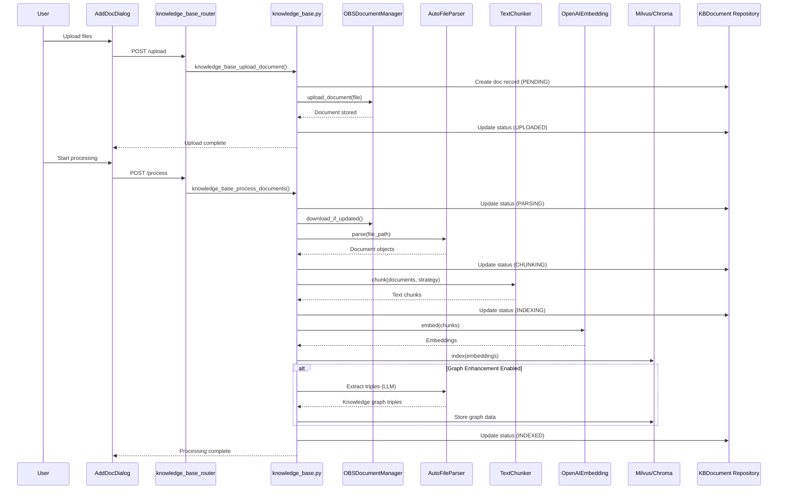
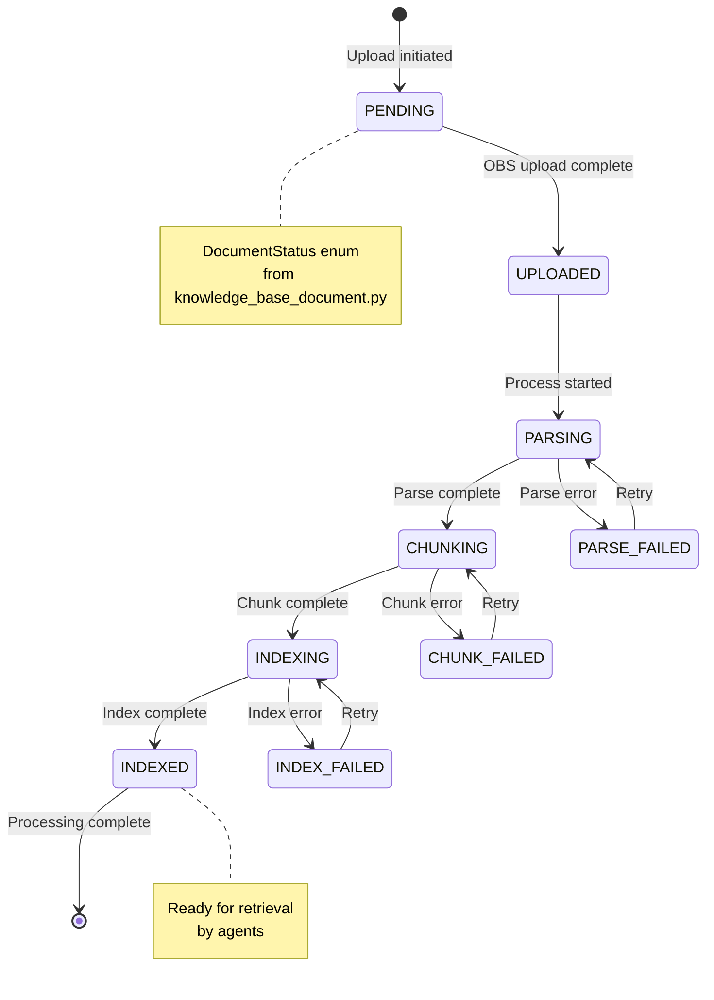
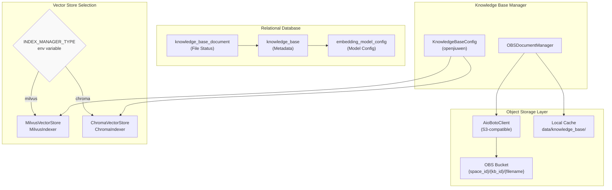
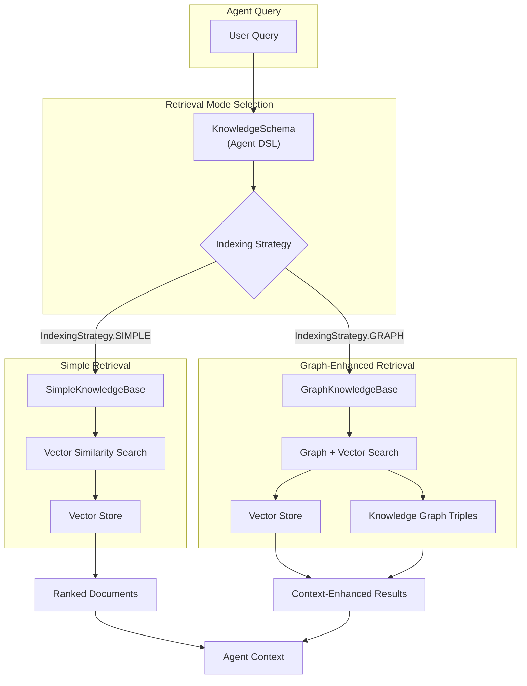
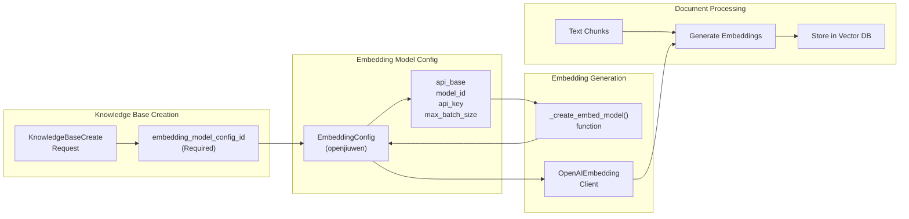
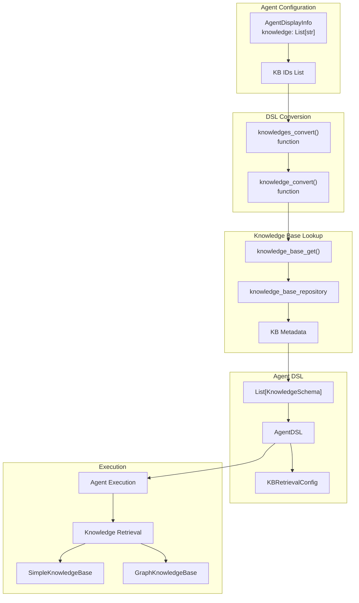

<!-- source: DeepWiki mcp.deepwiki.com · repo openJiuwen-ai/agent-studio · page 3.5 Knowledge Bases · fetched 2026-11-02 -->

# Knowledge Bases

<details>
<summary>Relevant source files</summary>

The following files were used as context for generating this wiki page:

- [backend/openjiuwen_studio/core/manager/agent.py](backend/openjiuwen_studio/core/manager/agent.py)
- [backend/openjiuwen_studio/core/manager/convertor/agent.py](backend/openjiuwen_studio/core/manager/convertor/agent.py)
- [backend/openjiuwen_studio/core/manager/knowledge_base.py](backend/openjiuwen_studio/core/manager/knowledge_base.py)
- [backend/openjiuwen_studio/core/manager/model_manager/managers/embedding_model_test_manager.py](backend/openjiuwen_studio/core/manager/model_manager/managers/embedding_model_test_manager.py)
- [backend/openjiuwen_studio/core/manager/repositories/agent_repository.py](backend/openjiuwen_studio/core/manager/repositories/agent_repository.py)
- [backend/openjiuwen_studio/core/manager/repositories/plugin_repository.py](backend/openjiuwen_studio/core/manager/repositories/plugin_repository.py)
- [backend/openjiuwen_studio/core/manager/repositories/tool_repository.py](backend/openjiuwen_studio/core/manager/repositories/tool_repository.py)
- [backend/openjiuwen_studio/routers/agents.py](backend/openjiuwen_studio/routers/agents.py)
- [backend/openjiuwen_studio/routers/embedding_models.py](backend/openjiuwen_studio/routers/embedding_models.py)
- [backend/openjiuwen_studio/schemas/agent.py](backend/openjiuwen_studio/schemas/agent.py)
- [frontend/packages/api-client/src/config.ts](frontend/packages/api-client/src/config.ts)
- [frontend/packages/api-client/src/services/agentService.ts](frontend/packages/api-client/src/services/agentService.ts)
- [frontend/src/locales/en-US.json](frontend/src/locales/en-US.json)
- [frontend/src/locales/zh-CN.json](frontend/src/locales/zh-CN.json)
- [frontend/src/pages/Auth/PrivacyPolicyPage.tsx](frontend/src/pages/Auth/PrivacyPolicyPage.tsx)
- [frontend/src/pages/Auth/UserLoginPage.tsx](frontend/src/pages/Auth/UserLoginPage.tsx)
- [frontend/src/pages/KnowledgeBase/components/AddDocumentDialog.tsx](frontend/src/pages/KnowledgeBase/components/AddDocumentDialog.tsx)
- [frontend/src/pages/KnowledgeBase/components/KnowledgeBaseFormDialog.tsx](frontend/src/pages/KnowledgeBase/components/KnowledgeBaseFormDialog.tsx)
- [frontend/src/pages/Models/ModelsPage.tsx](frontend/src/pages/Models/ModelsPage.tsx)
- [frontend/src/pages/Models/ModelsPageNew.tsx](frontend/src/pages/Models/ModelsPageNew.tsx)
- [frontend/src/pages/Models/components/EmbeddingModelsTable.tsx](frontend/src/pages/Models/components/EmbeddingModelsTable.tsx)
- [frontend/src/pages/Models/components/LLMModelsTable.tsx](frontend/src/pages/Models/components/LLMModelsTable.tsx)

</details>


This page describes the Knowledge Base system in OpenJiuwen Agent Studio, which provides document storage, processing, and retrieval capabilities for AI agents. Knowledge bases enable agents to access and retrieve information from uploaded documents using vector-based semantic search and optional graph enhancement.

For information about how agents integrate with knowledge bases, see [Agents](#3.1). For details on embedding model configuration required for knowledge bases, see [Models](#3.4).

## Overview

Knowledge bases are repositories of processed documents that agents can query to retrieve relevant information. The system supports multiple document formats (PDF, DOCX, TXT, MD), processes them through parsing and chunking strategies, generates embeddings, and stores them in vector databases for semantic retrieval.

**Core Capabilities:**
- Document upload and storage to object storage (OBS/MinIO)
- Multiple parsing strategies (fast parsing, layout analysis)
- Configurable text segmentation (automatic, token-based, semantic)
- Vector embedding generation using configured embedding models
- Optional graph-enhanced indexing for improved retrieval
- Two retrieval modes: Simple (vector-based) and Graph (knowledge graph-enhanced)
- Integration with multiple vector stores (Milvus, Chroma)

Sources: [backend/openjiuwen_studio/core/manager/knowledge_base.py:1-100](), [frontend/src/locales/zh-CN.json:194-212]()

## Architecture Overview



**Key Components:**

- **OBSDocumentManager**: Handles document upload/download to object storage [backend/openjiuwen_studio/core/manager/knowledge_base.py:86-186]()
- **knowledge_base_repository**: Database operations for knowledge base metadata [backend/openjiuwen_studio/core/manager/repositories/knowledge_base_repository.py]()
- **AutoFileParser**: Multi-format document parser from openjiuwen.core.retrieval [backend/openjiuwen_studio/core/manager/knowledge_base.py:31]()
- **TextChunker**: Segmentation strategies (token-based, semantic) [backend/openjiuwen_studio/core/manager/knowledge_base.py:29]()
- **OpenAIEmbedding**: Embedding generation client [backend/openjiuwen_studio/core/manager/knowledge_base.py:25]()

Sources: [backend/openjiuwen_studio/core/manager/knowledge_base.py:1-100](), [frontend/src/pages/KnowledgeBase/components/KnowledgeBaseFormDialog.tsx:1-50]()

## Document Processing Pipeline

The document processing pipeline transforms uploaded files into searchable vector embeddings through multiple stages:



**Processing Stages:**

1. **PENDING → UPLOADED**: File uploaded to OBS via `OBSDocumentManager.upload_document()` [backend/openjiuwen_studio/core/manager/knowledge_base.py:144-151]()

2. **UPLOADED → PARSING**: Document downloaded and parsed by `AutoFileParser` [backend/openjiuwen_studio/core/manager/knowledge_base.py:31]()

3. **PARSING → CHUNKING**: Text segmented by `TextChunker` with configurable strategies [backend/openjiuwen_studio/core/manager/knowledge_base.py:29]()

4. **CHUNKING → INDEXING**: Embeddings generated by `OpenAIEmbedding` and stored in vector database [backend/openjiuwen_studio/core/manager/knowledge_base.py:25]()

5. **Graph Enhancement (Optional)**: `TripleExtractor` uses LLM to extract knowledge graph triples [backend/openjiuwen_studio/core/manager/knowledge_base.py:30]()

Sources: [backend/openjiuwen_studio/core/manager/knowledge_base.py:455-800](), [frontend/src/pages/KnowledgeBase/components/AddDocumentDialog.tsx:1-200]()

## Document Status Lifecycle



**Status Tracking:**

The `DocumentStatus` enum tracks document processing state in the database. Each status transition is recorded with error messages if failures occur:

| Status | Description | Database Field |
|--------|-------------|----------------|
| `PENDING` | Initial upload state | `status = "pending"` |
| `UPLOADED` | File stored in OBS | `status = "uploaded"` |
| `PARSING` | Being parsed | `status = "parsing"` |
| `PARSE_FAILED` | Parse error | `status = "parse_failed"`, `error_message` set |
| `CHUNKING` | Being chunked | `status = "chunking"` |
| `CHUNK_FAILED` | Chunk error | `status = "chunk_failed"`, `error_message` set |
| `INDEXING` | Generating embeddings | `status = "indexing"` |
| `INDEX_FAILED` | Index error | `status = "index_failed"`, `error_message` set |
| `INDEXED` | Ready for retrieval | `status = "indexed"` |

Sources: [backend/openjiuwen_studio/models/knowledge_base_document.py](), [backend/openjiuwen_studio/core/manager/knowledge_base.py:455-550]()

## Storage Architecture



**Storage Components:**

1. **Object Storage (OBS/MinIO)**
   - Documents stored at path: `{space_id}/{kb_id}/{filename}` [backend/openjiuwen_studio/core/manager/knowledge_base.py:114-115]()
   - Accessed via `AioBotoClient` (S3-compatible) [backend/openjiuwen_studio/core/manager/knowledge_base.py:107-111]()
   - Local cache at `data/knowledge_base/` for processing [backend/openjiuwen_studio/core/manager/knowledge_base.py:118-121]()

2. **Vector Database**
   - Configured via `INDEX_MANAGER_TYPE` environment variable [backend/openjiuwen_studio/core/manager/knowledge_base.py:83]()
   - **Milvus**: Production vector database requiring etcd and MinIO [backend/openjiuwen_studio/core/retrieval/vector_store/milvus_store.py]()
   - **Chroma**: Embedded vector database for development [backend/openjiuwen_studio/core/retrieval/vector_store/chroma_store.py]()

3. **Relational Database Tables**
   - `knowledge_base`: Stores KB metadata (name, description, embedding model) [backend/openjiuwen_studio/models/knowledge_base.py]()
   - `knowledge_base_document`: Tracks document processing status [backend/openjiuwen_studio/models/knowledge_base_document.py]()
   - `embedding_model_config`: Embedding model configurations [backend/openjiuwen_studio/models/embedding_model_config.py]()

Sources: [backend/openjiuwen_studio/core/manager/knowledge_base.py:86-186](), [backend/openjiuwen_studio/core/manager/knowledge_base.py:83]()

## Configuration Options

### Parsing Strategies

Knowledge bases support two parsing strategies configured during document processing:

| Strategy | Value | Description | Use Case |
|----------|-------|-------------|----------|
| Fast Parsing | `"1"` | Quick text extraction | Plain text, simple documents |
| Layout Analysis | `"2"` | Preserves document structure | Complex PDFs, multi-column layouts |

Configured in: [frontend/src/pages/KnowledgeBase/components/AddDocumentDialog.tsx:53-55]()

### Segmentation Strategies

Text chunking strategies control how documents are split into retrievable units:

| Strategy | Value | Configuration | Description |
|----------|-------|---------------|-------------|
| Automatic | `"1"` | System defaults | Adaptive chunking based on document type |
| Token-based | `"2"` | `max_tokens` (default: 512)<br/>`chunk_overlap_percent` (default: 10%) | Fixed-size chunks with overlap |

**Token-based Configuration:**
- `max_tokens`: Maximum tokens per chunk (1-2048 range) [frontend/src/pages/KnowledgeBase/components/AddDocumentDialog.tsx:56]()
- `chunk_overlap_percent`: Overlap between chunks (0-50% range) [frontend/src/pages/KnowledgeBase/components/AddDocumentDialog.tsx:57]()

Configured in: [backend/openjiuwen_studio/schemas/knowledge_base.py:119-122]()

### Graph Enhancement

Optional graph-enhanced indexing extracts structured knowledge from documents:

**Configuration:**
- `enable_graph_enhancement`: Boolean flag [frontend/src/pages/KnowledgeBase/components/AddDocumentDialog.tsx:58]()
- `llm_model_id`: Required LLM model for triple extraction [frontend/src/pages/KnowledgeBase/components/AddDocumentDialog.tsx:59]()

**Process:**
1. `TripleExtractor` uses configured LLM to extract subject-predicate-object triples [backend/openjiuwen_studio/core/manager/knowledge_base.py:30]()
2. Minimum timeout of 120 seconds for graph indexing [backend/openjiuwen_studio/core/manager/knowledge_base.py:343-349]()
3. Triples stored in vector database for enhanced retrieval

Sources: [backend/openjiuwen_studio/core/manager/knowledge_base.py:298-366](), [frontend/src/pages/KnowledgeBase/components/AddDocumentDialog.tsx:52-59]()

## Retrieval Methods

The system supports two retrieval modes for querying knowledge bases:



### Simple Vector Retrieval

Uses `SimpleKnowledgeBase` for pure vector similarity search:

**Configuration:**
```python
KBRetrievalConfig(
    top_k=5,  # Number of results
    score_threshold=0.7,  # Minimum similarity
    retrieval_strategy="vector"
)
```

**Implementation:**
- Embedding model: Retrieved from `embedding_model_config_id` [backend/openjiuwen_studio/core/manager/knowledge_base.py:369-451]()
- Vector store: Determined by `INDEX_MANAGER_TYPE` [backend/openjiuwen_studio/core/manager/knowledge_base.py:83]()
- Retrieval: Direct vector similarity search in configured store

Sources: [backend/openjiuwen_studio/core/retrieval/simple_knowledge_base.py](), [backend/openjiuwen_studio/core/manager/knowledge_base.py:369-451]()

### Graph-Enhanced Retrieval

Uses `GraphKnowledgeBase` for knowledge graph-augmented search:

**Features:**
- Combines vector similarity with graph relationships
- Extracts triples (subject-predicate-object) during indexing
- Provides richer context through entity relationships

**Requirements:**
- LLM model configured during document processing [backend/openjiuwen_studio/core/manager/knowledge_base.py:298-366]()
- Graph enhancement enabled in processing configuration
- Minimum 120s timeout for triple extraction [backend/openjiuwen_studio/core/manager/knowledge_base.py:343-349]()

**Implementation:**
- `TripleExtractor`: Extracts knowledge graph triples using LLM [backend/openjiuwen_studio/core/manager/knowledge_base.py:30]()
- Stored alongside vector embeddings in same database
- Retrieved together during agent queries

Sources: [backend/openjiuwen_studio/core/retrieval/graph_knowledge_base.py](), [backend/openjiuwen_studio/core/manager/knowledge_base.py:298-366]()

## Embedding Model Integration

Knowledge bases require embedding models for vector generation:



**Embedding Model Resolution:**

1. Knowledge base stores `embedding_model_config_id` [backend/openjiuwen_studio/models/knowledge_base.py]()
2. During processing, `_create_embed_model()` retrieves configuration [backend/openjiuwen_studio/core/manager/knowledge_base.py:369-451]()
3. API key decrypted using `SecurityUtils` [backend/openjiuwen_studio/core/manager/knowledge_base.py:422-430]()
4. `OpenAIEmbedding` client initialized with configuration [backend/openjiuwen_studio/core/manager/knowledge_base.py:436-447]()

**Configuration Parameters:**
- `model_id`: Embedding model identifier (e.g., "text-embedding-ada-002")
- `api_base`: API endpoint URL
- `api_key`: Encrypted API key (decrypted at runtime)
- `max_batch_size`: Batch size for embedding generation (default: 5)
- `timeout`: Request timeout (default: 60s)
- `max_retries`: Retry count (default: 3)

Sources: [backend/openjiuwen_studio/core/manager/knowledge_base.py:369-451](), [backend/openjiuwen_studio/models/embedding_model_config.py]()

## API Endpoints

### Knowledge Base Management

| Endpoint | Method | Description | Key Functions |
|----------|--------|-------------|---------------|
| `/knowledge-bases/create` | POST | Create new knowledge base | `knowledge_base_create()` |
| `/knowledge-bases/list` | POST | List knowledge bases with pagination | `knowledge_base_list()` |
| `/knowledge-bases/get` | POST | Get knowledge base details | `knowledge_base_get()` |
| `/knowledge-bases/update` | POST | Update KB metadata | `knowledge_base_update()` |
| `/knowledge-bases/delete` | POST | Delete knowledge base | `knowledge_base_delete()` |
| `/knowledge-bases/search` | POST | Search knowledge bases | `knowledge_base_search()` |

### Document Management

| Endpoint | Method | Description | Key Functions |
|----------|--------|-------------|---------------|
| `/knowledge-bases/upload` | POST | Upload document to KB | `knowledge_base_upload_document()` [backend/openjiuwen_studio/core/manager/knowledge_base.py:802-900]() |
| `/knowledge-bases/upload-batch` | POST | Batch upload documents | `knowledge_base_upload_document_batch()` [backend/openjiuwen_studio/core/manager/knowledge_base.py:903-1000]() |
| `/knowledge-bases/process` | POST | Process uploaded documents | `knowledge_base_process_documents()` [backend/openjiuwen_studio/core/manager/knowledge_base.py:1003-1400]() |
| `/knowledge-bases/documents/list` | POST | List documents in KB | `knowledge_base_document_list()` |
| `/knowledge-bases/documents/status` | POST | Get document status | `knowledge_base_document_status()` |
| `/knowledge-bases/documents/update` | POST | Update document metadata | `knowledge_base_document_update()` |
| `/knowledge-bases/documents/delete` | POST | Delete document | `knowledge_base_document_delete()` |

### Retrieval Operations

| Endpoint | Method | Description | Response Format |
|----------|--------|-------------|-----------------|
| `/knowledge-bases/retrieve` | POST | Search documents in KB | `KnowledgeBaseSearchResponse` with ranked results |

Sources: [backend/openjiuwen_studio/routers/knowledge_base.py](), [frontend/packages/api-client/src/config.ts:165-171]()

## Frontend Integration

### Knowledge Base Creation

The `KnowledgeBaseFormDialog` component handles KB creation/editing:

**Key Fields:**
- `name`: Knowledge base name (validated via `validateKnowledgeBaseName()`) [frontend/src/pages/KnowledgeBase/components/KnowledgeBaseFormDialog.tsx:1-50]()
- `description`: Optional description
- `embedding_model_config_id`: Required embedding model selection [frontend/src/pages/KnowledgeBase/components/KnowledgeBaseFormDialog.tsx:30-100]()

**Embedding Model Selection:**
- Fetches active embedding models via `useEmbeddingModels()` hook [frontend/src/pages/KnowledgeBase/components/KnowledgeBaseFormDialog.tsx:10]()
- Tests model connectivity via `useTestEmbeddingModel()` [frontend/src/pages/KnowledgeBase/components/KnowledgeBaseFormDialog.tsx:10]()
- Displays model status and test results

Sources: [frontend/src/pages/KnowledgeBase/components/KnowledgeBaseFormDialog.tsx:1-300]()

### Document Upload and Processing

The `AddDocumentDialog` component manages document upload workflow:

**Multi-Step Process:**

1. **File Selection** (Step 1)
   - Drag-and-drop or file picker
   - File type validation (PDF, DOCX, TXT, MD)
   - File size validation (configurable limit)
   - Filename length validation [frontend/src/pages/KnowledgeBase/components/AddDocumentDialog.tsx:40-50]()

2. **Configuration** (Step 2)
   - Parsing strategy selection
   - Segmentation strategy and parameters
   - Graph enhancement toggle
   - LLM model selection (if graph enabled) [frontend/src/pages/KnowledgeBase/components/AddDocumentDialog.tsx:52-59]()

3. **Processing** (Step 3)
   - Batch upload to OBS
   - Process documents API call
   - Real-time status monitoring
   - Error handling and retry logic

**State Management:**
- `uploadedFileIds`: Tracks successfully uploaded documents [frontend/src/pages/KnowledgeBase/components/AddDocumentDialog.tsx:36]()
- `documentsProcessed`: Prevents duplicate processing [frontend/src/pages/KnowledgeBase/components/AddDocumentDialog.tsx:39]()
- `fileToDocIdMapRef`: Maps filenames to document IDs for cleanup [frontend/src/pages/KnowledgeBase/components/AddDocumentDialog.tsx:50]()

Sources: [frontend/src/pages/KnowledgeBase/components/AddDocumentDialog.tsx:1-400]()

## Error Handling

### Document Processing Errors

Error messages are formatted for frontend display via `_format_error_message_for_frontend()`:

**Error Transformation Rules:**
1. Remove technical prefixes ("File parsing failed:", "Index building failed:") [backend/openjiuwen_studio/core/manager/knowledge_base.py:265-271]()
2. Remove status codes ([155xxx]) [backend/openjiuwen_studio/core/manager/knowledge_base.py:276]()
3. Replace arrows (→) with semicolons [backend/openjiuwen_studio/core/manager/knowledge_base.py:279]()
4. Truncate at "reason:" clause [backend/openjiuwen_studio/core/manager/knowledge_base.py:283-287]()
5. Capitalize first letter [backend/openjiuwen_studio/core/manager/knowledge_base.py:293]()

**Example Transformation:**
```
Input: "File parsing failed: [155001] Parser error -> Invalid PDF format, reason: corrupt header"
Output: "Parser error; Invalid PDF format"
```

Sources: [backend/openjiuwen_studio/core/manager/knowledge_base.py:228-295]()

### Common Error Scenarios

| Error Type | Status | Frontend Handling |
|------------|--------|-------------------|
| File type unsupported | Upload rejection | Show invalid file dialog [frontend/src/pages/KnowledgeBase/components/AddDocumentDialog.tsx:41]() |
| File size exceeded | Upload rejection | Show oversized file dialog [frontend/src/pages/KnowledgeBase/components/AddDocumentDialog.tsx:45-46]() |
| Filename too long | Upload rejection | Show filename length dialog [frontend/src/pages/KnowledgeBase/components/AddDocumentDialog.tsx:42-43]() |
| Parse failure | `PARSE_FAILED` | Display formatted error message |
| Embedding failure | `INDEX_FAILED` | Show model connection error |
| OBS upload failure | Exception | Retry upload or show network error |

Sources: [backend/openjiuwen_studio/core/manager/knowledge_base.py:455-800](), [frontend/src/pages/KnowledgeBase/components/AddDocumentDialog.tsx:40-50]()

## Integration with Agents

Agents reference knowledge bases through the DSL conversion system:



**Conversion Process:**

1. Agent stores KB IDs in `knowledge` field [backend/openjiuwen_studio/schemas/agent.py:124]()
2. `knowledges_convert()` loops through IDs [backend/openjiuwen_studio/core/manager/convertor/agent.py:241-260]()
3. For each ID, `knowledge_convert()` fetches metadata [backend/openjiuwen_studio/core/manager/convertor/agent.py:208-238]()
4. Creates `KnowledgeSchema` DSL objects [backend/openjiuwen_studio/core/manager/convertor/agent.py:227-233]()
5. Agent execution uses schemas to initialize retrieval

**KnowledgeSchema Structure:**
```python
KnowledgeSchema(
    id=kb_id,
    version="",
    name=kb_name,
    description=kb_description
)
```

Sources: [backend/openjiuwen_studio/core/manager/convertor/agent.py:208-260](), [backend/openjiuwen_studio/core/manager/agent.py:1-100]()

## Database Schema

### knowledge_base Table

Primary table for knowledge base metadata:

| Column | Type | Description |
|--------|------|-------------|
| `kb_id` | VARCHAR(100) | Primary key, UUID |
| `space_id` | VARCHAR(100) | Workspace identifier |
| `name` | VARCHAR(255) | KB display name |
| `description` | TEXT | Optional description |
| `embedding_model_config_id` | INT | Foreign key to embedding config |
| `create_time` | BIGINT | Creation timestamp (milliseconds) |
| `update_time` | BIGINT | Last update timestamp |

Sources: [backend/openjiuwen_studio/models/knowledge_base.py]()

### knowledge_base_document Table

Tracks individual documents within knowledge bases:

| Column | Type | Description |
|--------|------|-------------|
| `doc_id` | VARCHAR(100) | Primary key, UUID |
| `kb_id` | VARCHAR(100) | Foreign key to knowledge base |
| `file_name` | VARCHAR(500) | Original filename |
| `file_path` | VARCHAR(1000) | OBS storage path |
| `file_size` | BIGINT | File size in bytes |
| `status` | VARCHAR(50) | Processing status (enum) |
| `error_message` | TEXT | Error details if failed |
| `parsing_strategy` | VARCHAR(50) | Parsing method used |
| `segmentation_strategy` | VARCHAR(50) | Chunking method used |
| `chunk_size` | INT | Tokens per chunk |
| `chunk_overlap` | INT | Overlap percentage |
| `enable_graph_enhancement` | BOOLEAN | Graph indexing flag |
| `llm_model_id` | INT | LLM for graph extraction |
| `create_time` | BIGINT | Upload timestamp |
| `update_time` | BIGINT | Last status update |

Sources: [backend/openjiuwen_studio/models/knowledge_base_document.py]()

### embedding_model_config Table

Stores embedding model configurations referenced by knowledge bases:

| Column | Type | Description |
|--------|------|-------------|
| `id` | INT | Primary key, auto-increment |
| `space_id` | VARCHAR(100) | Workspace identifier |
| `name` | VARCHAR(100) | Model display name |
| `model_id` | VARCHAR(100) | Model identifier (e.g., "text-embedding-ada-002") |
| `api_base` | VARCHAR(500) | API endpoint URL |
| `api_key` | TEXT | Encrypted API key |
| `max_batch_size` | INT | Embedding batch size |
| `is_active` | BOOLEAN | Model status |
| `created_at` | DATETIME | Creation timestamp |
| `updated_at` | DATETIME | Last update timestamp |

Sources: [backend/openjiuwen_studio/models/embedding_model_config.py]()

---

