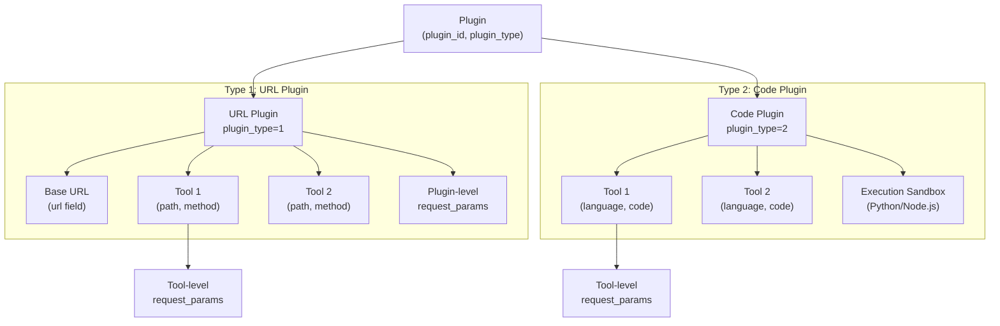
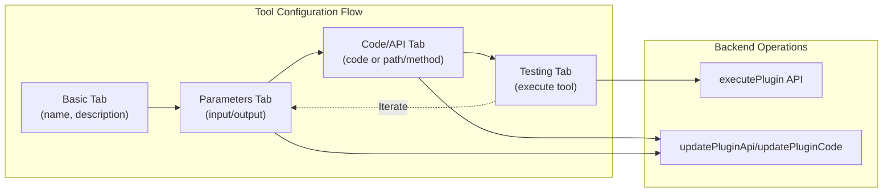
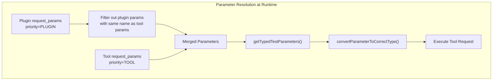
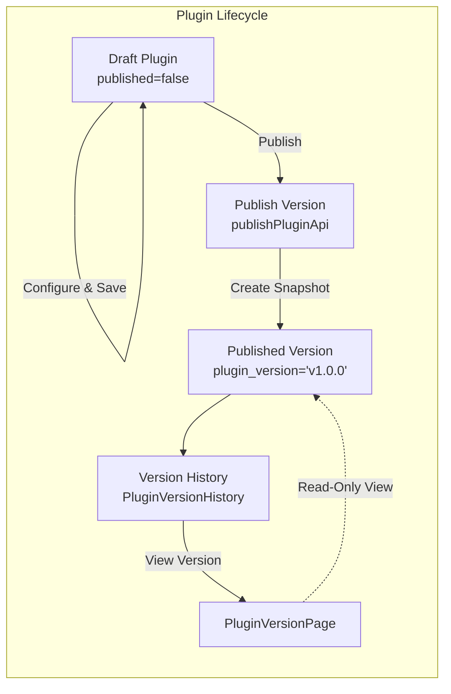
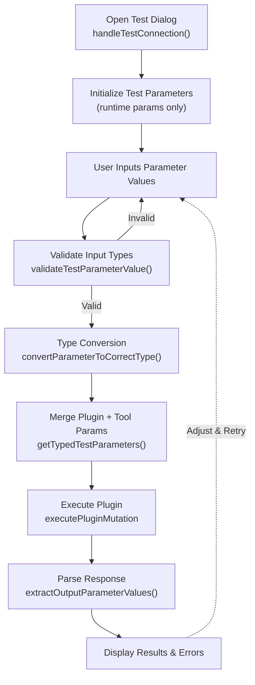
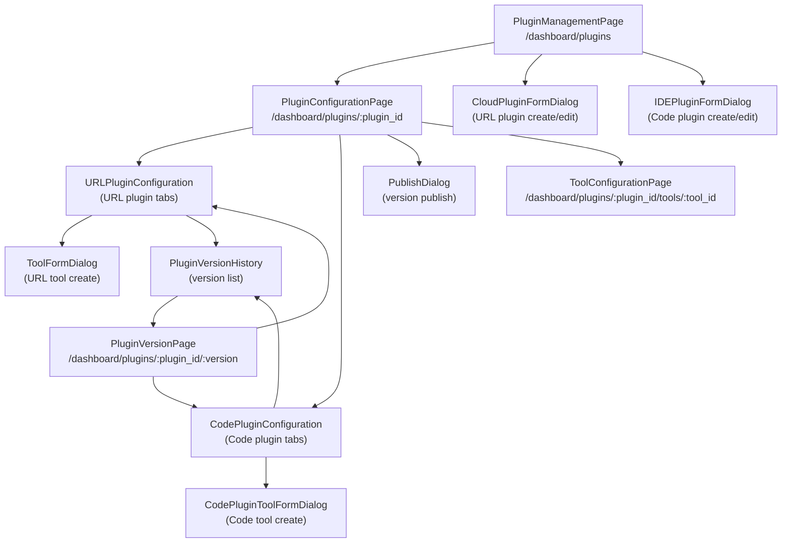

<!-- source: DeepWiki mcp.deepwiki.com · repo openJiuwen-ai/agent-studio · page 3.6 Plugins & Tools · fetched 2026-11-02 -->

# Plugins & Tools

<details>
<summary>Relevant source files</summary>

The following files were used as context for generating this wiki page:

- [frontend/src/components/Plugins/CloudPluginFormDialog.tsx](frontend/src/components/Plugins/CloudPluginFormDialog.tsx)
- [frontend/src/components/Plugins/CodeEditor.tsx](frontend/src/components/Plugins/CodeEditor.tsx)
- [frontend/src/components/Plugins/CodePluginToolFormDialog.tsx](frontend/src/components/Plugins/CodePluginToolFormDialog.tsx)
- [frontend/src/components/Plugins/IDEPluginFormDialog.tsx](frontend/src/components/Plugins/IDEPluginFormDialog.tsx)
- [frontend/src/components/Plugins/MarketPluginCard.tsx](frontend/src/components/Plugins/MarketPluginCard.tsx)
- [frontend/src/components/Plugins/MarketPluginList.tsx](frontend/src/components/Plugins/MarketPluginList.tsx)
- [frontend/src/components/Plugins/PluginVersionHistory.tsx](frontend/src/components/Plugins/PluginVersionHistory.tsx)
- [frontend/src/components/Plugins/PublishDialog.tsx](frontend/src/components/Plugins/PublishDialog.tsx)
- [frontend/src/components/Plugins/ToolFormDialog.tsx](frontend/src/components/Plugins/ToolFormDialog.tsx)
- [frontend/src/pages/Plugins/PluginConfigurationPage.tsx](frontend/src/pages/Plugins/PluginConfigurationPage.tsx)
- [frontend/src/pages/Plugins/PluginManagementPage.tsx](frontend/src/pages/Plugins/PluginManagementPage.tsx)
- [frontend/src/pages/Plugins/PluginVersionPage.tsx](frontend/src/pages/Plugins/PluginVersionPage.tsx)
- [frontend/src/pages/Plugins/ToolConfigurationPage.tsx](frontend/src/pages/Plugins/ToolConfigurationPage.tsx)
- [frontend/src/pages/Plugins/components/CodePluginConfiguration.tsx](frontend/src/pages/Plugins/components/CodePluginConfiguration.tsx)
- [frontend/src/pages/Plugins/components/URLPluginConfiguration.tsx](frontend/src/pages/Plugins/components/URLPluginConfiguration.tsx)

</details>


This document describes the plugin and tool system in OpenJiuwen Agent Studio. Plugins are extensible modules that provide tools (executable functions) to agents. The system supports two plugin types: **URL plugins** that call external HTTP APIs, and **Code plugins** that execute sandboxed Python or JavaScript code.

For information about how agents use plugins and tools in their workflows, see [Agents](#3.1) and [Workflows](#3.2). For the underlying execution infrastructure, see [Agent Execution Pipeline](#5.5).

---

## Plugin Types

The system supports two distinct plugin architectures, each optimized for different use cases.

### URL Plugins (Type 1)

URL plugins enable integration with external HTTP APIs. Each plugin defines a base URL and contains multiple tools, where each tool represents a specific API endpoint.

**Key Characteristics**:
- Plugin-level base URL configuration (`url` field)
- Tool-level path and HTTP method (GET, POST, PUT, DELETE, PATCH)
- Request parameter specification with send method (Header, Query, Body)
- Plugin-level parameters shared across all tools
- Header configuration for authentication and custom headers

**Implementation**: [frontend/src/pages/Plugins/components/URLPluginConfiguration.tsx:1-899]()

### Code Plugins (Type 2)

Code plugins execute custom code in isolated sandboxes. Each tool contains executable code in either Python or JavaScript that runs in a controlled environment.

**Key Characteristics**:
- Sandboxed execution environment (Python 3 or Node.js)
- Code editor with syntax highlighting and templates
- No base URL (code executes locally)
- Direct parameter access in code via `args.params`
- Built-in code templates for common patterns

**Implementation**: [frontend/src/pages/Plugins/components/CodePluginConfiguration.tsx:1-654]()



**Sources**: [frontend/src/pages/Plugins/PluginConfigurationPage.tsx:1-583](), [frontend/src/pages/Plugins/components/URLPluginConfiguration.tsx:1-899](), [frontend/src/pages/Plugins/components/CodePluginConfiguration.tsx:1-654]()

---

## Tools

Tools are the fundamental executable units within plugins. Each tool represents a single callable function or API endpoint that agents can invoke.

### Tool Structure

Every tool, regardless of plugin type, contains:

| Field | Type | Description |
|-------|------|-------------|
| `tool_id` | string | Unique identifier for the tool |
| `name` | string | Display name (max 128 chars) |
| `desc` | string | Description of functionality (max 256 chars) |
| `request_params` | array | Input parameters |
| `response_params` | array | Output parameters |
| `available` | boolean | Enable/disable flag |

**URL Tool Additional Fields**:
- `path`: API endpoint path (e.g., `/api/users/get`)
- `method`: HTTP method as integer (1=GET, 2=POST, 3=PUT, 4=DELETE, 5=PATCH)
- `headers`: Array of key-value pairs

**Code Tool Additional Fields**:
- `language`: Execution language (`python` or `javascript`)
- `code`: Executable code content

**Implementation**: [frontend/src/pages/Plugins/ToolConfigurationPage.tsx:67-79]()

### Tool Configuration Interface

The `ToolConfigurationPage` component provides the primary interface for tool management, supporting both URL and Code tools through a unified configuration experience.

**Core Features**:
- Tabbed interface: Basic Info, Parameters (Input/Output), Code/API Config, Testing
- Parameter type selector with validation
- Code editor with syntax highlighting (for Code tools)
- Path validation (for URL tools)
- Real-time testing with parameter input



**Sources**: [frontend/src/pages/Plugins/ToolConfigurationPage.tsx:144-1331]()

---

## Parameters

Parameters define the inputs and outputs for tools. The system provides a sophisticated parameter configuration system with type safety and validation.

### Parameter Types

The system supports 9 distinct parameter types, mapped between string representations (frontend) and numeric codes (backend):

| Type String | Numeric Code | Description | Example |
|-------------|--------------|-------------|---------|
| `string` | 1 | Text value | `"hello"` |
| `int` | 2 | Integer number | `42` |
| `float` | 3 | Floating point | `3.14` |
| `boolean` | 4 | True/false | `true` |
| `object` | 5 | JSON object | `{"key": "value"}` |
| `array_string` | 6 | String array | `["a", "b"]` |
| `array_int` | 7 | Integer array | `[1, 2, 3]` |
| `array_float` | 8 | Float array | `[1.5, 2.3]` |
| `array_boolean` | 9 | Boolean array | `[true, false]` |

**Type Mapping Functions**: [frontend/src/pages/Plugins/ToolConfigurationPage.tsx:371-402]()

### Parameter Configuration

Each parameter (input or output) has the following structure:

```typescript
interface ToolParameter {
  id: string
  name: string
  description: string
  type: string  // Type from table above
  method: number  // Send method (for input params)
  is_required?: boolean  // Required flag (input only)
  is_runtime?: boolean  // Runtime vs. default value (input only)
  value?: string  // Default value (input only)
  priority?: number  // PLUGIN or TOOL level
}
```

**Implementation**: [frontend/src/pages/Plugins/ToolConfigurationPage.tsx:50-60]()

### Parameter Send Methods (URL Tools Only)

For URL plugin tools, input parameters must specify how they are sent in the HTTP request:

| Method | Code | Description | Usage |
|--------|------|-------------|-------|
| None | 0 | Not sent in request | Internal parameters |
| Header | 1 | HTTP header | Authentication tokens |
| Query | 2 | URL query string | Search filters |
| Body | 3 | Request body | POST/PUT data |

**Method Mapping**: [frontend/src/pages/Plugins/ToolConfigurationPage.tsx:594-608]()

### Parameter Priority

Parameters can be defined at two levels:

- **Plugin-level parameters** (`priority: Priority.PLUGIN`): Shared across all tools in a plugin
- **Tool-level parameters** (`priority: Priority.TOOL`): Specific to individual tools

When a tool executes, tool-level parameters override plugin-level parameters with the same name.

**Priority Resolution**: [frontend/src/pages/Plugins/ToolConfigurationPage.tsx:452-484]()



**Sources**: [frontend/src/pages/Plugins/ToolConfigurationPage.tsx:452-484](), [frontend/src/components/Plugins/URLPluginConfiguration.tsx:454-516]()

---

## Plugin Management

### Creating Plugins

Plugins are created through dedicated dialog forms based on their type.

**URL Plugin Creation**:
1. Open `CloudPluginFormDialog`
2. Provide: name, description, optional markdown details, base URL
3. URL validation enforces HTTP/HTTPS protocol and 1000-byte limit
4. Backend creates plugin with `plugin_type=1`

**Code Plugin Creation**:
1. Open `IDEPluginFormDialog`
2. Provide: name, description, optional markdown details
3. No URL required (code execution is local)
4. Backend creates plugin with `plugin_type=2`

**API Endpoints**:
- Create: `POST /api/v1/plugins/create` via `useCreatePlugin` hook
- List: `GET /api/v1/plugins/list` via `usePluginList` hook
- Delete: `DELETE /api/v1/plugins/delete` via `useDeletePlugin` hook

**Implementation**: [frontend/src/pages/Plugins/PluginManagementPage.tsx:45-588](), [frontend/src/components/Plugins/CloudPluginFormDialog.tsx:1-184](), [frontend/src/components/Plugins/IDEPluginFormDialog.tsx:1-170]()

### Plugin Configuration Page

The main configuration interface adapts based on plugin type, rendering either `URLPluginConfiguration` or `CodePluginConfiguration` components.

**Configuration Tabs** (URL Plugins):
- **Basic**: Description, markdown details, icon selection, base URL
- **Tools**: List of API tools with create/edit/delete actions
- **Params**: Plugin-level request parameters

**Configuration Tabs** (Code Plugins):
- **Basic**: Description, markdown details, icon selection
- **Tools**: List of code tools with create/edit/delete actions

**Icon Selection**: 50 emoji options available for visual identification [frontend/src/pages/Plugins/PluginConfigurationPage.tsx:67-119]()

**Sources**: [frontend/src/pages/Plugins/PluginConfigurationPage.tsx:47-583]()

### Version Control and Publishing

Plugins support versioning through a publish workflow, enabling rollback and version history tracking.

**Publishing Flow**:
1. Open `PublishDialog` with version and description
2. System auto-increments version (semantic versioning recommended)
3. Optional: Auto-save current configuration before publish
4. Publish creates immutable version snapshot
5. Version appears in `PluginVersionHistory`

**Version Management**:
- View history via `PluginVersionHistory` dialog
- Navigate to specific versions via `PluginVersionPage`
- Delete old versions (with confirmation)
- Published versions are read-only



**API Endpoints**:
- Publish: `POST /api/v1/plugins/publish` via `usePluginPublish` [frontend/src/pages/Plugins/PluginConfigurationPage.tsx:163-173]()
- List Versions: `GET /api/v1/plugins/publish/list` via `usePluginPublishList` [frontend/src/components/Plugins/PluginVersionHistory.tsx:49-64]()
- Get Version: `GET /api/v1/plugins/publish/get` via `usePluginPublishGet` [frontend/src/pages/Plugins/PluginVersionPage.tsx:162-170]()
- Delete Version: `DELETE /api/v1/plugins/publish/delete` via `usePluginPublishDelete` [frontend/src/components/Plugins/PluginVersionHistory.tsx:46-48]()

**Sources**: [frontend/src/components/Plugins/PublishDialog.tsx:1-192](), [frontend/src/components/Plugins/PluginVersionHistory.tsx:1-445](), [frontend/src/pages/Plugins/PluginVersionPage.tsx:1-442]()

---

## Tool Management

### Creating Tools

Tools are created differently based on plugin type, using specialized dialog forms.

**URL Tool Creation** (`ToolFormDialog`):
1. Navigate to plugin's Tools tab
2. Click "Add Tool" button
3. Provide: name, description, path, HTTP method
4. Path validation: must start with `/`, alphanumeric + `-_/` only
5. API call: `POST /api/v1/plugins/api/create` via `usePluginCreateApi`

**Code Tool Creation** (`CodePluginToolFormDialog`):
1. Navigate to plugin's Tools tab
2. Click "Add Tool" button
3. Provide: name, description, runtime (Python/Node.js), code
4. Code editor with templates and syntax highlighting
5. API call: `POST /api/v1/plugins/code/create` via `usePluginCreateCode`

**Path Validation** (URL Tools): [frontend/src/utils/validationUtils.ts]() implements `validateToolPath()`:
- Must start with `/`
- Only alphanumeric, `-`, `_`, `/` allowed
- No consecutive slashes
- Provides helpful error messages

**Sources**: [frontend/src/components/Plugins/ToolFormDialog.tsx:1-169](), [frontend/src/components/Plugins/CodePluginToolFormDialog.tsx:1-383](), [frontend/src/pages/Plugins/components/URLPluginConfiguration.tsx:256-333](), [frontend/src/pages/Plugins/components/CodePluginConfiguration.tsx:218-276]()

### Tool Configuration

Individual tools are configured via `ToolConfigurationPage`, which provides a comprehensive interface for all tool settings.

**Navigation**:
- From plugin page: Click tool card in Tools tab
- URL: `/dashboard/plugins/{plugin_id}/tools/{tool_id}`
- State passed: plugin type, source, version info

**Configuration Sections**:

1. **Basic Information**:
   - Tool name and description
   - Availability toggle (enable/disable)
   
2. **Request Parameters** (Input):
   - Add/edit/delete parameters
   - Configure type, send method, required flag
   - Runtime vs. default value setting
   - Auto-save on changes

3. **Response Parameters** (Output):
   - Add/edit/delete parameters
   - Configure type and description
   - Used for parsing test results

4. **Execution Details**:
   - **URL Tools**: Path, HTTP method, headers
   - **Code Tools**: Language, code editor

5. **Testing**:
   - Input parameter values
   - Execute tool with test data
   - View formatted results
   - Output parameter extraction

**Auto-Save Behavior**: Parameter changes trigger immediate `updatePluginApi` or `updatePluginCode` calls to persist configuration [frontend/src/pages/Plugins/ToolConfigurationPage.tsx:710-795]()

**Sources**: [frontend/src/pages/Plugins/ToolConfigurationPage.tsx:144-1331]()

### Code Editor Features

Code tools include a sophisticated editor with developer-friendly features.

**Editor Capabilities**:
- Syntax highlighting (CodeMirror-based)
- Line numbers and code folding
- Light theme optimized for readability
- Template selection for common patterns
- Language-specific templates (Python/JavaScript)
- Copy code functionality
- Reset code action

**Code Templates**:
- **Python**: Basic function with `Args` parameter access [frontend/src/pages/Plugins/ToolConfigurationPage.tsx:90-103]()
- **JavaScript**: Main function with module export [frontend/src/pages/Plugins/ToolConfigurationPage.tsx:105-130]()

**Editors Used**:
- `PythonCodeEditor` from workflow-canvas package
- `TypeScriptCodeEditor` from workflow-canvas package
- Imported at: [frontend/src/pages/Plugins/ToolConfigurationPage.tsx:34-36]()

**Sources**: [frontend/src/pages/Plugins/ToolConfigurationPage.tsx:34-36](), [frontend/src/pages/Plugins/ToolConfigurationPage.tsx:90-131](), [frontend/src/components/Plugins/CodePluginToolFormDialog.tsx:51-383]()

---

## Testing Tools

The system provides built-in testing capabilities for both URL and Code tools, allowing developers to validate tool behavior before using them in agents.

### Test Execution Flow



**Sources**: [frontend/src/pages/Plugins/ToolConfigurationPage.tsx:994-1164]()

### Parameter Input and Validation

The test dialog presents input fields for all runtime parameters (where `is_runtime=true`).

**Input Field Types**:
- **String/Int/Float/Boolean**: Text field with type-specific validation
- **Array Types**: JSON array input with element type validation
- **Object**: JSON object input with structure validation

**Validation Rules** [frontend/src/pages/Plugins/ToolConfigurationPage.tsx:1053-1100]():
- `int`: Must match `/^-?\d+$/` regex
- `float`: Must be valid number via `Number()` parsing
- `object`: Must parse as JSON object (not array or null)
- `array_int`: Must be JSON array with integer elements only
- `array_float`: Must be JSON array with numeric elements

**Non-Runtime Parameters**: Parameters with `is_runtime=false` use their configured default `value` and are not presented for input.

### Execution and Results

**Execution Process**:
1. Convert string inputs to typed values via `convertParameterToCorrectType()` [frontend/src/pages/Plugins/ToolConfigurationPage.tsx:404-450]()
2. Merge plugin and tool parameters, with tool params taking precedence [frontend/src/pages/Plugins/ToolConfigurationPage.tsx:452-484]()
3. Call `POST /api/v1/plugins/execute` via `executePluginMutation`
4. Display execution results with structured output

**Result Display**:
```typescript
interface TestExecutionResult {
  timestamp: string
  execution_success: boolean
  error_code: number | null
  error_message: string | null
  output: unknown
  raw_response: unknown
  parse_error?: string
  raw_buffer?: string
}
```

**Output Parameter Extraction**: The system automatically extracts configured output parameters from the response using `extractOutputParameterValues()` [frontend/src/pages/Plugins/ToolConfigurationPage.tsx:486-541](), which:
- Searches for parameter names in `output` or `raw_response`
- Supports nested path extraction via dot notation
- Formats values according to parameter type
- Displays `undefined` for missing values

**Sources**: [frontend/src/pages/Plugins/ToolConfigurationPage.tsx:133-143](), [frontend/src/pages/Plugins/ToolConfigurationPage.tsx:1165-1331]()

### Test Dialog UI

The test interface provides comprehensive feedback during and after execution.

**Key UI Elements**:
- Parameter input section with type badges
- Validation error messages inline
- Execute button (disabled when validation fails)
- Loading state during execution
- Success/error result display
- Raw response viewer
- Output parameter value grid

**Parameter Input State**: [frontend/src/pages/Plugins/ToolConfigurationPage.tsx:160-161]()
```typescript
const [testParameters, setTestParameters] = useState<Record<string, string>>({})
const [testParameterErrors, setTestParameterErrors] = useState<Record<string, string>>({})
```

**Sources**: [frontend/src/pages/Plugins/ToolConfigurationPage.tsx:1165-1331]()

---

## Plugin and Tool Deletion

### Deletion Workflows

Both plugins and tools support deletion with confirmation dialogs to prevent accidental removal.

**Tool Deletion**:
1. Click delete icon on tool card
2. Confirm in deletion dialog
3. API call: `DELETE /api/v1/plugins/api/delete` or `/code/delete`
4. Refresh tool list on success

**Plugin Deletion**:
1. Click delete action in plugin management
2. Confirm in deletion dialog
3. API call: `DELETE /api/v1/plugins/delete`
4. Refresh plugin list and invalidate React Query cache

**Cascade Behavior**: Deleting a plugin removes all associated tools and their configurations.

**Implementation**: [frontend/src/pages/Plugins/ToolConfigurationPage.tsx:962-992](), [frontend/src/pages/Plugins/components/URLPluginConfiguration.tsx:335-373](), [frontend/src/pages/Plugins/components/CodePluginConfiguration.tsx:278-318]()

---

## Architecture and Code Entities

### Frontend Component Hierarchy



**Sources**: [frontend/src/pages/Plugins/PluginManagementPage.tsx:45-588](), [frontend/src/pages/Plugins/PluginConfigurationPage.tsx:47-583](), [frontend/src/pages/Plugins/ToolConfigurationPage.tsx:144-1331](), [frontend/src/pages/Plugins/PluginVersionPage.tsx:46-442]()

### API Client Hooks

The frontend uses React Query hooks from `@test-agentstudio/api-client` for all backend communication.

**Plugin Operations**:
| Hook | Endpoint | Purpose |
|------|----------|---------|
| `useCreatePlugin` | `POST /plugins/create` | Create new plugin |
| `usePluginList` | `GET /plugins/list` | List plugins for space |
| `useDeletePlugin` | `DELETE /plugins/delete` | Delete plugin |
| `useUpdatePlugin` | `PUT /plugins/update` | Update plugin metadata |
| `usePlugin` | `GET /plugins/get` | Get plugin details |

**URL Tool Operations**:
| Hook | Endpoint | Purpose |
|------|----------|---------|
| `usePluginCreateApi` | `POST /plugins/api/create` | Create URL tool |
| `usePluginUpdateApi` | `PUT /plugins/api/update` | Update URL tool |
| `usePluginDeleteApi` | `DELETE /plugins/api/delete` | Delete URL tool |
| `usePluginGetApi` | `GET /plugins/api/get` | Get URL tool details |
| `usePluginListApi` | `GET /plugins/api/list` | List URL tools |

**Code Tool Operations**:
| Hook | Endpoint | Purpose |
|------|----------|---------|
| `usePluginCreateCode` | `POST /plugins/code/create` | Create code tool |
| `usePluginUpdateCode` | `PUT /plugins/code/update` | Update code tool |
| `usePluginDeleteCode` | `DELETE /plugins/code/delete` | Delete code tool |
| `usePluginGetCode` | `GET /plugins/code/get` | Get code tool details |
| `usePluginListCode` | `GET /plugins/code/list` | List code tools |

**Version Operations**:
| Hook | Endpoint | Purpose |
|------|----------|---------|
| `usePluginPublish` | `POST /plugins/publish` | Publish version |
| `usePluginPublishList` | `GET /plugins/publish/list` | List versions |
| `usePluginPublishGet` | `GET /plugins/publish/get` | Get specific version |
| `usePluginPublishDelete` | `DELETE /plugins/publish/delete` | Delete version |

**Execution**:
| Hook | Endpoint | Purpose |
|------|----------|---------|
| `useExecutePlugin` | `POST /plugins/execute` | Execute tool with test params |

**Sources**: [frontend/src/pages/Plugins/ToolConfigurationPage.tsx:38-48](), [frontend/src/pages/Plugins/components/URLPluginConfiguration.tsx:7-14](), [frontend/src/pages/Plugins/components/CodePluginConfiguration.tsx:6-12]()

### Key Data Structures

**Plugin Data Model**:
```typescript
interface Plugin {
  space_id: string
  plugin_id: string
  plugin_version: string
  name: string
  desc: string
  desc_mk?: string
  plugin_type: number  // 1=URL, 2=Code
  published: boolean
  url?: string  // URL plugins only
  icon_uri: string
  request_params?: ToolParameter[]  // Plugin-level params
}
```

**Tool Data Model**:
```typescript
interface Tool {
  tool_id: string
  name: string
  description: string
  available: boolean
  
  // URL tool fields
  path?: string
  method?: number  // 1-5 for HTTP methods
  
  // Code tool fields
  language?: string  // 'python' or 'javascript'
  code?: string
  
  // Common fields
  input_parameters: ToolParameter[]
  output_parameters: ToolParameter[]
  headers?: HeaderConfig[]
}
```

**Sources**: [frontend/src/pages/Plugins/PluginManagementPage.tsx:39-44](), [frontend/src/pages/Plugins/ToolConfigurationPage.tsx:67-79]()

### State Management

Plugin and tool state is managed through a combination of:

1. **React Query Cache**: Server state for plugin/tool lists, details, versions
2. **Component State**: Form inputs, UI state, dialog visibility
3. **URL State**: Plugin ID, tool ID, version from route parameters
4. **Location State**: Navigation context (source, read-only mode, version info)

**Query Invalidation**: After mutations (create, update, delete), the system invalidates relevant queries to trigger refetch [frontend/src/pages/Plugins/PluginManagementPage.tsx:263-267]():
```typescript
queryClient.invalidateQueries({
  queryKey: ['pluginList', currentSpaceId],
  exact: false,
})
```

**Sources**: [frontend/src/pages/Plugins/PluginManagementPage.tsx:1-588](), [frontend/src/pages/Plugins/ToolConfigurationPage.tsx:144-346]()

---

## Integration with Agents

Plugins and tools are referenced by agents through their configuration DSL. When an agent executes, the system:

1. Converts agent display format to executable DSL
2. Resolves plugin and tool references by ID
3. Loads tool configurations and parameters
4. For URL tools: Constructs HTTP requests with parameters
5. For Code tools: Executes code in sandbox with parameters
6. Returns tool outputs to agent for further processing

This integration is detailed in [Agent Execution Pipeline](#5.5).

**Sources**: Based on system architecture diagrams and agent execution flow.

---

