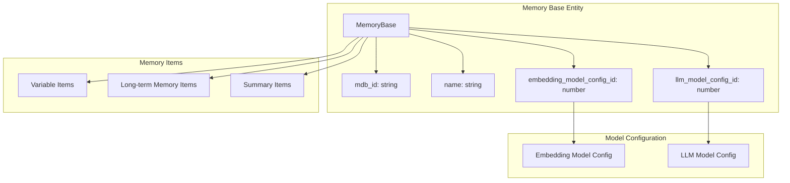
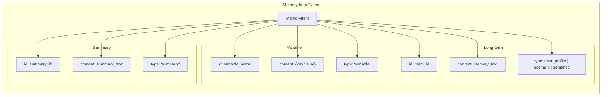
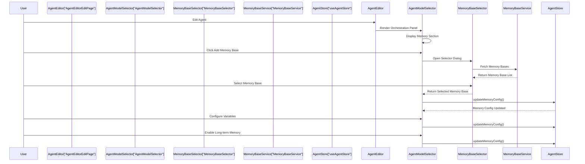
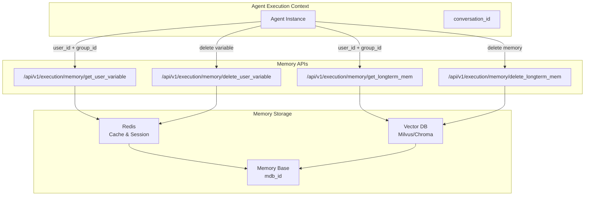
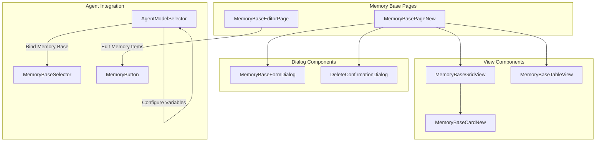
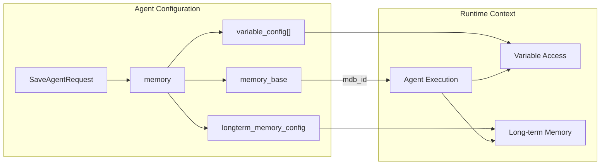

<!-- source: DeepWiki mcp.deepwiki.com · repo openJiuwen-ai/agent-studio · page 3.7 Memory Systems · fetched 2026-11-02 -->

# Memory Systems

<details>
<summary>Relevant source files</summary>

The following files were used as context for generating this wiki page:

- [frontend/src/components/Agent/AgentModelSelector.tsx](frontend/src/components/Agent/AgentModelSelector.tsx)
- [frontend/src/components/Agent/OverridePromptTemplateDialog.tsx](frontend/src/components/Agent/OverridePromptTemplateDialog.tsx)
- [frontend/src/locales/agent/en-US/common.json](frontend/src/locales/agent/en-US/common.json)
- [frontend/src/locales/agent/en-US/editor.json](frontend/src/locales/agent/en-US/editor.json)
- [frontend/src/locales/agent/zh-CN/common.json](frontend/src/locales/agent/zh-CN/common.json)
- [frontend/src/locales/agent/zh-CN/editor.json](frontend/src/locales/agent/zh-CN/editor.json)
- [frontend/src/pages/Agents/AgentCreatePage.tsx](frontend/src/pages/Agents/AgentCreatePage.tsx)
- [frontend/src/pages/Agents/AgentEditorEditPage.tsx](frontend/src/pages/Agents/AgentEditorEditPage.tsx)
- [frontend/src/pages/Agents/AgentsPage.tsx](frontend/src/pages/Agents/AgentsPage.tsx)
- [frontend/src/pages/MemoryBase/MemoryBaseEditorPage.tsx](frontend/src/pages/MemoryBase/MemoryBaseEditorPage.tsx)
- [frontend/src/pages/MemoryBase/MemoryBasePageNew.tsx](frontend/src/pages/MemoryBase/MemoryBasePageNew.tsx)
- [frontend/src/pages/MemoryBase/MemoryButton.tsx](frontend/src/pages/MemoryBase/MemoryButton.tsx)
- [frontend/src/pages/MemoryBase/components/MemoryBaseCard.tsx](frontend/src/pages/MemoryBase/components/MemoryBaseCard.tsx)
- [frontend/src/pages/MemoryBase/components/MemoryBaseCardNew.tsx](frontend/src/pages/MemoryBase/components/MemoryBaseCardNew.tsx)
- [frontend/src/pages/MemoryBase/components/MemoryBaseFormDialog.tsx](frontend/src/pages/MemoryBase/components/MemoryBaseFormDialog.tsx)
- [frontend/src/pages/MemoryBase/components/MemoryBaseTableView.tsx](frontend/src/pages/MemoryBase/components/MemoryBaseTableView.tsx)
- [frontend/src/pages/MemoryBase/index.ts](frontend/src/pages/MemoryBase/index.ts)
- [frontend/src/pages/MemoryBase/utils/validation.ts](frontend/src/pages/MemoryBase/utils/validation.ts)

</details>


Memory Systems in OpenJiuwen Agent Studio provide persistent storage and retrieval capabilities for agents, enabling them to maintain context across conversations and store user-specific information. This document covers memory base management, memory types, agent integration, and the technical implementation of memory storage and retrieval.

For information about knowledge base systems (document storage and RAG), see [Knowledge Bases](#3.5). For agent configuration details, see [Agents](#3.1).

---

## Overview

The memory system consists of three main components:

1. **Memory Bases** - Containers that store memory items, configured with Embedding and LLM models
2. **Memory Items** - Individual memory records of various types (variables, long-term memories, summaries)
3. **Agent Memory Configuration** - Settings that bind agents to memory bases and define memory behavior

Memory enables agents to:
- Store and retrieve user-defined variables during execution
- Maintain long-term memory of user profiles, scenarios, and semantic information
- Generate conversation summaries
- Persist context across multiple conversation sessions

Sources: [frontend/src/pages/MemoryBase/MemoryBaseEditorPage.tsx:1-1633](), [frontend/src/components/Agent/AgentModelSelector.tsx:1-700]()

---

## Memory Base Structure

### Memory Base Entity

A memory base is the fundamental container for memory items, defined with the following properties:

| Property | Type | Description |
|----------|------|-------------|
| `mdb_id` | string | Unique identifier for the memory base |
| `name` | string | Display name (max 100 chars, validated for special chars) |
| `description` | string (optional) | Functional description |
| `status` | string | Active status of the memory base |
| `space_id` | string | Space/tenant identifier |
| `embedding_model_config_id` | number | ID of the embedding model for vector operations |
| `llm_model_config_id` | number | ID of the LLM model for memory processing |

**Memory Base Architecture**



Sources: [frontend/src/types/memoryBase.ts](), [frontend/src/pages/MemoryBase/MemoryBaseEditorPage.tsx:88-96](), [frontend/src/pages/MemoryBase/components/MemoryBaseFormDialog.tsx:120-140]()

### Memory Base Validation

Memory base names are validated using the `validateMemoryBaseName` function:

- Must not be empty after trimming
- Maximum length: 100 characters
- Cannot contain special characters: `< > : " / \ | ? *` or control characters
- Cannot have leading/trailing spaces
- Must be unique within the space

Sources: [frontend/src/pages/MemoryBase/utils/validation.ts:10-39]()

---

## Memory Types

The system supports multiple memory types, each serving different purposes:

### Variable Memory (`variable`)

Variables store key-value pairs that can be accessed and modified during agent execution. Each variable has:

| Field | Description |
|-------|-------------|
| `id` | Variable key/name |
| `content` | Formatted as `{key : value}` |
| `type` | Always `"variable"` |

Variables are retrieved via `/api/v1/execution/memory/get_user_variable` and deleted via `/api/v1/execution/memory/delete_user_variable`.

Sources: [frontend/src/pages/MemoryBase/MemoryBaseEditorPage.tsx:350-360](), [frontend/src/pages/MemoryBase/MemoryButton.tsx:14-49]()

### Long-term Memory (`longterm`, `user_profile`, `scenario`, `semantic`)

Long-term memories persist information across conversations. Subtypes include:

- **`user_profile`** - User personal information and preferences
- **`scenario`** - Contextual scenarios from conversations
- **`semantic`** - Semantic information extracted from interactions

Each long-term memory item has:

| Field | Description |
|-------|-------------|
| `mem_id` | Unique memory identifier |
| `content` | The memory content/text |
| `type` | Memory subtype |

Long-term memories are retrieved via `/api/v1/execution/memory/get_longterm_mem` and deleted via `/api/v1/execution/memory/delete_longterm_mem`.

Sources: [frontend/src/pages/MemoryBase/MemoryBaseEditorPage.tsx:60-66](), [frontend/src/pages/MemoryBase/MemoryBaseEditorPage.tsx:363-368]()

### Summary Memory (`summary`)

Summaries are generated from conversation histories to maintain context efficiently.

Sources: [frontend/src/pages/MemoryBase/MemoryBaseEditorPage.tsx:60-66]()

---

## Memory Item Data Model

**Memory Item Structure**



Sources: [frontend/src/pages/MemoryBase/MemoryBaseEditorPage.tsx:220-222](), [frontend/src/pages/MemoryBase/MemoryBaseEditorPage.tsx:350-368]()

---

## Agent Memory Integration

### Memory Configuration in Agents

Agents bind to memory bases through the `memory` configuration object in `SaveAgentRequest`:

```typescript
memory: {
  max_tokens: number,
  variable_config: MemoryVariable[],
  longterm_memory_config: boolean,
  memory_base: {
    mdb_id: string,
    name: string,
    description?: string,
    status: string,
    embedding_model_config_id?: number,
    llm_model_config_id?: number
  }
}
```

**Memory Variable Configuration**

Each variable in `variable_config` has:

| Field | Type | Description |
|-------|------|-------------|
| `id` | string | Unique variable identifier |
| `name` | string | Variable name |
| `description` | string (optional) | Variable description |
| `enabled` | boolean | Whether the variable is active (default: true) |

Sources: [frontend/src/components/Agent/AgentModelSelector.tsx:81-86](), [frontend/src/components/Agent/AgentModelSelector.tsx:306-316]()

### Memory Binding Flow

**Agent Memory Binding Architecture**



Sources: [frontend/src/components/Agent/AgentModelSelector.tsx:437-492](), [frontend/src/pages/Agents/AgentEditorEditPage.tsx:71-176]()

### Memory Variable Management

Variables can be added, enabled/disabled, and removed within the agent configuration:

1. **Add Variable**: User enters name and description, clicks "Add"
2. **Enable/Disable**: Toggle switch controls `enabled` field
3. **Delete**: Removes variable from `variable_config` array

When variables are duplicate (same name), a warning is displayed.

Sources: [frontend/src/components/Agent/AgentModelSelector.tsx:672-711](), [frontend/src/locales/agent/en-US/editor.json:250-287]()

---

## Memory Data Flow

### Memory Retrieval and Storage

**Memory Data Flow in Agent Execution**



The memory system uses:
- **Redis** for variable storage and caching
- **Vector Database** (Milvus/Chroma) for long-term memory with semantic search capabilities
- **user_id** (space_id) and **group_id** (mdb_id) as identifiers for memory retrieval

Sources: [frontend/src/pages/MemoryBase/MemoryBaseEditorPage.tsx:68-206](), [frontend/src/pages/MemoryBase/MemoryButton.tsx:12-87]()

### Memory Operations

| Operation | Endpoint | Parameters | Purpose |
|-----------|----------|------------|---------|
| List Variables | `POST /api/v1/execution/memory/get_user_variable` | `user_id`, `group_id` | Retrieve all variables |
| Delete Variable | `POST /api/v1/execution/memory/delete_user_variable` | `user_id`, `group_id`, `name` | Remove specific variable |
| List Long-term | `POST /api/v1/execution/memory/get_longterm_mem` | `user_id`, `group_id`, `num`, `page` | Retrieve long-term memories |
| Delete Long-term | `POST /api/v1/execution/memory/delete_longterm_mem` | `user_id`, `group_id`, `mem_id` | Remove specific memory |

Sources: [frontend/src/pages/MemoryBase/MemoryBaseEditorPage.tsx:68-142]()

---

## Frontend Components

### Memory Base Management Components

**Memory Base Component Hierarchy**



Sources: [frontend/src/pages/MemoryBase/MemoryBasePageNew.tsx:1-290](), [frontend/src/pages/MemoryBase/MemoryBaseEditorPage.tsx:1-1633](), [frontend/src/components/Agent/AgentModelSelector.tsx:1-1200]()

### MemoryBasePageNew

The main memory base list page with grid and table view modes.

**Key Features**:
- Search memory bases by name/description
- Toggle between grid and table views
- Create, edit, delete memory bases
- Display embedding and LLM model information
- Pagination support

**State Management**:
- Uses `useMemoryBaseStore` for data fetching and mutations
- Uses `useUIStore` for view mode persistence
- Uses `useOptimizedSearch` for debounced search

Sources: [frontend/src/pages/MemoryBase/MemoryBasePageNew.tsx:24-290]()

### MemoryBaseEditorPage

Memory item editor for viewing and managing variables and long-term memories within a memory base.

**Key Features**:
- List all memory items with pagination
- Filter by memory type (all, longterm, variable, summary)
- Search memory content
- Batch select and delete memory items
- Refresh memory list

**Data Loading**:
```typescript
// Fetches variables and long-term memories in parallel
const res_var = await api.listVariables(spaceId, memoryBase.mdb_id);
const response_long = await api.listLongTerm(spaceId, memoryBase.mdb_id);

// Combines into unified list with ExtendedMemoryItem interface
const allMemories = [...variableMemories, ...longTermMemories];
```

Sources: [frontend/src/pages/MemoryBase/MemoryBaseEditorPage.tsx:224-387]()

### MemoryButton (Debug Memory Manager)

In-debug dialog for viewing and managing memory during agent testing.

**Tabs**:
1. **Variables** - View and delete variables
2. **Long-term Memory** - View and delete long-term memories

**Operations**:
- Auto-refresh on dialog open
- Delete individual items (staged for batch save)
- Save applies all deletions at once

Sources: [frontend/src/pages/MemoryBase/MemoryButton.tsx:1-450](), [frontend/src/locales/agent/en-US/editor.json:486-520]()

### MemoryBaseSelector

Dialog for selecting a memory base to bind to an agent.

**Features**:
- Lists all memory bases in the space
- Displays embedding and LLM model information
- Shows "Selected" badge for already-bound memory base
- Validates memory base availability before selection

Sources: [frontend/src/components/Agent/MemoryBaseSelector.tsx]()

---

## Backend Integration

### Memory Base CRUD APIs

Memory base management uses the `MemoryBaseService` from the API client:

| Method | Endpoint Pattern | Purpose |
|--------|-----------------|---------|
| `getMemoryBases` | `GET /api/memory-base` | List memory bases with pagination |
| `createMemoryBase` | `POST /api/memory-base` | Create new memory base |
| `updateMemoryBase` | `PUT /api/memory-base` | Update memory base properties |
| `deleteMemoryBase` | `DELETE /api/memory-base` | Delete memory base |
| `getMemoryBaseDetail` | `GET /api/memory-base/{id}` | Fetch single memory base |

Sources: [frontend/src/pages/MemoryBase/MemoryBaseEditorPage.tsx:145-205]()

### Memory Item APIs

Memory items are managed through execution-specific endpoints:

**Variable APIs**:
```typescript
// List all variables for a user in a memory base
POST /api/v1/execution/memory/get_user_variable
Body: { user_id: string, group_id: string }

// Delete a specific variable
POST /api/v1/execution/memory/delete_user_variable
Body: { user_id: string, group_id: string, name: string }
```

**Long-term Memory APIs**:
```typescript
// List long-term memories with pagination
POST /api/v1/execution/memory/get_longterm_mem
Body: { user_id: string, group_id: string, num: number, page: number }

// Delete a specific long-term memory
POST /api/v1/execution/memory/delete_longterm_mem
Body: { user_id: string, group_id: string, mem_id: string }
```

Sources: [frontend/src/pages/MemoryBase/MemoryBaseEditorPage.tsx:68-142]()

---

## Memory Configuration in Agent Execution

### Memory Initialization

When an agent with memory configuration executes:

1. **Memory Base Binding**: Agent references `memory.memory_base.mdb_id`
2. **Variable Loading**: Configured variables in `memory.variable_config` are available
3. **Long-term Memory**: If `memory.longterm_memory_config` is true, agent can access and update long-term memories

**Agent Memory Configuration Flow**



Sources: [frontend/src/components/Agent/AgentModelSelector.tsx:108-120](), [frontend/src/components/Agent/AgentModelSelector.tsx:305-323]()

### Memory in Debug Mode

During agent debugging (in `AgentDebugChat`), the `MemoryButton` component allows developers to:

1. View current variable values
2. View long-term memories
3. Delete specific memory items
4. Monitor memory changes during conversation

The debug memory manager uses the same APIs as the runtime system, providing real-time visibility into memory state.

Sources: [frontend/src/pages/MemoryBase/MemoryButton.tsx:106-302](), [frontend/src/locales/agent/en-US/editor.json:486-520]()

---

## Localization

Memory-related UI text is localized in:

- **Agent Editor Memory Section**: `agents.agentEditor.orchestration.orchestrationPage.memory`
- **Memory Manager Dialog**: `agents.agentEditor.previewDebug.memoryManager`
- **Memory Base Pages**: `memoryBases.*`

Example keys:
- `memoryBases.form.nameRequired` - "Please enter memory base name"
- `memoryBases.memoryType.variable` - "Variable"
- `memoryBases.memoryType.longterm` - "Long-term Memory"
- `agents.agentEditor.orchestration.orchestrationPage.memory.variablesTitle` - "Variable Configuration"

Sources: [frontend/src/locales/agent/en-US/editor.json:250-287](), [frontend/src/locales/agent/zh-CN/editor.json:250-287]()

---

## Constraints and Limits

| Constraint | Value | Enforced By |
|------------|-------|-------------|
| Max Memory Bases | 100 | Frontend validation |
| Memory Base Name Length | 100 chars | Validation function |
| Variable Name | No duplicates within agent | Frontend check |
| Page Size Options | 20, 60, 100, 200 | Frontend pagination |

Sources: [frontend/src/pages/MemoryBase/MemoryBasePageNew.tsx:22-23](), [frontend/src/pages/MemoryBase/utils/validation.ts:18-21](), [frontend/src/pages/MemoryBase/components/MemoryBaseFormDialog.tsx:144-145]()

---

