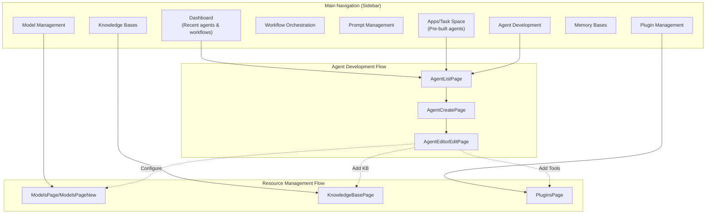
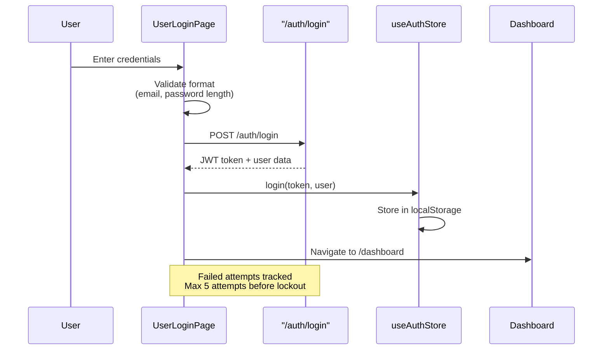
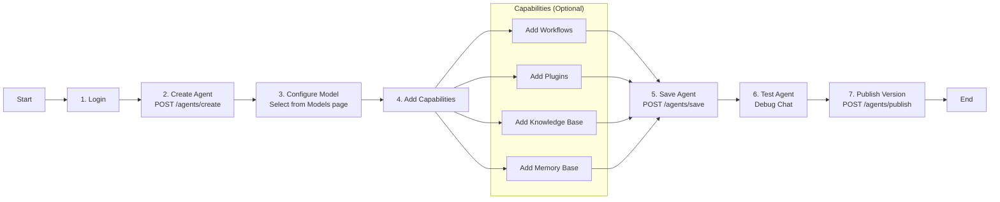
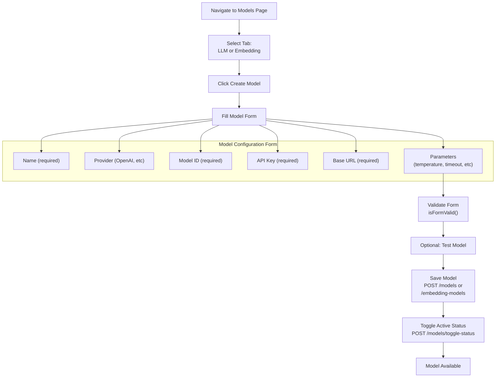
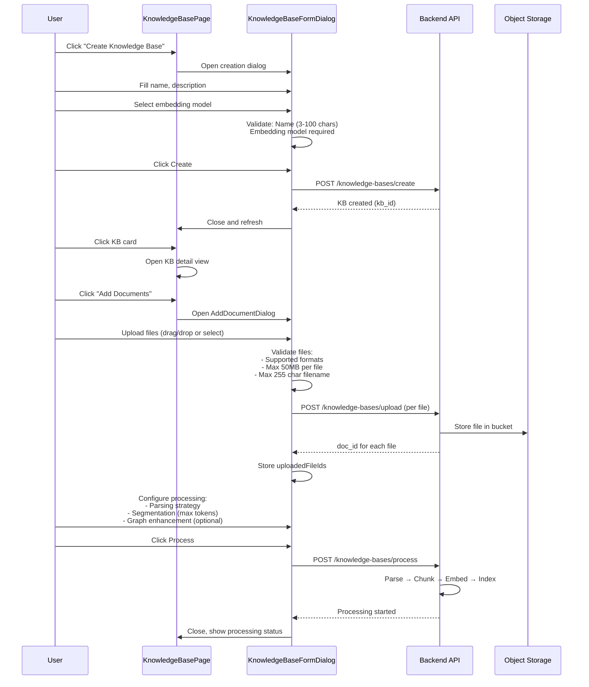
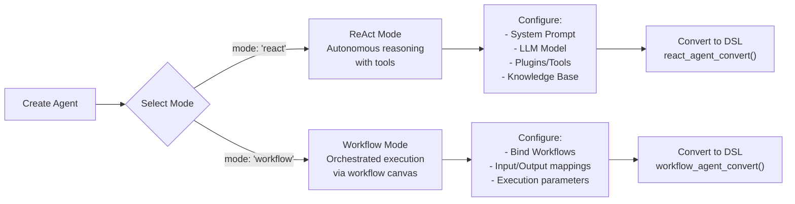
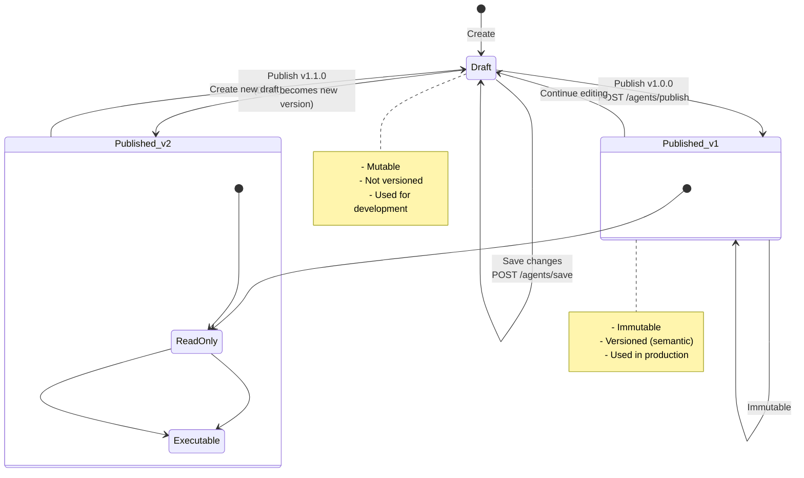
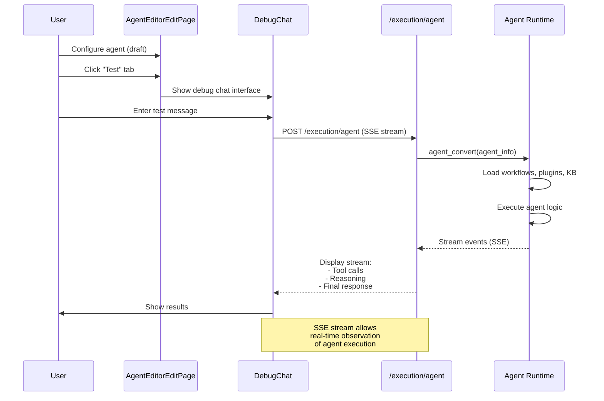

<!-- source: DeepWiki mcp.deepwiki.com · repo openJiuwen-ai/agent-studio · page 4 User Guides · fetched 2026-11-02 -->

# User Guides

<details>
<summary>Relevant source files</summary>

The following files were used as context for generating this wiki page:

- [backend/openjiuwen_studio/core/manager/agent.py](backend/openjiuwen_studio/core/manager/agent.py)
- [backend/openjiuwen_studio/core/manager/convertor/agent.py](backend/openjiuwen_studio/core/manager/convertor/agent.py)
- [backend/openjiuwen_studio/core/manager/knowledge_base.py](backend/openjiuwen_studio/core/manager/knowledge_base.py)
- [backend/openjiuwen_studio/core/manager/model_manager/managers/embedding_model_test_manager.py](backend/openjiuwen_studio/core/manager/model_manager/managers/embedding_model_test_manager.py)
- [backend/openjiuwen_studio/core/manager/repositories/agent_repository.py](backend/openjiuwen_studio/core/manager/repositories/agent_repository.py)
- [backend/openjiuwen_studio/core/manager/repositories/plugin_repository.py](backend/openjiuwen_studio/core/manager/repositories/plugin_repository.py)
- [backend/openjiuwen_studio/core/manager/repositories/tool_repository.py](backend/openjiuwen_studio/core/manager/repositories/tool_repository.py)
- [backend/openjiuwen_studio/routers/agents.py](backend/openjiuwen_studio/routers/agents.py)
- [backend/openjiuwen_studio/routers/embedding_models.py](backend/openjiuwen_studio/routers/embedding_models.py)
- [backend/openjiuwen_studio/schemas/agent.py](backend/openjiuwen_studio/schemas/agent.py)
- [frontend/packages/api-client/src/config.ts](frontend/packages/api-client/src/config.ts)
- [frontend/packages/api-client/src/services/agentService.ts](frontend/packages/api-client/src/services/agentService.ts)
- [frontend/src/locales/en-US.json](frontend/src/locales/en-US.json)
- [frontend/src/locales/zh-CN.json](frontend/src/locales/zh-CN.json)
- [frontend/src/pages/Auth/PrivacyPolicyPage.tsx](frontend/src/pages/Auth/PrivacyPolicyPage.tsx)
- [frontend/src/pages/Auth/UserLoginPage.tsx](frontend/src/pages/Auth/UserLoginPage.tsx)
- [frontend/src/pages/KnowledgeBase/components/AddDocumentDialog.tsx](frontend/src/pages/KnowledgeBase/components/AddDocumentDialog.tsx)
- [frontend/src/pages/KnowledgeBase/components/KnowledgeBaseFormDialog.tsx](frontend/src/pages/KnowledgeBase/components/KnowledgeBaseFormDialog.tsx)
- [frontend/src/pages/Models/ModelsPage.tsx](frontend/src/pages/Models/ModelsPage.tsx)
- [frontend/src/pages/Models/ModelsPageNew.tsx](frontend/src/pages/Models/ModelsPageNew.tsx)
- [frontend/src/pages/Models/components/EmbeddingModelsTable.tsx](frontend/src/pages/Models/components/EmbeddingModelsTable.tsx)
- [frontend/src/pages/Models/components/LLMModelsTable.tsx](frontend/src/pages/Models/components/LLMModelsTable.tsx)

</details>


This section provides practical, step-by-step tutorials for common tasks in OpenJiuwen Agent Studio. These guides are designed for users who want to build and deploy AI agents, workflows, and related components through the web interface.

For technical implementation details and architecture, see [Architecture](#5). For API-level integration, see [API Reference](#8). For deployment and operations, see [Deployment & Operations](#7).

---

## Overview

OpenJiuwen Agent Studio supports two primary user workflows:

1. **Agent Development Workflow**: Create agents → Configure models → Add capabilities (workflows/plugins/knowledge) → Test → Publish
2. **Resource Management Workflow**: Configure models → Create knowledge bases → Develop plugins → Integrate into agents

This page provides an overview of common user tasks and patterns. Detailed step-by-step guides are available in the subsections:
- [Creating Your First Agent](#4.1)
- [Building Workflows](#4.2)
- [Managing Models](#4.3)
- [Building Knowledge Bases](#4.4)
- [Developing Plugins](#4.5)
- [Optimizing Prompts](#4.6)
- [Using Memory Systems](#4.7)

---

## User Interface Architecture

### Main Navigation Structure



**Sources**: 
- [frontend/src/locales/en-US.json:529-568]()
- [frontend/src/pages/Auth/UserLoginPage.tsx:1-30]()

---

## Authentication and Initial Setup

### Login Flow

Users must authenticate before accessing the platform. The authentication process supports:

1. **Email-based Registration**: Users register with email format usernames
2. **Password Login**: Standard username/password authentication with JWT tokens
3. **Account Security**: Failed login attempts tracked, account lockout after 5 failed attempts



**Implementation Details**:
- Frontend: `UserLoginPage` component handles login form with validation [frontend/src/pages/Auth/UserLoginPage.tsx:129-205]()
- API: `useLoginWithPwd` hook calls `/auth/login` endpoint [frontend/src/pages/Auth/UserLoginPage.tsx:168]()
- State: `useAuthStore` manages authentication state and persists token [frontend/src/pages/Auth/UserLoginPage.tsx:164]()
- Security: Account lockout stored in localStorage with `account_lock_${email}` keys [frontend/src/pages/Auth/UserLoginPage.tsx:51-127]()

**Sources**:
- [frontend/src/pages/Auth/UserLoginPage.tsx:1-429]()
- [frontend/packages/api-client/src/config.ts:72-83]()
- [frontend/src/locales/en-US.json:337-426]()

---

## Common User Workflows

### Workflow 1: Agent Development

This is the most common workflow for creating a functional AI agent.



**Key API Endpoints**:
- Agent Creation: `POST /agents/create` [backend/openjiuwen_studio/routers/agents.py:157-183]()
- Agent Save: `POST /agents/save` [backend/openjiuwen_studio/routers/agents.py:237-260]()
- Agent Publish: `POST /agents/publish` [backend/openjiuwen_studio/routers/agents.py:308-329]()

**Key Components**:
- `AgentCreatePage`: Initial agent creation form [frontend/src/locales/en-US.json:1206-1220]()
- `AgentEditorEditPage`: Main agent configuration interface with tabs for prompt, model, workflows, plugins, knowledge
- `DebugChat`: Testing interface within agent editor

**Sources**:
- [backend/openjiuwen_studio/core/manager/agent.py:329-376]()
- [backend/openjiuwen_studio/routers/agents.py:157-329]()
- [frontend/src/locales/en-US.json:1206-1305]()

---

### Workflow 2: Model Configuration

Before creating agents, users typically configure LLM and Embedding models.



**Form Validation Rules**:
- Name: 1-100 characters [frontend/src/pages/Models/ModelsPage.tsx:225-227]()
- Model ID: 1-100 characters [frontend/src/pages/Models/ModelsPage.tsx:225-227]()
- Base URL: Must be valid HTTP/HTTPS URL [frontend/src/pages/Models/ModelsPage.tsx:280-294]()
- API Key: Required for creation, optional for editing [frontend/src/pages/Models/ModelsPage.tsx:228]()
- LLM Timeout: 1-3600 seconds [frontend/src/pages/Models/ModelsPage.tsx:394-399]()
- Embedding Max Batch Size: 1-100 [frontend/src/pages/Models/ModelsPage.tsx:233-237]()

**API Endpoints**:
- Create LLM: `POST /models` [frontend/packages/api-client/src/config.ts:144-150]()
- Create Embedding: `POST /embedding-models` [frontend/packages/api-client/src/config.ts:157-163]()
- Test Model: `POST /models/test` or `/embedding-models/test`

**Key Components**:
- `ModelsPage` / `ModelsPageNew`: Main models management page with tab interface [frontend/src/pages/Models/ModelsPage.tsx:114-517]()
- `LLMModelsTable`: Table displaying LLM models [frontend/src/pages/Models/components/LLMModelsTable.tsx:1-20]()
- `EmbeddingModelsTable`: Table displaying embedding models [frontend/src/pages/Models/components/EmbeddingModelsTable.tsx:1-20]()

**Sources**:
- [frontend/src/pages/Models/ModelsPage.tsx:1-1305]()
- [frontend/src/pages/Models/ModelsPageNew.tsx:1-800]()
- [backend/openjiuwen_studio/routers/embedding_models.py:1-200]()
- [frontend/src/locales/en-US.json:2008-2250]()

---

### Workflow 3: Knowledge Base Creation

Knowledge bases provide RAG (Retrieval-Augmented Generation) capabilities to agents.



**Document Processing Pipeline**:

1. **Upload Phase**:
   - File validation (format, size, name length) [frontend/src/pages/KnowledgeBase/components/AddDocumentDialog.tsx:286-375]()
   - Upload to OBS via `POST /knowledge-bases/upload` [frontend/src/pages/KnowledgeBase/components/AddDocumentDialog.tsx:377-445]()
   - Track `doc_id` for each uploaded file

2. **Processing Phase**:
   - User configures parsing/segmentation strategies
   - Backend executes: Parse → Chunk → Embed → Index [backend/openjiuwen_studio/core/manager/knowledge_base.py:459-600]()
   - Document status transitions: `UPLOADED` → `PARSING` → `PARSED` → `INDEXING` → `INDEXED`

3. **Retrieval Configuration**:
   - Knowledge base uses configured embedding model [backend/openjiuwen_studio/core/manager/knowledge_base.py:369-452]()
   - Supports vector stores: Milvus or Chroma (configurable via `INDEX_MANAGER_TYPE`) [backend/openjiuwen_studio/core/manager/knowledge_base.py:83]()

**Key Classes**:
- `OBSDocumentManager`: Handles object storage operations [backend/openjiuwen_studio/core/manager/knowledge_base.py:86-186]()
- `knowledge_base_repository`: Database operations for knowledge bases [backend/openjiuwen_studio/core/manager/knowledge_base.py:45-51]()

**Sources**:
- [frontend/src/pages/KnowledgeBase/components/KnowledgeBaseFormDialog.tsx:1-450]()
- [frontend/src/pages/KnowledgeBase/components/AddDocumentDialog.tsx:1-800]()
- [backend/openjiuwen_studio/core/manager/knowledge_base.py:1-600]()
- [frontend/src/locales/en-US.json:2251-2600]()

---

## Agent Configuration Details

### Agent Mode Selection

Agents support two operational modes configured during creation:



**Mode Characteristics**:

| Aspect | ReAct Mode | Workflow Mode |
|--------|-----------|---------------|
| **Control** | LLM-driven decisions | Pre-defined flow |
| **Edit Mode** | Manual prompt engineering | Visual workflow canvas |
| **Flexibility** | High (autonomous tool use) | Medium (structured execution) |
| **Predictability** | Lower (LLM-dependent) | Higher (deterministic) |
| **Use Cases** | Conversational AI, open-ended tasks | Business processes, pipelines |

**Configuration Components**:
- `AgentEditorEditPage`: Main configuration interface with tabs
- `SystemPromptTab`: Configure agent's system prompt and behavior
- `AgentModelSelector`: Select and configure LLM model
- `DebugChat`: Test agent configuration in real-time

**Conversion to Execution DSL**:
- ReAct agents: `react_agent_convert()` [backend/openjiuwen_studio/core/manager/convertor/agent.py:263-327]()
- Workflow agents: `workflow_agent_convert()` [backend/openjiuwen_studio/core/manager/convertor/agent.py:329-400]()

**Sources**:
- [backend/openjiuwen_studio/core/manager/convertor/agent.py:1-450]()
- [backend/openjiuwen_studio/schemas/agent.py:1-150]()
- [frontend/src/locales/en-US.json:1206-1500]()

---

## Version Management

### Agent and Workflow Versions

OpenJiuwen supports draft and published versions for both agents and workflows:



**Version Workflow**:

1. **Draft Phase**:
   - All changes saved to draft (no version string)
   - GET `/agents/get_agent_info` without version returns draft [backend/openjiuwen_studio/routers/agents.py:262-281]()
   - Unlimited saves via POST `/agents/save`

2. **Publish Phase**:
   - User provides semantic version (e.g., "1.0.0") [frontend/src/locales/en-US.json:147-150]()
   - POST `/agents/publish` creates immutable published version [backend/openjiuwen_studio/routers/agents.py:308-329]()
   - Draft continues to exist for further development

3. **Version History**:
   - GET `/agents/version_list` returns all published versions [backend/openjiuwen_studio/routers/agents.py:331-354]()
   - Each version stored separately in `agent_publish_db` table
   - Can delete specific versions via DELETE `/agents/delete_publish`

**Database Schema**:
- Draft: `agent_base_db` table (no version field or version=null) [backend/openjiuwen_studio/core/manager/repositories/agent_repository.py:1-100]()
- Published: `agent_publish_db` table (with version field) [backend/openjiuwen_studio/core/manager/repositories/agent_repository.py:150-250]()

**Sources**:
- [backend/openjiuwen_studio/routers/agents.py:213-354]()
- [backend/openjiuwen_studio/core/manager/agent.py:875-1000]()
- [frontend/src/locales/en-US.json:1450-1550]()

---

## Testing and Debugging

### In-Editor Testing

Agents can be tested directly within the editor using the Debug Chat component:



**Debug Features**:
- **Live Streaming**: SSE (Server-Sent Events) for real-time execution feedback
- **Tool Call Visibility**: See which plugins/workflows are invoked
- **Error Display**: Detailed error messages if execution fails
- **Conversation History**: Multi-turn testing supported

**Testing Modes**:

| Test Type | Location | Purpose |
|-----------|----------|---------|
| **Debug Chat** | Agent Editor | Quick iteration during development |
| **Model Test** | Models Page | Verify model connectivity and response |
| **Workflow Validation** | Workflow Canvas | Validate workflow logic before binding |
| **Plugin Test** | Plugin Editor | Test individual plugin/tool functionality |

**Sources**:
- [backend/openjiuwen_studio/routers/agents.py:400-450]()
- [frontend/src/locales/en-US.json:1550-1650]()
- [frontend/packages/api-client/src/config.ts:118-130]()

---

## Best Practices

### 1. Model Configuration

**Before Creating Agents**:
- Configure at least one LLM model (for agent reasoning)
- Configure at least one embedding model (if using knowledge bases)
- Test models using the built-in test feature to verify connectivity
- Use descriptive names for models (e.g., "gpt-4-production", "bge-m3-embeddings")

**Security**:
- API keys are encrypted in the database [backend/openjiuwen_studio/core/manager/model_manager/utils/security_utils.py]()
- Keys are decrypted only during execution
- Never expose API keys in logs or frontend

### 2. Agent Development

**Iterative Development**:
1. Start simple: Create agent with basic prompt only
2. Test thoroughly in Debug Chat
3. Add capabilities incrementally (one workflow/plugin at a time)
4. Test after each addition
5. Publish only when fully validated

**Prompt Engineering**:
- Use the Prompt Optimization feature for auto-tuning [frontend/src/locales/en-US.json:535-536]()
- Provide clear system prompts with specific instructions
- Define expected input/output formats
- Include examples in the prompt when possible

### 3. Knowledge Base Management

**Document Organization**:
- Use descriptive knowledge base names
- Group related documents in the same KB
- Configure appropriate chunk sizes based on content:
  - Technical docs: 512-1024 tokens
  - Long-form content: 1024-2048 tokens
  - Short snippets: 256-512 tokens

**Processing Strategy**:
- Use "Quick Parse" for standard documents (PDF, DOCX, TXT)
- Enable "Graph Enhancement" for complex documents with relationships [frontend/src/pages/KnowledgeBase/components/AddDocumentDialog.tsx:23-26]()
- Monitor document status transitions in the UI

### 4. Version Control

**Publishing Strategy**:
- Use semantic versioning (MAJOR.MINOR.PATCH)
- Publish after significant changes or before production deployment
- Keep draft version for ongoing development
- Document changes in version descriptions

**Version Management**:
- Delete old versions that are no longer needed
- Keep at least one stable production version
- Test published versions before updating production agents

---

## Common Error Patterns

### Validation Errors

**Model Configuration**:
```
Error: "Base URL: Invalid format"
Solution: Ensure URL starts with http:// or https://
```

**Agent Creation**:
```
Error: "Agent model configuration is empty"
Solution: Configure a model before saving the agent
```

**Knowledge Base**:
```
Error: "Knowledge base has no embedding_model_config_id"
Solution: Select an embedding model when creating the KB
```

### Runtime Errors

**Model Connectivity**:
```
Error: "Failed to connect to model endpoint"
Solution: 
1. Verify API key is correct
2. Test model using built-in test feature
3. Check base URL is accessible
4. Verify model is marked as "active"
```

**Document Processing**:
```
Error: "Failed to parse document"
Solution:
1. Verify file is not corrupted
2. Check file format is supported
3. Ensure file size < 50MB
4. Try different parsing strategy
```

### Authentication Issues

**Session Expiry**:
```
Error: "Session has expired, please login again"
Solution: Login again at /login
Note: JWT tokens expire after configured duration
```

**Account Lockout**:
```
Error: "Account locked due to too many failed attempts"
Solution: Wait for lockout period to expire (stored in localStorage)
```

**Sources**:
- [backend/openjiuwen_studio/routers/agents.py:130-152]()
- [frontend/src/pages/Auth/UserLoginPage.tsx:287-343]()
- [frontend/src/locales/en-US.json:150-157]()

---

## Next Steps

For detailed step-by-step instructions on specific tasks:

- **[Creating Your First Agent](#4.1)**: Complete walkthrough of agent creation
- **[Building Workflows](#4.2)**: Using the visual workflow canvas
- **[Managing Models](#4.3)**: Configuring LLM and embedding models
- **[Building Knowledge Bases](#4.4)**: Document upload and processing
- **[Developing Plugins](#4.5)**: Creating custom tools and integrations
- **[Optimizing Prompts](#4.6)**: Using auto-optimization features
- **[Using Memory Systems](#4.7)**: Configuring agent memory

For developers looking to extend the system, see:
- **[Developer Guide](#6)**: Contributing to the codebase
- **[API Reference](#8)**: Complete API documentation
- **[Architecture](#5)**: System design and components

**Sources**:
- [frontend/src/locales/en-US.json:1-2800]()
- [backend/openjiuwen_studio/routers/agents.py:1-500]()
- [frontend/packages/api-client/src/config.ts:1-250]()

---

