<!-- source: DeepWiki mcp.deepwiki.com · repo openJiuwen-ai/agent-studio · page 4.1 Creating Your First Agent · fetched 2026-11-02 -->

# Creating Your First Agent

Relevant source files

The following files were used as context for generating this wiki page:

- [backend/openjiuwen_studio/core/manager/agent.py](backend/openjiuwen_studio/core/manager/agent.py)
- [backend/openjiuwen_studio/core/manager/convertor/agent.py](backend/openjiuwen_studio/core/manager/convertor/agent.py)
- [backend/openjiuwen_studio/core/manager/knowledge_base.py](backend/openjiuwen_studio/core/manager/knowledge_base.py)
- [backend/openjiuwen_studio/core/manager/repositories/agent_repository.py](backend/openjiuwen_studio/core/manager/repositories/agent_repository.py)
- [backend/openjiuwen_studio/core/manager/repositories/plugin_repository.py](backend/openjiuwen_studio/core/manager/repositories/plugin_repository.py)
- [backend/openjiuwen_studio/core/manager/repositories/tool_repository.py](backend/openjiuwen_studio/core/manager/repositories/tool_repository.py)
- [backend/openjiuwen_studio/routers/agents.py](backend/openjiuwen_studio/routers/agents.py)
- [backend/openjiuwen_studio/schemas/agent.py](backend/openjiuwen_studio/schemas/agent.py)
- [frontend/packages/api-client/src/config.ts](frontend/packages/api-client/src/config.ts)
- [frontend/packages/api-client/src/services/agentService.ts](frontend/packages/api-client/src/services/agentService.ts)
- [frontend/src/components/Agent/AgentModelSelector.tsx](frontend/src/components/Agent/AgentModelSelector.tsx)
- [frontend/src/components/Agent/OverridePromptTemplateDialog.tsx](frontend/src/components/Agent/OverridePromptTemplateDialog.tsx)
- [frontend/src/locales/agent/en-US/common.json](frontend/src/locales/agent/en-US/common.json)
- [frontend/src/locales/agent/en-US/editor.json](frontend/src/locales/agent/en-US/editor.json)
- [frontend/src/locales/agent/zh-CN/common.json](frontend/src/locales/agent/zh-CN/common.json)
- [frontend/src/locales/agent/zh-CN/editor.json](frontend/src/locales/agent/zh-CN/editor.json)
- [frontend/src/pages/Agents/AgentCreatePage.tsx](frontend/src/pages/Agents/AgentCreatePage.tsx)
- [frontend/src/pages/Agents/AgentEditorEditPage.tsx](frontend/src/pages/Agents/AgentEditorEditPage.tsx)
- [frontend/src/pages/Agents/AgentsPage.tsx](frontend/src/pages/Agents/AgentsPage.tsx)

This guide walks through the complete process of creating a new agent from initial setup to testing. It covers agent mode selection, basic configuration, model setup, and debugging. For information about agent concepts and architecture, see [Agents](#3.1). For advanced configuration topics like workflow orchestration and prompt optimization, see [Building Workflows](#4.2) and [Optimizing Prompts](#4.6).

---

## Agent Creation Workflow

The agent creation process follows a multi-stage workflow that spans frontend UI interactions and backend processing:

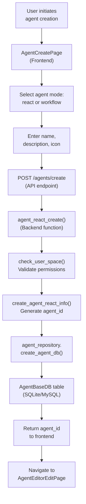

**Sources:** [frontend/src/pages/Agents/AgentCreatePage.tsx:1-300](), [backend/openjiuwen_studio/routers/agents.py:157-183](), [backend/openjiuwen_studio/core/manager/agent.py:301-376]()

---

## Step 1: Navigate to Agent Creation

Access the agent creation interface from the main agents page:

1. Click the **"Create Agent"** button in the agents list page
2. The system loads `AgentCreatePage` component
3. The page presents two agent modes with preview images and descriptions

The creation page uses a radio button interface for mode selection, with each option displaying:
- Mode icon and name
- Detailed description of use cases
- Preview diagram showing the mode's architecture

**Sources:** [frontend/src/pages/Agents/AgentCreatePage.tsx:35-274](), [frontend/src/locales/agent/en-US/editor.json:1-45]()

---

## Step 2: Select Agent Mode

Choose between two agent execution modes based on your use case:

### Mode Comparison

| Mode | Agent Type | Best For | Key Characteristics |
|------|-----------|----------|---------------------|
| **Single Agent (Autonomous Planning)** | `react` | Complex reasoning, dynamic tool selection | LLM autonomously plans actions, reflects on results, intelligently orchestrates tools |
| **Single Agent (Multi-Workflow)** | `workflow` | Structured processes, clear business logic | Pre-defined workflow orchestration with deterministic execution paths |

### React Mode Architecture

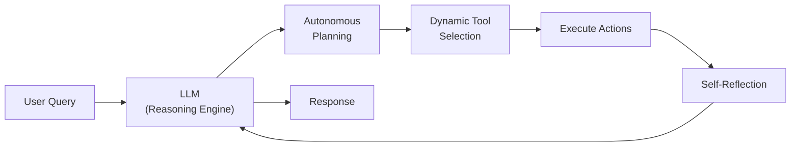

In React mode, the agent uses the ReAct (Reasoning + Acting) pattern where the LLM decides which tools to invoke based on the current context and previous results.

### Workflow Mode Architecture

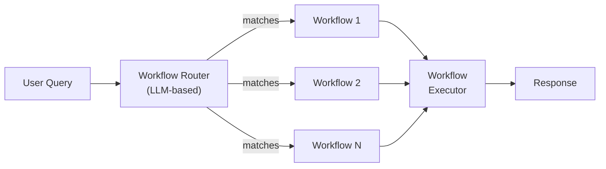

In Workflow mode, the agent selects and executes predefined workflows based on user intent. The LLM acts as a router and workflow executor rather than an autonomous planner.

**Mode Selection Code Flow:**

The selected mode is stored as `agent_type` in the request:

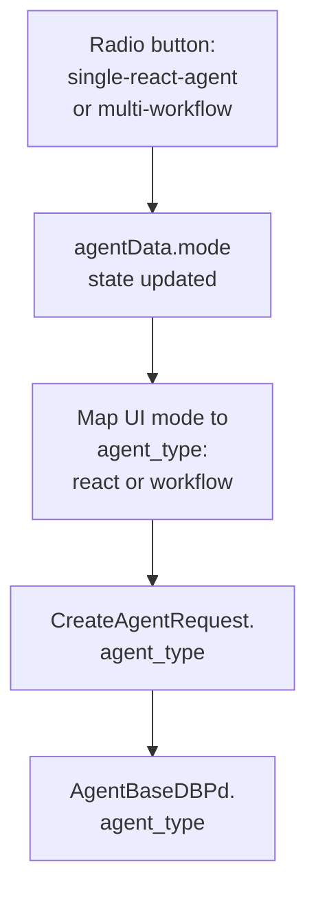

**Sources:** [frontend/src/pages/Agents/AgentCreatePage.tsx:36-54](), [frontend/src/locales/agent/en-US/editor.json:4-13](), [backend/openjiuwen_studio/schemas/agent.py:20-27]()

---

## Step 3: Configure Basic Information

After selecting the mode, provide essential metadata:

### Required Fields

| Field | Schema | Validation | Purpose |
|-------|--------|------------|---------|
| **Name** | `agent_name` | 1-255 characters | Unique identifier displayed in UI |
| **Description** | `description` | 1-500 characters | Functional summary of agent capabilities |
| **Icon** | `icon` | Max 2000 characters (emoji or URL) | Visual identifier in agent lists |

### Creation Request Flow

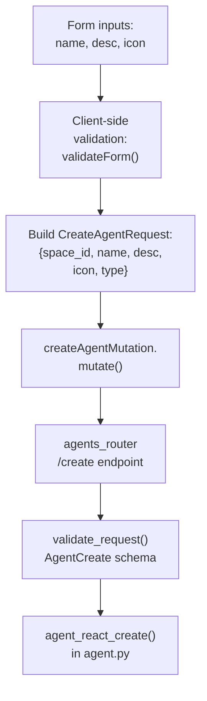

### Backend Creation Logic

The `agent_react_create` function in the backend performs these operations:

1. **Permission Check:** Validates `space_id` against `current_user` permissions
2. **ID Generation:** Creates UUID for `agent_id`: `str(uuid.uuid4())`
3. **Default Values:** Populates `AgentBaseDBPd` with system defaults
4. **Database Insert:** Saves record to `agent_base` table

**Default Values Applied:**

| Field | Default Value | Source |
|-------|---------------|--------|
| `edit_mode` | `AgentEditMode.Manual` | System constant |
| `constraint.max_iteration` | `5` | `AgentConstraint` default |
| `constraint.reserved_max_chat_rounds` | `10` | `AgentConstraint` default |
| `opening_remarks` | `AgentDefaults.OPENING_REMARKS.msg` | Localized default greeting |
| `create_time`, `update_time` | `milliseconds()` | Current timestamp |

**Sources:** [frontend/src/pages/Agents/AgentCreatePage.tsx:103-134](), [backend/openjiuwen_studio/routers/agents.py:157-183](), [backend/openjiuwen_studio/core/manager/agent.py:301-376](), [backend/openjiuwen_studio/schemas/agent.py:20-27]()

---

## Step 4: Initial Agent Configuration

After creation, the system navigates to `AgentEditorEditPage` where you configure the agent's behavior. The editor has three main panels:

### Editor Layout

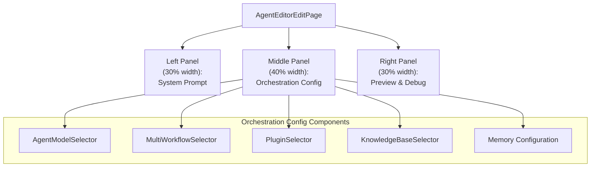

**Sources:** [frontend/src/pages/Agents/AgentEditorEditPage.tsx:1-50](), [frontend/src/components/Agent/AgentModelSelector.tsx:108-156]()

---

## Step 5: Configure Model Settings

Model configuration is **required** before the agent can execute. The system needs an LLM to process user queries.

### Model Selection Process

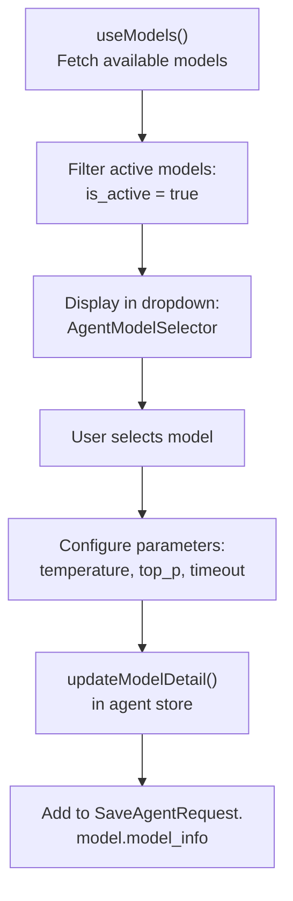

### Model Parameters

The following parameters can be configured for each model:

| Parameter | Type | Range | Default | Purpose |
|-----------|------|-------|---------|---------|
| `temperature` | `float` | 0.0 - 2.0 | 0.7 | Controls output randomness and creativity |
| `top_p` | `float` | 0.0 - 1.0 | 0.9 | Nucleus sampling threshold |
| `timeout` | `int` | ≥ 1 | 300 seconds | Maximum request duration |

### Model Configuration Storage

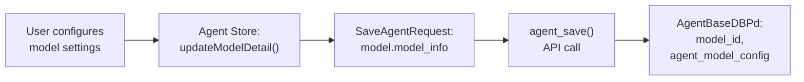

The model configuration is saved in two fields:
- `model_id`: References the model in the `model_config` table
- `agent_model_config`: JSON field storing temperature, top_p, timeout overrides

**Sources:** [frontend/src/components/Agent/AgentModelSelector.tsx:190-283](), [frontend/src/components/Agent/ModelDetailForm.tsx:1-100](), [backend/openjiuwen_studio/core/manager/agent.py:614-755]()

---

## Step 6: Add Capabilities (Optional)

Enhance your agent with additional capabilities:

### Available Capability Types

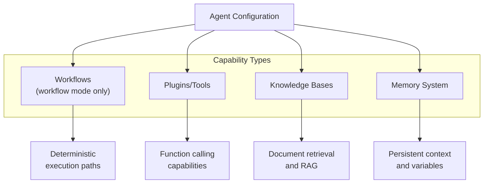

### Adding Workflows (Workflow Mode)

For workflow-mode agents, add workflows that define execution paths:

1. Click **"Add existing workflow"** or **"Create new workflow"** in the Workflows section
2. Select workflows from the `WorkflowSelector` dialog
3. Each workflow must specify a version: `draft` or a published version like `v1.0.0`
4. Workflows are validated before agent execution

**Workflow Integration Schema:**

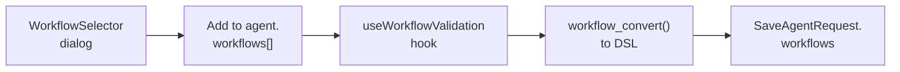

### Adding Plugins (React Mode)

For react-mode agents, add plugins that provide tool capabilities:

1. Click **"Add existing plugin"** or **"Create new plugin"** in the Plugins section
2. Select plugins from the `PluginSelector` dialog
3. Each plugin provides one or more tools with defined input/output schemas

**Plugin Integration Flow:**

The agent converts plugins to DSL format during execution:

- `agent_plugin_convert()` fetches tool metadata
- `convert_to_properties_format()` transforms parameters to JSON Schema
- Tool schema includes: `name`, `description`, `inputs`, `outputs`

### Adding Knowledge Bases

Integrate document retrieval capabilities:

1. Click **"Add existing knowledge base"** in the Knowledge section
2. Select one or more knowledge bases from `KnowledgeBaseSelector`
3. Configure retrieval settings: max recall count, min match score, graph retrieval strategy

**Important:** All knowledge bases added to an agent must use the same embedding model.

### Configuring Memory

Enable persistent context and user preferences:

1. Click **"Add existing memory base"** in the Memory section
2. Select a memory base (or create new)
3. Configure memory variables (name, description, enabled status)
4. Optionally enable long-term memory for user preference tracking

**Sources:** [frontend/src/components/Agent/AgentModelSelector.tsx:136-156](), [backend/openjiuwen_studio/core/manager/convertor/agent.py:68-205](), [frontend/src/components/Agent/WorkflowSelector.tsx:1-100]()

---

## Step 7: Test Your Agent

Use the integrated debug interface to test agent behavior:

### Debug Interface Components

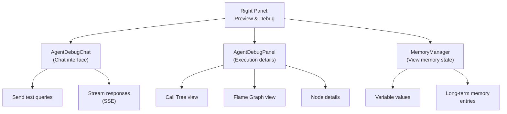

### Debug Execution Flow

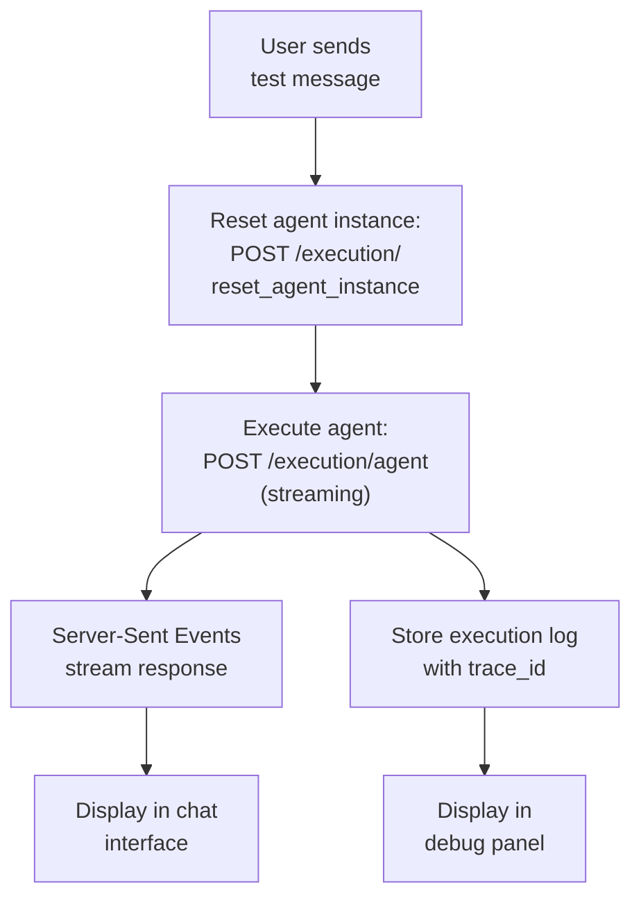

### Viewing Execution Details

The debug panel provides two visualization modes:

1. **Call Tree:** Hierarchical view of agent execution steps
   - Shows node names, status, duration
   - Expandable/collapsible tree structure
   - Click nodes to view input/output details

2. **Flame Graph:** Time-based visualization
   - Width represents execution duration
   - Stacked bars show call hierarchy
   - Quickly identify performance bottlenecks

### Debug Panel Data Flow

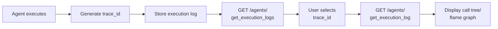

**Key Debug Features:**

- **Real-time streaming:** Agent responses appear as they're generated
- **Execution history:** Select and review previous test runs
- **Node inspection:** Click any node to view input/output data
- **Memory inspection:** View current variable and long-term memory state
- **Performance metrics:** View duration for each execution step

**Sources:** [frontend/src/components/Agent/AgentDebugChat.tsx:1-200](), [frontend/src/components/Agent/AgentDebugPanel.tsx:1-300](), [backend/openjiuwen_studio/routers/agents.py:400-450]()

---

## Step 8: Save and Publish

### Saving Draft Changes

The agent editor auto-saves periodically, but you can manually save:

1. Click the **"Save"** button in the top toolbar
2. The system validates configuration before saving
3. Save writes to the `agent_base` table (draft version)

**Save Validation:**

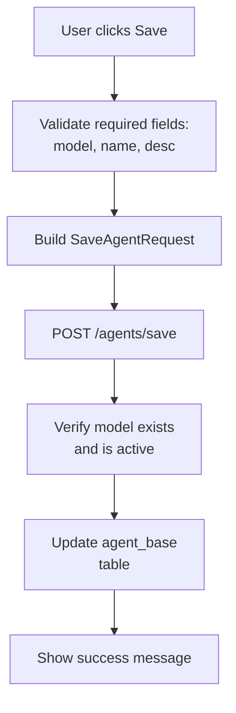

### Publishing a Version

To make the agent available for production use:

1. Ensure all required fields are configured and saved
2. Click **"Submit New Version"** button
3. Enter version number (format: `vX.Y.Z`) and description
4. The system validates the agent configuration using `agent_convert()`
5. If validation passes, a publish record is created in `agent_publish` table

**Publish Workflow:**

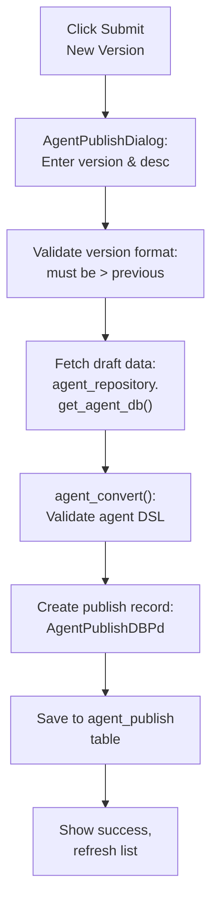

**Version Validation Rules:**

- Format must be `vX.Y.Z` where X, Y, Z are integers
- New version must be greater than latest published version
- Version comparison uses semantic versioning logic

**Publish Validation:**

Before publishing, the system validates:
- Agent has valid model configuration
- All workflows (if any) exist and are valid
- All plugins (if any) exist and have valid tool schemas
- All knowledge bases (if any) exist and are accessible
- Memory configuration (if any) references valid memory base

**Sources:** [backend/openjiuwen_studio/core/manager/agent.py:614-755](), [backend/openjiuwen_studio/core/manager/agent.py:922-1094](), [frontend/src/components/Agent/AgentPublishDialog.tsx:1-150]()

---

## Common Issues and Solutions

### Model Not Configured

**Problem:** Debug chat shows "Please configure a model before debugging"

**Solution:** 
1. Go to Orchestration panel
2. Select a model from the dropdown in Model Configuration section
3. Ensure the model's `is_active` status is `true`
4. Save the agent

### Workflow Validation Failed

**Problem:** Workflow validation shows errors in the UI

**Solution:**
1. Click the workflow item showing validation error
2. Navigate to the workflow editor
3. Fix validation issues (missing nodes, invalid connections, etc.)
4. Return to agent editor and click refresh icon to re-validate

### Knowledge Base Embedding Model Mismatch

**Problem:** Error when adding multiple knowledge bases: "Selected knowledge bases use different Embedding models"

**Solution:**
- Only add knowledge bases that use the same embedding model
- Check each knowledge base's embedding model ID before selection
- Create separate agents for knowledge bases with different embeddings

### Memory Variable Not Working

**Problem:** Memory variables not persisting values

**Solution:**
1. Ensure a memory base is bound to the agent
2. Check that the memory variable is enabled (toggle switch)
3. Verify the variable name is unique within the agent
4. Memory variables require the memory base's embedding and LLM models to be active

**Sources:** [frontend/src/components/Agent/AgentDebugChat.tsx:150-250](), [frontend/src/hooks/useWorkflowValidation.ts:1-100](), [frontend/src/components/Agent/KnowledgeBaseSelector.tsx:200-300]()

---

## Next Steps

After creating and testing your first agent, explore these advanced topics:

- **[Building Workflows](#4.2):** Create complex workflow orchestrations for workflow-mode agents
- **[Managing Models](#4.3):** Configure and manage LLM and embedding models
- **[Building Knowledge Bases](#4.4):** Upload documents and configure retrieval strategies
- **[Developing Plugins](#4.5):** Create custom tools and API integrations
- **[Optimizing Prompts](#4.6):** Use automated prompt optimization to improve agent performance
- **[Using Memory Systems](#4.7):** Configure variables and long-term memory for persistent context
- **[Agent Execution Pipeline](#5.5):** Understand how agents are converted from configuration to executable DSL
- **[API Reference - Agent APIs](#8.1):** Full API documentation for agent operations

**Sources:** [frontend/src/pages/Agents/AgentEditorEditPage.tsx:1-700](), [backend/openjiuwen_studio/core/manager/agent.py:1-2000]()

---

