<!-- source: DeepWiki mcp.deepwiki.com · repo openJiuwen-ai/agent-studio · page 4.2 Building Workflows · fetched 2026-11-02 -->

# Building Workflows

<details>
<summary>Relevant source files</summary>

The following files were used as context for generating this wiki page:

- [frontend/packages/workflow-canvas/src/components/testrun/shared/use-input-interruption.ts](frontend/packages/workflow-canvas/src/components/testrun/shared/use-input-interruption.ts)
- [frontend/packages/workflow-canvas/src/components/testrun/testrun-panel/test-run-panel.tsx](frontend/packages/workflow-canvas/src/components/testrun/testrun-panel/test-run-panel.tsx)
- [frontend/packages/workflow-canvas/src/editor.tsx](frontend/packages/workflow-canvas/src/editor.tsx)
- [frontend/packages/workflow-canvas/src/nodes/loop/effects.ts](frontend/packages/workflow-canvas/src/nodes/loop/effects.ts)
- [frontend/packages/workflow-canvas/src/nodes/loop/form-meta.tsx](frontend/packages/workflow-canvas/src/nodes/loop/form-meta.tsx)
- [frontend/packages/workflow-canvas/src/nodes/loop/validation.ts](frontend/packages/workflow-canvas/src/nodes/loop/validation.ts)
- [frontend/packages/workflow-canvas/src/utils/validation/validation-helpers.ts](frontend/packages/workflow-canvas/src/utils/validation/validation-helpers.ts)
- [frontend/packages/workflow-canvas/src/utils/workflow-node-utils.ts](frontend/packages/workflow-canvas/src/utils/workflow-node-utils.ts)
- [frontend/src/locales/workflow/en-US/common.json](frontend/src/locales/workflow/en-US/common.json)
- [frontend/src/locales/workflow/en-US/nodes.json](frontend/src/locales/workflow/en-US/nodes.json)
- [frontend/src/locales/workflow/zh-CN/common.json](frontend/src/locales/workflow/zh-CN/common.json)
- [frontend/src/locales/workflow/zh-CN/nodes.json](frontend/src/locales/workflow/zh-CN/nodes.json)

</details>


This guide provides a step-by-step tutorial for building workflows using the visual workflow canvas editor. You will learn how to add nodes, configure them, connect them together, and test your workflow execution.

For conceptual information about what workflows are and how they fit into the system, see [Workflows](#3.2). For detailed technical architecture of the workflow canvas, see [Workflow Canvas Architecture](#5.7).

## Workflow Canvas Overview

The workflow canvas is a visual node-based editor where you build workflows by dragging nodes onto the canvas and connecting them. The canvas is implemented in [frontend/packages/workflow-canvas/src/editor.tsx]() using the `FreeLayoutEditorProvider` component.

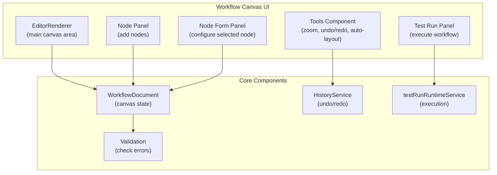

**Sources:** [frontend/packages/workflow-canvas/src/editor.tsx:1-250](), [frontend/packages/workflow-canvas/src/components/tools.tsx]()

## Starting a New Workflow

Every workflow begins with a **Start** node and must end with an **End** node. These nodes define the entry and exit points of your workflow.

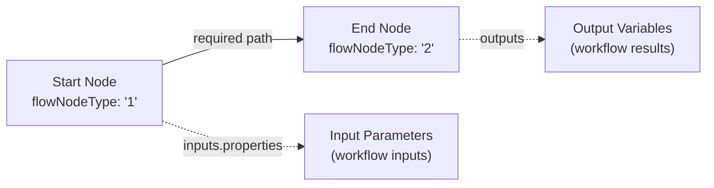

### Start Node Configuration

The Start node defines the input parameters your workflow accepts. Configure inputs in `inputs.properties` using the form materials system.

**Sources:** [frontend/src/locales/workflow/en-US/nodes.json:98-100](), [frontend/packages/workflow-canvas/src/nodes/]()

### End Node Configuration

The End node specifies what outputs the workflow returns. You can either:
- Reference output variables from other nodes
- Provide custom output content via `outputs.content`

**Sources:** [frontend/src/locales/workflow/en-US/nodes.json:101-104]()

## Adding Nodes to the Canvas

### Available Node Types

The workflow canvas supports multiple node types, each identified by a `flowNodeType` numeric constant:

| Node Type | ID | Purpose | Locale Key |
|-----------|----|---------|-----------| 
| Start | `1` | Workflow entry point | `workflowCanvas.node.Start` |
| End | `2` | Workflow exit point | `workflowCanvas.node.End` |
| LLM | `3` | Call language models | `workflowCanvas.node.LLM` |
| Selector (Condition) | `4` | Conditional branching | `workflowCanvas.node.Selector` |
| Loop | `5` | Iteration logic | `workflowCanvas.node.Loop` |
| Intent | `6` | Intent recognition | `workflowCanvas.node.Intent` |
| Questioner | `7` | Ask questions | `workflowCanvas.node.Questioner` |
| Input | `8` | Pause for user input | `workflowCanvas.node.Input` |
| Output | `9` | Stream intermediate output | `workflowCanvas.node.Output` |
| Code | `10` | Execute custom code | `workflowCanvas.node.Code` |
| Text Editor | `11` | String manipulation | `workflowCanvas.node.TextEditor` |
| Continue | `12` | Skip loop iteration | `workflowCanvas.node.Continue` |
| Break | `13` | Exit loop early | `workflowCanvas.node.Break` |
| Workflow | `14` | Execute sub-workflow | `workflowCanvas.node.Workflow` |
| Block Start | `15` | Loop body start | `workflowCanvas.node.Start` |
| Block End | `16` | Loop body end | `workflowCanvas.node.End` |
| Variable | `17` | Assign variables | `workflowCanvas.node.Variable` |
| Variable Merge | `18` | Merge variable groups | `workflowCanvas.node.VariableMerge` |
| Plugin | `19` | Call plugin tools | `workflowCanvas.node.Plugin` |

**Sources:** [frontend/src/locales/workflow/en-US/common.json:23-43](), [frontend/packages/workflow-canvas/src/utils/validation/validation-helpers.ts:13-34]()

### Node Title Generation

When adding nodes, the system automatically generates unique titles using `generateNodeTitle()`:

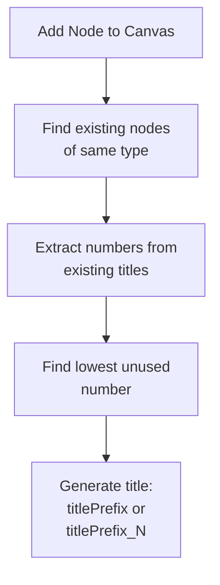

For example, adding multiple LLM nodes creates: "LLM", "LLM_1", "LLM_2", etc.

**Sources:** [frontend/packages/workflow-canvas/src/utils/workflow-node-utils.ts:95-139]()

## Configuring Nodes

### Node Configuration Pattern

Each node type has a form configuration defined in its `form-meta.tsx` file. The configuration uses a consistent pattern:

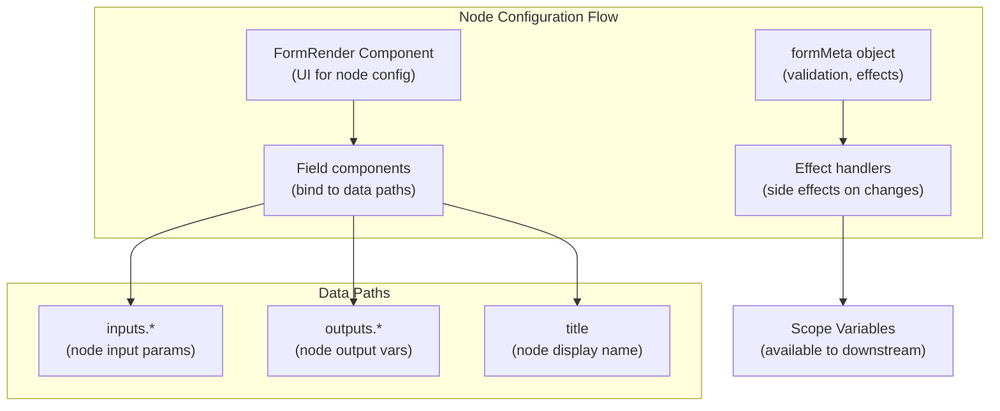

**Sources:** [frontend/packages/workflow-canvas/src/nodes/loop/form-meta.tsx:1-414]()

### Example: LLM Node Configuration

An LLM node typically includes:

- **Model Selection**: Choose which LLM to use via `formModel` component
- **System Prompt**: Configure via `formPrompt` with variable interpolation
- **User Prompt**: Optional user message template
- **Output Format**: Text, Markdown, or JSON

**Sources:** [frontend/src/locales/workflow/en-US/nodes.json:3-12]()

### Example: Loop Node Configuration

The Loop node is one of the most complex configurations, supporting two iteration types:

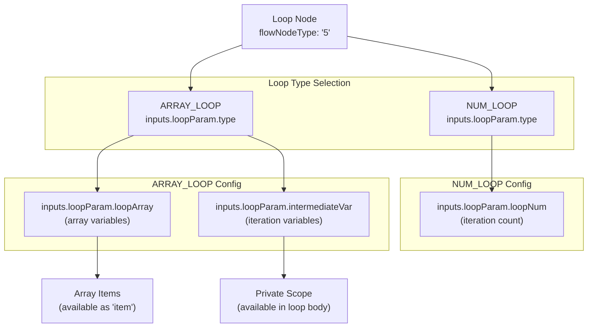

**Sources:** [frontend/packages/workflow-canvas/src/nodes/loop/form-meta.tsx:36-414]()

#### Loop Private Scope

Loops create a `privateScope` with special variables available inside the loop body:

- `index`: Current iteration index (integer)
- Array element variables: For each array in `loopArray`, an element variable is created
- Intermediate variables: User-defined variables from `intermediateVar`

**Sources:** [frontend/packages/workflow-canvas/src/nodes/loop/effects.ts:48-157]()

## Connecting Nodes

### Basic Connection Flow

Nodes are connected via output and input ports. The connection determines data flow:

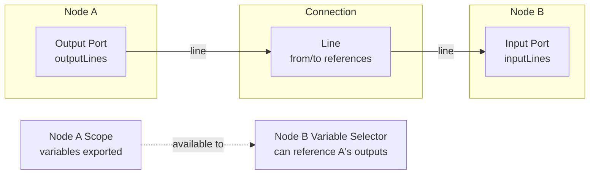

### Variable References

Variables are referenced using the `IFlowRefValue` type with a content array representing the path:

```typescript
{
  type: 'ref',
  content: ['nodeId', 'variableName'],
  schema: { type: 'string' }
}
```

**Sources:** [frontend/packages/workflow-canvas/src/form-materials/]()

### Conditional Branching

The Condition (Selector) node creates multiple branches based on conditions:

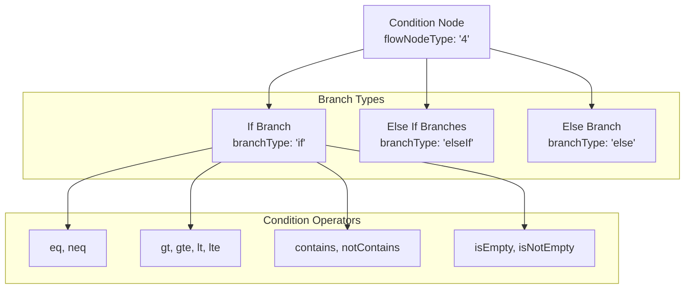

Conditions are evaluated with AND/OR logic specified in `condition.logic`.

**Sources:** [frontend/src/locales/workflow/en-US/nodes.json:22-67](), [frontend/src/locales/workflow/en-US/common.json:142-151]()

## Testing Workflows

### Test Run Panel

The Test Run Panel allows you to execute workflows with custom inputs:

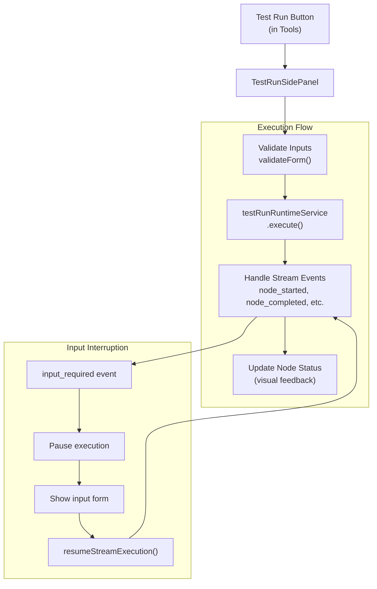

**Sources:** [frontend/packages/workflow-canvas/src/components/testrun/testrun-panel/test-run-panel.tsx:1-418]()

### Test Run Input Handling

The test run system uses `NodeInputPanel` to collect workflow inputs. It supports:

- **Form Mode**: UI inputs for each parameter
- **JSON Mode**: Direct JSON input via `inputJSONMode` toggle

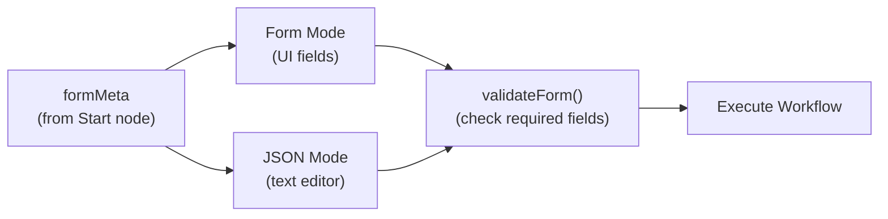

**Sources:** [frontend/packages/workflow-canvas/src/components/testrun/testrun-panel/test-run-panel.tsx:69-79]()

### Input Node Interruptions

When a workflow encounters an Input node (`flowNodeType: '8'`), execution pauses and waits for user input:

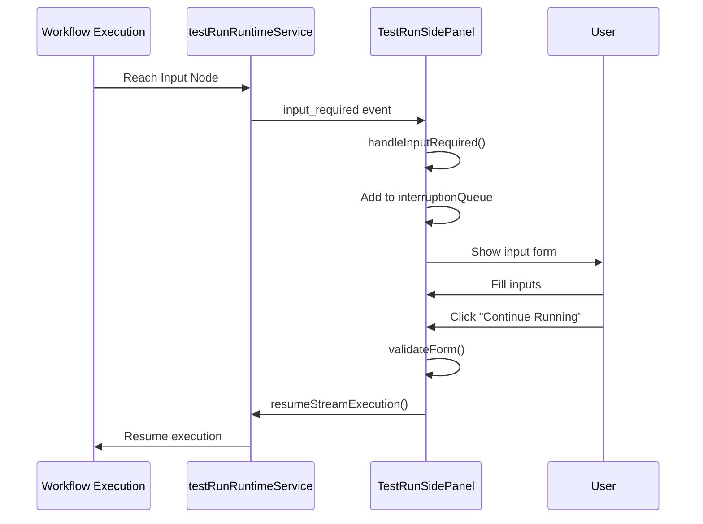

**Sources:** [frontend/packages/workflow-canvas/src/components/testrun/shared/use-input-interruption.ts:1-78](), [frontend/packages/workflow-canvas/src/components/testrun/testrun-panel/test-run-panel.tsx:295-324]()

### Node Status Visualization

During test runs, nodes display visual status indicators:

- **Running**: Node is currently executing
- **Success**: Node completed successfully
- **Failed**: Node encountered an error
- **Cancelled**: Execution was stopped

**Sources:** [frontend/src/locales/workflow/en-US/common.json:228-239]()

## Loop Nodes in Detail

### Loop Validation

Loop nodes have extensive validation to ensure correct configuration:

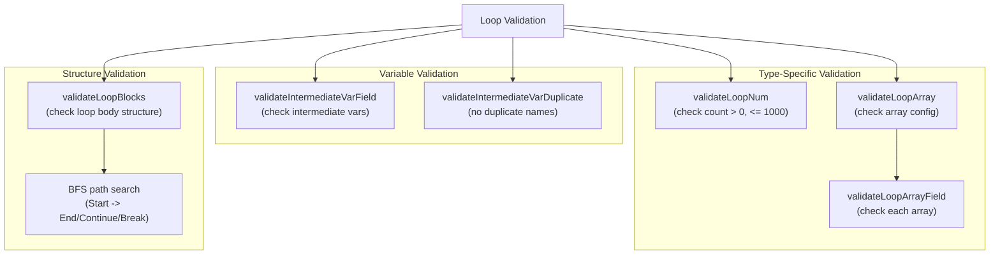

**Sources:** [frontend/packages/workflow-canvas/src/nodes/loop/validation.ts:1-261]()

#### Loop Body Structure

The loop body must contain a valid path from Block Start to Block End (or Continue/Break):

```typescript
// Build adjacency graph
const buildGraph = (nodes, edges) => {
  const graph = new Map()
  nodes.forEach(node => graph.set(node.id, []))
  edges.forEach(edge => {
    graph.get(edge.sourceNodeID).push(edge.targetNodeID)
  })
  return graph
}

// BFS to check if path exists
const hasPath = (graph, start, end) => {
  const visited = new Set()
  const queue = [start]
  
  while (queue.length > 0) {
    const current = queue.shift()
    if (current === end) return true
    if (visited.has(current)) continue
    visited.add(current)
    queue.push(...(graph.get(current) || []))
  }
  return false
}
```

**Sources:** [frontend/packages/workflow-canvas/src/nodes/loop/validation.ts:161-251]()

## Saving and Publishing Workflows

### Auto-Save

Workflows are automatically saved as you edit them. The auto-save mechanism is implemented in the `handleAutoSave` callback:

**Sources:** [frontend/packages/workflow-canvas/src/editor.tsx:170-174]()

### Version History

Workflows support version history, allowing you to:
- View previous versions via the History Panel
- Restore to a previous version
- Create copies of specific versions

The version selection is managed through `useWorkflowStore`:

```typescript
selectedVersion: string | null
setSelectedVersion: (version: string) => void
```

**Sources:** [frontend/packages/workflow-canvas/src/editor.tsx:46-103]()

### Publishing Workflows

To publish a workflow version, use the Publish Dialog which validates:

- Version format: Must follow `vX.Y.Z` pattern
- Version increment: Must be greater than existing versions
- Description: Required, 5-200 characters

**Sources:** [frontend/src/locales/workflow/en-US/nodes.json:290-309]()

## Validation and Error Handling

### Validation System

The validation system runs on multiple triggers:

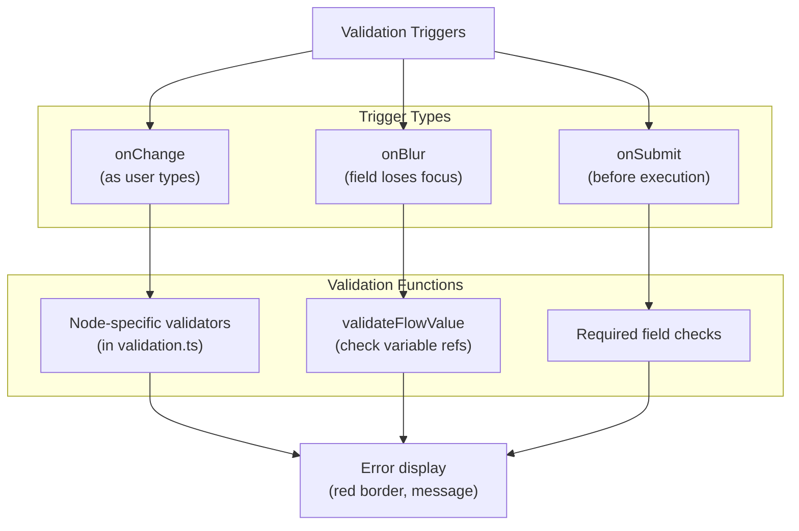

**Sources:** [frontend/packages/workflow-canvas/src/nodes/loop/form-meta.tsx:406-414](), [frontend/src/locales/workflow/en-US/common.json:49-70]()

### Common Validation Errors

| Error Type | Message Key | Description |
|------------|-------------|-------------|
| Required field | `validation.fieldRequired` | Field cannot be empty |
| Unknown variable | `validation.variableReferencedNotFound` | Referenced variable doesn't exist |
| Type mismatch | `nodes.condition.typeMismatch` | Variable type doesn't match expected |
| Empty array | `nodes.loop.arrayVariableCannotBeEmptyArray` | Loop array is empty |
| Path incomplete | `nodes.loop.loopBodyMustHaveCompletePath` | Loop body missing complete path |

**Sources:** [frontend/src/locales/workflow/en-US/common.json:49-70](), [frontend/src/locales/workflow/en-US/nodes.json:22-88]()

## Advanced Features

### Sub-Workflows

The Sub-Workflow node (`flowNodeType: '14'`) allows nesting workflows within workflows, enabling reusable workflow components.

**Sources:** [frontend/src/locales/workflow/en-US/nodes.json:144-148]()

### Variable Merge

The Variable Merge node (`flowNodeType: '18'`) aggregates variables from multiple branches:

- **Aggregation Strategy**: `firstNonNull` - Returns first non-null value from each group
- **Groups**: Multiple variable groups with custom names
- **Type Inference**: Defaults to first variable's type in group

**Sources:** [frontend/src/locales/workflow/en-US/nodes.json:129-143]()

### Plugin Integration

Plugin nodes (`flowNodeType: '19'`) call external tools:

- Select from available plugins via `PluginSelector`
- Configure tool-specific parameters
- Support both URL-based and code-based plugins

**Sources:** [frontend/src/locales/workflow/en-US/nodes.json:410-427](), [frontend/src/locales/workflow/en-US/common.json:1-22]()

---

