<!-- source: DeepWiki mcp.deepwiki.com · repo openJiuwen-ai/agent-studio · page 4.3 Managing Models · fetched 2026-11-02 -->

# Managing Models

<details>
<summary>Relevant source files</summary>

The following files were used as context for generating this wiki page:

- [backend/openjiuwen_studio/core/manager/model_manager/managers/embedding_model_test_manager.py](backend/openjiuwen_studio/core/manager/model_manager/managers/embedding_model_test_manager.py)
- [backend/openjiuwen_studio/core/manager/model_manager/managers/model_test_manager.py](backend/openjiuwen_studio/core/manager/model_manager/managers/model_test_manager.py)
- [backend/openjiuwen_studio/ops/modules/llm/llm_config_service.py](backend/openjiuwen_studio/ops/modules/llm/llm_config_service.py)
- [backend/openjiuwen_studio/ops/modules/llm/schema.py](backend/openjiuwen_studio/ops/modules/llm/schema.py)
- [backend/openjiuwen_studio/ops/modules/prompt/domain/debug_entity.py](backend/openjiuwen_studio/ops/modules/prompt/domain/debug_entity.py)
- [backend/openjiuwen_studio/ops/modules/prompt/domain/entities.py](backend/openjiuwen_studio/ops/modules/prompt/domain/entities.py)
- [backend/openjiuwen_studio/ops/modules/prompt/domain/services.py](backend/openjiuwen_studio/ops/modules/prompt/domain/services.py)
- [backend/openjiuwen_studio/ops/modules/prompt/infra/repositories/debug_repo.py](backend/openjiuwen_studio/ops/modules/prompt/infra/repositories/debug_repo.py)
- [backend/openjiuwen_studio/routers/embedding_models.py](backend/openjiuwen_studio/routers/embedding_models.py)
- [backend/openjiuwen_studio/routers/prompt_debug_router.py](backend/openjiuwen_studio/routers/prompt_debug_router.py)
- [backend/openjiuwen_studio/routers/prompt_llm_router.py](backend/openjiuwen_studio/routers/prompt_llm_router.py)
- [backend/openjiuwen_studio/routers/prompt_router.py](backend/openjiuwen_studio/routers/prompt_router.py)
- [backend/openjiuwen_studio/routers/prompt_tuning_router.py](backend/openjiuwen_studio/routers/prompt_tuning_router.py)
- [backend/openjiuwen_studio/schemas/model_config.py](backend/openjiuwen_studio/schemas/model_config.py)
- [frontend/src/components/Agent/ModelDetailForm.tsx](frontend/src/components/Agent/ModelDetailForm.tsx)
- [frontend/src/locales/en-US.json](frontend/src/locales/en-US.json)
- [frontend/src/locales/zh-CN.json](frontend/src/locales/zh-CN.json)
- [frontend/src/pages/Auth/PrivacyPolicyPage.tsx](frontend/src/pages/Auth/PrivacyPolicyPage.tsx)
- [frontend/src/pages/Auth/UserLoginPage.tsx](frontend/src/pages/Auth/UserLoginPage.tsx)
- [frontend/src/pages/KnowledgeBase/components/AddDocumentDialog.tsx](frontend/src/pages/KnowledgeBase/components/AddDocumentDialog.tsx)
- [frontend/src/pages/KnowledgeBase/components/KnowledgeBaseFormDialog.tsx](frontend/src/pages/KnowledgeBase/components/KnowledgeBaseFormDialog.tsx)
- [frontend/src/pages/Models/ModelsPage.tsx](frontend/src/pages/Models/ModelsPage.tsx)
- [frontend/src/pages/Models/ModelsPageNew.tsx](frontend/src/pages/Models/ModelsPageNew.tsx)
- [frontend/src/pages/Models/components/EmbeddingModelsTable.tsx](frontend/src/pages/Models/components/EmbeddingModelsTable.tsx)
- [frontend/src/pages/Models/components/LLMModelsTable.tsx](frontend/src/pages/Models/components/LLMModelsTable.tsx)

</details>


This page explains how to configure, test, and manage AI models in OpenJiuwen Agent Studio. The system supports two types of models: **LLM models** (Large Language Models for text generation) and **Embedding models** (for text vectorization in knowledge bases). This guide covers model registration, API key management, testing procedures, and provider-specific configurations.

> **Note:** For information about using models in agents, see [Creating Your First Agent](#4.1). For details about the underlying model architecture, see [System Architecture](#5.1).

---

## Model Types

OpenJiuwen Agent Studio supports two distinct model categories, each with specific use cases and configuration requirements:

### LLM Models

LLM (Large Language Model) configurations are used for:
- Agent text generation and reasoning
- Prompt debugging and optimization
- Tool calling and function execution
- Multi-turn conversations

**Key Configuration Parameters:**
- `temperature`: Controls randomness (0.0-2.0)
- `max_tokens`: Maximum response length
- `top_p`: Nucleus sampling parameter (0.0-1.0)
- `timeout`: Request timeout in seconds (1-3600)
- `enable_streaming`: Stream responses chunk-by-chunk
- `enable_function_calling`: Enable tool/function calling capabilities

### Embedding Models

Embedding model configurations are used for:
- Knowledge base document vectorization
- Semantic search and retrieval
- Memory system text encoding

**Key Configuration Parameters:**
- `max_batch_size`: Maximum documents per batch (1-100)
- `api_base`: OpenAI-compatible API endpoint
- `model_id`: Specific embedding model identifier

**Sources:**
- [backend/openjiuwen_studio/schemas/model_config.py:1-128]()
- [backend/openjiuwen_studio/schemas/embedding_model_config.py:1-120]()
- [frontend/src/pages/Models/ModelsPage.tsx:46-82]()

---

## Model Management Interface

### Frontend Architecture

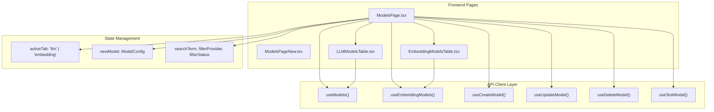

The models page uses a tabbed interface to separate LLM and Embedding model management. Each tab displays a table with filtering, searching, and pagination capabilities.

**Sources:**
- [frontend/src/pages/Models/ModelsPage.tsx:114-277]()
- [frontend/src/pages/Models/ModelsPageNew.tsx:112-276]()
- [frontend/src/pages/Models/components/LLMModelsTable.tsx:1-40]()
- [frontend/src/pages/Models/components/EmbeddingModelsTable.tsx:1-40]()

---

## Creating and Configuring Models

### LLM Model Creation Flow

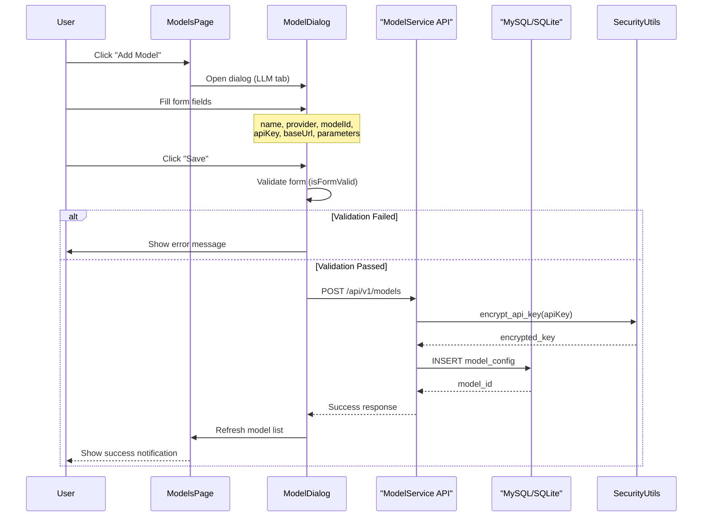

**Validation Rules:**

| Field | Type | Min | Max | Required | Notes |
|-------|------|-----|-----|----------|-------|
| `name` | string | 1 | 100 | Yes | Model configuration name |
| `modelId` | string | 1 | 100 | Yes | Provider-specific model identifier |
| `apiKey` | string | - | - | Yes (create) | Encrypted before storage |
| `baseUrl` | string | - | - | Yes | Must start with http:// or https:// |
| `description` | string | 0 | 500 | No | Optional description |
| `tags` | array | 0 | 10 | No | Maximum 10 tags |
| `temperature` | float | 0.0 | 2.0 | No | Default: 0.7 |
| `max_tokens` | int | 1 | - | No | Default: 4096 |
| `top_p` | float | 0.0 | 1.0 | No | Default: 0.9 |
| `timeout` | int | 1 | 3600 | No | Default: 60 seconds |

**Sources:**
- [frontend/src/pages/Models/ModelsPage.tsx:224-244]()
- [frontend/src/pages/Models/ModelsPage.tsx:374-414]()
- [backend/openjiuwen_studio/schemas/model_config.py:27-57]()

### Embedding Model Creation Flow

Embedding models have a simplified configuration compared to LLM models:

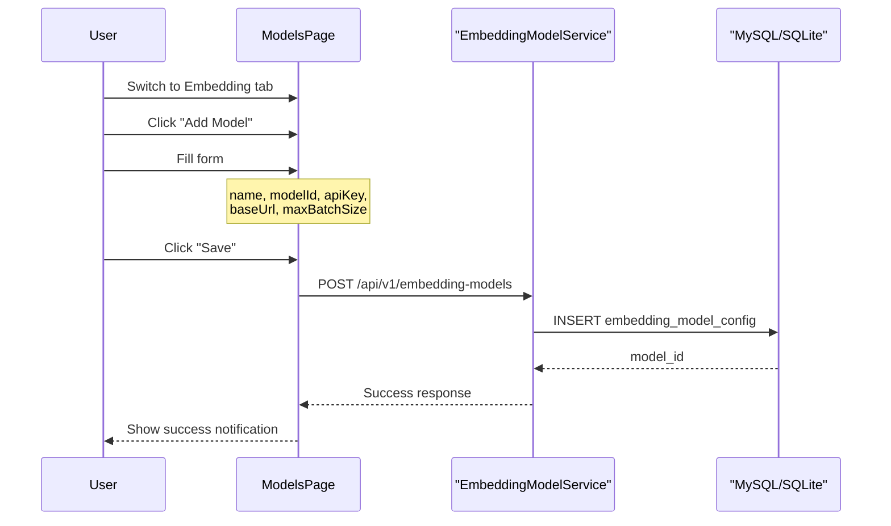

**Embedding-Specific Configuration:**

```typescript
interface EmbeddingModelConfig {
  name: string              // Display name (1-100 chars)
  protocol: 'openai'        // Currently only OpenAI protocol supported
  modelId: string           // Model identifier (e.g., "text-embedding-3-small")
  apiKey: string            // Encrypted API key
  apiBase: string           // API endpoint URL
  maxBatchSize: number      // Documents per batch (1-100, default: 8)
  isActive: boolean         // Enable/disable model
  tags: string[]            // Optional tags (max 10)
}
```

**Sources:**
- [frontend/src/pages/Models/ModelsPage.tsx:637-752]()
- [backend/openjiuwen_studio/schemas/embedding_model_config.py:28-65]()
- [backend/openjiuwen_studio/routers/embedding_models.py:1-250]()

---

## Model Testing

### LLM Model Test Process

Testing ensures that model configurations are valid and can communicate with the provider's API:

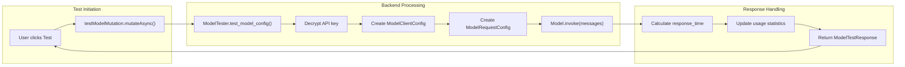

**Test Request Structure:**

```python
class ModelTestRequest(BaseModel):
    prompt: str                        # Test prompt to send
    parameters: Optional[ModelParameters] = None  # Override default parameters
```

**Test Response Structure:**

```python
class ModelTestResponse(BaseModel):
    success: bool                      # Test passed/failed
    response: str                      # Model's response text
    tokens_used: int                   # Tokens consumed
    cost: float                        # Estimated cost (USD)
    latency: float                     # Response time (seconds)
    error: Optional[str] = None        # Error message if failed
```

**Backend Test Implementation:**

The test process follows these steps:

1. **Retrieve Model Configuration**: Fetch from `ModelConfigRepository`
2. **Validate Model Status**: Ensure `is_active=True`
3. **Decrypt API Key**: Use `SecurityUtils.decrypt_api_key()`
4. **Create Model Instance**: Initialize `Model` with client and request configs
5. **Invoke Model**: Send test prompt via `model.invoke(messages)`
6. **Track Metrics**: Record tokens, cost, latency, success/failure
7. **Update Statistics**: Call `update_usage_stats()` on repository

**Sources:**
- [backend/openjiuwen_studio/core/manager/model_manager/managers/model_test_manager.py:40-178]()
- [backend/openjiuwen_studio/schemas/model_config.py:100-124]()
- [frontend/src/pages/Models/ModelsPage.tsx:1105-1177]()

### Embedding Model Test Process

Embedding models are tested by encoding a sample text and validating the response:

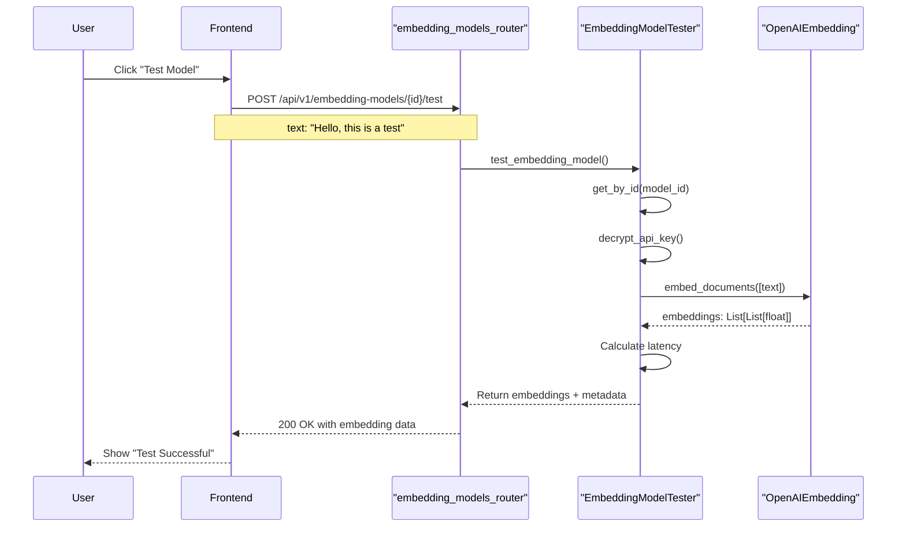

**Test Request:**

```python
class EmbeddingModelTestRequest(BaseModel):
    text: str  # Sample text to embed (default: "Hello, this is a test")
```

**Test Response:**

```python
{
    "success": True,
    "embeddings": [[0.123, -0.456, ...]],  # Vector representation
    "dimensions": 1536,                     # Embedding dimension
    "latency": 0.234,                       # Response time (seconds)
    "error": None
}
```

**Sources:**
- [backend/openjiuwen_studio/core/manager/model_manager/managers/embedding_model_test_manager.py:28-120]()
- [backend/openjiuwen_studio/routers/embedding_models.py:193-229]()
- [frontend/src/pages/KnowledgeBase/components/AddDocumentDialog.tsx:95-118]()

---

## API Key Management

### Security Architecture

API keys are encrypted at rest using `Fernet` symmetric encryption:

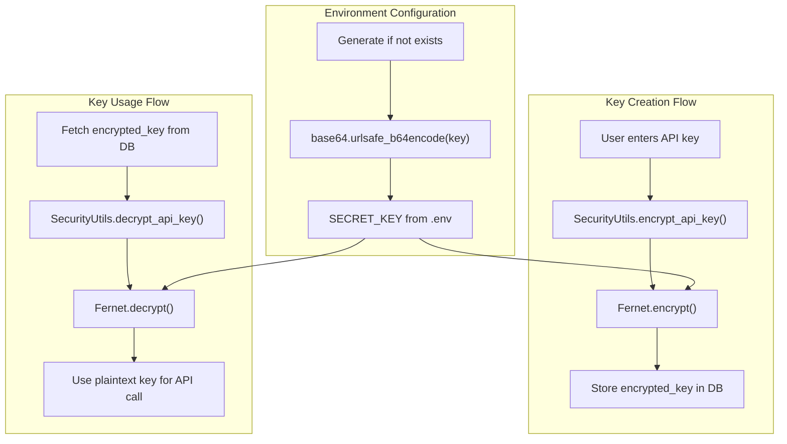

**Encryption Implementation:**

The `SecurityUtils` class handles all API key encryption/decryption:

```python
# Key encryption (during model creation/update)
def encrypt_api_key(self, api_key: str) -> str:
    cipher_suite = Fernet(self.secret_key)
    encrypted = cipher_suite.encrypt(api_key.encode())
    return encrypted.decode()

# Key decryption (during model testing/usage)
def decrypt_api_key(self, encrypted_key: str) -> str:
    cipher_suite = Fernet(self.secret_key)
    decrypted = cipher_suite.decrypt(encrypted_key.encode())
    return decrypted.decode()
```

**Frontend Masking:**

When editing models, API keys are displayed in masked form:

| Scenario | Display Format | Editable |
|----------|----------------|----------|
| New Model | Empty field | Yes |
| Edit Model (with key) | `••••••••••••••••••••••••` | Optional (can update) |
| Edit Model (no key) | Empty field | Yes |
| Model List | Never displayed | N/A |

**Sources:**
- [backend/openjiuwen_studio/core/manager/model_manager/utils/security_utils.py:1-50]()
- [frontend/src/pages/Models/ModelsPage.tsx:246-277]()
- [backend/openjiuwen_studio/core/manager/model_manager/managers/model_config_manager.py:120-180]()

---

## Supported Model Providers

### LLM Providers

The system supports multiple LLM providers through a unified `ModelProvider` enum:

| Provider | Enum Value | Base URL Example | Notes |
|----------|------------|------------------|-------|
| OpenAI | `openai` | `https://api.openai.com/v1` | GPT-3.5, GPT-4, etc. |
| Anthropic | `anthropic` | `https://api.anthropic.com` | Claude models |
| DeepSeek | `deepseek` | `https://api.deepseek.com` | DeepSeek models |
| Qwen | `qwen` | Custom endpoint | Alibaba Qwen models |
| Google | `google` | `https://generativelanguage.googleapis.com` | Gemini models |
| Baidu | `baidu` | Custom endpoint | ERNIE models |
| Zhipu | `zhipu` | Custom endpoint | GLM models |
| SiliconFlow | `siliconflow` | Custom endpoint | SiliconFlow models |
| Custom | `custom` | User-defined | Any OpenAI-compatible API |

### Provider Compatibility Layer

The backend uses a compatibility function to normalize provider names:

```python
def compatible_provider(provider: str) -> str:
    """Convert provider name to standard format for SDK"""
    provider_mapping = {
        'openai': 'openai',
        'anthropic': 'anthropic',
        'deepseek': 'deepseek',
        'qwen': 'dashscope',      # Maps to Alibaba DashScope
        'google': 'google',
        'baidu': 'baidu',
        'zhipu': 'zhipu',
        'siliconflow': 'siliconflow',
        'custom': 'openai'         # Custom APIs use OpenAI protocol
    }
    return provider_mapping.get(provider.lower(), 'openai')
```

**Sources:**
- [backend/openjiuwen_studio/schemas/model_config.py:8-17]()
- [backend/openjiuwen_studio/core/utils/compatible_field.py:1-40]()
- [frontend/src/locales/zh-CN.json:1885-1900]()

### Embedding Providers

Currently, embedding models support the **OpenAI protocol only**:

| Protocol | Supported Models | API Compatibility |
|----------|------------------|-------------------|
| `openai` | text-embedding-3-small, text-embedding-3-large, text-embedding-ada-002, custom | OpenAI-compatible endpoints |

**Note:** While the protocol is fixed to OpenAI, you can use any OpenAI-compatible embedding API by configuring the `apiBase` parameter.

**Sources:**
- [backend/openjiuwen_studio/schemas/embedding_model_config.py:13-18]()
- [backend/openjiuwen_studio/routers/embedding_models.py:36-100]()

---

## Backend API Architecture

### LLM Model Endpoints

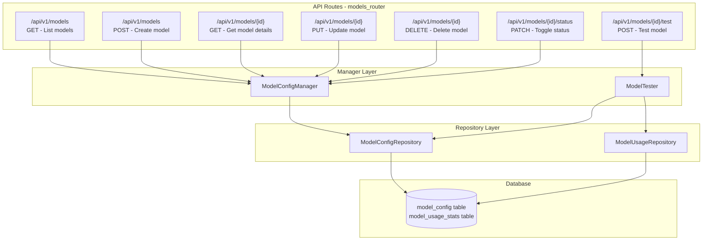

**Key API Endpoint Details:**

**List Models:**
```
GET /api/v1/models?space_id={id}&page={n}&size={n}&is_active={bool}
Response: { items: ModelConfig[], total: int, page: int, size: int }
```

**Create Model:**
```
POST /api/v1/models
Body: ModelConfigCreate
Response: ModelConfigResponse
```

**Update Model:**
```
PUT /api/v1/models/{id}
Body: ModelConfigUpdate
Response: ModelConfigResponse
```

**Test Model:**
```
POST /api/v1/models/{id}/test
Body: { prompt: str, parameters?: ModelParameters }
Response: ModelTestResponse
```

**Sources:**
- [backend/openjiuwen_studio/routers/models.py:1-350]()
- [backend/openjiuwen_studio/core/manager/model_manager/managers/model_config_manager.py:1-300]()
- [backend/openjiuwen_studio/core/manager/repositories/model_config_repository.py:1-200]()

### Embedding Model Endpoints

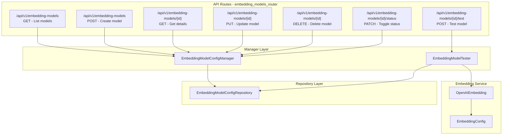

**Sources:**
- [backend/openjiuwen_studio/routers/embedding_models.py:25-250]()
- [backend/openjiuwen_studio/core/manager/model_manager/managers/embedding_model_config_manager.py:1-250]()
- [backend/openjiuwen_studio/core/manager/model_manager/managers/embedding_model_test_manager.py:20-120]()

---

## Usage Statistics and Monitoring

### LLM Model Usage Tracking

The system automatically tracks usage statistics for LLM models:

**Tracked Metrics:**

| Metric | Type | Description |
|--------|------|-------------|
| `total_requests` | int | Total number of API calls |
| `total_tokens` | int | Cumulative tokens consumed |
| `total_cost` | float | Estimated cost in USD |
| `success_rate` | float | Percentage of successful calls (0-1) |
| `avg_response_time` | float | Average latency in seconds |
| `last_used` | datetime | Timestamp of last usage |
| `daily_requests` | int | Requests today |
| `daily_tokens` | int | Tokens consumed today |
| `daily_cost` | float | Cost today |
| `monthly_requests` | int | Requests this month |
| `monthly_tokens` | int | Tokens this month |
| `monthly_cost` | float | Cost this month |

**Update Mechanism:**

Statistics are updated after each model test or inference:

```python
def update_usage_stats(
    model_id: int,
    tokens_used: int,
    cost: float,
    response_time: float,
    success: bool
):
    # Increment counters
    stats.total_requests += 1
    stats.total_tokens += tokens_used
    stats.total_cost += cost
    
    # Update success rate (running average)
    stats.success_rate = (
        (stats.success_rate * (stats.total_requests - 1) + (1 if success else 0))
        / stats.total_requests
    )
    
    # Update average response time
    stats.avg_response_time = (
        (stats.avg_response_time * (stats.total_requests - 1) + response_time)
        / stats.total_requests
    )
    
    # Set last used timestamp
    stats.last_used = datetime.now(timezone.utc)
    
    # Reset daily/monthly counters if period changed
    # (Implementation checks date boundaries)
```

**Sources:**
- [backend/openjiuwen_studio/schemas/model_config.py:59-73]()
- [backend/openjiuwen_studio/core/manager/model_manager/managers/model_test_manager.py:159-165]()
- [backend/openjiuwen_studio/core/manager/repositories/model_config_repository.py:100-150]()

---

## Advanced Configuration

### Model Parameters Deep Dive

**Temperature:**
Controls randomness in model responses. Lower values produce more deterministic outputs.

```yaml
Range: 0.0 - 2.0
Default: 0.7
Recommended for:
  - Creative writing: 0.8 - 1.2
  - Factual Q&A: 0.1 - 0.5
  - Code generation: 0.2 - 0.6
```

**Top-p (Nucleus Sampling):**
Limits token selection to the most probable options.

```yaml
Range: 0.0 - 1.0
Default: 0.9
Note: Only adjust temperature OR top_p, not both
```

**Max Tokens:**
Maximum length of generated response.

```yaml
Range: 1 - model_specific_limit
Default: 4096
Examples:
  - GPT-3.5-turbo: 4096
  - GPT-4: 8192
  - GPT-4-32k: 32768
```

**Timeout:**
Request timeout duration.

```yaml
Range: 1 - 3600 seconds
Default: 60
Use cases:
  - Quick responses: 30-60s
  - Complex reasoning: 120-300s
  - Batch processing: 300-600s
```

**Sources:**
- [backend/openjiuwen_studio/schemas/model_config.py:20-25]()
- [frontend/src/locales/zh-CN.json:1906-1925]()
- [frontend/src/components/Agent/ModelDetailForm.tsx:1-300]()

### System Model vs Custom Model

The system distinguishes between two model types:

**System Models:**
- Pre-configured in `model_config.yaml`
- Read-only in UI (cannot be edited or deleted)
- Identified by `model_from: "config"`
- Managed via configuration file

**Custom Models:**
- Created by users through UI
- Stored in database (`model_config` table)
- Fully editable and deletable
- Identified by `model_from: "db"`

**Sources:**
- [backend/openjiuwen_studio/ops/modules/llm/llm_config_service.py:25-78]()
- [frontend/src/pages/Models/ModelsPage.tsx:48-82]()

---

## Integration with Other Features

### Models in Agents

When creating or editing agents, users select from available LLM models:

```mermaid
graph LR
    A["Agent Configuration"] --> B["Select LLM Model"]
    B --> C["Fetch active models<br/>GET /api/v1/models?is_active=true"]
    C --> D["Display in dropdown"]
    D --> E["User selects model"]
    E --> F["Store model_id in agent config"]
    
    F --> G["Agent Execution"]
    G --> H["Retrieve model config by ID"]
    H --> I["Decrypt API key"]
    I --> J["Initialize Model instance"]
    J --> K["Execute agent logic"]
```

**Sources:**
- [frontend/src/components/Agent/ModelSelector.tsx:1-200]()
- [backend/openjiuwen_studio/core/manager/agent_manager/agent_executor.py:1-300]()

### Models in Knowledge Bases

Embedding models are required for knowledge base document processing:

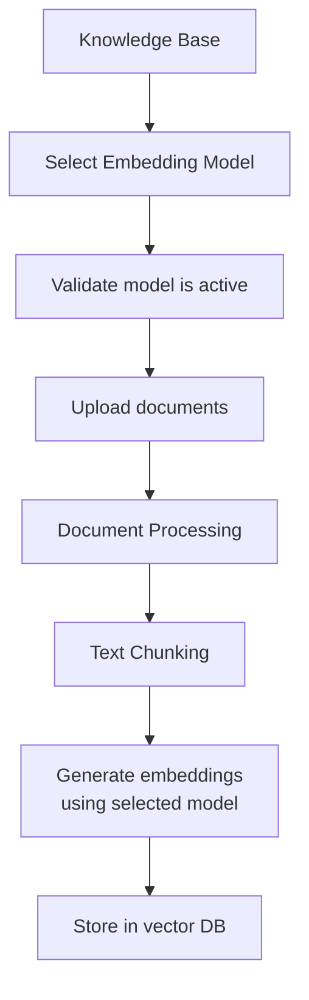

**Validation Rules:**
- Embedding model must have `is_active=True`
- API key must be valid (tested during KB creation)
- Model must be accessible (not deleted)

**Sources:**
- [frontend/src/pages/KnowledgeBase/components/KnowledgeBaseFormDialog.tsx:110-250]()
- [frontend/src/pages/KnowledgeBase/components/AddDocumentDialog.tsx:62-118]()

### Models in Prompt Tuning

The prompt optimization system uses LLM models for automated prompt improvement:

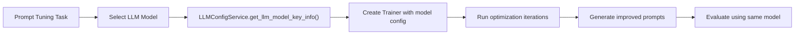

**Model Configuration Retrieval:**

```python
# From prompt tuning router
def get_llm_model_key_info(model_id: str, source: str) -> Dict:
    return {
        "base_url": "...",
        "api_key": "...",          # Decrypted
        "provider": "...",
        "model_name": "...",
        "params": {
            "temperature": 0.7,
            "top_p": 0.9,
            "timeout": 60,
            "max_tokens": 4096
        }
    }
```

**Sources:**
- [backend/openjiuwen_studio/ops/modules/llm/llm_config_service.py:80-125]()
- [backend/openjiuwen_studio/routers/prompt_tuning_router.py:107-138]()

---

## Troubleshooting

### Common Issues

**API Key Errors:**

| Error Message | Cause | Solution |
|---------------|-------|----------|
| "API key decryption failed" | Invalid or corrupted encrypted key | Re-enter API key in model configuration |
| "Model lacks a valid API key" | API key not set or empty | Provide valid API key |
| "Authentication failed" | Wrong API key for provider | Verify key in provider's dashboard |

**Test Failures:**

| Error Type | Common Causes | Resolution Steps |
|------------|---------------|------------------|
| Timeout | Network issues, slow API | Increase timeout parameter, check connectivity |
| Rate Limit | Exceeded provider's quota | Wait or upgrade provider plan |
| Invalid Request | Wrong model_id or parameters | Verify model_id matches provider's naming |
| SSL Verification | Certificate issues | Set `LLM_SSL_VERIFY=false` (dev only) |

**Connection Issues:**

1. Verify `base_url` format (must start with `http://` or `https://`)
2. Check firewall rules for outbound connections
3. Confirm provider's API endpoint is accessible
4. Test with `curl` or `httpie` to isolate issue

**Sources:**
- [backend/openjiuwen_studio/core/manager/model_manager/managers/model_test_manager.py:179-220]()
- [frontend/src/pages/Models/ModelsPage.tsx:418-634]()

---

## Best Practices

### Configuration Guidelines

1. **Use Descriptive Names:** Include provider and model version (e.g., "OpenAI GPT-4 Turbo")
2. **Tag Models Appropriately:** Add tags like "production", "testing", "fast", "accurate"
3. **Set Reasonable Timeouts:** Balance between responsiveness and completion
4. **Test Before Production:** Always test models after configuration changes
5. **Monitor Usage:** Regularly check statistics to avoid unexpected costs

### Security Recommendations

1. **Rotate API Keys:** Periodically update keys, especially after team member departures
2. **Use Least Privilege:** Only activate models that are currently needed
3. **Secure SECRET_KEY:** Keep the encryption key in environment variables, never in code
4. **Audit Model Access:** Track which users create/modify model configurations
5. **Separate Dev/Prod Models:** Use different API keys for development and production

### Performance Optimization

1. **Enable Streaming:** For better UX in chat interfaces
2. **Adjust Max Tokens:** Lower values reduce cost and latency
3. **Use Appropriate Models:** Don't use GPT-4 for simple tasks
4. **Batch Embeddings:** Set `max_batch_size` appropriately (usually 5-10)
5. **Cache Responses:** Implement response caching for repeated queries

**Sources:**
- [backend/openjiuwen_studio/core/manager/model_manager/utils/security_utils.py:1-50]()
- [frontend/src/pages/Models/ModelsPage.tsx:224-244]()

---

