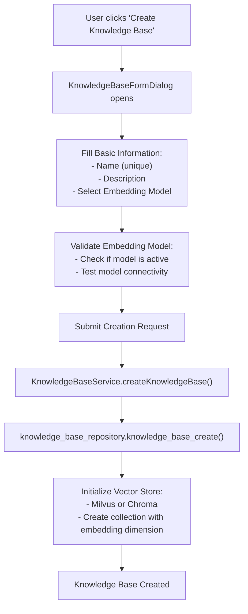
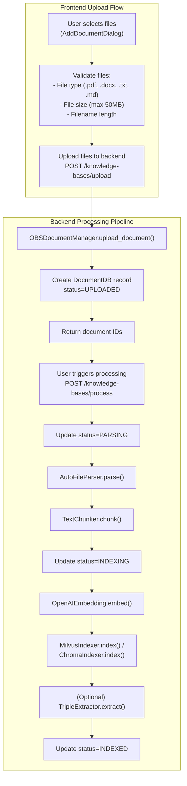
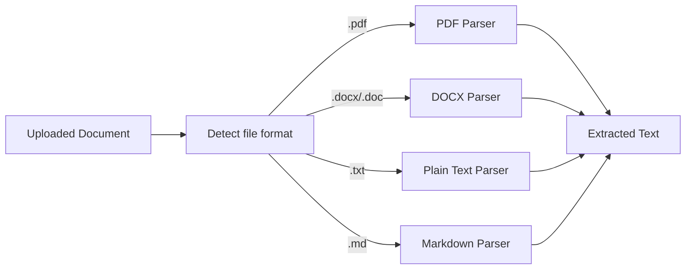
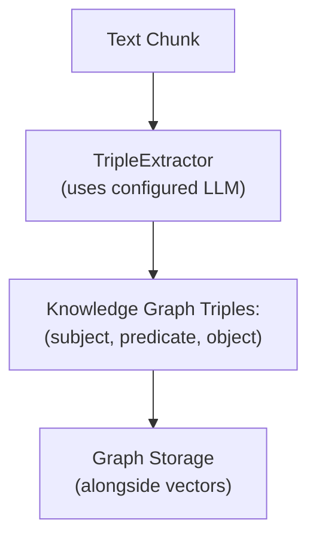
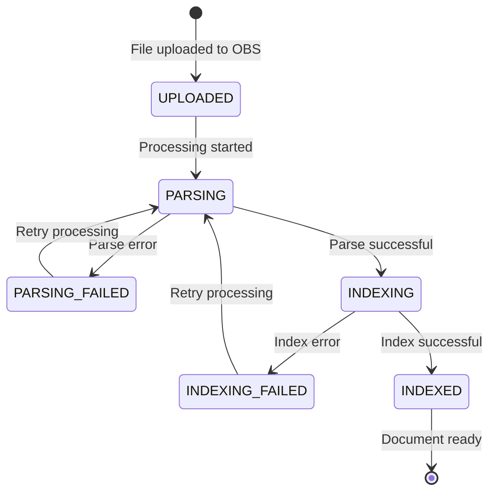
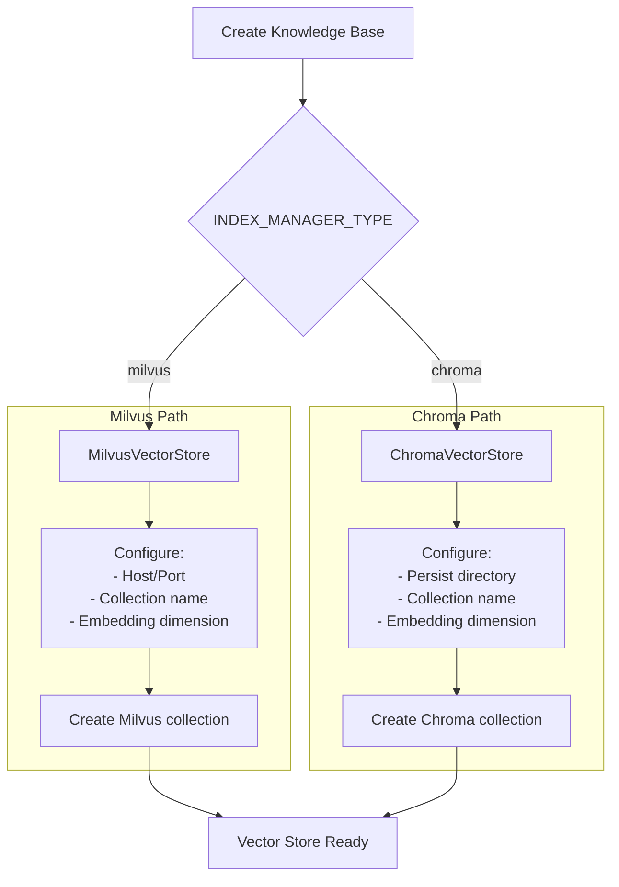

<!-- source: DeepWiki mcp.deepwiki.com · repo openJiuwen-ai/agent-studio · page 4.4 Building Knowledge Bases · fetched 2026-11-02 -->

# Building Knowledge Bases

<details>
<summary>Relevant source files</summary>

The following files were used as context for generating this wiki page:

- [backend/openjiuwen_studio/core/manager/agent.py](backend/openjiuwen_studio/core/manager/agent.py)
- [backend/openjiuwen_studio/core/manager/convertor/agent.py](backend/openjiuwen_studio/core/manager/convertor/agent.py)
- [backend/openjiuwen_studio/core/manager/knowledge_base.py](backend/openjiuwen_studio/core/manager/knowledge_base.py)
- [backend/openjiuwen_studio/core/manager/model_manager/managers/embedding_model_test_manager.py](backend/openjiuwen_studio/core/manager/model_manager/managers/embedding_model_test_manager.py)
- [backend/openjiuwen_studio/core/manager/repositories/agent_repository.py](backend/openjiuwen_studio/core/manager/repositories/agent_repository.py)
- [backend/openjiuwen_studio/core/manager/repositories/plugin_repository.py](backend/openjiuwen_studio/core/manager/repositories/plugin_repository.py)
- [backend/openjiuwen_studio/core/manager/repositories/tool_repository.py](backend/openjiuwen_studio/core/manager/repositories/tool_repository.py)
- [backend/openjiuwen_studio/routers/agents.py](backend/openjiuwen_studio/routers/agents.py)
- [backend/openjiuwen_studio/routers/embedding_models.py](backend/openjiuwen_studio/routers/embedding_models.py)
- [backend/openjiuwen_studio/schemas/agent.py](backend/openjiuwen_studio/schemas/agent.py)
- [frontend/packages/api-client/src/config.ts](frontend/packages/api-client/src/config.ts)
- [frontend/packages/api-client/src/services/agentService.ts](frontend/packages/api-client/src/services/agentService.ts)
- [frontend/src/locales/en-US.json](frontend/src/locales/en-US.json)
- [frontend/src/locales/zh-CN.json](frontend/src/locales/zh-CN.json)
- [frontend/src/pages/Auth/PrivacyPolicyPage.tsx](frontend/src/pages/Auth/PrivacyPolicyPage.tsx)
- [frontend/src/pages/Auth/UserLoginPage.tsx](frontend/src/pages/Auth/UserLoginPage.tsx)
- [frontend/src/pages/KnowledgeBase/components/AddDocumentDialog.tsx](frontend/src/pages/KnowledgeBase/components/AddDocumentDialog.tsx)
- [frontend/src/pages/KnowledgeBase/components/KnowledgeBaseFormDialog.tsx](frontend/src/pages/KnowledgeBase/components/KnowledgeBaseFormDialog.tsx)
- [frontend/src/pages/Models/ModelsPage.tsx](frontend/src/pages/Models/ModelsPage.tsx)
- [frontend/src/pages/Models/ModelsPageNew.tsx](frontend/src/pages/Models/ModelsPageNew.tsx)
- [frontend/src/pages/Models/components/EmbeddingModelsTable.tsx](frontend/src/pages/Models/components/EmbeddingModelsTable.tsx)
- [frontend/src/pages/Models/components/LLMModelsTable.tsx](frontend/src/pages/Models/components/LLMModelsTable.tsx)

</details>


This guide provides step-by-step instructions for creating knowledge bases, uploading documents, configuring processing parameters, and integrating knowledge bases with agents. Knowledge bases enable Retrieval-Augmented Generation (RAG) by storing and indexing documents for semantic search and context enhancement.

For managing embedding models required by knowledge bases, see [Managing Models](#4.3). For using knowledge bases within agents, see [Creating Your First Agent](#4.1).

---

## Overview

Knowledge bases in OpenJiuwen Agent Studio serve as document repositories that support semantic search and retrieval. They process uploaded documents through parsing, chunking, embedding, and indexing pipelines to enable agents to access relevant context from large document collections.

### Key Components

| Component | Purpose | Implementation |
|-----------|---------|----------------|
| **Document Storage** | Stores original files in OBS/MinIO or local filesystem | `OBSDocumentManager` |
| **Document Parser** | Extracts text from various file formats (PDF, DOCX, TXT, MD) | `AutoFileParser` |
| **Text Chunker** | Splits documents into semantic chunks | `TextChunker` |
| **Embedding Model** | Converts text chunks to vector embeddings | `OpenAIEmbedding` |
| **Vector Store** | Indexes and retrieves vector embeddings | `MilvusIndexer` / `ChromaIndexer` |
| **Graph Extractor** | (Optional) Extracts knowledge graph triples | `TripleExtractor` |

**Sources:** [backend/openjiuwen_studio/core/manager/knowledge_base.py:1-82]()

---

## Prerequisites

Before creating a knowledge base, you must configure at least one **Embedding Model**:

1. Navigate to **Models** page
2. Switch to **Embedding** tab
3. Create a new embedding model with:
   - Provider (e.g., OpenAI)
   - Model ID (e.g., `text-embedding-3-small`)
   - API Key and Base URL
   - Max Batch Size (recommended: 5-10)

The embedding model will convert document chunks into vector representations for semantic search.

**Sources:** [frontend/src/pages/KnowledgeBase/components/KnowledgeBaseFormDialog.tsx:10-11](), [backend/openjiuwen_studio/core/manager/knowledge_base.py:369-451]()

---

## Knowledge Base Creation Workflow



**Knowledge Base Creation Flow**

### Step-by-Step: Creating a Knowledge Base

1. **Access Creation Dialog**
   - Navigate to **Knowledge Bases** page
   - Click **Create Knowledge Base** button
   - The `KnowledgeBaseFormDialog` component opens

2. **Configure Basic Information**
   - **Name**: Enter a unique name (letters, numbers, underscores, hyphens only)
   - **Description**: Provide a description of the knowledge base purpose
   - **Embedding Model**: Select from dropdown of active embedding models

3. **Select Embedding Model**
   - Only **active** embedding models appear in dropdown
   - System validates model availability before allowing creation
   - The selected model determines the vector dimension for indexing

4. **Submit**
   - Click **Confirm** to create the knowledge base
   - Backend initializes the vector store collection
   - Knowledge base appears in the list with status **Ready**

**Sources:** [frontend/src/pages/KnowledgeBase/components/KnowledgeBaseFormDialog.tsx:65-165](), [backend/openjiuwen_studio/core/manager/knowledge_base.py:461-569]()

---

## Document Upload and Processing

### Document Upload Architecture



**Document Upload and Processing Pipeline**

### Step-by-Step: Uploading Documents

1. **Open Upload Dialog**
   - In Knowledge Base detail view, click **Add Documents**
   - The `AddDocumentDialog` component opens with a 2-step wizard

2. **Step 1: Select and Upload Files**
   - **Drag and drop** files or click to browse
   - Supported formats: `.pdf`, `.docx`, `.doc`, `.txt`, `.md`
   - Maximum file size: **50 MB** per file
   - Maximum filename length: **200 characters**
   - Files are immediately uploaded to OBS/MinIO storage
   - Document records are created with status `UPLOADED`

3. **Step 2: Configure Processing Parameters**

   Configure how documents will be parsed, chunked, and indexed:

   | Parameter | Options | Description |
   |-----------|---------|-------------|
   | **Parsing Strategy** | Fast Parse (default), Detailed Parse | Text extraction method |
   | **Segmentation Strategy** | Auto Segment (default), Custom | Chunking approach |
   | **Max Tokens** | 128-2048 (default: 512) | Maximum tokens per chunk |
   | **Chunk Overlap %** | 0-50 (default: 10) | Overlap between consecutive chunks |
   | **Graph Enhancement** | Enabled/Disabled | Extract knowledge graph triples |
   | **LLM Model** | (Required if graph enabled) | Model for triple extraction |

4. **Start Processing**
   - Click **Start Processing** to begin the indexing pipeline
   - Documents transition through statuses: `PARSING` → `INDEXING` → `INDEXED`
   - Processing runs asynchronously in the background

**Sources:** [frontend/src/pages/KnowledgeBase/components/AddDocumentDialog.tsx:28-70](), [backend/openjiuwen_studio/core/manager/knowledge_base.py:783-1088]()

---

## Processing Configuration Details

### Parsing Strategies

The system extracts text from uploaded files using the `AutoFileParser`:



**Document Parsing Flow**

- **Fast Parse**: Default mode, efficient text extraction
- **Detailed Parse**: Enhanced extraction with structure preservation

**Sources:** [backend/openjiuwen_studio/core/manager/knowledge_base.py:870-892]()

### Segmentation Strategies

Text chunking splits documents into semantic units using `TextChunker`:

| Strategy | Behavior | Configuration |
|----------|----------|---------------|
| **Auto Segment** | Automatic token-based chunking | Uses `max_tokens` and `chunk_overlap_percent` |
| **Custom** | User-defined chunking parameters | Full control over chunk size and overlap |

**Chunking Parameters:**
- `max_tokens`: Maximum tokens per chunk (128-2048)
- `chunk_overlap_percent`: Percentage overlap (0-50%)
- Overlap ensures context continuity between chunks

**Sources:** [backend/openjiuwen_studio/core/manager/knowledge_base.py:893-914]()

### Indexing Process

After chunking, the system generates embeddings and indexes them in the vector store:

1. **Embedding Generation**: `OpenAIEmbedding` converts chunks to vectors using the configured embedding model
2. **Vector Indexing**: Vectors are stored in either:
   - **Milvus**: High-performance vector database (requires etcd, MinIO, AVX CPU)
   - **Chroma**: Embedded vector database (default, simpler setup)
3. **Status Update**: Document status changes to `INDEXED` when complete

**Sources:** [backend/openjiuwen_studio/core/manager/knowledge_base.py:915-1023]()

### Graph Enhancement (Optional)

When enabled, the `TripleExtractor` uses an LLM to extract structured knowledge:



**Graph Enhancement Pipeline**

- **Requirement**: Must select an active LLM model
- **Use Case**: Enhanced semantic relationships for complex queries
- **Performance**: Adds processing time but improves retrieval quality

**Sources:** [backend/openjiuwen_studio/core/manager/knowledge_base.py:1024-1052]()

---

## Using Knowledge Bases in Agents

### Integration with Agents

Knowledge bases are attached to agents to provide context retrieval during conversations:

```mermaid
graph TB
    subgraph "Agent Configuration"
        AgentEditor["Agent Editor<br/>(AgentDisplayInfo)"]
        SelectKB["Select Knowledge Bases<br/>knowledge: list[str]"]
        SaveAgent["Save Agent Configuration"]
    end
    
    subgraph "Agent Execution"
        UserQuery["User Query"]
        AgentConvert["agent_convert()<br/>Convert display to DSL"]
        LoadKB["knowledge_convert()<br/>Load KB metadata"]
        CreateRetriever["Create KnowledgeBaseRetriever"]
        QueryVectorStore["Query vector store<br/>(semantic search)"]
        RetrieveContext["Retrieve relevant chunks"]
        LLMWithContext["LLM invocation<br/>with retrieved context"]
        Response["Agent Response"]
    end
    
    AgentEditor --> SelectKB
    SelectKB --> SaveAgent
    
    UserQuery --> AgentConvert
    AgentConvert --> LoadKB
    LoadKB --> CreateRetriever
    CreateRetriever --> QueryVectorStore
    QueryVectorStore --> RetrieveContext
    RetrieveContext --> LLMWithContext
    LLMWithContext --> Response
```



**Knowledge Base Integration in Agent Workflow**

### Step-by-Step: Attaching Knowledge Bases to Agents

1. **Open Agent Editor**
   - Navigate to **Agents** page
   - Select an agent and click **Edit**

2. **Configure Knowledge Base**
   - In the agent configuration panel, locate the **Knowledge** section
   - Select one or more knowledge bases from the dropdown
   - Multiple knowledge bases can be attached to a single agent

3. **Save Agent**
   - Click **Save** to persist the configuration
   - The agent's `knowledge` field stores the list of knowledge base IDs

4. **Agent Execution with RAG**
   - When the agent receives a query, it:
     - Converts the query to embeddings using the knowledge base's embedding model
     - Performs semantic search in the vector store
     - Retrieves top-k relevant chunks
     - Augments the LLM prompt with retrieved context
     - Generates a response based on retrieved knowledge

**Sources:** [backend/openjiuwen_studio/core/manager/agent.py:1-126](), [backend/openjiuwen_studio/core/manager/convertor/agent.py:208-260]()

### Knowledge Base Retrieval Configuration

Agents can customize retrieval behavior through `KBRetrievalConfig`:

| Parameter | Default | Description |
|-----------|---------|-------------|
| `top_k` | 5 | Number of chunks to retrieve |
| `score_threshold` | 0.0 | Minimum similarity score |
| `search_strategy` | "vector" | "vector", "graph", or "hybrid" |

**Sources:** [backend/openjiuwen_studio/core/common/dsl.py:1-100]() (inferred from architecture)

---

## Document Management

### Document Status Lifecycle

Documents progress through the following statuses:



**Document Status State Machine**

| Status | Description | User Actions |
|--------|-------------|--------------|
| `UPLOADED` | File stored, not processed | Can trigger processing |
| `PARSING` | Text extraction in progress | Wait or cancel |
| `PARSING_FAILED` | Parse error occurred | View error, retry |
| `INDEXING` | Embedding and indexing in progress | Wait or cancel |
| `INDEXING_FAILED` | Index error occurred | View error, retry |
| `INDEXED` | Document ready for retrieval | Use in agents |

**Sources:** [backend/openjiuwen_studio/models/knowledge_base_document.py:1-50]() (inferred), [backend/openjiuwen_studio/core/manager/knowledge_base.py:783-1088]()

### Document Operations

Available operations on documents:

1. **View Document List**
   - Endpoint: `POST /api/v1/knowledge-bases/documents/list`
   - Displays all documents with status, size, and timestamps

2. **Update Document Metadata**
   - Endpoint: `POST /api/v1/knowledge-bases/documents/update`
   - Update document name or description

3. **Delete Document**
   - Endpoint: `POST /api/v1/knowledge-bases/documents/delete`
   - Removes document record, file from OBS, and vectors from index

4. **Re-process Failed Documents**
   - Endpoint: `POST /api/v1/knowledge-bases/process`
   - Retry processing for `PARSING_FAILED` or `INDEXING_FAILED` documents

5. **View Processing Progress**
   - Endpoint: `POST /api/v1/knowledge-bases/task-progress`
   - Monitor real-time processing status

**Sources:** [frontend/packages/api-client/src/config.ts:146-158](), [backend/openjiuwen_studio/core/manager/knowledge_base.py:1089-1500]()

---

## Vector Store Configuration

The system supports two vector store backends:

### Milvus vs Chroma

| Feature | Milvus | Chroma |
|---------|--------|--------|
| **Setup** | Requires etcd, MinIO, AVX CPU | Embedded, simple setup |
| **Performance** | High-performance, distributed | Good for moderate workloads |
| **Scalability** | Highly scalable | Limited to single machine |
| **Configuration** | `INDEX_MANAGER_TYPE=milvus` | `INDEX_MANAGER_TYPE=chroma` (default) |
| **Dependencies** | Milvus 2.6.2+, etcd, MinIO | None (embedded) |

**Selection:**
- The vector store type is determined by the `INDEX_MANAGER_TYPE` environment variable
- All knowledge bases in the system use the same vector store type
- Cannot mix Milvus and Chroma within a single deployment

**Sources:** [backend/openjiuwen_studio/core/manager/knowledge_base.py:83]()

### Vector Store Initialization



**Vector Store Initialization Flow**

**Sources:** [backend/openjiuwen_studio/core/manager/knowledge_base.py:461-569]()

---

## Error Handling and Troubleshooting

### Common Issues

| Issue | Cause | Solution |
|-------|-------|----------|
| **Embedding model not found** | Model not configured or inactive | Create/activate embedding model in Models page |
| **File upload fails** | File too large (>50MB) or unsupported format | Check file size and format |
| **PARSING_FAILED** | Corrupted file or unsupported encoding | Re-upload file or convert to supported format |
| **INDEXING_FAILED** | Embedding model API error or vector store unavailable | Check model API key and vector store connection |
| **Slow processing** | Large files or graph enhancement enabled | Use smaller chunk sizes or disable graph enhancement |

### Viewing Error Details

When document processing fails:
1. Document status shows `PARSING_FAILED` or `INDEXING_FAILED`
2. Error message is displayed in the document list
3. Formatted error excludes internal prefixes and status codes for readability
4. Common errors:
   - "File parsing failed" - Issue with document format or content
   - "Index building failed" - Embedding or vector store error
   - "Failed to update status to INDEXING" - Database transaction error

**Sources:** [backend/openjiuwen_studio/core/manager/knowledge_base.py:227-295]()

---

## Advanced Configuration

### Embedding Model Selection

Knowledge bases can use different embedding models:
- Each knowledge base is bound to **one** embedding model
- The model determines the vector dimension for the vector store
- Changing the embedding model requires re-indexing all documents
- Agents querying the knowledge base must use a compatible embedding model for retrieval

**Sources:** [backend/openjiuwen_studio/core/manager/knowledge_base.py:369-451]()

### Graph-Enhanced Retrieval

When graph enhancement is enabled:
1. `TripleExtractor` uses the configured LLM to extract (subject, predicate, object) triples
2. Triples are stored alongside vector embeddings
3. Retrieval can use:
   - **Vector-only**: Fast semantic search
   - **Graph-only**: Structured knowledge traversal
   - **Hybrid**: Combines both approaches for richer context

**Requirements:**
- LLM model must be active and have sufficient timeout (minimum 120s recommended)
- Increases processing time and API costs
- Provides enhanced semantic understanding for complex queries

**Sources:** [backend/openjiuwen_studio/core/manager/knowledge_base.py:297-366](), [backend/openjiuwen_studio/core/manager/knowledge_base.py:1024-1052]()

### Object Storage Configuration

Documents are stored in OBS (Object Storage Service) or MinIO:

```
Environment Variables:
- OBS_BUCKET: Bucket name
- OBS_SERVER: Object storage endpoint
- OBS_ACCESS_KEY_ID: Access key (encrypted)
- OBS_SECRET_ACCESS_KEY: Secret key (encrypted)
```

If OBS is not configured, documents are stored locally in:
```
backend/data/knowledge_base/{space_id}/{kb_id}/{filename}
```

**Sources:** [backend/openjiuwen_studio/core/manager/knowledge_base.py:86-186]()

---

## API Reference Summary

Key endpoints for knowledge base operations:

| Endpoint | Method | Purpose |
|----------|--------|---------|
| `/knowledge-bases/create` | POST | Create knowledge base |
| `/knowledge-bases/list` | POST | List knowledge bases |
| `/knowledge-bases/get` | POST | Get knowledge base details |
| `/knowledge-bases/update` | POST | Update knowledge base metadata |
| `/knowledge-bases/delete` | POST | Delete knowledge base |
| `/knowledge-bases/upload` | POST | Upload documents |
| `/knowledge-bases/process` | POST | Start document processing |
| `/knowledge-bases/documents/list` | POST | List documents in KB |
| `/knowledge-bases/documents/status` | POST | Get document status |
| `/knowledge-bases/documents/delete` | POST | Delete document |
| `/knowledge-bases/task-progress` | POST | Get processing progress |
| `/knowledge-bases/search` | POST | Search documents (retrieval) |

**Sources:** [frontend/packages/api-client/src/config.ts:146-158]()

---

