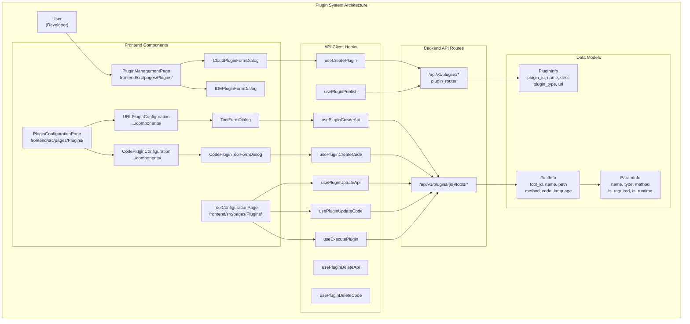
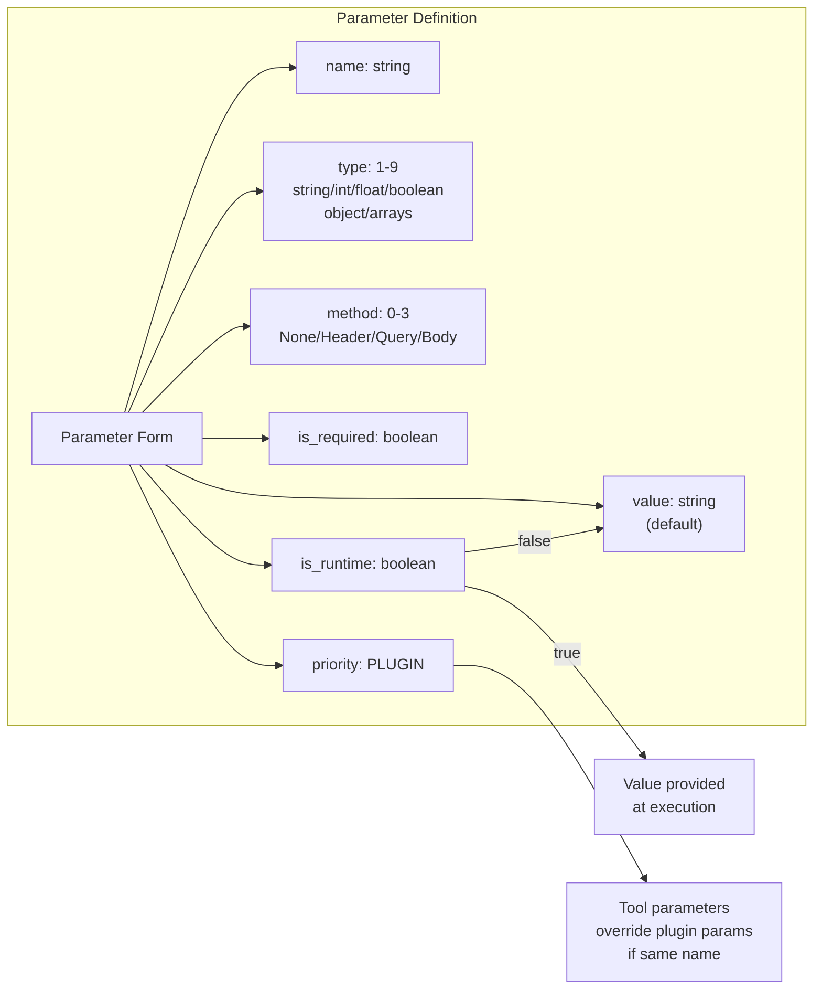
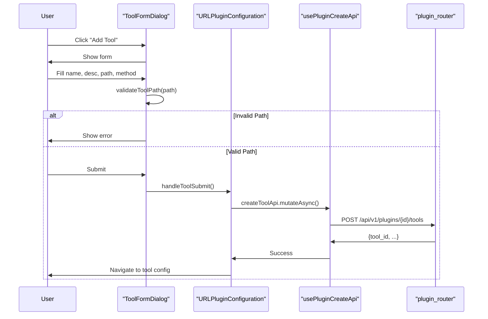
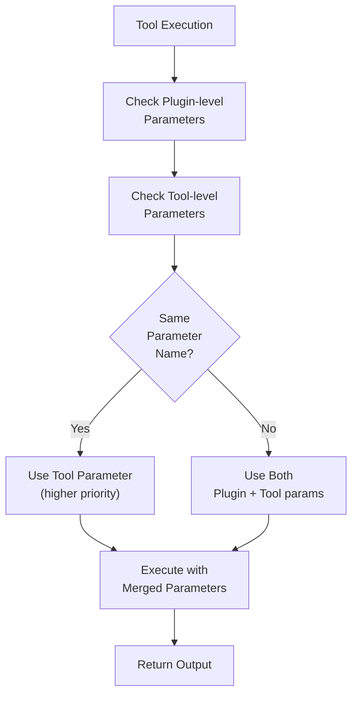
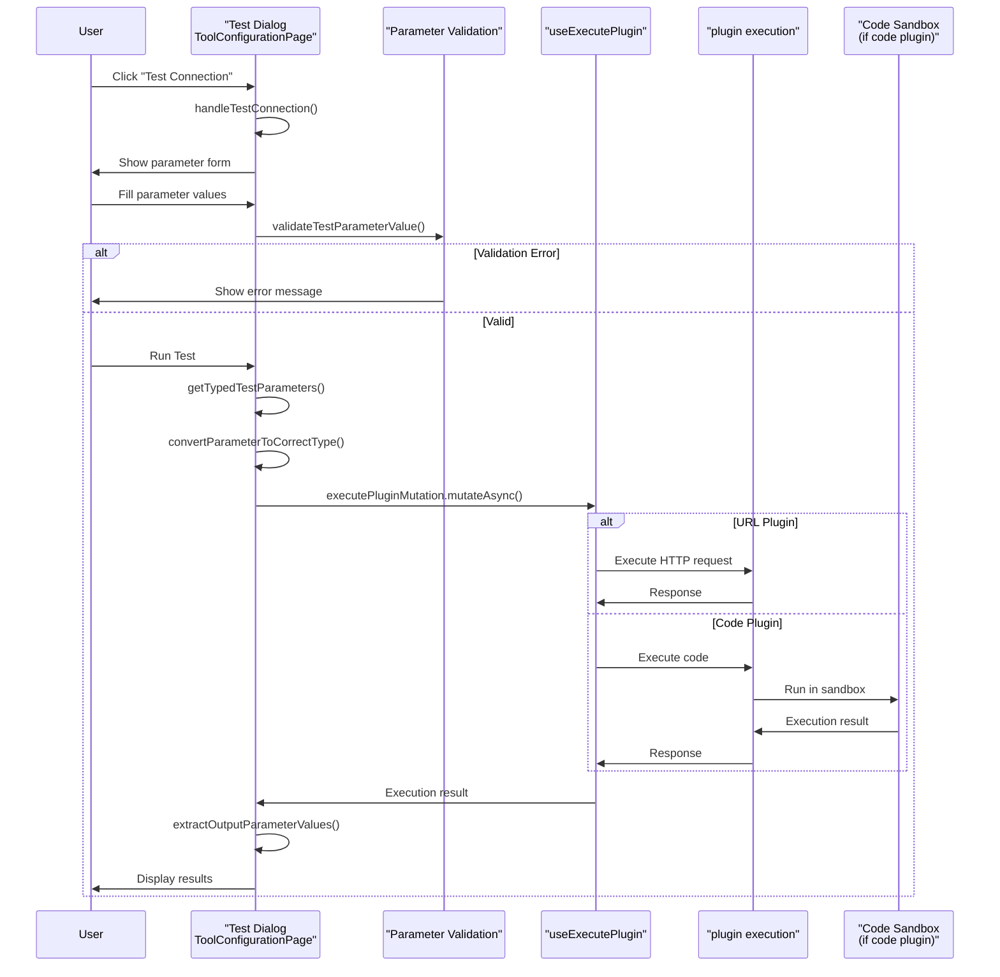
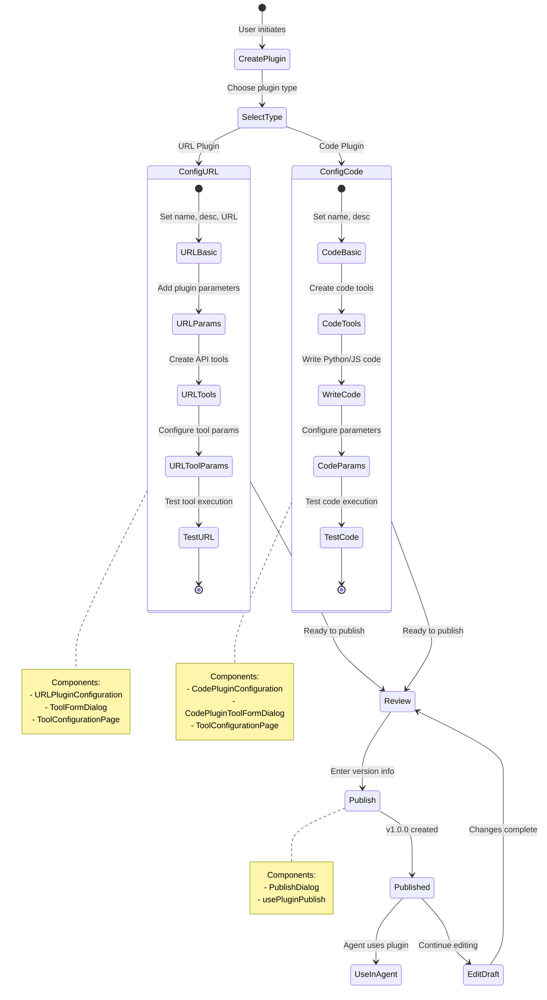

<!-- source: DeepWiki mcp.deepwiki.com · repo openJiuwen-ai/agent-studio · page 4.5 Developing Plugins · fetched 2026-11-02 -->

# Developing Plugins

<details>
<summary>Relevant source files</summary>

The following files were used as context for generating this wiki page:

- [frontend/src/components/Plugins/CloudPluginFormDialog.tsx](frontend/src/components/Plugins/CloudPluginFormDialog.tsx)
- [frontend/src/components/Plugins/CodeEditor.tsx](frontend/src/components/Plugins/CodeEditor.tsx)
- [frontend/src/components/Plugins/CodePluginToolFormDialog.tsx](frontend/src/components/Plugins/CodePluginToolFormDialog.tsx)
- [frontend/src/components/Plugins/IDEPluginFormDialog.tsx](frontend/src/components/Plugins/IDEPluginFormDialog.tsx)
- [frontend/src/components/Plugins/MarketPluginCard.tsx](frontend/src/components/Plugins/MarketPluginCard.tsx)
- [frontend/src/components/Plugins/MarketPluginList.tsx](frontend/src/components/Plugins/MarketPluginList.tsx)
- [frontend/src/components/Plugins/PluginVersionHistory.tsx](frontend/src/components/Plugins/PluginVersionHistory.tsx)
- [frontend/src/components/Plugins/PublishDialog.tsx](frontend/src/components/Plugins/PublishDialog.tsx)
- [frontend/src/components/Plugins/ToolFormDialog.tsx](frontend/src/components/Plugins/ToolFormDialog.tsx)
- [frontend/src/pages/Plugins/PluginConfigurationPage.tsx](frontend/src/pages/Plugins/PluginConfigurationPage.tsx)
- [frontend/src/pages/Plugins/PluginManagementPage.tsx](frontend/src/pages/Plugins/PluginManagementPage.tsx)
- [frontend/src/pages/Plugins/PluginVersionPage.tsx](frontend/src/pages/Plugins/PluginVersionPage.tsx)
- [frontend/src/pages/Plugins/ToolConfigurationPage.tsx](frontend/src/pages/Plugins/ToolConfigurationPage.tsx)
- [frontend/src/pages/Plugins/components/CodePluginConfiguration.tsx](frontend/src/pages/Plugins/components/CodePluginConfiguration.tsx)
- [frontend/src/pages/Plugins/components/URLPluginConfiguration.tsx](frontend/src/pages/Plugins/components/URLPluginConfiguration.tsx)

</details>


This guide covers how to create, configure, test, and publish plugins in OpenJiuwen Agent Studio. Plugins extend agent capabilities by providing reusable tools that can call external APIs or execute custom code. For information about using plugins in agents, see [Plugins & Tools](#3.6). For API reference, see [Plugin APIs](#8.6).

## Overview

OpenJiuwen Agent Studio supports two types of plugins:

| Plugin Type | Description | Use Case | Code Execution |
|-------------|-------------|----------|----------------|
| **URL Plugin** (type=1) | Calls external HTTP APIs | Integrate third-party services, REST APIs | Remote |
| **Code Plugin** (type=2) | Executes Python or JavaScript code | Custom logic, data processing, local operations | Sandbox |

Each plugin contains one or more **tools**. A tool is a specific function or API endpoint that agents can invoke. Tools define input parameters (what the agent provides) and output parameters (what the tool returns).

---

## Plugin Architecture



**Sources:** 
- [frontend/src/pages/Plugins/PluginManagementPage.tsx:1-580]()
- [frontend/src/pages/Plugins/PluginConfigurationPage.tsx:1-583]()
- [frontend/src/pages/Plugins/ToolConfigurationPage.tsx:1-1500]()
- [frontend/src/components/Plugins/CloudPluginFormDialog.tsx:1-184]()
- [frontend/src/components/Plugins/IDEPluginFormDialog.tsx:1-170]()

---

## Creating a URL Plugin

URL plugins call external HTTP APIs. They are suitable for integrating third-party services like weather APIs, database queries, or any REST endpoint.

### Step 1: Create the Plugin

1. Navigate to **Plugins** page in the dashboard
2. Click **Create Plugin** → **URL Plugin**
3. Fill in the plugin form:

| Field | Description | Required | Max Length |
|-------|-------------|----------|------------|
| Name | Plugin name | Yes | 128 chars |
| Description | Brief description | Yes | 258 chars |
| Details (Markdown) | Extended documentation | No | Unlimited |
| Service URL | Base URL for the API | Yes | 1000 bytes |
| Icon | Emoji or icon URI | No | - |

**Validation Rules:**
- URL must start with `http://` or `https://`
- URL format validated in real-time: [frontend/src/pages/Plugins/components/URLPluginConfiguration.tsx:210-217]()
- Path validation uses `validateHttpUrlRealtime()`: [frontend/src/utils/validationUtils.tsx]()

**Sources:**
- [frontend/src/components/Plugins/CloudPluginFormDialog.tsx:53-180]()
- [frontend/src/pages/Plugins/PluginManagementPage.tsx:330-400]()

### Step 2: Configure Plugin-Level Parameters

Plugin-level parameters apply to all tools within the plugin. Common use cases:
- API keys
- Authentication tokens
- Base configuration values

**Parameter Configuration:**



**Parameter Types (Enum Values):**

| Type Code | Type Name | Description | Example |
|-----------|-----------|-------------|---------|
| 1 | `string` | Text value | `"hello"` |
| 2 | `int` | Integer number | `42` |
| 3 | `float` | Decimal number | `3.14` |
| 4 | `boolean` | True/false | `true` |
| 5 | `object` | JSON object | `{"key":"value"}` |
| 6 | `array_string` | String array | `["a","b"]` |
| 7 | `array_int` | Integer array | `[1,2,3]` |
| 8 | `array_float` | Float array | `[1.5,2.3]` |
| 9 | `array_boolean` | Boolean array | `[true,false]` |

**Parameter Methods (Where to Send):**

| Method Code | Method Name | Description |
|-------------|-------------|-------------|
| 0 | `None` | Not sent in request |
| 1 | `Header` | HTTP header |
| 2 | `Query` | URL query parameter |
| 3 | `Body` | Request body (JSON) |

**Runtime vs Non-Runtime:**
- **Runtime parameters** (`is_runtime=true`): Agent provides value at execution time
- **Non-runtime parameters** (`is_runtime=false`): Use default value from configuration

**Sources:**
- [frontend/src/pages/Plugins/components/URLPluginConfiguration.tsx:150-162]()
- [frontend/src/pages/Plugins/components/URLPluginConfiguration.tsx:411-516]()
- [frontend/src/pages/Plugins/ToolConfigurationPage.tsx:50-60]()

### Step 3: Create Tools

Tools are the actual API endpoints that agents can call.

**Tool Creation Dialog:**

| Field | Description | Required | Validation |
|-------|-------------|----------|------------|
| Name | Tool name | Yes | 128 chars max |
| Description | What the tool does | Yes | 256 chars max |
| Path | API endpoint path | Yes | Must start with `/`, alphanumeric, `-`, `_`, `/` only |
| Method | HTTP method | Yes | GET, POST, PUT, DELETE, PATCH |

**Path Validation:**
- Must start with `/`
- Can only contain: `a-z`, `A-Z`, `0-9`, `-`, `_`, `/`
- Example valid paths: `/api/users/get`, `/v1/weather/current`
- Validation: [frontend/src/components/Plugins/ToolFormDialog.tsx:41-55]()

**Tool Creation Flow:**



**Sources:**
- [frontend/src/components/Plugins/ToolFormDialog.tsx:1-169]()
- [frontend/src/pages/Plugins/components/URLPluginConfiguration.tsx:256-333]()

### Step 4: Configure Tool Parameters

After creating a tool, configure its input and output parameters.

**Input Parameters:**
- Define what data the agent must provide when calling the tool
- Can override plugin-level parameters with same name
- Support all parameter types and methods

**Output Parameters:**
- Define what data the tool returns
- Used for validation and extraction
- No `method` or `is_runtime` fields (output only)

**Parameter Priority System:**



**Parameter Dialog Implementation:**
- Add parameter: [frontend/src/pages/Plugins/ToolConfigurationPage.tsx:710-795]()
- Delete parameter: [frontend/src/pages/Plugins/ToolConfigurationPage.tsx:797-836]()
- Auto-save on changes: Parameters saved immediately via `updatePluginApiMutation`

**Sources:**
- [frontend/src/pages/Plugins/ToolConfigurationPage.tsx:678-708]()
- [frontend/src/pages/Plugins/ToolConfigurationPage.tsx:452-484]()

---

## Creating a Code Plugin

Code plugins execute Python or JavaScript code in a sandboxed environment. They're suitable for data processing, calculations, and custom business logic.

### Step 1: Create the Plugin

1. Navigate to **Plugins** page
2. Click **Create Plugin** → **Code Plugin**
3. Fill in basic information (same as URL plugin, but no Service URL)

**Sources:**
- [frontend/src/components/Plugins/IDEPluginFormDialog.tsx:1-170]()
- [frontend/src/pages/Plugins/PluginManagementPage.tsx:400-470]()

### Step 2: Create Code Tools

Code tools contain the actual executable code.

**Code Tool Dialog:**

| Field | Description | Required |
|-------|-------------|----------|
| Name | Tool name | Yes |
| Description | Function description | Yes |
| Runtime | Python 3 or Node.js | Yes |
| Code | Executable code | Yes |

**Supported Runtimes:**

| Runtime | Language | Use Case | Code Editor |
|---------|----------|----------|-------------|
| `python3` | Python 3 | Data analysis, ML, scripts | `PythonCodeEditor` |
| `nodejs` | JavaScript | Web APIs, JSON processing | `TypeScriptCodeEditor` |

**Code Editor Features:**
- Syntax highlighting
- Line numbers
- Code folding
- Template library
- Integrated testing

**Code Templates:**

Python template structure:
```python
def add_test(a: int, b: int):
    return a + b

def main(args: Args):
    a = args.params['add1']
    b = args.params['add2']
    c = add_test(a, b)
    
    return {'res': c}
```

JavaScript template structure:
```javascript
function main() {
    const result = {
        message: "Hello World!",
        status: "success",
        timestamp: new Date().toISOString()
    };
    return result;
}

module.exports = { main };
```

**Sources:**
- [frontend/src/components/Plugins/CodePluginToolFormDialog.tsx:1-380]()
- [frontend/src/components/Plugins/CodePluginToolFormDialog.tsx:55-96]()
- [frontend/src/pages/Plugins/ToolConfigurationPage.tsx:90-131]()

### Step 3: Configure Code Tool Parameters

Code tools support the same parameter system as URL tools, with one key difference:

**Code Plugin Parameter Rules:**
- All input parameters are **runtime parameters** (`is_runtime=true`)
- No default values stored
- Parameters accessed via `args.params['parameter_name']` in code
- No `method` field (not applicable to code execution)

**Parameter Access in Code:**

Python:
```python
def main(args: Args):
    # Access parameters
    param1 = args.params['param1']
    param2 = args.params['param2']
    
    # Return output
    return {'result': param1 + param2}
```

JavaScript:
```javascript
function main(args) {
    // Access parameters
    const param1 = args.params.param1;
    const param2 = args.params.param2;
    
    // Return output
    return {result: param1 + param2};
}
```

**Sources:**
- [frontend/src/pages/Plugins/ToolConfigurationPage.tsx:678-708]()
- [frontend/src/pages/Plugins/ToolConfigurationPage.tsx:287-329]()

---

## Testing Tools

Test tools before publishing to ensure they work correctly.

### Test Dialog

The test dialog allows you to:
1. Provide values for runtime parameters
2. Execute the tool
3. View execution results
4. Verify output parameters

**Test Execution Flow:**



**Parameter Type Conversion:**

The system automatically converts string inputs to correct types:

| Parameter Type | Conversion Logic | Example Input | Converted Value |
|----------------|------------------|---------------|-----------------|
| `int` | `parseInt(value, 10)` | `"42"` | `42` |
| `float` | `parseFloat(value)` | `"3.14"` | `3.14` |
| `boolean` | `value === 'true'` or `value === '1'` | `"true"` | `true` |
| `array_*` | `JSON.parse(value)` | `"[1,2,3]"` | `[1,2,3]` |
| `object` | `JSON.parse(value)` | `'{"key":"val"}'` | `{key:"val"}` |

**Test Result Structure:**

```typescript
interface TestExecutionResult {
  timestamp: string
  execution_success: boolean
  error_code: number | null
  error_message: string | null
  output: unknown
  raw_response: unknown
  parse_error?: string
  raw_buffer?: string
}
```

**Output Parameter Extraction:**
- System attempts to extract each output parameter from the result
- Supports dot notation for nested objects (e.g., `user.name`)
- Falls back to `raw_response` if `output` is unavailable
- [frontend/src/pages/Plugins/ToolConfigurationPage.tsx:486-541]()

**Sources:**
- [frontend/src/pages/Plugins/ToolConfigurationPage.tsx:994-1029]()
- [frontend/src/pages/Plugins/ToolConfigurationPage.tsx:1103-1199]()
- [frontend/src/pages/Plugins/ToolConfigurationPage.tsx:404-450]()
- [frontend/src/pages/Plugins/ToolConfigurationPage.tsx:452-484]()

---

## Publishing Plugins

Publishing creates a versioned snapshot of your plugin that agents can use.

### Publishing Process

```mermaid
graph TB
    subgraph "Plugin Publishing Workflow"
        Edit["Edit Plugin<br/>& Tools"]
        
        Save["Auto-save<br/>Configuration"]
        
        Publish["Click 'Publish'<br/>Button"]
        
        PublishDialog["PublishDialog<br/>component"]
        
        Version["Enter Version<br/>(e.g., v1.0.0)"]
        
        Desc["Enter Version<br/>Description"]
        
        Validate["Validate Form"]
        
        PreSave["Auto-save Config<br/>(if needed)"]
        
        API["usePluginPublish<br/>API call"]
        
        Backend["plugin_router<br/>publish endpoint"]
        
        Create["Create Plugin<br/>Publish Record"]
        
        Success["Show Success<br/>& Refresh"]
        
        Edit --> Save
        Save --> Publish
        Publish --> PublishDialog
        PublishDialog --> Version
        Version --> Desc
        Desc --> Validate
        
        Validate -->|Invalid| PublishDialog
        Validate -->|Valid| PreSave
        PreSave --> API
        API --> Backend
        Backend --> Create
        Create --> Success
    end
```



**Publish Dialog Fields:**

| Field | Description | Required | Format |
|-------|-------------|----------|--------|
| Version | Semantic version | Yes | `vX.Y.Z` format recommended |
| Description | Change description | Yes | Max 256 chars |

**Auto-Save Before Publish:**
The system automatically saves current configuration before publishing to ensure the published version matches what's displayed: [frontend/src/components/Plugins/PublishDialog.tsx:64-96]()

**Version History:**
- View all published versions: Click "Version History" button
- Each version is immutable (read-only)
- Can view but not edit published versions
- [frontend/src/components/Plugins/PluginVersionHistory.tsx:1-450]()

**Sources:**
- [frontend/src/components/Plugins/PublishDialog.tsx:1-192]()
- [frontend/src/pages/Plugins/PluginConfigurationPage.tsx:404-437]()
- [frontend/src/components/Plugins/PluginVersionHistory.tsx:131-153]()

---

## Plugin Development Best Practices

### Parameter Design

1. **Use Plugin-Level Parameters for:**
   - API keys and authentication tokens
   - Base URLs or endpoints
   - Global configuration that applies to all tools

2. **Use Tool-Level Parameters for:**
   - Specific inputs for each tool
   - Override plugin parameters when needed
   - Tool-specific configuration

3. **Runtime Parameter Guidelines:**
   - Set `is_runtime=true` for dynamic values agents provide
   - Set `is_runtime=false` for fixed configuration values
   - Non-runtime parameters must have default values

### Testing Strategy

1. **Test with Representative Data:**
   - Test all parameter types (strings, numbers, objects, arrays)
   - Test edge cases (empty values, special characters)
   - Test error conditions

2. **Verify Output Parameters:**
   - Ensure output matches defined parameters
   - Check nested object extraction
   - Validate data types

3. **Code Plugin Testing:**
   - Test code locally before adding to plugin
   - Verify all dependencies are available in sandbox
   - Check execution timeouts

### Version Management

1. **Semantic Versioning:**
   - Major version (v1.0.0): Breaking changes
   - Minor version (v1.1.0): New features, backward compatible
   - Patch version (v1.0.1): Bug fixes

2. **Version Descriptions:**
   - Clearly document changes
   - List new features and fixed issues
   - Note any breaking changes

3. **Publishing Frequency:**
   - Publish stable versions for production use
   - Test thoroughly before publishing
   - Keep draft version for development

**Sources:**
- [frontend/src/pages/Plugins/ToolConfigurationPage.tsx:452-484]()
- [frontend/src/components/Plugins/PublishDialog.tsx:29-100]()
- [frontend/src/components/Plugins/PluginVersionHistory.tsx:1-450]()

---

## Complete Development Workflow



**Key Components in Workflow:**

| Stage | Component | File Path |
|-------|-----------|-----------|
| Create Plugin | `CloudPluginFormDialog` | [frontend/src/components/Plugins/CloudPluginFormDialog.tsx]() |
| Create Plugin | `IDEPluginFormDialog` | [frontend/src/components/Plugins/IDEPluginFormDialog.tsx]() |
| Config URL Plugin | `URLPluginConfiguration` | [frontend/src/pages/Plugins/components/URLPluginConfiguration.tsx]() |
| Config Code Plugin | `CodePluginConfiguration` | [frontend/src/pages/Plugins/components/CodePluginConfiguration.tsx]() |
| Create Tool | `ToolFormDialog` | [frontend/src/components/Plugins/ToolFormDialog.tsx]() |
| Create Code Tool | `CodePluginToolFormDialog` | [frontend/src/components/Plugins/CodePluginToolFormDialog.tsx]() |
| Config Tool | `ToolConfigurationPage` | [frontend/src/pages/Plugins/ToolConfigurationPage.tsx]() |
| Publish | `PublishDialog` | [frontend/src/components/Plugins/PublishDialog.tsx]() |
| Version History | `PluginVersionHistory` | [frontend/src/components/Plugins/PluginVersionHistory.tsx]() |

**Sources:**
- [frontend/src/pages/Plugins/PluginManagementPage.tsx:1-580]()
- [frontend/src/pages/Plugins/PluginConfigurationPage.tsx:1-583]()
- [frontend/src/pages/Plugins/ToolConfigurationPage.tsx:1-1500]()

---

