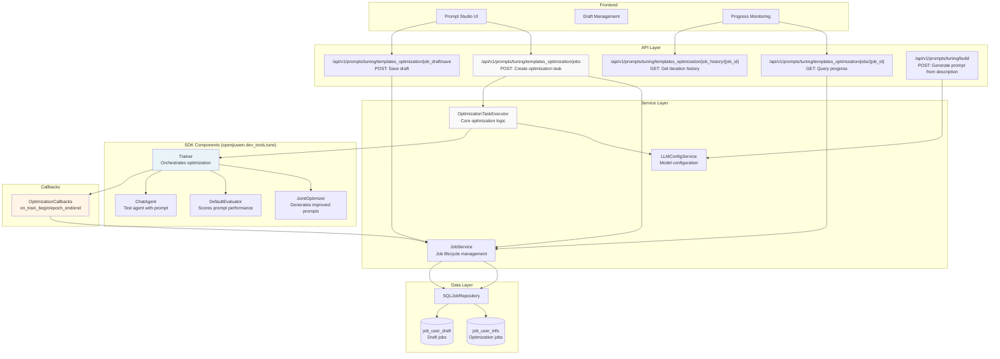
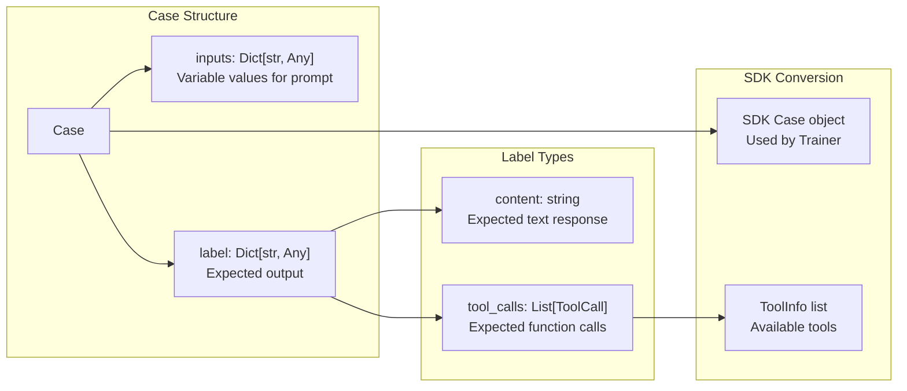
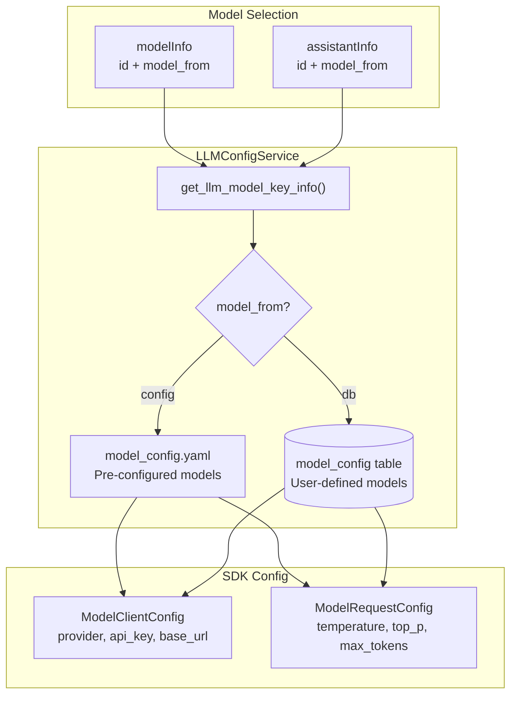
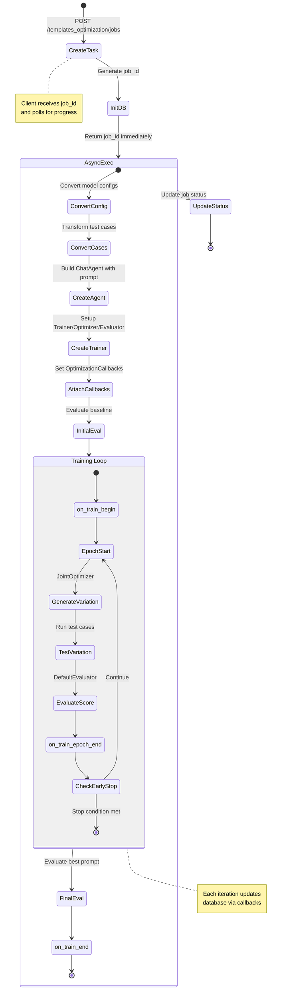
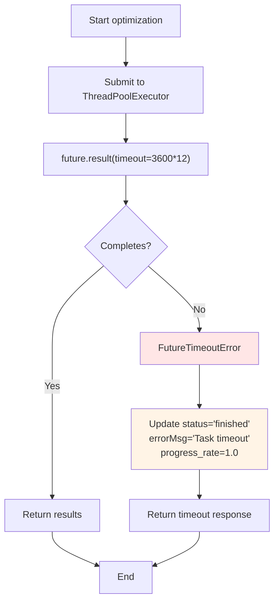
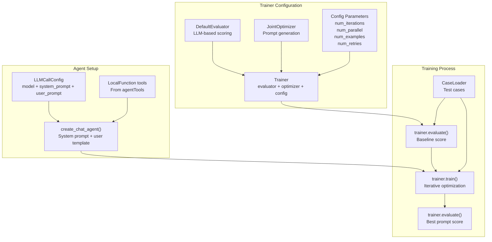
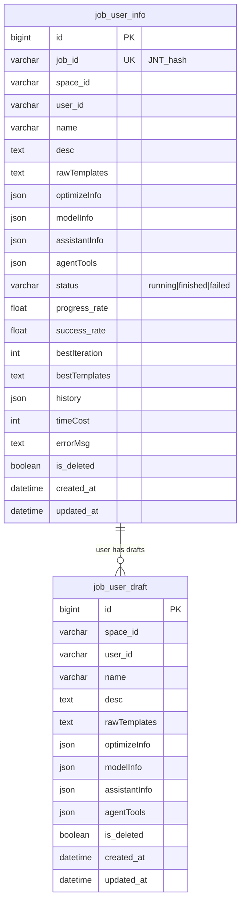

<!-- source: DeepWiki mcp.deepwiki.com · repo openJiuwen-ai/agent-studio · page 4.6 Optimizing Prompts · fetched 2026-11-02 -->

# Optimizing Prompts

<details>
<summary>Relevant source files</summary>

The following files were used as context for generating this wiki page:

- [backend/openjiuwen_studio/core/manager/model_manager/managers/model_test_manager.py](backend/openjiuwen_studio/core/manager/model_manager/managers/model_test_manager.py)
- [backend/openjiuwen_studio/ops/modules/llm/llm_config_service.py](backend/openjiuwen_studio/ops/modules/llm/llm_config_service.py)
- [backend/openjiuwen_studio/ops/modules/llm/schema.py](backend/openjiuwen_studio/ops/modules/llm/schema.py)
- [backend/openjiuwen_studio/ops/modules/prompt/domain/debug_entity.py](backend/openjiuwen_studio/ops/modules/prompt/domain/debug_entity.py)
- [backend/openjiuwen_studio/ops/modules/prompt/domain/entities.py](backend/openjiuwen_studio/ops/modules/prompt/domain/entities.py)
- [backend/openjiuwen_studio/ops/modules/prompt/domain/services.py](backend/openjiuwen_studio/ops/modules/prompt/domain/services.py)
- [backend/openjiuwen_studio/ops/modules/prompt/infra/repositories/debug_repo.py](backend/openjiuwen_studio/ops/modules/prompt/infra/repositories/debug_repo.py)
- [backend/openjiuwen_studio/routers/prompt_debug_router.py](backend/openjiuwen_studio/routers/prompt_debug_router.py)
- [backend/openjiuwen_studio/routers/prompt_llm_router.py](backend/openjiuwen_studio/routers/prompt_llm_router.py)
- [backend/openjiuwen_studio/routers/prompt_router.py](backend/openjiuwen_studio/routers/prompt_router.py)
- [backend/openjiuwen_studio/routers/prompt_tuning_router.py](backend/openjiuwen_studio/routers/prompt_tuning_router.py)
- [backend/openjiuwen_studio/schemas/model_config.py](backend/openjiuwen_studio/schemas/model_config.py)
- [frontend/src/components/Agent/ModelDetailForm.tsx](frontend/src/components/Agent/ModelDetailForm.tsx)

</details>


This guide explains how to use the prompt optimization system to automatically improve prompt templates through iterative LLM-based refinement. The optimization process uses test cases and evaluation metrics to generate improved prompts that better meet your requirements.

For information about creating and managing prompt templates, see [Prompts & Templates](#3.3). For details on prompt debugging, see the debug functionality within the prompt editing interface.

## Overview

The prompt optimization system allows you to:
- Define test cases with expected inputs and outputs
- Configure optimization parameters (iterations, evaluation metrics, parallel execution)
- Run automated optimization using LLM-based trainers and evaluators
- Track optimization progress with iteration history and scoring metrics
- Apply optimized prompts to your prompt templates

The system supports both traditional text-based prompts and tool-calling scenarios, making it suitable for optimizing various agent behaviors.

**Sources:** [backend/openjiuwen_studio/routers/prompt_tuning_router.py:1-906]()

## System Architecture

### Optimization Pipeline



**Sources:** [backend/openjiuwen_studio/routers/prompt_tuning_router.py:60-906](), [backend/openjiuwen_studio/ops/modules/prompt/application/service.py]()

### Key Components

| Component | File | Purpose |
|-----------|------|---------|
| `prompt_tuning_router` | [backend/openjiuwen_studio/routers/prompt_tuning_router.py]() | API endpoints for optimization operations |
| `OptimizationTaskExecutor` | [backend/openjiuwen_studio/routers/prompt_tuning_router.py:278-667]() | Executes optimization with timeout control |
| `OptimizationCallbacks` | [backend/openjiuwen_studio/routers/prompt_tuning_router.py:141-276]() | Updates database during optimization |
| `JobService` | [backend/openjiuwen_studio/ops/modules/prompt/application/service.py]() | Manages job lifecycle and persistence |
| `Trainer` | SDK: `openjiuwen.dev_tools.tune.trainer.trainer` | Core optimization orchestrator |
| `JointOptimizer` | SDK: `openjiuwen.dev_tools.tune.optimizer.joint_optimizer` | Generates prompt variations |
| `DefaultEvaluator` | SDK: `openjiuwen.dev_tools.tune.evaluator.evaluator` | Evaluates prompt quality |

**Sources:** [backend/openjiuwen_studio/routers/prompt_tuning_router.py:1-60]()

## Creating an Optimization Task

### Request Structure

To create an optimization task, send a POST request to `/api/v1/prompts/tuning/templates_optimization/jobs`:

```json
{
  "name": "Customer Support Optimization",
  "desc": "Optimize customer support response quality",
  "rawTemplates": "You are a helpful customer support agent...",
  "optimizeInfo": {
    "num_iter": 5,
    "early_stop_score": 0.95,
    "cases": [...],
    "llm_parallel": 2,
    "user_compare_rules": "Responses must be polite and accurate",
    "user_compare_options": "Prefer concise answers",
    "external_knowledge": "Company policy: Always offer refunds"
  },
  "modelInfo": {
    "id": 1,
    "model_from": "config"
  },
  "assistantInfo": {
    "id": 2,
    "model_from": "config"
  },
  "agentTools": [...]
}
```

**Sources:** [backend/openjiuwen_studio/ops/modules/prompt/domain/entities.py:614-623]()

### Test Case Definition

Test cases define the inputs and expected outputs for optimization:



Example test case format:

```json
{
  "inputs": {
    "query": "I want to return my product"
  },
  "label": {
    "content": "I'd be happy to help with your return...",
    "tool_calls": {
      "content": [{
        "name": "create_return_ticket",
        "arguments": {"reason": "customer_request"}
      }]
    }
  }
}
```

**Sources:** [backend/openjiuwen_studio/ops/modules/prompt/domain/entities.py:558-605](), [backend/openjiuwen_studio/routers/prompt_tuning_router.py:303-358]()

### Optimization Parameters

The `OptimizeInfo` object configures the optimization behavior:

| Parameter | Type | Default | Description |
|-----------|------|---------|-------------|
| `num_iter` | int | 0 | Number of optimization iterations |
| `early_stop_score` | float | None | Stop if score reaches this threshold |
| `example_num` | int | None | Number of examples in few-shot prompts |
| `llm_parallel` | int | 1 | Parallel LLM calls for evaluation |
| `user_compare_rules` | string | None | Evaluation rules for the LLM judge |
| `user_compare_options` | string | None | Additional evaluation preferences |
| `external_knowledge` | string | None | Background knowledge for evaluation |
| `cases` | List[Case] | [] | Test cases (max 300, 16MB) |

**Sources:** [backend/openjiuwen_studio/ops/modules/prompt/domain/entities.py:563-605]()

### Model Configuration

Two models are required:
1. **Model Info**: The optimization model that generates improved prompts
2. **Assistant Info**: The model used to test prompt variations



The `ModelConfigConverter` transforms model configuration from the database format to SDK format:

**Sources:** [backend/openjiuwen_studio/routers/prompt_tuning_router.py:107-139](), [backend/openjiuwen_studio/ops/modules/llm/llm_config_service.py:80-125]()

## Optimization Execution Flow

### Task Lifecycle



**Sources:** [backend/openjiuwen_studio/routers/prompt_tuning_router.py:504-667]()

### Callback System

The `OptimizationCallbacks` class implements three lifecycle hooks:

```python
class OptimizationCallbacks(Callbacks):
    def on_train_begin(self, agent, progress, eval_info):
        # Initialize baseline history record
        # Set status to "running"
        
    def on_train_epoch_end(self, agent, progress, eval_info):
        # Extract current prompt from agent
        # Calculate success rate and progress
        # Update best iteration if score improved
        # Append history record
        
    def on_train_end(self, agent, progress, eval_info):
        # Set status to "finished"
        # Set progress to 100%
        # Log final metrics
```

Each callback updates the `job_user_info` table with:
- `progress_rate`: Completion percentage (0.0-1.0)
- `success_rate`: Best evaluation score achieved
- `bestIteration`: Round number of best prompt
- `bestTemplates`: Text of best prompt
- `history`: JSON array of iteration records
- `timeCost`: Elapsed time in seconds

**Sources:** [backend/openjiuwen_studio/routers/prompt_tuning_router.py:141-276]()

### Timeout Handling

Optimization tasks have a default timeout of 12 hours:



**Sources:** [backend/openjiuwen_studio/routers/prompt_tuning_router.py:504-552]()

## Monitoring Optimization Progress

### Querying Job Status

GET `/api/v1/prompts/tuning/templates_optimization/jobs/{job_id}?workspace_id={id}`

Response structure:

```json
{
  "code": 200,
  "msg": "success",
  "progress": {
    "status": "running",
    "progress_rate": 0.6,
    "success_rate": 0.82,
    "time_cost": 180,
    "best_iteration": 3,
    "best_prompt": "Optimized prompt text...",
    "original_prompt": "Original prompt text...",
    "error_msg": null,
    "job_info": {
      "id": "JNT_abc123...",
      "name": "Customer Support Optimization",
      "num_iter": 5,
      "modelInfo": {...},
      "assistantInfo": {...}
    }
  },
  "history": [
    {
      "iteration_round": 0,
      "success_rate": 0.65,
      "optimized_prompt": "",
      "evaluate_cases": [...]
    },
    {
      "iteration_round": 1,
      "success_rate": 0.72,
      "optimized_prompt": "Improved prompt...",
      "evaluate_cases": [...]
    }
  ],
  "optimizeInfo": {
    "num_iter": 5,
    "cases": [...],
    ...
  }
}
```

**Sources:** [backend/openjiuwen_studio/ops/modules/prompt/domain/entities.py:669-674](), [backend/openjiuwen_studio/routers/prompt_tuning_router.py:767-784]()

### Iteration History

Each history item contains detailed evaluation results:

```json
{
  "iteration_round": 2,
  "success_rate": 0.78,
  "optimized_prompt": "You are a customer support agent...",
  "evaluate_cases": [
    {
      "inputs": {"query": "Return product"},
      "label": {"content": "I'd be happy to help..."},
      "output": {"content": "I'll help you with that return..."},
      "score": 0.9,
      "reasoning": "Response is polite and addresses the request"
    }
  ]
}
```

GET `/api/v1/prompts/tuning/templates_optimization/job_history/{job_id}?iteration_round={n}&page_num={p}&page_size={s}`

This endpoint supports pagination of `evaluate_cases` within a specific iteration:
- `page_num`: Page number (1-indexed)
- `page_size`: Cases per page (default 5)
- `iteration_round`: Required parameter specifying which iteration

**Sources:** [backend/openjiuwen_studio/routers/prompt_tuning_router.py:863-906](), [backend/openjiuwen_studio/ops/modules/prompt/domain/entities.py:643-648]()

## Optimization Algorithms

### SDK Integration

The optimization uses three key SDK components:



**Sources:** [backend/openjiuwen_studio/routers/prompt_tuning_router.py:408-502](), [backend/openjiuwen_studio/routers/prompt_tuning_router.py:562-626]()

### Evaluator Configuration

The evaluator builds a metric string from user inputs:

```python
metric_parts = []
if optimize_config.get("user_compare_options"):
    metric_parts.append(optimize_config["user_compare_options"])
if optimize_config.get("user_compare_rules"):
    metric_parts.append(optimize_config["user_compare_rules"])
if optimize_config.get("external_knowledge"):
    metric_parts.append(f"背景知识: {optimize_config['external_knowledge']}")

metric = "\n".join(metric_parts) if metric_parts else "回答需要准确、完整"
```

This metric guides the LLM evaluator when comparing prompt outputs against expected labels.

**Sources:** [backend/openjiuwen_studio/routers/prompt_tuning_router.py:466-489]()

### Tool Support

When test cases involve tool calls, the system converts agent tools to `LocalFunction` objects:

1. Parse tool schema from `agentTools` array
2. Extract function name, description, and parameters
3. Validate required parameters are defined
4. Create `ToolCard` with input schema
5. Wrap in `LocalFunction` with dummy implementation
6. Build `ToolInfo` list for cases

The optimizer uses these tools when generating and evaluating prompt variations that include function calling.

**Sources:** [backend/openjiuwen_studio/routers/prompt_tuning_router.py:365-405](), [backend/openjiuwen_studio/routers/prompt_tuning_router.py:553-561]()

## Draft System

### Saving Work in Progress

Draft functionality allows saving incomplete optimization configurations:

POST `/api/v1/prompts/tuning/templates_optimization/job_draft/save?workspace_id={id}&draft_id={id}`

The `process_job_draft_body()` function relaxes validation:
- Empty `desc`, `rawTemplates` fields are replaced with space characters
- Empty `cases` array is removed from `optimizeInfo`
- Cases without assistant messages get an empty assistant message appended

**Sources:** [backend/openjiuwen_studio/routers/prompt_tuning_router.py:70-94](), [backend/openjiuwen_studio/routers/prompt_tuning_router.py:822-841]()

### Draft Storage

Drafts are stored in the `job_user_draft` table with structure:

```sql
CREATE TABLE job_user_draft (
    id BIGINT PRIMARY KEY AUTO_INCREMENT,
    space_id VARCHAR(255),
    user_id VARCHAR(255),
    name VARCHAR(255),
    desc TEXT,
    rawTemplates TEXT,
    optimizeInfo JSON,
    modelInfo JSON,
    assistantInfo JSON,
    agentTools JSON,
    is_deleted BOOLEAN DEFAULT FALSE,
    created_at DATETIME,
    updated_at DATETIME
);
```

The `JobDomainService.save_draft()` method handles upsert logic:
- If `draft_id` exists, update the existing record
- Otherwise, create a new draft record
- Return the draft ID for subsequent updates

**Sources:** [backend/openjiuwen_studio/ops/modules/prompt/domain/services.py:347-393]()

### Retrieving Drafts

GET `/api/v1/prompts/tuning/templates_optimization/job_draft/get?workspace_id={id}&draft_id={id}`

Response includes the full `OptimizeTaskCreationRequest` structure, allowing the UI to resume editing.

**Sources:** [backend/openjiuwen_studio/routers/prompt_tuning_router.py:843-861]()

## Batch Operations

### Querying Multiple Jobs

POST `/api/v1/prompts/tuning/templates_optimization/jobs/get_infos?workspace_id={id}`

Request body:
```json
{
  "id_list": ["*"]  // "*" for all jobs, or specific job IDs
}
```

Response aggregates:
- All formal optimization jobs
- All draft jobs
- Status counts (running, finished, failed)
- Job metadata without full history

The response includes a `job_type` field to distinguish between `"formal"` and `"draft"` entries.

**Sources:** [backend/openjiuwen_studio/routers/prompt_tuning_router.py:786-797](), [backend/openjiuwen_studio/ops/modules/prompt/domain/services.py:498-606]()

### Deleting Jobs

DELETE `/api/v1/prompts/tuning/templates_optimization/jobs/{job_id}?workspace_id={id}&job_type={formal|draft}`

Performs soft delete by setting `is_deleted=True`:
- `job_type="formal"`: Deletes from `job_user_info`
- `job_type="draft"`: Deletes from `job_user_draft`

**Sources:** [backend/openjiuwen_studio/routers/prompt_tuning_router.py:799-820]()

## Prompt Generation

### One-Click Generation

POST `/api/v1/prompts/tuning/build`

Generates a prompt from a natural language description using meta-templates:

```json
{
  "instruct": "Create a prompt for customer support chatbot",
  "modelInfo": {"id": 1, "model_from": "config"},
  "stream": true,
  "templateInfo": {
    "metaTemplateType": "GeneralTemplate-PanguUnify71B"
  },
  "tools": [...],
  "workspace_id": "123"
}
```

Supported meta-template types:
- `GeneralTemplate-PanguUnify71B`
- `PlanTemplate-PanguUnify71B`
- `GeneralTemplate-Xiaoyi`
- `PlanTemplate-Xiaoyi`
- `DeepSeekR1-PlanTemplate-XiaoYi`

The system uses prompt builders from the SDK:
- `MetaTemplateBuilder`: Base template structure
- `FeedbackPromptBuilder`: Incorporates user feedback
- `BadCasePromptBuilder`: Learns from failure cases

**Sources:** [backend/openjiuwen_studio/routers/prompt_tuning_router.py:919-1152](), [backend/openjiuwen_studio/ops/modules/prompt/domain/entities.py:676-687]()

## Database Schema

### Job Tables



The `job_id` is generated using `generate_optimize_task_job_id()`:
- SHA256 hash of JSON request body + timestamp
- Prefixed with `"JNT_"`
- Ensures idempotency for duplicate requests

**Sources:** [backend/openjiuwen_studio/routers/prompt_tuning_router.py:669-675](), [backend/openjiuwen_studio/ops/modules/prompt/domain/services.py:439-465]()

## Error Handling

### Validation

Request validation occurs at multiple levels:

1. **Pydantic Models**: Field types, lengths, ranges
   - `name`: 1-32 characters
   - `desc`: 1-256 characters
   - `cases`: Max 300 items, max 16MB JSON size

2. **Model Configuration**: API keys, base URLs, timeouts

3. **Test Cases**: Input/label structure, tool definitions

**Sources:** [backend/openjiuwen_studio/ops/modules/prompt/domain/entities.py:12-24](), [backend/openjiuwen_studio/ops/modules/prompt/domain/entities.py:582-605]()

### Execution Failures

If optimization fails during execution:
1. Exception is caught in `_execute_optimization_core()`
2. Job status is updated to `"failed"`
3. Error message is stored in `errorMsg` field
4. Database update ensures failure is visible to user

Timeout failures are treated as completed tasks with special error message.

**Sources:** [backend/openjiuwen_studio/routers/prompt_tuning_router.py:628-652]()

## Best Practices

### Test Case Design

- **Coverage**: Include diverse scenarios (edge cases, common cases, error cases)
- **Clarity**: Write clear, unambiguous expected outputs
- **Balance**: Aim for 10-50 test cases (more cases = longer optimization)
- **Tool Calls**: For function-calling agents, specify exact tool names and arguments

### Model Selection

- **Optimization Model**: Use a powerful model (e.g., GPT-4) for generating improvements
- **Assistant Model**: Can be the same or different; affects cost vs. quality tradeoff
- **Temperature**: Lower temperature (0.3-0.5) for more consistent evaluations

### Iteration Strategy

- **Start Small**: Begin with 3-5 iterations to validate setup
- **Early Stopping**: Set `early_stop_score` to terminate when target quality is reached
- **Parallel Execution**: Use `llm_parallel=2-4` to speed up evaluation

### Cost Optimization

Each iteration makes LLM calls equal to:
```
total_calls = num_cases * (optimizer_calls + evaluator_calls)
optimizer_calls ≈ 2-3 per iteration
evaluator_calls ≈ 1 per case
```

Estimate cost before running long optimizations.

**Sources:** [backend/openjiuwen_studio/routers/prompt_tuning_router.py:446-502]()

---

