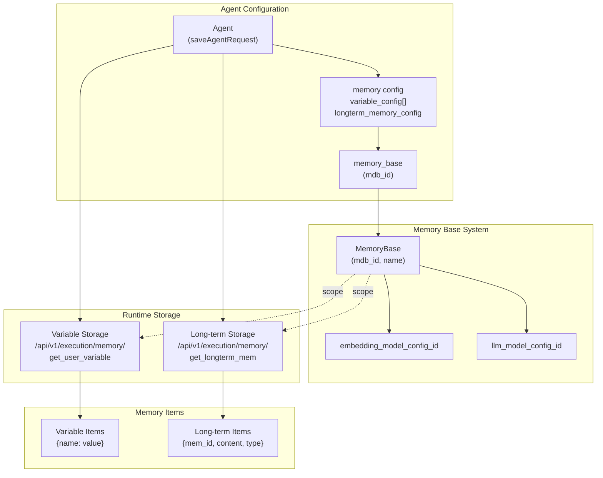
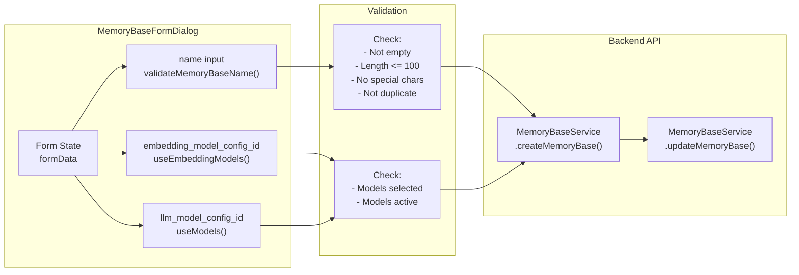
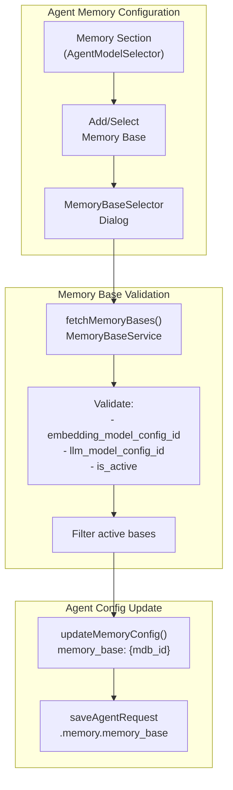
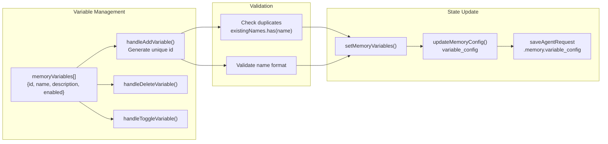
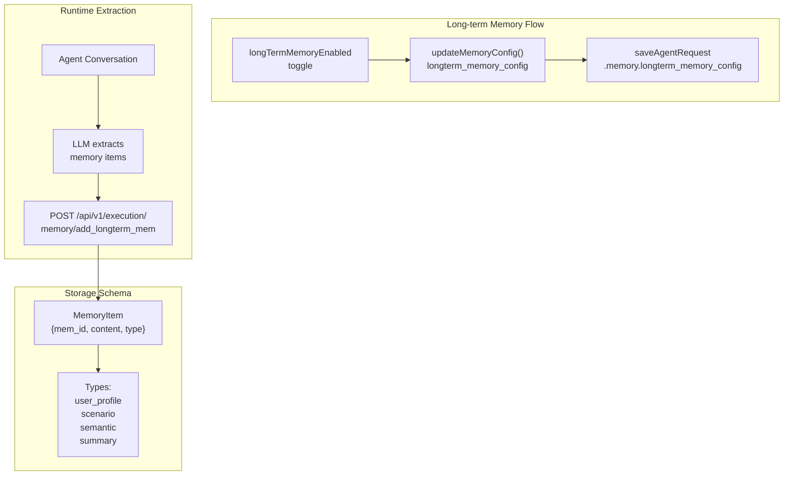
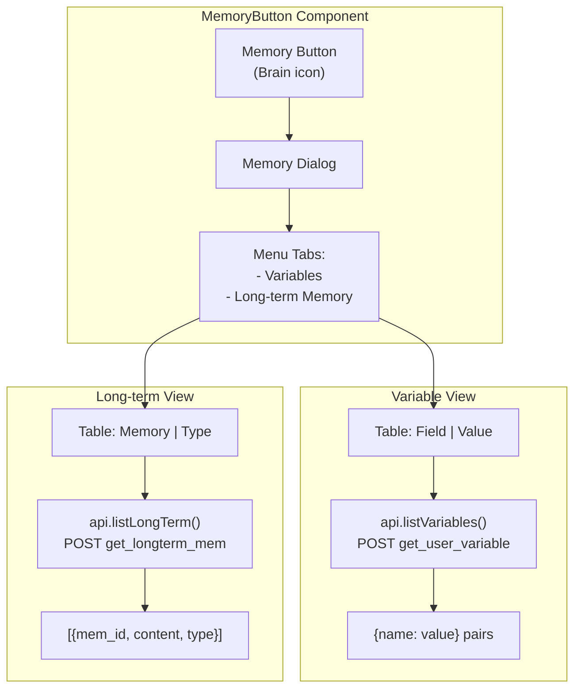
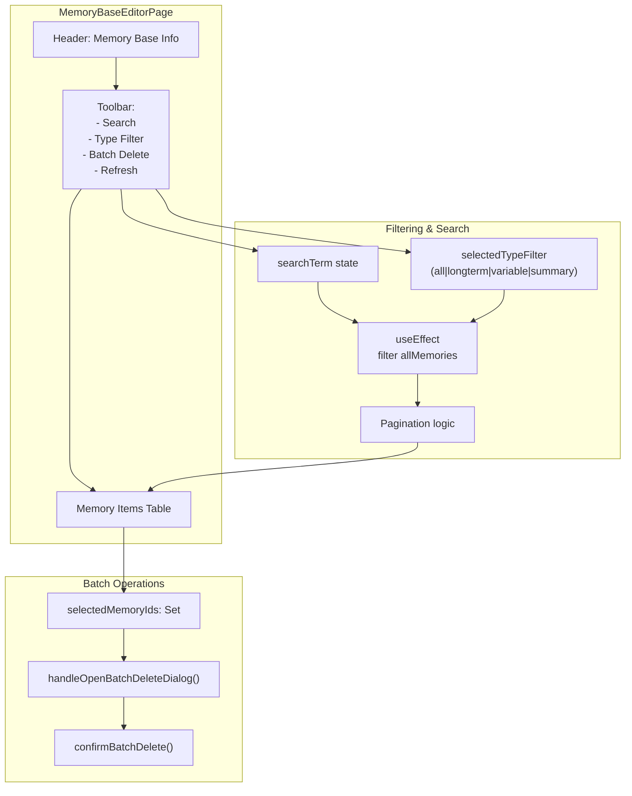

<!-- source: DeepWiki mcp.deepwiki.com · repo openJiuwen-ai/agent-studio · page 4.7 Using Memory Systems · fetched 2026-11-02 -->

# Using Memory Systems

<details>
<summary>Relevant source files</summary>

The following files were used as context for generating this wiki page:

- [frontend/src/components/Agent/AgentModelSelector.tsx](frontend/src/components/Agent/AgentModelSelector.tsx)
- [frontend/src/components/Agent/OverridePromptTemplateDialog.tsx](frontend/src/components/Agent/OverridePromptTemplateDialog.tsx)
- [frontend/src/locales/agent/en-US/common.json](frontend/src/locales/agent/en-US/common.json)
- [frontend/src/locales/agent/en-US/editor.json](frontend/src/locales/agent/en-US/editor.json)
- [frontend/src/locales/agent/zh-CN/common.json](frontend/src/locales/agent/zh-CN/common.json)
- [frontend/src/locales/agent/zh-CN/editor.json](frontend/src/locales/agent/zh-CN/editor.json)
- [frontend/src/pages/Agents/AgentCreatePage.tsx](frontend/src/pages/Agents/AgentCreatePage.tsx)
- [frontend/src/pages/Agents/AgentEditorEditPage.tsx](frontend/src/pages/Agents/AgentEditorEditPage.tsx)
- [frontend/src/pages/Agents/AgentsPage.tsx](frontend/src/pages/Agents/AgentsPage.tsx)
- [frontend/src/pages/MemoryBase/MemoryBaseEditorPage.tsx](frontend/src/pages/MemoryBase/MemoryBaseEditorPage.tsx)
- [frontend/src/pages/MemoryBase/MemoryBasePageNew.tsx](frontend/src/pages/MemoryBase/MemoryBasePageNew.tsx)
- [frontend/src/pages/MemoryBase/MemoryButton.tsx](frontend/src/pages/MemoryBase/MemoryButton.tsx)
- [frontend/src/pages/MemoryBase/components/MemoryBaseCard.tsx](frontend/src/pages/MemoryBase/components/MemoryBaseCard.tsx)
- [frontend/src/pages/MemoryBase/components/MemoryBaseCardNew.tsx](frontend/src/pages/MemoryBase/components/MemoryBaseCardNew.tsx)
- [frontend/src/pages/MemoryBase/components/MemoryBaseFormDialog.tsx](frontend/src/pages/MemoryBase/components/MemoryBaseFormDialog.tsx)
- [frontend/src/pages/MemoryBase/components/MemoryBaseTableView.tsx](frontend/src/pages/MemoryBase/components/MemoryBaseTableView.tsx)
- [frontend/src/pages/MemoryBase/index.ts](frontend/src/pages/MemoryBase/index.ts)
- [frontend/src/pages/MemoryBase/utils/validation.ts](frontend/src/pages/MemoryBase/utils/validation.ts)

</details>


This guide explains how to create and use memory systems in OpenJiuwen Agent Studio. Memory systems enable agents to store and retrieve information across conversations, including session variables and long-term knowledge about users.

For information about knowledge base systems (document-based retrieval), see [Building Knowledge Bases](#4.4). For prompt optimization features, see [Optimizing Prompts](#4.6).

---

## Memory System Overview

Memory systems in OpenJiuwen consist of **Memory Bases** that store two types of data:

- **Memory Variables**: Key-value pairs for storing session-specific data (e.g., user preferences, temporary state)
- **Long-term Memory**: Persistent information extracted from conversations (e.g., user profiles, preferences, historical context)

Memory bases require both an **Embedding Model** (for vector storage) and an **LLM Model** (for memory extraction and retrieval).

### Architecture Overview



**Sources:**
- [frontend/src/components/Agent/AgentModelSelector.tsx:81-97]()
- [frontend/src/pages/MemoryBase/MemoryBaseEditorPage.tsx:43-206]()
- [frontend/src/locales/agent/en-US/editor.json:250-287]()

---

## Creating a Memory Base

### Step 1: Navigate to Memory Base Management

1. Access the Memory Base page from the dashboard sidebar
2. Click the **Create Memory Base** button

### Step 2: Configure the Memory Base

| Field | Description | Required |
|-------|-------------|----------|
| **Name** | Unique identifier (max 100 chars, no special chars like `< > : " / \ \| ? *`) | ✓ |
| **Description** | Purpose and usage notes | - |
| **Embedding Model** | Model for vector storage (must be active) | ✓ |
| **LLM Model** | Model for memory extraction (must be active) | ✓ |



### Key Implementation Details

The form validation ensures:
- Names are unique across the space (checked against existing memory bases)
- Selected models are active and available
- Special characters that could cause file system issues are rejected

**Sources:**
- [frontend/src/pages/MemoryBase/components/MemoryBaseFormDialog.tsx:128-268]()
- [frontend/src/pages/MemoryBase/utils/validation.ts:1-39]()
- [frontend/src/locales/agent/en-US/editor.json:268-283]()

---

## Binding Memory to an Agent

### Step 1: Open Agent Memory Configuration

In the agent editor, navigate to the **Orchestration** tab → **Memory** section.

### Step 2: Select Memory Base



### Memory Base Requirements

- Must have valid **Embedding Model** (active)
- Must have valid **LLM Model** (active)
- If model is disabled, warning shown: `"Some memory bases have no Embedding model configured"`

**Sources:**
- [frontend/src/components/Agent/AgentModelSelector.tsx:437-492]()
- [frontend/src/components/Agent/MemoryBaseSelector.tsx]() (referenced in imports)

---

## Configuring Memory Variables

Memory variables are predefined fields that agents can read and write during conversations.

### Adding Variables

1. In the agent's Memory section, locate **Variable Configuration**
2. Click **Add** to create a new variable
3. Configure the variable:

| Property | Description | Example |
|----------|-------------|---------|
| **Variable Name** | Identifier used in conversations | `user_name`, `preferred_language` |
| **Variable Description** | Purpose and usage | "User's preferred name for addressing" |
| **Enabled** | Whether variable is active | Toggle on/off |



### Variable Lifecycle

Variables are stored per `(user_id, group_id)` scope where:
- `user_id` = space_id
- `group_id` = memory_base.mdb_id

**API Endpoints:**
- **List**: `POST /api/v1/execution/memory/get_user_variable`
- **Delete**: `POST /api/v1/execution/memory/delete_user_variable`

**Sources:**
- [frontend/src/components/Agent/AgentModelSelector.tsx:656-739]()
- [frontend/src/pages/MemoryBase/MemoryBaseEditorPage.tsx:70-106]()
- [frontend/src/locales/agent/en-US/editor.json:253-267]()

---

## Enabling Long-term Memory

Long-term memory allows agents to extract and persist information from conversations.

### Activation Steps

1. In the Memory section, locate **Long-Term Memory**
2. Toggle **Enable Long-Term Memory** switch
3. Save the agent configuration

### Memory Types

Long-term memory items are categorized by type:

| Type | Description | Example |
|------|-------------|---------|
| `user_profile` | User personal information | Name, occupation, preferences |
| `scenario` | Contextual scenarios | Project details, current tasks |
| `semantic` | Semantic knowledge | Domain concepts, relationships |
| `summary` | Conversation summaries | Key points from past chats |
| `longterm` | General long-term data | Historical context |



### Configuration Warning

If no memory base is bound, the UI displays:
> "Please bind a memory base to enable long-term memory feature"

**Sources:**
- [frontend/src/components/Agent/AgentModelSelector.tsx:753-763]()
- [frontend/src/locales/agent/en-US/editor.json:284-286]()
- [frontend/src/pages/MemoryBase/MemoryBaseEditorPage.tsx:60-66]()

---

## Managing Memory Items

### Viewing Memory in Debug Mode

During agent testing, access the **Memory** button in the debug panel:



### Deleting Memory Items

**Variables:**
1. Switch to Variables tab
2. Click delete icon next to variable
3. Click **Save** to confirm deletion
4. API call: `POST /api/v1/execution/memory/delete_user_variable`

**Long-term Memory:**
1. Switch to Long-term Memory tab
2. Click delete icon next to memory item
3. Click **Save** to confirm deletion
4. API call: `POST /api/v1/execution/memory/delete_longterm_mem`

**Sources:**
- [frontend/src/pages/MemoryBase/MemoryButton.tsx:106-303]()
- [frontend/src/locales/agent/en-US/editor.json:486-521]()

---

## Memory Base Editor

The Memory Base Editor provides a dedicated interface for managing memory items at scale.

### Navigation

1. Go to Memory Bases page
2. Click on a memory base name or click the edit icon
3. Access the Memory Base Editor (`MemoryBaseEditorPage`)

### Features



### Memory Item Display

Each memory item shows:
- **Type Icon**: Visual indicator (Hash for variable, MessageSquare for summary, User for longterm)
- **Type Name**: Translated type label
- **Content**: Memory content (truncated at 120 chars)
- **Actions**: Delete button

**Sources:**
- [frontend/src/pages/MemoryBase/MemoryBaseEditorPage.tsx:224-1633]()
- [frontend/src/locales/agent/en-US/editor.json]() (memoryBases section)

---

## Memory API Reference

### Core API Endpoints

| Endpoint | Method | Purpose | Request Body |
|----------|--------|---------|--------------|
| `/api/v1/execution/memory/get_user_variable` | POST | List variables | `{user_id, group_id}` |
| `/api/v1/execution/memory/delete_user_variable` | POST | Delete variable | `{user_id, group_id, name}` |
| `/api/v1/execution/memory/get_longterm_mem` | POST | List long-term memories | `{user_id, group_id, num, page}` |
| `/api/v1/execution/memory/delete_longterm_mem` | POST | Delete long-term memory | `{user_id, group_id, mem_id}` |

### Memory Base Management APIs

Memory base CRUD operations use the `MemoryBaseService` client:

```typescript
// Create
MemoryBaseService.createMemoryBase({
  space_id: string,
  name: string,
  description?: string,
  embedding_model_config_id: number,
  llm_model_config_id: number
})

// Update
MemoryBaseService.updateMemoryBase({
  mdb_id: string,
  space_id: string,
  name?: string,
  description?: string,
  embedding_model_config_id?: number,
  llm_model_config_id?: number
})

// Delete
MemoryBaseService.deleteMemoryBase({
  mdb_id: string,
  space_id: string
})

// List
MemoryBaseService.getMemoryBases({
  space_id: string,
  page: number,
  page_size: number
})
```

**Sources:**
- [frontend/src/pages/MemoryBase/MemoryBaseEditorPage.tsx:68-206]()
- [frontend/src/pages/MemoryBase/components/MemoryBaseFormDialog.tsx]() (API client usage)

---

## Best Practices

### Variable Naming

- Use descriptive names: `user_preferred_language` instead of `lang`
- Follow snake_case convention for consistency
- Avoid special characters and spaces
- Document purpose in the description field

### Long-term Memory

- Enable only when needed (requires additional LLM calls)
- Monitor memory growth in production
- Periodically review and clean expired memories
- Use appropriate memory types for better organization

### Model Selection

- Choose embedding models optimized for short text (variables typically < 512 tokens)
- Use capable LLM models for memory extraction (e.g., GPT-4, Claude)
- Ensure models remain active to prevent memory access failures

### Memory Base Organization

- Create separate memory bases for different agent contexts
- Use clear naming: `customer_service_memory`, `sales_assistant_memory`
- Document embedding and LLM model choices
- Limit to 100 memory bases per space (hard limit)

**Sources:**
- [frontend/src/pages/MemoryBase/MemoryBasePageNew.tsx:20-23]()
- [frontend/src/pages/MemoryBase/components/MemoryBaseFormDialog.tsx:144-145]()

---

