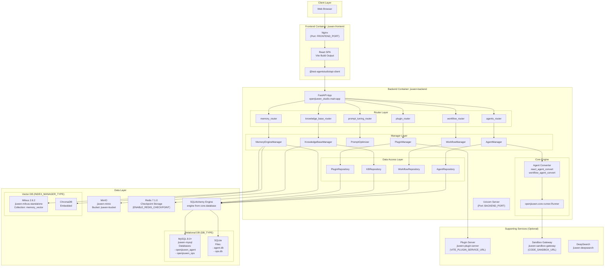
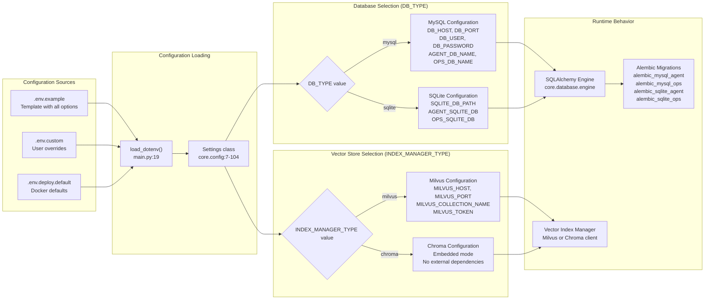
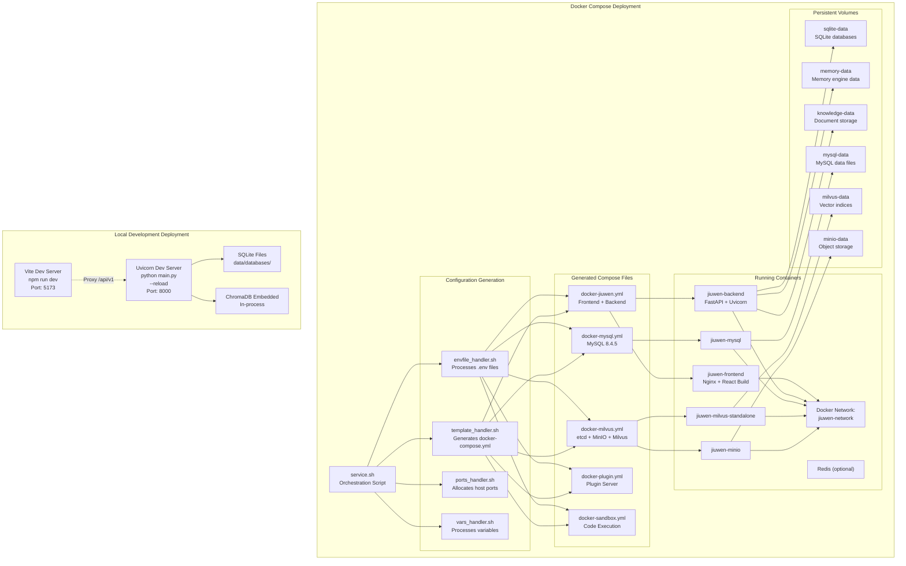
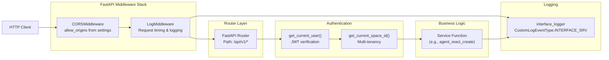

<!-- source: DeepWiki mcp.deepwiki.com · repo openJiuwen-ai/agent-studio · page 5 Architecture · fetched 2026-11-02 -->

# Architecture

<details>
<summary>Relevant source files</summary>

The following files were used as context for generating this wiki page:

- [.env.example](.env.example)
- [backend/openjiuwen_studio/core/common/logging/__init__.py](backend/openjiuwen_studio/core/common/logging/__init__.py)
- [backend/openjiuwen_studio/core/common/logging/events.py](backend/openjiuwen_studio/core/common/logging/events.py)
- [backend/openjiuwen_studio/core/config.py](backend/openjiuwen_studio/core/config.py)
- [backend/openjiuwen_studio/core/manager/convertor/components/sub_workflow.py](backend/openjiuwen_studio/core/manager/convertor/components/sub_workflow.py)
- [backend/openjiuwen_studio/core/manager/email_manager/__init__.py](backend/openjiuwen_studio/core/manager/email_manager/__init__.py)
- [backend/openjiuwen_studio/core/manager/email_manager/email_template.py](backend/openjiuwen_studio/core/manager/email_manager/email_template.py)
- [backend/openjiuwen_studio/core/manager/email_manager/email_utils.py](backend/openjiuwen_studio/core/manager/email_manager/email_utils.py)
- [backend/openjiuwen_studio/core/manager/redis_manager/__init__.py](backend/openjiuwen_studio/core/manager/redis_manager/__init__.py)
- [backend/openjiuwen_studio/core/manager/utils/utils.py](backend/openjiuwen_studio/core/manager/utils/utils.py)
- [backend/openjiuwen_studio/main.py](backend/openjiuwen_studio/main.py)
- [backend/pyproject.toml](backend/pyproject.toml)
- [docs/en/2.Installation Guide/Install via Docker/Linux_Installation.md](docs/en/2.Installation Guide/Install via Docker/Linux_Installation.md)
- [docs/en/2.Installation Guide/Install via Docker/MacOS_Installation.md](docs/en/2.Installation Guide/Install via Docker/MacOS_Installation.md)
- [docs/en/2.Installation Guide/Install via Docker/Windows_Installation.md](docs/en/2.Installation Guide/Install via Docker/Windows_Installation.md)
- [scripts/.env.deploy.default](scripts/.env.deploy.default)
- [scripts/args_handler.sh](scripts/args_handler.sh)
- [scripts/common.sh](scripts/common.sh)
- [scripts/conf/docker-deepsearch.template.yml](scripts/conf/docker-deepsearch.template.yml)
- [scripts/conf/docker-jiuwen.template.yml](scripts/conf/docker-jiuwen.template.yml)
- [scripts/conf/docker-plugin.template.yml](scripts/conf/docker-plugin.template.yml)
- [scripts/envfile_handler.sh](scripts/envfile_handler.sh)
- [scripts/gen_ssl.sh](scripts/gen_ssl.sh)
- [scripts/global_vars.sh](scripts/global_vars.sh)
- [scripts/prompt_handler.sh](scripts/prompt_handler.sh)
- [scripts/service.sh](scripts/service.sh)
- [scripts/template_handler.sh](scripts/template_handler.sh)
- [scripts/vars_handler.sh](scripts/vars_handler.sh)

</details>


This section provides a comprehensive overview of OpenJiuwen Agent Studio's system architecture for developers and advanced users. It explains the overall system design, technology stack, deployment models, and key architectural patterns that govern how the platform operates.

For detailed information about specific architectural components:
- Overall system design and component interaction: see [System Architecture](#5.1)
- Frontend application structure and state management: see [Frontend Architecture](#5.2)  
- Backend service layers and patterns: see [Backend Architecture](#5.3)
- Database, vector stores, and storage systems: see [Data Layer](#5.4)
- Agent conversion and execution flow: see [Agent Execution Pipeline](#5.5)
- Document processing and RAG workflow: see [Document Processing Pipeline](#5.6)
- Visual workflow editor implementation: see [Workflow Canvas Architecture](#5.7)

## Technology Stack

OpenJiuwen Agent Studio is built on a modern Python and TypeScript technology stack with support for multiple deployment configurations.

### Backend Stack

| Component | Technology | Version | Purpose |
|-----------|-----------|---------|---------|
| Web Framework | FastAPI | 0.115.11 | REST API server with async support |
| ASGI Server | Uvicorn | 0.35+ | Production-grade async server |
| ORM | SQLAlchemy | 2.0.41 | Database abstraction layer |
| Database (Primary) | MySQL | 8.0+ | Production relational database |
| Database (Dev) | SQLite | 3.x | Development relational database |
| Vector Store (Primary) | Milvus | 2.6.2+ | Scalable vector database |
| Vector Store (Dev) | Chroma | embedded | Development vector database |
| Object Storage | MinIO | RELEASE.2024-12-18T13-15-44Z | S3-compatible file storage |
| Caching | Redis | 7.1.0 | Session and checkpoint storage |
| Migration | Alembic | 1.13.1 | Database schema versioning |
| AI Framework | openjiuwen | 0.1.7 | Core agent execution framework |
| Validation | Pydantic | 2.11.7 | Data validation and settings |
| Graph Processing | NetworkX | 3.4.2 | Workflow DAG operations |

### Frontend Stack

The frontend is a React-based single-page application built with Vite, featuring:
- **React 18** with TypeScript for type-safe component development
- **Zustand** for lightweight state management
- **React Query** for server state synchronization and caching
- **@workflow-canvas** for visual workflow editing
- **@test-agentstudio/api-client** for typed API communication
- **Vite** for fast development and optimized production builds

### Infrastructure Stack

| Component | Technology | Version | Purpose |
|-----------|-----------|---------|---------|
| Reverse Proxy | Nginx | latest | HTTPS termination, static file serving |
| Containerization | Docker | 20.10+ | Container runtime |
| Orchestration | Docker Compose | 2.19.1+ | Multi-container deployment |
| Message Queue (Milvus) | etcd | 3.5.18 | Milvus metadata coordination |

Sources: [backend/pyproject.toml:1-70](), [.env.example:1-196](), [scripts/.env.deploy.default:1-76]()

## System Architecture Overview

The following diagram shows the complete system architecture with actual code entities and configuration points:

**Figure 1: Complete System Architecture with Code Entities**



Sources: [backend/openjiuwen_studio/main.py:1-278](), [backend/openjiuwen_studio/core/config.py:1-105](), [.env.example:90-148](), [scripts/global_vars.sh:28-61]()

## Configuration-Driven Architecture

OpenJiuwen Agent Studio uses environment variables to enable flexible deployment configurations without code changes. The configuration system supports multiple database backends, vector stores, and optional services.

**Figure 2: Configuration Flow and Selection Logic**



Sources: [backend/openjiuwen_studio/core/config.py:7-104](), [backend/openjiuwen_studio/main.py:17-19](), [.env.example:90-148]()

### Key Configuration Variables

| Variable | Values | Purpose | Default |
|----------|--------|---------|---------|
| `DB_TYPE` | `mysql`, `sqlite` | Selects relational database backend | `sqlite` |
| `INDEX_MANAGER_TYPE` | `milvus`, `chroma` | Selects vector database backend | `chroma` |
| `ENABLE_REDIS_CHECKPOINT` | `True`, `False` | Enables Redis for workflow checkpointing | `False` |
| `DEBUG` | `True`, `False` | Enables debug mode and verbose logging | `false` |
| `VITE_ENABLE_NEW_AUTH` | `True`, `False` | Enables full authentication system | `False` |
| `SERVICE_MODE` | `develop`, `product` | Controls encryption key storage mode | `develop` |

Sources: [.env.example:90-173](), [backend/openjiuwen_studio/core/config.py:26-91]()

## Deployment Architecture

OpenJiuwen Agent Studio supports two primary deployment models: Docker Compose for production and local development for rapid iteration.

**Figure 3: Deployment Models and Container Orchestration**



Sources: [scripts/service.sh:1-40](), [scripts/global_vars.sh:174-193](), [scripts/conf/docker-jiuwen.template.yml:1-72](), [backend/openjiuwen_studio/main.py:247-273]()

### Docker Compose Service Architecture

The `service.sh` script orchestrates Docker Compose deployments by:

1. **Parsing arguments** ([scripts/args_handler.sh:5-174]()) to determine which modules to deploy
2. **Allocating ports** ([scripts/ports_handler.sh]()) from available ranges to avoid conflicts
3. **Generating unique names** ([scripts/vars_handler.sh:5-15]()) with random suffixes for multi-instance support
4. **Processing configuration** ([scripts/envfile_handler.sh:5-195]()) by merging `.env.custom` with defaults
5. **Rendering templates** ([scripts/template_handler.sh:34-61]()) to create final `docker-compose.yml` files
6. **Managing containers** ([scripts/container_handler.sh]()) with Docker Compose commands

Sources: [scripts/service.sh:27-39](), [scripts/global_vars.sh:1-224]()

### Network Architecture

All Docker containers communicate via a shared bridge network (`jiuwen-network`) with internal DNS resolution:

| Service | Container Name | Internal Hostname | Purpose |
|---------|---------------|-------------------|---------|
| Frontend | `jiuwen-frontend-{suffix}` | `frontend-{suffix}` | Serves React SPA, proxies API |
| Backend | `jiuwen-backend-{suffix}` | `backend-{suffix}` | FastAPI application server |
| MySQL | `jiuwen-mysql-{suffix}` | `mysql-{suffix}` | Relational database |
| Milvus | `jiuwen-milvus-standalone-{suffix}` | `milvus-{suffix}` | Vector database |
| MinIO | `jiuwen-minio-{suffix}` | `minio-{suffix}` | Object storage |

Container hostnames are injected into configuration files via template variables like `<<BACKEND_SERVICE>>` and `<<MYSQL_SERVICE>>` ([scripts/template_handler.sh:5-32]()).

Sources: [scripts/global_vars.sh:28-61](), [scripts/vars_handler.sh:84-178](), [scripts/conf/docker-jiuwen.template.yml:1-72]()

## Application Lifecycle Management

The FastAPI application initializes all system components during startup and gracefully shuts them down on termination.

**Figure 4: Application Startup and Shutdown Sequence**

```mermaid
sequenceDiagram
    participant Main as main.py
    participant Lifespan as lifespan_func
    participant DB as Database Layer
    participant Alembic as Alembic Version Check
    participant Memory as MemoryEngineManager
    participant Runner as openjiuwen Runner
    participant App as FastAPI App
    
    Main->>App: Create FastAPI(lifespan=lifespan_func)
    Main->>Main: Register routers
    Main->>Main: Add CORS middleware
    Main->>Main: uvicorn.run(app)
    
    App->>Lifespan: Startup event triggered
    
    Lifespan->>Lifespan: Rename SQLite indexes if DB_TYPE=sqlite
    Note over Lifespan: Handle duplicate index names<br/>main.py:94-107
    
    Lifespan->>DB: Base.metadata.create_all(engine, tables)
    Note over DB: Create all table schemas<br/>main.py:110-114
    
    Lifespan->>Memory: MemoryEngineManager.init()
    Note over Memory: Initialize memory engine<br/>main.py:115
    
    Lifespan->>Alembic: check_alembic_versions()
    Note over Alembic: Verify migration state<br/>main.py:121
    
    Lifespan->>Lifespan: create_database_tables() for ops
    Note over Lifespan: Ops database tables<br/>main.py:124
    
    alt ENABLE_REDIS_CHECKPOINT = True
        Lifespan->>Runner: Configure Redis checkpointer
        Note over Runner: Set CheckpointerConfig<br/>main.py:128-138
    end
    
    Lifespan->>Runner: Runner.start()
    Note over Runner: Start agent execution engine<br/>main.py:140
    
    Lifespan-->>App: Startup complete
    
    Note over App: Application running<br/>Serving requests
    
    App->>Lifespan: Shutdown event triggered
    Lifespan->>Lifespan: Cleanup resources
    Lifespan-->>App: Shutdown complete
```



Sources: [backend/openjiuwen_studio/main.py:54-146]()

### Database Initialization Strategy

The application uses a hybrid approach for database initialization:

1. **SQLAlchemy DDL** (`Base.metadata.create_all()`) creates tables with `checkfirst=True` ([main.py:110-114]())
2. **Alembic migrations** manage schema changes for production deployments ([main.py:121]())
3. **SQLite index renaming** handles duplicate index name conflicts specific to SQLite ([main.py:94-107]())

The system supports four separate Alembic migration branches:
- `alembic_mysql_agent` - MySQL schema for agent database
- `alembic_mysql_ops` - MySQL schema for ops database  
- `alembic_sqlite_agent` - SQLite schema for agent database
- `alembic_sqlite_ops` - SQLite schema for ops database

Sources: [backend/openjiuwen_studio/main.py:54-126](), [scripts/global_vars.sh:207-223]()

## Middleware and Cross-Cutting Concerns

**Figure 5: Request Processing Pipeline**



### Logging Architecture

The system implements structured logging with custom event types:

- **Interface Logger** tracks all API requests with timing metrics ([main.py:166-221]())
- **Custom Event Types** defined in [backend/openjiuwen_studio/core/common/logging/events.py:30-49]()
- **Log Middleware** captures execution time, status codes, and errors ([main.py:166-221]())

```python
interface_logger.info(
    "",
    event_type=CustomLogEventType.INTERFACE_SRV.value,
    interface_name=endpoint_name,
    execution_time_ms=round((time.perf_counter() - start_time) * 1000),
    error_code=str(response.status_code),
    metadata={"route_path": route_path}
)
```

Sources: [backend/openjiuwen_studio/main.py:166-221](), [backend/openjiuwen_studio/core/common/logging/events.py:1-50]()

### CORS Configuration

CORS middleware allows cross-origin requests from configured origins ([main.py:225-232]()):

```python
app.add_middleware(
    CORSMiddleware,
    allow_origins=["http://localhost:3000", "http://127.0.0.1:3000"],
    allow_credentials=True,
    allow_methods=["*"],
    allow_headers=["*"],
)
```

The `allow_origins` list can be extended via the `ALLOWED_ORIGINS` environment variable ([.env.example:68]()).

Sources: [backend/openjiuwen_studio/main.py:225-232](), [.env.example:67-68]()

## Security Architecture

### Encryption and Secret Management

OpenJiuwen implements a layered encryption system for protecting sensitive data:

1. **Service Mode Selection** (`SERVICE_MODE` = `develop` | `product`) determines encryption key storage
2. **AES-256 Encryption** for API keys and credentials using `SERVER_AES_MASTER_KEY`
3. **Optional KMS Integration** with Huawei Cloud KMS for enterprise deployments
4. **JWT-based Authentication** with configurable token expiration times

| Secret Type | Storage Location | Encryption Method |
|-------------|-----------------|-------------------|
| LLM API Keys | Database (encrypted) | AES-256-GCM |
| SMTP Password | Environment variable | AES-256-GCM |
| JWT Signing Key | `SECRET_KEY` env var | Plain (secure random) |
| Database Passwords | `.env` files | Plain (file system security) |

Sources: [.env.example:70-84](), [backend/openjiuwen_studio/core/manager/email_manager/email_utils.py:22](), [backend/openjiuwen_studio/core/config.py:52-53]()

### Multi-tenancy and Workspace Isolation

The system implements workspace-level isolation through:

- **SpaceDB** table for workspace definitions ([main.py:68]())
- **SpaceUserDB** table for user-workspace associations ([main.py:69]())  
- **`space_id` parameter** required in most API endpoints for data scoping
- **Dependency injection** of current workspace via `get_current_space_id()`

Sources: [backend/openjiuwen_studio/main.py:68-69]()

## Performance and Scalability Patterns

### Worker Configuration

The system supports multi-worker deployment for production environments:

```python
config = {
    "workers": int(os.getenv("WORKER_NUM", 1))
        if (os.getenv("INDEX_MANAGER_TYPE") == "milvus" and os.getenv("DB_TYPE") == "mysql")
        else 1,
}
```

Multi-worker mode is only enabled when using both Milvus and MySQL to avoid SQLite and ChromaDB concurrency limitations ([main.py:255-258]()).

### Asynchronous I/O

The platform leverages Python's `asyncio` for non-blocking operations:

- **Async route handlers** for I/O-bound API endpoints
- **Async database drivers** (`aiomysql`, `aiosqlite`) for concurrent queries
- **Uvicorn ASGI server** with `loop="asyncio"` enforcement ([main.py:269-272]())

### Caching and Checkpointing

- **Redis checkpointing** for stateful workflow execution when `ENABLE_REDIS_CHECKPOINT=True` ([main.py:128-138]())
- **Frontend caching** via React Query for server state management
- **Vector index caching** in Milvus/Chroma for fast similarity search

Sources: [backend/openjiuwen_studio/main.py:247-273](), [.env.example:117-121]()

## Key Architectural Patterns

### 1. Manager-Repository Pattern

The backend follows a three-layer architecture:

```
Router → Manager → Repository → Database
```

- **Routers** ([openjiuwen_studio/routers/]()) handle HTTP requests and validation
- **Managers** ([openjiuwen_studio/core/manager/]()) implement business logic
- **Repositories** provide data access abstraction

Example flow for agent creation:
```
agents_router → AgentManager → AgentRepository → SQLAlchemy Engine
```

### 2. Strategy Pattern for Database Selection

Database backend selection uses environment variable-driven strategy pattern:

```python
if settings.db_type == "mysql":
    # Use MySQL-specific repository implementations
elif settings.db_type == "sqlite":
    # Use SQLite-specific repository implementations
```

This pattern extends to vector databases (`INDEX_MANAGER_TYPE`) and other pluggable components.

### 3. Dependency Injection

FastAPI's dependency injection system provides:

- **Authentication** via `get_current_user()` dependency
- **Workspace scoping** via `get_current_space_id()` dependency  
- **Database sessions** injected into route handlers
- **Configuration** via the `Settings` singleton

### 4. DSL-based Agent Abstraction

Agents are represented in two forms:

1. **Display Format** - JSON structure from frontend UI
2. **Executable DSL** - Standardized internal representation

The **Converter** ([openjiuwen_studio/core/manager/convertor/]()) transforms display format to DSL, enabling:
- UI-independent agent execution
- Version compatibility across releases
- Export/import functionality

Sources: [backend/openjiuwen_studio/core/manager/convertor/components/sub_workflow.py:15-52]()

### 5. Event-Driven Logging

Structured logging uses event-based architecture:

- **Event types** defined as enums ([CustomLogEventType]())
- **Event classes** as dataclasses with typed fields ([InterfaceEvent]())
- **Event registration** maps types to classes for extensibility

This enables consistent log formats, easy filtering, and future integration with observability platforms.

Sources: [backend/openjiuwen_studio/core/common/logging/events.py:1-50]()

## Version Management

### Application Versioning

The platform version is managed in [backend/pyproject.toml:7]():

```toml
[project]
name = "openjiuwen-studio"
version = "0.1.5"
```

Version retrieval utility at [backend/openjiuwen_studio/core/manager/utils/utils.py:125-146]() parses `pyproject.toml` to get the current version.

### Database Schema Versioning

Alembic migration revisions are tracked in [scripts/global_vars.sh:207-223]()):

```bash
declare -A REVISION_ID=(
    ["MYSQL_AGENT_0.1.4"]="072ac1293a02"
    ["MYSQL_OPS_0.1.4"]="13377a900fe2"
    ["SQLITE_AGENT_0.1.4"]="8f4846812221"
    ["SQLITE_OPS_0.1.4"]="f6e49cd8c97d"
)
```

The `check_alembic_versions()` function validates schema compatibility on startup.

### Deployment Version Tracking

The deployment script tracks versions via:
- **VERSION** variable in `.env.deploy.default`
- **Version extraction** function in deployment scripts
- **Upgrade detection** when starting with `--upgrade` flag

Sources: [backend/pyproject.toml:5-8](), [backend/openjiuwen_studio/core/manager/utils/utils.py:125-146](), [scripts/global_vars.sh:207-223]()

---

This architectural overview provides the foundation for understanding the detailed subsystem architectures covered in the following sections. Each subsection explores specific components, data flows, and implementation patterns in greater depth.

---

