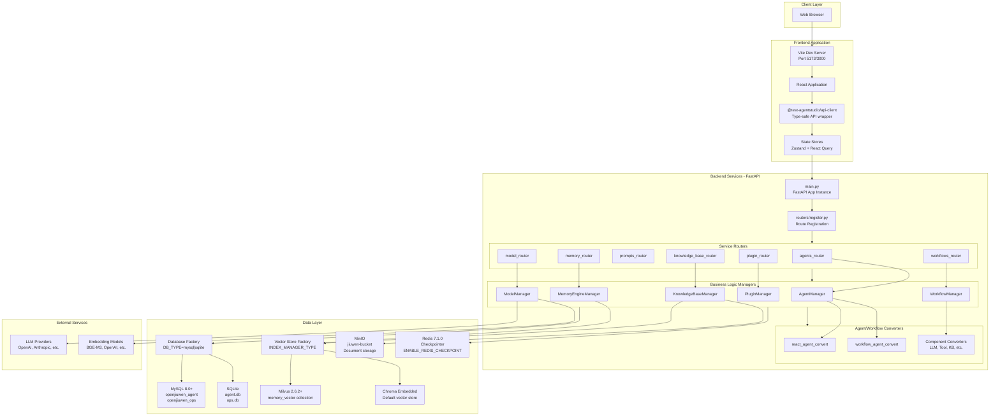
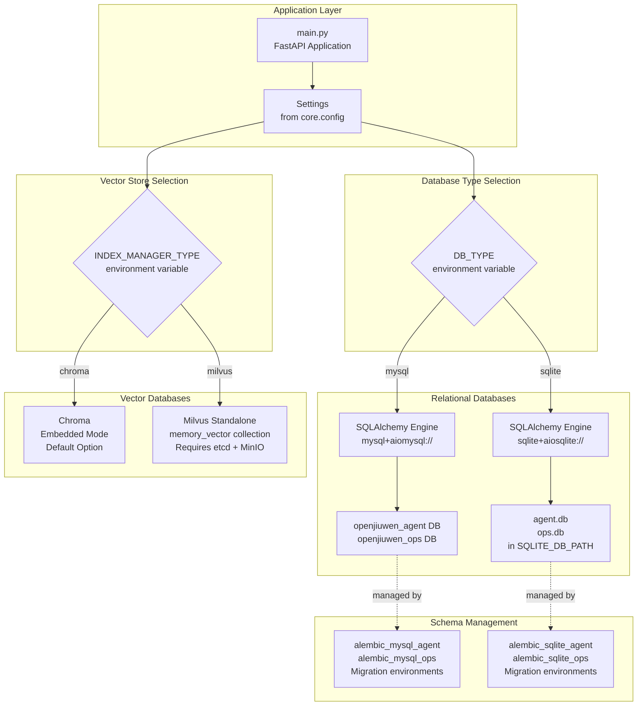
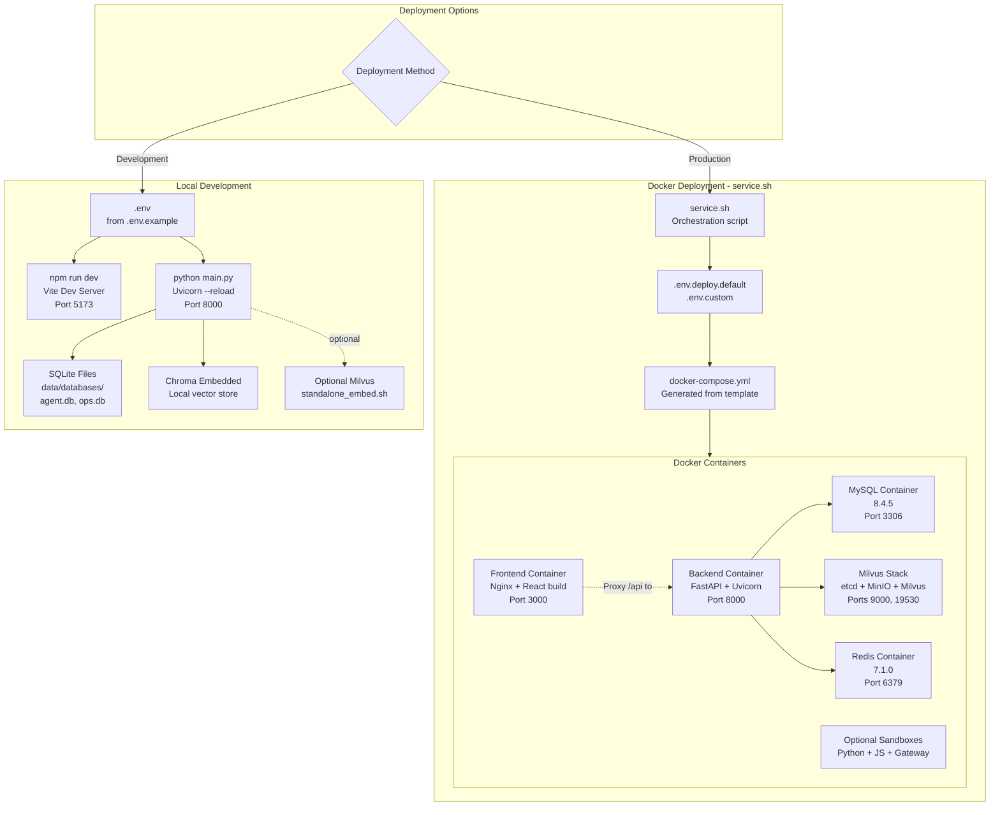
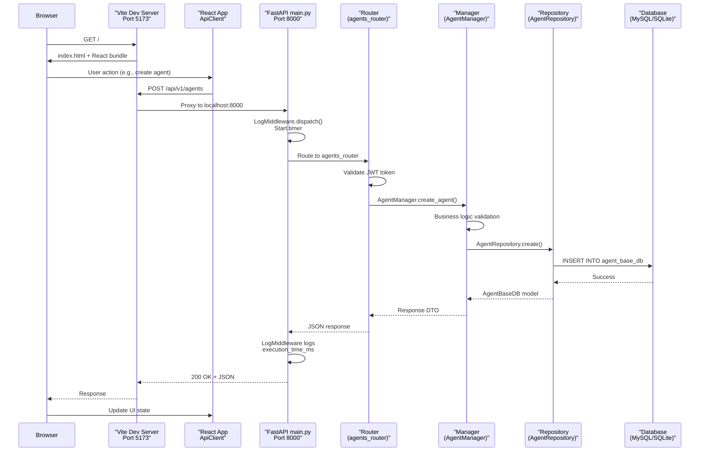
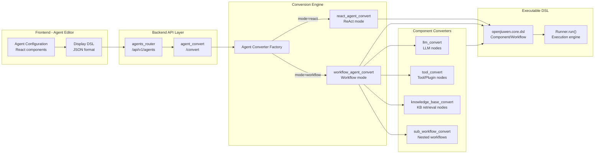
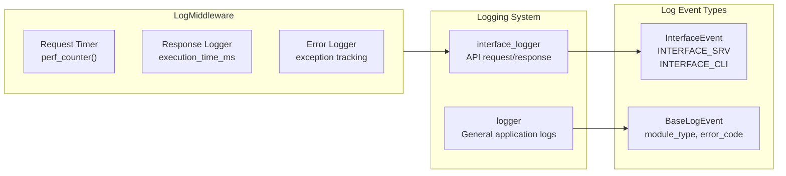

<!-- source: DeepWiki mcp.deepwiki.com · repo openJiuwen-ai/agent-studio · page 5.1 System Architecture · fetched 2026-11-02 -->

# System Architecture

<details>
<summary>Relevant source files</summary>

The following files were used as context for generating this wiki page:

- [.env.example](.env.example)
- [backend/openjiuwen_studio/core/common/logging/__init__.py](backend/openjiuwen_studio/core/common/logging/__init__.py)
- [backend/openjiuwen_studio/core/common/logging/events.py](backend/openjiuwen_studio/core/common/logging/events.py)
- [backend/openjiuwen_studio/core/config.py](backend/openjiuwen_studio/core/config.py)
- [backend/openjiuwen_studio/core/manager/convertor/components/sub_workflow.py](backend/openjiuwen_studio/core/manager/convertor/components/sub_workflow.py)
- [backend/openjiuwen_studio/core/manager/email_manager/__init__.py](backend/openjiuwen_studio/core/manager/email_manager/__init__.py)
- [backend/openjiuwen_studio/core/manager/email_manager/email_template.py](backend/openjiuwen_studio/core/manager/email_manager/email_template.py)
- [backend/openjiuwen_studio/core/manager/email_manager/email_utils.py](backend/openjiuwen_studio/core/manager/email_manager/email_utils.py)
- [backend/openjiuwen_studio/core/manager/redis_manager/__init__.py](backend/openjiuwen_studio/core/manager/redis_manager/__init__.py)
- [backend/openjiuwen_studio/core/manager/utils/utils.py](backend/openjiuwen_studio/core/manager/utils/utils.py)
- [backend/openjiuwen_studio/main.py](backend/openjiuwen_studio/main.py)
- [backend/pyproject.toml](backend/pyproject.toml)
- [docs/en/2.Installation Guide/Install via Docker/Linux_Installation.md](docs/en/2.Installation Guide/Install via Docker/Linux_Installation.md)
- [docs/en/2.Installation Guide/Install via Docker/MacOS_Installation.md](docs/en/2.Installation Guide/Install via Docker/MacOS_Installation.md)
- [docs/en/2.Installation Guide/Install via Docker/Windows_Installation.md](docs/en/2.Installation Guide/Install via Docker/Windows_Installation.md)

</details>


This document provides a comprehensive overview of the OpenJiuwen Agent Studio system architecture, including the technology stack, core components, configuration management, and deployment models. It serves as the foundational architecture reference for developers and advanced users.

For detailed information about specific architectural subsystems, see:
- Frontend implementation details: [Frontend Architecture](#5.2)
- Backend service organization: [Backend Architecture](#5.3)
- Database and storage systems: [Data Layer](#5.4)
- Agent execution mechanics: [Agent Execution Pipeline](#5.5)
- Document processing workflow: [Document Processing Pipeline](#5.6)
- Workflow visual editor: [Workflow Canvas Architecture](#5.7)

## Technology Stack

OpenJiuwen Agent Studio is built using a modern web application stack with Python and JavaScript/TypeScript as the primary languages.

### Backend Technologies

| Component | Technology | Version | Purpose |
|-----------|-----------|---------|---------|
| **Web Framework** | FastAPI | 0.115.11 | REST API server and routing |
| **ASGI Server** | Uvicorn | 0.35+ | Production-grade async server |
| **Data Validation** | Pydantic | 2.11.7 | Request/response validation and settings |
| **ORM** | SQLAlchemy | 2.0.41 | Database abstraction layer |
| **Database Migration** | Alembic | 1.13.1 | Schema version control |
| **AI Framework** | openjiuwen | 0.1.7 | Agent execution and workflow orchestration |
| **Graph Processing** | NetworkX | 3.4.2 | Workflow graph operations |

### Frontend Technologies

| Component | Technology | Purpose |
|-----------|-----------|---------|
| **Framework** | React | Component-based UI |
| **Build Tool** | Vite | Fast development server and bundler |
| **Language** | TypeScript | Type-safe JavaScript |
| **State Management** | Zustand | Lightweight state management |
| **API Client** | React Query | Server state management and caching |

### Data Storage Systems

| System | Options | Default | Purpose |
|--------|---------|---------|---------|
| **Relational DB** | MySQL 8.0+ / SQLite | SQLite | Agent metadata, workflows, configurations |
| **Vector DB** | Milvus 2.6.2+ / Chroma | Chroma | Knowledge base embeddings, memory storage |
| **Cache/Queue** | Redis 7.1.0 | Optional | Session checkpointing, caching |
| **Object Storage** | MinIO / OBS | MinIO | Document files, artifacts |

Sources: [backend/pyproject.toml:1-70](), [.env.example:1-196](), [backend/openjiuwen_studio/core/config.py:1-105]()

## Overall System Architecture



**Diagram: Overall System Component Architecture**

The system follows a layered architecture pattern with clear separation between presentation (frontend), business logic (backend services), and data persistence (storage layer). The backend uses a router-service-manager-repository pattern for organizing business logic.

Sources: [backend/openjiuwen_studio/main.py:1-278](), [.env.example:1-196](), [backend/openjiuwen_studio/core/config.py:1-105]()

## Core Components

### FastAPI Application (`main.py`)

The main application entry point is defined in `main.py`, which:

1. **Initializes the FastAPI application** with API documentation at `/api/docs`
2. **Configures lifespan events** using the `lifespan_func` async context manager
3. **Sets up middleware** including CORS and logging middleware
4. **Registers all routers** through the `register.router_register()` function

Key initialization steps in the lifespan function:

```python
# Database table creation
Base.metadata.create_all(bind=engine, tables=target_tables, checkfirst=True)

# Memory engine initialization
await MemoryEngineManager.init()

# Alembic version verification
check_alembic_versions()

# Optional Redis checkpointer for workflow state
if settings.enable_redis_checkpoint:
    Runner.set_config(runner_config)
```

Sources: [backend/openjiuwen_studio/main.py:54-146](), [backend/openjiuwen_studio/main.py:148-163]()

### Configuration Management

The system uses a two-tier configuration approach:

**Environment Variables Layer**: All configuration is defined in `.env` files, with `.env.example` serving as the template.

**Settings Classes**: Pydantic-based settings classes provide type validation and defaults:

- `openjiuwen_studio.core.config.Settings` - Main application settings
- `openjiuwen_studio.ops.config.settings` - Operations database settings

Key configuration categories:

| Category | Key Variables | Purpose |
|----------|---------------|---------|
| **Database Selection** | `DB_TYPE` | Choose `mysql` or `sqlite` |
| **Vector Store Selection** | `INDEX_MANAGER_TYPE` | Choose `milvus` or `chroma` |
| **MySQL Config** | `DB_HOST`, `DB_PORT`, `DB_USER`, `DB_PASSWORD` | MySQL connection parameters |
| **SQLite Config** | `SQLITE_DB_PATH`, `AGENT_SQLITE_DB`, `OPS_SQLITE_DB` | SQLite file locations |
| **Milvus Config** | `MILVUS_HOST`, `MILVUS_PORT`, `MILVUS_COLLECTION_NAME` | Milvus vector store connection |
| **MinIO Config** | `MINIO_HOST`, `MINIO_PORT`, `MINIO_BUCKET` | Object storage connection |
| **Redis Config** | `ENABLE_REDIS_CHECKPOINT`, `REDIS_HOST`, `REDIS_PORT` | Optional Redis checkpointer |
| **Authentication** | `SECRET_KEY`, `ALGORITHM`, `ACCESS_TOKEN_EXPIRE_MINUTES` | JWT token configuration |

Sources: [.env.example:1-196](), [backend/openjiuwen_studio/core/config.py:1-105]()

### Multi-Database Architecture



**Diagram: Multi-Database Selection Architecture**

The system supports multiple database backends through environment variable configuration:

- **Relational Database**: MySQL (production) or SQLite (development)
- **Vector Database**: Milvus (scalable) or Chroma (embedded)

Database selection is determined at startup based on `DB_TYPE` and `INDEX_MANAGER_TYPE` environment variables.

Sources: [.env.example:90-148](), [backend/openjiuwen_studio/core/config.py:26-46](), [backend/openjiuwen_studio/main.py:94-114]()

## Deployment Architecture



**Diagram: Deployment Architecture Options**

OpenJiuwen supports two primary deployment modes:

### Docker Deployment (Production)

Orchestrated by the `service.sh` script, which:
1. Generates `docker-compose.yml` from templates
2. Merges `.env.deploy.default` with user `.env.custom` overrides
3. Launches all containerized services

Default container configuration:
- **Frontend**: Nginx serving static React build
- **Backend**: FastAPI with Uvicorn, using MySQL
- **Databases**: MySQL, Milvus (with etcd + MinIO), Redis
- **Optional**: Python/JS sandboxes, plugin server

### Local Development

Manual setup using:
1. Copy `.env.example` to `.env`
2. Run `npm run dev` for frontend (Vite dev server)
3. Run `python main.py` for backend (Uvicorn with auto-reload)
4. Uses SQLite + Chroma by default for lightweight setup

Sources: [.env.example:1-196](), [backend/openjiuwen_studio/main.py:247-273](), [docs/en/2.Installation Guide/Install via Docker/Linux_Installation.md:1-128]()

## Component Interaction Patterns

### Request Flow Architecture



**Diagram: Request-Response Flow with Middleware**

The system uses a layered request processing pipeline:

1. **Proxy Layer** (Development): Vite proxies `/api` requests to backend
2. **Middleware Layer**: CORS, logging, authentication
3. **Router Layer**: FastAPI route handlers
4. **Service/Manager Layer**: Business logic
5. **Repository Layer**: Data access abstraction
6. **Database Layer**: Persistence

Each request is logged by `LogMiddleware` with execution time metrics.

Sources: [backend/openjiuwen_studio/main.py:166-222](), [.env.example:16-28]()

### Agent Conversion Flow



**Diagram: Agent Configuration to Execution Conversion**

Agent conversion transforms UI configuration (Display DSL) into executable format:

1. **Display DSL**: JSON representation from frontend, optimized for editing
2. **Converter Selection**: Based on agent mode (ReAct or Workflow)
3. **Component Conversion**: Each node type has dedicated converter
4. **Executable DSL**: openjiuwen framework format for execution
5. **Runner Execution**: Executes converted workflow graph

Key converter functions:
- `react_agent_convert()` - Simple ReAct-style agents
- `workflow_agent_convert()` - Complex workflow agents
- Component converters in `openjiuwen_studio.core.manager.convertor.components`

Sources: [backend/openjiuwen_studio/core/manager/convertor/components/sub_workflow.py:1-53](), [backend/openjiuwen_studio/core/manager/utils/utils.py:1-146]()

## Version Management

The system implements semantic versioning across multiple dimensions:

### Application Version

Defined in `pyproject.toml`:

```toml
[project]
name = "openjiuwen-studio"
version = "0.1.5"
```

Retrieved programmatically by `get_current_project_version()` function for version checks.

### Database Schema Versions

Managed by Alembic with separate migration environments:
- `alembic_mysql_agent` - Agent database schema for MySQL
- `alembic_mysql_ops` - Operations database schema for MySQL  
- `alembic_sqlite_agent` - Agent database schema for SQLite
- `alembic_sqlite_ops` - Operations database schema for SQLite

The `check_alembic_versions()` function verifies schema compatibility at startup.

### Agent/Workflow Versions

Agents and workflows use semantic versioning (`major.minor.patch`) with:
- **Draft versions** - Unpublished working copies
- **Published versions** - Immutable, production-ready releases
- **Version incrementality checks** - Ensures new versions are higher than previous

Sources: [backend/pyproject.toml:1-70](), [backend/openjiuwen_studio/main.py:120-121](), [backend/openjiuwen_studio/core/manager/utils/utils.py:11-88]()

## External Service Integration

### LLM and Embedding Providers

The system integrates with multiple AI service providers through a unified model configuration interface:

- **LLM Models**: OpenAI, Anthropic, and other OpenAI-compatible APIs
- **Embedding Models**: BGE-M3, OpenAI embeddings, and other providers

Model configurations are stored in `ModelConfig` and `EmbeddingModelConfig` database tables, with encrypted API keys for security.

### Optional Services

| Service | Purpose | Configuration |
|---------|---------|---------------|
| **Code Sandbox** | Execute Python/JavaScript plugins safely | `CODE_SANDBOX_URL` |
| **Plugin Server** | External plugin hosting | `VITE_PLUGIN_SERVICE_URL` |
| **Email Service** | User registration and password reset | `SMTP_HOST`, `SMTP_PORT`, `SMTP_USER` |
| **DeepSearch Agent** | Advanced search capabilities | `DEEPSEARCH_AGENT_HOST`, `DEEPSEARCH_AGENT_PORT` |

Sources: [.env.example:74-159](), [backend/openjiuwen_studio/core/manager/email_manager/email_utils.py:1-67]()

## Logging and Monitoring

### Structured Logging

The system uses a custom logging framework with event-based logging:



**Diagram: Logging Architecture**

Key logging features:
- **Request timing**: Every API request logged with execution time in milliseconds
- **Structured events**: Custom event types for different log categories
- **Error tracking**: Exceptions logged with context and stack traces
- **Interface logging**: Separate logger for API-level events

Sources: [backend/openjiuwen_studio/main.py:166-222](), [backend/openjiuwen_studio/core/common/logging/events.py:1-50]()

## Security Architecture

### Authentication and Authorization

- **JWT-based authentication**: Tokens with configurable expiration
- **Space-based authorization**: Users belong to spaces with role-based permissions
- **Token refresh mechanism**: Automatic token renewal to maintain sessions
- **API key encryption**: Sensitive credentials encrypted using AES

### Environment-Based Security Modes

| Mode | Setting | Key Storage |
|------|---------|-------------|
| **Development** | `SERVICE_MODE=develop` | `SERVER_AES_MASTER_KEY` in `.env` |
| **Production** | `SERVICE_MODE=product` | `SERVER_AES_MASTER_KEY_ENV` (base64-encoded) |

Additional security features:
- **SSRF Protection**: Optional protection against server-side request forgery
- **SSL Verification**: Configurable SSL verification for LLM and REST APIs
- **CORS Configuration**: Restricted origins for cross-origin requests

Sources: [.env.example:51-88](), [backend/openjiuwen_studio/core/config.py:51-95]()

---

This architecture overview provides the foundation for understanding the OpenJiuwen Agent Studio system. For detailed information about specific subsystems, refer to the related architecture pages listed at the beginning of this document.

---

