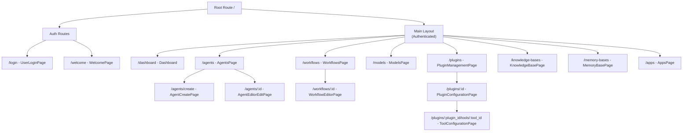
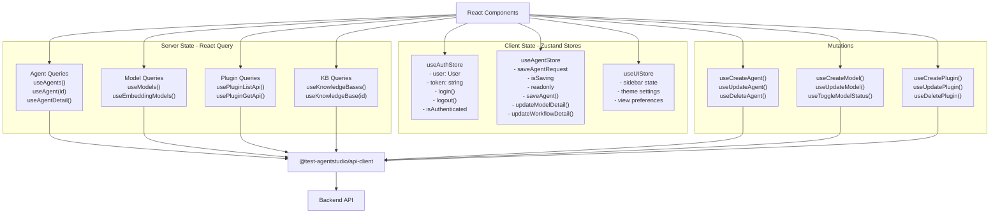
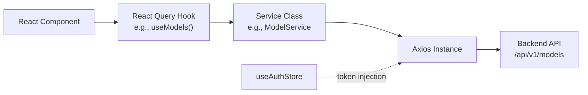
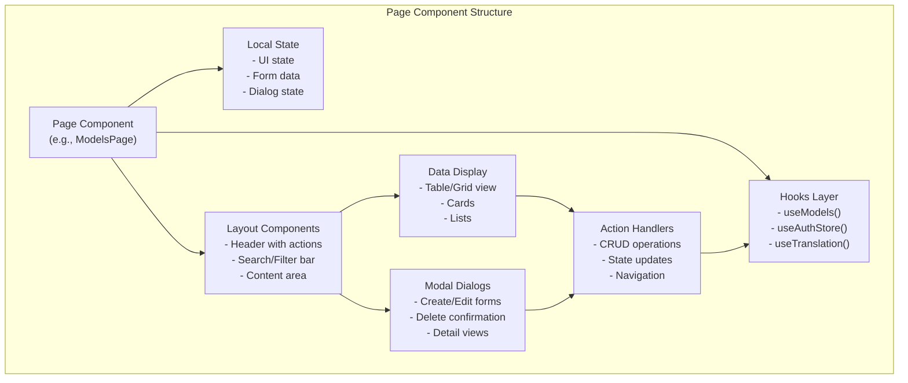
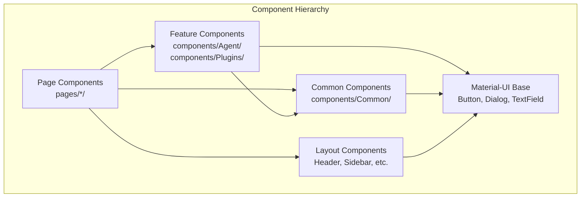
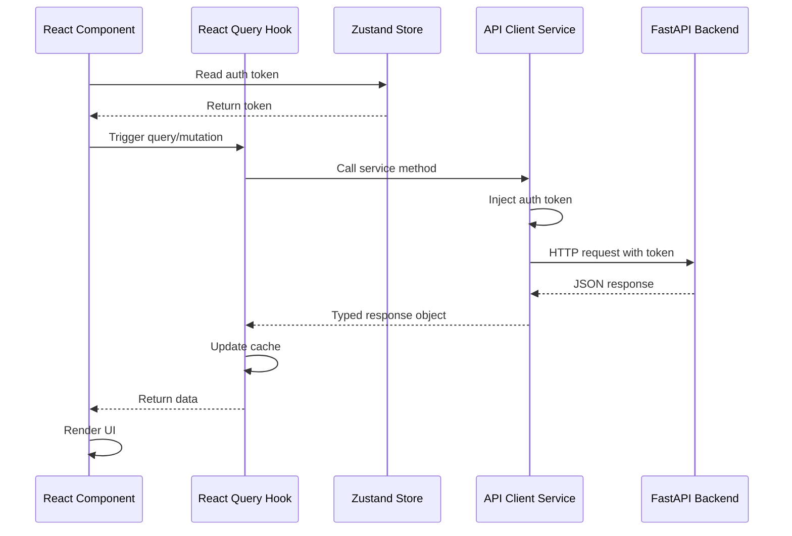

<!-- source: DeepWiki mcp.deepwiki.com · repo openJiuwen-ai/agent-studio · page 5.2 Frontend Architecture · fetched 2026-11-02 -->

# Frontend Architecture

<details>
<summary>Relevant source files</summary>

The following files were used as context for generating this wiki page:

- [backend/openjiuwen_studio/core/manager/model_manager/managers/embedding_model_test_manager.py](backend/openjiuwen_studio/core/manager/model_manager/managers/embedding_model_test_manager.py)
- [backend/openjiuwen_studio/routers/embedding_models.py](backend/openjiuwen_studio/routers/embedding_models.py)
- [frontend/src/components/Agent/AgentModelSelector.tsx](frontend/src/components/Agent/AgentModelSelector.tsx)
- [frontend/src/components/Agent/OverridePromptTemplateDialog.tsx](frontend/src/components/Agent/OverridePromptTemplateDialog.tsx)
- [frontend/src/components/Plugins/CloudPluginFormDialog.tsx](frontend/src/components/Plugins/CloudPluginFormDialog.tsx)
- [frontend/src/components/Plugins/CodeEditor.tsx](frontend/src/components/Plugins/CodeEditor.tsx)
- [frontend/src/components/Plugins/CodePluginToolFormDialog.tsx](frontend/src/components/Plugins/CodePluginToolFormDialog.tsx)
- [frontend/src/components/Plugins/IDEPluginFormDialog.tsx](frontend/src/components/Plugins/IDEPluginFormDialog.tsx)
- [frontend/src/components/Plugins/MarketPluginCard.tsx](frontend/src/components/Plugins/MarketPluginCard.tsx)
- [frontend/src/components/Plugins/MarketPluginList.tsx](frontend/src/components/Plugins/MarketPluginList.tsx)
- [frontend/src/components/Plugins/PluginVersionHistory.tsx](frontend/src/components/Plugins/PluginVersionHistory.tsx)
- [frontend/src/components/Plugins/PublishDialog.tsx](frontend/src/components/Plugins/PublishDialog.tsx)
- [frontend/src/components/Plugins/ToolFormDialog.tsx](frontend/src/components/Plugins/ToolFormDialog.tsx)
- [frontend/src/locales/agent/en-US/common.json](frontend/src/locales/agent/en-US/common.json)
- [frontend/src/locales/agent/en-US/editor.json](frontend/src/locales/agent/en-US/editor.json)
- [frontend/src/locales/agent/zh-CN/common.json](frontend/src/locales/agent/zh-CN/common.json)
- [frontend/src/locales/agent/zh-CN/editor.json](frontend/src/locales/agent/zh-CN/editor.json)
- [frontend/src/locales/en-US.json](frontend/src/locales/en-US.json)
- [frontend/src/locales/zh-CN.json](frontend/src/locales/zh-CN.json)
- [frontend/src/pages/Agents/AgentCreatePage.tsx](frontend/src/pages/Agents/AgentCreatePage.tsx)
- [frontend/src/pages/Agents/AgentEditorEditPage.tsx](frontend/src/pages/Agents/AgentEditorEditPage.tsx)
- [frontend/src/pages/Agents/AgentsPage.tsx](frontend/src/pages/Agents/AgentsPage.tsx)
- [frontend/src/pages/Auth/PrivacyPolicyPage.tsx](frontend/src/pages/Auth/PrivacyPolicyPage.tsx)
- [frontend/src/pages/Auth/UserLoginPage.tsx](frontend/src/pages/Auth/UserLoginPage.tsx)
- [frontend/src/pages/KnowledgeBase/components/AddDocumentDialog.tsx](frontend/src/pages/KnowledgeBase/components/AddDocumentDialog.tsx)
- [frontend/src/pages/KnowledgeBase/components/KnowledgeBaseFormDialog.tsx](frontend/src/pages/KnowledgeBase/components/KnowledgeBaseFormDialog.tsx)
- [frontend/src/pages/Models/ModelsPage.tsx](frontend/src/pages/Models/ModelsPage.tsx)
- [frontend/src/pages/Models/ModelsPageNew.tsx](frontend/src/pages/Models/ModelsPageNew.tsx)
- [frontend/src/pages/Models/components/EmbeddingModelsTable.tsx](frontend/src/pages/Models/components/EmbeddingModelsTable.tsx)
- [frontend/src/pages/Models/components/LLMModelsTable.tsx](frontend/src/pages/Models/components/LLMModelsTable.tsx)
- [frontend/src/pages/Plugins/PluginConfigurationPage.tsx](frontend/src/pages/Plugins/PluginConfigurationPage.tsx)
- [frontend/src/pages/Plugins/PluginManagementPage.tsx](frontend/src/pages/Plugins/PluginManagementPage.tsx)
- [frontend/src/pages/Plugins/PluginVersionPage.tsx](frontend/src/pages/Plugins/PluginVersionPage.tsx)
- [frontend/src/pages/Plugins/ToolConfigurationPage.tsx](frontend/src/pages/Plugins/ToolConfigurationPage.tsx)
- [frontend/src/pages/Plugins/components/CodePluginConfiguration.tsx](frontend/src/pages/Plugins/components/CodePluginConfiguration.tsx)
- [frontend/src/pages/Plugins/components/URLPluginConfiguration.tsx](frontend/src/pages/Plugins/components/URLPluginConfiguration.tsx)

</details>


This document describes the frontend architecture of OpenJiuwen Agent Studio, covering the React-based web application structure, state management patterns, API communication layer, and component organization. For backend architecture details, see [Backend Architecture](#5.3). For information about the workflow canvas visual editor specifically, see [Workflow Canvas Architecture](#5.7).

## Technology Stack

The frontend is built using modern web technologies optimized for developer experience and production performance:

| Technology | Version | Purpose |
|------------|---------|---------|
| React | 18.x | UI framework with hooks-based component model |
| TypeScript | Latest | Type-safe JavaScript with enhanced IDE support |
| Vite | Latest | Fast build tool and dev server with HMR |
| Material-UI (MUI) | v5 | Component library for consistent UI design |
| React Router | v6 | Client-side routing and navigation |
| React Query | v3 | Server state management and caching |
| Zustand | Latest | Lightweight client state management |
| i18next | Latest | Internationalization framework |
| Axios | Latest | HTTP client for API requests |

**Sources:** [frontend/src/pages/Models/ModelsPage.tsx:1-44](), [frontend/src/pages/Agents/AgentsPage.tsx:1-13](), [frontend/src/pages/Plugins/PluginManagementPage.tsx:1-5]()

## Project Structure

The frontend codebase follows a feature-based organization pattern with clear separation of concerns:

```
frontend/src/
├── pages/                    # Page-level components (route targets)
│   ├── Agents/              # Agent management pages
│   ├── Models/              # Model configuration pages
│   ├── Plugins/             # Plugin management pages
│   ├── KnowledgeBase/       # Knowledge base pages
│   ├── Workflows/           # Workflow orchestration pages
│   └── Auth/                # Authentication pages
├── components/              # Reusable UI components
│   ├── Agent/              # Agent-specific components
│   ├── Plugins/            # Plugin-specific components
│   ├── Common/             # Shared UI components
│   └── Layout/             # Layout components
├── stores/                  # Zustand state stores
│   ├── useAuthStore.ts     # Authentication state
│   └── useAgentStore.ts    # Agent editor state
├── hooks/                   # Custom React hooks
├── utils/                   # Utility functions
├── locales/                # i18n translation files
│   ├── zh-CN.json          # Chinese translations
│   └── en-US.json          # English translations
├── config/                  # Configuration files
├── types/                   # TypeScript type definitions
└── Common/                  # Common utilities and components
```

**Sources:** [frontend/src/pages/Models/ModelsPage.tsx:1-5](), [frontend/src/pages/Agents/AgentEditorEditPage.tsx:1-19](), [frontend/src/components/Agent/AgentModelSelector.tsx:1-28]()

## Application Entry Point and Routing

### Routing Structure

The application uses React Router v6 for declarative routing with nested route configurations:



**Key Routes:**
- Authentication routes handle login, registration, and password recovery
- Main application routes are protected by authentication guards
- Nested routes follow RESTful patterns (e.g., `/agents/:id` for editing)
- Dynamic segments (`:id`, `:plugin_id`) enable parameterized navigation

**Sources:** [frontend/src/pages/Auth/UserLoginPage.tsx:1-20](), [frontend/src/pages/Agents/AgentsPage.tsx:1-13](), [frontend/src/pages/Agents/AgentEditorEditPage.tsx:1-11]()

## State Management Architecture

The frontend employs a hybrid state management strategy combining Zustand for client state and React Query for server state:



### Zustand Stores

**`useAuthStore`** - Authentication and user session management:
- Stores user information, JWT token, and space ID
- Provides `login()`, `logout()`, and session validation
- Persists authentication state to localStorage
- Used across all authenticated pages for access control

**`useAgentStore`** - Agent editor state management:
- Manages draft agent configuration during editing
- Handles auto-save functionality with debouncing
- Tracks dirty state and unsaved changes
- Coordinates between system prompt, orchestration, and debug tabs
- Provides `saveAgent()`, `updateModelDetail()`, `updateWorkflowDetail()`, etc.

**Sources:** [frontend/src/stores/useAuthStore.ts]() (inferred), [frontend/src/pages/Agents/AgentEditorEditPage.tsx:12-19](), [frontend/src/components/Agent/AgentModelSelector.tsx:16-28]()

### React Query for Server State

React Query manages all server data with automatic caching, background refetching, and optimistic updates:

**Query Hooks Pattern:**
- `useAgents()` - Paginated list with filters and sorting
- `useAgent(id)` - Single agent details with automatic caching
- `useModels()` - Model list with active status filtering
- `usePluginListApi()` - Plugin tools with pagination

**Mutation Hooks Pattern:**
- Automatic cache invalidation on success
- Optimistic updates for instant UI feedback
- Error handling with rollback
- Loading states managed automatically

**Sources:** [frontend/src/pages/Models/ModelsPage.tsx:32-42](), [frontend/src/pages/Agents/AgentsPage.tsx:5-12](), [frontend/src/pages/Plugins/ToolConfigurationPage.tsx:38-48]()

## API Communication Layer

### API Client Package

The frontend uses a centralized API client package `@test-agentstudio/api-client` that provides:

1. **Type-safe API methods** - All request/response types defined in TypeScript
2. **React Query hooks** - Pre-configured hooks for each API endpoint
3. **Automatic token injection** - Authentication handled transparently
4. **Error handling** - Standardized error responses



**API Service Classes:**
- `AgentService` - Agent CRUD operations
- `ModelService` - Model configuration
- `PluginService` - Plugin management
- `KnowledgeBaseService` - Knowledge base operations
- `WorkflowService` - Workflow orchestration
- `MemoryBaseService` - Memory base management
- `ExecutionService` - Agent execution and testing
- `AuthService` - Authentication and user management

**Sources:** [frontend/src/pages/Models/ModelsPage.tsx:32-42](), [frontend/src/pages/Agents/AgentsPage.tsx:5](), [frontend/src/components/Agent/AgentModelSelector.tsx:7]()

### SSE (Server-Sent Events) Communication

For real-time streaming responses, the frontend implements SSE communication for:

1. **Agent Debugging** - Stream agent execution steps and LLM responses
2. **Prompt Optimization** - Real-time optimization progress
3. **DeepSearch Execution** - Progressive research report generation

**SSE Implementation Pattern:**
```
Component initiates SSE connection
  → EventSource established with authentication
  → Receive data events with incremental updates
  → Parse and render streaming content
  → Handle completion/error events
  → Close connection and cleanup
```

**Sources:** [frontend/src/locales/zh-CN.json:152-157](), [frontend/src/locales/en-US.json:152-156]()

## Page-Level Architecture

The application follows a consistent page structure pattern across different feature areas:



### Example: Models Page Structure

**Component Hierarchy:**
```
ModelsPage
├── Header (title, create button, tab switcher)
├── SearchFilterBar
│   ├── SearchField
│   ├── ProviderFilter (Select)
│   └── StatusFilter (Select)
├── ModelsTable (LLM or Embedding based on tab)
│   ├── TableHead (sortable columns)
│   └── TableBody
│       └── ModelRow (per model)
│           ├── ModelInfo (name, provider, status)
│           ├── ModelMetrics (for LLM: usage stats)
│           └── ActionButtons (edit, delete, test, toggle)
├── Pagination
├── ModelDialog (create/edit)
│   ├── BasicInfoTab
│   │   ├── NameField
│   │   ├── ProviderSelect
│   │   ├── ModelIdField
│   │   ├── APIKeyField
│   │   └── BaseUrlField
│   └── AdvancedTab (for LLM only)
│       ├── TemperatureSlider
│       ├── MaxTokensField
│       ├── TimeoutField
│       └── StreamingToggle
├── TestDialog (model testing)
│   ├── PromptInput
│   ├── TestButton
│   └── ResultDisplay
└── DeleteConfirmationDialog
```

**Data Flow:**
1. Page loads → `useModels()` fetches data → React Query caches
2. User clicks "Create" → `setShowModelDialog(true)` → Dialog opens
3. User submits form → `createModelMutation.mutateAsync()` → API call
4. On success → React Query invalidates cache → Table auto-refetches
5. Snackbar shows success message

**Sources:** [frontend/src/pages/Models/ModelsPage.tsx:114-244](), [frontend/src/pages/Models/ModelsPageNew.tsx:1-48]()

## Component Architecture

### Component Categories



### Key Component Patterns

**1. Agent Model Selector** (`AgentModelSelector.tsx`)
- Complex orchestration configuration component
- Manages model selection, workflows, plugins, knowledge bases, memory
- Uses accordion layout for collapsible sections
- Coordinates multiple child components with shared state
- Implements validation for model availability and configuration

**Component Structure:**
```
AgentModelSelector
├── ModelConfigSection (Accordion)
│   ├── ModelSelect (dropdown)
│   └── ModelDetailForm (temperature, tokens, timeout)
├── WorkflowSection (Accordion)
│   ├── AddWorkflowButton
│   ├── WorkflowList
│   │   └── WorkflowItem (version selector, validation status)
│   └── WorkflowSelector (modal)
├── PluginSection (Accordion)
│   ├── AddPluginButton
│   ├── PluginList
│   │   └── PluginItem (name, description, actions)
│   └── PluginSelector (modal)
├── KnowledgeSection (Accordion)
│   ├── AddKnowledgeBaseButton
│   ├── KnowledgeBaseList
│   │   └── KnowledgeBaseItem (settings dialog)
│   └── KnowledgeBaseSelector (modal)
└── MemorySection (Accordion)
    ├── MemoryBaseSelector
    ├── VariableConfiguration
    │   └── VariableList (add/remove variables)
    └── LongTermMemoryToggle
```

**Sources:** [frontend/src/components/Agent/AgentModelSelector.tsx:1-28](), [frontend/src/components/Agent/AgentModelSelector.tsx:108-157]()

**2. Tool Configuration Page** (`ToolConfigurationPage.tsx`)
- Manages plugin tool configuration with parameters
- Supports both URL-based and code-based tools
- Parameter type selector with validation
- Code editor integration for code tools
- Test execution with parameter input

**Key Features:**
- Dual tab interface (basic info + parameters)
- Input/output parameter management with dialogs
- Path validation for URL tools
- Language selection for code tools (Python/JavaScript)
- Test dialog with parameter value input
- Result display with type-aware formatting

**Sources:** [frontend/src/pages/Plugins/ToolConfigurationPage.tsx:1-66](), [frontend/src/pages/Plugins/ToolConfigurationPage.tsx:144-244]()

**3. Delete Confirmation Dialog** (`DeleteConfirmationDialog`)
- Reusable confirmation dialog with entity-specific messages
- Supports different entity types (agent, workflow, model, plugin, KB)
- Translatable confirmation messages
- Loading state during deletion
- Customizable delete button text

**Sources:** Referenced in [frontend/src/locales/zh-CN.json:188-217](), [frontend/src/pages/Models/ModelsPage.tsx:43]()

### Form Material Components

The application uses specialized form components for complex inputs:

**Code Editors:**
- `PythonCodeEditor` - Python syntax highlighting and validation
- `TypeScriptCodeEditor` - TypeScript/JavaScript editing
- Monaco-based with intellisense support
- Integrated in tool configuration and workflow nodes

**Parameter Type Selector:**
- `ParameterTypeSelector` - Dropdown for parameter types
- Supports: string, int, float, boolean, object, array types
- Used in plugin parameter configuration
- Type validation on form submission

**Sources:** [frontend/src/pages/Plugins/ToolConfigurationPage.tsx:34-36](), [frontend/src/pages/Plugins/components/URLPluginConfiguration.tsx:33]()

## Internationalization (i18n)

The application provides full internationalization support using `i18next`:

### Translation Structure

```
locales/
├── zh-CN.json              # Chinese (Simplified) - primary language
├── en-US.json              # English - secondary language
└── agent/                  # Feature-specific translations
    ├── zh-CN/
    │   ├── common.json     # Shared agent translations
    │   └── editor.json     # Agent editor translations
    └── en-US/
        ├── common.json
        └── editor.json
```

### Translation Key Organization

Translation keys follow a hierarchical namespace pattern:

```
{
  "common": {
    "buttons": { "save": "保存", "cancel": "取消" },
    "messages": { "saveSuccess": "保存成功" },
    "status": { "active": "活跃", "inactive": "非活跃" }
  },
  "agents": {
    "agentList": { "noAgents": "暂无智能体" },
    "agentEditor": {
      "systemPrompt": { "title": "系统提示词配置" },
      "orchestration": { "title": "编排配置" }
    }
  },
  "models": {
    "modelConfig": { "parameters": { "temperature": "温度" } }
  }
}
```

**Usage Pattern:**
```typescript
const { t } = useTranslation()
// Simple key
t('common.buttons.save')  // → "保存" or "Save"

// With interpolation
t('common.messages.agentDeleteSuccess', { name: 'Agent1' })
// → "智能体删除成功" or "Agent deleted successfully"

// Scoped translation
const { t } = useScopedTranslation('agents.agentEditor')
t('systemPrompt.title')  // → "系统提示词配置"
```

**Language Switching:**
- Language dropdown in header (`LanguageDropdown` component)
- Stores preference in localStorage
- Instant UI update on language change
- Fallback to English for missing translations

**Sources:** [frontend/src/locales/zh-CN.json:1-20](), [frontend/src/locales/en-US.json:1-20](), [frontend/src/locales/agent/zh-CN/editor.json:1-10](), [frontend/src/locales/agent/en-US/editor.json:1-10]()

## Frontend-Backend Integration Patterns

### Request/Response Flow



### Authentication Flow

**Login Process:**
1. User submits credentials in `UserLoginPage`
2. `useLoginWithPwd()` mutation sends POST to `/auth/login`
3. Backend validates and returns JWT token + user info
4. `login()` function in `useAuthStore` stores token and user
5. Token persisted to localStorage
6. Router redirects to dashboard
7. All subsequent API calls include token in headers

**Token Injection:**
```typescript
// API client automatically adds token to requests
axios.interceptors.request.use(config => {
  const token = useAuthStore.getState().token
  if (token) {
    config.headers.Authorization = `Bearer ${token}`
  }
  return config
})
```

**Session Validation:**
- Token expiration checked on each API call
- 401 responses trigger automatic logout
- User redirected to login page
- Session expiry message displayed

**Sources:** [frontend/src/pages/Auth/UserLoginPage.tsx:1-20](), [frontend/src/pages/Auth/UserLoginPage.tsx:129-176]()

### Error Handling

**Unified Error Handling:**
```typescript
// UnifiedSnackbar hook pattern
const { showSuccess, showError, showWarning } = useUnifiedSnackbar()

try {
  await createModelMutation.mutateAsync({ model, spaceId })
  showSuccess(t('models.messages.addSuccess'))
} catch (error: any) {
  // Parse backend error details
  const detailData = error?.response?.data?.detail
  let errorMessage = t('models.messages.addFailed')
  
  if (Array.isArray(detailData)) {
    // Field validation errors
    const fieldErrors = detailData.map(err => 
      `${fieldMap[err.loc[1]]}: ${err.msg}`
    ).join('; ')
    errorMessage = fieldErrors
  }
  
  showError(errorMessage)
}
```

**Error Types:**
- Validation errors - Display field-specific messages
- Authentication errors - Redirect to login
- Network errors - Show retry option
- Server errors - Display user-friendly message

**Sources:** [frontend/src/pages/Models/ModelsPage.tsx:374-517](), [frontend/src/Common/UnifiedSnackbar.tsx]() (inferred)

## Key Frontend Development Patterns

### Custom Hooks

**1. Form Management Hooks:**
- `useCloudPluginForm()` - Cloud plugin form state
- `useUnifiedSnackbar()` - Snackbar notification management
- `useWorkflowValidation()` - Workflow validation with cache

**2. Data Fetching Hooks:**
- All API operations wrapped in React Query hooks
- Automatic caching and background refetching
- Optimistic updates for instant feedback

**Sources:** [frontend/src/pages/Plugins/PluginConfigurationPage.tsx:8](), [frontend/src/components/Agent/AgentModelSelector.tsx:153-156]()

### Validation Patterns

**Client-Side Validation:**
```typescript
// Real-time URL validation
const handleUrlChange = (url: string) => {
  setConfigForm(prev => ({ ...prev, url }))
  const error = validateHttpUrlRealtime(url)
  setUrlError(error)
}

// Form submission validation
const isFormValid = () => {
  const nameValid = newModel.name?.trim() && 
                    newModel.name.length <= 100
  const apiKeyValid = editMode ? true : 
                      newModel.apiKey?.trim()
  const baseUrlValid = newModel.baseUrl?.trim() && 
                       !baseUrlError
  return nameValid && apiKeyValid && baseUrlValid
}
```

**Validation Utilities:**
- `validateToolPath()` - Tool URL path validation
- `validateHttpUrlRealtime()` - HTTP URL format validation
- `getPathHelpText()` - Contextual validation messages

**Sources:** [frontend/src/pages/Plugins/components/URLPluginConfiguration.tsx:211-217](), [frontend/src/pages/Models/ModelsPage.tsx:224-244](), [frontend/src/pages/Plugins/ToolConfigurationPage.tsx:8]()

### Pagination and Filtering

**Frontend Pagination Pattern:**
```typescript
// Combined server + client pagination
const { data, isLoading } = useModels({
  spaceId: user?.spaceId,
  page: 1,
  size: 100,  // Fetch large batch for client-side filtering
  sort_by: 'update_time',
  sort_order: 'desc'
})

// Client-side filtering
const filteredModels = models.filter(model => {
  const matchesSearch = model.name.toLowerCase()
                             .includes(searchTerm.toLowerCase())
  const matchesProvider = filterProvider === 'all' || 
                          model.provider === filterProvider
  const matchesStatus = filterStatus === 'all' || 
                        (filterStatus === 'active' && model.isActive)
  return matchesSearch && matchesProvider && matchesStatus
})

// Client-side pagination
const paginatedModels = filteredModels.slice(
  (currentPage - 1) * pageSize,
  currentPage * pageSize
)
```

**Sources:** [frontend/src/pages/Models/ModelsPage.tsx:119-373]()

### Debouncing and Performance

**Search Debouncing:**
```typescript
// Debounce search input to avoid excessive API calls
const [searchTerm, setSearchTerm] = useState('')
const [debouncedSearchTerm, setDebouncedSearchTerm] = useState('')

useEffect(() => {
  const timer = setTimeout(() => {
    setDebouncedSearchTerm(searchTerm)
  }, 300)
  return () => clearTimeout(timer)
}, [searchTerm])

// Use debouncedSearchTerm for API calls
const { data } = useSearchAgents({
  keyword: debouncedSearchTerm,
  // ...
})
```

**Sources:** [frontend/src/pages/Agents/AgentsPage.tsx:42-50]()

### Code Editor Integration

The frontend integrates Monaco-based code editors for Python and JavaScript/TypeScript code editing:

**Editor Components:**
- `PythonCodeEditor` - Python syntax highlighting
- `TypeScriptCodeEditor` - JS/TS syntax highlighting
- Shared base editor styles imported from `base-editor/styles.css`

**Usage Pattern:**
```tsx
<PythonCodeEditor
  value={codeContent}
  onChange={(value) => setCodeContent(value)}
  height="400px"
  language="python"
/>
```

**Features:**
- Syntax highlighting
- Auto-completion
- Error detection
- Line numbers
- Code folding

**Sources:** [frontend/src/pages/Plugins/ToolConfigurationPage.tsx:34-36](), [frontend/src/components/Plugins/CodePluginToolFormDialog.tsx:22]()

## Dialog and Modal Management

### Dialog State Pattern

The application uses a consistent pattern for managing dialogs:

```typescript
// Dialog state
const [showDialog, setShowDialog] = useState(false)
const [editMode, setEditMode] = useState(false)
const [editingItem, setEditingItem] = useState<Item | null>(null)

// Open for create
const handleCreate = () => {
  setEditMode(false)
  setEditingItem(null)
  setShowDialog(true)
}

// Open for edit
const handleEdit = (item: Item) => {
  setEditMode(true)
  setEditingItem(item)
  setShowDialog(true)
}

// Close and reset
const handleClose = () => {
  setShowDialog(false)
  setEditMode(false)
  setEditingItem(null)
}
```

**Common Dialog Types:**
1. **Form Dialogs** - Create/edit entities (models, agents, plugins)
2. **Confirmation Dialogs** - Delete confirmations
3. **Selection Dialogs** - Workflow/plugin/KB selection
4. **Test Dialogs** - Model/plugin testing
5. **Version History Dialogs** - View and restore versions

**Sources:** [frontend/src/pages/Models/ModelsPage.tsx:172-277](), [frontend/src/pages/Plugins/ToolConfigurationPage.tsx:156-220]()

---

This frontend architecture provides a scalable, maintainable, and type-safe foundation for the OpenJiuwen Agent Studio web application. The combination of React Query for server state, Zustand for client state, and Material-UI for UI components creates a robust development experience with excellent performance characteristics.

---

