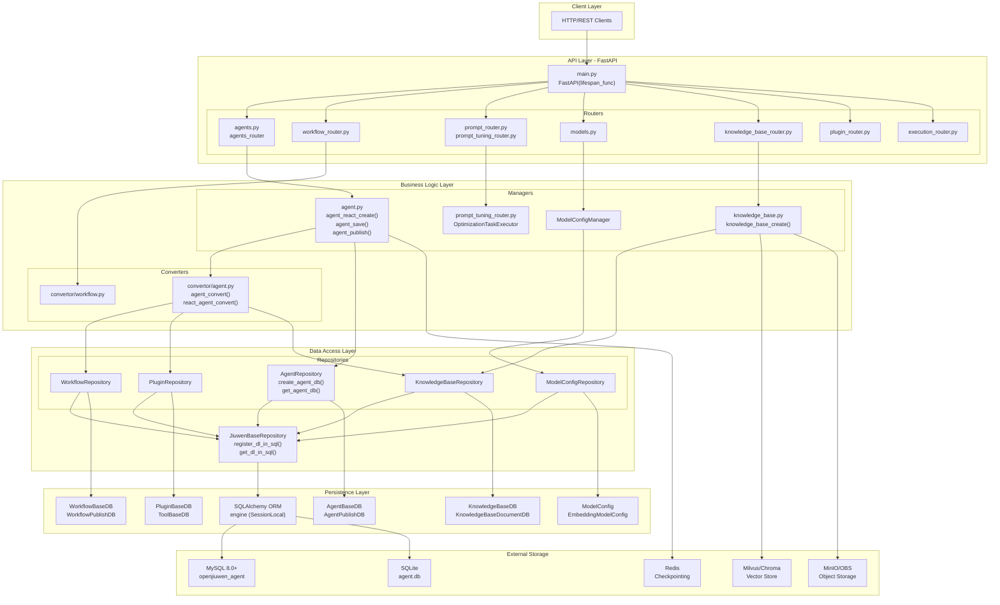
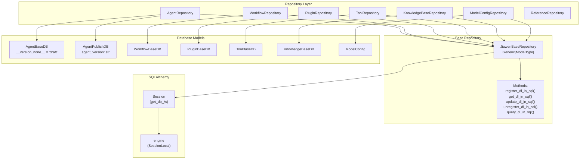
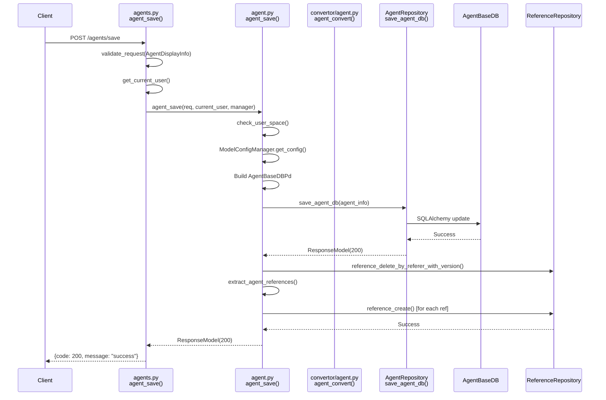
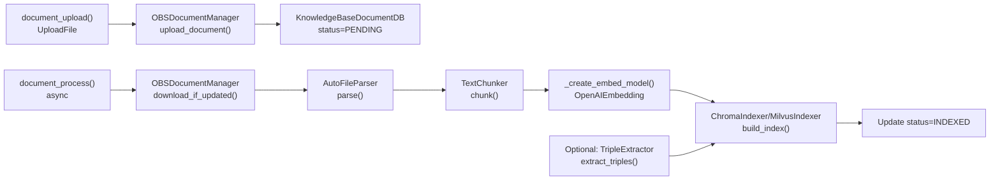

<!-- source: DeepWiki mcp.deepwiki.com · repo openJiuwen-ai/agent-studio · page 5.3 Backend Architecture · fetched 2026-11-02 -->

# Backend Architecture

<details>
<summary>Relevant source files</summary>

The following files were used as context for generating this wiki page:

- [.env.example](.env.example)
- [backend/openjiuwen_studio/core/common/logging/__init__.py](backend/openjiuwen_studio/core/common/logging/__init__.py)
- [backend/openjiuwen_studio/core/common/logging/events.py](backend/openjiuwen_studio/core/common/logging/events.py)
- [backend/openjiuwen_studio/core/config.py](backend/openjiuwen_studio/core/config.py)
- [backend/openjiuwen_studio/core/manager/agent.py](backend/openjiuwen_studio/core/manager/agent.py)
- [backend/openjiuwen_studio/core/manager/convertor/agent.py](backend/openjiuwen_studio/core/manager/convertor/agent.py)
- [backend/openjiuwen_studio/core/manager/convertor/components/sub_workflow.py](backend/openjiuwen_studio/core/manager/convertor/components/sub_workflow.py)
- [backend/openjiuwen_studio/core/manager/email_manager/__init__.py](backend/openjiuwen_studio/core/manager/email_manager/__init__.py)
- [backend/openjiuwen_studio/core/manager/email_manager/email_template.py](backend/openjiuwen_studio/core/manager/email_manager/email_template.py)
- [backend/openjiuwen_studio/core/manager/email_manager/email_utils.py](backend/openjiuwen_studio/core/manager/email_manager/email_utils.py)
- [backend/openjiuwen_studio/core/manager/knowledge_base.py](backend/openjiuwen_studio/core/manager/knowledge_base.py)
- [backend/openjiuwen_studio/core/manager/model_manager/managers/model_test_manager.py](backend/openjiuwen_studio/core/manager/model_manager/managers/model_test_manager.py)
- [backend/openjiuwen_studio/core/manager/redis_manager/__init__.py](backend/openjiuwen_studio/core/manager/redis_manager/__init__.py)
- [backend/openjiuwen_studio/core/manager/repositories/agent_repository.py](backend/openjiuwen_studio/core/manager/repositories/agent_repository.py)
- [backend/openjiuwen_studio/core/manager/repositories/plugin_repository.py](backend/openjiuwen_studio/core/manager/repositories/plugin_repository.py)
- [backend/openjiuwen_studio/core/manager/repositories/tool_repository.py](backend/openjiuwen_studio/core/manager/repositories/tool_repository.py)
- [backend/openjiuwen_studio/core/manager/utils/utils.py](backend/openjiuwen_studio/core/manager/utils/utils.py)
- [backend/openjiuwen_studio/main.py](backend/openjiuwen_studio/main.py)
- [backend/openjiuwen_studio/ops/modules/llm/llm_config_service.py](backend/openjiuwen_studio/ops/modules/llm/llm_config_service.py)
- [backend/openjiuwen_studio/ops/modules/llm/schema.py](backend/openjiuwen_studio/ops/modules/llm/schema.py)
- [backend/openjiuwen_studio/ops/modules/prompt/domain/debug_entity.py](backend/openjiuwen_studio/ops/modules/prompt/domain/debug_entity.py)
- [backend/openjiuwen_studio/ops/modules/prompt/domain/entities.py](backend/openjiuwen_studio/ops/modules/prompt/domain/entities.py)
- [backend/openjiuwen_studio/ops/modules/prompt/domain/services.py](backend/openjiuwen_studio/ops/modules/prompt/domain/services.py)
- [backend/openjiuwen_studio/ops/modules/prompt/infra/repositories/debug_repo.py](backend/openjiuwen_studio/ops/modules/prompt/infra/repositories/debug_repo.py)
- [backend/openjiuwen_studio/routers/agents.py](backend/openjiuwen_studio/routers/agents.py)
- [backend/openjiuwen_studio/routers/prompt_debug_router.py](backend/openjiuwen_studio/routers/prompt_debug_router.py)
- [backend/openjiuwen_studio/routers/prompt_llm_router.py](backend/openjiuwen_studio/routers/prompt_llm_router.py)
- [backend/openjiuwen_studio/routers/prompt_router.py](backend/openjiuwen_studio/routers/prompt_router.py)
- [backend/openjiuwen_studio/routers/prompt_tuning_router.py](backend/openjiuwen_studio/routers/prompt_tuning_router.py)
- [backend/openjiuwen_studio/schemas/agent.py](backend/openjiuwen_studio/schemas/agent.py)
- [backend/openjiuwen_studio/schemas/model_config.py](backend/openjiuwen_studio/schemas/model_config.py)
- [frontend/packages/api-client/src/config.ts](frontend/packages/api-client/src/config.ts)
- [frontend/packages/api-client/src/services/agentService.ts](frontend/packages/api-client/src/services/agentService.ts)
- [frontend/src/components/Agent/ModelDetailForm.tsx](frontend/src/components/Agent/ModelDetailForm.tsx)

</details>


This document describes the backend architecture of OpenJiuwen Agent Studio, including its layered design, core components, service structure, and data flow patterns. The backend is built with FastAPI and follows a clean architecture pattern with clear separation between API routes, business logic, data access, and external integrations.

For frontend architecture details, see [Frontend Architecture](#5.2). For the agent execution pipeline, see [Agent Execution Pipeline](#5.5). For database schema details, see [Data Layer](#5.4).

---

## Architectural Overview

The backend follows a **layered service architecture** with FastAPI as the web framework. The system is organized into distinct layers that separate concerns and enable maintainability.



**Sources**: [backend/openjiuwen_studio/main.py:1-278](), [backend/openjiuwen_studio/routers/agents.py:1-154](), [backend/openjiuwen_studio/core/manager/agent.py:1-301](), [backend/openjiuwen_studio/core/manager/repositories/agent_repository.py:1-74]()

---

## Layer Architecture

### 1. API Layer (Routers)

The API layer consists of FastAPI routers that handle HTTP requests and responses. Each router corresponds to a major feature domain.

**Key Router Files**:
- `routers/agents.py` - Agent CRUD operations
- `routers/workflow_router.py` - Workflow management
- `routers/prompt_router.py` - Prompt template management
- `routers/prompt_tuning_router.py` - Prompt optimization
- `routers/models.py` - LLM model configuration
- `routers/knowledge_base_router.py` - Knowledge base operations
- `routers/plugin_router.py` - Plugin and tool management
- `routers/execution_router.py` - Workflow and agent execution

**Router Pattern**:

Routers follow a consistent pattern:
1. Receive request (validated with Pydantic models)
2. Extract user context via `get_current_user()`
3. Call manager functions
4. Return `ResponseModel` with status code and data

Example from [backend/openjiuwen_studio/routers/agents.py:157-182]():

```python
@agents_router.post("/create", response_model=ResponseModel[dict])
async def agent_create(
        request: dict,
        current_user: dict = Depends(get_current_user)
):
    try:
        req = validate_request(request, AgentCreate)
        res = mgr.agent_react_create(req, current_user)
        if res.code == status.HTTP_200_OK:
            logger.info(f"[AGENT_CREATE] Agent created - ID: {res.data.get('id')}")
        return handle_response(res)
    except ValidationError as e:
        user_id = (current_user.get("data") or {}).get("user_id_str", "unknown")
        raise handle_validation_error(e, "AGENT_CREATE", current_user, user_id)
```

**Sources**: [backend/openjiuwen_studio/routers/agents.py:154-183](), [backend/openjiuwen_studio/routers/common.py]()

---

### 2. Business Logic Layer (Managers)

Managers contain the core business logic. They orchestrate operations across multiple repositories, perform validation, and implement workflows.

**Key Manager Modules**:

| Manager | File | Key Functions |
|---------|------|---------------|
| Agent Manager | `core/manager/agent.py` | `agent_react_create()`, `agent_save()`, `agent_publish()`, `agent_delete()` |
| Knowledge Base Manager | `core/manager/knowledge_base.py` | `knowledge_base_create()`, `document_upload()`, `document_process()` |
| Model Manager | `core/manager/model_manager/managers/` | `ModelConfigManager`, `ModelTester` |
| Converter | `core/manager/convertor/agent.py` | `agent_convert()`, `react_agent_convert()` |

**Manager Pattern Example**:

The `agent_save()` function from [backend/openjiuwen_studio/core/manager/agent.py:614-754]() demonstrates the manager pattern:

1. **Validate** user permissions via `check_user_space()`
2. **Process** model configuration with `ModelConfigManager`
3. **Save** to database via `agent_repository.save_agent_db()`
4. **Manage references** via `reference_repository`
5. **Return** standardized `ResponseModel`

The `@with_exception_handling` decorator from [backend/openjiuwen_studio/core/manager/agent.py:162-298]() provides unified error handling, logging, and performance monitoring.

**Sources**: [backend/openjiuwen_studio/core/manager/agent.py:162-754](), [backend/openjiuwen_studio/core/manager/knowledge_base.py:486-605]()

---

### 3. Data Access Layer (Repositories)

Repositories abstract database operations and provide a clean interface for data persistence. All repositories extend or use `JiuwenBaseRepository`.



**Repository Pattern**:

Each repository implements domain-specific operations while delegating common CRUD to `JiuwenBaseRepository`. Example from [backend/openjiuwen_studio/core/manager/repositories/agent_repository.py:93-139]():

```python
@with_exception_handling
def create_agent_db(self, agent_info: AgentBaseDBPd) -> ResponseModel:
    with get_db_jw() as db:
        agent_db = JiuwenBaseRepository(db, agent.AgentBaseDB)
        find_id = {"agent_id": agent_info.agent_id, "space_id": agent_info.space_id}
        return agent_db.register_dl_in_sql(find_id=find_id, dl=agent_info.model_dump())
```

**Generic Operations** from [backend/openjiuwen_studio/core/manager/repositories/jiuwen_base_repository.py]():
- `register_dl_in_sql()` - Create or update record
- `get_dl_in_sql()` - Retrieve records with filtering
- `update_dl_in_sql()` - Update existing record
- `unregister_dl_in_sql()` - Delete record
- `query_dl_in_sql()` - Complex queries with pagination

**Sources**: [backend/openjiuwen_studio/core/manager/repositories/agent_repository.py:1-74](), [backend/openjiuwen_studio/core/manager/repositories/jiuwen_base_repository.py](), [backend/openjiuwen_studio/core/manager/repositories/plugin_repository.py:1-121]()

---

## Core Services and Components

### Agent Service Architecture

The agent service demonstrates the full request flow through all layers:



**Sources**: [backend/openjiuwen_studio/routers/agents.py:267-350](), [backend/openjiuwen_studio/core/manager/agent.py:614-754]()

---

### Model Configuration Management

Model configuration is handled by `ModelConfigManager` from [backend/openjiuwen_studio/core/manager/model_manager/managers/]():

**Key Components**:
- **ModelConfigManager** - CRUD operations for model configs
- **ModelTester** - Tests model configurations with actual LLM calls
- **SecurityUtils** - Encrypts/decrypts API keys

**Model Configuration Flow**:

1. **Storage**: Model configs stored in `ModelConfig` table with encrypted API keys
2. **Retrieval**: Manager fetches config and decrypts API key via `SecurityUtils.decrypt_api_key()`
3. **Testing**: `ModelTester` creates `Model` instance with `ModelClientConfig` and `ModelRequestConfig`
4. **Usage**: Agent manager retrieves model details for agent execution

Example from [backend/openjiuwen_studio/core/manager/model_manager/managers/model_test_manager.py:40-177]():

```python
async def test_model_config(self, model_id: int, test_request: ModelTestRequest, user_id: int):
    model = self.model_repo.get_by_id(model_id)
    api_key = SecurityUtils().decrypt_api_key(model.api_key)
    
    model_client_config = ModelClientConfig(
        client_provider=compatible_provider(model.provider),
        api_key=api_key,
        api_base=model.base_url,
        timeout=model.timeout
    )
    
    model_config = ModelRequestConfig(
        model=model.model_type,
        temperature=temperature,
        top_p=top_p
    )
    
    model_inference = Model(
        model_client_config=model_client_config,
        model_config=model_config
    )
    
    ai_message = await model_inference.invoke(messages)
```

**Sources**: [backend/openjiuwen_studio/core/manager/model_manager/managers/model_test_manager.py:23-177](), [backend/openjiuwen_studio/schemas/model_config.py:1-35]()

---

### Prompt Optimization Service

The prompt tuning system is a sophisticated service for automated prompt optimization using LLM-based training.

**Key Classes**:

| Class | Location | Purpose |
|-------|----------|---------|
| `OptimizationTaskExecutor` | `routers/prompt_tuning_router.py` | Executes optimization tasks |
| `OptimizationCallbacks` | `routers/prompt_tuning_router.py` | Database update callbacks during training |
| `ModelConfigConverter` | `routers/prompt_tuning_router.py` | Converts model configs to SDK format |
| `LLMConfigService` | `ops/modules/llm/llm_config_service.py` | Retrieves LLM configurations |
| `JobService` | `ops/modules/prompt/application/service.py` | Manages optimization jobs |

**Optimization Flow** from [backend/openjiuwen_studio/routers/prompt_tuning_router.py:278-607]():

1. **Create Agent**: Build chat agent with initial prompt using `create_chat_agent()`
2. **Create Trainer**: Initialize `Trainer` with `JointOptimizer` and `DefaultEvaluator`
3. **Set Callbacks**: Attach `OptimizationCallbacks` for progress tracking
4. **Evaluate**: Run initial evaluation with `trainer.evaluate()`
5. **Train**: Execute `trainer.train()` with multiple epochs
6. **Update DB**: `OptimizationCallbacks` updates job status on each epoch via `JobService`

**Sources**: [backend/openjiuwen_studio/routers/prompt_tuning_router.py:141-607](), [backend/openjiuwen_studio/ops/modules/llm/llm_config_service.py:18-180]()

---

### Knowledge Base Document Processing

Knowledge base management includes document upload, parsing, chunking, embedding, and indexing.

**Processing Pipeline** from [backend/openjiuwen_studio/core/manager/knowledge_base.py]():



**Key Functions**:
- `knowledge_base_create()` - Creates KB with embedding model config
- `document_upload()` - Handles file upload to OBS/MinIO
- `document_process()` - Processes document through pipeline
- `_create_embed_model()` - Creates embedding model from DB config
- `_create_llm_client_from_db()` - Creates LLM for triple extraction

**Sources**: [backend/openjiuwen_studio/core/manager/knowledge_base.py:86-1887]()

---

## Database Architecture

### Multi-Database Support

The system supports both MySQL and SQLite via environment variable `DB_TYPE` from [.env.example:93-106]():

```python
# Database type (mysql/sqlite)
DB_TYPE=sqlite

# MySQL
DB_HOST=localhost
DB_PORT=3306
DB_USER=root
DB_PASSWORD=root
AGENT_DB_NAME=openjiuwen_agent

# SQLite
SQLITE_DB_PATH=data/databases
AGENT_SQLITE_DB=agent.db
```

**Database Selection** from [backend/openjiuwen_studio/core/database.py]():

```python
if settings.db_type.lower() == "mysql":
    DATABASE_URL = f"mysql+pymysql://{settings.db_user}:{settings.db_password}@{settings.db_host}:{settings.db_port}/{settings.agent_db_name}"
else:
    DATABASE_URL = f"sqlite:///{settings.sqlite_db_path}/{settings.agent_sqlite_db}"

engine = create_engine(DATABASE_URL)
SessionLocal = sessionmaker(bind=engine)
```

### Core Database Models

**Draft and Publish Pattern**:

Many entities use a dual-table pattern for versioning:

| Draft Table | Publish Table | Version Field |
|-------------|---------------|---------------|
| `AgentBaseDB` | `AgentPublishDB` | `agent_version` |
| `WorkflowBaseDB` | `WorkflowPublishDB` | `workflow_version` |
| `PluginBaseDB` | `PluginPublishDB` | `plugin_version` |

Draft records use `__version_none__ = "draft"` constant from [backend/openjiuwen_studio/models/agent.py]().

**Key Models**:
- `AgentBaseDB` / `AgentPublishDB` - Agent configurations
- `WorkflowBaseDB` / `WorkflowPublishDB` - Workflow definitions
- `PluginBaseDB` / `ToolBaseDB` - Plugin and tool configs
- `ModelConfig` / `EmbeddingModelConfig` - Model configurations
- `KnowledgeBaseDB` / `KnowledgeBaseDocumentDB` - Knowledge bases and documents
- `ReferenceDB` - Tracks dependencies between entities

**Sources**: [backend/openjiuwen_studio/models/agent.py](), [backend/openjiuwen_studio/models/workflow.py](), [backend/openjiuwen_studio/core/database.py]()

---

## API Structure and Standards

### Request/Response Pattern

All API endpoints follow a consistent pattern using `ResponseModel`:

```python
class ResponseModel(BaseModel):
    code: int = Field(default=200)
    message: str = Field(default="success")
    data: Optional[Any] = None
```

**Status Codes** are managed via `StatusCode` enum from [backend/openjiuwen_studio/core/common/status_code.py]():

```python
class StatusCode:
    AGENT_CREATE_SUCCESS = StatusCodeDetail(200, "Agent created successfully")
    AGENT_NOT_FOUND = StatusCodeDetail(404, "Agent not found")
    AGENT_VALIDATION_ERROR = StatusCodeDetail(400, "Validation error: {msg}")
```

### Validation and Error Handling

**Request Validation** uses Pydantic models from `schemas/` directory:

```python
class AgentCreate(BaseModel):
    space_id: str = Field(..., min_length=1, max_length=100)
    agent_name: str = Field(..., min_length=1, max_length=255, alias="name")
    description: str = Field(..., min_length=1, max_length=500, alias="desc")
    agent_type: str = Field(..., min_length=1, max_length=30, alias="type")
```

**Error Handling** via decorator from [backend/openjiuwen_studio/core/manager/agent.py:162-298]():

```python
@with_exception_handling
def agent_save(req: AgentDisplayInfo, current_user: dict, manager: ModelConfigManager):
    # Catches ValidationError, ValueError, KeyError, TimeoutError, etc.
    # Returns standardized ResponseModel with appropriate status code
```

**Sources**: [backend/openjiuwen_studio/schemas/agent.py:1-273](), [backend/openjiuwen_studio/schemas/common.py](), [backend/openjiuwen_studio/core/common/status_code.py]()

---

## Configuration Management

### Environment Configuration

Configuration is managed via Pydantic `Settings` class from [backend/openjiuwen_studio/core/config.py:7-97]():

```python
class Settings(BaseSettings):
    # Database
    db_type: str = "mysql"
    db_host: str = ""
    db_port: int = 3306
    
    # Security
    secret_key: str = "your-secret-key-change-in-production"
    access_token_expire_minutes: int = 5256000
    
    # Redis
    enable_redis_checkpoint: bool = False
    redis_host: str = "localhost"
    
    # MinIO
    minio_host: str = ""
    minio_bucket: str = ""
```

**Environment Variables** are loaded from `.env` file via `python-dotenv` in [backend/openjiuwen_studio/main.py:17-19]():

```python
from dotenv import load_dotenv
project_root = os.path.dirname(backend_dir)
load_dotenv(os.path.join(project_root, '.env'))
```

### Security Configuration

**API Key Encryption** via `SecurityUtils` from [backend/openjiuwen_studio/core/manager/model_manager/utils/security_utils.py]():

- **Development Mode** (`SERVICE_MODE=develop`): Uses `SERVER_AES_MASTER_KEY` environment variable
- **Production Mode** (`SERVICE_MODE=product`): Uses `SERVER_AES_MASTER_KEY_ENV` (base64 encoded)
- **KMS Support**: Optional Huawei Cloud KMS for key management

**Authentication** uses JWT tokens with configurable expiration from [.env.example:53-65]():

```
SECRET_KEY=your-secret-key-change-in-production
ALGORITHM=HS256
ACCESS_TOKEN_EXPIRE_MINUTES=2880
REFRESH_TOKEN_EXPIRE_DAYS=2
```

**Sources**: [backend/openjiuwen_studio/core/config.py:1-97](), [.env.example:1-196]()

---

## Application Startup and Lifecycle

### Main Application Initialization

Application startup is managed via `lifespan_func` context manager from [backend/openjiuwen_studio/main.py:54-146]():

```python
@asynccontextmanager
async def lifespan_func(app: FastAPI):
    # Startup
    logger.info("🚀 Starting Jiuwen Agent Studio Backend...")
    
    # 1. Create database tables
    Base.metadata.create_all(bind=engine, tables=target_tables, checkfirst=True)
    
    # 2. Initialize memory engine
    await MemoryEngineManager.init()
    
    # 3. Check Alembic versions
    check_alembic_versions()
    
    # 4. Create ops database tables
    create_database_tables()
    
    # 5. Initialize Runner with optional Redis checkpointer
    if settings.enable_redis_checkpoint:
        runner_config.checkpointer_config = CheckpointerConfig(type="redis", ...)
        Runner.set_config(runner_config)
    await Runner.start()
    
    yield
    
    # Shutdown
    logger.info("🛑 Shutting down...")
```

### Router Registration

Routers are registered in [backend/openjiuwen_studio/routers/register.py]():

```python
def router_register(app: FastAPI):
    app.include_router(agents_router, prefix="/api/v1/agents", tags=["agents"])
    app.include_router(workflow_router, prefix="/api/v1/workflows", tags=["workflows"])
    app.include_router(prompt_router, prefix="/api/v1/prompts", tags=["prompts"])
    # ... more routers
```

### Middleware Configuration

**CORS Middleware** from [backend/openjiuwen_studio/main.py:226-232]():

```python
app.add_middleware(
    CORSMiddleware,
    allow_origins=["http://localhost:3000", "http://127.0.0.1:3000"],
    allow_credentials=True,
    allow_methods=["*"],
    allow_headers=["*"],
)
```

**Logging Middleware** from [backend/openjiuwen_studio/main.py:166-222]():

Tracks request execution time and logs to structured format via `interface_logger`.

**Sources**: [backend/openjiuwen_studio/main.py:1-278](), [backend/openjiuwen_studio/routers/register.py]()

---

## API Endpoints Summary

### Agent APIs

| Endpoint | Method | Handler | Purpose |
|----------|--------|---------|---------|
| `/agents/create` | POST | `agent_create()` | Create new agent |
| `/agents/get_agent_info` | POST | `agent_get_info()` | Get agent details |
| `/agents/save` | POST | `agent_save()` | Save agent draft |
| `/agents/update` | POST | `agent_update()` | Update agent metadata |
| `/agents/list` | POST | `agent_list()` | List agents with pagination |
| `/agents/publish` | POST | `agent_publish()` | Publish agent version |
| `/agents/delete` | POST | `agent_delete()` | Delete agent (all versions) |
| `/agents/delete_publish` | POST | `agent_publish_delete()` | Delete specific version |
| `/agents/copy` | POST | `agent_copy()` | Copy agent to new instance |
| `/agents/export` | POST | `agent_export()` | Export agent as JSON |
| `/agents/import` | POST | `agent_import()` | Import agent from JSON |

### Model APIs

| Endpoint | Method | Handler | Purpose |
|----------|--------|---------|---------|
| `/models/` | GET | `list_models()` | List all models |
| `/models/` | POST | `create_model()` | Create model config |
| `/models/:id/` | GET | `get_model()` | Get model details |
| `/models/:id/` | PUT | `update_model()` | Update model config |
| `/models/:id/` | DELETE | `delete_model()` | Delete model config |
| `/models/:id/test/` | POST | `test_model()` | Test model with prompt |

### Knowledge Base APIs

| Endpoint | Method | Handler | Purpose |
|----------|--------|---------|---------|
| `/knowledge-bases/create` | POST | `knowledge_base_create()` | Create KB |
| `/knowledge-bases/upload` | POST | `document_upload()` | Upload document |
| `/knowledge-bases/process` | POST | `document_process()` | Process document |
| `/knowledge-bases/list` | POST | `knowledge_base_list()` | List KBs |
| `/knowledge-bases/delete` | POST | `knowledge_base_delete()` | Delete KB |

**Sources**: [frontend/packages/api-client/src/config.ts:70-270](), [backend/openjiuwen_studio/routers/agents.py:1-450]()

---

## Key Design Patterns

### 1. Repository Pattern with Generic Base

`JiuwenBaseRepository` provides generic CRUD operations for all models:

```python
class JiuwenBaseRepository(Generic[ModelType]):
    def __init__(self, db: Session, model_class: Type[ModelType]):
        self.db = db
        self.model_class = model_class
    
    def register_dl_in_sql(self, find_id: dict, dl: dict) -> ResponseModel:
        # Create or update record
    
    def get_dl_in_sql(self, find_id: dict) -> ResponseModel:
        # Retrieve records
```

### 2. Converter Pattern for DSL Transformation

Agent and workflow converters transform UI models to executable DSL from [backend/openjiuwen_studio/core/manager/convertor/agent.py:311-455]():

```python
def react_agent_convert(space_id: str, agent_info: AgentBaseDBPd, model_details: dict):
    # 1. Convert workflows to DSL
    workflows_dsl = workflows_convert(space_id, agent_info.workflows)
    
    # 2. Convert plugins to DSL
    plugins_dsl = agent_plugins_convert(space_id, agent_info.plugins)
    
    # 3. Convert knowledge bases to DSL
    knowledges_dsl = knowledges_convert(space_id, agent_info.knowledge)
    
    # 4. Build model config DSL
    model_dsl = ModelConfig(...)
    
    # 5. Create agent DSL
    return dsl.ReactAgent(...)
```

### 3. Manager Orchestration Pattern

Managers coordinate multiple repositories and services:

```python
def agent_save(req: AgentDisplayInfo, current_user: dict, manager: ModelConfigManager):
    # 1. Check permissions
    check_user_space(req.space_id, current_user)
    
    # 2. Get model config
    model = manager.get_config_by_id(model_id)
    
    # 3. Save to database
    agent_repository.save_agent_db(agent_info)
    
    # 4. Manage references
    reference_repository.reference_delete_by_referer()
    reference_repository.reference_create()
```

### 4. Decorator-Based Error Handling

All manager functions use `@with_exception_handling` decorator for consistent error handling, logging, and performance tracking from [backend/openjiuwen_studio/core/manager/agent.py:162-298]().

**Sources**: [backend/openjiuwen_studio/core/manager/repositories/jiuwen_base_repository.py](), [backend/openjiuwen_studio/core/manager/convertor/agent.py:311-455](), [backend/openjiuwen_studio/core/manager/agent.py:614-754]()

---

