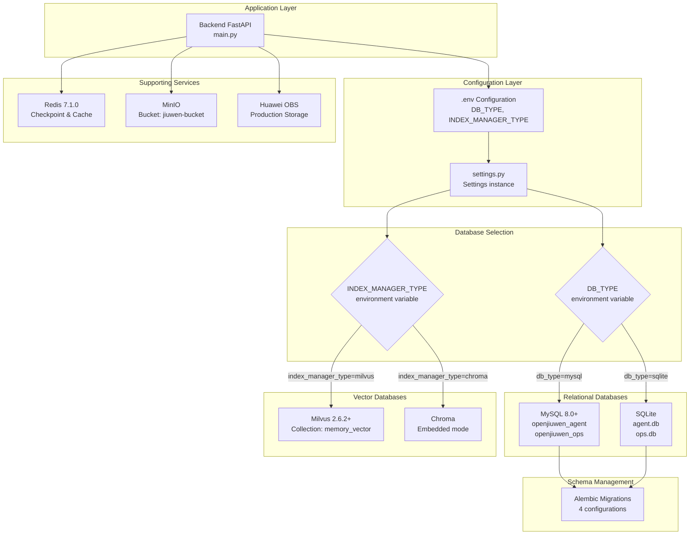
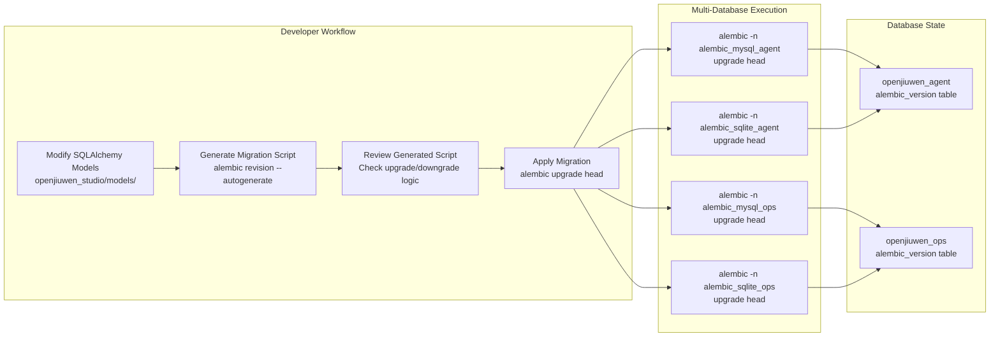
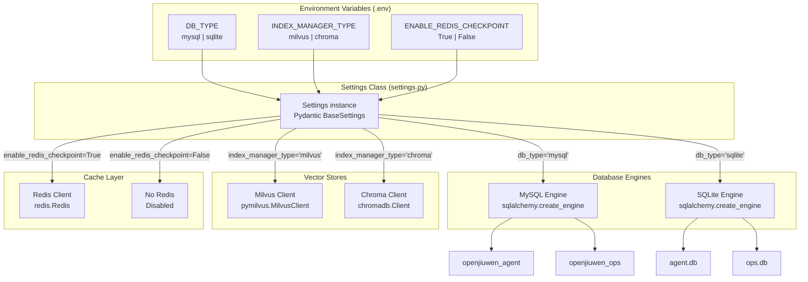

<!-- source: DeepWiki mcp.deepwiki.com · repo openJiuwen-ai/agent-studio · page 5.4 Data Layer · fetched 2026-11-02 -->

# Data Layer

<details>
<summary>Relevant source files</summary>

The following files were used as context for generating this wiki page:

- [.env.example](.env.example)
- [backend/DATABASE_MIGRATION_DEVELOPMENT_GUIDE_EN.md](backend/DATABASE_MIGRATION_DEVELOPMENT_GUIDE_EN.md)
- [backend/GENERATE_MIGRATION_USAGE_EN.md](backend/GENERATE_MIGRATION_USAGE_EN.md)
- [backend/openjiuwen_studio/core/common/logging/__init__.py](backend/openjiuwen_studio/core/common/logging/__init__.py)
- [backend/openjiuwen_studio/core/common/logging/events.py](backend/openjiuwen_studio/core/common/logging/events.py)
- [backend/openjiuwen_studio/core/config.py](backend/openjiuwen_studio/core/config.py)
- [backend/openjiuwen_studio/core/manager/convertor/components/sub_workflow.py](backend/openjiuwen_studio/core/manager/convertor/components/sub_workflow.py)
- [backend/openjiuwen_studio/core/manager/email_manager/__init__.py](backend/openjiuwen_studio/core/manager/email_manager/__init__.py)
- [backend/openjiuwen_studio/core/manager/email_manager/email_template.py](backend/openjiuwen_studio/core/manager/email_manager/email_template.py)
- [backend/openjiuwen_studio/core/manager/email_manager/email_utils.py](backend/openjiuwen_studio/core/manager/email_manager/email_utils.py)
- [backend/openjiuwen_studio/core/manager/redis_manager/__init__.py](backend/openjiuwen_studio/core/manager/redis_manager/__init__.py)
- [backend/openjiuwen_studio/core/manager/utils/utils.py](backend/openjiuwen_studio/core/manager/utils/utils.py)
- [backend/openjiuwen_studio/main.py](backend/openjiuwen_studio/main.py)
- [backend/pyproject.toml](backend/pyproject.toml)
- [docs/en/2.Installation Guide/Install via Docker/Linux_Installation.md](docs/en/2.Installation Guide/Install via Docker/Linux_Installation.md)
- [docs/en/2.Installation Guide/Install via Docker/MacOS_Installation.md](docs/en/2.Installation Guide/Install via Docker/MacOS_Installation.md)
- [docs/en/2.Installation Guide/Install via Docker/Windows_Installation.md](docs/en/2.Installation Guide/Install via Docker/Windows_Installation.md)
- [docs/en/2.Installation Guide/Local Installation/Linux_Installation.md](docs/en/2.Installation Guide/Local Installation/Linux_Installation.md)
- [docs/en/2.Installation Guide/Local Installation/MacOS_Installation.md](docs/en/2.Installation Guide/Local Installation/MacOS_Installation.md)
- [docs/en/2.Installation Guide/Local Installation/Windows_Installation.md](docs/en/2.Installation Guide/Local Installation/Windows_Installation.md)

</details>


This document describes the data persistence architecture for OpenJiuwen Agent Studio. It covers relational databases, vector stores, object storage, caching systems, and the database migration framework.

For information about the Backend Architecture that consumes these data layers, see [Backend Architecture](#5.3). For information about the overall System Architecture, see [System Architecture](#5.1).

---

## Overview

The OpenJiuwen Agent Studio data layer implements a **multi-database strategy** designed for flexibility and scalability. The system supports multiple database technologies that can be configured based on deployment requirements:

| Data Type | Technologies Supported | Purpose |
|-----------|----------------------|---------|
| **Relational Data** | MySQL 8.0+ / SQLite 3.x | Agent metadata, workflows, users, execution logs |
| **Vector Data** | Milvus 2.6.2+ / Chroma | Knowledge base embeddings, memory vectors |
| **Object Storage** | MinIO / Huawei OBS | Document files, large binary objects |
| **Cache & State** | Redis 7.1.0+ | Session checkpointing, cache layer |

The data layer is accessed through repository classes and managed by service-layer managers, following a layered architecture pattern.

Sources: [.env.example:90-149](), [backend/pyproject.toml:10-35]()

---

## Architecture Diagram

### Multi-Database System Architecture



Sources: [backend/openjiuwen_studio/main.py:1-146](), [backend/openjiuwen_studio/core/config.py:1-105](), [.env.example:90-149]()

---

## Relational Databases

### Database Selection

The system supports two relational database types controlled by the `DB_TYPE` environment variable:

| Database Type | Use Case | Configuration |
|--------------|----------|---------------|
| **SQLite** | Development, testing, single-user scenarios | `DB_TYPE=sqlite` |
| **MySQL** | Production, multi-user, concurrent access | `DB_TYPE=mysql` |

Sources: [backend/openjiuwen_studio/core/config.py:26-38]()

### Database Instances

The system maintains **two separate databases** for logical separation:

#### 1. Agent Database

Stores core agent and workflow data:

- `AgentBaseDB` - Draft agent configurations
- `AgentPublishDB` - Published agent versions
- `WorkflowBaseDB` - Draft workflow definitions
- `WorkflowPublishDB` - Published workflow versions
- `PluginBaseDB` / `PluginPublishDB` - Plugin metadata
- `ToolBaseDB` - Tool configurations
- `KnowledgeBaseDB` / `KnowledgeBaseDocumentDB` - Knowledge base data
- `MemoryBaseDB` - Memory base configurations
- `AgentExecutionDB` / `AgentExecutionDetailsDB` - Execution logs
- `WorkflowExecutionDB` / `WorkflowExecutionDetailsDB` - Workflow runs
- `TraceDetailDB` / `TraceSummaryDB` - Trace data
- `ModelConfig` / `EmbeddingModelConfig` - Model configurations
- `SystemLLMModelDB` / `SystemEmbeddingModelDB` - System model registry

#### 2. Ops Database

Stores operational and prompt management data:

- Prompt templates and optimization results
- Prompt tuning history
- Debug sessions

The separation allows for independent scaling and management of operational versus core business data.

Sources: [backend/openjiuwen_studio/main.py:28-43](), [backend/openjiuwen_studio/main.py:59-92]()

### Configuration Reference

#### MySQL Configuration

```env
DB_TYPE=mysql
DB_HOST=localhost
DB_PORT=3306
DB_USER=root
DB_PASSWORD=root
AGENT_DB_NAME=openjiuwen_agent
OPS_DB_NAME=openjiuwen_ops
```

#### SQLite Configuration

```env
DB_TYPE=sqlite
SQLITE_DB_PATH=data/databases
AGENT_SQLITE_DB=agent.db
OPS_SQLITE_DB=ops.db
```

Sources: [.env.example:92-106](), [backend/openjiuwen_studio/core/config.py:26-38]()

### Database Initialization

Database tables are created automatically on application startup using SQLAlchemy's `Base.metadata.create_all()` with `checkfirst=True`:

```python
Base.metadata.create_all(
    bind=engine,
    tables=target_tables,
    checkfirst=True
)
```

For SQLite deployments, the system automatically renames duplicate indexes to avoid conflicts:

```python
if engine.url.drivername == "sqlite":
    for table in target_tables:
        for idx in table.indexes:
            old_idx_name = idx.name
            idx.name = f"{old_idx_name}_{table.name}"
```

Sources: [backend/openjiuwen_studio/main.py:94-114]()

---

## Database Migration System

### Alembic Configuration

The system uses **Alembic** for database schema versioning and migration. Due to multi-database support, **four separate Alembic configurations** exist:

| Configuration Name | Database Type | Database Instance | Configuration Path |
|-------------------|--------------|-------------------|-------------------|
| `alembic_mysql_agent` | MySQL | Agent Database | `backend/upgrade/mysql/alembic_agent/` |
| `alembic_mysql_ops` | MySQL | Ops Database | `backend/upgrade/mysql/alembic_ops/` |
| `alembic_sqlite_agent` | SQLite | Agent Database | `backend/upgrade/sqlite/alembic_agent/` |
| `alembic_sqlite_ops` | SQLite | Ops Database | `backend/upgrade/sqlite/alembic_ops/` |

Each configuration maintains its own:
- Migration version history in `versions/` directory
- `alembic_version` table in the database
- Independent revision chain

Sources: [backend/DATABASE_MIGRATION_DEVELOPMENT_GUIDE_EN.md:86-106]()

### Migration Workflow Diagram



Sources: [backend/DATABASE_MIGRATION_DEVELOPMENT_GUIDE_EN.md:50-88](), [backend/DATABASE_MIGRATION_DEVELOPMENT_GUIDE_EN.md:280-428]()

### Version Stamping

For existing databases that have not used Alembic, the `stamp` command marks the current database state without executing SQL:

```bash
# MySQL Agent Database
alembic -n alembic_mysql_agent stamp 54351e123cf0

# MySQL Ops Database
alembic -n alembic_mysql_ops stamp 13377a900fe2

# SQLite Agent Database
alembic -n alembic_sqlite_agent stamp f458c7fb17a5

# SQLite Ops Database
alembic -n alembic_sqlite_ops stamp b4f4c6589bc5
```

Version baseline table:

| Database Type | Service Component | v0.1.2 Revision ID | v0.1.3 Revision ID | v0.1.4 Revision ID |
|--------------|-------------------|-------------------|-------------------|-------------------|
| MySQL | Agent | `54351e123cf0` | `06a1f79bce8b` | `072ac1293a02` |
| MySQL | Ops | `80f110f929fc` | `13377a900fe2` | `13377a900fe2` |
| SQLite | Agent | `f458c7fb17a5` | `031b34b4dd30` | `8f4846812221` |
| SQLite | Ops | `b4f4c6589bc5` | `f6e49cd8c97d` | `f6e49cd8c97d` |

Sources: [backend/DATABASE_MIGRATION_DEVELOPMENT_GUIDE_EN.md:363-428]()

### Migration Utilities

The system provides idempotency helper functions to avoid conflicts when re-running migrations:

```python
from openjiuwen_studio.core.database.migration_utils import (
    table_exists,
    column_exists, 
    index_exists
)

def upgrade() -> None:
    if not table_exists('my_new_table'):
        op.create_table('my_new_table', ...)
    
    if not column_exists('users', 'new_column'):
        op.add_column('users', sa.Column('new_column', sa.String(100)))
    
    if not index_exists('users', 'idx_user_email'):
        op.create_index('idx_user_email', 'users', ['email'])
```

Sources: [backend/DATABASE_MIGRATION_DEVELOPMENT_GUIDE_EN.md:224-253]()

### Version Check on Startup

The application checks Alembic versions on startup and logs warnings if database versions are outdated:

```python
check_alembic_versions()
```

This function compares the current database version against the latest version in the code repository and logs appropriate messages.

Sources: [backend/openjiuwen_studio/main.py:120-121]()

---

## Vector Databases

### Vector Store Selection

The system supports two vector database implementations controlled by the `INDEX_MANAGER_TYPE` environment variable:

| Vector DB | Use Case | Configuration |
|-----------|----------|---------------|
| **Chroma** | Development, embedded mode, quick setup | `INDEX_MANAGER_TYPE=chroma` |
| **Milvus** | Production, distributed deployment, scalability | `INDEX_MANAGER_TYPE=milvus` |

Sources: [.env.example:135-143]()

### Chroma Configuration

Chroma runs in **embedded mode** with no additional services required. It stores vector data locally:

```env
INDEX_MANAGER_TYPE=chroma
MEMORY_DATA_PATH=memory-data
```

The `MEMORY_DATA_PATH` specifies the local directory for storing Chroma's persistent data.

Sources: [.env.example:148]()

### Milvus Configuration

Milvus requires external service deployment and additional infrastructure:

```env
INDEX_MANAGER_TYPE=milvus
MILVUS_HOST=jiuwen-milvus-standalone
MILVUS_PORT=19530
MILVUS_COLLECTION_NAME=memory_vector
MILVUS_TOKEN=
EMBEDDING_MODEL_DIMENTION=1024
```

**Milvus Dependencies:**
- etcd for metadata storage
- MinIO for object storage
- AVX CPU instruction set support

Sources: [.env.example:138-143]()

### Vector Database Usage

Vector databases store:

1. **Knowledge Base Embeddings** - Document chunks converted to vectors for RAG retrieval
2. **Memory Vectors** - Long-term memory storage for agents
3. **Semantic Search** - Fast similarity search for retrieval operations

The `MemoryEngineManager` initializes vector database connections on application startup:

```python
await MemoryEngineManager.init()
```

Sources: [backend/openjiuwen_studio/main.py:115]()

---

## Object Storage

### Storage Options

The system supports two object storage backends:

| Storage | Use Case | Configuration Prefix |
|---------|----------|---------------------|
| **MinIO** | Local deployment, development, single-node | `MINIO_*` |
| **Huawei OBS** | Cloud deployment, distributed, production | `OBS_*` |

### MinIO Configuration

MinIO is used for standalone and local deployments:

```env
MINIO_HOST=localhost
MINIO_PORT=9000
MINIO_ACCESS_KEY=minioadmin
MINIO_SECRET_KEY=minioadmin
MINIO_SECURE=False
MINIO_BUCKET=jiuwen-bucket
```

MinIO stores:
- Uploaded knowledge base documents (PDF, DOCX, TXT, MD)
- Large binary files
- Temporary processing artifacts

Sources: [.env.example:108-114](), [backend/openjiuwen_studio/core/config.py:40-46]()

### Huawei OBS Configuration

OBS is used for distributed and cloud deployments:

```env
OBS_ACCESS_KEY_ID=
OBS_SECRET_ACCESS_KEY=
OBS_SERVER=
OBS_BUCKET=
```

**Note:** For standalone/local deployment without object storage, OBS-related variables are left empty. Only fill real values when using distributed deployment with cloud object storage.

Sources: [.env.example:192-196]()

### Storage Selection Logic

The storage backend is selected through the `openjiuwen` library configuration. The system initializes with:

```python
from openjiuwen import configure

# Configuration loaded from environment
openjiuwen.configure(
    obs_config={
        "access_key": settings.obs_access_key_id,
        "secret_key": settings.obs_secret_access_key,
        ...
    }
)
```

Sources: [backend/pyproject.toml:19]()

---

## Redis Cache and Checkpointing

### Redis Configuration

Redis provides optional caching and workflow checkpointing:

```env
ENABLE_REDIS_CHECKPOINT=False
REDIS_HOST=localhost
REDIS_PORT=6379
REDIS_DB=0
REDIS_PASSWORD=
```

Sources: [.env.example:116-121](), [backend/openjiuwen_studio/core/config.py:69-81]()

### Checkpoint Configuration

When Redis checkpointing is enabled, the system configures the workflow runner to use Redis for state persistence:

```python
if settings.enable_redis_checkpoint:
    runner_config = get_runner_config()
    runner_config.checkpointer_config = CheckpointerConfig(
        type="redis",
        conf={
            "connection": {
                "redis_client": redis_manager_bytes.client
            }
        }
    )
    Runner.set_config(runner_config)
```

This allows workflow executions to:
- Persist state between steps
- Resume after interruptions
- Support long-running workflows

Sources: [backend/openjiuwen_studio/main.py:128-138]()

### Redis Client Initialization

The Redis client is initialized through the `redis_manager_bytes` singleton:

```python
from openjiuwen_studio.core.manager.redis_manager.redis_client import redis_manager_bytes
```

Sources: [backend/openjiuwen_studio/main.py:45]()

---

## Database Connection Management

### SQLAlchemy Engine

The database engine is created in `openjiuwen_studio.core.database` and imported throughout the application:

```python
from openjiuwen_studio.core.database import engine
```

The engine handles:
- Connection pooling
- Transaction management
- Database dialect selection (MySQL vs SQLite)

Sources: [backend/openjiuwen_studio/main.py:25]()

### Settings Configuration

All database configurations are centralized in the `Settings` class:

```python
from openjiuwen_studio.core.config import settings

# Relational database
db_type = settings.db_type  # "mysql" or "sqlite"
db_host = settings.db_host
db_port = settings.db_port

# Vector database  
index_manager_type = settings.INDEX_MANAGER_TYPE  # From env variable

# Redis
redis_url = settings.redis_url  # Computed property
```

The `Settings` class uses Pydantic for validation and environment variable loading:

```python
class Settings(BaseSettings):
    db_type: str = "mysql"
    db_host: str = ""
    db_port: int = 3306
    # ... other fields
    
    class Config:
        env_file = "../.env"
        case_sensitive = False
        extra = "ignore"
```

Sources: [backend/openjiuwen_studio/core/config.py:7-104]()

---

## Configuration Diagram

### Environment Variable to Database Component Mapping



Sources: [backend/openjiuwen_studio/core/config.py:7-104](), [.env.example:90-149]()

---

## Data Layer Access Patterns

### Repository Pattern

The data layer is accessed through repository classes that abstract database operations:

```
Application Layer (Managers)
    ↓
Repository Layer (Database access)
    ↓
SQLAlchemy Models (ORM)
    ↓
Database Engine
    ↓
Physical Database (MySQL/SQLite)
```

Example repositories:
- `AgentRepository` - Agent CRUD operations
- `WorkflowRepository` - Workflow data access
- `KnowledgeBaseRepository` - Knowledge base queries
- `PluginRepository` - Plugin metadata access

This pattern ensures:
- Separation of concerns
- Testability (repositories can be mocked)
- Consistent transaction management
- Database independence (switching between MySQL/SQLite)

Sources: High-level diagrams provided in context

---

## Summary

The OpenJiuwen Agent Studio data layer provides:

1. **Flexible Database Support** - MySQL or SQLite for relational data based on deployment needs
2. **Vector Storage Options** - Milvus or Chroma for embeddings and semantic search
3. **Object Storage** - MinIO or OBS for document and file storage
4. **Optional Caching** - Redis for workflow checkpointing and performance
5. **Schema Versioning** - Alembic migrations with multi-database support
6. **Configuration-Driven** - Environment variables control all database selections

The architecture supports both simple single-node deployments (SQLite + Chroma + MinIO) and scalable production deployments (MySQL + Milvus + OBS + Redis) without code changes.

Sources: [.env.example:90-149](), [backend/openjiuwen_studio/main.py:54-146](), [backend/DATABASE_MIGRATION_DEVELOPMENT_GUIDE_EN.md:1-50]()

---

