<!-- source: DeepWiki mcp.deepwiki.com · repo openJiuwen-ai/agent-studio · page 5.5 Agent Execution Pipeline · fetched 2026-11-02 -->

# Agent Execution Pipeline

Relevant source files

The following files were used as context for generating this wiki page:

- [backend/openjiuwen_studio/core/manager/agent.py](backend/openjiuwen_studio/core/manager/agent.py)
- [backend/openjiuwen_studio/core/manager/convertor/agent.py](backend/openjiuwen_studio/core/manager/convertor/agent.py)
- [backend/openjiuwen_studio/core/manager/knowledge_base.py](backend/openjiuwen_studio/core/manager/knowledge_base.py)
- [backend/openjiuwen_studio/core/manager/repositories/agent_repository.py](backend/openjiuwen_studio/core/manager/repositories/agent_repository.py)
- [backend/openjiuwen_studio/core/manager/repositories/plugin_repository.py](backend/openjiuwen_studio/core/manager/repositories/plugin_repository.py)
- [backend/openjiuwen_studio/core/manager/repositories/tool_repository.py](backend/openjiuwen_studio/core/manager/repositories/tool_repository.py)
- [backend/openjiuwen_studio/routers/agents.py](backend/openjiuwen_studio/routers/agents.py)
- [backend/openjiuwen_studio/schemas/agent.py](backend/openjiuwen_studio/schemas/agent.py)
- [frontend/packages/api-client/src/config.ts](frontend/packages/api-client/src/config.ts)
- [frontend/packages/api-client/src/services/agentService.ts](frontend/packages/api-client/src/services/agentService.ts)
- [frontend/src/components/Agent/AgentModelSelector.tsx](frontend/src/components/Agent/AgentModelSelector.tsx)
- [frontend/src/components/Agent/OverridePromptTemplateDialog.tsx](frontend/src/components/Agent/OverridePromptTemplateDialog.tsx)
- [frontend/src/locales/agent/en-US/common.json](frontend/src/locales/agent/en-US/common.json)
- [frontend/src/locales/agent/en-US/editor.json](frontend/src/locales/agent/en-US/editor.json)
- [frontend/src/locales/agent/zh-CN/common.json](frontend/src/locales/agent/zh-CN/common.json)
- [frontend/src/locales/agent/zh-CN/editor.json](frontend/src/locales/agent/zh-CN/editor.json)
- [frontend/src/pages/Agents/AgentCreatePage.tsx](frontend/src/pages/Agents/AgentCreatePage.tsx)
- [frontend/src/pages/Agents/AgentEditorEditPage.tsx](frontend/src/pages/Agents/AgentEditorEditPage.tsx)
- [frontend/src/pages/Agents/AgentsPage.tsx](frontend/src/pages/Agents/AgentsPage.tsx)

## Purpose and Scope

This document describes how agents are executed in OpenJiuwen Agent Studio, from configuration through conversion to runtime execution. It covers the transformation pipeline that converts user-friendly agent configurations into executable Domain Specific Language (DSL) format, resolves dependencies, and prepares agents for execution.

For information about agent creation and configuration in the UI, see [Creating Your First Agent](#4.1). For workflow execution details, see [Workflow Canvas Architecture](#5.7). For the overall agent lifecycle including versioning, see [Agents](#3.1).

---

## Pipeline Overview

The agent execution pipeline transforms declarative agent configurations into executable runtime structures. The process involves several stages:

1. **Configuration Storage**: Agent definitions stored in database (draft or published versions)
2. **Pre-Execution Validation**: Agent configuration validated before execution or publishing
3. **DSL Conversion**: Agent configuration converted to executable DSL format
4. **Resource Resolution**: Dependencies (workflows, plugins, knowledge bases, memory) loaded and validated
5. **Context Assembly**: Execution context built with model configuration, prompts, and resources
6. **Execution**: Agent runs using converted DSL with resolved resources

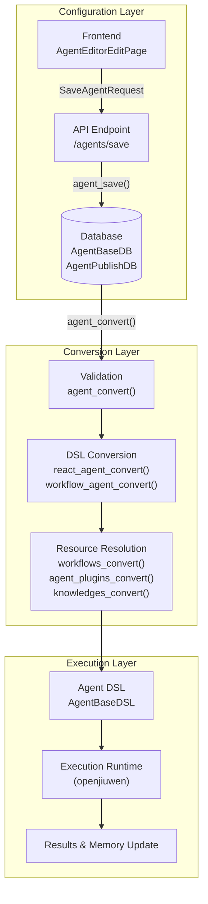

**Sources**: [backend/openjiuwen_studio/core/manager/agent.py:1004-1061](), [backend/openjiuwen_studio/core/manager/convertor/agent.py:241-372]()

---

## Agent Configuration Storage

### Draft and Published Versions

Agents exist in two states:
- **Draft**: Mutable working version, stored in `AgentBaseDB` table with `agent_version=NULL`
- **Published**: Immutable versioned snapshots, stored in `AgentPublishDB` table with semantic versions (e.g., "v1.0.0")

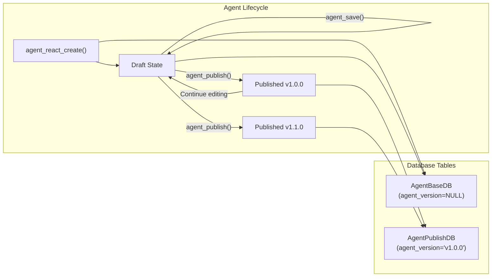

**Storage Schema**: The `AgentBaseDBPd` model contains:
- Basic metadata: `agent_id`, `agent_name`, `description`, `icon`, `agent_type`
- Model configuration: `model_id`, `agent_model_config` (temperature, top_p, timeout)
- Resources: `workflows`, `plugins`, `knowledge`, `memory`
- Prompts: `prompt_template`, `prompt_template_name`, `opening_remarks`
- Constraints: `constraint` (max_iteration, reserved_max_chat_rounds)
- Configuration: `configs` (retrieval_config for knowledge bases)

**Sources**: [backend/openjiuwen_studio/models/agent.py](), [backend/openjiuwen_studio/core/manager/agent.py:301-327](), [backend/openjiuwen_studio/core/manager/agent.py:1063-1088]()

---

## Conversion Phase

### Entry Point: agent_convert()

The `agent_convert()` function is the main entry point for converting agent configurations to executable DSL format. It handles both ReAct and Workflow agent types.

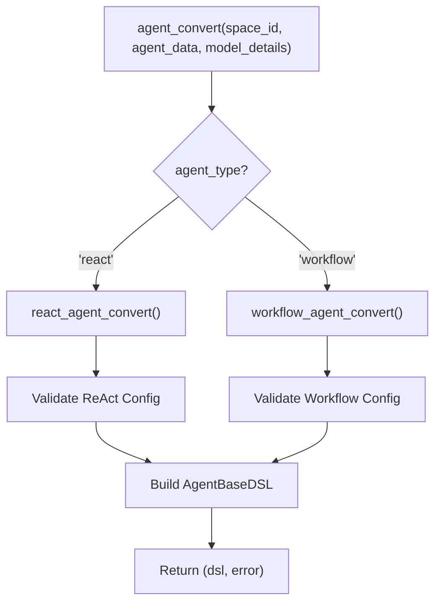

**Sources**: [backend/openjiuwen_studio/core/manager/convertor/agent.py:241-262](), [backend/openjiuwen_studio/core/manager/convertor/agent.py:264-286]()

### ReAct Agent Conversion

ReAct agents use autonomous planning with LLM reasoning and tool calling. The conversion process:

1. **Extract Model Configuration**: Convert model details to `ModelConfig` DSL
2. **Convert Prompt Templates**: Transform prompt template list to DSL format
3. **Resolve Workflows**: Convert workflow references to `WorkflowSchema` objects
4. **Resolve Plugins**: Convert plugin references to `PluginSchema` objects
5. **Resolve Knowledge Bases**: Convert knowledge base references to `KnowledgeSchema` objects
6. **Build Constraints**: Create `ConstrainConfig` from agent constraints
7. **Assemble DSL**: Create `AgentBaseDSL` object with all components

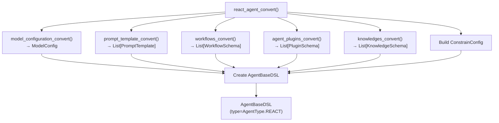

**Key Conversion Functions**:

| Function | Input | Output | Purpose |
|----------|-------|--------|---------|
| `model_configuration_convert()` | Model details dict | `ModelConfig` | Converts model config with API credentials |
| `prompt_template_convert()` | List of prompt dicts | List of `PromptTemplate` | Transforms role-content pairs |
| `workflows_convert()` | List of workflow refs | List of `WorkflowSchema` | Resolves workflow IDs to schemas |
| `agent_plugins_convert()` | List of `AgentPlugin` | List of `PluginSchema` | Resolves plugin tools to schemas |
| `knowledges_convert()` | List of KB IDs | List of `KnowledgeSchema` | Resolves knowledge base metadata |

**Sources**: [backend/openjiuwen_studio/core/manager/convertor/agent.py:288-372](), [backend/openjiuwen_studio/core/manager/convertor/agent.py:32-66](), [backend/openjiuwen_studio/core/manager/convertor/agent.py:119-172]()

### Workflow Agent Conversion

Workflow agents use predefined workflow orchestration with an LLM controller for routing. The conversion process:

1. **Extract Controller Model**: Convert model configuration for workflow routing
2. **Convert Opening Remarks**: Extract greeting message
3. **Convert Default Response**: Extract fallback response text
4. **Resolve Workflows**: Same as ReAct agent workflow resolution
5. **Build Constraint Config**: Create workflow-specific constraints
6. **Assemble DSL**: Create `AgentBaseDSL` with workflow-specific configuration

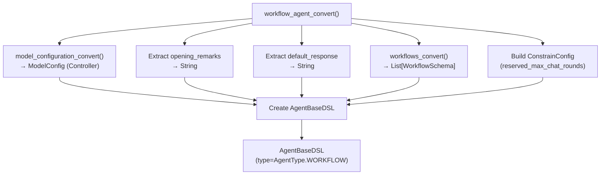

**Sources**: [backend/openjiuwen_studio/core/manager/convertor/agent.py:264-286]()

---

## Resource Resolution

### Workflow Resolution

Workflows are converted by fetching their canvas definitions and extracting input/output parameter schemas:

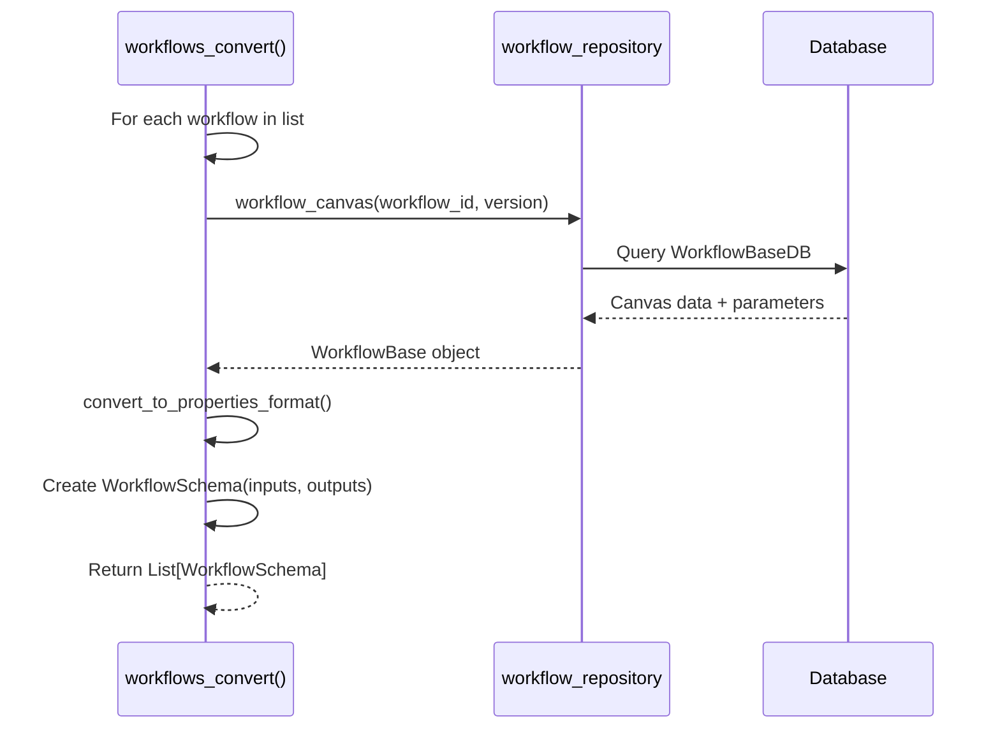

**Workflow Schema Structure**:
- `id`: Workflow identifier
- `version`: Version string (or "draft")
- `name`: Workflow name
- `description`: Workflow description
- `inputs`: JSON Schema object for input parameters
- `outputs`: JSON Schema object for output parameters
- `configs`: Additional configuration (empty dict)

**Sources**: [backend/openjiuwen_studio/core/manager/convertor/agent.py:32-66](), [backend/openjiuwen_studio/core/manager/convertor/agent.py:68-117]()

### Plugin Resolution

Plugins are resolved by fetching tool definitions and converting parameters to JSON Schema format:

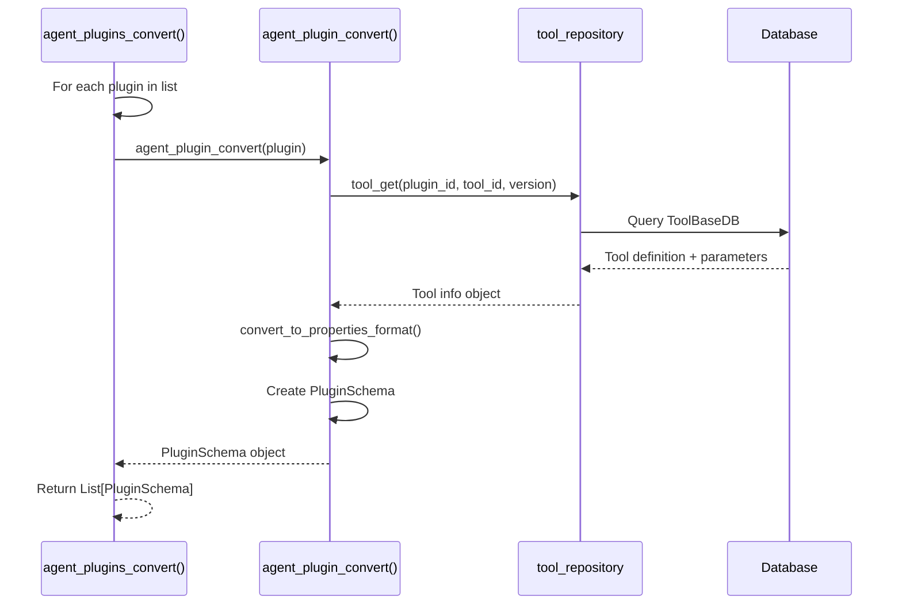

**Plugin Schema Structure**:
- `id`: Tool identifier
- `plugin_id`: Parent plugin identifier
- `version`: Plugin version
- `name`: Tool name
- `description`: Tool description
- `inputs`: JSON Schema for tool inputs
- `outputs`: JSON Schema for tool outputs
- `configs`: Additional configuration

**Sources**: [backend/openjiuwen_studio/core/manager/convertor/agent.py:119-172](), [backend/openjiuwen_studio/core/manager/convertor/agent.py:174-206]()

### Knowledge Base Resolution

Knowledge bases are resolved by fetching metadata from the knowledge base repository:

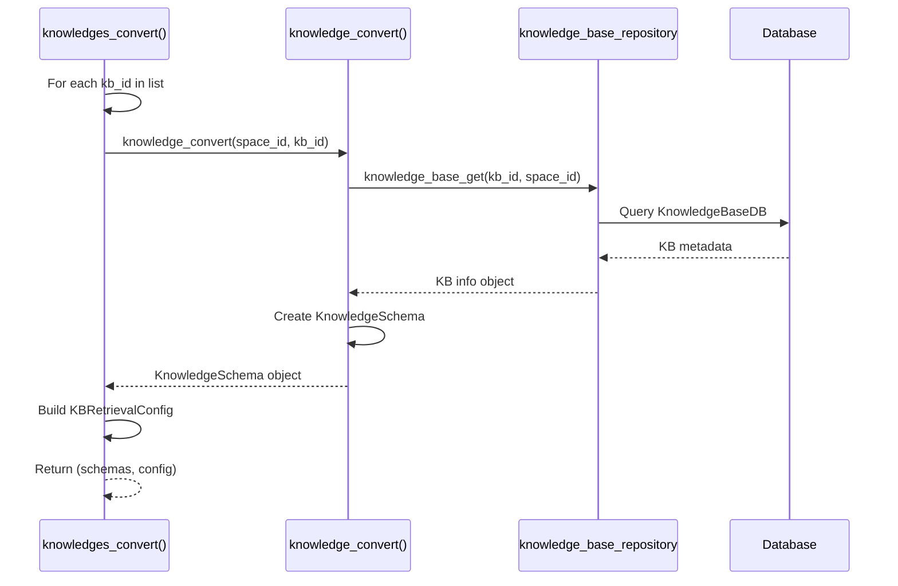

**Knowledge Base Retrieval Configuration**:
The `KBRetrievalConfig` is built from the agent's `retrieval_config`:
- `use_agent`: Whether to use agentic retrieval strategy
- `use_sync`: Whether to use synchronous (base) graph retrieval
- `source`: Retrieval source (1=hybrid, 2=text, 3=triple)
- `topk`: Maximum number of passages to retrieve
- `score_threshold`: Minimum similarity score for results

**Sources**: [backend/openjiuwen_studio/core/manager/convertor/agent.py:208-239](), [backend/openjiuwen_studio/core/manager/knowledge_base.py:208-234]()

---

## Model Configuration

### Model Details Resolution

Model configuration involves two parts:
1. **Model metadata** from model management system
2. **Agent-specific overrides** from `agent_model_config`

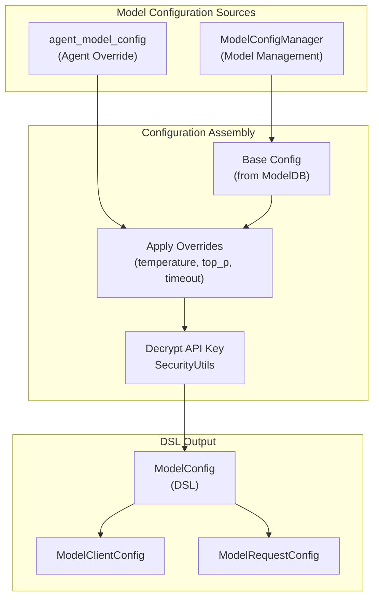

**Model Configuration Fields**:

| Field | Source | Purpose |
|-------|--------|---------|
| `provider` | ModelDB | LLM provider (OpenAI, Anthropic, etc.) |
| `api_key` | ModelDB (decrypted) | API authentication key |
| `base_url` | ModelDB | API endpoint URL |
| `model_name` | ModelDB | Model identifier |
| `temperature` | agent_model_config or ModelDB | Randomness control (0.0-2.0) |
| `top_p` | agent_model_config or ModelDB | Nucleus sampling parameter |
| `timeout` | agent_model_config or ModelDB | Request timeout in seconds |
| `enable_streaming` | ModelDB | Whether to use streaming responses |

**Sources**: [backend/openjiuwen_studio/core/manager/agent.py:1007-1045](), [backend/openjiuwen_studio/core/manager/convertor/agent.py:374-437]()

---

## Validation During Publishing

When publishing an agent, the system validates the configuration by attempting conversion:

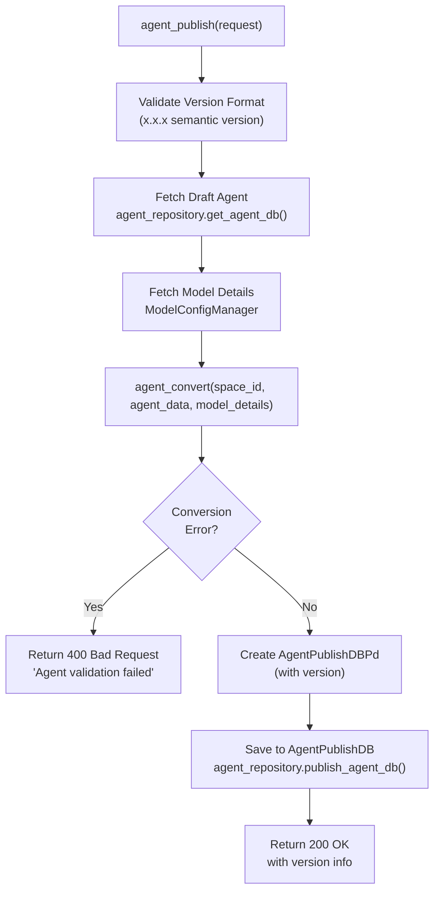

**Validation Errors**: If conversion fails, the publish operation is rejected with detailed error messages:
- Missing or invalid model configuration
- Workflow resolution failures
- Plugin tool not found
- Knowledge base not found
- Invalid parameter schemas

**Sources**: [backend/openjiuwen_studio/core/manager/agent.py:922-1110](), [backend/openjiuwen_studio/routers/agents.py:277-330]()

---

## Execution Context Assembly

### Memory Configuration

Memory configuration is converted to DSL format, including variables and long-term memory:

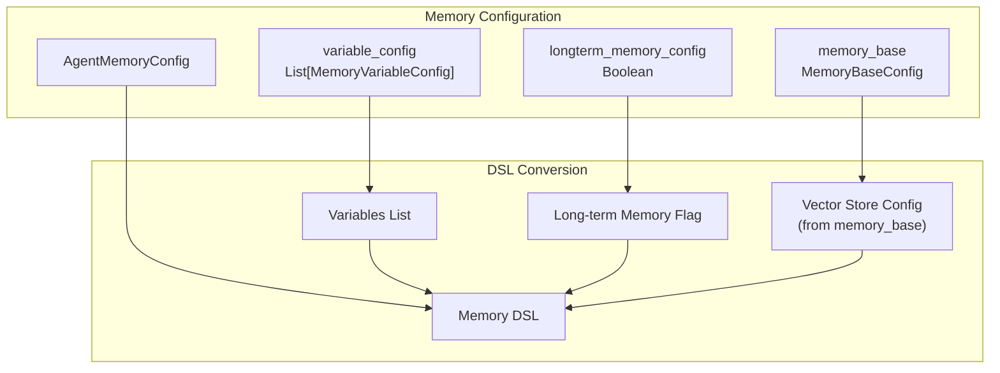

**Memory Variable Structure**:
- `id`: Unique variable identifier
- `name`: Variable name (used as key)
- `description`: Variable description for LLM context
- `enabled`: Whether variable is active (default: true)

**Memory Base Configuration**:
- `mdb_id`: Memory base identifier
- `name`: Memory base name
- `embedding_model_config_id`: Embedding model for vector storage
- `llm_model_config_id`: LLM for memory extraction
- `description`: Memory base description

**Sources**: [backend/openjiuwen_studio/schemas/agent.py:88-108](), [frontend/src/components/Agent/AgentModelSelector.tsx:81-86]()

---

## Complete Execution Flow

### End-to-End Pipeline

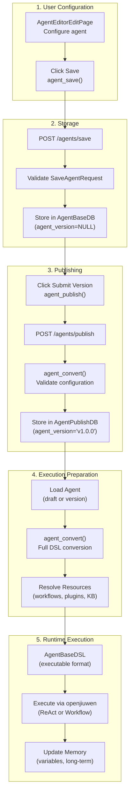

**Sources**: [backend/openjiuwen_studio/core/manager/agent.py:614-754](), [backend/openjiuwen_studio/core/manager/agent.py:922-1110](), [backend/openjiuwen_studio/routers/agents.py:157-183]()

---

## Version Management in Execution

### Draft vs. Published Execution

The system supports executing both draft and published versions of agents:

| Aspect | Draft Version | Published Version |
|--------|---------------|-------------------|
| Database Table | `AgentBaseDB` | `AgentPublishDB` |
| Version Field | `NULL` or `"draft"` | Semantic version (e.g., "v1.0.0") |
| Mutability | Can be modified | Immutable |
| Use Case | Development, testing | Production, stable APIs |
| Retrieval | `agent_version=NULL` | `agent_version='v1.0.0'` |

**Version Selection Logic**:
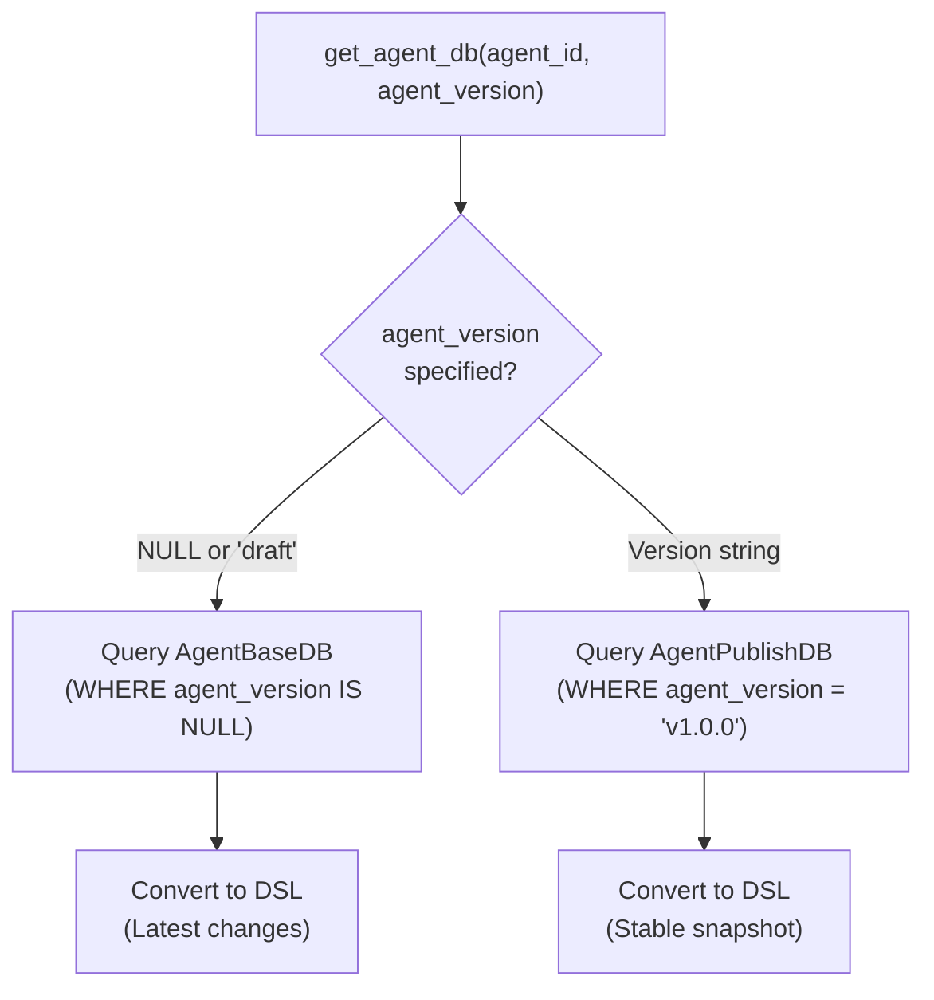

**Sources**: [backend/openjiuwen_studio/core/manager/repositories/agent_repository.py:74-134](), [backend/openjiuwen_studio/core/manager/agent.py:501-611]()

---

## Error Handling

### Conversion Error Types

The conversion process includes comprehensive error handling:

| Error Type | Cause | Resolution |
|------------|-------|------------|
| Model Not Found | Invalid `model_id` or model deleted | Select valid model in agent configuration |
| Workflow Not Found | Workflow ID invalid or deleted | Remove or replace workflow reference |
| Plugin Tool Not Found | Tool ID invalid or plugin deleted | Remove or replace plugin reference |
| Knowledge Base Not Found | KB ID invalid or KB deleted | Remove or replace KB reference |
| Invalid Parameters | Parameter schema malformed | Fix workflow/plugin parameter definitions |
| Validation Error | Agent config incomplete | Complete all required agent fields |

**Error Propagation**:
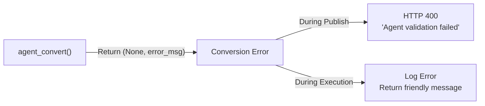

**Sources**: [backend/openjiuwen_studio/core/manager/convertor/agent.py:32-239](), [backend/openjiuwen_studio/core/manager/agent.py:1051-1061]()

---

## Performance Considerations

### Conversion Caching

The system does **not** cache converted DSL objects by default. Each execution request triggers a fresh conversion. This ensures:
- Latest configuration changes are always used
- No stale cache issues with resource updates
- Simplified version management

### Batch Resource Resolution

When resolving multiple resources (workflows, plugins, knowledge bases), the system:
1. Fetches all resource IDs upfront
2. Queries database once per resource type
3. Converts in parallel where possible
4. Logs conversion failures but continues with successful items

**Sources**: [backend/openjiuwen_studio/core/manager/convertor/agent.py:68-117](), [backend/openjiuwen_studio/core/manager/convertor/agent.py:174-206]()

---

## Summary

The Agent Execution Pipeline transforms user-friendly agent configurations into executable DSL format through a multi-stage process:

1. **Storage**: Agents stored as draft (mutable) or published (immutable) versions
2. **Conversion**: `agent_convert()` transforms configuration to DSL format based on agent type
3. **Resolution**: Workflows, plugins, and knowledge bases resolved to executable schemas
4. **Validation**: Configuration validated during publishing to prevent invalid agents
5. **Execution**: Converted DSL used by runtime execution engine (openjiuwen)

The pipeline ensures that agents are properly validated before execution while maintaining flexibility for development (draft) and stability for production (published versions).

**Key Code Entities**:
- `agent_convert()`: Main conversion entry point
- `react_agent_convert()`: ReAct agent conversion
- `workflow_agent_convert()`: Workflow agent conversion
- `AgentBaseDSL`: Output DSL format
- `AgentBaseDB` / `AgentPublishDB`: Storage tables
- `agent_save()`: Save draft configuration
- `agent_publish()`: Publish versioned snapshot

**Sources**: [backend/openjiuwen_studio/core/manager/convertor/agent.py:1-437](), [backend/openjiuwen_studio/core/manager/agent.py:1-2631]()

---

