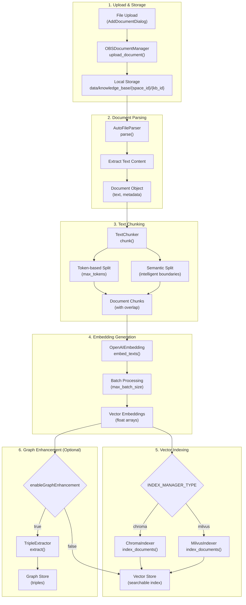
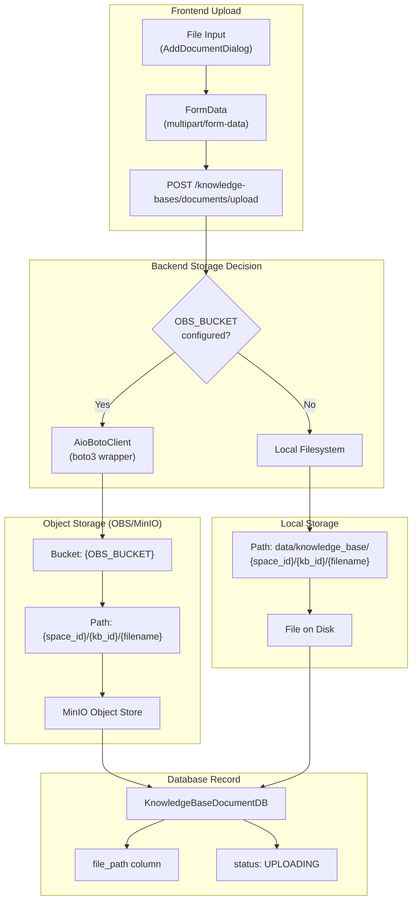
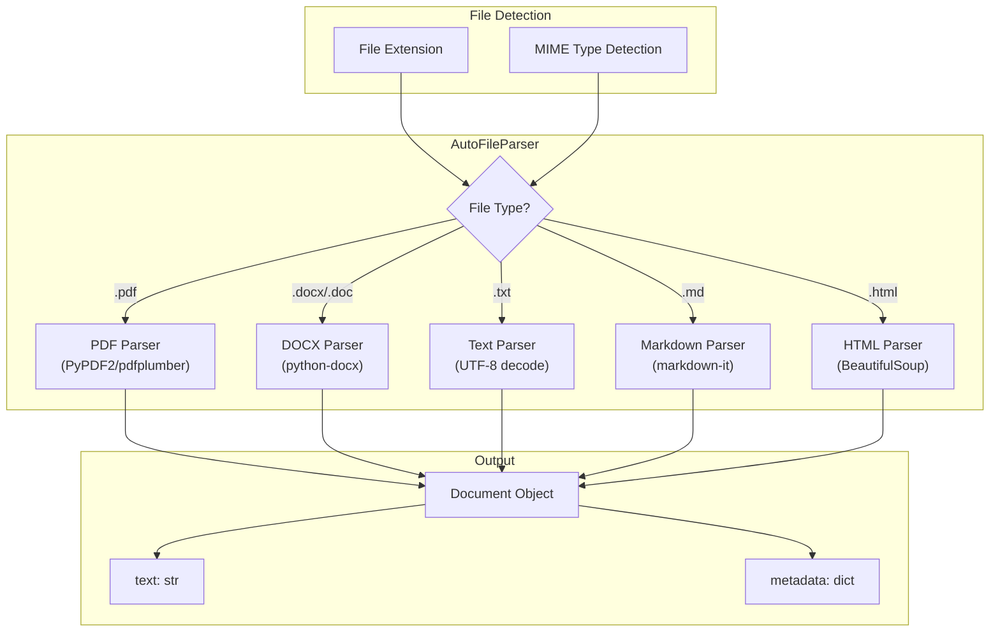
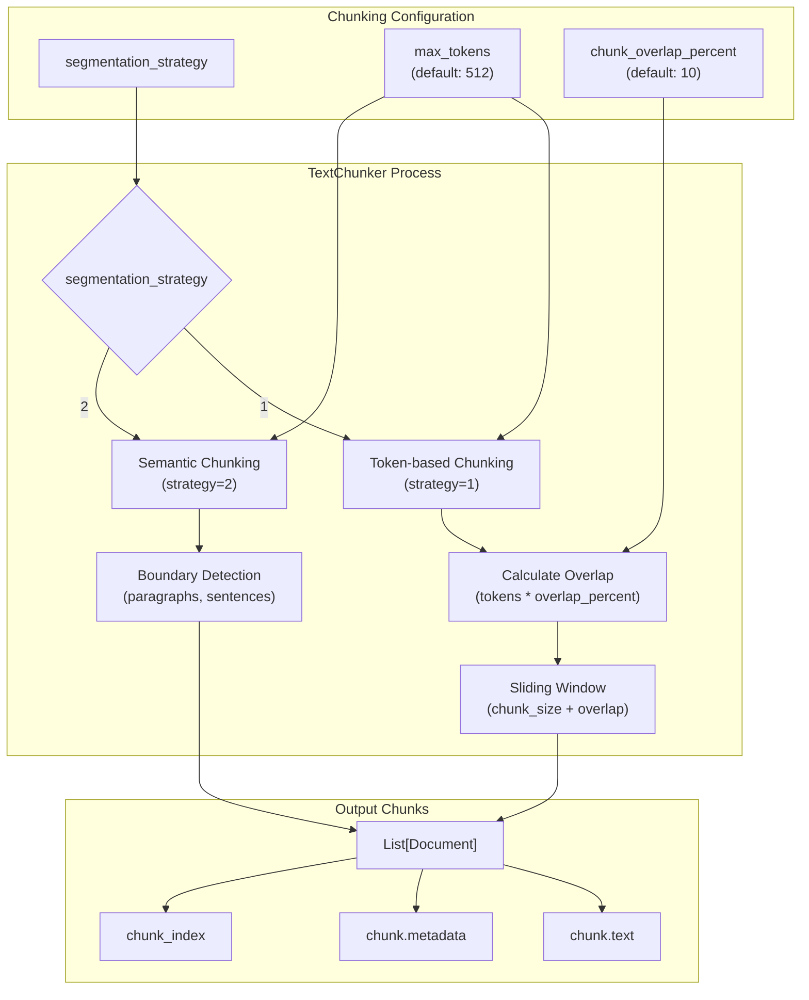
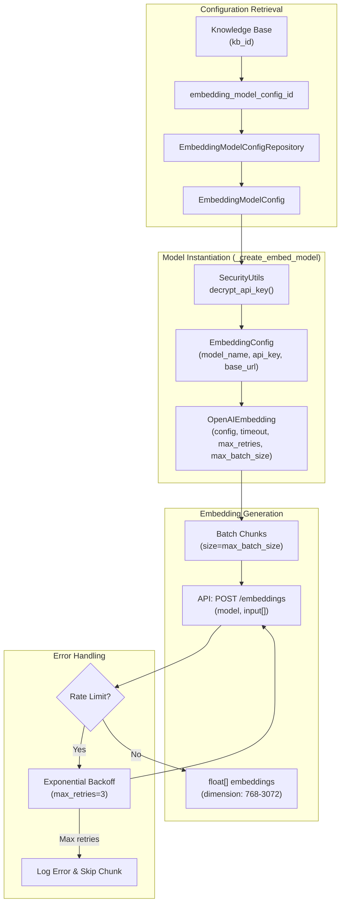
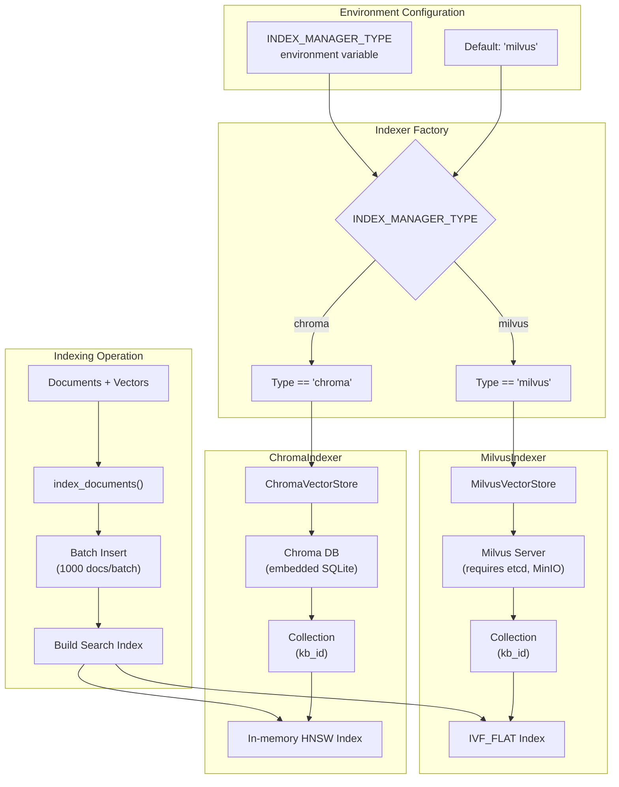
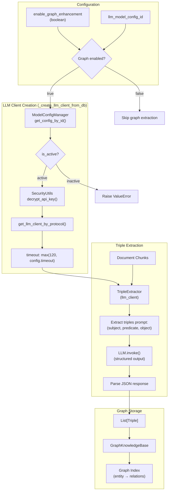
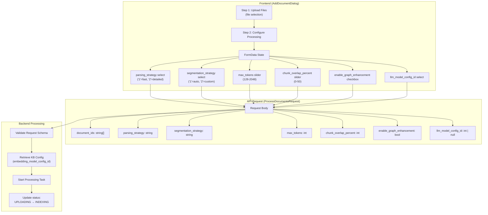
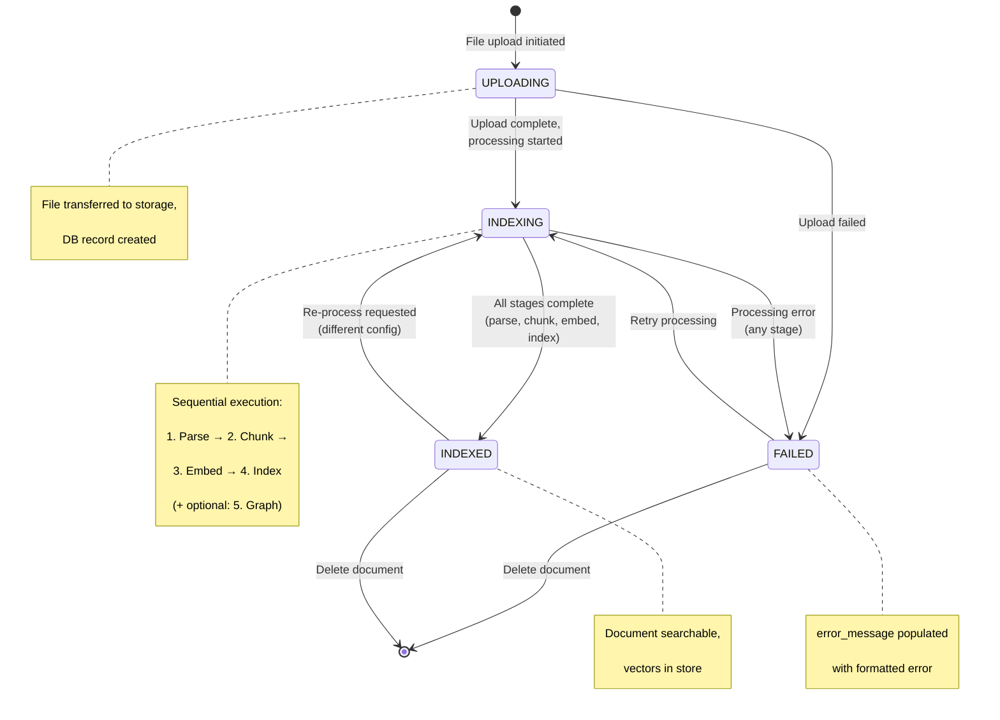
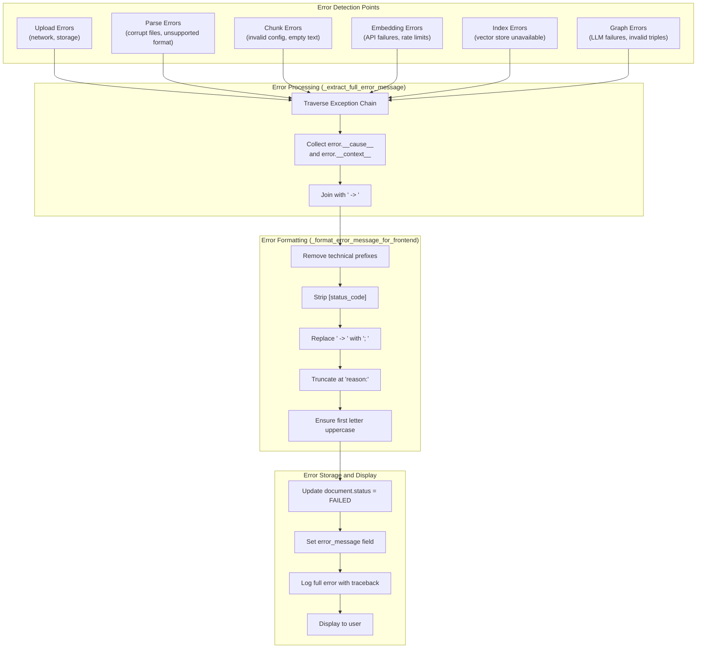

<!-- source: DeepWiki mcp.deepwiki.com · repo openJiuwen-ai/agent-studio · page 5.6 Document Processing Pipeline · fetched 2026-11-02 -->

# Document Processing Pipeline

<details>
<summary>Relevant source files</summary>

The following files were used as context for generating this wiki page:

- [backend/openjiuwen_studio/core/manager/agent.py](backend/openjiuwen_studio/core/manager/agent.py)
- [backend/openjiuwen_studio/core/manager/convertor/agent.py](backend/openjiuwen_studio/core/manager/convertor/agent.py)
- [backend/openjiuwen_studio/core/manager/knowledge_base.py](backend/openjiuwen_studio/core/manager/knowledge_base.py)
- [backend/openjiuwen_studio/core/manager/model_manager/managers/embedding_model_test_manager.py](backend/openjiuwen_studio/core/manager/model_manager/managers/embedding_model_test_manager.py)
- [backend/openjiuwen_studio/core/manager/repositories/agent_repository.py](backend/openjiuwen_studio/core/manager/repositories/agent_repository.py)
- [backend/openjiuwen_studio/core/manager/repositories/plugin_repository.py](backend/openjiuwen_studio/core/manager/repositories/plugin_repository.py)
- [backend/openjiuwen_studio/core/manager/repositories/tool_repository.py](backend/openjiuwen_studio/core/manager/repositories/tool_repository.py)
- [backend/openjiuwen_studio/routers/agents.py](backend/openjiuwen_studio/routers/agents.py)
- [backend/openjiuwen_studio/routers/embedding_models.py](backend/openjiuwen_studio/routers/embedding_models.py)
- [backend/openjiuwen_studio/schemas/agent.py](backend/openjiuwen_studio/schemas/agent.py)
- [frontend/packages/api-client/src/config.ts](frontend/packages/api-client/src/config.ts)
- [frontend/packages/api-client/src/services/agentService.ts](frontend/packages/api-client/src/services/agentService.ts)
- [frontend/src/locales/en-US.json](frontend/src/locales/en-US.json)
- [frontend/src/locales/zh-CN.json](frontend/src/locales/zh-CN.json)
- [frontend/src/pages/Auth/PrivacyPolicyPage.tsx](frontend/src/pages/Auth/PrivacyPolicyPage.tsx)
- [frontend/src/pages/Auth/UserLoginPage.tsx](frontend/src/pages/Auth/UserLoginPage.tsx)
- [frontend/src/pages/KnowledgeBase/components/AddDocumentDialog.tsx](frontend/src/pages/KnowledgeBase/components/AddDocumentDialog.tsx)
- [frontend/src/pages/KnowledgeBase/components/KnowledgeBaseFormDialog.tsx](frontend/src/pages/KnowledgeBase/components/KnowledgeBaseFormDialog.tsx)
- [frontend/src/pages/Models/ModelsPage.tsx](frontend/src/pages/Models/ModelsPage.tsx)
- [frontend/src/pages/Models/ModelsPageNew.tsx](frontend/src/pages/Models/ModelsPageNew.tsx)
- [frontend/src/pages/Models/components/EmbeddingModelsTable.tsx](frontend/src/pages/Models/components/EmbeddingModelsTable.tsx)
- [frontend/src/pages/Models/components/LLMModelsTable.tsx](frontend/src/pages/Models/components/LLMModelsTable.tsx)

</details>


This document describes the end-to-end pipeline for processing documents uploaded to knowledge bases, from file upload through parsing, chunking, embedding generation, and vector indexing. This pipeline enables retrieval-augmented generation (RAG) by converting unstructured documents into searchable vector representations.

For information about knowledge base management and CRUD operations, see [Knowledge Bases](#3.5). For details on retrieval and search operations, see [Knowledge Bases](#3.5).

## Overview

The document processing pipeline transforms uploaded files into indexed vector embeddings that can be efficiently searched for semantic similarity. The pipeline supports multiple document formats (PDF, DOCX, TXT, Markdown, HTML) and provides configurable parsing, chunking, and indexing strategies.

The pipeline is implemented primarily in [backend/openjiuwen_studio/core/manager/knowledge_base.py]() and uses the `openjiuwen.core.retrieval` package for document processing operations.

**Key Components:**
- **OBSDocumentManager**: Handles document storage in MinIO/OBS or local filesystem
- **AutoFileParser**: Extracts text content from various file formats
- **TextChunker**: Splits documents into semantically meaningful chunks
- **OpenAIEmbedding**: Generates vector embeddings for text chunks
- **ChromaIndexer/MilvusIndexer**: Indexes vectors into the selected vector store
- **TripleExtractor**: (Optional) Extracts knowledge graph triples for graph-enhanced RAG

**Supported File Formats:**
- PDF (`.pdf`)
- Microsoft Word (`.doc`, `.docx`)
- Plain Text (`.txt`)
- Markdown (`.md`)
- HTML (`.html`)

Sources: [backend/openjiuwen_studio/core/manager/knowledge_base.py:1-82](), [frontend/src/pages/KnowledgeBase/components/AddDocumentDialog.tsx:1-70]()

## Pipeline Architecture

The document processing pipeline consists of six main stages, each with specific responsibilities and configurable options:



**Pipeline Stages:**

| Stage | Input | Output | Configurable Parameters |
|-------|-------|--------|------------------------|
| Upload & Storage | File bytes | Object path | `bucket`, `object_name` |
| Document Parsing | File path | `Document` object | `parsing_strategy` |
| Text Chunking | Document text | List of chunks | `segmentation_strategy`, `max_tokens`, `chunk_overlap_percent` |
| Embedding Generation | Text chunks | Vector embeddings | `embedding_model_config_id`, `max_batch_size` |
| Vector Indexing | Vectors + metadata | Indexed documents | `INDEX_MANAGER_TYPE` |
| Graph Enhancement | Text chunks | Knowledge triples | `enable_graph_enhancement`, `llm_model_config_id` |

Sources: [backend/openjiuwen_studio/core/manager/knowledge_base.py:86-186](), [backend/openjiuwen_studio/core/manager/knowledge_base.py:369-451]()

## Document Upload and Storage

Documents are first uploaded through the frontend and stored in either object storage (MinIO/OBS) or the local filesystem. The `OBSDocumentManager` class handles this abstraction.

### Storage Architecture



**Storage Path Construction:**

The `OBSDocumentManager` provides helper methods for constructing storage paths:

- **OBS path**: `f"{space_id}/{kb_id}/{file_name}"` - [backend/openjiuwen_studio/core/manager/knowledge_base.py:113-115]()
- **Local path**: `backend_dir / "data" / "knowledge_base" / space_id / kb_id / file_name` - [backend/openjiuwen_studio/core/manager/knowledge_base.py:117-121]()

**Key Methods:**

| Method | Purpose | Parameters |
|--------|---------|------------|
| `upload_document()` | Upload file to OBS | `object_name`, `file_path` |
| `download_document()` | Download file from OBS | `object_name`, `file_path` |
| `download_if_updated()` | Conditional download based on modification time | `object_name`, `file_path` |
| `delete_document()` | Remove file from OBS | `object_name` |

The storage layer automatically handles directory creation for local storage and uses the configured OBS credentials (`OBS_ACCESS_KEY_ID`, `OBS_SECRET_ACCESS_KEY`) for object storage operations.

Sources: [backend/openjiuwen_studio/core/manager/knowledge_base.py:86-186]()

## Document Parsing

The parsing stage extracts raw text content from uploaded files. The `AutoFileParser` from the `openjiuwen.core.retrieval` package automatically detects file types and applies the appropriate parsing strategy.

### Parsing Strategies



**Parsing Configuration:**

The `parsing_strategy` parameter in the frontend form maps to internal parser settings:
- `"1"` = Fast parsing (default, prioritizes speed)
- `"2"` = Detailed parsing (extracts additional metadata, tables, images)

**Error Handling:**

Parsing errors are caught and formatted for frontend display using `_format_error_message_for_frontend()`:
- Removes technical error prefixes
- Strips status codes
- Truncates at "reason:" markers
- Ensures user-friendly capitalization

Example error transformation:
```
Input:  "File parsing failed: [155001] PDF parsing error -> Invalid PDF structure, reason: corrupted header"
Output: "PDF parsing error; Invalid PDF structure"
```

Sources: [backend/openjiuwen_studio/core/manager/knowledge_base.py:228-295]()

## Text Chunking

After parsing, the document text is split into smaller chunks for embedding. The `TextChunker` component provides two primary strategies.

### Chunking Strategies



**Chunking Parameters:**

| Parameter | Type | Default | Range | Description |
|-----------|------|---------|-------|-------------|
| `segmentation_strategy` | string | `"1"` | `"1"`, `"2"` | Chunking method |
| `max_tokens` | integer | `512` | `128-2048` | Maximum tokens per chunk |
| `chunk_overlap_percent` | integer | `10` | `0-50` | Overlap between chunks (%) |

**Strategy Details:**

1. **Token-based (`"1"`)**: 
   - Splits text at fixed token boundaries
   - Uses tiktoken for token counting
   - Overlap calculated as: `overlap_tokens = max_tokens * (chunk_overlap_percent / 100)`
   - Maintains context continuity across chunks

2. **Semantic (`"2"`)**: 
   - Detects natural language boundaries (paragraphs, sentences)
   - Respects semantic coherence
   - May produce variable-length chunks within the max_tokens limit
   - Better for maintaining context integrity

**Chunk Metadata:**

Each chunk includes metadata preserved from the original document:
- `chunk_index`: Sequential position in the document
- `source`: Original file path
- `doc_id`: Database document ID
- Custom metadata from the parser

Sources: [backend/openjiuwen_studio/core/manager/knowledge_base.py:1-82](), [frontend/src/pages/KnowledgeBase/components/AddDocumentDialog.tsx:52-59]()

## Embedding Generation

Text chunks are converted to dense vector embeddings using the configured embedding model. The system retrieves the embedding model configuration from the database and instantiates an `OpenAIEmbedding` client.

### Embedding Model Configuration



**Embedding Model Resolution:**

The `_create_embed_model()` function performs these steps:
1. Query knowledge base to get `embedding_model_config_id` - [backend/openjiuwen_studio/core/manager/knowledge_base.py:391-398]()
2. Fetch embedding model config from database - [backend/openjiuwen_studio/core/manager/knowledge_base.py:404-409]()
3. Verify model is active - [backend/openjiuwen_studio/core/manager/knowledge_base.py:411-414]()
4. Decrypt API key - [backend/openjiuwen_studio/core/manager/knowledge_base.py:422-430]()
5. Create `EmbeddingConfig` object - [backend/openjiuwen_studio/core/manager/knowledge_base.py:433-440]()
6. Instantiate `OpenAIEmbedding` with config - [backend/openjiuwen_studio/core/manager/knowledge_base.py:441-446]()

**Batching Parameters:**

| Parameter | Source | Default | Purpose |
|-----------|--------|---------|---------|
| `max_batch_size` | `EmbeddingModelConfig.max_batch_size` | `5` | Chunks per API request |
| `timeout` | Hardcoded | `60` | API timeout (seconds) |
| `max_retries` | Hardcoded | `3` | Retry attempts on failure |

The batching mechanism groups multiple chunks into a single API call to optimize throughput while respecting provider rate limits.

Sources: [backend/openjiuwen_studio/core/manager/knowledge_base.py:369-451]()

## Vector Indexing

The final stage indexes the generated embeddings into a vector database for similarity search. The system supports two vector stores: **Chroma** (embedded, default) and **Milvus** (distributed, production).

### Indexer Selection



**Vector Store Comparison:**

| Feature | ChromaIndexer | MilvusIndexer |
|---------|---------------|---------------|
| **Deployment** | Embedded, single process | Distributed, requires infrastructure |
| **Storage** | SQLite file | etcd + MinIO + Milvus nodes |
| **Scalability** | Up to ~1M vectors | Billions of vectors |
| **Index Type** | HNSW (in-memory) | IVF_FLAT, IVF_SQ8, HNSW |
| **CPU Requirements** | Any CPU | AVX instruction set required |
| **Use Case** | Development, small deployments | Production, large-scale |

**Indexing Process:**

The `index_documents()` method in both indexers:
1. Validates vector dimensions match collection schema
2. Batches documents (typically 1000 per batch)
3. Inserts vectors with metadata (doc_id, chunk_index, etc.)
4. Updates the search index structure
5. Returns success/failure status

**Collection Schema:**

Both stores maintain these fields per document chunk:
- `id`: Unique identifier (generated or from doc_id + chunk_index)
- `vector`: Dense embedding array (float32)
- `text`: Original chunk text
- `metadata`: JSON object with source, chunk_index, etc.

Sources: [backend/openjiuwen_studio/core/manager/knowledge_base.py:83]()

## Graph Enhancement (Optional)

When `enable_graph_enhancement` is enabled, the system extracts knowledge graph triples from document chunks using an LLM. This creates a structured knowledge representation alongside the vector embeddings.

### Graph Extraction Pipeline



**LLM Model Requirements:**

The LLM model used for graph extraction must:
- Be active (`is_active = true`) - [backend/openjiuwen_studio/core/manager/knowledge_base.py:323-328]()
- Have a timeout of at least 120 seconds (auto-adjusted if lower) - [backend/openjiuwen_studio/core/manager/knowledge_base.py:343-349]()
- Support structured output for triple extraction
- Have valid, decrypted API credentials

**Triple Extraction:**

The `TripleExtractor` sends each chunk to the LLM with a prompt requesting structured extraction of:
- **Subject**: Entity or concept
- **Predicate**: Relationship type
- **Object**: Related entity or value

Example triple: `("OpenAI", "develops", "GPT-4")`

**Graph Index Structure:**

The extracted triples are indexed for efficient graph traversal queries:
- Entity → outgoing edges (subject-predicate-object)
- Reverse index (object → incoming edges)
- Full-text search on entities and relations

This enables hybrid retrieval combining vector similarity with graph reasoning.

Sources: [backend/openjiuwen_studio/core/manager/knowledge_base.py:298-366]()

## Processing Configuration Flow

The document processing pipeline is initiated through the frontend and configured via a multi-step form. Here's how configuration parameters flow from UI to backend:



**Configuration Validation:**

The backend validates processing parameters according to these rules:

| Parameter | Validation | Error Condition |
|-----------|------------|-----------------|
| `document_ids` | Non-empty array | Empty or missing |
| `parsing_strategy` | `"1"` or `"2"` | Invalid value |
| `segmentation_strategy` | `"1"` or `"2"` | Invalid value |
| `max_tokens` | `128 ≤ value ≤ 2048` | Out of range |
| `chunk_overlap_percent` | `0 ≤ value ≤ 50` | Out of range |
| `enable_graph_enhancement` | boolean | Type mismatch |
| `llm_model_config_id` | Valid model ID or null | Model not found or inactive |

**Default Values:**

When parameters are not provided, the system uses these defaults:
- `parsing_strategy`: `"1"` (fast)
- `segmentation_strategy`: `"1"` (auto)
- `max_tokens`: `512`
- `chunk_overlap_percent`: `10`
- `enable_graph_enhancement`: `false`
- `llm_model_config_id`: `null`

Sources: [frontend/src/pages/KnowledgeBase/components/AddDocumentDialog.tsx:52-59](), [frontend/packages/api-client/src/types/knowledgeBase.ts]()

## Document Status State Machine

Documents transition through a series of states as they progress through the pipeline. The status is tracked in the `KnowledgeBaseDocumentDB.status` field.



**Status Enum Values:**

From `DocumentStatus` enum:
- `UPLOADING`: Initial state after file upload
- `INDEXING`: Processing in progress (parsing, chunking, embedding, indexing)
- `INDEXED`: Successfully processed and searchable
- `FAILED`: Processing failed at any stage

**Status Transitions:**

| From | To | Trigger | Side Effects |
|------|-----|---------|--------------|
| `UPLOADING` | `INDEXING` | Process request received | Start background processing task |
| `INDEXING` | `INDEXED` | All stages succeed | Update `update_time`, clear `error_message` |
| `INDEXING` | `FAILED` | Any stage fails | Set `error_message`, log details |
| `FAILED` | `INDEXING` | Manual retry | Clear `error_message`, restart processing |
| `INDEXED` | `INDEXING` | Re-process with new config | Delete old vectors, restart pipeline |
| Any | Deleted | Delete request | Remove DB record, vectors, and file |

**Error Message Storage:**

When a document enters `FAILED` status, the `error_message` field contains a user-friendly error description formatted by `_format_error_message_for_frontend()`. This strips technical details and provides actionable information.

Sources: [backend/openjiuwen_studio/models/knowledge_base_document.py](), [backend/openjiuwen_studio/core/manager/knowledge_base.py:228-295]()

## Error Handling and Recovery

The document processing pipeline implements comprehensive error handling at each stage to ensure graceful degradation and detailed error reporting.

### Error Categories and Handling



**Error Message Transformation Example:**

```
Raw Exception Chain:
  IndexingError("Index building failed: [155502] Connection to Milvus failed")
  → ConnectionError("Network unreachable, reason: timeout after 30s")

After _extract_full_error_message():
  "Index building failed: [155502] Connection to Milvus failed -> Network unreachable, reason: timeout after 30s"

After _format_error_message_for_frontend():
  "Connection to Milvus failed; Network unreachable"
```

**Retry Mechanisms:**

Different stages implement different retry strategies:

1. **Embedding API Calls**:
   - Exponential backoff with max_retries=3
   - Handled by `OpenAIEmbedding` class
   - Rate limit detection and waiting

2. **Vector Store Operations**:
   - Connection retry on transient failures
   - Handled by `MilvusIndexer` / `ChromaIndexer`
   - No retry on validation errors

3. **Graph Extraction**:
   - LLM timeout configurable (minimum 120s)
   - Single attempt per chunk (no automatic retry)
   - Failures logged but don't fail entire document

**Recovery Options:**

Users can recover from failures through the frontend:
- **Retry Processing**: Re-submit same document with same or modified config
- **Delete and Re-upload**: Remove failed document and upload new version
- **Adjust Configuration**: Change max_tokens, chunking strategy, or disable graph enhancement

Sources: [backend/openjiuwen_studio/core/manager/knowledge_base.py:190-295]()

## Performance Optimization

The pipeline includes several optimization techniques to improve processing speed and resource utilization:

**Batching:**
- Embedding API calls batch up to `max_batch_size` chunks (default: 5)
- Vector indexing batches insertions (1000 documents per batch)
- Reduces API round-trips and improves throughput

**Parallel Processing:**
- Multiple documents can be processed concurrently (backend manages task queue)
- Each document processes chunks sequentially but documents are parallel
- Controlled by server resources and concurrent task limits

**Caching:**
- Embedding model configurations cached in memory after first retrieval
- LLM client instances reused across chunks within same document
- Reduces database queries and client initialization overhead

**Resource Management:**
- Timeout enforcement prevents hung operations (60s for embeddings, 120s+ for graph)
- Memory-efficient streaming for large documents
- Automatic cleanup of temporary data after processing

Sources: [backend/openjiuwen_studio/core/manager/knowledge_base.py:369-451]()

---

This document covered the complete document processing pipeline from upload through vector indexing and optional graph enhancement. For information on using indexed documents for retrieval, see [Knowledge Bases](#3.5). For details on embedding model configuration, see [Models](#3.4).

---

