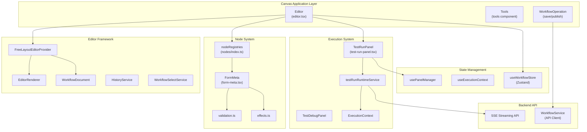
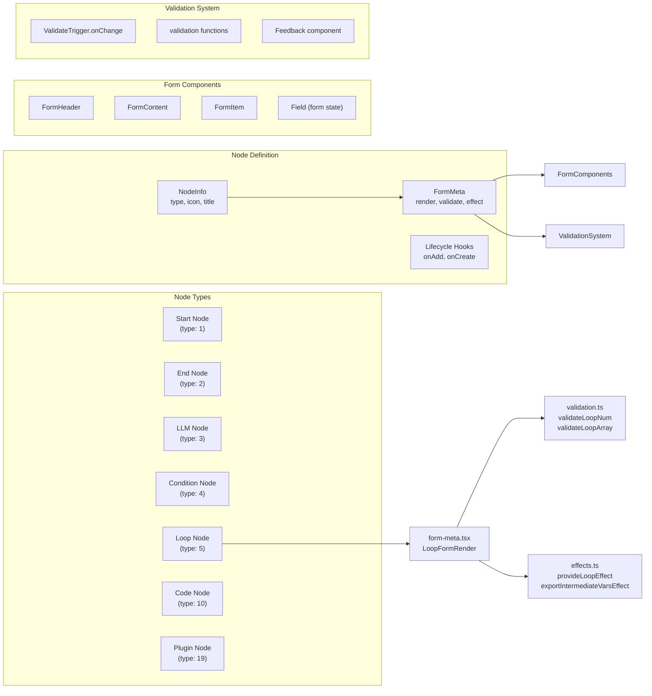
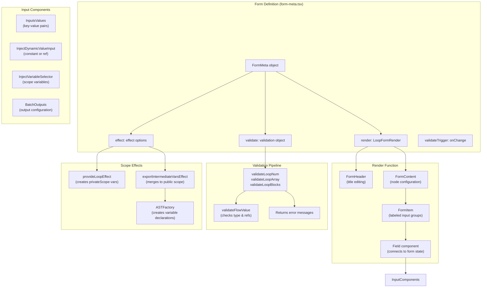
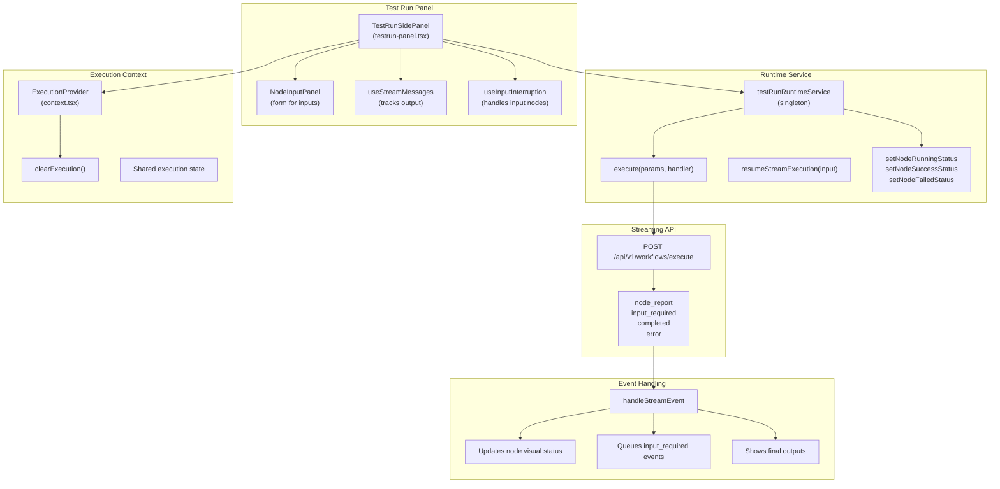
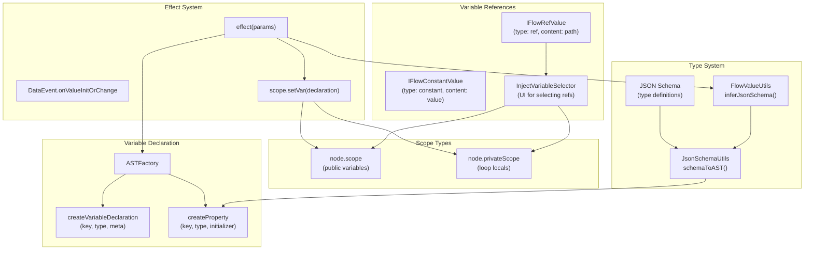
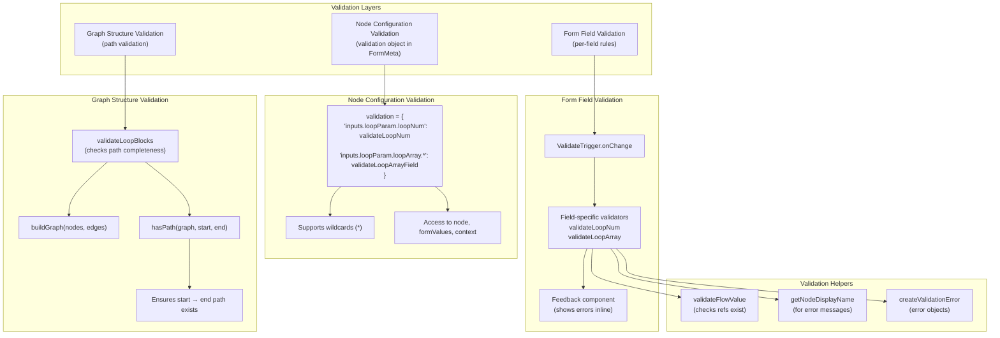
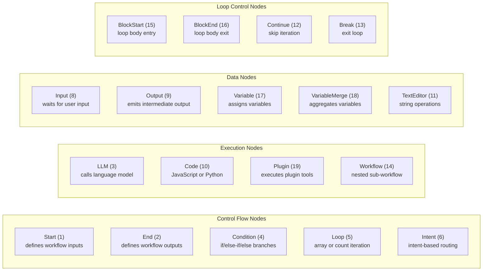
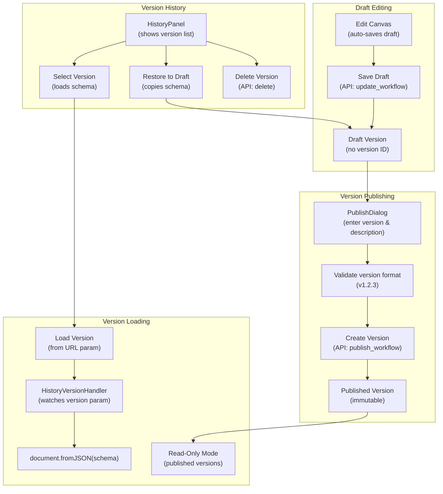

<!-- source: DeepWiki mcp.deepwiki.com · repo openJiuwen-ai/agent-studio · page 5.7 Workflow Canvas Architecture · fetched 2026-11-02 -->

# Workflow Canvas Architecture

<details>
<summary>Relevant source files</summary>

The following files were used as context for generating this wiki page:

- [frontend/packages/workflow-canvas/src/components/testrun/shared/use-input-interruption.ts](frontend/packages/workflow-canvas/src/components/testrun/shared/use-input-interruption.ts)
- [frontend/packages/workflow-canvas/src/components/testrun/testrun-panel/test-run-panel.tsx](frontend/packages/workflow-canvas/src/components/testrun/testrun-panel/test-run-panel.tsx)
- [frontend/packages/workflow-canvas/src/editor.tsx](frontend/packages/workflow-canvas/src/editor.tsx)
- [frontend/packages/workflow-canvas/src/nodes/loop/effects.ts](frontend/packages/workflow-canvas/src/nodes/loop/effects.ts)
- [frontend/packages/workflow-canvas/src/nodes/loop/form-meta.tsx](frontend/packages/workflow-canvas/src/nodes/loop/form-meta.tsx)
- [frontend/packages/workflow-canvas/src/nodes/loop/validation.ts](frontend/packages/workflow-canvas/src/nodes/loop/validation.ts)
- [frontend/packages/workflow-canvas/src/utils/validation/validation-helpers.ts](frontend/packages/workflow-canvas/src/utils/validation/validation-helpers.ts)
- [frontend/packages/workflow-canvas/src/utils/workflow-node-utils.ts](frontend/packages/workflow-canvas/src/utils/workflow-node-utils.ts)
- [frontend/src/locales/workflow/en-US/common.json](frontend/src/locales/workflow/en-US/common.json)
- [frontend/src/locales/workflow/en-US/nodes.json](frontend/src/locales/workflow/en-US/nodes.json)
- [frontend/src/locales/workflow/zh-CN/common.json](frontend/src/locales/workflow/zh-CN/common.json)
- [frontend/src/locales/workflow/zh-CN/nodes.json](frontend/src/locales/workflow/zh-CN/nodes.json)

</details>


## Purpose and Scope

This document describes the architecture of the Workflow Canvas, a visual workflow editor that allows users to create, configure, and test complex workflows through a drag-and-drop interface. The canvas supports multiple node types (LLM, Code, Plugin, Loop, Condition, etc.), provides real-time validation, and enables test execution with debugging capabilities.

For information about the overall system architecture, see [System Architecture](#5.1). For details on backend workflow execution, see [Agent Execution Pipeline](#5.5). For frontend patterns, see [Frontend Architecture](#5.2).

---

## Core Architecture Overview

The Workflow Canvas is built on top of the `@flowgram.ai/free-layout-editor` framework and extends it with domain-specific node types, validation, and execution capabilities.

### High-Level Component Structure



**Sources:** [frontend/packages/workflow-canvas/src/editor.tsx:1-251](), [frontend/packages/workflow-canvas/src/components/testrun/testrun-panel/test-run-panel.tsx:1-419]()

---

## Node System Architecture

The node system is the core abstraction that defines workflow building blocks. Each node type has its own registry, form configuration, validation rules, and scope effects.

### Node Registry Structure



**Node Type Mapping:**

| Node Type | Flow Node Type ID | Key Features |
|-----------|------------------|--------------|
| Start | `1` | Workflow entry point, defines inputs |
| End | `2` | Workflow exit point, defines outputs |
| LLM | `3` | Calls language models with prompts |
| Selector (Condition) | `4` | Conditional branching (if/else-if/else) |
| Loop | `5` | Iteration over arrays or fixed counts |
| Intent | `6` | Intent recognition with multiple branches |
| Questioner | `7` | Interactive questioning with max questions |
| Input | `8` | Pauses for user input during execution |
| Output | `9` | Outputs intermediate results |
| Code | `10` | Execute JavaScript or Python code |
| TextEditor | `11` | String concatenation/splitting |
| Continue | `12` | Skip current loop iteration |
| Break | `13` | Exit loop early |
| Workflow | `14` | Nested sub-workflow execution |
| BlockStart | `15` | Loop body start |
| BlockEnd | `16` | Loop body end |
| Variable | `17` | Variable assignment |
| VariableMerge | `18` | Aggregate variables from branches |
| Plugin | `19` | Execute plugin tools |

**Sources:** [frontend/src/locales/workflow/en-US/nodes.json:1-439](), [frontend/packages/workflow-canvas/src/utils/validation/validation-helpers.ts:10-35]()

---

## Canvas Editor Implementation

The canvas editor is built on `FreeLayoutEditorProvider` and provides a visual interface for workflow construction.

### Editor Component Structure

```mermaid
graph TB
    subgraph "Editor Component"
        EditorRoot["Editor<br/>(editor.tsx)"]
        FreeLayoutProvider["FreeLayoutEditorProvider<br/>(ref: editorRef)"]
        ExecutionProvider["ExecutionProvider"]
    end
    
    subgraph "Canvas Rendering"
        EditorRenderer["EditorRenderer<br/>(canvas view)"]
        SubCanvasRender["SubCanvasRender<br/>(for Loop nodes)"]
    end
    
    subgraph "State & Services"
        WorkflowDocument["WorkflowDocument<br/>toJSON(), fromJSON()"]
        HistoryService["HistoryService<br/>start(), stop()"]
        SelectService["WorkflowSelectService<br/>selectNode()"]
    end
    
    subgraph "Side Panels"
        NodeFormPanel["nodeFormPanelFactory<br/>(right panel)"]
        TestRunPanel["testRunPanelFactory<br/>(right panel)"]
        HistoryPanel["HistoryPanel<br/>(right overlay)"]
    end
    
    subgraph "Tools & Operations"
        Tools["Tools<br/>undo/redo/zoom/layout"]
        WorkflowOperation["WorkflowOperation<br/>save/publish/import/export"]
    end
    
    subgraph "Version Management"
        HistoryVersionHandler["HistoryVersionHandler<br/>(loads version schema)"]
        AutoOpenNodePanel["AutoOpenNodePanel<br/>(nodeId from URL)"]
    end
    
    EditorRoot --> FreeLayoutProvider
    FreeLayoutProvider --> EditorRenderer
    FreeLayoutProvider --> WorkflowDocument
    FreeLayoutProvider --> HistoryService
    FreeLayoutProvider --> SelectService
    
    EditorRoot --> ExecutionProvider
    EditorRoot --> HistoryVersionHandler
    EditorRoot --> AutoOpenNodePanel
    
    EditorRoot --> NodeFormPanel
    EditorRoot --> TestRunPanel
    EditorRoot --> HistoryPanel
    
    EditorRoot --> Tools
    EditorRoot --> WorkflowOperation
```



**Key Functions in Editor:**

- **`useWorkflowData()`**: Fetches workflow schema from API and manages auto-save
- **`useEditorProps()`**: Configures editor with node registries and canvas data
- **`HistoryVersionHandler`**: Loads historical versions and updates canvas via `document.fromJSON()`
- **`AutoOpenNodePanel`**: Opens node detail panel when `nodeId` is in URL query params

**Sources:** [frontend/packages/workflow-canvas/src/editor.tsx:156-250]()

---

## Form and Validation System

Each node has a form configuration that defines its UI, validation rules, and scope effects.

### Form Meta Architecture



**Loop Node Example:**

The loop node demonstrates the full form system:

- **Form Render**: [frontend/packages/workflow-canvas/src/nodes/loop/form-meta.tsx:193-404]()
  - Renders loop type selector (array vs count)
  - Renders array inputs with `ArrayInputsValues` component
  - Renders intermediate variables with `InputsValues` component
  - Renders loop outputs with `BatchOutputs` component

- **Validation**: [frontend/packages/workflow-canvas/src/nodes/loop/validation.ts:1-261]()
  - `validateLoopNum`: Checks loop count is 1-1000
  - `validateLoopArray`: Validates array configurations
  - `validateLoopBlocks`: Ensures path from blockStart to blockEnd

- **Effects**: [frontend/packages/workflow-canvas/src/nodes/loop/effects.ts:1-236]()
  - `provideLoopEffect`: Creates private scope variables (index, item, intermediates)
  - `exportIntermediateVarsEffect`: Exports outputs and intermediates to parent scope

**Sources:** [frontend/packages/workflow-canvas/src/nodes/loop/form-meta.tsx:406-414](), [frontend/packages/workflow-canvas/src/nodes/loop/validation.ts:253-260](), [frontend/packages/workflow-canvas/src/nodes/loop/effects.ts:159-235]()

---

## Execution and Testing System

The workflow canvas includes a test execution system for running workflows directly from the editor.

### Test Run Architecture



**Test Run Flow:**

1. **Initialization**: User opens test run panel via Tools component
2. **Input Collection**: `NodeInputPanel` renders form based on `formMeta` from Start node
3. **Execution Start**: 
   - Calls `testRunRuntimeService.execute()` with workflow ID and inputs
   - Clears previous node statuses
   - Opens SSE stream to backend
4. **Event Streaming**:
   - `node_report`: Updates node status (running/success/failed)
   - `input_required`: Pauses and shows input form
   - `completed`: Shows final outputs
   - `error`: Displays error and marks failed nodes
5. **Input Interruption**:
   - `useInputInterruption` manages queue of input requests
   - User fills form and clicks continue
   - Calls `resumeStreamExecution()` to continue
6. **Result Display**: Shows inputs/outputs in `NodeInputPanel`

**Sources:** [frontend/packages/workflow-canvas/src/components/testrun/testrun-panel/test-run-panel.tsx:236-293](), [frontend/packages/workflow-canvas/src/components/testrun/shared/use-input-interruption.ts:1-79]()

---

## Data Flow and Scope Management

The canvas implements a scope system for tracking variables and their types throughout the workflow.

### Scope Architecture



**Scope Management Example (Loop Node):**

1. **Private Scope Creation** [frontend/packages/workflow-canvas/src/nodes/loop/effects.ts:48-157]():
   - `provideLoopEffect` creates `${nodeId}_locals` variable declaration
   - Includes `index`, `item` (for array loops), and user-defined intermediate variables
   - Added to `node.privateScope` so only loop body can access

2. **Public Scope Export** [frontend/packages/workflow-canvas/src/nodes/loop/effects.ts:175-235]():
   - `exportIntermediateVarsEffect` creates `${nodeId}` variable declaration
   - Merges outputs (with `wrapArray` expressions) and intermediate variables
   - Added to `node.scope` so downstream nodes can access

3. **Type Inference**:
   - For constant values: Uses `schema` field directly
   - For references: Calls `FlowValueUtils.inferJsonSchema(flowValue, scope)`
   - Converts schemas to AST types via `JsonSchemaUtils.schemaToAST()`

**Sources:** [frontend/packages/workflow-canvas/src/nodes/loop/effects.ts:48-157](), [frontend/packages/workflow-canvas/src/nodes/loop/effects.ts:175-235]()

---

## Validation System

The canvas validates workflows at multiple levels: form field validation, node configuration validation, and graph structure validation.

### Validation Pipeline



**Validation Execution:**

1. **Field-Level Validation**:
   - Triggered on `onChange` due to `ValidateTrigger.onChange`
   - Executes validation function for specific field path
   - Returns error string or `undefined` if valid

2. **Node-Level Validation**:
   - Executes before save/publish operations
   - Matches field paths using wildcards (e.g., `inputs.loopParam.loopArray.*`)
   - Collects all errors across all fields

3. **Graph-Level Validation**:
   - Loop nodes validate internal structure [frontend/packages/workflow-canvas/src/nodes/loop/validation.ts:161-251]()
   - Builds graph from nodes and edges
   - Uses BFS to check if path exists from blockStart to blockEnd/continue/break
   - Returns error if no complete path found

**Common Validation Utilities:**

- **`validateFlowValue()`**: Checks if variable references exist in scope, validates required fields
- **`getNodeDisplayName()`**: Gets localized node type name for error messages [frontend/packages/workflow-canvas/src/utils/validation/validation-helpers.ts:41-57]()
- **`hasConnections()`**: Checks if node has input/output connections [frontend/packages/workflow-canvas/src/utils/validation/validation-helpers.ts:64-82]()

**Sources:** [frontend/packages/workflow-canvas/src/nodes/loop/validation.ts:1-261](), [frontend/packages/workflow-canvas/src/utils/validation/validation-helpers.ts:1-148]()

---

## Component Structure

The canvas is organized into modular components with clear responsibilities.

### Component Organization

```mermaid
graph TB
    subgraph "Editor Layer"
        Editor["editor.tsx<br/>(main entry point)"]
    end
    
    subgraph "Layout Components"
        Tools["components/tools<br/>(toolbar)"]
        WorkflowOperation["components/workflow-operation<br/>(save/publish/import/export)"]
        HistoryPanel["components/history-panel<br/>(version list)"]
    end
    
    subgraph "Node Components"
        BaseNode["components/base-node<br/>(node rendering)"]
        NodePanel["components/sidebar/node-panel<br/>(node configuration)"]
        NodeInputPanel["components/testrun/node-input-panel<br/>(input form)"]
    end
    
    subgraph "Form Materials"
        InputsValues["form-materials/inputs-values<br/>(key-value editor)"]
        BatchOutputs["form-materials/batch-outputs<br/>(output editor)"]
        InjectVariableSelector["form-materials/inject-variable-selector<br/>(scope picker)"]
        InjectDynamicValueInput["form-materials/inject-dynamic-value-input<br/>(constant or ref)"]
    end
    
    subgraph "Form Components"
        FormHeader["form-components/form-header<br/>(title editing)"]
        FormContent["form-components/form-content<br/>(scrollable container)"]
        FormItem["form-components/form-item<br/>(labeled field)"]
        FormSelect["form-components/form-select<br/>(dropdown)"]
    end
    
    subgraph "Node Definitions"
        NodesIndex["nodes/index.ts<br/>(nodeRegistries)"]
        LoopNode["nodes/loop/<br/>form-meta.tsx<br/>validation.ts<br/>effects.ts"]
        LLMNode["nodes/llm/"]
        ConditionNode["nodes/condition/"]
        OtherNodes["nodes/.../"]
    end
    
    subgraph "Hooks"
        UseWorkflowData["hooks/use-workflow-data<br/>(fetch & auto-save)"]
        UseEditorProps["hooks/use-editor-props<br/>(editor config)"]
        UseFormMeta["hooks/use-form-meta<br/>(start node inputs)"]
    end
    
    subgraph "Utilities"
        WorkflowNodeUtils["utils/workflow-node-utils<br/>(findNodeRecursively)"]
        ValidationHelpers["utils/validation/validation-helpers<br/>(error formatting)"]
    end
    
    Editor --> Tools
    Editor --> WorkflowOperation
    Editor --> HistoryPanel
    Editor --> BaseNode
    Editor --> NodesIndex
    
    NodePanel --> FormHeader
    NodePanel --> FormContent
    FormContent --> FormItem
    FormItem --> InputsValues
    FormItem --> BatchOutputs
    FormItem --> InjectVariableSelector
    
    NodesIndex --> LoopNode
    NodesIndex --> LLMNode
    NodesIndex --> ConditionNode
    LoopNode --> InputsValues
    LoopNode --> BatchOutputs
    
    Editor --> UseWorkflowData
    Editor --> UseEditorProps
    NodeInputPanel --> UseFormMeta
    
    LoopNode --> WorkflowNodeUtils
    LoopNode --> ValidationHelpers
```



**Key Component Responsibilities:**

| Component | Purpose | Location |
|-----------|---------|----------|
| `Editor` | Main entry point, orchestrates all sub-systems | [editor.tsx:156-250]() |
| `Tools` | Toolbar with undo/redo/zoom/layout/test run | components/tools |
| `WorkflowOperation` | Save/publish/import/export operations | components/workflow-operation |
| `HistoryPanel` | Version history with restore/delete | components/history-panel |
| `TestRunPanel` | Test execution with streaming results | [testrun-panel.tsx:39-412]() |
| `NodeFormPanel` | Node configuration sidebar | components/sidebar |
| `InputsValues` | Key-value pair editor for inputs | form-materials/inputs-values |
| `BatchOutputs` | Output variable configuration | form-materials/batch-outputs |
| `InjectVariableSelector` | Variable selector from scope | form-materials/inject-variable-selector |
| `InjectDynamicValueInput` | Switch between constant and reference | form-materials/inject-dynamic-value-input |

**Sources:** [frontend/packages/workflow-canvas/src/editor.tsx:1-251](), [frontend/packages/workflow-canvas/src/components/testrun/testrun-panel/test-run-panel.tsx:1-419]()

---

## Node Type Details

Each node type has unique configuration and behavior.

### Node Type Implementations



**Node Configuration Patterns:**

1. **LLM Node**:
   - Selects model via `FormModel` component
   - Configures system/user prompts with variable injection
   - Supports output format selection (text/markdown/JSON)
   - Can link to versioned prompt templates

2. **Condition Node**:
   - Supports if/else-if/else branches
   - Each branch has conditional logic (equals, contains, isEmpty, etc.)
   - Validates all required branches are connected
   - Outputs to different ports based on condition

3. **Loop Node**:
   - Two modes: array loop (iterate over arrays) or count loop (fixed iterations)
   - Array loop supports multiple parallel arrays (uses shortest length)
   - Creates private scope for loop locals (index, item, intermediates)
   - Exports aggregated outputs as wrapped arrays
   - Contains nested canvas with blockStart/blockEnd nodes

4. **Plugin Node**:
   - Selects plugin and tool via `PluginSelector`
   - Dynamically generates form based on tool's input schema
   - Supports both URL-based and code-based plugins
   - Version selection for published plugins

5. **Input Node**:
   - Pauses workflow execution during test run
   - Prompts user for input values
   - Queues multiple input requests if needed
   - Resumes execution via `resumeStreamExecution()`

**Sources:** [frontend/src/locales/workflow/en-US/nodes.json:1-439](), [frontend/packages/workflow-canvas/src/nodes/loop/form-meta.tsx:193-404]()

---

## Internationalization

The canvas supports multiple languages through a comprehensive i18n system.

### I18n Structure

**Translation Files:**
- `frontend/src/locales/workflow/en-US/nodes.json`: Node-specific translations
- `frontend/src/locales/workflow/en-US/common.json`: Shared translations
- `frontend/src/locales/workflow/zh-CN/nodes.json`: Chinese node translations
- `frontend/src/locales/workflow/zh-CN/common.json`: Chinese shared translations

**Translation Categories:**

| Category | Examples |
|----------|----------|
| Node Titles | `nodes.llm.titlePrefix`, `nodes.loop.titlePrefix` |
| Node Descriptions | `nodes.code.description`, `nodes.plugin.description` |
| Validation Errors | `nodes.loop.loopCountCannotBeEmpty`, `nodes.condition.ifBranchMustBeConnected` |
| Form Labels | `formMaterials.common.selectVariable`, `formMaterials.editor.defaultValue` |
| UI Actions | `workflow.save`, `workflow.publish`, `testrun.testRun` |
| Error Messages | `editorStates.loadFailed`, `validation.nodeValidationError` |

**Sources:** [frontend/src/locales/workflow/en-US/nodes.json:1-439](), [frontend/src/locales/workflow/en-US/common.json:1-300](), [frontend/src/locales/workflow/zh-CN/nodes.json:1-439](), [frontend/src/locales/workflow/zh-CN/common.json:1-300]()

---

## Version Management

The canvas supports draft and published versions with history tracking.

### Version Management Flow



**Version State Management:**

The `useWorkflowStore` (Zustand) manages version state:
- `selectedVersion`: Currently loaded version ID or 'draft'
- `showHistoryPanel`: Controls history panel visibility
- `historyRefreshTs`: Timestamp to trigger history refresh
- `setSelectedVersion()`: Switches between versions
- `openHistoryPanel()`: Opens history panel
- `closeHistoryPanel()`: Closes history panel

**Version Switching Process:**

1. User selects version from `HistoryPanel` or URL contains `?version=v1.0.0`
2. `HistoryVersionHandler` detects version change [frontend/packages/workflow-canvas/src/editor.tsx:46-103]()
3. Fetches version schema via `WorkflowService.getWorkflowCanvas()`
4. Stops history tracking with `historyService.stop()`
5. Clears canvas with `document.clear()`
6. Loads new schema with `document.fromJSON(parsed)`
7. Restarts history tracking with `historyService.start()`
8. Fits canvas view to content

**Sources:** [frontend/packages/workflow-canvas/src/editor.tsx:46-103]()

---

## Utility Functions

The canvas includes utility functions for common operations.

### Workflow Node Utils

**File:** [frontend/packages/workflow-canvas/src/utils/workflow-node-utils.ts:1-140]()

| Function | Purpose |
|----------|---------|
| `findNodeRecursively(blocks, targetId)` | Recursively searches for node by ID, including nested nodes in loops |
| `extractNumberFromTitle(title)` | Extracts trailing number from node title (e.g., "LLM_5" → 5) |
| `findNodesByType(nodes, targetType)` | Recursively finds all nodes of a specific type |
| `generateNodeTitle(nodeType, context, prefix)` | Generates unique node title with auto-incrementing number |

**Usage Example:**
```typescript
// Find node recursively (handles loop nesting)
const node = findNodeRecursively(document.root.blocks, nodeId)

// Generate unique title for new LLM node
const title = generateNodeTitle('3', context, 'LLM')
// Returns: "LLM" for first node, "LLM_1" for second, etc.
```

### Validation Helpers

**File:** [frontend/packages/workflow-canvas/src/utils/validation/validation-helpers.ts:1-148]()

| Function | Purpose |
|----------|---------|
| `getNodeDisplayName(node)` | Gets localized display name for node |
| `hasConnections(node)` | Checks if node has input/output connections |
| `extractPropertyName(name, pattern)` | Extracts field name from full path |
| `createValidationError(nodeId, title, error, field, severity)` | Creates validation error object |
| `isConstantValueEmpty(value)` | Checks if constant value is empty |
| `hasMinimumOutputs(outputs, minCount)` | Validates minimum output count |

**Sources:** [frontend/packages/workflow-canvas/src/utils/workflow-node-utils.ts:1-140](), [frontend/packages/workflow-canvas/src/utils/validation/validation-helpers.ts:1-148]()

---

