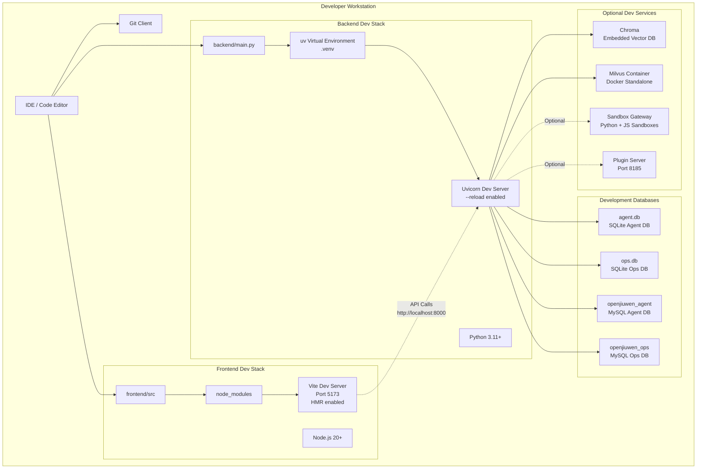
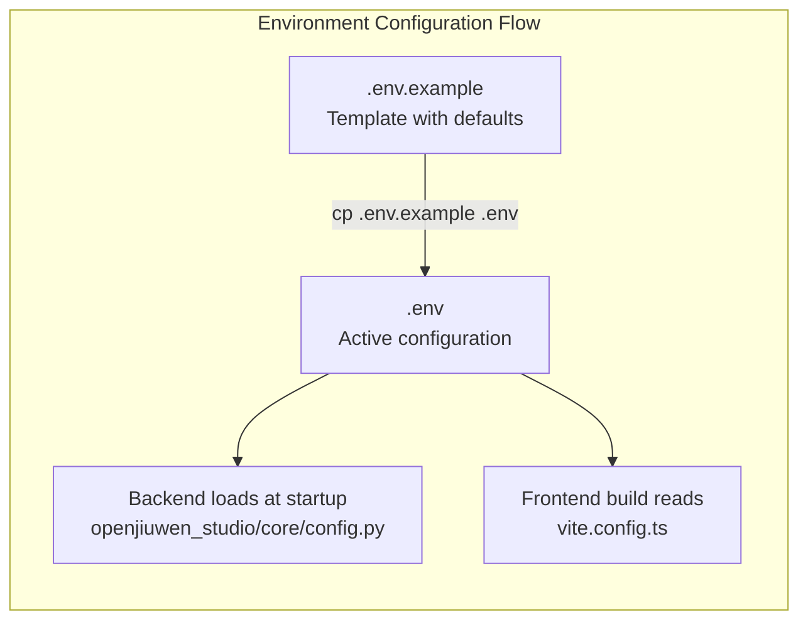
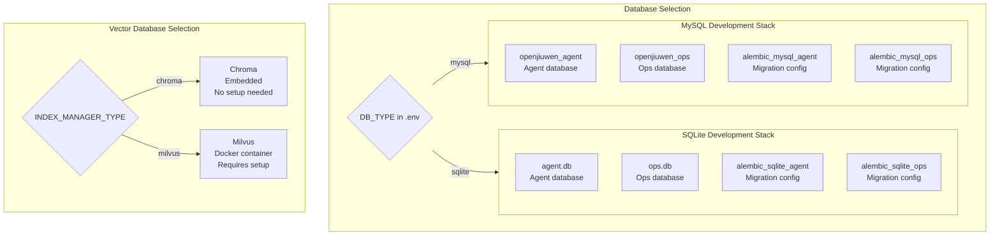
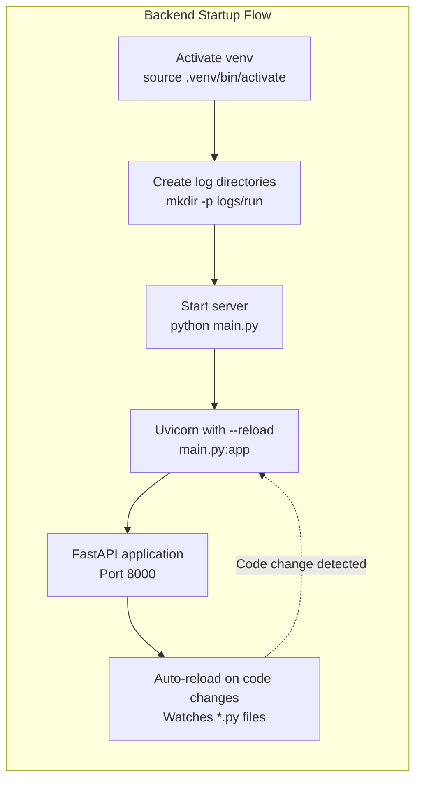
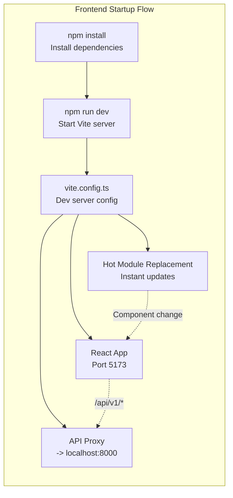
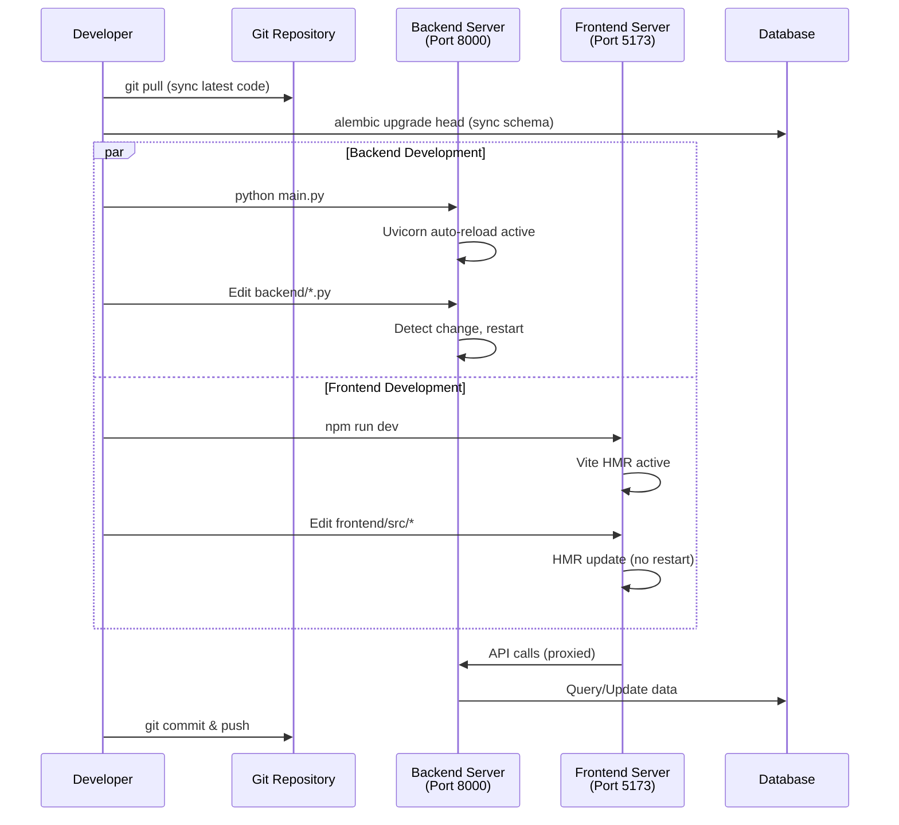
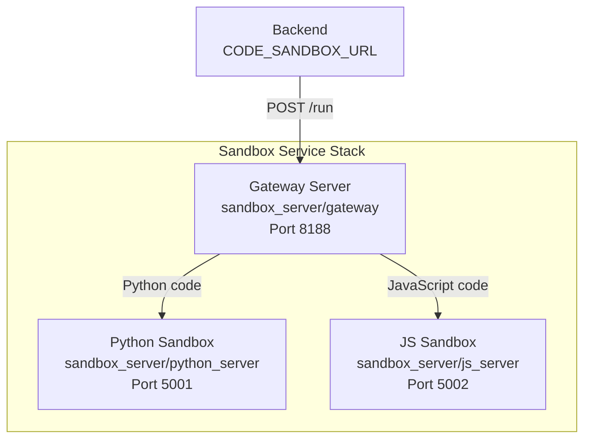

<!-- source: DeepWiki mcp.deepwiki.com · repo openJiuwen-ai/agent-studio · page 6.1 Development Environment Setup · fetched 2026-11-02 -->

# Development Environment Setup

<details>
<summary>Relevant source files</summary>

The following files were used as context for generating this wiki page:

- [backend/DATABASE_MIGRATION_DEVELOPMENT_GUIDE_EN.md](backend/DATABASE_MIGRATION_DEVELOPMENT_GUIDE_EN.md)
- [backend/GENERATE_MIGRATION_USAGE_EN.md](backend/GENERATE_MIGRATION_USAGE_EN.md)
- [docs/en/2.Installation Guide/Local Installation/Linux_Installation.md](docs/en/2.Installation Guide/Local Installation/Linux_Installation.md)
- [docs/en/2.Installation Guide/Local Installation/MacOS_Installation.md](docs/en/2.Installation Guide/Local Installation/MacOS_Installation.md)
- [docs/en/2.Installation Guide/Local Installation/Windows_Installation.md](docs/en/2.Installation Guide/Local Installation/Windows_Installation.md)

</details>


## Purpose and Scope

This document provides comprehensive guidance for setting up a local development environment for OpenJiuwen Agent Studio. It covers the installation of development dependencies, configuration of development services, and establishment of a productive development workflow with hot reload capabilities.

**Related Documentation:**
- For production deployment, see [Docker Deployment](#7.1)
- For database schema changes during development, see [Database Migrations](#6.2)
- For frontend-specific development patterns, see [Frontend Development](#6.3)
- For backend-specific development patterns, see [Backend Development](#6.4)

---

## System Requirements

### Minimum Hardware Requirements

| Component | Minimum | Recommended |
|-----------|---------|-------------|
| **CPU** | 2 cores | 4+ cores |
| **RAM** | 4 GB | 8+ GB |
| **Disk Space** | 10 GB free | 20+ GB free |

### Software Prerequisites

| Software | Version | Purpose |
|----------|---------|---------|
| **Git** | 2.40+ | Source code management |
| **Node.js** | 20.0+ | Frontend development server |
| **npm** | 10.0+ | Frontend package management |
| **Python** | 3.11+ | Backend runtime |
| **uv** | 0.5.0+ | Python dependency management |
| **MySQL** | 8.0+ | Optional: relational database |
| **Docker** | Latest | Optional: for Milvus vector database |

### Supported Operating Systems

- **Linux**: Ubuntu 22.04+ (recommended), Debian-based distributions
- **macOS**: 14.0+ (Sonoma or later)
- **Windows**: Windows 10+ with PowerShell 5.1+

Sources: [docs/en/2.Installation Guide/Local Installation/Linux_Installation.md:6-26](), [docs/en/2.Installation Guide/Local Installation/MacOS_Installation.md:6-24](), [docs/en/2.Installation Guide/Local Installation/Windows_Installation.md:6-25]()

---

## Development Environment Architecture



**Key Development Components:**

| Component | Path | Port | Purpose |
|-----------|------|------|---------|
| **Backend** | `backend/main.py` | 8000 | FastAPI application with auto-reload |
| **Frontend** | `frontend/` | 5173 | Vite dev server with HMR |
| **Agent DB** | `backend/agent.db` or MySQL | - | Agent, workflow, knowledge base data |
| **Ops DB** | `backend/ops.db` or MySQL | - | Prompt templates, operational data |
| **Chroma** | `backend/memory-data/` | - | Embedded vector database (default) |
| **Milvus** | Docker container | 19530 | Alternative vector database |

Sources: [docs/en/2.Installation Guide/Local Installation/Linux_Installation.md:218-381](), [backend/DATABASE_MIGRATION_DEVELOPMENT_GUIDE_EN.md:1-21]()

---

## Initial Setup

### Step 1: Clone the Repository

```bash
# Configure Git credentials for multiple operations during setup
git config --global credential.helper store
git config --global user.name "your_username"
git config --global user.email "your_email"

# Clone the repository
git clone https://github.com/openJiuwen-ai/agent-studio.git
cd agent-studio
```

**Repository Structure:**

```
agent-studio/
├── backend/                 # FastAPI backend
│   ├── main.py             # Application entry point
│   ├── pyproject.toml      # Python dependencies
│   ├── alembic.ini         # Database migration config
│   ├── openjiuwen_studio/  # Core application code
│   └── upgrade/            # Alembic migration scripts
├── frontend/               # React frontend
│   ├── package.json        # Node.js dependencies
│   ├── vite.config.ts      # Vite configuration
│   └── src/                # Frontend source code
├── sandbox_server/         # Code execution sandboxes
├── plugin_server/          # Plugin execution server
├── scripts/                # Utility scripts
├── .env.example            # Environment template
└── README.md
```

Sources: [docs/en/2.Installation Guide/Local Installation/Linux_Installation.md:220-243]()

### Step 2: Install Backend Dependencies

```bash
cd backend

# Create Python virtual environment with uv
uv venv

# Install all dependencies
uv sync
```

**Dependency Management:**

- **uv** is used instead of pip for faster, more reliable dependency resolution
- Dependencies are declared in `backend/pyproject.toml`
- The virtual environment is created at `backend/.venv/`

**Configuration for Mirrors (Optional):**

Edit `backend/pyproject.toml` if default PyPI is slow:

```toml
[[tool.uv.index]]
url = "https://pypi.tuna.tsinghua.edu.cn/simple"  # Example mirror
```

**Troubleshooting:**

If `uv sync` hangs for >20 minutes or fails:
- Press Ctrl+C to cancel
- Try `uv sync --native-tls` to use system native TLS library
- Change the PyPI mirror in `pyproject.toml`

Sources: [docs/en/2.Installation Guide/Local Installation/Linux_Installation.md:318-342](), [docs/en/2.Installation Guide/MacOS_Installation.md:283-307]()

### Step 3: Install Frontend Dependencies

```bash
cd frontend

# Install Node.js packages
npm install
```

**Package Management:**

- Dependencies are declared in `frontend/package.json`
- Node modules are installed to `frontend/node_modules/`
- Known npm audit warnings can be safely ignored (they do not affect functionality)

**Configuration for Mirrors (Optional):**

```bash
# Use a faster npm registry (example: China mirror)
npm config set registry https://registry.npmmirror.com
```

Sources: [docs/en/2.Installation Guide/Local Installation/Linux_Installation.md:354-362]()

---

## Environment Configuration

### Environment Variables Setup

```bash
# Copy the example configuration
cp .env.example .env

# Edit the .env file with your settings
```

**Core Development Variables:**



**Essential Variables for Development:**

| Variable | Default | Development Value | Description |
|----------|---------|-------------------|-------------|
| `DB_TYPE` | `sqlite` | `sqlite` or `mysql` | Relational database type |
| `DB_HOST` | `localhost` | `localhost` | Database host |
| `DB_PORT` | `3306` | `3306` | MySQL port (if using MySQL) |
| `DB_USER` | - | `your_user_name` | Database username |
| `DB_PASSWORD` | - | `your_password` | Database password |
| `INDEX_MANAGER_TYPE` | `chroma` | `chroma` or `milvus` | Vector database type |
| `MEMORY_DATA_PATH` | `memory-data` | `memory-data` | Chroma data directory |
| `CODE_SANDBOX_URL` | - | `http://localhost:8188/run` | Optional: sandbox service |
| `VITE_PLUGIN_SERVICE_URL` | - | `http://localhost:8185` | Optional: plugin server |

**Database Type Selection:**

For development, **SQLite is recommended** because:
- No additional installation required
- Simpler setup
- Sufficient for development and testing
- Database files stored in `backend/` directory

Use MySQL when:
- Testing production-like scenarios
- Developing features requiring concurrent writes
- Testing user permission management

Sources: [docs/en/2.Installation Guide/Local Installation/Linux_Installation.md:264-316]()

### Optional: AES Key Generation

For testing encrypted field storage:

```bash
cd scripts
bash build_AES_master_key.sh

# Export the generated key
export SERVER_AES_MASTER_KEY_ENV=your_generated_key
```

**Important:** The AES key must remain unchanged after initial setup. Changing it will make previously encrypted data undecipherable.

Sources: [docs/en/2.Installation Guide/Local Installation/Linux_Installation.md:245-258]()

---

## Database Setup for Development

### Database Type Configuration Matrix



### SQLite Setup (Default for Development)

**No manual setup required.** Database files are created automatically on first run.

**Initial Database Stamp:**

```bash
cd backend

# Activate virtual environment
source .venv/bin/activate  # Linux/macOS
# OR
.\.venv\Scripts\Activate.ps1  # Windows PowerShell

# Stamp databases to mark initial version
alembic -n alembic_sqlite_agent stamp head
alembic -n alembic_sqlite_ops stamp head
```

**Why stamp is needed:** This marks the database as being at the latest migration version without executing the migrations (which would fail since tables don't exist yet). The application's `Base.metadata.create_all()` will create the tables on first run.

Sources: [backend/DATABASE_MIGRATION_DEVELOPMENT_GUIDE_EN.md:369-395]()

### MySQL Setup (Optional)

**Step 1: Install MySQL**

See platform-specific instructions:
- Linux: [docs/en/2.Installation Guide/Local Installation/Linux_Installation.md:166-208]()
- macOS: [docs/en/2.Installation Guide/Local Installation/MacOS_Installation.md:126-168]()
- Windows: [docs/en/2.Installation Guide/Local Installation/Windows_Installation.md:138-188]()

**Step 2: Create Databases and User**

```sql
-- Connect to MySQL as root
mysql -u root -p

-- Create databases
CREATE DATABASE openjiuwen_agent;
CREATE DATABASE openjiuwen_ops;

-- Create user
CREATE USER 'your_user_name'@'localhost' IDENTIFIED BY 'your_password';

-- Grant privileges
GRANT ALL PRIVILEGES ON openjiuwen_agent.* TO 'your_user_name'@'localhost';
GRANT ALL PRIVILEGES ON openjiuwen_ops.* TO 'your_user_name'@'localhost';
FLUSH PRIVILEGES;
```

**Step 3: Update .env Configuration**

```env
DB_TYPE=mysql
DB_HOST=localhost
DB_PORT=3306
DB_USER=your_user_name
DB_PASSWORD=your_password  # URL-encode special characters if needed
```

**Step 4: Stamp MySQL Databases**

```bash
cd backend
source .venv/bin/activate

alembic -n alembic_mysql_agent stamp head
alembic -n alembic_mysql_ops stamp head
```

Sources: [docs/en/2.Installation Guide/Local Installation/Linux_Installation.md:166-208](), [backend/DATABASE_MIGRATION_DEVELOPMENT_GUIDE_EN.md:86-106]()

### Alembic Multi-Database Configuration

**Database Instance Mapping:**

| Alembic Config Name | Database Type | Purpose | Config Path |
|---------------------|---------------|---------|-------------|
| `alembic_sqlite_agent` | SQLite | Agent data | `backend/upgrade/sqlite/alembic_agent/` |
| `alembic_sqlite_ops` | SQLite | Ops data | `backend/upgrade/sqlite/alembic_ops/` |
| `alembic_mysql_agent` | MySQL | Agent data | `backend/upgrade/mysql/alembic_agent/` |
| `alembic_mysql_ops` | MySQL | Ops data | `backend/upgrade/mysql/alembic_ops/` |

**Common Alembic Commands for Development:**

```bash
# Check current database version
alembic -n alembic_sqlite_agent current

# Upgrade to latest version (after pulling code)
alembic -n alembic_sqlite_agent upgrade head

# View migration history
alembic -n alembic_sqlite_agent history
```

For detailed database migration workflows, see [Database Migrations](#6.2).

Sources: [backend/DATABASE_MIGRATION_DEVELOPMENT_GUIDE_EN.md:86-155]()

---

## Running in Development Mode

### Backend Development Server



**Start Backend:**

```bash
cd backend

# Activate virtual environment
source .venv/bin/activate  # Linux/macOS
# OR
.\.venv\Scripts\Activate.ps1  # Windows PowerShell

# Create log directories
mkdir -p logs/run  # Linux/macOS
# OR
mkdir logs; mkdir logs\run  # Windows

# Start development server
python main.py
```

**Expected Output:**

```
INFO:     Uvicorn running on http://0.0.0.0:8000 (Press CTRL+C to quit)
INFO:     Started reloader process [PID] using WatchFiles
INFO:     Started server process [PID]
INFO:     Waiting for application startup.
✅ agent database: version is already up to date
   Current version: xxxxx
   Latest version: xxxxx
INFO:     Application startup complete.
```

**Auto-Reload Configuration:**

The backend uses Uvicorn's auto-reload feature, configured in `backend/main.py`:
- Watches all `.py` files in the backend directory
- Automatically restarts when code changes are detected
- Reload typically takes 1-2 seconds

**Backend runs on:** `http://localhost:8000`

Sources: [docs/en/2.Installation Guide/Local Installation/Linux_Installation.md:343-350]()

### Frontend Development Server



**Start Frontend:**

```bash
cd frontend

# Start development server
npm run dev
```

**Expected Output:**

```
  VITE v5.x.x  ready in xxx ms

  ➜  Local:   http://localhost:5173/
  ➜  Network: http://192.168.x.x:5173/
  ➜  press h + enter to show help
```

**Hot Module Replacement (HMR):**

- Vite provides instant updates when source files change
- Changes to React components, CSS, and other assets are reflected immediately without full page reload
- State preservation during HMR for faster development iteration

**Frontend runs on:** `http://localhost:5173`

**Accessing the Application:**

Open `http://localhost:5173` in your browser. The frontend will automatically proxy API requests to the backend at `http://localhost:8000`.

Sources: [docs/en/2.Installation Guide/Local Installation/Linux_Installation.md:364-375]()

---

## Development Workflow

### Typical Development Session



### Before Starting Development

**1. Sync with Remote:**

```bash
git pull origin main
```

**2. Check Database Version:**

```bash
cd backend
alembic -n alembic_sqlite_agent current
alembic -n alembic_sqlite_agent heads
```

If `current` is behind `heads`, upgrade:

```bash
alembic -n alembic_sqlite_agent upgrade head
alembic -n alembic_sqlite_ops upgrade head
```

**3. Update Dependencies (if needed):**

```bash
# Backend
cd backend
uv sync

# Frontend
cd frontend
npm install
```

Sources: [backend/DATABASE_MIGRATION_DEVELOPMENT_GUIDE_EN.md:292-343]()

### Making Code Changes

**Backend Changes:**

1. Edit files in `backend/openjiuwen_studio/`
2. Uvicorn detects changes and auto-restarts
3. Check terminal for restart confirmation and any errors
4. Test changes via API or frontend

**Frontend Changes:**

1. Edit files in `frontend/src/`
2. Vite HMR updates the browser automatically
3. Check browser console for any errors
4. Test changes in the UI

**Database Schema Changes:**

See [Database Migrations](#6.2) for full workflow. Quick reference:

```bash
# Generate migration after model changes
cd backend
python generate_migration.py --autogenerate -m "feat: add user profile"

# Apply migration
alembic -n alembic_sqlite_agent upgrade head
```

Sources: [backend/GENERATE_MIGRATION_USAGE_EN.md:10-19]()

### Testing Changes

**Manual Testing:**

1. Access the application at `http://localhost:5173`
2. Verify functionality through the UI
3. Check browser DevTools console for errors
4. Check backend terminal for API logs

**Log Locations:**

- **Backend logs:** `backend/logs/run/`
- **Frontend logs:** Browser DevTools console

---

## Optional Services Setup

### Code Sandbox Service (Optional)

Required for:
- Code node in workflows
- Code-based plugins

**Architecture:**



**Setup:**

1. **Configure Python Sandbox:**

```bash
# Create .env in sandbox_server/python_server/
cat > sandbox_server/python_server/.env << EOF
HOST=0.0.0.0
PORT=5001
EOF

# Start Python sandbox
cd sandbox_server/python_server
python openjiuwen_sandbox_pyserver/kernel.py
```

2. **Start JS Sandbox:**

```bash
# Starts on port 5002 by default
cd sandbox_server/js_server
node kernel.js
```

3. **Configure and Start Gateway:**

```bash
# Create .env in sandbox_server/gateway/
cat > sandbox_server/gateway/.env << EOF
ENABLE_LINUX_SANDBOX=0
HOST=0.0.0.0
PORT=8188
PYTHON_SANDBOX_URL=http://localhost:5001/run
JS_SANDBOX_URL=http://localhost:5002/run
EOF

# Start gateway
cd sandbox_server/gateway
python openjiuwen_sandbox_gateway/server.py
```

4. **Update Backend .env:**

```env
CODE_SANDBOX_URL=http://localhost:8188/run
```

Sources: [docs/en/2.Installation Guide/Local Installation/Linux_Installation.md:455-533]()

### Plugin Server (Optional)

Required for:
- External plugins that need dedicated server

**Setup:**

1. **Start Plugin Server:**

```bash
cd plugin_server/openjiuwen_plugin_server
python run_restful.py
```

2. **Update Backend .env:**

```env
VITE_PLUGIN_SERVICE_URL=http://localhost:8185
VITE_PLUGIN_CONFIG_PATH=/config.json
```

Sources: [docs/en/2.Installation Guide/Local Installation/Linux_Installation.md:534-541]()

### Milvus Vector Database (Optional)

For development, **Chroma is recommended** as it requires no additional setup. Use Milvus when:
- Testing production-like vector database scenarios
- Developing features requiring Milvus-specific functionality

**Prerequisites:**
- Docker Desktop installed
- CPU with AVX instruction set support

**Setup with Docker:**

```bash
# Download standalone script
curl -sfL https://raw.githubusercontent.com/milvus-io/milvus/master/scripts/standalone_embed.sh -o standalone_embed.sh

# Pull Milvus image (x86)
docker pull swr.cn-north-4.myhuaweicloud.com/openjiuwen/milvusdb/milvus-amd64:v2.6.2

# Edit standalone_embed.sh to use the pulled image
# Replace milvusdb/milvus:v2.6.7 with:
# swr.cn-north-4.myhuaweicloud.com/openjiuwen/milvusdb/milvus-amd64:v2.6.2

# Start Milvus
bash standalone_embed.sh start

# Verify running
docker ps -a
# Should show milvus-standalone on port 19530
```

**Update .env:**

```env
INDEX_MANAGER_TYPE=milvus
MILVUS_HOST=127.0.0.1
MILVUS_PORT=19530
MILVUS_COLLECTION_NAME=memory_vector
```

**Stop Milvus:**

```bash
bash standalone_embed.sh stop
```

Sources: [docs/en/2.Installation Guide/Local Installation/Linux_Installation.md:389-428]()

---

## Tools and Debugging

### IDE and Editor Setup

**Recommended IDEs:**

- **VS Code** (most common)
- **PyCharm** (for backend-focused development)
- **WebStorm** (for frontend-focused development)

**VS Code Extensions:**

```json
{
  "recommendations": [
    "ms-python.python",
    "ms-python.vscode-pylance",
    "dbaeumer.vscode-eslint",
    "esbenp.prettier-vscode",
    "vue.volar",
    "bradlc.vscode-tailwindcss"
  ]
}
```

### Backend Debugging

**Method 1: VS Code Debugger**

Create `.vscode/launch.json`:

```json
{
  "version": "0.2.0",
  "configurations": [
    {
      "name": "Backend: Debug",
      "type": "python",
      "request": "launch",
      "module": "uvicorn",
      "args": [
        "main:app",
        "--reload",
        "--host", "0.0.0.0",
        "--port", "8000"
      ],
      "cwd": "${workspaceFolder}/backend",
      "env": {
        "PYTHONPATH": "${workspaceFolder}/backend"
      },
      "console": "integratedTerminal"
    }
  ]
}
```

**Method 2: Print Debugging**

```python
# In backend code
import logging
logger = logging.getLogger(__name__)

logger.debug("Debug message")
logger.info("Info message")
logger.error("Error message")
```

Logs appear in:
- Terminal output
- `backend/logs/run/` directory

**Method 3: Interactive Debugger**

```python
# Add breakpoint in code
import pdb; pdb.set_trace()

# Or use built-in breakpoint()
breakpoint()
```

### Frontend Debugging

**Browser DevTools:**

- **Console:** View logs, errors, and warnings
- **Network:** Monitor API requests/responses
- **Sources:** Set breakpoints in TypeScript/JavaScript
- **React DevTools:** Inspect component hierarchy and state

**Logging in Frontend:**

```typescript
// Console logging
console.log('Debug info:', data);
console.error('Error occurred:', error);

// React Query DevTools (already configured)
// Open browser and look for React Query icon in bottom-right
```

**API Debugging:**

Check network requests in DevTools:
- All API calls go to `/api/v1/*`
- Proxied to backend at `http://localhost:8000`
- Inspect request/response payloads

### Log File Locations

| Service | Log Location | Purpose |
|---------|--------------|---------|
| **Backend** | `backend/logs/run/` | Application logs |
| **Uvicorn** | Terminal output | HTTP request logs |
| **Vite** | Terminal output | Frontend build logs |
| **Alembic** | Terminal output | Database migration logs |

### Common Development Issues

**Backend won't start:**

```bash
# Check if port 8000 is in use
lsof -i :8000  # Linux/macOS
netstat -ano | findstr :8000  # Windows

# Kill process if needed
kill -9 <PID>  # Linux/macOS
taskkill /PID <PID> /F  # Windows
```

**Frontend won't start:**

```bash
# Check if port 5173 is in use
lsof -i :5173  # Linux/macOS
netstat -ano | findstr :5173  # Windows

# Clear node_modules and reinstall
rm -rf node_modules package-lock.json
npm install
```

**Database connection errors:**

```bash
# Check database configuration
cat .env | grep DB_

# Test MySQL connection
mysql -h localhost -u your_user_name -p

# Reset SQLite databases
rm backend/agent.db backend/ops.db
# Restart backend to recreate
```

**Database version mismatch:**

```bash
# Check current version
cd backend
alembic -n alembic_sqlite_agent current

# Upgrade to latest
alembic -n alembic_sqlite_agent upgrade head
```

---

## Quick Reference Commands

### Daily Development Commands

```bash
# Start development session
cd agent-studio

# Terminal 1: Backend
cd backend
source .venv/bin/activate
python main.py

# Terminal 2: Frontend
cd frontend
npm run dev

# Terminal 3: Optional - Sandbox
cd sandbox_server/gateway
python openjiuwen_sandbox_gateway/server.py
```

### Database Commands

```bash
# Check database version
alembic -n alembic_sqlite_agent current

# Upgrade database
alembic -n alembic_sqlite_agent upgrade head

# Generate migration after model changes
python generate_migration.py --autogenerate -m "feat: description"
```

### Dependency Updates

```bash
# Update backend dependencies
cd backend
uv sync

# Update frontend dependencies
cd frontend
npm install
```

### Code Quality

```bash
# Backend linting (if configured)
cd backend
flake8 openjiuwen_studio/

# Frontend linting
cd frontend
npm run lint
```

---

## Next Steps

After setting up your development environment:

- **Understand the architecture:** Review [System Architecture](#5.1) and [Backend Architecture](#5.3)
- **Make database changes:** See [Database Migrations](#6.2) for schema modification workflows
- **Develop frontend features:** See [Frontend Development](#6.3) for component patterns
- **Develop backend features:** See [Backend Development](#6.4) for API development
- **Create workflow nodes:** See [Creating Custom Workflow Nodes](#6.5)
- **Build plugins:** See [Plugin SDK](#6.6)
- **Write tests:** See [Testing & Debugging](#6.7)

Sources: All sections above

---

