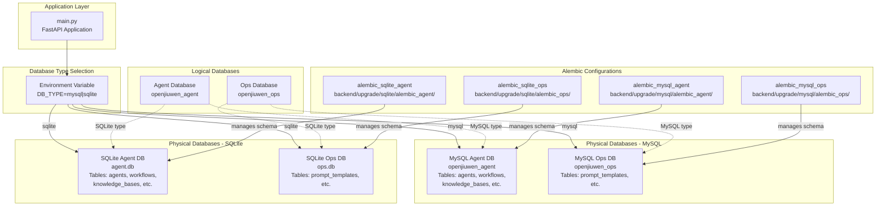
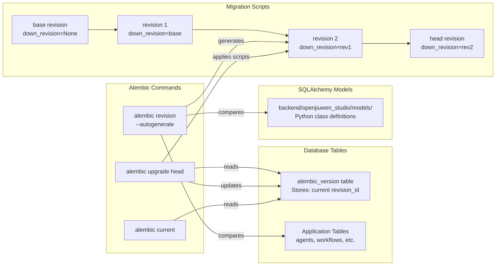
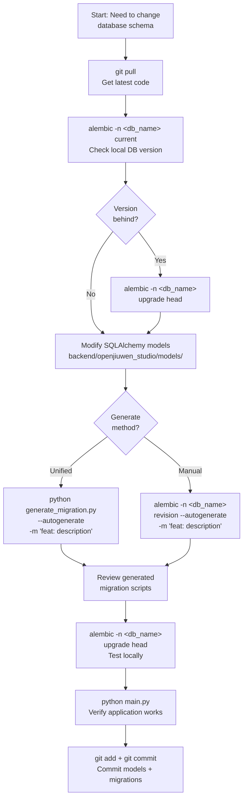
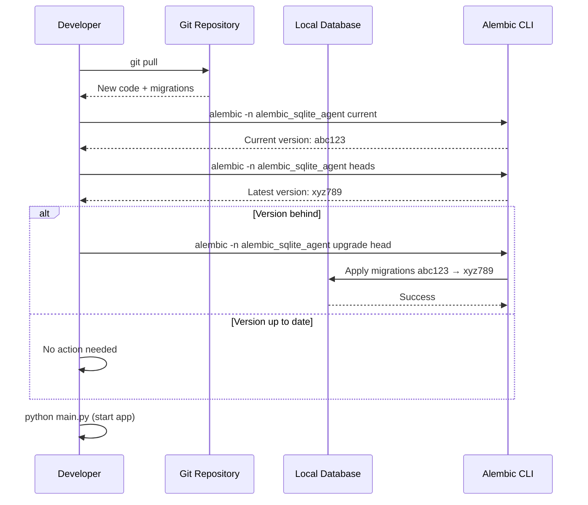

<!-- source: DeepWiki mcp.deepwiki.com · repo openJiuwen-ai/agent-studio · page 6.2 Database Migrations · fetched 2026-11-02 -->

# Database Migrations

<details>
<summary>Relevant source files</summary>

The following files were used as context for generating this wiki page:

- [backend/DATABASE_MIGRATION_DEVELOPMENT_GUIDE_EN.md](backend/DATABASE_MIGRATION_DEVELOPMENT_GUIDE_EN.md)
- [backend/GENERATE_MIGRATION_USAGE_EN.md](backend/GENERATE_MIGRATION_USAGE_EN.md)
- [docs/en/2.Installation Guide/Local Installation/Linux_Installation.md](docs/en/2.Installation Guide/Local Installation/Linux_Installation.md)
- [docs/en/2.Installation Guide/Local Installation/MacOS_Installation.md](docs/en/2.Installation Guide/Local Installation/MacOS_Installation.md)
- [docs/en/2.Installation Guide/Local Installation/Windows_Installation.md](docs/en/2.Installation Guide/Local Installation/Windows_Installation.md)

</details>


## Purpose and Scope

This document explains how database schema changes are managed in OpenJiuwen Agent Studio using Alembic, SQLAlchemy's database migration tool. It covers the multi-database migration architecture, common migration operations, and workflows for developers making schema changes.

**Scope:**
- Relational database migrations (MySQL and SQLite) using Alembic
- Migration script generation, application, and rollback procedures
- Version management and team collaboration workflows

**Out of Scope:**
- Vector database management (Milvus/Chroma are auto-managed at application layer)
- Initial database setup and installation (see [Installation & Setup](#2))
- Backend service architecture (see [Backend Architecture](#5.3))

---

## Multi-Database Migration Architecture

OpenJiuwen Agent Studio maintains **four independent Alembic configurations** to support two database types (MySQL and SQLite) across two logical databases (Agent and Ops).

### Database Structure Overview



**Sources:** [backend/DATABASE_MIGRATION_DEVELOPMENT_GUIDE_EN.md:86-106]()

### Alembic Configuration Mapping

| Configuration Name | Database Type | Purpose | Configuration Path | Versions Path |
|-------------------|---------------|---------|-------------------|---------------|
| `alembic_mysql_agent` | MySQL | Agent data (agents, workflows, knowledge bases) | `backend/upgrade/mysql/alembic_agent/` | `backend/upgrade/mysql/alembic_agent/versions/` |
| `alembic_mysql_ops` | MySQL | Operations data (prompt templates) | `backend/upgrade/mysql/alembic_ops/` | `backend/upgrade/mysql/alembic_ops/versions/` |
| `alembic_sqlite_agent` | SQLite | Agent data (agents, workflows, knowledge bases) | `backend/upgrade/sqlite/alembic_agent/` | `backend/upgrade/sqlite/alembic_agent/versions/` |
| `alembic_sqlite_ops` | SQLite | Operations data (prompt templates) | `backend/upgrade/sqlite/alembic_ops/` | `backend/upgrade/sqlite/alembic_ops/versions/` |

**Sources:** [backend/DATABASE_MIGRATION_DEVELOPMENT_GUIDE_EN.md:90-97]()

---

## How Alembic Migrations Work

### Version Tracking Mechanism



**Key Concepts:**

1. **alembic_version Table**: Each database contains a special table storing the current revision ID
2. **State Comparison**: `alembic revision --autogenerate` compares SQLAlchemy models against actual database schema
3. **Migration Chain**: Each revision links to its predecessor via `down_revision`, forming a linked list
4. **Upgrade Path**: Alembic follows the chain to migrate from any old version to the latest

**Sources:** [backend/DATABASE_MIGRATION_DEVELOPMENT_GUIDE_EN.md:50-69]()

---

## Migration Workflow for Developers

### Standard Development Process



**Sources:** [backend/DATABASE_MIGRATION_DEVELOPMENT_GUIDE_EN.md:279-336](), [backend/DATABASE_MIGRATION_DEVELOPMENT_GUIDE_EN.md:543-562]()

### Choosing a Database Configuration

When running Alembic commands, you must specify which database configuration to use via the `-n` parameter:

```bash
# Determine database type from .env
# DB_TYPE=mysql or DB_TYPE=sqlite

# For Agent data changes (agents, workflows, knowledge bases)
alembic -n alembic_mysql_agent <command>    # if using MySQL
alembic -n alembic_sqlite_agent <command>   # if using SQLite

# For Ops data changes (prompt templates)
alembic -n alembic_mysql_ops <command>      # if using MySQL
alembic -n alembic_sqlite_ops <command>     # if using SQLite
```

**Sources:** [backend/DATABASE_MIGRATION_DEVELOPMENT_GUIDE_EN.md:86-155]()

---

## Common Migration Operations

### Generating Migration Scripts

#### Method 1: Unified Generation Tool (Recommended)

The `generate_migration.py` script generates migrations for all 4 database configurations simultaneously:

```bash
# Auto-generate migrations for all databases
python generate_migration.py --autogenerate -m "feat: add user profile table"

# Generate for specific databases only
python generate_migration.py --autogenerate -d mysql_agent -d sqlite_agent -m "feat: update schema"

# Create blank migration scripts
python generate_migration.py --manual -m "feat: custom data migration"
```

**How it works:**
- Loops through all 4 configurations (`alembic_mysql_agent`, `alembic_mysql_ops`, `alembic_sqlite_agent`, `alembic_sqlite_ops`)
- Dynamically injects `DB_TYPE` environment variable for each database type
- Ensures correct schema generation (e.g., `Integer` vs `BigInteger` based on database type)

**Sources:** [backend/GENERATE_MIGRATION_USAGE_EN.md:1-110](), [backend/GENERATE_MIGRATION_USAGE_EN.md:113-173]()

#### Method 2: Manual Generation Per Database

```bash
# SQLite Agent database
alembic -n alembic_sqlite_agent revision --autogenerate -m "feat: add user profile table"

# MySQL Agent database
alembic -n alembic_mysql_agent revision --autogenerate -m "feat: add user profile table"

# SQLite Ops database
alembic -n alembic_sqlite_ops revision --autogenerate -m "feat: add audit log field"

# MySQL Ops database
alembic -n alembic_mysql_ops revision --autogenerate -m "feat: add audit log field"
```

**Sources:** [backend/DATABASE_MIGRATION_DEVELOPMENT_GUIDE_EN.md:449-487]()

#### Naming Convention

All migration messages must start with `feat:` or `fix:`:

| Prefix | Purpose | Example |
|--------|---------|---------|
| `feat:` | New features or schema additions | `feat: add user status column` |
| `fix:` | Bug fixes or corrections | `fix: correct email field type` |

**Sources:** [backend/DATABASE_MIGRATION_DEVELOPMENT_GUIDE_EN.md:489-510](), [backend/GENERATE_MIGRATION_USAGE_EN.md:337-355]()

### Applying Migrations

```bash
# Upgrade to latest version
alembic -n alembic_sqlite_agent upgrade head

# Upgrade to specific version
alembic -n alembic_sqlite_agent upgrade <revision_id>

# Rollback one version
alembic -n alembic_sqlite_agent downgrade -1
```

**Sources:** [backend/DATABASE_MIGRATION_DEVELOPMENT_GUIDE_EN.md:512-535]()

### Checking Migration Status

```bash
# View current database version
alembic -n alembic_sqlite_agent current

# View latest available version
alembic -n alembic_sqlite_agent heads

# View migration history
alembic -n alembic_sqlite_agent history
```

**Sources:** [backend/DATABASE_MIGRATION_DEVELOPMENT_GUIDE_EN.md:74-84]()

---

## Writing Migration Scripts

### Idempotent Migrations

Since MySQL DDL operations don't support transaction rollback, migration scripts should be **idempotent** (safe to run multiple times). The codebase provides helper functions:

```python
from openjiuwen_studio.core.database.migration_utils import table_exists, column_exists, index_exists

def upgrade() -> None:
    # Check before creating table
    if not table_exists('my_new_table'):
        op.create_table('my_new_table', ...)

    # Check before adding column
    if not column_exists('users', 'new_column'):
        op.add_column('users', sa.Column('new_column', sa.String(100)))

    # Check before creating index
    if not index_exists('users', 'idx_user_email'):
        op.create_index('idx_user_email', 'users', ['email'])
```

**Sources:** [backend/DATABASE_MIGRATION_DEVELOPMENT_GUIDE_EN.md:225-252]()

### Common Scenarios

#### Scenario 1: Add New Column

1. Modify model in [backend/openjiuwen_studio/models/]()
2. Generate migration script
3. Review auto-generated `op.add_column()` statement
4. Apply migration

**Sources:** [backend/DATABASE_MIGRATION_DEVELOPMENT_GUIDE_EN.md:157-174]()

#### Scenario 2: Drop Column

⚠️ **Alembic does not auto-detect deletions.** You must manually add `op.drop_column()`:

```python
def upgrade():
    # Manually added
    op.drop_column('users', 'old_column')

def downgrade():
    # Restore on rollback
    op.add_column('users', sa.Column('old_column', sa.Integer(), nullable=True))
```

**Sources:** [backend/DATABASE_MIGRATION_DEVELOPMENT_GUIDE_EN.md:175-201]()

#### Scenario 3: Rename Column

⚠️ **Alembic recognizes renames as "drop + add", causing data loss.** Use `op.alter_column()`:

```python
def upgrade():
    op.alter_column('users', 'old_name', new_column_name='new_name')

def downgrade():
    op.alter_column('users', 'new_name', new_column_name='old_name')
```

**Note:** SQLite has limited `ALTER TABLE` support. Use batch mode if needed.

**Sources:** [backend/DATABASE_MIGRATION_DEVELOPMENT_GUIDE_EN.md:202-224]()

#### Scenario 4: Change Column Type

```python
def upgrade():
    op.alter_column('users', 'username',
               existing_type=sa.VARCHAR(length=50),
               type_=sa.String(length=100),
               existing_nullable=False)
```

**Sources:** [backend/DATABASE_MIGRATION_DEVELOPMENT_GUIDE_EN.md:253-276]()

---

## Version Management and Baselines

### Version History

The codebase maintains migration baselines for released versions:

| Version | MySQL Agent | MySQL Ops | SQLite Agent | SQLite Ops |
|---------|-------------|-----------|--------------|------------|
| v0.1.2  | `54351e123cf0` | `80f110f929fc` | `f458c7fb17a5` | `b4f4c6589bc5` |
| v0.1.3  | `06a1f79bce8b` | `13377a900fe2` | `031b34b4dd30` | `f6e49cd8c97d` |
| v0.1.4  | `072ac1293a02` | `13377a900fe2` | `8f4846812221` | `f6e49cd8c97d` |

**Sources:** [backend/DATABASE_MIGRATION_DEVELOPMENT_GUIDE_EN.md:396-406]()

### Stamping Existing Databases

If you have an existing database (e.g., from v0.1.2) that has never used Alembic, use `alembic stamp` to mark its version **without executing SQL**:

```bash
# MySQL users upgrading from v0.1.2
alembic -n alembic_mysql_agent stamp 54351e123cf0
alembic -n alembic_mysql_ops stamp 80f110f929fc

# SQLite users upgrading from v0.1.2
alembic -n alembic_sqlite_agent stamp f458c7fb17a5
alembic -n alembic_sqlite_ops stamp b4f4c6589bc5
```

After stamping, run `alembic upgrade head` to apply incremental migrations.

**Sources:** [backend/DATABASE_MIGRATION_DEVELOPMENT_GUIDE_EN.md:353-430](), [docs/en/2.Installation Guide/Local Installation/Linux_Installation.md:326-337]()

### Version Upgrade Constraints

⚠️ **Important:** Upgrades only support **same-type database components**:

- **MySQL → MySQL** ✅
- **SQLite → SQLite** ✅
- **MySQL → SQLite** ❌
- **SQLite → MySQL** ❌

Vector databases have the same constraint:
- **Chroma → Chroma** ✅
- **Milvus → Milvus** ✅
- **Chroma ↔ Milvus** ❌ (incompatible data formats)

**Sources:** [backend/DATABASE_MIGRATION_DEVELOPMENT_GUIDE_EN.md:35-49]()

---

## Team Collaboration

### Synchronizing with Team Changes

When pulling code that includes new migrations:



**Sources:** [backend/DATABASE_MIGRATION_DEVELOPMENT_GUIDE_EN.md:291-351]()

### Resolving Merge Conflicts

If multiple developers create migrations simultaneously, you may encounter "multiple heads":

```bash
# Scenario: Both you and teammate created migrations B1 and B2 from base A
# After git pull, you have two parallel heads

# Step 1: Upgrade to one head
alembic -n alembic_sqlite_agent upgrade B1

# Step 2: Merge the parallel branches
alembic -n alembic_sqlite_agent merge heads -m "Merge parallel migrations B1 and B2"

# Step 3: Upgrade to the new merge point
alembic -n alembic_sqlite_agent upgrade head
```

**Note:** The merge operation creates a new migration file that points to both B1 and B2. Original files B1 and B2 are **not deleted**.

**Sources:** [backend/DATABASE_MIGRATION_DEVELOPMENT_GUIDE_EN.md:564-589]()

---

## Initial Setup During Installation

### Database Initialization Commands

During local installation, users must stamp the database to establish version tracking:

```bash
# For MySQL users
alembic -n alembic_mysql_agent stamp head
alembic -n alembic_mysql_ops stamp head

# For SQLite users
alembic -n alembic_sqlite_agent stamp head
alembic -n alembic_sqlite_ops stamp head
```

These commands are executed after `uv sync` but before starting the application.

**Sources:** [docs/en/2.Installation Guide/Local Installation/Linux_Installation.md:326-337](), [docs/en/2.Installation Guide/Local Installation/MacOS_Installation.md:291-302](), [docs/en/2.Installation Guide/Local Installation/Windows_Installation.md:322-333]()

### Application Startup Behavior

The `main.py` file attempts to create tables using `Base.metadata.create_all()` on startup. To avoid conflicts:

1. **Always check version** before starting application
2. **Run migrations** if version is behind
3. **Stamp version** if database exists but has no alembic_version table

**Sources:** [backend/DATABASE_MIGRATION_DEVELOPMENT_GUIDE_EN.md:305-306]()

---

## Best Practices

### Development Checklist

- [ ] Pull latest code before making changes
- [ ] Update local database to latest version
- [ ] Modify SQLAlchemy models
- [ ] Generate migration scripts (prefer `generate_migration.py`)
- [ ] Review generated scripts for correctness
- [ ] Test `upgrade` and `downgrade` locally
- [ ] Verify application functionality
- [ ] Commit model changes + migration scripts together

**Sources:** [backend/DATABASE_MIGRATION_DEVELOPMENT_GUIDE_EN.md:344-351](), [backend/DATABASE_MIGRATION_DEVELOPMENT_GUIDE_EN.md:590-598]()

### Important Rules

1. **Never modify database directly** via GUI tools (Navicat, DBeaver)
   - Causes version history misalignment
   
2. **Never modify committed migration scripts**
   - Create new migrations to fix issues
   
3. **Use idempotent checks** for MySQL migrations
   - Utilize `table_exists()`, `column_exists()`, `index_exists()`
   
4. **Avoid modifying `user_message` table**
   - Managed by memory module, requires coordination

5. **Test both upgrade and downgrade**
   - Ensure reversibility of migrations

**Sources:** [backend/DATABASE_MIGRATION_DEVELOPMENT_GUIDE_EN.md:590-598](), [backend/DATABASE_MIGRATION_DEVELOPMENT_GUIDE_EN.md:289]()

---

## Troubleshooting

### Error: "File has no '[alembic]' section"

**Cause:** Missing `-n` parameter to specify database configuration.

**Solution:** Always include `-n <config_name>`:

```bash
# ❌ Wrong
alembic upgrade head

# ✅ Correct
alembic -n alembic_sqlite_agent upgrade head
```

**Sources:** [backend/DATABASE_MIGRATION_DEVELOPMENT_GUIDE_EN.md:606-650]()

### Error: "Table already exists"

**Cause:** Running migrations on a database that already has tables but no version stamp.

**Solution:** Stamp the database before upgrading:

```bash
# Determine your current version (e.g., v0.1.2)
# Then stamp it
alembic -n alembic_sqlite_agent stamp f458c7fb17a5

# Now upgrade works
alembic -n alembic_sqlite_agent upgrade head
```

**Sources:** [backend/DATABASE_MIGRATION_DEVELOPMENT_GUIDE_EN.md:353-394]()

### Multiple Heads Detected

**Cause:** Parallel development created conflicting migrations.

**Solution:** Merge the heads:

```bash
alembic -n alembic_sqlite_agent merge heads -m "Merge parallel migrations"
alembic -n alembic_sqlite_agent upgrade head
```

**Sources:** [backend/DATABASE_MIGRATION_DEVELOPMENT_GUIDE_EN.md:564-589]()

### Application Startup Version Mismatch

**Symptom:** Warning logs about version mismatch when starting `main.py`.

**Solution:**

```bash
# Check current version
alembic -n alembic_sqlite_agent current

# Check latest version
alembic -n alembic_sqlite_agent heads

# Upgrade if needed
alembic -n alembic_sqlite_agent upgrade head
```

**Sources:** [backend/DATABASE_MIGRATION_DEVELOPMENT_GUIDE_EN.md:305-343]()

---

## File Structure Reference

```
backend/
├── alembic.ini                    # Alembic main configuration file
├── generate_migration.py          # Unified migration generation tool
├── DATABASE_MIGRATION_DEVELOPMENT_GUIDE_EN.md
├── GENERATE_MIGRATION_USAGE_EN.md
├── openjiuwen_studio/
│   ├── models/                    # SQLAlchemy models for Agent DB
│   ├── core/database/
│   │   └── migration_utils.py     # Helper functions (table_exists, etc.)
│   └── ops/modules/prompt/infra/repositories/
│       └── orm_repo.py            # Models for Ops DB
└── upgrade/
    ├── mysql/
    │   ├── alembic_agent/
    │   │   ├── alembic.ini        # MySQL Agent config
    │   │   └── versions/          # Migration scripts
    │   └── alembic_ops/
    │       ├── alembic.ini        # MySQL Ops config
    │       └── versions/          # Migration scripts
    └── sqlite/
        ├── alembic_agent/
        │   ├── alembic.ini        # SQLite Agent config
        │   └── versions/          # Migration scripts
        └── alembic_ops/
            ├── alembic.ini        # SQLite Ops config
            └── versions/          # Migration scripts
```

**Sources:** [backend/DATABASE_MIGRATION_DEVELOPMENT_GUIDE_EN.md:13](), [backend/GENERATE_MIGRATION_USAGE_EN.md:179-196]()

---

## Quick Reference

### Essential Commands

| Task | Command |
|------|---------|
| Check current version | `alembic -n <db_name> current` |
| Check latest version | `alembic -n <db_name> heads` |
| Generate migrations (all DBs) | `python generate_migration.py --autogenerate -m "feat: description"` |
| Generate migration (single DB) | `alembic -n <db_name> revision --autogenerate -m "feat: description"` |
| Apply migrations | `alembic -n <db_name> upgrade head` |
| Rollback one migration | `alembic -n <db_name> downgrade -1` |
| Stamp version (no SQL) | `alembic -n <db_name> stamp <revision_id>` |
| View history | `alembic -n <db_name> history` |
| Merge parallel heads | `alembic -n <db_name> merge heads -m "merge message"` |

### Database Configuration Names

- `alembic_mysql_agent` - MySQL Agent database
- `alembic_mysql_ops` - MySQL Ops database
- `alembic_sqlite_agent` - SQLite Agent database
- `alembic_sqlite_ops` - SQLite Ops database

**Sources:** [backend/DATABASE_MIGRATION_DEVELOPMENT_GUIDE_EN.md:74-84](), [backend/GENERATE_MIGRATION_USAGE_EN.md:382-396]()

---

