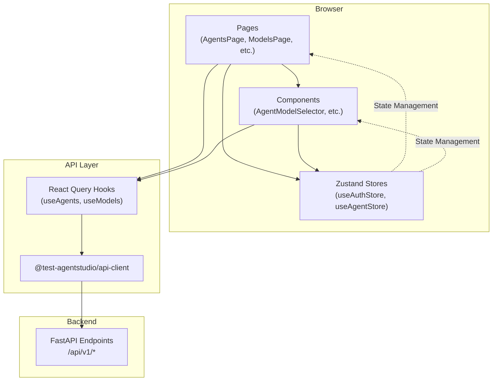
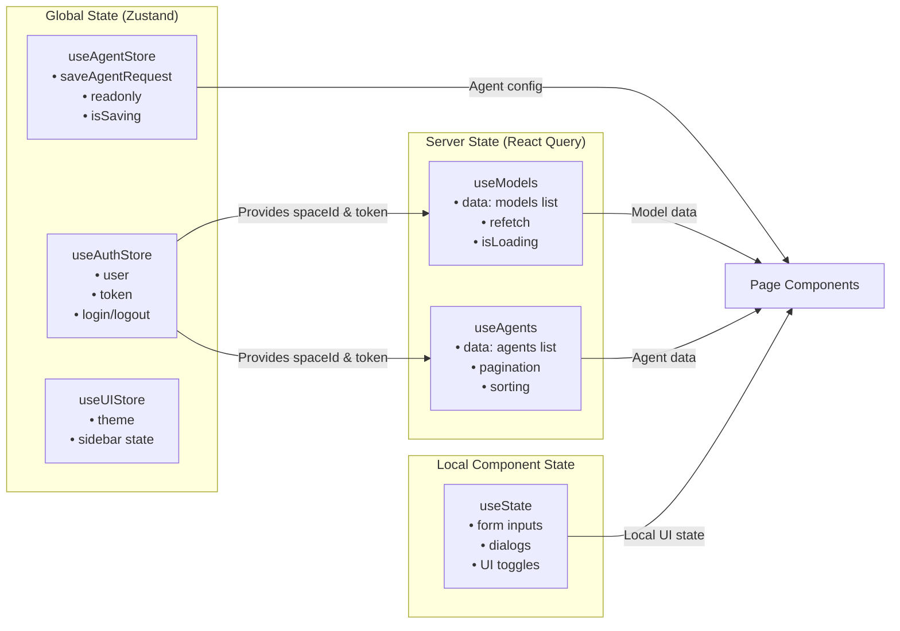
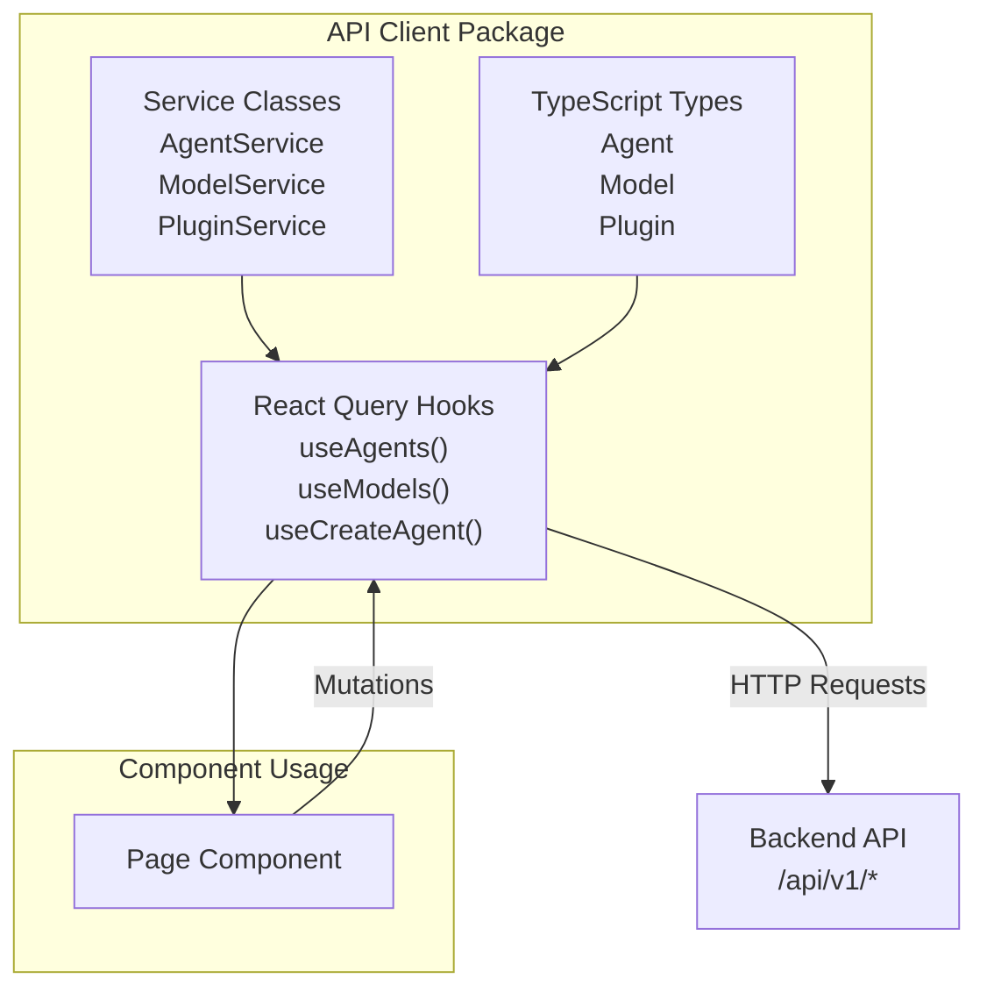
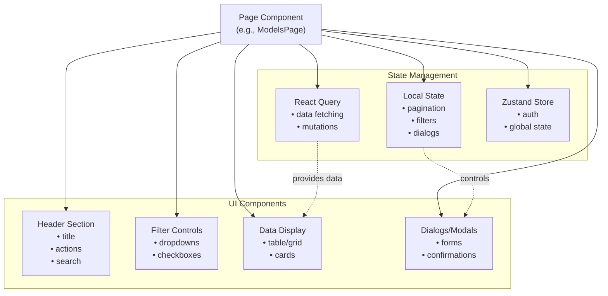
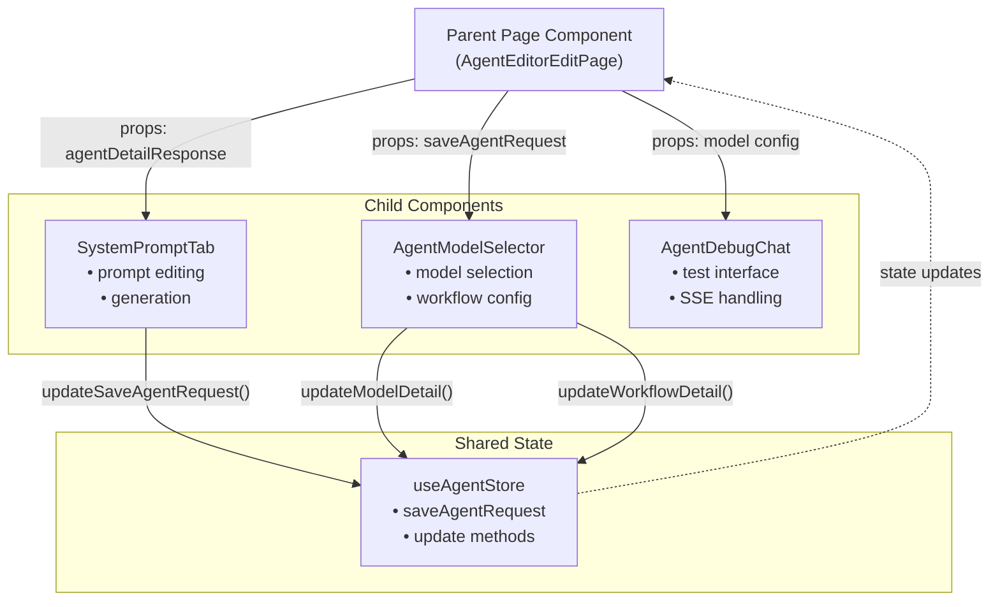
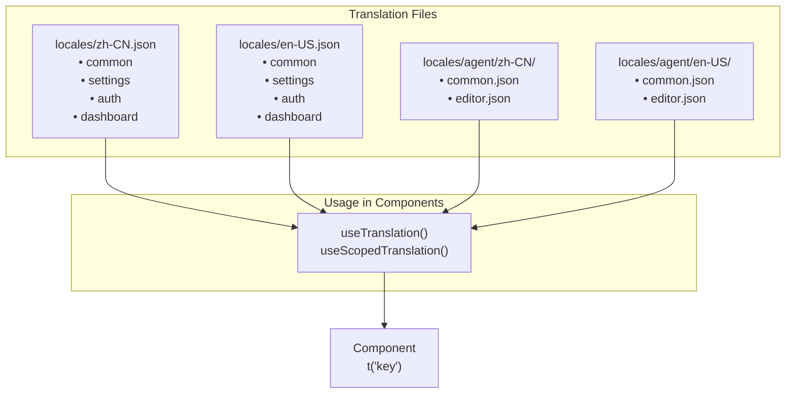
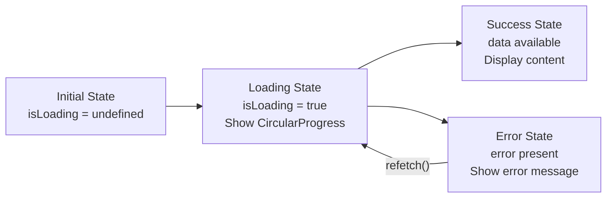

<!-- source: DeepWiki mcp.deepwiki.com · repo openJiuwen-ai/agent-studio · page 6.3 Frontend Development · fetched 2026-11-02 -->

# Frontend Development

<details>
<summary>Relevant source files</summary>

The following files were used as context for generating this wiki page:

- [backend/openjiuwen_studio/core/manager/model_manager/managers/embedding_model_test_manager.py](backend/openjiuwen_studio/core/manager/model_manager/managers/embedding_model_test_manager.py)
- [backend/openjiuwen_studio/routers/embedding_models.py](backend/openjiuwen_studio/routers/embedding_models.py)
- [frontend/src/components/Agent/AgentModelSelector.tsx](frontend/src/components/Agent/AgentModelSelector.tsx)
- [frontend/src/components/Agent/OverridePromptTemplateDialog.tsx](frontend/src/components/Agent/OverridePromptTemplateDialog.tsx)
- [frontend/src/components/Plugins/CloudPluginFormDialog.tsx](frontend/src/components/Plugins/CloudPluginFormDialog.tsx)
- [frontend/src/components/Plugins/CodeEditor.tsx](frontend/src/components/Plugins/CodeEditor.tsx)
- [frontend/src/components/Plugins/CodePluginToolFormDialog.tsx](frontend/src/components/Plugins/CodePluginToolFormDialog.tsx)
- [frontend/src/components/Plugins/IDEPluginFormDialog.tsx](frontend/src/components/Plugins/IDEPluginFormDialog.tsx)
- [frontend/src/components/Plugins/MarketPluginCard.tsx](frontend/src/components/Plugins/MarketPluginCard.tsx)
- [frontend/src/components/Plugins/MarketPluginList.tsx](frontend/src/components/Plugins/MarketPluginList.tsx)
- [frontend/src/components/Plugins/PluginVersionHistory.tsx](frontend/src/components/Plugins/PluginVersionHistory.tsx)
- [frontend/src/components/Plugins/PublishDialog.tsx](frontend/src/components/Plugins/PublishDialog.tsx)
- [frontend/src/components/Plugins/ToolFormDialog.tsx](frontend/src/components/Plugins/ToolFormDialog.tsx)
- [frontend/src/locales/agent/en-US/common.json](frontend/src/locales/agent/en-US/common.json)
- [frontend/src/locales/agent/en-US/editor.json](frontend/src/locales/agent/en-US/editor.json)
- [frontend/src/locales/agent/zh-CN/common.json](frontend/src/locales/agent/zh-CN/common.json)
- [frontend/src/locales/agent/zh-CN/editor.json](frontend/src/locales/agent/zh-CN/editor.json)
- [frontend/src/locales/en-US.json](frontend/src/locales/en-US.json)
- [frontend/src/locales/zh-CN.json](frontend/src/locales/zh-CN.json)
- [frontend/src/pages/Agents/AgentCreatePage.tsx](frontend/src/pages/Agents/AgentCreatePage.tsx)
- [frontend/src/pages/Agents/AgentEditorEditPage.tsx](frontend/src/pages/Agents/AgentEditorEditPage.tsx)
- [frontend/src/pages/Agents/AgentsPage.tsx](frontend/src/pages/Agents/AgentsPage.tsx)
- [frontend/src/pages/Auth/PrivacyPolicyPage.tsx](frontend/src/pages/Auth/PrivacyPolicyPage.tsx)
- [frontend/src/pages/Auth/UserLoginPage.tsx](frontend/src/pages/Auth/UserLoginPage.tsx)
- [frontend/src/pages/KnowledgeBase/components/AddDocumentDialog.tsx](frontend/src/pages/KnowledgeBase/components/AddDocumentDialog.tsx)
- [frontend/src/pages/KnowledgeBase/components/KnowledgeBaseFormDialog.tsx](frontend/src/pages/KnowledgeBase/components/KnowledgeBaseFormDialog.tsx)
- [frontend/src/pages/Models/ModelsPage.tsx](frontend/src/pages/Models/ModelsPage.tsx)
- [frontend/src/pages/Models/ModelsPageNew.tsx](frontend/src/pages/Models/ModelsPageNew.tsx)
- [frontend/src/pages/Models/components/EmbeddingModelsTable.tsx](frontend/src/pages/Models/components/EmbeddingModelsTable.tsx)
- [frontend/src/pages/Models/components/LLMModelsTable.tsx](frontend/src/pages/Models/components/LLMModelsTable.tsx)
- [frontend/src/pages/Plugins/PluginConfigurationPage.tsx](frontend/src/pages/Plugins/PluginConfigurationPage.tsx)
- [frontend/src/pages/Plugins/PluginManagementPage.tsx](frontend/src/pages/Plugins/PluginManagementPage.tsx)
- [frontend/src/pages/Plugins/PluginVersionPage.tsx](frontend/src/pages/Plugins/PluginVersionPage.tsx)
- [frontend/src/pages/Plugins/ToolConfigurationPage.tsx](frontend/src/pages/Plugins/ToolConfigurationPage.tsx)
- [frontend/src/pages/Plugins/components/CodePluginConfiguration.tsx](frontend/src/pages/Plugins/components/CodePluginConfiguration.tsx)
- [frontend/src/pages/Plugins/components/URLPluginConfiguration.tsx](frontend/src/pages/Plugins/components/URLPluginConfiguration.tsx)

</details>


This document covers frontend development practices, architecture, and patterns used in OpenJiuwen Agent Studio. It provides guidance for developers working on the React-based user interface, including project structure, state management, API integration, component development, and internationalization.

For backend API development, see [Backend Development](#6.4). For workflow canvas-specific development, see [Workflow Canvas Architecture](#5.7).

---

## Frontend Technology Stack

The frontend application is built using modern web technologies:

- **Framework**: React 18 with TypeScript
- **Build Tool**: Vite
- **UI Framework**: Material-UI (MUI) v5
- **State Management**: Zustand
- **Data Fetching**: React Query (TanStack Query)
- **Routing**: React Router v6
- **Internationalization**: i18next / react-i18next
- **Form Handling**: react-hook-form
- **HTTP Client**: Axios (wrapped in API client package)
- **Code Editors**: Monaco Editor (via custom wrappers)

Sources: [frontend/package.json](), [frontend/vite.config.ts]()

---

## Project Structure

### Directory Organization

```
frontend/
├── packages/
│   ├── api-client/              # Typed API client package
│   └── workflow-canvas/         # Workflow visual editor
├── src/
│   ├── assets/                  # Static assets (icons, images)
│   ├── Common/                  # Shared utility components
│   ├── components/              # Reusable components
│   │   ├── Agent/              # Agent-specific components
│   │   ├── Common/             # Common UI components
│   │   ├── Plugins/            # Plugin management components
│   │   └── ...
│   ├── config/                  # Configuration files
│   ├── hooks/                   # Custom React hooks
│   ├── i18n/                    # Internationalization setup
│   ├── locales/                 # Translation files
│   │   ├── zh-CN.json          # Chinese translations
│   │   ├── en-US.json          # English translations
│   │   └── agent/              # Agent-specific translations
│   ├── pages/                   # Application pages
│   │   ├── Agents/             # Agent management pages
│   │   ├── Models/             # Model configuration pages
│   │   ├── Plugins/            # Plugin management pages
│   │   ├── KnowledgeBase/      # Knowledge base pages
│   │   └── Auth/               # Authentication pages
│   ├── stores/                  # Zustand state stores
│   ├── types/                   # TypeScript type definitions
│   ├── utils/                   # Utility functions
│   ├── App.tsx                  # Root application component
│   └── main.tsx                 # Application entry point
└── index.html                   # HTML template
```

Sources: [frontend/src/]() directory structure

---

## Frontend Architecture

### Component and Data Flow



**Component Data Flow Diagram**

The frontend follows a unidirectional data flow pattern with clear separation of concerns between presentation (Pages/Components), state management (Stores), and data fetching (React Query).

Sources: [frontend/src/pages/Agents/AgentEditorEditPage.tsx:1-50](), [frontend/src/stores/useAuthStore.ts](), [packages/api-client/]()

---

### State Management Architecture



**State Management Structure**

The application uses a hybrid state management approach:
- **Zustand stores** for client-side application state
- **React Query** for server state and caching
- **Local useState** for component-specific UI state

Sources: [frontend/src/stores/useAuthStore.ts](), [frontend/src/stores/useAgentStore.ts](), [frontend/src/pages/Models/ModelsPage.tsx:115-158]()

---

## State Management with Zustand

### Authentication Store

The `useAuthStore` manages user authentication state and provides login/logout functionality:

```typescript
// Key store structure and methods
interface AuthStore {
  user: User | null
  token: string | null
  isAuthenticated: boolean
  login: (userData: User, token: string) => void
  logout: () => void
}
```

**Key Features:**
- Persists authentication state to localStorage
- Automatically provides `spaceId` for API requests
- Handles token management for API client

Sources: [frontend/src/stores/useAuthStore.ts](), [frontend/src/pages/Auth/UserLoginPage.tsx:164-168]()

### Agent Store

The `useAgentStore` manages agent editing state and provides save/update operations:

```typescript
// Key store structure
interface AgentStore {
  saveAgentRequest: SaveAgentRequest
  readonly: boolean
  isSaving: boolean
  lastAutoSaveTime: number | null
  updateModelDetail: (model: ModelDetail) => void
  updateWorkflowDetail: (workflows: WorkflowDetail[]) => void
  updatePluginDetail: (plugins: AgentPlugin[]) => void
  saveAgent: () => Promise<boolean>
  resetStore: () => void
}
```

**Usage Pattern:**
```typescript
const { saveAgentRequest, updateModelDetail, saveAgent } = useAgentStore()

// Update state
updateModelDetail(selectedModel)

// Save to backend
const success = await saveAgent()
```

Sources: [frontend/src/stores/useAgentStore.ts](), [frontend/src/pages/Agents/AgentEditorEditPage.tsx:114](), [frontend/src/components/Agent/AgentModelSelector.tsx:114-115]()

---

## API Communication Patterns

### API Client Package

The `@test-agentstudio/api-client` package provides type-safe API access with auto-generated types:



**API Client Architecture**

Sources: [packages/api-client/](), [frontend/src/pages/Models/ModelsPage.tsx:26-40]()

### React Query Hooks Usage

**Data Fetching Pattern:**
```typescript
// Query hook for fetching data
const { data: modelsResponse, isLoading, error, refetch } = useModels({
  spaceId: user?.spaceId,
  page: currentPage,
  size: pageSize,
  sort_by: 'update_time',
  sort_order: 'desc',
})

// Access data with safety checks
const models = modelsResponse?.items || []
```

**Mutation Pattern:**
```typescript
// Mutation hook for data modifications
const createModelMutation = useCreateModel()

// Execute mutation
await createModelMutation.mutateAsync({ 
  model: newModel, 
  spaceId: user?.spaceId 
})
```

Sources: [frontend/src/pages/Models/ModelsPage.tsx:124-149](), [frontend/src/pages/Agents/AgentsPage.tsx:80-100]()

### Common API Client Hooks

| Hook Name | Purpose | Return Data |
|-----------|---------|-------------|
| `useAgents()` | Fetch agent list with pagination/search | `{ items: Agent[], total: number }` |
| `useModels()` | Fetch LLM model configurations | `{ items: ModelConfig[], total: number }` |
| `useEmbeddingModels()` | Fetch embedding model configurations | `{ items: EmbeddingModelConfig[], total: number }` |
| `usePlugin()` | Fetch single plugin details | `PluginInfo` |
| `useCreateAgent()` | Create new agent | Mutation hook |
| `useUpdateModel()` | Update model configuration | Mutation hook |
| `useTestModel()` | Test model with prompt | Mutation hook |

Sources: [frontend/src/pages/Models/ModelsPage.tsx:26-40](), [frontend/src/pages/Agents/AgentsPage.tsx:5]()

---

## Page Development Patterns

### Page Component Structure

A typical page component follows this structure:



**Typical Page Component Structure**

Sources: [frontend/src/pages/Models/ModelsPage.tsx:114-245](), [frontend/src/pages/Agents/AgentsPage.tsx:37-100]()

### Example: Models Page Pattern

The `ModelsPage` demonstrates a standard page development pattern:

**1. State Setup:**
```typescript
// Pagination
const [currentPage, setCurrentPage] = useState<number>(1)
const [pageSize, setPageSize] = useState<number>(10)

// Filters
const [searchTerm, setSearchTerm] = useState('')
const [filterProvider, setFilterProvider] = useState('all')

// Dialog state
const [showModelDialog, setShowModelDialog] = useState(false)
const [editMode, setEditMode] = useState(false)
```

**2. Data Fetching:**
```typescript
// Fetch data with React Query
const { data: modelsResponse, isLoading, refetch } = useModels({
  spaceId: user?.spaceId,
  page: currentPage,
  size: pageSize,
  sort_by: 'update_time',
  sort_order: 'desc',
})
```

**3. Client-Side Filtering:**
```typescript
// Filter and sort data on client side
const filteredModels = allModels
  .filter(model => {
    const matchesSearch = model.name.toLowerCase().includes(searchTerm.toLowerCase())
    const matchesProvider = filterProvider === 'all' || model.provider === filterProvider
    return matchesSearch && matchesProvider
  })
  .sort((a, b) => new Date(b.updatedAt).getTime() - new Date(a.updatedAt).getTime())
```

Sources: [frontend/src/pages/Models/ModelsPage.tsx:114-369]()

---

## Component Development

### Component Organization

Components are organized by feature domain:

```
components/
├── Agent/                      # Agent-specific components
│   ├── AgentModelSelector.tsx  # Model selection UI
│   ├── AgentDebugChat.tsx      # Debug chat interface
│   ├── SystemPromptTab.tsx     # Prompt editing
│   └── WorkflowSelector.tsx    # Workflow selection dialog
├── Common/                     # Shared UI components
│   ├── DeleteConfirmationDialog.tsx
│   ├── LanguageDropdown.tsx
│   └── ActionSlot.tsx
└── Plugins/                    # Plugin management components
    ├── CloudPluginFormDialog.tsx
    ├── ToolFormDialog.tsx
    └── PluginVersionHistory.tsx
```

Sources: [frontend/src/components/]() directory structure

### Component Communication Patterns



**Component Communication Pattern in Agent Editor**

The agent editor uses a combination of:
- **Props drilling** for read-only data
- **Shared Zustand store** for coordinated state updates
- **Callback props** for actions that need parent handling

Sources: [frontend/src/pages/Agents/AgentEditorEditPage.tsx:1-50](), [frontend/src/components/Agent/AgentModelSelector.tsx:108-120]()

### Reusable Component Example: UnifiedSnackbar

The `UnifiedSnackbar` component demonstrates a common pattern for user notifications:

```typescript
// Hook usage
const { snackbar, showSuccess, showError, showWarning, closeSnackbar } = useUnifiedSnackbar()

// Display notifications
showSuccess(t('models.messages.addSuccess'))
showError(t('models.messages.addFailed'))

// Component renders the snackbar
<UnifiedSnackbar
  open={snackbar.open}
  message={snackbar.message}
  severity={snackbar.severity}
  onClose={closeSnackbar}
/>
```

Sources: [frontend/src/Common/UnifiedSnackbar.tsx](), [frontend/src/pages/Models/ModelsPage.tsx:176-177]()

---

## Internationalization (i18n)

### Translation File Structure



**i18n File Organization**

Sources: [frontend/src/locales/zh-CN.json:1-100](), [frontend/src/locales/agent/zh-CN/editor.json:1-50]()

### Translation Usage Patterns

**Basic Translation:**
```typescript
import { useTranslation } from 'react-i18next'

const MyComponent = () => {
  const { t } = useTranslation()
  
  return (
    <Button>{t('common.buttons.save')}</Button>
  )
}
```

**Scoped Translation (for Agent pages):**
```typescript
import { useScopedTranslation } from '@/i18n'

const AgentEditor = () => {
  const { t } = useScopedTranslation('agents.agentEditor.editPage')
  
  return (
    <Typography>{t('labels.lastSavedAt')}</Typography>
  )
}
```

**Translation with Interpolation:**
```typescript
// Translation key in JSON: "confirmDelete": "确定要删除\"{{name}}\"吗？"
const message = t('common.confirmDialog.messages.agent', { name: agentName })
```

Sources: [frontend/src/i18n/index.ts](), [frontend/src/pages/Agents/AgentEditorEditPage.tsx:26](), [frontend/src/locales/zh-CN.json:199]()

### Translation Key Organization

Translation keys follow a hierarchical structure:

| Namespace | Purpose | Example Keys |
|-----------|---------|--------------|
| `common.*` | Shared UI elements | `common.buttons.save`, `common.messages.saveSuccess` |
| `agents.*` | Agent management | `agents.agentList.noAgents`, `agents.agentCreate.title` |
| `models.*` | Model configuration | `models.modelConfig.parameters.temperature` |
| `plugins.*` | Plugin management | `plugins.toolConfig.notFound` |
| `auth.*` | Authentication | `auth.login.title`, `auth.register.submit` |

Sources: [frontend/src/locales/zh-CN.json:2-217](), [frontend/src/locales/agent/zh-CN/common.json:1-100]()

---

## Form Handling and Validation

### Form State Management

The application uses controlled components with local state for forms:

```typescript
// Form state
const [configForm, setConfigForm] = useState({
  name: '',
  desc: '',
  icon_uri: '',
  url: '',
})

// Update handlers
const handleUrlChange = (url: string) => {
  setConfigForm(prev => ({ ...prev, url }))
  
  // Real-time validation
  const error = validateHttpUrlRealtime(url)
  setUrlError(error)
}
```

Sources: [frontend/src/pages/Plugins/components/URLPluginConfiguration.tsx:211-217]()

### Validation Utilities

The codebase provides centralized validation utilities:

```typescript
// URL validation
import { validateHttpUrlRealtime, getHttpUrlHelpText } from '@/utils/validationUtils'

const error = validateHttpUrlRealtime(url)
const helpText = getHttpUrlHelpText()

// Path validation
import { validateToolPath, getPathHelpText } from '@/utils/validationUtils'

const validation = validateToolPath(path)
if (!validation.isValid) {
  setPathError(validation.error)
}
```

Sources: [frontend/src/utils/validationUtils.ts](), [frontend/src/pages/Plugins/components/URLPluginConfiguration.tsx:8]()

### Dialog-Based Forms

Most forms are presented in MUI Dialog components:

```typescript
const [showDialog, setShowDialog] = useState(false)
const [formData, setFormData] = useState(initialState)

const handleSubmit = async () => {
  if (!isFormValid()) {
    showError(t('messages.fillRequiredFields'))
    return
  }
  
  try {
    await mutation.mutateAsync(formData)
    setShowDialog(false)
    showSuccess(t('messages.success'))
  } catch (error) {
    showError(t('messages.failed'))
  }
}
```

Sources: [frontend/src/pages/Models/ModelsPage.tsx:374-413]()

---

## Code Editor Integration

### Monaco-Based Code Editors

The application provides specialized code editor components for Python and TypeScript:

```typescript
import { 
  PythonCodeEditor, 
  TypeScriptCodeEditor 
} from '@workflow-canvas/src/form-materials/components/code-editor'
import '@workflow-canvas/src/form-materials/components/base-editor/styles.css'

// Usage
<PythonCodeEditor
  value={codeContent}
  onChange={setCodeContent}
  height="400px"
/>
```

**Key Features:**
- Syntax highlighting for Python and JavaScript/TypeScript
- Auto-completion
- Error detection
- Configurable height

Sources: [frontend/src/pages/Plugins/ToolConfigurationPage.tsx:34-36](), [packages/workflow-canvas/src/form-materials/components/code-editor/]()

### Code Templates

Code editors support template insertion:

```typescript
const codeTemplates: CodeTemplate[] = [
  {
    language: 'python',
    name: 'Basic Function',
    description: 'Simple data processing function',
    template: `def add_test(a: int, b: int):
  return a + b

def main(args: Args):
  a = args.params['add1']
  b = args.params['add2']
  c = add_test(a, b)
  return {'res': c}`,
  },
]

// Apply template
setCodeContent(selectedTemplate.template)
```

Sources: [frontend/src/pages/Plugins/ToolConfigurationPage.tsx:90-131]()

---

## Styling and UI Framework

### Material-UI (MUI) Components

The application extensively uses MUI components for consistent UI:

**Common Components:**
- `Button`, `IconButton`, `Tooltip`
- `TextField`, `Select`, `MenuItem`, `FormControl`
- `Dialog`, `DialogTitle`, `DialogContent`, `DialogActions`
- `Card`, `CardContent`, `Typography`
- `Table`, `TableBody`, `TableCell`, `TableHead`, `TableRow`
- `Chip`, `Snackbar`, `Alert`, `CircularProgress`

Sources: [frontend/src/pages/Models/ModelsPage.tsx:4-31]()

### Custom Styled Components

Pages use MUI's `styled` API for custom components:

```typescript
import { styled } from '@mui/material/styles'
import MuiAccordion, { AccordionProps } from '@mui/material/Accordion'

const Accordion = styled((props: AccordionProps) => 
  <MuiAccordion disableGutters elevation={0} square {...props} />
)(({ theme }) => ({
  border: `1px solid ${theme.palette.divider}`,
  '&:not(:last-child)': {
    marginBottom: '8px',
  },
  backgroundColor: '#f9fafb',
}))
```

Sources: [frontend/src/components/Agent/AgentModelSelector.tsx:31-43]()

### Lucide Icons

The application uses Lucide React for icons:

```typescript
import { 
  Save, Plus, Trash2, Settings, Search, 
  ChevronLeft, ChevronRight, AlertCircle 
} from 'lucide-react'

<Button startIcon={<Save />}>
  {t('common.buttons.save')}
</Button>
```

Sources: [frontend/src/pages/Models/ModelsPage.tsx:4](), [frontend/src/pages/Agents/AgentsPage.tsx:4]()

---

## Common Development Patterns

### Loading States



**Standard Loading Pattern**

```typescript
const { data, isLoading, error, refetch } = useModels(params)

if (isLoading) {
  return <CircularProgress />
}

if (error) {
  return (
    <Alert severity="error">
      {t('messages.loadFailed')}
      <Button onClick={() => refetch()}>
        {t('common.buttons.retry')}
      </Button>
    </Alert>
  )
}

return <DataDisplay data={data} />
```

Sources: [frontend/src/pages/Models/ModelsPage.tsx:152-158]()

### Pagination Pattern

```typescript
// Pagination state
const [currentPage, setCurrentPage] = useState(1)
const [pageSize, setPageSize] = useState(10)

// Calculate pagination
const totalPages = Math.ceil(totalItems / pageSize)
const paginatedData = data.slice(
  (currentPage - 1) * pageSize, 
  currentPage * pageSize
)

// Pagination controls
<Box>
  <Button 
    disabled={currentPage === 1}
    onClick={() => setCurrentPage(prev => prev - 1)}
  >
    Previous
  </Button>
  <Typography>Page {currentPage} / {totalPages}</Typography>
  <Button 
    disabled={currentPage === totalPages}
    onClick={() => setCurrentPage(prev => prev + 1)}
  >
    Next
  </Button>
</Box>
```

Sources: [frontend/src/pages/Models/ModelsPage.tsx:119-122](), [frontend/src/pages/Agents/AgentsPage.tsx:44-45]()

### Delete Confirmation Pattern

```typescript
// Dialog state
const [deleteDialog, setDeleteDialog] = useState({
  isOpen: false,
  modelId: '',
  modelName: '',
})

// Open dialog
const handleDeleteClick = (model: Model) => {
  setDeleteDialog({
    isOpen: true,
    modelId: model.id,
    modelName: model.name,
  })
}

// Execute deletion
const handleConfirmDelete = async () => {
  await deleteModelMutation.mutateAsync({ id: deleteDialog.modelId })
  setDeleteDialog({ isOpen: false, modelId: '', modelName: '' })
  showSuccess(t('messages.deleteSuccess'))
}

// Render dialog
<DeleteConfirmationDialog
  open={deleteDialog.isOpen}
  onClose={() => setDeleteDialog({ ...deleteDialog, isOpen: false })}
  onConfirm={handleConfirmDelete}
  title={t('confirmDialog.titles.model')}
  message={t('confirmDialog.messages.model', { name: deleteDialog.modelName })}
/>
```

Sources: [frontend/src/pages/Models/ModelsPage.tsx:190-202](), [frontend/src/components/Common/DeleteConfirmationDialog.tsx]()

### Debounced Search Pattern

```typescript
const [searchTerm, setSearchTerm] = useState('')
const [debouncedSearchTerm, setDebouncedSearchTerm] = useState('')
const debounceTimerRef = useRef<NodeJS.Timeout | null>(null)

// Update search term with debouncing
const handleSearchChange = (value: string) => {
  setSearchTerm(value)
  
  if (debounceTimerRef.current) {
    clearTimeout(debounceTimerRef.current)
  }
  
  debounceTimerRef.current = setTimeout(() => {
    setDebouncedSearchTerm(value)
  }, 300)
}

// Use debounced term for filtering
const filteredData = data.filter(item => 
  item.name.toLowerCase().includes(debouncedSearchTerm.toLowerCase())
)
```

Sources: [frontend/src/pages/Agents/AgentsPage.tsx:48-51]()

---

## Testing and Debugging

### Debug Chat Interface

The agent editor includes a debug chat interface for testing agents:

```typescript
<AgentDebugChat
  agentId={agentId}
  modelConfig={selectedModel}
  systemPrompt={saveAgentRequest.prompt_template}
  workflows={workflowObjects}
  plugins={pluginObjects}
  knowledge={knowledgeBaseObjects}
/>
```

The debug interface:
- Tests agent responses in real-time
- Displays conversation history
- Shows debug information including model parameters
- Supports SSE streaming for responses

Sources: [frontend/src/components/Agent/AgentDebugChat.tsx](), [frontend/src/pages/Agents/AgentEditorEditPage.tsx]()

### Browser DevTools Integration

The application integrates with React DevTools and provides useful debugging:

```typescript
// Enable React Query DevTools in development
import { ReactQueryDevtools } from 'react-query/devtools'

<ReactQueryDevtools initialIsOpen={false} />
```

Sources: [frontend/src/App.tsx]()

---

## Performance Optimization

### React Query Caching

React Query automatically caches API responses with configurable strategies:

```typescript
// Query with caching configuration
const { data } = useModels(params, {
  staleTime: 5 * 60 * 1000,  // 5 minutes
  cacheTime: 10 * 60 * 1000,  // 10 minutes
  refetchOnWindowFocus: false,
})
```

Sources: [packages/api-client/]()

### Memoization

Components use `useMemo` and `useCallback` for expensive computations:

```typescript
// Memoize filtered data
const filteredModels = useMemo(() => {
  return allModels
    .filter(model => matchesFilters(model))
    .sort(sortComparator)
}, [allModels, searchTerm, filterProvider, sortBy])

// Memoize callbacks
const handleModelSelect = useCallback((model: Model) => {
  updateModelDetail(model)
}, [updateModelDetail])
```

Sources: [frontend/src/pages/Models/ModelsPage.tsx:319-337](), [frontend/src/pages/Plugins/components/URLPluginConfiguration.tsx:222-241]()

### Lazy Loading

Routes and heavy components use React lazy loading:

```typescript
const AgentEditorEditPage = lazy(() => import('./pages/Agents/AgentEditorEditPage'))
const WorkflowCanvas = lazy(() => import('./components/Workflow/WorkflowCanvas'))

<Suspense fallback={<CircularProgress />}>
  <AgentEditorEditPage />
</Suspense>
```

Sources: [frontend/src/App.tsx]()

---

## Error Handling

### API Error Handling Pattern

```typescript
try {
  await createModelMutation.mutateAsync({ model, spaceId })
  showSuccess(t('models.messages.addSuccess'))
} catch (error: any) {
  let errorMessage = t('models.messages.addFailed')
  
  // Extract backend error details
  const detailData = error?.response?.data?.detail
  
  if (Array.isArray(detailData)) {
    // Handle validation errors
    const fieldErrors = detailData.map(err => {
      const fieldName = err.loc?.[1]
      const fieldMap = {
        name: t('models.messages.fieldNames.name'),
        apiKey: t('models.messages.fieldNames.apiKey'),
      }
      return `${fieldMap[fieldName]}${err.msg}`
    })
    errorMessage = fieldErrors.join('; ')
  } else if (typeof detailData === 'string') {
    errorMessage = detailData
  }
  
  showError(errorMessage)
}
```

Sources: [frontend/src/pages/Models/ModelsPage.tsx:417-516]()

### User-Friendly Error Messages

The application provides localized, user-friendly error messages:

```typescript
// Translation keys for errors
{
  "models": {
    "messages": {
      "validationErrors": {
        "minLength": "不能为空",
        "maxLength": "长度不能超过{{max}}个字符",
        "required": "为必填项",
        "invalidUrl": "URL格式无效",
        "alreadyExists": "已存在"
      }
    }
  }
}
```

Sources: [frontend/src/locales/zh-CN.json](), [frontend/src/pages/Models/ModelsPage.tsx:450-491]()

---

## Adding a New Page

### Step-by-Step Guide

1. **Create page component file:**
```typescript
// frontend/src/pages/MyFeature/MyFeaturePage.tsx
import React, { useState } from 'react'
import { useTranslation } from 'react-i18next'
import { useMyFeatureData } from '@test-agentstudio/api-client'

const MyFeaturePage: React.FC = () => {
  const { t } = useTranslation()
  const { data, isLoading } = useMyFeatureData()
  
  return (
    <Box>
      <Typography variant="h4">
        {t('myFeature.title')}
      </Typography>
      {/* Page content */}
    </Box>
  )
}

export default MyFeaturePage
```

2. **Add route to router:**
```typescript
// frontend/src/App.tsx
import MyFeaturePage from './pages/MyFeature/MyFeaturePage'

<Route path="/my-feature" element={<MyFeaturePage />} />
```

3. **Add navigation link:**
```typescript
// Update sidebar navigation
{
  name: t('layout.navigation.myFeature'),
  path: '/my-feature',
  icon: <MyFeatureIcon />,
}
```

4. **Add translations:**
```json
// frontend/src/locales/zh-CN.json
{
  "myFeature": {
    "title": "我的功能",
    "subtitle": "功能描述"
  }
}
```

Sources: [frontend/src/App.tsx](), [frontend/src/pages/]() directory structure

---

## Best Practices

### Component Design
1. **Keep components focused**: Each component should have a single responsibility
2. **Use TypeScript**: Define proper interfaces for props and state
3. **Extract reusable logic**: Use custom hooks for shared logic
4. **Memoize expensive operations**: Use `useMemo` and `useCallback` appropriately

### State Management
1. **Use Zustand for global state**: Authentication, theme, shared UI state
2. **Use React Query for server state**: All API data fetching and caching
3. **Keep local state local**: Use `useState` for component-specific UI state
4. **Avoid prop drilling**: Use context or Zustand for deeply nested state

### API Integration
1. **Use typed API client**: Always use the `@test-agentstudio/api-client` package
2. **Handle loading states**: Show loading indicators during API calls
3. **Handle errors gracefully**: Provide user-friendly error messages
4. **Implement optimistic updates**: Update UI before API confirmation where appropriate

### Internationalization
1. **Never hardcode strings**: Use translation keys for all user-facing text
2. **Organize translations logically**: Group by feature/domain
3. **Support interpolation**: Use dynamic values in translations
4. **Test both languages**: Verify UI works in both Chinese and English

### Code Quality
1. **Follow ESLint rules**: Use the project's ESLint configuration
2. **Write meaningful variable names**: Prefer clarity over brevity
3. **Add comments for complex logic**: Explain the "why", not the "what"
4. **Keep functions small**: Extract complex logic into separate functions

Sources: [frontend/src/]() entire codebase patterns

---

