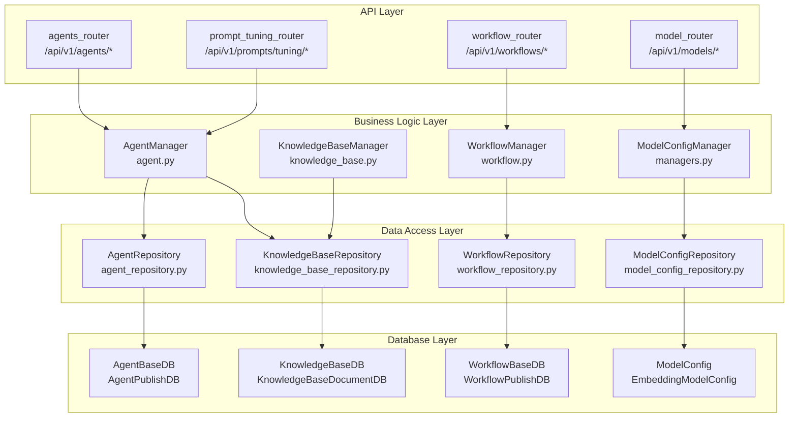
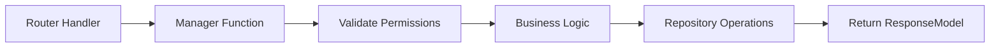
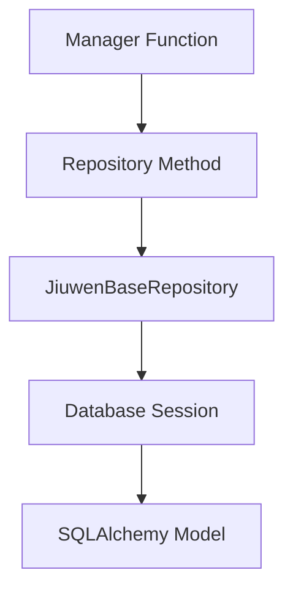
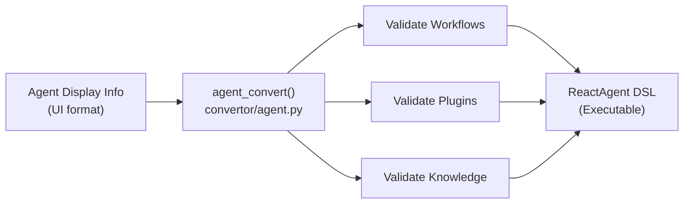

<!-- source: DeepWiki mcp.deepwiki.com · repo openJiuwen-ai/agent-studio · page 6.4 Backend Development · fetched 2026-11-02 -->

# Backend Development

<details>
<summary>Relevant source files</summary>

The following files were used as context for generating this wiki page:

- [.env.example](.env.example)
- [backend/openjiuwen_studio/core/common/logging/__init__.py](backend/openjiuwen_studio/core/common/logging/__init__.py)
- [backend/openjiuwen_studio/core/common/logging/events.py](backend/openjiuwen_studio/core/common/logging/events.py)
- [backend/openjiuwen_studio/core/config.py](backend/openjiuwen_studio/core/config.py)
- [backend/openjiuwen_studio/core/manager/agent.py](backend/openjiuwen_studio/core/manager/agent.py)
- [backend/openjiuwen_studio/core/manager/convertor/agent.py](backend/openjiuwen_studio/core/manager/convertor/agent.py)
- [backend/openjiuwen_studio/core/manager/convertor/components/sub_workflow.py](backend/openjiuwen_studio/core/manager/convertor/components/sub_workflow.py)
- [backend/openjiuwen_studio/core/manager/email_manager/__init__.py](backend/openjiuwen_studio/core/manager/email_manager/__init__.py)
- [backend/openjiuwen_studio/core/manager/email_manager/email_template.py](backend/openjiuwen_studio/core/manager/email_manager/email_template.py)
- [backend/openjiuwen_studio/core/manager/email_manager/email_utils.py](backend/openjiuwen_studio/core/manager/email_manager/email_utils.py)
- [backend/openjiuwen_studio/core/manager/knowledge_base.py](backend/openjiuwen_studio/core/manager/knowledge_base.py)
- [backend/openjiuwen_studio/core/manager/model_manager/managers/model_test_manager.py](backend/openjiuwen_studio/core/manager/model_manager/managers/model_test_manager.py)
- [backend/openjiuwen_studio/core/manager/redis_manager/__init__.py](backend/openjiuwen_studio/core/manager/redis_manager/__init__.py)
- [backend/openjiuwen_studio/core/manager/repositories/agent_repository.py](backend/openjiuwen_studio/core/manager/repositories/agent_repository.py)
- [backend/openjiuwen_studio/core/manager/repositories/plugin_repository.py](backend/openjiuwen_studio/core/manager/repositories/plugin_repository.py)
- [backend/openjiuwen_studio/core/manager/repositories/tool_repository.py](backend/openjiuwen_studio/core/manager/repositories/tool_repository.py)
- [backend/openjiuwen_studio/core/manager/utils/utils.py](backend/openjiuwen_studio/core/manager/utils/utils.py)
- [backend/openjiuwen_studio/main.py](backend/openjiuwen_studio/main.py)
- [backend/openjiuwen_studio/ops/modules/llm/llm_config_service.py](backend/openjiuwen_studio/ops/modules/llm/llm_config_service.py)
- [backend/openjiuwen_studio/ops/modules/llm/schema.py](backend/openjiuwen_studio/ops/modules/llm/schema.py)
- [backend/openjiuwen_studio/ops/modules/prompt/domain/debug_entity.py](backend/openjiuwen_studio/ops/modules/prompt/domain/debug_entity.py)
- [backend/openjiuwen_studio/ops/modules/prompt/domain/entities.py](backend/openjiuwen_studio/ops/modules/prompt/domain/entities.py)
- [backend/openjiuwen_studio/ops/modules/prompt/domain/services.py](backend/openjiuwen_studio/ops/modules/prompt/domain/services.py)
- [backend/openjiuwen_studio/ops/modules/prompt/infra/repositories/debug_repo.py](backend/openjiuwen_studio/ops/modules/prompt/infra/repositories/debug_repo.py)
- [backend/openjiuwen_studio/routers/agents.py](backend/openjiuwen_studio/routers/agents.py)
- [backend/openjiuwen_studio/routers/prompt_debug_router.py](backend/openjiuwen_studio/routers/prompt_debug_router.py)
- [backend/openjiuwen_studio/routers/prompt_llm_router.py](backend/openjiuwen_studio/routers/prompt_llm_router.py)
- [backend/openjiuwen_studio/routers/prompt_router.py](backend/openjiuwen_studio/routers/prompt_router.py)
- [backend/openjiuwen_studio/routers/prompt_tuning_router.py](backend/openjiuwen_studio/routers/prompt_tuning_router.py)
- [backend/openjiuwen_studio/schemas/agent.py](backend/openjiuwen_studio/schemas/agent.py)
- [backend/openjiuwen_studio/schemas/model_config.py](backend/openjiuwen_studio/schemas/model_config.py)
- [frontend/packages/api-client/src/config.ts](frontend/packages/api-client/src/config.ts)
- [frontend/packages/api-client/src/services/agentService.ts](frontend/packages/api-client/src/services/agentService.ts)
- [frontend/src/components/Agent/ModelDetailForm.tsx](frontend/src/components/Agent/ModelDetailForm.tsx)

</details>


This page provides guidance for developers working on the OpenJiuwen Agent Studio backend. It covers the backend architecture, coding patterns, and step-by-step instructions for adding new features.

For frontend development, see [Frontend Development](#6.3). For database schema changes, see [Database Migrations](#6.2).

---

## Backend Architecture Overview

The backend follows a layered architecture pattern with clear separation of concerns:



**Sources:** [backend/openjiuwen_studio/main.py:1-278](), [backend/openjiuwen_studio/routers/agents.py:1-600](), [backend/openjiuwen_studio/core/manager/agent.py:1-300](), [backend/openjiuwen_studio/core/manager/repositories/agent_repository.py:1-50]()

---

## Project Structure

The backend codebase is organized as follows:

```
backend/
├── openjiuwen_studio/
│   ├── main.py                          # FastAPI application entry point
│   ├── core/
│   │   ├── config.py                    # Application configuration
│   │   ├── database.py                  # Database connection setup
│   │   ├── manager/                     # Business logic layer
│   │   │   ├── agent.py                # Agent management functions
│   │   │   ├── knowledge_base.py       # Knowledge base operations
│   │   │   ├── convertor/              # DSL conversion logic
│   │   │   │   ├── agent.py           # Agent-to-DSL converter
│   │   │   │   └── components/        # Component converters
│   │   │   ├── model_manager/          # Model configuration management
│   │   │   │   └── managers/          # Model managers
│   │   │   └── repositories/           # Data access layer
│   │   │       ├── agent_repository.py
│   │   │       ├── workflow_repository.py
│   │   │       └── knowledge_base_repository.py
│   │   └── common/                      # Common utilities
│   ├── models/                          # SQLAlchemy database models
│   │   ├── agent.py
│   │   ├── workflow.py
│   │   └── knowledge_base.py
│   ├── schemas/                         # Pydantic request/response schemas
│   │   ├── agent.py
│   │   ├── workflow.py
│   │   └── common.py
│   ├── routers/                         # FastAPI route handlers
│   │   ├── agents.py
│   │   ├── workflows.py
│   │   ├── prompt_tuning_router.py
│   │   └── models.py
│   └── ops/                             # Operations modules
│       └── modules/
│           ├── prompt/                  # Prompt management
│           └── llm/                     # LLM services
└── pyproject.toml                       # Python project configuration
```

**Sources:** [backend/openjiuwen_studio/main.py:1-10](), [backend/openjiuwen_studio/core/config.py:1-90]()

---

## Adding New API Endpoints

### Step 1: Define Request/Response Schemas

Create Pydantic models in `schemas/` to define the API contract:

```python
# backend/openjiuwen_studio/schemas/my_feature.py
from pydantic import BaseModel, Field

class MyFeatureCreateRequest(BaseModel):
    space_id: str = Field(..., min_length=1, max_length=100)
    name: str = Field(..., min_length=1, max_length=255)
    description: str = Field("", max_length=500)

class MyFeatureResponse(BaseModel):
    id: str
    name: str
    status: str
```

**Sources:** [backend/openjiuwen_studio/schemas/agent.py:1-50](), [backend/openjiuwen_studio/schemas/model_config.py:1-40]()

### Step 2: Create Router

Define API endpoints in `routers/`:

```python
# backend/openjiuwen_studio/routers/my_feature.py
from fastapi import APIRouter, Depends, status
from openjiuwen_studio.core.manager.login_manager.user import get_current_user
from openjiuwen_studio.schemas.my_feature import MyFeatureCreateRequest, MyFeatureResponse
from openjiuwen_studio.schemas.common import ResponseModel
import openjiuwen_studio.core.manager.my_feature as mgr

my_feature_router = APIRouter()

@my_feature_router.post("/create", response_model=ResponseModel[dict])
async def create_my_feature(
    request: dict,
    current_user: dict = Depends(get_current_user)
):
    """Create a new feature instance"""
    from openjiuwen_studio.routers.common import validate_request, handle_response
    req = validate_request(request, MyFeatureCreateRequest)
    res = mgr.create_my_feature(req, current_user)
    return handle_response(res)
```

**Sources:** [backend/openjiuwen_studio/routers/agents.py:157-183](), [backend/openjiuwen_studio/routers/prompt_tuning_router.py:59-68]()

### Step 3: Register Router

Register the router in `main.py`:

```python
# In main.py
from openjiuwen_studio.routers.my_feature import my_feature_router

def router_register(app: FastAPI):
    # ... existing routers
    app.include_router(my_feature_router, prefix="/api/v1/my-feature", tags=["my-feature"])
```

**Sources:** [backend/openjiuwen_studio/main.py:244]()

---

## Implementing Business Logic (Managers)

Business logic is implemented in manager functions within `core/manager/`. These functions handle validation, orchestration, and error handling.

### Manager Function Pattern



### Example Manager Implementation

```python
# backend/openjiuwen_studio/core/manager/my_feature.py
from fastapi import status
from openjiuwen.core.common.logging import logger
from openjiuwen_studio.core.manager.login_manager.space import check_user_space
from openjiuwen_studio.core.manager.repositories.my_feature_repository import my_feature_repository
from openjiuwen_studio.schemas.common import ResponseModel

@with_exception_handling
def create_my_feature(req: MyFeatureCreateRequest, current_user: dict) -> ResponseModel:
    """Create new feature"""
    start_time = time.time()
    user_id = current_user.get("user_id", "unknown")
    
    logger.info(f"[MY_FEATURE_CREATE] Creating feature - User: {user_id}, Name: {req.name}")
    
    # 1. Validate user space permissions
    _ = check_user_space(req.space_id, current_user)
    
    # 2. Generate feature ID
    feature_id = str(uuid.uuid4())
    
    # 3. Prepare data
    feature_data = {
        "feature_id": feature_id,
        "space_id": req.space_id,
        "name": req.name,
        "description": req.description,
        "create_time": milliseconds(),
        "update_time": milliseconds(),
    }
    
    # 4. Save to database
    create_result = my_feature_repository.create_feature(feature_data)
    
    if create_result.code != status.HTTP_200_OK:
        logger.error(f"[MY_FEATURE_CREATE] Database save failed - Error: {create_result.message}")
        return ResponseModel(code=create_result.code, message=create_result.message)
    
    logger.info(f"[MY_FEATURE_CREATE] Feature created - ID: {feature_id}, Duration: {time.time() - start_time:.3f}s")
    
    # 5. Return response
    return ResponseModel(
        code=status.HTTP_200_OK,
        message="create feature success",
        data={"id": feature_id}
    )
```

**Sources:** [backend/openjiuwen_studio/core/manager/agent.py:329-376](), [backend/openjiuwen_studio/core/manager/knowledge_base.py:486-604]()

### Exception Handling Decorator

All manager functions should use the `@with_exception_handling` decorator:

```python
def with_exception_handling(func: Callable) -> Callable:
    """Enhanced exception handler with unified error handling and logging"""
    @functools.wraps(func)
    def wrapper(*args, **kwargs):
        start_time = time.time()
        func_name = func.__name__
        
        try:
            result = func(*args, **kwargs)
            execution_time = time.time() - start_time
            return result
            
        except ValidationError as e:
            # Handle validation errors
            return ResponseModel(
                code=StatusCode.VALIDATION_ERROR.code,
                message=str(e)
            )
        except Exception as e:
            logger.error(f"[{func_name}] Error: {str(e)}", exc_info=True)
            return ResponseModel(
                code=StatusCode.INTERNAL_SERVER_ERROR.code,
                message=str(e)
            )
    
    return wrapper
```

**Sources:** [backend/openjiuwen_studio/core/manager/agent.py:162-299](), [backend/openjiuwen_studio/core/manager/knowledge_base.py:456-484]()

---

## Data Access Layer (Repositories)

Repositories provide an abstraction over database operations. They use `JiuwenBaseRepository` as a base class.

### Repository Pattern



### Creating a Repository

```python
# backend/openjiuwen_studio/core/manager/repositories/my_feature_repository.py
from functools import wraps
from typing import Callable
from fastapi import status
from openjiuwen.core.common.logging import logger
from openjiuwen_studio.models.my_feature import MyFeatureDB
from openjiuwen_studio.schemas.common import ResponseModel
from openjiuwen_studio.core.manager.repositories import JiuwenBaseRepository
from openjiuwen_studio.core.manager.repositories.jiuwen_base_repository import get_db_jw

class MyFeatureRepository:
    def __init__(self) -> None:
        pass
    
    def with_exception_handling(func) -> Callable:
        @wraps(func)
        def wrapper(self, *args, **kwargs):
            try:
                return func(self, *args, **kwargs)
            except Exception as e:
                logger.error(f"Error in {func.__name__}: {str(e)}")
                return ResponseModel(
                    code=status.HTTP_400_BAD_REQUEST,
                    message=f"Database operation failed: {str(e)}"
                )
        return wrapper
    
    @with_exception_handling
    def create_feature(self, feature_data: dict) -> ResponseModel:
        """Create a new feature in database"""
        with get_db_jw() as db:
            feature_db = JiuwenBaseRepository(db, MyFeatureDB)
            find_id = {"feature_id": feature_data["feature_id"]}
            return feature_db.register_dl_in_sql(find_id=find_id, dl=feature_data)
    
    @with_exception_handling
    def get_feature(self, feature_id: str, space_id: str) -> ResponseModel:
        """Retrieve feature from database"""
        with get_db_jw() as db:
            feature_db = JiuwenBaseRepository(db, MyFeatureDB)
            find_id = {"feature_id": feature_id, "space_id": space_id}
            return feature_db.get_dl_in_sql(find_id=find_id, return_first_item=True)
    
    @with_exception_handling
    def update_feature(self, feature_id: str, space_id: str, update_data: dict) -> ResponseModel:
        """Update feature in database"""
        with get_db_jw() as db:
            feature_db = JiuwenBaseRepository(db, MyFeatureDB)
            find_id = {"feature_id": feature_id, "space_id": space_id}
            return feature_db.update_dl_in_sql(find_id=find_id, update_dl=update_data)

# Singleton instance
my_feature_repository = MyFeatureRepository()
```

**Sources:** [backend/openjiuwen_studio/core/manager/repositories/agent_repository.py:21-100](), [backend/openjiuwen_studio/core/manager/repositories/plugin_repository.py:17-99]()

### Common Repository Methods

| Method | Purpose | Example |
|--------|---------|---------|
| `register_dl_in_sql` | Create or update record | `repo.register_dl_in_sql(find_id, dl)` |
| `get_dl_in_sql` | Query records | `repo.get_dl_in_sql(find_id)` |
| `update_dl_in_sql` | Update existing record | `repo.update_dl_in_sql(find_id, update_dl)` |
| `unregister_dl_in_sql` | Delete record | `repo.unregister_dl_in_sql(find_id)` |

**Sources:** [backend/openjiuwen_studio/core/manager/repositories/tool_repository.py:35-80]()

---

## Request/Response Validation

### Input Validation with Pydantic

All API endpoints use Pydantic models for request validation:

```python
# Schema definition
class AgentCreate(BaseModel):
    space_id: str = Field(..., min_length=1, max_length=100)
    agent_name: str = Field(..., min_length=1, max_length=255, alias="name")
    description: str = Field(..., min_length=1, max_length=500, alias="desc")
    agent_type: str = Field(..., min_length=1, max_length=30, alias="type")
    
    model_config = ConfigDict(populate_by_name=True)

# Router handler
@agents_router.post("/create")
async def agent_create(
    request: dict,
    current_user: dict = Depends(get_current_user)
):
    try:
        req = validate_request(request, AgentCreate)
        res = mgr.agent_react_create(req, current_user)
        return handle_response(res)
    except ValidationError as e:
        raise handle_validation_error(e, "AGENT_CREATE", current_user)
```

**Sources:** [backend/openjiuwen_studio/routers/agents.py:157-183](), [backend/openjiuwen_studio/schemas/agent.py:20-27]()

### Response Model Standard

All API responses follow the `ResponseModel` structure:

```python
class ResponseModel(BaseModel):
    code: int = Field(default=200, description="HTTP status code")
    message: str = Field(default="success", description="Response message")
    data: Optional[Any] = Field(default=None, description="Response data")
```

**Sources:** [backend/openjiuwen_studio/core/manager/agent.py:371-376]()

### Validation Error Handling

Custom validation error handler provides localized error messages:

```python
def handle_validation_error(
    e: ValidationError,
    operation: str,
    current_user: Optional[dict] = None,
    user_id: str = "unknown"
) -> HTTPException:
    """Handle ValidationError with friendly messages"""
    language = _resolve_language(current_user)
    error_details = []
    
    for err in e.errors():
        field = '.'.join(map(str, err['loc']))
        field = _translate_field_name(field, language)
        msg = _translate_validation_message(err, operation, language)
        error_details.append(f"{field}: {msg}")
    
    error_msg = ", ".join(error_details)
    prefix = "参数校验失败" if language == "zh" else "Validation failed"
    
    return HTTPException(
        status_code=status.HTTP_400_BAD_REQUEST,
        detail=f"{prefix}: {error_msg}"
    )
```

**Sources:** [backend/openjiuwen_studio/routers/agents.py:125-152]()

---

## Configuration Management

### Environment Variables

Configuration is managed through environment variables defined in `.env`:

| Variable | Description | Default |
|----------|-------------|---------|
| `DB_TYPE` | Database type (mysql/sqlite) | `sqlite` |
| `DB_HOST` | MySQL host | `localhost` |
| `BACKEND_PORT` | Backend server port | `8000` |
| `SECRET_KEY` | JWT secret key | *required* |
| `INDEX_MANAGER_TYPE` | Vector store type (milvus/chroma) | `chroma` |
| `REDIS_HOST` | Redis host for checkpointing | `localhost` |

**Sources:** [.env.example:1-196]()

### Settings Class

Configuration is loaded via Pydantic settings:

```python
# backend/openjiuwen_studio/core/config.py
class Settings(BaseSettings):
    app_name: str = "Jiuwen Agent Studio"
    app_version: str = "1.0.0"
    debug: bool = True
    
    # Database
    db_type: str = "mysql"
    db_host: str = ""
    db_port: int = 3306
    db_user: str = ""
    db_password: str = ""
    
    # Security
    secret_key: str = "your-secret-key-change-in-production"
    algorithm: str = "HS256"
    access_token_expire_minutes: int = 5256000
    
    # Redis
    enable_redis_checkpoint: bool = False
    redis_host: str = "localhost"
    redis_port: int = 6379

settings = Settings()
```

**Sources:** [backend/openjiuwen_studio/core/config.py:7-90]()

### Accessing Configuration

```python
from openjiuwen_studio.core.config import settings

# Use configuration values
db_type = settings.db_type
secret_key = settings.secret_key
```

---

## Common Patterns

### DSL Conversion Pattern

Agent configurations are converted to executable DSL format:



**Example conversion flow:**

```python
def agent_convert(
    space_id: str,
    agent_info: AgentBaseDBPd,
    model_details: Optional[dict] = None
) -> tuple[Optional[dict], Optional[str]]:
    """Convert agent configuration to executable DSL"""
    
    # Convert workflows
    workflows_dsl = workflows_convert(space_id, agent_info.workflows)
    
    # Convert plugins
    plugins_dsl = agent_plugins_convert(space_id, agent_info.plugins)
    
    # Convert knowledge bases
    knowledges_dsl = knowledges_convert(space_id, agent_info.knowledge)
    
    # Build agent DSL
    agent_dsl = dsl.ReactAgent(
        id=agent_info.agent_id,
        name=agent_info.agent_name,
        plugins=plugins_dsl,
        workflows=workflows_dsl,
        knowledges=knowledges_dsl,
        # ... more fields
    )
    
    return agent_dsl.model_dump(), None
```

**Sources:** [backend/openjiuwen_studio/core/manager/convertor/agent.py:307-451]()

### Model Configuration Pattern

Model configurations require API key encryption/decryption:

```python
from openjiuwen_studio.core.manager.model_manager.utils import SecurityUtils

# Encrypt API key before storage
security_utils = SecurityUtils()
encrypted_key = security_utils.encrypt_api_key(api_key)

# Store in database
model_data = {
    "api_key": encrypted_key,
    # ... other fields
}

# Decrypt when using
api_key = security_utils.decrypt_api_key(model.api_key)
```

**Sources:** [backend/openjiuwen_studio/core/manager/convertor/agent.py:342-353](), [backend/openjiuwen_studio/core/manager/model_manager/managers/model_test_manager.py:74-78]()

### Prompt Optimization Pattern

Prompt optimization uses callbacks to track progress:

```python
class OptimizationCallbacks(Callbacks):
    """Database-updating callback class"""
    
    def __init__(self, job_id: str, job_service: JobService):
        self.job_id = job_id
        self.job_service = job_service
        self.history_records = []
        super().__init__()
    
    def on_train_epoch_end(self, agent, progress: Progress, eval_info: List[EvaluatedCase]):
        """Called after each training epoch"""
        history_record = {
            "iteration_round": progress.current_epoch,
            "success_rate": float(progress.current_epoch_score),
            "optimized_prompt": agent.get_system_prompt(),
        }
        self.history_records.append(history_record)
        
        # Update database
        update_data = {
            "progress_rate": progress.current_epoch / progress.max_epoch,
            "history": json.dumps(self.history_records),
            "status": "running"
        }
        self.job_service.update_job(self.job_id, update_data)
```

**Sources:** [backend/openjiuwen_studio/routers/prompt_tuning_router.py:141-276]()

### Database Session Management

Use context managers for database sessions:

```python
from openjiuwen_studio.core.manager.repositories.jiuwen_base_repository import get_db_jw

# Pattern 1: Context manager
with get_db_jw() as db:
    repo = JiuwenBaseRepository(db, MyModel)
    result = repo.get_dl_in_sql(find_id)

# Pattern 2: Dependency injection (for routes)
@router.post("/endpoint")
async def endpoint(db: Session = Depends(get_db_agent)):
    # Use db session
    pass
```

**Sources:** [backend/openjiuwen_studio/core/manager/agent.py:140-160](), [backend/openjiuwen_studio/core/manager/repositories/agent_repository.py:35-50]()

### Logging Best Practices

Structured logging with operation tags:

```python
from openjiuwen.core.common.logging import logger

# Start of operation
logger.info(f"[FEATURE_OPERATION] Starting - User: {user_id}, ID: {feature_id}")

# Debug information
logger.debug(f"[FEATURE_OPERATION] Processing data: {data}")

# Success
logger.info(f"[FEATURE_OPERATION] Completed - ID: {feature_id}, Duration: {duration:.3f}s")

# Error
logger.error(f"[FEATURE_OPERATION] Failed - ID: {feature_id}, Error: {str(e)}", exc_info=True)
```

**Sources:** [backend/openjiuwen_studio/core/manager/agent.py:339-368]()

### Multi-Database Support

The system supports both MySQL and SQLite through configuration:

```python
# Database engine selection based on DB_TYPE
if settings.db_type == "mysql":
    database_url = f"mysql+pymysql://{settings.db_user}:{settings.db_password}@{settings.db_host}:{settings.db_port}/{settings.agent_db_name}"
else:  # sqlite
    db_path = Path(settings.sqlite_db_path) / settings.agent_sqlite_db
    database_url = f"sqlite:///{db_path}"

engine = create_engine(database_url)
```

**Sources:** [backend/openjiuwen_studio/main.py:54-115]()

---

## Testing API Endpoints

### Manual Testing with cURL

```bash
# Create agent
curl -X POST http://localhost:8000/api/v1/agents/create \
  -H "Content-Type: application/json" \
  -H "Authorization: Bearer YOUR_TOKEN" \
  -d '{
    "spaceId": "space123",
    "name": "Test Agent",
    "desc": "A test agent",
    "type": "react",
    "icon": "🤖"
  }'

# Get agent list
curl -X POST http://localhost:8000/api/v1/agents/list \
  -H "Content-Type: application/json" \
  -H "Authorization: Bearer YOUR_TOKEN" \
  -d '{
    "spaceId": "space123",
    "page": 1,
    "page_size": 10
  }'
```

### API Client Usage (Frontend)

```typescript
import { AgentService } from '@test-agentstudio/api-client'

// Create agent
const response = await AgentService.createAgent({
  spaceId: 'space123',
  name: 'Test Agent',
  desc: 'A test agent',
  type: 'react',
  icon: '🤖'
})

// Get agent list
const agents = await AgentService.getAgents({
  spaceId: 'space123',
  page: 1,
  page_size: 10
})
```

**Sources:** [frontend/packages/api-client/src/services/agentService.ts:30-49](), [frontend/packages/api-client/src/config.ts:1-70]()

---

## Performance Considerations

### Database Query Optimization

- Use pagination for list operations: [backend/openjiuwen_studio/core/manager/repositories/plugin_repository.py:105-119]()
- Batch fetch related data to avoid N+1 queries: [backend/openjiuwen_studio/core/manager/agent.py:850-863]()
- Use database indexes on frequently queried fields

### Caching Strategies

- Model configurations are cached after first load
- Use Redis for distributed caching when `ENABLE_REDIS_CHECKPOINT=True`
- Vector store results can be cached for repeated queries

### Async Operations

Use async functions for I/O-bound operations:

```python
@with_exception_handling
async def knowledge_base_delete(req: KnowledgeBaseGet, current_user: dict) -> ResponseModel:
    """Delete knowledge base (async operation)"""
    # ... delete logic
    await _delete_kb_indices(req.kb_id, req.space_id)
    return ResponseModel(code=status.HTTP_200_OK, message="success")
```

**Sources:** [backend/openjiuwen_studio/core/manager/knowledge_base.py:645-756]()

---

**Sources:** [backend/openjiuwen_studio/main.py:1-278](), [backend/openjiuwen_studio/routers/agents.py:1-600](), [backend/openjiuwen_studio/core/manager/agent.py:1-1500](), [backend/openjiuwen_studio/core/manager/repositories/agent_repository.py:1-400](), [backend/openjiuwen_studio/schemas/agent.py:1-273](), [backend/openjiuwen_studio/core/config.py:1-90](), [.env.example:1-196](), [backend/openjiuwen_studio/core/manager/convertor/agent.py:1-500]()

---

