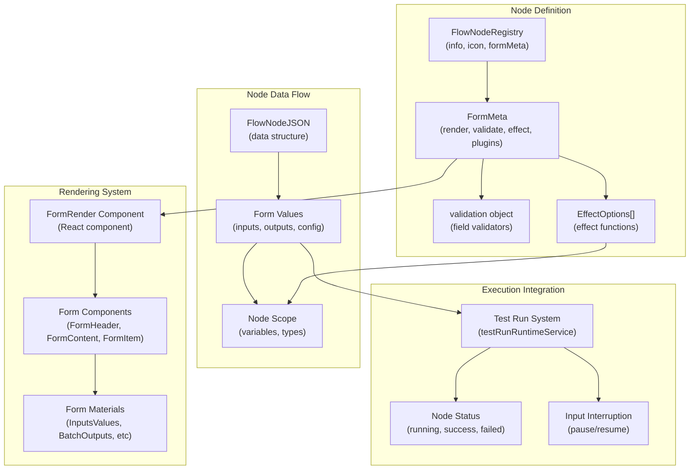
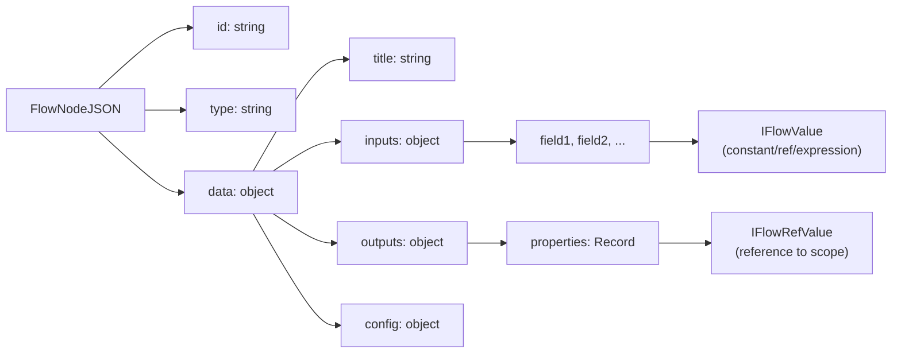
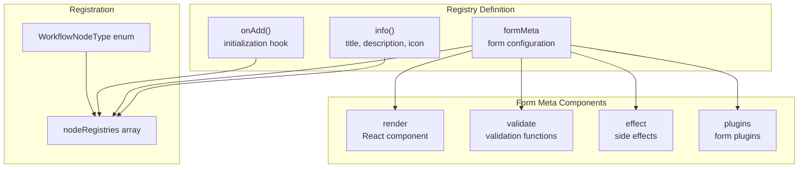
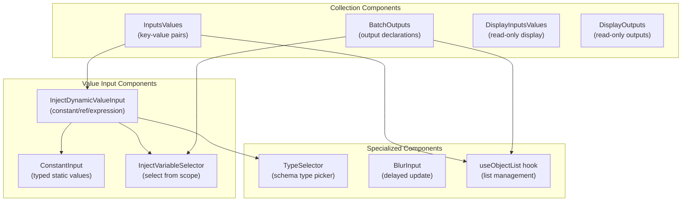
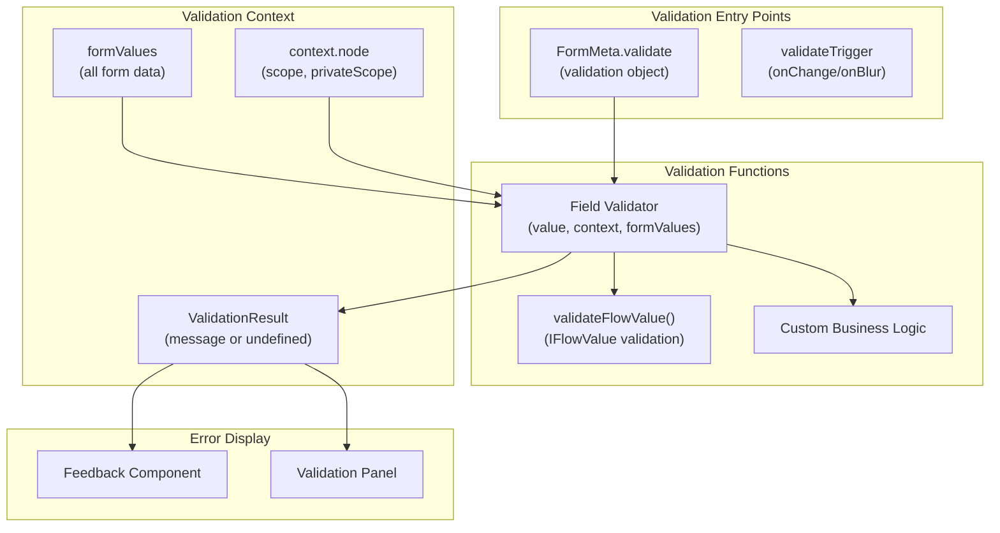
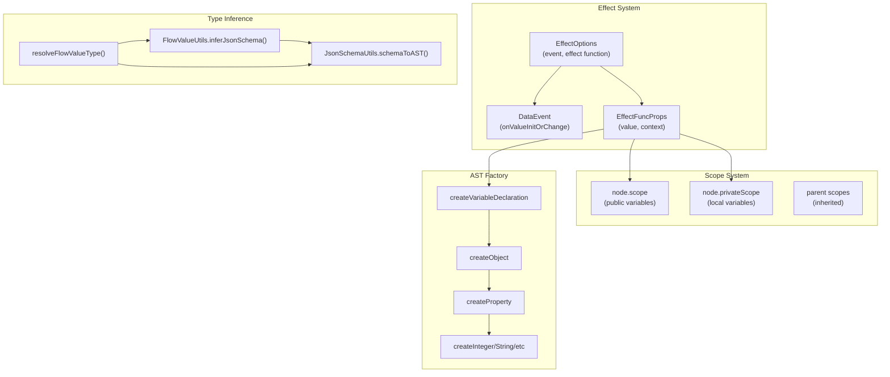
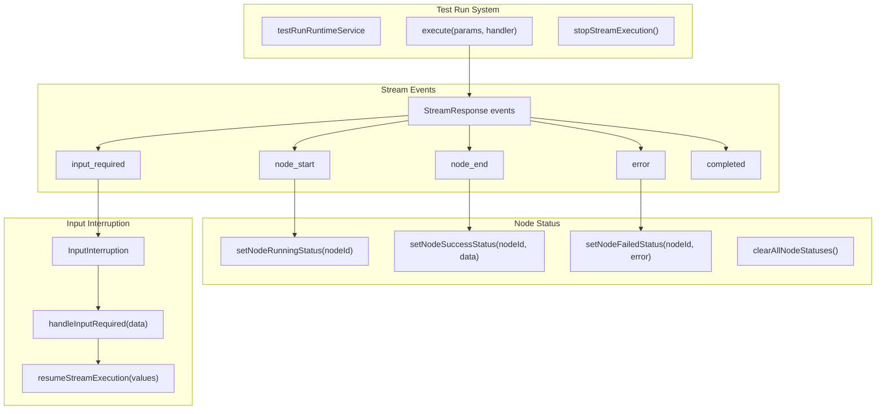

<!-- source: DeepWiki mcp.deepwiki.com · repo openJiuwen-ai/agent-studio · page 6.5 Creating Custom Workflow Nodes · fetched 2026-11-02 -->

# Creating Custom Workflow Nodes

<details>
<summary>Relevant source files</summary>

The following files were used as context for generating this wiki page:

- [frontend/packages/workflow-canvas/src/components/testrun/shared/use-input-interruption.ts](frontend/packages/workflow-canvas/src/components/testrun/shared/use-input-interruption.ts)
- [frontend/packages/workflow-canvas/src/components/testrun/testrun-panel/test-run-panel.tsx](frontend/packages/workflow-canvas/src/components/testrun/testrun-panel/test-run-panel.tsx)
- [frontend/packages/workflow-canvas/src/editor.tsx](frontend/packages/workflow-canvas/src/editor.tsx)
- [frontend/packages/workflow-canvas/src/nodes/loop/effects.ts](frontend/packages/workflow-canvas/src/nodes/loop/effects.ts)
- [frontend/packages/workflow-canvas/src/nodes/loop/form-meta.tsx](frontend/packages/workflow-canvas/src/nodes/loop/form-meta.tsx)
- [frontend/packages/workflow-canvas/src/nodes/loop/validation.ts](frontend/packages/workflow-canvas/src/nodes/loop/validation.ts)
- [frontend/packages/workflow-canvas/src/utils/validation/validation-helpers.ts](frontend/packages/workflow-canvas/src/utils/validation/validation-helpers.ts)
- [frontend/packages/workflow-canvas/src/utils/workflow-node-utils.ts](frontend/packages/workflow-canvas/src/utils/workflow-node-utils.ts)
- [frontend/src/locales/workflow/en-US/common.json](frontend/src/locales/workflow/en-US/common.json)
- [frontend/src/locales/workflow/en-US/nodes.json](frontend/src/locales/workflow/en-US/nodes.json)
- [frontend/src/locales/workflow/zh-CN/common.json](frontend/src/locales/workflow/zh-CN/common.json)
- [frontend/src/locales/workflow/zh-CN/nodes.json](frontend/src/locales/workflow/zh-CN/nodes.json)

</details>


This document provides a comprehensive guide for developers who want to extend the workflow canvas by creating custom node types. It covers the node registry system, form rendering, validation, effects, and integration with the broader workflow execution system.

For information about using the workflow canvas as an end-user, see [Building Workflows](#4.2). For details about the workflow execution pipeline, see [Workflow Canvas Architecture](#5.7).

---

## Node System Architecture

The workflow canvas uses a modular node system where each node type is defined through a registry that specifies its behavior, appearance, and configuration interface.



**Sources:** [frontend/packages/workflow-canvas/src/nodes/loop/form-meta.tsx:1-415](), [frontend/packages/workflow-canvas/src/nodes/loop/effects.ts:1-236](), [frontend/packages/workflow-canvas/src/nodes/loop/validation.ts:1-261]()

---

## Node Type System

Each node type is identified by a numeric ID and has a corresponding registry entry. The system supports various node categories for different workflow operations.

| Node Type | ID | Purpose | Key Features |
|-----------|----|---------|--------------| 
| Start | 1 | Workflow entry point | Defines input parameters |
| End | 2 | Workflow exit point | Collects output values |
| LLM | 3 | Language model calls | Model selection, prompts |
| Selector | 4 | Conditional branching | If/else logic |
| Loop | 5 | Iteration control | Array/count loops |
| Intent | 6 | Intent classification | Multi-branch routing |
| Questioner | 7 | User interaction | Question sequences |
| Input | 8 | Runtime input | Pause for user input |
| Output | 9 | Intermediate output | Stream outputs |
| Code | 10 | Custom code | JavaScript/Python |
| TextEditor | 11 | Text manipulation | Concatenate/split |
| Continue | 12 | Loop control | Skip iteration |
| Break | 13 | Loop control | Exit loop |
| Workflow | 14 | Sub-workflow | Nested execution |
| BlockStart | 15 | Block boundary | Loop/container start |
| BlockEnd | 16 | Block boundary | Loop/container end |
| Variable | 17 | Variable assignment | Value updates |
| VariableMerge | 18 | Variable aggregation | Merge branches |
| Plugin | 19 | External tools | API/code plugins |
| Comment | 99 | Documentation | Non-executable |

**Sources:** [frontend/src/locales/workflow/en-US/nodes.json:2-189](), [frontend/src/locales/workflow/zh-CN/common.json:23-44](), [frontend/packages/workflow-canvas/src/utils/validation/validation-helpers.ts:13-34]()

---

## Node Data Structure

Workflow nodes are represented as JSON objects with a standardized structure. Understanding this structure is essential for creating custom nodes.



### Core Interfaces

**IFlowValue Types:**
- `constant`: Static value with schema (e.g., `{type: 'constant', content: 5, schema: {type: 'integer'}}`)
- `ref`: Reference to another node's output (e.g., `{type: 'ref', content: ['nodeId', 'fieldName']}`)
- `expression`: Computed value from template (e.g., `{type: 'expression', content: '{{var1}} + {{var2}}'}`)

**Example Node JSON:**
```typescript
interface LoopNodeJSON extends FlowNodeJSON {
  data: {
    title?: string
    inputs?: {
      loopParam?: {
        type?: 'arrayLoop' | 'numLoop'
        loopNum?: IFlowValue
        loopArray?: Record<string, IFlowValue>
        intermediateVar?: Record<string, IFlowValue>
      }
    }
    outputs?: {
      type: 'object'
      properties?: Record<string, IFlowRefValue>
    }
  }
}
```

**Sources:** [frontend/packages/workflow-canvas/src/nodes/loop/form-meta.tsx:41-60](), [frontend/packages/workflow-canvas/src/form-materials:1-26]()

---

## Creating a Node Registry

The node registry is the entry point for defining a custom node. It specifies metadata, appearance, and behavior.



### Basic Registry Structure

```typescript
import { FlowNodeRegistry } from '@flowgram.ai/free-layout-editor'
import { WorkflowNodeType } from '../constants'

export const customNodeRegistry: FlowNodeRegistry = {
  // Unique identifier for this node type
  type: WorkflowNodeType.CUSTOM,
  
  // Display information
  info: () => ({
    title: 'Custom Node',
    description: 'Description of what this node does',
    icon: <CustomIcon />, // or icon URL string
    category: 'components', // Categories: llmAndWorkflow, businessLogic, inputOutput, components
  }),
  
  // Form rendering and validation
  formMeta: customFormMeta,
  
  // Initialization hook (optional)
  onAdd: (context) => {
    const title = generateNodeTitle(
      WorkflowNodeType.CUSTOM,
      context,
      'Custom_Node'
    )
    return {
      data: {
        title,
        inputs: {},
        outputs: { type: 'object', properties: {} }
      }
    }
  }
}
```

**Sources:** [frontend/packages/workflow-canvas/src/utils/workflow-node-utils.ts:95-139](), [frontend/src/locales/workflow/en-US/common.json:95-100]()

---

## Form Metadata and Rendering

The `FormMeta` object defines how the node's configuration interface is rendered and validated. It consists of four main components: render function, validation rules, effects, and plugins.

### Form Rendering Component

The render function creates the node's configuration UI. It should use the provided form components and materials for consistency.

```typescript
import {
  FormHeader,
  FormContent,
  FormItem,
  FormSelect,
  Feedback
} from '../../form-components'
import {
  Field,
  FormMeta,
  ValidateTrigger
} from '@flowgram.ai/free-layout-editor'
import {
  InputsValues,
  BatchOutputs,
  InjectDynamicValueInput
} from '../../form-materials'

export const CustomFormRender = () => {
  const { t } = useTranslation()
  const isSidebar = useIsSidebar()
  const { node } = useNodeRenderContext()
  
  return (
    <>
      <FormHeader />
      <FormContent>
        {/* Configuration Fields */}
        <FormItem name="Configuration" vertical>
          <Field name="inputs.configParam">
            {({ field }) => (
              <InjectDynamicValueInput
                value={field.value}
                onChange={field.onChange}
                schema={{ type: 'string' }}
              />
            )}
          </Field>
        </FormItem>
        
        {/* Output Configuration */}
        <Field name="outputs.properties">
          {({ field, fieldState }) => (
            <FormItem name="Outputs" vertical>
              <BatchOutputs
                value={field.value}
                onChange={field.onChange}
                hasError={Object.keys(fieldState?.errors || {}).length > 0}
              />
              <Feedback errors={fieldState?.errors} />
            </FormItem>
          )}
        </Field>
      </FormContent>
    </>
  )
}
```

### Key Form Components

| Component | Purpose | Usage |
|-----------|---------|-------|
| `FormHeader` | Node title editor | Always at top of form |
| `FormContent` | Scrollable content area | Container for all fields |
| `FormItem` | Labeled form field | Wraps individual inputs |
| `Field` | Field state binding | Connects to form values |
| `Feedback` | Validation errors | Shows error messages |
| `FormSelect` | Dropdown selector | Enum/option selection |
| `FormDisplay` | Read-only display | Shows computed values |

**Sources:** [frontend/packages/workflow-canvas/src/nodes/loop/form-meta.tsx:193-404](), [frontend/packages/workflow-canvas/src/form-materials:1-26]()

---

## Form Materials and Input Components

Form materials are reusable components for handling different input types in workflow nodes. They provide consistent UX patterns and type-safe value handling.



### Using InjectDynamicValueInput

This component handles the three value types (constant, ref, expression) with a unified interface:

```typescript
<Field name="inputs.myField">
  {({ field }) => (
    <InjectDynamicValueInput
      style={{ width: '100%' }}
      value={field.value as IFlowConstantRefValue}
      onChange={(value) => field.onChange(value)}
      schema={{ type: 'string' }}  // Expected value schema
    />
  )}
</Field>
```

### Using InputsValues for Key-Value Pairs

For nodes that accept dynamic input fields:

```typescript
<Field name="inputs.parameters">
  {({ field }) => (
    <InputsValues
      value={field.value}
      onChange={(value) => field.onChange(value)}
      onValidateKey={(key, itemId, allItems) => {
        // Custom key validation
        if (key === 'reserved') {
          return 'Cannot use reserved keyword'
        }
        const isDuplicate = allItems.some(
          item => item.id !== itemId && item.key === key
        )
        if (isDuplicate && key) {
          return `Duplicate key: ${key}`
        }
        return undefined
      }}
    />
  )}
</Field>
```

### Using BatchOutputs for Output Configuration

For nodes that produce multiple output fields:

```typescript
<Field name="outputs.properties">
  {({ field, fieldState }) => (
    <FormItem name="Outputs" vertical>
      <BatchOutputs
        style={{ width: '100%' }}
        value={field.value}
        onChange={val => field.onChange(val)}
        hasError={Object.keys(fieldState?.errors || {}).length > 0}
        skipKeys={['index']}  // Reserved keys to exclude
      />
      <Feedback errors={fieldState?.errors} />
    </FormItem>
  )}
</Field>
```

**Sources:** [frontend/packages/workflow-canvas/src/nodes/loop/form-meta.tsx:62-191](), [frontend/packages/workflow-canvas/src/nodes/loop/form-meta.tsx:283-314]()

---

## Validation System

Validation ensures node configuration is correct before workflow execution. The system supports field-level and cross-field validation with internationalized error messages.



### Validation Function Structure

```typescript
interface ValidationContext {
  value?: any
  context: {
    node: FlowNodeEntity
  }
  name?: string
  formValues?: any
}

export const validateCustomField = ({
  value,
  context,
  name,
  formValues
}: ValidationContext) => {
  // 1. Check if field is required
  if (!value) {
    return t('workflowCanvas.validation.fieldRequired')
  }
  
  // 2. Validate IFlowValue using helper
  const flowValueResult = validateFlowValue(value, {
    node: context.node,
    required: true,
    includePrivateScope: true,
    errorMessages: {
      required: 'Field cannot be empty',
      unknownVariable: 'Referenced variable not found'
    }
  })
  
  if (flowValueResult) {
    return flowValueResult.message
  }
  
  // 3. Custom validation logic
  if (value?.type === 'constant') {
    if (value.content < 0) {
      return 'Value must be positive'
    }
  }
  
  // 4. Cross-field validation
  const otherField = formValues?.inputs?.otherParam
  if (otherField && value.content > otherField.content) {
    return 'Must not exceed other parameter'
  }
  
  return undefined  // No errors
}
```

### Complete Validation Object

The validation object maps field paths to validator functions:

```typescript
export const validation = {
  // Simple field validation
  'inputs.requiredParam': validateRequiredParam,
  
  // Nested field validation
  'inputs.config.subField': validateSubField,
  
  // Wildcard validation (for dynamic keys)
  'inputs.parameters.*': validateParameterField,
  
  // Block validation (for container nodes)
  'blocks': validateBlocks,
  
  // Output validation
  'outputs.properties': validateOutputs
}
```

### Common Validation Patterns

**Validating Constant Values:**
```typescript
if (value?.type === 'constant') {
  const content = value.content
  
  // Type checking
  if (typeof content !== 'number') {
    return 'Must be a number'
  }
  
  // Range checking
  if (content < 1 || content > 1000) {
    return 'Must be between 1 and 1000'
  }
  
  // Array validation
  if (Array.isArray(content) && content.length === 0) {
    return 'Array cannot be empty'
  }
}
```

**Validating References:**
```typescript
if (value?.type === 'ref') {
  const refPath = value.content
  
  // Check if reference exists in scope
  try {
    const schema = FlowValueUtils.inferJsonSchema(
      value,
      context.node.scope
    )
    if (!schema) {
      return 'Referenced variable not found'
    }
  } catch (error) {
    return 'Invalid reference'
  }
}
```

**Conditional Validation:**
```typescript
export const validateConditionalField = ({
  value,
  formValues
}: ValidationContext) => {
  const mode = formValues?.inputs?.mode
  
  // Only validate if mode is 'advanced'
  if (mode !== 'advanced') {
    return undefined
  }
  
  if (!value) {
    return 'Required in advanced mode'
  }
  
  return undefined
}
```

**Sources:** [frontend/packages/workflow-canvas/src/nodes/loop/validation.ts:1-261](), [frontend/packages/workflow-canvas/src/form-materials:1-26]()

---

## Effects and Scope Management

Effects provide dynamic behavior by responding to value changes and managing the node's variable scope. They enable features like exposing loop variables, computing derived values, and updating type information.



### Effect Configuration

Effects are configured in the `FormMeta` object:

```typescript
export const formMeta: FormMeta = {
  render: CustomFormRender,
  validateTrigger: ValidateTrigger.onChange,
  validate: validation,
  effect: {
    // Field path to watch
    'inputs.parameters': [
      provideVariablesEffect,
      computeDerivedEffect
    ],
    // Multiple paths can have effects
    'inputs.config': [
      updateTypeEffect
    ]
  },
  plugins: [createBatchOutputsFormPlugin({ outputKey: 'outputs.properties' })]
}
```

### Creating an Effect

Effects respond to value changes and update the node's scope:

```typescript
import {
  ASTFactory,
  EffectOptions,
  DataEvent,
  EffectFuncProps
} from '@flowgram.ai/editor'
import { JsonSchemaUtils } from '@flowgram.ai/json-schema'

export const provideVariablesEffect: EffectOptions[] = [
  {
    event: DataEvent.onValueInitOrChange,
    effect: (params: EffectFuncProps) => {
      const { value, context } = params
      
      // Extract configuration
      const config = value || {}
      const parameters = config.parameters || {}
      
      // Build variable declarations
      const properties = Object.entries(parameters).map(([key, flowValue]) => {
        // Resolve type from IFlowValue
        const type = resolveFlowValueType(
          flowValue,
          context.node.scope,
          context.node.privateScope
        )
        
        return ASTFactory.createProperty({
          key,
          type,
          meta: { title: `Parameter ${key}` }
        })
      })
      
      // Create variable declaration
      const declaration = ASTFactory.createVariableDeclaration({
        key: `${context.node.id}_locals`,
        meta: {
          title: context.node.form?.getValueIn('title'),
          icon: getNodeIcon(context.node)
        },
        type: ASTFactory.createObject({
          properties
        })
      })
      
      // Update scope (use setTimeout to avoid conflicts)
      setTimeout(() => {
        context.node.privateScope?.setVar(declaration)
      }, 0)
    }
  }
]
```

### Type Resolution Helper

```typescript
const resolveFlowValueType = (
  flowVal: IFlowValue,
  scope: any,
  privateScope: any
) => {
  if (!flowVal) {
    return ASTFactory.createString()
  }
  
  // Handle constant values with schema
  if (flowVal.type === 'constant') {
    const constantVal = flowVal as IFlowConstantValue
    if (constantVal.schema) {
      try {
        return JsonSchemaUtils.schemaToAST(constantVal.schema)
      } catch (error) {
        console.warn('Failed to convert schema to AST:', error)
      }
    }
  }
  
  // Handle references - infer type from scope
  if (flowVal.type === 'ref' || flowVal.type === 'expression') {
    try {
      let schema = undefined
      
      // Try private scope first
      if (privateScope) {
        schema = FlowValueUtils.inferJsonSchema(flowVal, privateScope)
      }
      
      // Fall back to public scope
      if (!schema && scope) {
        schema = FlowValueUtils.inferJsonSchema(flowVal, scope)
      }
      
      if (schema) {
        return JsonSchemaUtils.schemaToAST(schema)
      }
    } catch (error) {
      console.warn('Failed to infer type:', error)
    }
  }
  
  // Default to string
  return ASTFactory.createString()
}
```

### Exporting Variables to Public Scope

For nodes that produce outputs visible to downstream nodes:

```typescript
export const exportOutputsEffect: EffectOptions[] = [
  {
    event: DataEvent.onValueInitOrChange,
    effect: (params: EffectFuncProps) => {
      const { value, context } = params
      
      const outputProperties: Record<string, any> =
        context.node.form?.getValueIn('outputs.properties') || {}
      
      // Build properties with references
      const properties = Object.entries(outputProperties).map(([key, refValue]) =>
        ASTFactory.createProperty({
          key,
          initializer: ASTFactory.createKeyPathExpression({
            keyPath: refValue?.content || []
          })
        })
      )
      
      if (properties.length === 0) return
      
      // Export to public scope (delayed to run after other effects)
      setTimeout(() => {
        const declaration = ASTFactory.createVariableDeclaration({
          key: `${context.node.id}`,
          meta: {
            title: context.node.form?.getValueIn('title'),
            icon: getNodeIcon(context.node)
          },
          type: ASTFactory.createObject({
            properties
          })
        })
        
        context.node.scope?.setVar(declaration)
      }, 10)
    }
  }
]
```

### Scope Visibility

| Scope Type | Visibility | Use Case |
|-----------|------------|----------|
| `node.scope` | Public - visible to all downstream nodes | Node outputs, workflow variables |
| `node.privateScope` | Private - only within node/container | Loop iteration variables, local state |
| `parent scopes` | Inherited from ancestors | Nested workflows, container variables |

**Sources:** [frontend/packages/workflow-canvas/src/nodes/loop/effects.ts:1-236](), [frontend/packages/workflow-canvas/src/nodes/loop/form-meta.tsx:406-414]()

---

## Complete Example: Custom Aggregator Node

This example demonstrates creating a complete custom node that aggregates values from multiple branches. It showcases form rendering, validation, effects, and scope management.

### Step 1: Define Node Type and Constants

```typescript
// constants.ts
export enum WorkflowNodeType {
  // ... existing types
  AGGREGATOR = '20'
}

// Define the node's data structure
interface AggregatorNodeJSON extends FlowNodeJSON {
  data: {
    title?: string
    inputs?: {
      aggregationMode?: 'sum' | 'average' | 'concat'
      sourceFields?: Record<string, IFlowRefValue>
    }
    outputs?: {
      type: 'object'
      properties?: Record<string, unknown>
    }
  }
}
```

### Step 2: Create Form Renderer

```typescript
// form-meta.tsx
import React from 'react'
import {
  FormHeader,
  FormContent,
  FormItem,
  FormSelect,
  Feedback
} from '../../form-components'
import {
  Field,
  FormMeta,
  ValidateTrigger
} from '@flowgram.ai/free-layout-editor'
import {
  InputsValues,
  InjectVariableSelector,
  DisplayOutputs
} from '../../form-materials'
import { useTranslation } from '../../i18n'
import { useIsSidebar, useNodeRenderContext } from '../../hooks'
import { validation } from './validation'
import { provideAggregatedOutputEffect } from './effects'

export const AggregatorFormRender = () => {
  const { t } = useTranslation()
  const isSidebar = useIsSidebar()
  const { node } = useNodeRenderContext()
  
  return (
    <>
      <FormHeader />
      <FormContent>
        {/* Aggregation Mode Selection */}
        <FormItem name="Aggregation Mode" vertical>
          <Field name="inputs.aggregationMode">
            {({ field }) => (
              <FormSelect
                style={{ width: '100%' }}
                value={field.value || 'sum'}
                onChange={(value) => field.onChange(value)}
                options={[
                  { label: 'Sum', value: 'sum' },
                  { label: 'Average', value: 'average' },
                  { label: 'Concatenate', value: 'concat' }
                ]}
              />
            )}
          </Field>
        </FormItem>
        
        {/* Source Fields */}
        <FormItem name="Source Fields" vertical>
          <Field name="inputs.sourceFields">
            {({ field }) => (
              <InputsValues
                value={field.value}
                onChange={(value) => field.onChange(value)}
                onValidateKey={(key, itemId, allItems) => {
                  const isDuplicate = allItems.some(
                    item => item.id !== itemId && item.key === key
                  )
                  if (isDuplicate && key) {
                    return `Duplicate field name: ${key}`
                  }
                  return undefined
                }}
              />
            )}
          </Field>
        </FormItem>
        
        {/* Output Preview */}
        {!isSidebar && (
          <Field name="outputs.properties">
            {() => (
              <FormDisplay
                label="Output"
                content={<DisplayOutputs displayFromScope />}
              />
            )}
          </Field>
        )}
      </FormContent>
    </>
  )
}
```

### Step 3: Implement Validation

```typescript
// validation.ts
import { validateFlowValue } from '../../form-materials'
import { FlowNodeEntity } from '@flowgram.ai/free-layout-editor'

interface ValidationContext {
  value?: any
  context: { node: FlowNodeEntity }
  name?: string
  formValues?: any
}

export const validateAggregationMode = ({
  value
}: ValidationContext) => {
  if (!value) {
    return 'Aggregation mode is required'
  }
  
  const validModes = ['sum', 'average', 'concat']
  if (!validModes.includes(value)) {
    return `Invalid mode: ${value}`
  }
  
  return undefined
}

export const validateSourceFields = ({
  value,
  context
}: ValidationContext) => {
  if (!value || typeof value !== 'object') {
    return 'At least one source field is required'
  }
  
  const fields = Object.keys(value)
  if (fields.length === 0) {
    return 'At least one source field is required'
  }
  
  return undefined
}

export const validateSourceField = ({
  value,
  context,
  name
}: ValidationContext) => {
  const fieldName = name?.replace(/^inputs\.sourceFields\./, '') || ''
  
  const validationResult = validateFlowValue(value, {
    node: context.node,
    required: true,
    includePrivateScope: false,
    errorMessages: {
      required: `Field "${fieldName}" cannot be empty`,
      unknownVariable: `Field "${fieldName}" references unknown variable`
    }
  })
  
  return validationResult?.message
}

export const validation = {
  'inputs.aggregationMode': validateAggregationMode,
  'inputs.sourceFields': validateSourceFields,
  'inputs.sourceFields.*': validateSourceField
}
```

### Step 4: Create Effects

```typescript
// effects.ts
import {
  ASTFactory,
  EffectOptions,
  DataEvent,
  EffectFuncProps,
  FlowNodeRegistry
} from '@flowgram.ai/editor'
import { JsonSchemaUtils } from '@flowgram.ai/json-schema'
import { FlowValueUtils } from '../../form-materials'

export const provideAggregatedOutputEffect: EffectOptions[] = [
  {
    event: DataEvent.onValueInitOrChange,
    effect: (params: EffectFuncProps) => {
      const { value, context } = params
      
      const config = value || {}
      const mode = config.aggregationMode || 'sum'
      const sourceFields: Record<string, any> = config.sourceFields || {}
      
      // Determine output type based on mode
      let outputType
      if (mode === 'concat') {
        outputType = ASTFactory.createString()
      } else {
        outputType = ASTFactory.createNumber()
      }
      
      // Create output property
      const resultProperty = ASTFactory.createProperty({
        key: 'result',
        type: outputType,
        meta: { title: 'Aggregated Result' }
      })
      
      // Create metadata property
      const countProperty = ASTFactory.createProperty({
        key: 'count',
        type: ASTFactory.createInteger(),
        meta: { title: 'Number of Fields' }
      })
      
      // Build variable declaration
      const declaration = ASTFactory.createVariableDeclaration({
        key: `${context.node.id}`,
        meta: {
          title: context.node.form?.getValueIn('title'),
          icon: (() => {
            const info = context.node.getNodeRegistry<FlowNodeRegistry>().info
            return typeof info === 'function' ? info().icon : info?.icon
          })()
        },
        type: ASTFactory.createObject({
          properties: [resultProperty, countProperty]
        })
      })
      
      // Export to scope
      setTimeout(() => {
        context.node.scope?.setVar(declaration)
      }, 0)
    }
  }
]
```

### Step 5: Register the Node

```typescript
// index.ts
import { FlowNodeRegistry } from '@flowgram.ai/free-layout-editor'
import { WorkflowNodeType } from '../constants'
import { formMeta, AggregatorFormRender } from './form-meta'
import { AggregatorIcon } from './icon'
import { generateNodeTitle } from '../../utils/workflow-node-utils'

export const aggregatorNodeRegistry: FlowNodeRegistry = {
  type: WorkflowNodeType.AGGREGATOR,
  
  info: () => ({
    title: 'Aggregator',
    description: 'Aggregate values from multiple sources',
    icon: <AggregatorIcon />,
    category: 'components'
  }),
  
  formMeta: {
    render: AggregatorFormRender,
    validateTrigger: ValidateTrigger.onChange,
    validate: validation,
    effect: {
      'inputs': [provideAggregatedOutputEffect]
    }
  },
  
  onAdd: (context) => {
    const title = generateNodeTitle(
      WorkflowNodeType.AGGREGATOR,
      context,
      'Aggregator'
    )
    
    return {
      data: {
        title,
        inputs: {
          aggregationMode: 'sum',
          sourceFields: {}
        },
        outputs: {
          type: 'object',
          properties: {}
        }
      }
    }
  }
}

// Add to node registries array
export const nodeRegistries = [
  // ... existing registries
  aggregatorNodeRegistry
]
```

### Step 6: Add Translations

```json
// frontend/src/locales/workflow/en-US/nodes.json
{
  "nodes": {
    "aggregator": {
      "titlePrefix": "Aggregator",
      "description": "Aggregate values from multiple sources using sum, average, or concatenation.",
      "aggregationMode": "Aggregation Mode",
      "sourceFields": "Source Fields",
      "result": "Result"
    }
  }
}
```

**Sources:** [frontend/packages/workflow-canvas/src/nodes/loop/form-meta.tsx:193-414](), [frontend/packages/workflow-canvas/src/nodes/loop/validation.ts:1-261](), [frontend/packages/workflow-canvas/src/nodes/loop/effects.ts:159-236]()

---

## Testing and Debugging Integration

Custom nodes integrate with the workflow canvas testing system to support test runs and debugging.



### Node Status Management

The test run system automatically manages node status during execution:

```typescript
// Node status is automatically set during test runs
// Running status: Yellow indicator
testRunRuntimeService.setNodeRunningStatus(nodeId)

// Success status: Green indicator with output data
testRunRuntimeService.setNodeSuccessStatus(nodeId, {
  inputs: { /* input values */ },
  outputs: { /* output values */ }
})

// Failed status: Red indicator with error
testRunRuntimeService.setNodeFailedStatus(nodeId, 'Error message')

// Clear all statuses (e.g., before new run)
testRunRuntimeService.clearAllNodeStatuses()
```

### Supporting Input Interruption

If your node requires user input during execution, implement the Input node pattern:

```typescript
// In your node's execution logic (backend)
// Return an input_required event
{
  type: 'input_required',
  data: {
    nodeId: 'input_node_123',
    message: {
      fields: [
        {
          name: 'userInput',
          type: 'string',
          required: true,
          description: 'Please provide input'
        }
      ]
    }
  }
}

// The test run panel will pause and show input form
// User fills form and clicks continue
// Your node receives resumed execution with input values
```

### Handling Test Debug

For debugging individual nodes without full workflow execution:

```typescript
// Test debug panel calls node with mock inputs
// Your node should handle being called in isolation

// Example: Validate node can execute with minimal context
const testDebugNode = async (nodeId: string, inputs: Record<string, any>) => {
  const node = findNodeRecursively(document.root.blocks, nodeId)
  if (!node) {
    throw new Error('Node not found')
  }
  
  // Execute node logic with provided inputs
  // Return outputs for display in debug panel
  return {
    outputs: {
      // Your node's output values
    }
  }
}
```

**Sources:** [frontend/packages/workflow-canvas/src/components/testrun/testrun-panel/test-run-panel.tsx:1-418](), [frontend/packages/workflow-canvas/src/components/testrun/shared/use-input-interruption.ts:1-79]()

---

## Best Practices

### Form Design

1. **Use consistent field naming**: Follow the pattern `inputs.{category}.{field}` for input fields and `outputs.properties` for outputs
2. **Provide defaults**: Initialize fields with sensible defaults in the `onAdd` hook
3. **Use `isSidebar` flag**: Show different views for sidebar vs. main canvas (detailed config vs. summary)
4. **Include help text**: Use `FormItem` descriptions and tooltips to guide users

### Validation

1. **Validate early**: Use `ValidateTrigger.onChange` for immediate feedback
2. **Provide clear messages**: Use i18n keys with descriptive error messages
3. **Check dependencies**: Validate cross-field constraints in form-level validators
4. **Handle all value types**: Validate constant, ref, and expression values appropriately

### Effects

1. **Use setTimeout**: Delay scope updates to avoid race conditions with other effects
2. **Infer types correctly**: Use `FlowValueUtils.inferJsonSchema()` to determine types from references
3. **Clean up variables**: Remove old scope variables when configuration changes
4. **Order matters**: Effects run in array order; structure dependencies accordingly

### Performance

1. **Minimize re-renders**: Use `Field` component to isolate updates to specific form sections
2. **Avoid expensive computations in render**: Move heavy logic to effects or memoize results
3. **Use privateScope for internal state**: Keep loop variables and temporary data out of public scope

### Testing

1. **Test validation**: Verify all validation rules trigger correctly
2. **Test effects**: Ensure scope variables are created and updated properly
3. **Test interruption**: If node supports input, test pause/resume behavior
4. **Test error handling**: Verify node behaves correctly when inputs are invalid

**Sources:** [frontend/packages/workflow-canvas/src/nodes/loop/form-meta.tsx:1-415](), [frontend/packages/workflow-canvas/src/nodes/loop/validation.ts:1-261](), [frontend/packages/workflow-canvas/src/nodes/loop/effects.ts:1-236]()

---

## Integration Checklist

When adding a custom node to the system, ensure these integration points are complete:

- [ ] **Node Registry**: Create registry with type, info, formMeta, and onAdd hook
- [ ] **Form Component**: Implement FormRender component with all configuration fields
- [ ] **Validation**: Define validation object with field-level validators
- [ ] **Effects**: Create effects for scope management and type inference
- [ ] **Translations**: Add i18n keys for node title, description, fields, and errors
- [ ] **Icon**: Provide icon component or URL for node palette and canvas
- [ ] **Constants**: Add node type to WorkflowNodeType enum
- [ ] **Registration**: Add registry to nodeRegistries array
- [ ] **Testing**: Test node in workflow canvas with various configurations
- [ ] **Documentation**: Update user guide with node usage examples

**Sources:** [frontend/packages/workflow-canvas/src/editor.tsx:1-250](), [frontend/packages/workflow-canvas/src/nodes/loop/form-meta.tsx:406-414]()

---

