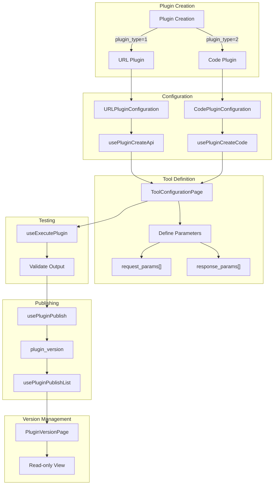
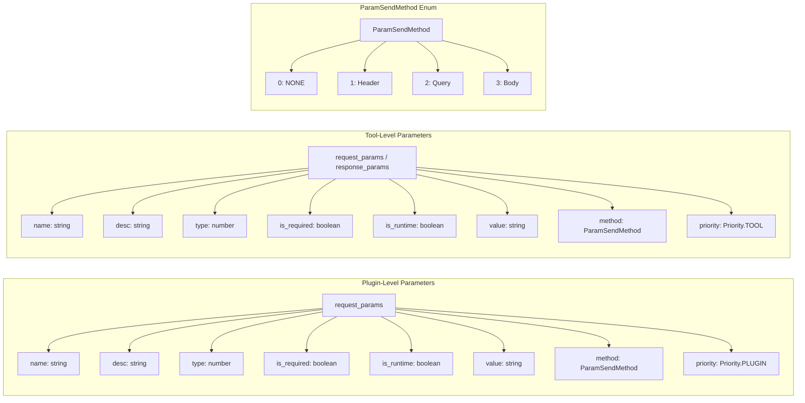
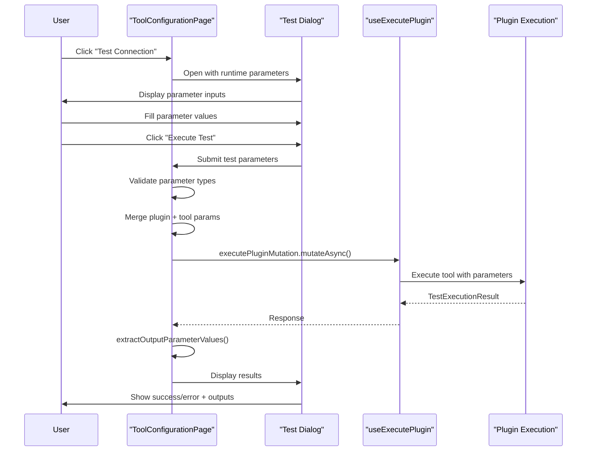
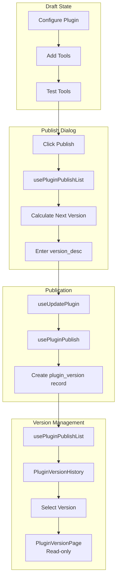
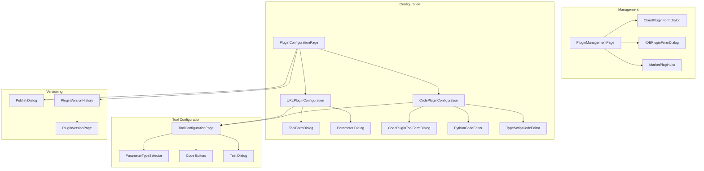

<!-- source: DeepWiki mcp.deepwiki.com · repo openJiuwen-ai/agent-studio · page 6.6 Plugin SDK · fetched 2026-11-02 -->

# Plugin SDK

<details>
<summary>Relevant source files</summary>

The following files were used as context for generating this wiki page:

- [frontend/src/components/Plugins/CloudPluginFormDialog.tsx](frontend/src/components/Plugins/CloudPluginFormDialog.tsx)
- [frontend/src/components/Plugins/CodeEditor.tsx](frontend/src/components/Plugins/CodeEditor.tsx)
- [frontend/src/components/Plugins/CodePluginToolFormDialog.tsx](frontend/src/components/Plugins/CodePluginToolFormDialog.tsx)
- [frontend/src/components/Plugins/IDEPluginFormDialog.tsx](frontend/src/components/Plugins/IDEPluginFormDialog.tsx)
- [frontend/src/components/Plugins/MarketPluginCard.tsx](frontend/src/components/Plugins/MarketPluginCard.tsx)
- [frontend/src/components/Plugins/MarketPluginList.tsx](frontend/src/components/Plugins/MarketPluginList.tsx)
- [frontend/src/components/Plugins/PluginVersionHistory.tsx](frontend/src/components/Plugins/PluginVersionHistory.tsx)
- [frontend/src/components/Plugins/PublishDialog.tsx](frontend/src/components/Plugins/PublishDialog.tsx)
- [frontend/src/components/Plugins/ToolFormDialog.tsx](frontend/src/components/Plugins/ToolFormDialog.tsx)
- [frontend/src/pages/Plugins/PluginConfigurationPage.tsx](frontend/src/pages/Plugins/PluginConfigurationPage.tsx)
- [frontend/src/pages/Plugins/PluginManagementPage.tsx](frontend/src/pages/Plugins/PluginManagementPage.tsx)
- [frontend/src/pages/Plugins/PluginVersionPage.tsx](frontend/src/pages/Plugins/PluginVersionPage.tsx)
- [frontend/src/pages/Plugins/ToolConfigurationPage.tsx](frontend/src/pages/Plugins/ToolConfigurationPage.tsx)
- [frontend/src/pages/Plugins/components/CodePluginConfiguration.tsx](frontend/src/pages/Plugins/components/CodePluginConfiguration.tsx)
- [frontend/src/pages/Plugins/components/URLPluginConfiguration.tsx](frontend/src/pages/Plugins/components/URLPluginConfiguration.tsx)

</details>


This document describes how to develop external plugins for OpenJiuwen Agent Studio. It covers plugin types, tool definition, parameter configuration, testing, and publishing workflows. For information about using plugins within agents, see [Plugins & Tools](#3.6). For plugin management UI, see [Developing Plugins](#4.5).

## Plugin Types

OpenJiuwen supports two plugin architectures, distinguished by the `plugin_type` field:

### URL Plugins (plugin_type = 1)

Cloud-based plugins that expose tools via HTTP APIs. The plugin's `url` field specifies the base endpoint, and each tool defines a relative `path` and HTTP `method`.

**Key Components:**
- `CloudPluginFormDialog` - Plugin creation UI ([frontend/src/components/Plugins/CloudPluginFormDialog.tsx:1-184]())
- `URLPluginConfiguration` - Configuration management ([frontend/src/pages/Plugins/components/URLPluginConfiguration.tsx:1-1000]())
- `usePluginCreateApi()` - API tool creation ([frontend/src/pages/Plugins/components/URLPluginConfiguration.tsx:196]())

**Structure:**
```typescript
{
  plugin_type: 1,
  url: "https://api.example.com",  // Base URL
  tools: [{
    path: "/users/get",             // Relative path
    method: 2,                      // POST (1=GET, 2=POST, 3=PUT, 4=DELETE, 5=PATCH)
    request_params: [...],
    response_params: [...]
  }]
}
```

### Code Plugins (plugin_type = 2)

IDE/local plugins that execute sandboxed Python or JavaScript code. Each tool contains executable code that runs in an isolated environment.

**Key Components:**
- `IDEPluginFormDialog` - Plugin creation UI ([frontend/src/components/Plugins/IDEPluginFormDialog.tsx:1-170]())
- `CodePluginConfiguration` - Configuration management ([frontend/src/pages/Plugins/components/CodePluginConfiguration.tsx:1-700]())
- `usePluginCreateCode()` - Code tool creation ([frontend/src/pages/Plugins/components/CodePluginConfiguration.tsx:187]())

**Structure:**
```typescript
{
  plugin_type: 2,
  tools: [{
    language: "python",             // "python" or "javascript"
    code: "def main(args): ...",    // Executable code
    request_params: [...],
    response_params: [...]
  }]
}
```

**Sources:** [frontend/src/pages/Plugins/PluginConfigurationPage.tsx:472-536](), [frontend/src/components/Plugins/CloudPluginFormDialog.tsx:1-184](), [frontend/src/components/Plugins/IDEPluginFormDialog.tsx:1-170]()

## Plugin Structure and Lifecycle



**Sources:** [frontend/src/pages/Plugins/PluginConfigurationPage.tsx:1-584](), [frontend/src/pages/Plugins/ToolConfigurationPage.tsx:1-1300]()

## Creating a Plugin

### Step 1: Initialize Plugin

**URL Plugin Creation:**
```typescript
const createPluginMutation = useCreatePlugin()

const request = {
  space_id: getDefaultSpaceId(),
  plugin_type: 1,
  name: "My API Plugin",
  desc: "Plugin description",
  desc_mk: "## Detailed Description\n...",
  url: "https://api.example.com",
  icon_uri: "🔌",
  request_params: []  // Plugin-level parameters
}

const response = await createPluginMutation.mutateAsync(request)
```

**Code Plugin Creation:**
```typescript
const request = {
  space_id: getDefaultSpaceId(),
  plugin_type: 2,
  name: "My Code Plugin",
  desc: "Plugin description",
  desc_mk: "## Detailed Description\n...",
  icon_uri: "⚡",
  request_params: []
}
```

**Sources:** [frontend/src/pages/Plugins/PluginManagementPage.tsx:290-350]()

### Step 2: Configure Basic Information

The configuration form includes:

| Field | Type | Required | Max Length | Description |
|-------|------|----------|------------|-------------|
| `name` | string | Yes | 128 bytes | Plugin display name |
| `desc` | string | Yes | 258 bytes | Short description |
| `desc_mk` | string | No | Unlimited | Markdown detailed description |
| `icon_uri` | string | Yes | - | Emoji or image URL |
| `url` | string | Yes (URL only) | 1000 bytes | Base API endpoint |

**URL Validation** ([frontend/src/utils/validationUtils.tsx]())
- Must start with `http://` or `https://`
- Maximum 1000 bytes
- Enforced by `validateHttpUrl()` and `validateHttpUrlRealtime()`

**Sources:** [frontend/src/pages/Plugins/components/URLPluginConfiguration.tsx:690-807](), [frontend/src/components/Plugins/CloudPluginFormDialog.tsx:63-85]()

## Defining Tools

### URL Plugin Tools

**Creation Workflow:**

1. **Open Tool Dialog** ([frontend/src/pages/Plugins/components/URLPluginConfiguration.tsx:246-254]())
```typescript
setIsToolDialogOpen(true)
setToolForm({
  name: '',
  description: '',
  path: '',
  method: ''
})
```

2. **Configure Tool** ([frontend/src/components/Plugins/ToolFormDialog.tsx:60-148]())
```typescript
{
  name: "Get User",              // Tool display name
  description: "Fetches user information by ID",
  path: "/users/get",            // API path (validated)
  method: "POST"                 // GET, POST, PUT, DELETE, PATCH
}
```

3. **Path Validation** ([frontend/src/utils/validationUtils.tsx]())
- Must start with `/`
- Only alphanumeric, underscore, hyphen, slash
- Checked by `validateToolPath(path)`

4. **Submit Tool** ([frontend/src/pages/Plugins/components/URLPluginConfiguration.tsx:256-333]())
```typescript
const methodMap = {
  'GET': 1, 'POST': 2, 'PUT': 3, 'DELETE': 4, 'PATCH': 5
}

const createRequest = {
  space_id: getDefaultSpaceId(),
  plugin_id: plugin_id,
  name: toolForm.name.trim(),
  desc: toolForm.description.trim(),
  path: toolForm.path.trim(),
  method: methodMap[toolForm.method.toUpperCase()]
}

const response = await createToolApi.mutateAsync(createRequest)
// Navigate to ToolConfigurationPage for parameter setup
navigate(`/dashboard/plugins/${plugin_id}/tools/${response.data.tool_id}`)
```

**Sources:** [frontend/src/pages/Plugins/components/URLPluginConfiguration.tsx:183-333](), [frontend/src/components/Plugins/ToolFormDialog.tsx:1-169]()

### Code Plugin Tools

**Creation Workflow:**

1. **Open Code Tool Dialog** ([frontend/src/pages/Plugins/components/CodePluginConfiguration.tsx:172-181]())

2. **Configure Runtime** ([frontend/src/components/Plugins/CodePluginToolFormDialog.tsx:98-101]())
```typescript
const runtimeOptions = [
  { value: 'python3', label: 'Python 3', icon: '🐍' },
  { value: 'nodejs', label: 'Node.js', icon: '🟢' }
]
```

3. **Write Code** ([frontend/src/components/Plugins/CodePluginToolFormDialog.tsx:331-354]())

**Python Example:**
```python
def add_test(a: int, b: int):
    return a + b

def main(args: Args):
    a = args.params['add1']
    b = args.params['add2']
    c = add_test(a, b)
    
    return {'res': c}
```

**JavaScript Example:**
```javascript
function main() {
  const result = {
    message: "Hello World!",
    status: "success",
    timestamp: new Date().toISOString()
  };
  
  return result;
}

module.exports = { main };
```

4. **Submit Tool** ([frontend/src/pages/Plugins/components/CodePluginConfiguration.tsx:218-276]())
```typescript
const createRequest = {
  space_id: getDefaultSpaceId(),
  plugin_id: plugin_id,
  name: codePluginToolForm.name.trim(),
  desc: codePluginToolForm.description.trim(),
  language: codePluginToolForm.codeLanguage,  // "python" or "javascript"
  code: codePluginToolForm.code
}

const response = await createCodeToolApi.mutateAsync(createRequest)
navigate(`/dashboard/plugins/${plugin_id}/tools/${response.data.tool_id}`)
```

**Sources:** [frontend/src/pages/Plugins/components/CodePluginConfiguration.tsx:172-276](), [frontend/src/components/Plugins/CodePluginToolFormDialog.tsx:1-400]()

## Parameter Configuration

### Parameter Types

Parameters use numeric type codes mapped to string representations:

| Type Code | String | Description |
|-----------|--------|-------------|
| 1 | `string` | Text value |
| 2 | `int` | Integer number |
| 3 | `float` | Floating point number |
| 4 | `boolean` | True/false value |
| 5 | `object` | JSON object |
| 6 | `array_string` | Array of strings |
| 7 | `array_int` | Array of integers |
| 8 | `array_float` | Array of floats |
| 9 | `array_boolean` | Array of booleans |

**Type Mapping Functions** ([frontend/src/pages/Plugins/ToolConfigurationPage.tsx:371-402]())
```typescript
const mapTypeToNumber = (type: string): number => {
  const typeMap = {
    'string': 1, 'int': 2, 'float': 3, 'boolean': 4,
    'object': 5, 'array_string': 6, 'array_int': 7,
    'array_float': 8, 'array_boolean': 9
  }
  return typeMap[type] || 1
}

const mapNumberToString = (typeNumber: number): string => {
  const typeMap = {
    1: 'string', 2: 'int', 3: 'float', 4: 'boolean',
    5: 'object', 6: 'array_string', 7: 'array_int',
    8: 'array_float', 9: 'array_boolean'
  }
  return typeMap[typeNumber] || 'string'
}
```

**Sources:** [frontend/src/pages/Plugins/ToolConfigurationPage.tsx:371-402]()

### Parameter Structure



**Sources:** [frontend/src/pages/Plugins/ToolConfigurationPage.tsx:50-80](), [frontend/src/pages/Plugins/components/URLPluginConfiguration.tsx:151-162]()

### Input Parameters (request_params)

**For URL Plugins** - Parameters specify how values are sent to the API:

```typescript
interface ToolParameter {
  name: string               // Parameter identifier
  description: string        // Human-readable description
  type: string              // "string", "int", "float", etc.
  method: number            // ParamSendMethod: 0=None, 1=Header, 2=Query, 3=Body
  is_required: boolean      // Whether parameter is mandatory
  is_runtime: boolean       // true = user provides, false = use default value
  value: string             // Default value (used when is_runtime=false)
  priority: number          // Priority.PLUGIN (0) or Priority.TOOL (1)
}
```

**Parameter Dialog** ([frontend/src/pages/Plugins/ToolConfigurationPage.tsx:678-708]())
```typescript
const openParameterDialog = (parameter: ToolParameter | null, isInput: boolean) => {
  setEditingParameter(parameter)
  setParameterForm({
    name: parameter?.name || '',
    description: parameter?.description || '',
    type: parameter?.type || 'string',
    method: parameter?.method ?? ParamSendMethod.NONE,
    is_required: parameter?.is_required || false,
    is_runtime: parameter?.is_runtime || true,
    value: parameter?.value || '',
    priority: parameter?.priority ?? Priority.TOOL
  })
  setIsInputDialogOpen(true)
}
```

**Parameter Validation** ([frontend/src/pages/Plugins/ToolConfigurationPage.tsx:710-719]())
```typescript
if (!parameterForm.name.trim() || !parameterForm.description.trim()) {
  // Error: name and description required
}

if (!parameterForm.is_runtime && !parameterForm.value.trim()) {
  // Error: non-runtime parameters must have default value
}
```

**Auto-Save on Parameter Changes** ([frontend/src/pages/Plugins/ToolConfigurationPage.tsx:750-787]())
After adding/editing a parameter, the system automatically calls `usePluginUpdateApi()` or `usePluginUpdateCode()` to persist changes.

**Sources:** [frontend/src/pages/Plugins/ToolConfigurationPage.tsx:678-836]()

### Output Parameters (response_params)

Output parameters define the structure of the tool's response. They do not use `method`, `is_runtime`, or `value` fields.

```typescript
{
  name: "user_id",
  description: "Unique user identifier",
  type: "int",
  is_required: true
}
```

**Extraction During Testing** ([frontend/src/pages/Plugins/ToolConfigurationPage.tsx:486-541]())
```typescript
const extractOutputParameterValues = (testResults: TestExecutionResult): Record<string, unknown> => {
  const outputValues: Record<string, unknown> = {}
  const sourceData = testResults.output || testResults.raw_response
  
  tool.output_parameters.forEach(param => {
    const paramName = param.name
    if (sourceData && typeof sourceData === 'object' && paramName in sourceData) {
      outputValues[paramName] = sourceData[paramName]
    } else {
      outputValues[paramName] = extractNestedValue(sourceData, paramName)
    }
  })
  
  return outputValues
}
```

**Sources:** [frontend/src/pages/Plugins/ToolConfigurationPage.tsx:486-541]()

### Runtime vs Non-Runtime Parameters

**Runtime Parameters** (`is_runtime = true`):
- User must provide value when executing the tool
- Displayed in test dialog for user input
- No default `value` stored

**Non-Runtime Parameters** (`is_runtime = false`):
- Default `value` is always used
- Hidden from user during execution
- Useful for API keys, fixed configuration

**Code Plugin Behavior:**
Code plugins always treat parameters as runtime (`is_runtime = true`) because the code execution context determines parameter handling ([frontend/src/pages/Plugins/ToolConfigurationPage.tsx:727-728]()).

**Sources:** [frontend/src/pages/Plugins/ToolConfigurationPage.tsx:664-676](), [frontend/src/pages/Plugins/components/URLPluginConfiguration.tsx:440-452]()

### Plugin-Level vs Tool-Level Parameters

**Plugin-Level Parameters** (`priority: Priority.PLUGIN = 0`):
- Defined in `plugin_info.request_params`
- Shared across all tools in the plugin
- Typically authentication headers or common configuration
- Configured in URLPluginConfiguration ([frontend/src/pages/Plugins/components/URLPluginConfiguration.tsx:411-516]())

**Tool-Level Parameters** (`priority: Priority.TOOL = 1`):
- Defined in `tool.request_params`
- Specific to one tool
- Override plugin parameters with same name
- Configured in ToolConfigurationPage ([frontend/src/pages/Plugins/ToolConfigurationPage.tsx:1-1300]())

**Parameter Merging** ([frontend/src/pages/Plugins/ToolConfigurationPage.tsx:452-484]())
```typescript
const getTypedTestParameters = (): Record<string, ParameterValue> => {
  const typedParameters: Record<string, ParameterValue> = {}
  
  // Get tool parameter names to filter conflicts
  const toolParamNames = new Set(tool?.input_parameters?.map(p => p.name) || [])
  
  // 1. Add plugin-level parameters (skip if tool param has same name)
  if (pluginData?.data?.plugin_info?.request_params) {
    pluginData.data.plugin_info.request_params.forEach(param => {
      if (toolParamNames.has(param.name)) return  // Skip - tool overrides
      
      const stringValue = param.is_runtime === false 
        ? param.value || '' 
        : testParameters[`plugin_${param.name}`] || param.value || ''
      typedParameters[param.name] = convertParameterToCorrectType(stringValue, param.type)
    })
  }
  
  // 2. Add tool-level parameters (overrides plugin params)
  if (tool?.input_parameters) {
    tool.input_parameters.forEach(param => {
      const stringValue = param.is_runtime === false
        ? param.value || ''
        : testParameters[`tool_${param.name}`] || ''
      typedParameters[param.name] = convertParameterToCorrectType(stringValue, param.type)
    })
  }
  
  return typedParameters
}
```

**Sources:** [frontend/src/pages/Plugins/ToolConfigurationPage.tsx:452-484](), [frontend/src/pages/Plugins/components/URLPluginConfiguration.tsx:411-516]()

## Testing and Debugging

### Test Execution Workflow



**Sources:** [frontend/src/pages/Plugins/ToolConfigurationPage.tsx:994-1165]()

### Opening Test Dialog

**Initialize Test Parameters** ([frontend/src/pages/Plugins/ToolConfigurationPage.tsx:994-1029]())
```typescript
const handleTestConnection = () => {
  setTestDialogOpen(true)
  setTestResults('')
  setTestError('')
  
  const initialParams: Record<string, string> = {}
  const toolParamNames = new Set(tool?.input_parameters?.map(p => p.name) || [])
  
  // Initialize plugin parameters (exclude conflicts)
  if (pluginData?.data?.plugin_info?.request_params) {
    pluginData.data.plugin_info.request_params.forEach(param => {
      if (param.is_runtime !== false && !toolParamNames.has(param.name)) {
        initialParams[`plugin_${param.name}`] = param.type === 'boolean' ? 'false' : ''
      }
    })
  }
  
  // Initialize tool parameters
  if (tool?.input_parameters) {
    tool.input_parameters.forEach(param => {
      if (param.is_runtime !== false) {
        initialParams[`tool_${param.name}`] = param.type === 'boolean' ? 'false' : ''
      }
    })
  }
  
  setTestParameters(initialParams)
}
```

**Sources:** [frontend/src/pages/Plugins/ToolConfigurationPage.tsx:994-1029]()

### Parameter Type Validation

**Real-Time Validation** ([frontend/src/pages/Plugins/ToolConfigurationPage.tsx:1031-1051]())
```typescript
const handleTestParameterChange = (paramName: string, value: string, paramType: 'plugin' | 'tool', fieldType?: string) => {
  const key = `${paramType}_${paramName}`
  setTestParameters(prev => ({ ...prev, [key]: value }))
  
  if (fieldType === 'int' || fieldType === 'float' || fieldType === 'object' || 
      fieldType === 'array_int' || fieldType === 'array_float') {
    const error = validateTestParameterValue(value, fieldType)
    setTestParameterErrors(prev => ({ ...prev, [key]: error }))
  } else {
    setTestParameterErrors(prev => {
      const newErrors = { ...prev }
      delete newErrors[key]
      return newErrors
    })
  }
}
```

**Validation Rules** ([frontend/src/pages/Plugins/ToolConfigurationPage.tsx:1053-1100]())
```typescript
const validateTestParameterValue = (value: string, type: string): string => {
  if (!value || value.trim() === '') return ''
  
  const trimmedValue = value.trim()
  
  if (type === 'int') {
    if (!/^-?\d+$/.test(trimmedValue)) return '请输入有效的整数'
  } else if (type === 'float') {
    const num = Number(trimmedValue)
    if (isNaN(num)) return '请输入有效的数字'
  } else if (type === 'object') {
    try {
      const parsed = JSON.parse(trimmedValue)
      if (typeof parsed !== 'object' || Array.isArray(parsed) || parsed === null) {
        return '请输入有效的JSON对象格式，例如: {"key":"value"}'
      }
    } catch (e) {
      return '请输入有效的JSON格式，例如: {"key":"value"}'
    }
  } else if (type === 'array_int') {
    try {
      const parsed = JSON.parse(trimmedValue)
      if (!Array.isArray(parsed)) return '请输入有效的数组格式，例如: [1,2,3]'
      if (!parsed.every((item: unknown) => Number.isInteger(item))) {
        return '数组中的所有元素必须是整数，例如: [1,2,3]'
      }
    } catch (e) {
      return '请输入有效的JSON数组格式，例如: [1,2,3]'
    }
  }
  // ... similar for array_float
  
  return ''
}
```

**Sources:** [frontend/src/pages/Plugins/ToolConfigurationPage.tsx:1031-1100]()

### Type Conversion

**Converting String Input to Typed Values** ([frontend/src/pages/Plugins/ToolConfigurationPage.tsx:404-450]())
```typescript
const convertParameterToCorrectType = (value: string, type: string): ParameterValue => {
  if (value === '' || value === null || value === undefined) {
    return undefined
  }
  
  switch (type) {
    case 'int':
      const intValue = parseInt(value, 10)
      return isNaN(intValue) ? 0 : intValue
    
    case 'float':
      const floatValue = parseFloat(value)
      return isNaN(floatValue) ? 0.0 : floatValue
    
    case 'boolean':
      return value.toLowerCase() === 'true' || value === '1'
    
    case 'array_string':
    case 'array_int':
    case 'array_float':
    case 'array_boolean':
      try {
        return JSON.parse(value)
      } catch {
        return value.split(',').map(item => item.trim()).filter(item => item.length > 0)
      }
    
    case 'object':
      try {
        return JSON.parse(value)
      } catch {
        return { raw: value }
      }
    
    case 'string':
    default:
      return value
  }
}
```

**Sources:** [frontend/src/pages/Plugins/ToolConfigurationPage.tsx:404-450]()

### Executing Test

**Test Execution** ([frontend/src/pages/Plugins/ToolConfigurationPage.tsx:1102-1165]())
```typescript
const handleRunTest = async () => {
  // Validate all parameters
  const hasErrors = Object.keys(testParameterErrors).some(key => testParameterErrors[key])
  if (hasErrors) {
    setSnackbar({ open: true, message: '请修正参数错误后再执行', severity: 'error' })
    return
  }
  
  setIsTestRunning(true)
  setTestError('')
  setTestResults('')
  
  try {
    const typedParameters = getTypedTestParameters()
    
    const testRequest = {
      space_id: getDefaultSpaceId(),
      plugin_id: plugin_id || '',
      tool_id: tool.tool_id,
      params: typedParameters
    }
    
    console.log('Executing plugin test:', testRequest)
    
    const response = await executePluginMutation.mutateAsync(testRequest)
    
    if (response.code === 200) {
      const testResults: TestExecutionResult = {
        timestamp: new Date().toISOString(),
        execution_success: response.data.execution_success,
        error_code: response.data.error_code,
        error_message: response.data.error_message,
        output: response.data.output,
        raw_response: response.data.raw_response,
      }
      
      setTestResults(JSON.stringify(testResults, null, 2))
      
      if (testResults.execution_success) {
        const outputValues = extractOutputParameterValues(testResults)
        console.log('Extracted output values:', outputValues)
        setSnackbar({ open: true, message: '测试执行成功', severity: 'success' })
      } else {
        setTestError(testResults.error_message || '执行失败')
        setSnackbar({ open: true, message: '测试执行失败', severity: 'error' })
      }
    } else {
      setTestError(response.message || '未知错误')
      setSnackbar({ open: true, message: `测试失败: ${response.message}`, severity: 'error' })
    }
  } catch (error: unknown) {
    console.error('Test execution failed:', error)
    const errorMessage = error?.response?.data?.message || error?.message || '测试执行失败'
    setTestError(errorMessage)
    setSnackbar({ open: true, message: errorMessage, severity: 'error' })
  } finally {
    setIsTestRunning(false)
  }
}
```

**Sources:** [frontend/src/pages/Plugins/ToolConfigurationPage.tsx:1102-1165]()

### Test Results Structure

```typescript
interface TestExecutionResult {
  timestamp: string
  execution_success: boolean
  error_code: number | null
  error_message: string | null
  output: unknown                // Parsed output based on response_params
  raw_response: unknown          // Raw API/code response
  parse_error?: string          // JSON parsing errors
  raw_buffer?: string           // Raw buffer for debugging
}
```

**Output Extraction** ([frontend/src/pages/Plugins/ToolConfigurationPage.tsx:486-541]())
The system automatically extracts output parameter values from `testResults.output` or `testResults.raw_response` based on the configured `response_params`.

**Sources:** [frontend/src/pages/Plugins/ToolConfigurationPage.tsx:133-143](), [frontend/src/pages/Plugins/ToolConfigurationPage.tsx:486-541]()

## Publishing and Versioning

### Version Publishing Workflow



**Sources:** [frontend/src/pages/Plugins/PluginConfigurationPage.tsx:163-209](), [frontend/src/components/Plugins/PublishDialog.tsx:1-192]()

### Opening Publish Dialog

**Trigger Publication** ([frontend/src/pages/Plugins/PluginConfigurationPage.tsx:163-209]())
```typescript
// Plugin publish list - fetch every time dialog opens
const { data: publishListData, isLoading: isPublishListLoading, refetch: refetchPublishList } = 
  usePluginPublishList({
    space_id: getDefaultSpaceId(),
    plugin_id: plugin_id,
  }, {
    enabled: !!plugin_id,
  })

// Extract latest version from publish list data
const getLatestVersion = (): string => {
  if (!publishListData?.data?.plugin_infos || publishListData.data.plugin_infos.length === 0) {
    return 'v0.0.1'
  }
  
  const pluginPublishInfos = publishListData.data.plugin_infos.filter(
    info => info.plugin_id === plugin_id
  )
  
  if (pluginPublishInfos.length === 0) {
    return 'v0.0.1'
  }
  
  // Return the first (latest) version
  const latestPublish = pluginPublishInfos[0]
  return latestPublish.plugin_version || 'v0.0.1'
}

// Force refetch when dialog opens
useEffect(() => {
  if (isPublishDialogOpen && plugin_id) {
    refetchPublishList({ cancelRefetch: false })
  }
}, [isPublishDialogOpen, plugin_id, refetchPublishList])
```

**Sources:** [frontend/src/pages/Plugins/PluginConfigurationPage.tsx:163-209]()

### Publish Dialog

**Dialog Fields** ([frontend/src/components/Plugins/PublishDialog.tsx:1-192]())
```typescript
interface PublishDialogProps {
  open: boolean
  pluginName: string
  pluginId: string
  spaceId: string
  onClose: () => void
  onPublish: (version: string, versionDesc: string) => void
  loading?: boolean
  latestVersion?: string        // Pre-populated suggested version
  configData?: PluginConfigData // Auto-save before publish
  updatePluginApi?: any         // useUpdatePlugin hook
}
```

**Auto-Save Configuration** ([frontend/src/components/Plugins/PublishDialog.tsx:55-96]())
```typescript
const handleSubmit = async () => {
  if (!version.trim() || !versionDesc.trim()) return
  
  // First, save plugin configuration if configData provided
  if (configData && updatePluginApi) {
    try {
      setIsSaving(true)
      const updateRequest = {
        space_id: spaceId,
        plugin_id: pluginId,
        name: configData.name,
        desc: configData.desc,
        desc_mk: configData.desc_mk,
        icon_uri: configData.icon_uri,
        url: configData.url,
        auth_method: configData.authMethod,
        request_params: configData.request_params || []
      }
      
      const updateResponse = await updatePluginApi.mutateAsync(updateRequest)
      
      if (updateResponse.code !== 200) {
        console.error('Failed to save plugin configuration:', updateResponse)
        return
      }
      
      setIsSaving(false)
    } catch (error) {
      console.error('Error saving plugin configuration:', error)
      return
    }
  }
  
  // Then publish
  onPublish(version.trim(), versionDesc.trim())
}
```

**Sources:** [frontend/src/components/Plugins/PublishDialog.tsx:1-192]()

### Publishing Plugin

**Publish API Call** ([frontend/src/pages/Plugins/PluginConfigurationPage.tsx:404-437]())
```typescript
const publishPluginApi = usePluginPublish()

const handlePublishPlugin = async (version: string, versionDesc: string) => {
  if (!plugin_id) {
    showError(t('plugins.pluginVersion.pluginIdNotFound'))
    return
  }
  
  try {
    const publishRequest = {
      space_id: getDefaultSpaceId(),
      plugin_id,
      plugin_version: version,         // e.g., "v1.0.0"
      version_desc: versionDesc,       // Change description
      force: false
    }
    
    console.log('Publishing plugin:', publishRequest)
    
    const response = await publishPluginApi.mutateAsync(publishRequest)
    
    if (response.code === 200) {
      showSuccess(t('plugins.pluginVersion.publishSuccess', { name: plugin?.name || plugin_id }))
      setIsPublishDialogOpen(false)
      
      // Refresh plugin data to get latest publish status
      await loadPluginData()
    } else {
      showError(`${t('plugins.pluginVersion.publishFailed')}: ${response.message}`)
    }
  } catch (error: unknown) {
    console.error('Publish failed:', error)
    const errorMessage = error?.response?.data?.message || error?.message
    showError(errorMessage)
  }
}
```

**Sources:** [frontend/src/pages/Plugins/PluginConfigurationPage.tsx:404-437]()

### Version History

**Viewing History** ([frontend/src/components/Plugins/PluginVersionHistory.tsx:33-74]())
```typescript
const { data: versionListData, isLoading, error, refetch } = usePluginPublishList({
  space_id: spaceId,
  plugin_id: pluginId,
}, {
  enabled: open && !!pluginId && !!spaceId,
})

const versions = versionListData?.data?.plugin_infos || []

// Display version cards with details
versions.map((version: PluginPublishInfo) => (
  <Card key={version.plugin_version}>
    <CardContent>
      {/* Version number, name, description */}
      <Typography>{version.plugin_version}</Typography>
      <Typography>{version.name}</Typography>
      <Typography>{version.desc}</Typography>
      
      {/* Version metadata */}
      <div>Plugin Type: {version.plugin_type}</div>
      <div>Tools: {version.tools?.length || 0}</div>
      <div>URL: {version.url}</div>
      
      {/* Version description (from publish) */}
      <Typography>{version.version_desc}</Typography>
      
      {/* Actions */}
      <IconButton onClick={() => handleSelectVersion(version)}>
        <Check />  {/* View version */}
      </IconButton>
      <IconButton onClick={() => handleDeleteClick(version)}>
        <Trash2 />  {/* Delete version */}
      </IconButton>
    </CardContent>
  </Card>
))
```

**Sources:** [frontend/src/components/Plugins/PluginVersionHistory.tsx:1-450]()

### Viewing Published Versions

**Navigation to Version Page** ([frontend/src/components/Plugins/PluginVersionHistory.tsx:132-153]())
```typescript
const handleSelectVersion = async (version: PluginPublishInfo) => {
  if (!spaceId || !pluginId) return
  
  const versionStr = version.plugin_version || '1.0.0'
  setSelectingVersion(versionStr)
  
  try {
    // Navigate to read-only version page
    navigate(`/dashboard/plugins/${pluginId}/${versionStr}`)
    console.log(`导航到插件版本页面: /dashboard/plugins/${pluginId}/${versionStr}`)
    
    // Close dialog after navigation starts
    setTimeout(() => {
      onClose()
    }, 100)
  } catch (error) {
    console.error('导航失败:', error)
  } finally {
    setSelectingVersion(null)
  }
}
```

**PluginVersionPage - Read-Only View** ([frontend/src/pages/Plugins/PluginVersionPage.tsx:1-400]())
```typescript
const { plugin_id, version } = useParams<{ plugin_id: string; version: string }>()

// Read-only state
const [isReadOnly, setIsReadOnly] = useState(true)

// Fetch published version data
const { data: versionDataResponse, isLoading: versionLoading, error: versionError } = 
  usePluginPublishGet({
    space_id: getDefaultSpaceId(),
    plugin_id: plugin_id || '',
    plugin_version: version || ''
  })

// Render appropriate configuration component with isReadOnly=true
{pluginConfigData?.plugin_type === 2 ? (
  <CodePluginConfiguration
    plugin={plugin}
    pluginConfigData={pluginConfigData}
    // ... other props
    toolsQuery={toolsQuery}    // Pre-fetched tools data
    isReadOnly={true}           // Disable editing
  />
) : (
  <URLPluginConfiguration
    plugin={plugin}
    pluginConfigData={pluginConfigData}
    // ... other props
    toolsQuery={toolsQuery}
    isReadOnly={true}
  />
)}
```

**Read-Only Restrictions:**
- Icon selection hidden ([frontend/src/pages/Plugins/components/URLPluginConfiguration.tsx:744-767]())
- Tool creation disabled ([frontend/src/pages/Plugins/components/CodePluginConfiguration.tsx:561-565]())
- Configuration fields disabled ([frontend/src/pages/Plugins/components/URLPluginConfiguration.tsx:705]())
- Save actions removed

**Sources:** [frontend/src/pages/Plugins/PluginVersionPage.tsx:1-400](), [frontend/src/components/Plugins/PluginVersionHistory.tsx:132-153]()

### Deleting Versions

**Version Deletion** ([frontend/src/components/Plugins/PluginVersionHistory.tsx:100-124]())
```typescript
const deletePluginPublish = usePluginPublishDelete()

const handleDeleteConfirm = async () => {
  if (!versionToDelete || !spaceId || !pluginId) return
  
  try {
    const deleteRequest = {
      space_id: spaceId,
      plugin_id: pluginId,
      plugin_version: versionToDelete.plugin_version || '1.0.0'
    }
    
    await deletePluginPublish.mutateAsync(deleteRequest)
    
    // Refresh version list
    refetch()
    setDeleteConfirmOpen(false)
    setVersionToDelete(null)
  } catch (error) {
    console.error('删除版本失败:', error)
  }
}
```

**Sources:** [frontend/src/components/Plugins/PluginVersionHistory.tsx:100-124]()

## API Integration Reference

### Key API Hooks

| Hook | Purpose | File |
|------|---------|------|
| `useCreatePlugin()` | Create new plugin | [frontend/src/pages/Plugins/PluginManagementPage.tsx:73]() |
| `useUpdatePlugin()` | Update plugin config | [frontend/src/pages/Plugins/PluginConfigurationPage.tsx:159]() |
| `useDeletePlugin()` | Delete plugin | [frontend/src/pages/Plugins/PluginManagementPage.tsx:75]() |
| `usePluginCreateApi()` | Create URL tool | [frontend/src/pages/Plugins/components/URLPluginConfiguration.tsx:196]() |
| `usePluginUpdateApi()` | Update URL tool | [frontend/src/pages/Plugins/ToolConfigurationPage.tsx:38]() |
| `usePluginDeleteApi()` | Delete URL tool | [frontend/src/pages/Plugins/components/URLPluginConfiguration.tsx:198]() |
| `usePluginCreateCode()` | Create code tool | [frontend/src/pages/Plugins/components/CodePluginConfiguration.tsx:187]() |
| `usePluginUpdateCode()` | Update code tool | [frontend/src/pages/Plugins/ToolConfigurationPage.tsx:39]() |
| `usePluginDeleteCode()` | Delete code tool | [frontend/src/pages/Plugins/components/CodePluginConfiguration.tsx:190]() |
| `useExecutePlugin()` | Test tool execution | [frontend/src/pages/Plugins/ToolConfigurationPage.tsx:44]() |
| `usePluginPublish()` | Publish version | [frontend/src/pages/Plugins/PluginConfigurationPage.tsx:162]() |
| `usePluginPublishList()` | List versions | [frontend/src/pages/Plugins/PluginConfigurationPage.tsx:165]() |
| `usePluginPublishGet()` | Get version details | [frontend/src/pages/Plugins/PluginVersionPage.tsx:162]() |
| `usePluginPublishDelete()` | Delete version | [frontend/src/components/Plugins/PluginVersionHistory.tsx:47]() |

**Sources:** [frontend/src/pages/Plugins/PluginManagementPage.tsx:1-600](), [frontend/src/pages/Plugins/ToolConfigurationPage.tsx:1-1300](), [frontend/src/pages/Plugins/PluginConfigurationPage.tsx:1-584]()

### API Request Structures

**Create Plugin:**
```typescript
{
  space_id: string
  plugin_type: 1 | 2
  name: string
  desc: string
  desc_mk?: string
  url?: string           // Required for plugin_type=1
  icon_uri?: string
  request_params?: []    // Plugin-level parameters
}
```

**Create URL Tool:**
```typescript
{
  space_id: string
  plugin_id: string
  name: string
  desc: string
  path: string
  method: 1 | 2 | 3 | 4 | 5
}
```

**Create Code Tool:**
```typescript
{
  space_id: string
  plugin_id: string
  name: string
  desc: string
  language: "python" | "javascript"
  code: string
}
```

**Update Tool:**
```typescript
{
  space_id: string
  plugin_id: string
  tool_id: string
  name: string
  desc: string
  path?: string          // For URL tools
  method?: number        // For URL tools
  language?: string      // For code tools
  code?: string          // For code tools
  plugin_version: string
  request_params: ToolParameter[]
  response_params: ToolParameter[]
  headers: { name: string, value: string }[]
}
```

**Execute Plugin (Test):**
```typescript
{
  space_id: string
  plugin_id: string
  tool_id: string
  params: Record<string, ParameterValue>
}
```

**Publish Plugin:**
```typescript
{
  space_id: string
  plugin_id: string
  plugin_version: string
  version_desc: string
  force: boolean
}
```

**Sources:** [frontend/src/pages/Plugins/ToolConfigurationPage.tsx:610-662](), [frontend/src/pages/Plugins/components/URLPluginConfiguration.tsx:286-293](), [frontend/src/pages/Plugins/PluginConfigurationPage.tsx:404-437]()

## Component Architecture



**Sources:** [frontend/src/pages/Plugins/PluginManagementPage.tsx:1-600](), [frontend/src/pages/Plugins/PluginConfigurationPage.tsx:1-584](), [frontend/src/pages/Plugins/ToolConfigurationPage.tsx:1-1300]()

---

